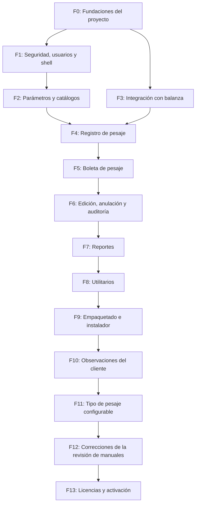

# Guía del Agente y Control de Ejecución (Agents.md)

Este documento registra la arquitectura, convenciones, estado de ejecución fase por fase y bitácora técnica para la reconstrucción del **Sistema de Pesaje para Faeneo**.

---

## 1. Orden y Mapa de Fases

El plan maestro se ejecuta en el siguiente orden estricto de dependencias:

---

## 2. Estado de Ejecución por Fase

| Fase | Título | Estado | HUs Completadas | Total HUs | Fecha de Finalización |
| :--- | :--- | :---: | :---: | :---: | :---: |
| **F0** | **Fundaciones del proyecto** | ✅ Completado | 7 | 7 | 2026-09-24 |
| **F1** | **Seguridad, usuarios y shell principal** | ✅ Completado | 6 | 6 | 2026-09-24 |
| **F2** | **Parámetros y catálogos** | ✅ Completado | 6 | 6 | 2026-09-24 |
| **F3** | **Integración con balanza** | ✅ Completado | 7 | 7 | 2026-09-25 |
| **F4** | **Registro de pesaje** | ✅ Completado | 7 | 7 | 2026-09-27 |
| **F5** | **Boleta de pesaje** | ✅ Completado | 6 | 6 | 2026-09-28 |
| **F6** | **Edición, anulación y auditoría** | ✅ Completado | 5 | 5 | 2026-09-30 |
| **F7** | **Reportes** | ✅ Completado | 6 | 6 | 2026-10-01 |
| **F8** | **Utilitarios** | ✅ Completado | 6 | 6 | 2026-10-01 |
| **F9** | **Empaquetado, instalador y puesta en marcha** | ✅ Completado | 6 | 6 | 2026-10-03 |
| **F10** | **Observaciones del cliente (post-F9)** | ✅ Completado | 9 observaciones (O1–O9) | 9 | 2026-10-04 |
| **F11** | **Tipo de pesaje configurable (res completa / media res)** | ✅ Completado | 10 tareas (T1–T10) | 10 | 2026-10-08 |
| **F12** | **Correcciones de la revisión de manuales (1.2.1)** | ✅ Completado | 6 defectos (E1–E6) | 6 | 2026-10-13 |
| **F13** | **Licencias: clave de activación y prueba de 15 días (1.3.0)** | ✅ Completado | 6 tareas (T1–T6) | 6 | 2026-10-13 |

---

## 3. Registro Detallado de HUs por Fase

### [x] Fase F0 — Fundaciones del proyecto (COMPLETADA)
- [x] **HU-F0-01:** Estructura de solución y proyectos (`src/PesajeFaeneo.sln`, props, capas limpias, arquitectura tests).
- [x] **HU-F0-02:** Entidades de dominio y enumeraciones (`Usuario`, `ParametrosSistema`, `ConfiguracionBalanza`, `Ganadero`, `Cliente`, `Fletero`, `Pesaje`, `Auditoria`, Enums y Excepciones).
- [x] **HU-F0-03:** Host genérico, DI, configuración y logging (Serilog con retención de 30 días, Host, Mutex `Global\PesajeFaeneo`, `AppPaths`).
- [x] **HU-F0-04:** DbContext, mapeo EF Core y migración inicial (`PesajeDbContext`, SQLite, pesos REAL, índices únicos y compuestos, migración `Inicial`, pragmas WAL).
- [x] **HU-F0-05:** Datos iniciales y hasher de contraseñas (`Pbkdf2PasswordHasher` con SHA256/100k, `DataSeeder` idempotente con admin/admin).
- [x] **HU-F0-06:** Manejo global de excepciones (`ClasificadorErrores`, `ManejadorErrores`, `FormBase` con `EjecutarAsync`).
- [x] **HU-F0-07:** Infraestructura de pruebas (`SqliteDbFixture` en memoria, `SqliteArchivoFixture`, Builders de prueba, `build.ps1` con cobertura).

### [x] Fase F1 — Seguridad, usuarios y shell principal (COMPLETADA)
- [x] **HU-F1-01:** Servicio de autenticación y auditoría base
- [x] **HU-F1-02:** Sesión, permisos y autorización por rol
- [x] **HU-F1-03:** Pantalla de inicio de sesión
- [x] **HU-F1-04:** Shell y menú principal con autorización
- [x] **HU-F1-05:** Gestión de usuarios (CRUD)
- [x] **HU-F1-06:** Cambio de contraseña

### [x] Fase F2 — Parámetros y catálogos (COMPLETADA)
- [x] **HU-F2-01:** Parámetros del Sistema (datos de la empresa)
- [x] **HU-F2-02:** Reglas de validación y normalización de catálogos
- [x] **HU-F2-03:** Gestión de Ganaderos
- [x] **HU-F2-04:** Gestión de Clientes
- [x] **HU-F2-05:** Gestión de Fleteros (F1..F4)
- [x] **HU-F2-06:** Control reutilizable de búsqueda y autocompletado

### [x] Fase F3 — Integración con balanza (COMPLETADA)
- [x] **HU-F3-01:** Abstracción IScaleReader y ciclo de conexión
- [x] **HU-F3-02:** Parser de tramas configurable por regex
- [x] **HU-F3-03:** Detector de estabilidad
- [x] **HU-F3-04:** Lectores Serial (RS-232/USB) y TCP
- [x] **HU-F3-05:** Simulador de balanza
- [x] **HU-F3-06:** Servicio de balanza compartido y entrega segura a la UI
- [x] **HU-F3-07:** Configuración y diagnóstico de balanza

### [x] Fase F4 — Registro de pesaje (COMPLETADA)
- [x] **HU-F4-01:** Reglas de dominio del pesaje
- [x] **HU-F4-02:** Grabar pesaje con numeración atómica y auditoría
- [x] **HU-F4-03:** Sugerencia de secuencia por ganadero del día
- [x] **HU-F4-04:** Pantalla de pesaje y display en vivo
- [x] **HU-F4-05:** Captura de pesos desde la balanza
- [x] **HU-F4-06:** Flujo por teclado, estados de botones y mensajes guía
- [x] **HU-F4-07:** Alta rápida de ganadero y cliente desde el pesaje

### [x] Fase F5 — Boleta de pesaje (COMPLETADA)
- [x] **HU-F5-01:** Datos de boleta y configuración de impresión por equipo
- [x] **HU-F5-02:** Renderizador del layout de boleta
- [x] **HU-F5-03:** Impresión y vista previa con PrintDocument
- [x] **HU-F5-04:** Imprimir desde el pesaje e impresión automática al grabar
- [x] **HU-F5-05:** Reimpresión por número y acceso rápido
- [x] **HU-F5-06:** Selección de impresora, papel y calibración

### [x] Fase F6 — Edición, anulación y auditoría (COMPLETADA)
- [x] **HU-F6-01:** Buscador de boletas
- [x] **HU-F6-02:** Editar boleta sin modificar pesos
- [x] **HU-F6-03:** Anular boleta con motivo obligatorio
- [x] **HU-F6-04:** Auditoría con diff antes/después en JSON
- [x] **HU-F6-05:** Visor de auditoría

### [x] Fase F7 — Reportes (COMPLETADA)
- [x] **HU-F7-01:** Servicio común de reportes y regla de totales (Media res = 0.5)
- [x] **HU-F7-02:** Índices y rendimiento de consultas
- [x] **HU-F7-03:** Pantalla de filtros común y vista previa
- [x] **HU-F7-04:** Exportación a PDF con formato original (QuestPDF)
- [x] **HU-F7-05:** Exportación a Excel e impresión
- [x] **HU-F7-06:** Reporte de boletas anuladas

### [x] Fase F8 — Utilitarios (COMPLETADA)
- [x] **HU-F8-01:** Backup manual consistente (SqliteBackupService)
- [x] **HU-F8-02:** Backup automático diario con retención
- [x] **HU-F8-03:** Restauración con validación y reinicio
- [x] **HU-F8-04:** Importador de datos legado desde CSV (con simulacro)
- [x] **HU-F8-05:** Lectores opcionales DBF y MDB
- [x] **HU-F8-06:** Visor de logs

### [x] Fase F9 — Empaquetado, instalador y puesta en marcha (COMPLETADA)
- [x] **HU-F9-01:** Publicación self-contained y versionado
- [x] **HU-F9-02:** Migraciones automáticas al iniciar con backup previo
- [x] **HU-F9-03:** Instalador Inno Setup
- [x] **HU-F9-04:** Asistente de primer arranque
- [x] **HU-F9-05:** Checklist de aceptación en sitio (UAT)
- [x] **HU-F9-06:** Manual de usuario y guía de balanza

### [x] Fase F10 — Observaciones del cliente post-F9 (COMPLETADA; plan: `docs/plans/F10-observaciones-cliente.md`)
- [x] **O1:** Número de boleta automático (solo editable mientras no exista ningún pesaje)
- [x] **O2:** "Borrar pesos" → "Borrar pesaje"
- [x] **O3:** Historial de pesajes en su propio apartado
- [x] **O4:** Ganadero: "Marca" → "Código"
- [x] **O5:** N fleteros, elegido al pesar
- [x] **O6:** Códigos automáticos y no digitables
- [x] **O7:** Logo y nombre de la empresa en el login
- [x] **O8:** Reporte por raza
- [x] **O9:** Ubicación del fletero en la boleta

### [x] Fase F11 — Tipo de pesaje configurable (COMPLETADA; plan: `docs/plans/F11-tipo-de-pesaje.md`)
- [x] **T1:** `ModoDesposte`, `ReglasDesposte` y migración `F11_ModoDesposte`
- [x] **T2:** lectura y cambio del tipo de pesaje en `ServicioParametros` (auditado)
- [x] **T3:** `FrmTipoPesaje` y menú **Administración › Tipo de pesaje**
- [x] **T4:** paso obligatorio "3. Tipo de pesaje" en el asistente de puesta en marcha
- [x] **T5:** pantalla de pesaje sin combo de desposte con un solo tipo y rechazo en el servicio
- [x] **T6:** boleta sin desposte (media carta y ticket)
- [x] **T7:** reportes sin "Tipo Corte" ni desglose (grilla, PDF y Excel; Excel por lista de columnas)
- [x] **T8:** buscador, historial, edición, anulación, reimpresión e importador
- [x] **T9:** herramienta de capturas, manuales (fuentes) y checklist UAT
- [x] **T10:** versión 1.2.0, CHANGELOG, README y bitácora

### [x] Fase F12 — Correcciones de la revisión de manuales (COMPLETADA; plan: `docs/plans/F12-correcciones-revision-manuales.md`)
- [x] **E1:** fletero escrito sin elegir bloquea el grabado (pesaje) y el guardado (edición)
- [x] **E2:** Grabar (F12) gris cuando está deshabilitado
- [x] **E3:** línea de atajos del inicio según permisos
- [x] **E4:** guía del pesaje en reposo y aviso de F8 visible
- [x] **E5:** anulación valida el motivo antes de confirmar
- [x] **E6:** prueba de balanza con 0 tramas avisa y orienta

### [x] Fase F13 — Licencias y activación (COMPLETADA; plan: `docs/plans/F13-licencias-activacion.md`)
- [x] **T1:** migración del servidor `supabase/migrations/20261013000000_licencias_por_producto.sql` (columna `product`, funciones por producto, compatibilidad con ScaleLogger 0.1.0)
- [x] **T2:** `Application/Licencias` (reglas, firma, servicio) y `ExigirOperacion` en pesaje e importación
- [x] **T3:** `Infrastructure/Licencias` (cliente Supabase, almacén en el registro, identificador de equipo, demo de capturas)
- [x] **T4:** `FrmActivacion`, control previo al login, sincronización en segundo plano, barra de estado, menú Ayuda y Acerca de
- [x] **T5:** pruebas (1768 → 1952)
- [x] **T6:** versión 1.3.0, CHANGELOG, README, guías, manuales, checklist UAT y bitácora
---

## 4. Convenciones Arquitectónicas y de Ingeniería
- **Arquitectura en Capas:**
  - `PesajeFaeneo.Domain`: Sin dependencias externas ni NuGet. Entidades, Enums, Excepciones, Reglas puras.
  - `PesajeFaeneo.Application`: Servicios, Interfaces, DTOs, Seguridad, Validadores. Depende solo de Domain (+ `Microsoft.Extensions.DependencyInjection.Abstractions` para exponer extensiones `IServiceCollection`; **no** referencia `Microsoft.Extensions.Hosting`, EF Core, WinForms ni Serilog).
  - `PesajeFaeneo.Infrastructure`: EF Core, Balanza, Exportación, Archivos, Log. Depende de Application y Domain. No referencia WinForms.
  - `PesajeFaeneo.WinForms`: Formularios, Controles, Presentación, Impresión GDI+ (`WinForms/Impresion`; vive aquí y no en Infrastructure porque esta es `net8.0` sin `System.Drawing.Common` y agregarlo exigiría un paquete nuevo y rompería la compilación con CA1416, D2 de F5). Depende de las capas anteriores vía DI. `IFormFactory` vive aquí (no en Application): es un concepto de UI, restringido a `where T : Form`.
  - `PesajeFaeneo.Tests`: Tests unitarios y de integración con xUnit (solo `Assert`). `ArquitecturaTests` hace cumplir las reglas de capas anteriores por reflexión.
- **Persistencia:** SQLite vía EF Core 8. `journal_mode=WAL` se aplica una vez tras migrar (persiste en el archivo); `busy_timeout`, `synchronous=NORMAL` y `foreign_keys=ON` son pragmas **por conexión** y se aplican con `SqlitePragmasInterceptor` (registrado a través de `SqliteOpcionesExtensiones.ConfigurarSqlite`, usado en DI, `DesignTimeDbContextFactory` y los fixtures de prueba) para cubrir a todas las conexiones del pool, no solo a la primera.
- **Fechas y horas:** se persiste todo en **UTC**. `PesajeDbContext.ConfigureConventions` aplica `DateTimeUtcConverter`/`DateTimeUtcNulableConverter` a toda propiedad `DateTime`/`DateTime?` del modelo: al guardar convierte a UTC, al leer marca `DateTimeKind.Utc` explícitamente (SQLite no conserva `DateTimeKind`). Los filtros "del día" (secuencia por ganadero en F4-03, reportes en F7) deben convertir los límites del día local a UTC con `TimeProvider.LocalTimeZone` antes de comparar contra estas columnas.
- **Pesos decimales:** convertidos a `REAL` (double) vía `DecimalARealConverter` (redondeo a 1 decimal, `AwayFromZero`), centralizado y reutilizado en `Pesaje` y `ConfiguracionBalanza`. Resolución de peso: 0,1 kg. Totales calculados en memoria.
- **Búsquedas/unicidad insensibles a mayúsculas:** `Usuario.NombreUsuario`, `Ganadero.Codigo` (antes `Marca`), `Ganadero.Nombre`, `Cliente.Nombre` y `Fletero.Nombre` usan `UseCollation("NOCASE")`.
- **Unidad de trabajo y persistencia F1:** `IUnidadDeTrabajoFactory` singleton + `IUnidadDeTrabajo` transaccional con repositorios `IUsuarioRepositorio` e `IAuditoriaRepositorio`. Las operaciones de negocio y su registro de auditoría se guardan siempre en la misma llamada a `GuardarCambiosAsync` para garantizar atomicidad. Traducción centralizada de excepciones de persistencia: `DbUpdateConcurrencyException` → `ConcurrenciaException`, `SqliteException` 19 UNIQUE → `ConflictoException`, `SqliteException` 19 CHECK → `ReglaNegocioException("BD_CHECK")`.
- **Sesión y autorización:** `ISesionActual` registrado como Singleton en memoria. `ExigirPermiso` se ejecuta como primera línea de defensa en cada método de servicio (defensa en profundidad), mientras que la UI oculta (`Available = false`) las opciones sin permiso mediante `AutorizadorMenu`.
- **Contexto de aplicación y bucle de UI:** `ContextoAplicacion : ApplicationContext` gestiona el ciclo de vida sin asignar `MainForm`, permitiendo transiciones fluidas entre login, cambio obligatorio de contraseña y shell sin terminar el proceso. Nunca se bloquea el hilo de UI (`.Result`, `.Wait()`, etc.) dentro de eventos asíncronos; se usa `FormBase.EjecutarAsync`.
- **Auditoría segura:** los snapshots de usuario en auditoría (`UsuarioAuditoria`) serializan únicamente metadatos (`Id`, `NombreUsuario`, `NombreCompleto`, `Rol`, `Activo`, `DebeCambiarPassword`); jamás se registran contraseñas en texto claro, hashes ni salts en logs, auditorías ni excepciones.
- **Formularios:** `IFormFactory.Crear<T>()` crea un `IServiceScope` propio por formulario (con `ActivatorUtilities.CreateInstance`) y lo libera cuando el formulario se cierra (`form.Disposed`). Los formularios **no** se registran en el contenedor raíz de DI (para no poder resolverlos ni fugarlos desde ahí).
- **`FormBase`:** `EjecutarAsync`/`Ejecutar` usan `UseWaitCursor` (no `Cursor.Current`, que se pierde en el primer `await`) y un campo `_ocupado` que descarta invocaciones reentrantes (protección contra doble clic/doble Enter, crítico para F4 "Grabar pesaje").
- **Escalado por DPI y layout de formularios:** `FormBase.OnLoad` activa `AutoScaleDimensions = 96×96` + `AutoScaleMode.Dpi` (en `OnLoad` y no en el constructor: WinForms escala en el siguiente layout y en el constructor el formulario todavía está vacío). Todos los tamaños del código se escriben a 96 DPI. Etiquetas y botones con `AutoSize` en lugar de anchos fijos; toda columna de `TableLayoutPanel` que contenga controles `Dock = Fill` lleva `ColumnStyle` (sin estilo se dimensiona por el contenido y, al escalar, queda más ancha que el panel); nada de `Anchor = Right` con `Location` fija (el anclaje se calcula contra el ancho inicial). Los filtros usan `DisenoFiltros` (fechas `dd/MM/yyyy` fijas, independientes de la región). `VerificadorLayout` (tests) detecta controles que se salen de su contenedor y textos cortados, a 96 DPI y con `Scale(1,25)`.
- **Seguridad:** Autorización basada en `Permiso` verificado en UI y servicios. Auditoría atómica de cambios. El usuario `admin/admin` se siembra con `DebeCambiarPassword = true`.
- **Tiempo:** Siempre `TimeProvider` inyectado (obligatorio, no opcional; `FakeTimeProvider` en tests).
- **Errores:** `ClasificadorErrores` distingue `Validacion`, `Negocio` (incluye `ConcurrenciaException`, `ConflictoException`, `EntidadNoEncontradaException`, `ReglaNegocioException` y cualquier otra `DomainException`), `NoAutorizado`, `Cancelado` (`OperationCanceledException`: sin log ni MessageBox) e `Inesperado`. Un `AggregateException` solo se desenvuelve si tiene una única excepción interna.
- **Catálogos y normalización en mayúsculas:** persistencia forzada en mayúsculas (`ToUpperInvariant`) y colapso de espacios intermedios (`Regex.Replace(s, @"\s+", " ")`). La collation `NOCASE` de SQLite sólo pliega caracteres ASCII A–Z y no cubre caracteres acentuados ni la letra eñe (p. ej. "PEÑA" y "peña" serían tratados como distintos sin esta normalización).
- **Unidad de trabajo y transacciones explícitas (`ITransaccion`):** extensión de `IUnidadDeTrabajo` con `IniciarTransaccionAsync` y `ITransaccion` para inserciones donde el registro de auditoría requiere el `Id` autogenerado de la entidad (catálogos), garantizando atomicidad completa y soporte de reversión en caso de error.
- **Búsqueda tolerante a acentos y autocompletado en memoria:** plegado de texto a ASCII en mayúsculas vía `NormalizationForm.FormD` despojando marcas no espaciadoras (`UnicodeCategory.NonSpacingMark`) en `TextoBusqueda`. Motor `MotorBusqueda` con ranking en 5 niveles de relevancia (código exacto, prefijo de código, prefijo de descripción, prefijo de palabras, contiene descripción).
- **Control reutilizable de autocompletado (`ControlBusquedaCatalogo`):** `UserControl` con lista desplegable flotante agregada dinámicamente al formulario contenedor (`FindForm().Controls`) y `BringToFront()`, evitando recortes por contenedores padre. Enrutamiento de teclado mediante `PreviewKeyDown` marcando `IsInputKey = true` condicionalmente para Enter y Escape cuando la lista está activa, evitando consumo prematuro por `AcceptButton`/`CancelButton` del formulario.
- **Almacenamiento seguro de logo:** implementado en `AlmacenLogoArchivos` con validación estricta de encabezados binarios (firmas mágicas para PNG, JPEG y BMP) y tamaño máximo de 1 MB. El logo se referencia en base de datos mediante su nombre de archivo relativo y se almacena en `AppPaths.LogoDir`. Las cargas en UI (`FrmParametros`) emplean lectura en flujo y copia a `Bitmap` para evitar el bloqueo del archivo en disco que ocasiona `Image.FromFile`. Limpieza segura de archivos en rollback.
- **Regla de reentrada en UI (`FormBase`, regla 0.10):** jamás invocar un método con `EjecutarAsync` interno dentro del delegado de otro `EjecutarAsync` o `Ejecutar`; los formularios modales y operaciones compuestas deben obtener el resultado y ejecutar las recargas posteriormente para evitar que la bandera `_ocupado` descarte silenciosamente la operación.
- **Balanza e integración de pesaje:** servicio singleton (`IServicioBalanza`) con un único lector activo creado por fábrica (`IFabricaLectorBalanza`). Ciclo de vida explícito en `Program.Main` tras migrar la base de datos (sin `IHostedService`, porque el Host arrancaría antes de migrar y sembrar). El servicio implementa tanto `IAsyncDisposable` como `IDisposable` síncrono para evitar excepciones de MS.DI al cerrar el host. `ConfigureAwait(false)` estricto en todas las operaciones asíncronas de balanza para prevenir interbloqueos con el contexto de sincronización de WinForms al salir. Puerto serie sobre kernel32 directo (`PuertoSerieWin32`, **no** `System.IO.Ports.SerialPort`): se lee el DCB actual del driver y solo se modifican baudios/bits/paridad/parada si difieren; si el driver rechaza `SetCommState`, se relee y se acepta cuando el formato ya coincide. DTR/RTS y control de flujo quedan como los deja el driver. Motivo: `SerialPort.Open()` siempre reescribe el DCB completo y el driver CH340 rechaza cualquier `SetCommState` con error 31 ("el dispositivo no funciona"), incluso sin cambios (verificado en sitio con el indicador RX8 Accurex). Lectura en hilo dedicado (`Thread` con `IsBackground = true`, `AboveNormal`) con `ReadFile` no bloqueante sondeado hasta 250 ms; el cierre usa `SafeFileHandle` (seguro ante un `ReadFile` concurrente). Tramas separadas por fin de línea (CR/LF/ETX) o, si se configura, también por espacio; el peso de la trama puede venir en kilogramos o en gramos (se convierte antes de redondear a 0,1 kg). Entrega segura a la UI por sondeo desacoplado (`MonitorBalanzaUi` con `System.Windows.Forms.Timer` cada 100 ms) sobre una instantánea inmutable (`InstantaneaBalanza`) sin cruzar eventos entre hilos ni fugar referencias a formularios cerrados. Parser de tramas basado en regex con grupos obligatorios `(?<peso>...)` y opcionales `(?<estable>...)`, reemplazo de coma por punto decimal y límite de ejecución de 100 ms contra expresiones catastróficas. Detector de estabilidad con ventana deslizante de lecturas y dispersión menor o igual a la tolerancia configurable. Vigilancia continua para estados `SinDatos` (tras 3 timeouts) y `TramasNoReconocidas` (tras 3 tramas consecutivas sin parsear). Pausa obligatoria de 500 ms tras cerrar un puerto COM para permitir su liberación por el sistema operativo antes de reabrir. Método `EsCapturable` para consumo de F4 (conectada, estable, peso no nulo y lectura reciente dentro del timeout). Diagnóstico interactivo (`ProbarAsync`) que suspende temporalmente el bucle de producción (estado `EnDiagnostico`) y lo reanuda de forma garantizada en `finally`.
- **Registro de pesaje y captura (F4):** reglas puras en `Domain/Reglas/ReglasPesaje` con redondeo decimal AwayFromZero a 1 decimal (0,1 kg), tolerancia total de +/- 0,1 kg, límites estrictos por lado (10,0 a 600,0 kg) y totales según tipo de desposte (`ResCompleta` 10,0 a 1200,0 kg; `MediaRes` 10,0 a 600,0 kg). Numeración atómica garantizada con `UPDATE ParametrosSistema SET SiguienteNumeroBoleta = SiguienteNumeroBoleta + 1 WHERE Id = 1 RETURNING SiguienteNumeroBoleta - 1` mediante `SqlQuery<long>(...).ToListAsync()` como primera sentencia dentro de una transacción explícita (`ITransaccion`), precedida por validación de ganadero y cliente en BD. Grabado atómico de `Pesaje` y `Auditoria` en la misma transacción (`PesajeAuditoria` con snapshot sanitizado). Captura desacoplada en `ControlCapturas`: únicamente cuando la balanza es capturable (`EsCapturable(ahora)` dentro de `TimeoutMs`), peso dentro de rango y exigencia obligatoria de retorno a cero (peso <= 2 kg) entre el primer y segundo lado en res completa para evitar pesajes accidentales del mismo lado. Política de simulador estricta: solo usuarios con permiso `ConfigurarBalanza` (Administrador) pueden capturar o grabar pesos simulados; para Operadores se deshabilitan las capturas y se oculta el panel de control del simulador. `RangoDiaLocal` calcula los límites del día local y los proyecta a UTC para la sugerencia de secuencias y consultas del día. Sugerencia de secuencia asíncrona fuera de `EjecutarAsync` con token de versión (`_versionSugerencia`) para descartar respuestas tardías. Teclado y navegación en `FrmPesaje` gobernados por `ProcessCmdKey` estricto (F5, F6, F8, F12, Escape, Enter con descenso en `ContainerControl` mediante `ControlEnfocado()`) y botones con `TabStop = false`. Hook `OnPesajeGrabado(PesajeRegistrado r)` preparado como punto de extensión para la impresión automática de boletas en F5-04.
- **Boleta e impresión (F5):** modelo y diseño puros en `Application/Boletas` (coordenadas en mm, cultura fija `es-BO`, sin dependencia de `System.Drawing`); pintor GDI+ con `Graphics.DrawString` sobre `DocumentoBoleta` (`StandardPrintController`, `OriginAtMargins = false`, compensación de `HardMargin` solo al imprimir, copias como páginas físicas independientes para soporte de térmicas/matriciales y leyenda ORIGINAL/COPIA, contador de copias reiniciado en `OnBeginPrint`); configuración por equipo en `config\impresion.json` (atómica, validada, atada a `MachineName`); auditoría `Imprimir`/`Reimprimir` tras `Print()`; detección de reimpresión por conteo en auditoría con leyenda obligatoria "REIMPRESIÓN n — {fecha}"; impresión automática en bloque secuencial tras el grabado; acceso F9 en `FrmPesaje` y F3 en shell principal.
- **Gestión de boletas y auditoría (F6):** token de concurrencia `Pesaje.Version` (entero mapeado con `IsConcurrencyToken`) gestionado automáticamente en `PesajeDbContext.SaveChangesAsync` (incremento `OriginalValue + 1` en cada modificación); migración `F6_VersionPesaje` vía `AddColumn` simple con valor por defecto 1 sin reconstrucción de tabla; servicios desacoplados `IServicioGestionPesajes` e `IServicioAuditoria` bajo permisos de autorización por rol (`EditarBoleta`, `AnularBoleta`, `VerAuditoria`); edición de boletas limitada estrictamente a atributos descriptivos (ganadero, secuencia, cliente, dirección, color/raza, sexo, observación) manteniendo inalterables los pesos y el tipo de desposte por integridad física; anulación irreversible con motivo obligatorio de 5 a 100 caracteres; persistencia atómica en una única llamada a `GuardarCambiosAsync` por operación incluyendo entidad y auditoría; edición sin modificaciones descartada sin auditar; snapshot de `Pesaje` enriquecido con datos desnormalizados (`PesajeAuditoria`) para trazabilidad histórica íntegra; motor de diferencias en memoria `DiferenciasAuditoria.Calcular` que proyecta marcas de tiempo a hora local y resalta modificaciones; enmascaramiento de `LoginFallido` sin usuario registrado (`EntidadId = "***"`); leyenda de anulación recortada a 30 caracteres con tamaño de fuente adaptativo en media carta; buscador de boletas `FrmBuscarBoletas` con combinación AND de filtros, tope de 200 filas, selección persistente, atajos F4/F8 y Enter contextual en grilla; visor de auditoría `FrmVisorAuditoria` de solo lectura con tope de 500 registros y tabs de cambios visuales y JSON.
- **Reportes (F7):** servicio desacoplado `IServicioReportes` bajo permiso `VerReportes` (autorizado para Supervisor y Administrador, solo lectura); 5 tipos de reporte (pesajes del día, entre fechas, por ganadero, por cliente, boletas anuladas; D1); separación estricta entre boletas vigentes y anuladas (D2); regla pura de cómputo de reses en `ReglasReportes.Reses` (res completa = 1, media res = 0,5) con cálculo de totales en memoria sobre variables `decimal` exactas a 0,1 kg sin funciones de agregación SQL (D3); inclusión de boletas con peso simulado marcadas con asterisco y nota de advertencia al pie (D4); límites de procesamiento y presentación: máximo de 20 000 boletas consultables (con mensaje de reducción de rango si se supera), 1 000 filas visibles en grilla UI y 2 000 boletas máximas para renderizado e impresión directa en memoria (D7); definición declarativa de columnas en `ColumnasReporte` (D6); exportación a PDF fiel al legado mediante QuestPDF con licencia comunitaria en constructores estáticos de `DisenoPdfReporte` y `CargadorLogoReporte`, y logo del sistema precargado y validado una sola vez (tolerancia a ausencia o archivo dañado con aviso en log/pantalla sin interrumpir el reporte; D10); formato de pesos decimales con coma (`#,##0.0`, D11); exportación a Excel mediante ClosedXML con valores numéricos y fechas reales sin fórmulas (D13); impresión física y vista previa basadas en rasterizado de páginas PDF a PNG en memoria proyectadas sobre `DocumentoPaginasReporte` con `FrmVistaPrevia` y escalado proporcional centrado (D14); instantánea inmutable desacoplada e invalidación inmediata de vista y acciones al cambiar filtros en UI (D15); optimización del planificador SQLite con `ANALYZE` en `DatabaseInitializer` sin migraciones de esquema ni índices nuevos (D16); aislamiento de dependencias de QuestPDF y ClosedXML exclusivamente en `PesajeFaeneo.Infrastructure.Reportes` verificado por `ArquitecturaTests` (regla 0.5).
- **Utilitarios (F8):** backup `.zip` (manifiesto `manifest.json` + `pesaje.db` en modo journal DELETE + carpeta de logos `logo/`; sin `config` ni `logs`), copia binaria consistente con `BackupDatabase` desde conexión en solo lectura y validación con `PRAGMA quick_check` previa al empaquetado (D1–D2); nomenclatura estandarizada `PesajeFaeneo_{tipo}_{yyyy-MM-dd[_HHmmss]}.zip` (el automático lleva solo la fecha: uno por día) en subcarpetas `manuales`, `automaticos` y `seguridad` (D3); programador automático diario en segundo plano (`ProgramadorBackupAutomatico`) con `PeriodicTimer` y revisión al arranque (después de 2 minutos de espera) y al cerrar el sistema (`chkAlCerrar`) sin bloquear la UI (D4); el cierre espera hasta 10 s al programador y hasta 60 s al backup de cierre, en `Program.Main` y sin UI; configuración persistida en `config/backup.json` con guardado atómico (D5); retención configurable de backups automáticos (7 a 365 días, por defecto 30) conservando siempre un mínimo de 3 copias más recientes para evitar borrado accidental (D6); soporte de copia secundaria a pendrive o ruta de red con tolerancia a desconexión y advertencia informativa (D7); validación integral de restauración con extracción temporal, comprobación de integridad SHA-256, verificación de esquema, versión y existencia de administrador activo, y simulación de migraciones EF Core en base de datos de prueba antes de programar (D8); resguardos previos automáticos obligatorios ante restauraciones e importaciones (D9); aplicación de restauraciones exclusivamente durante el arranque del sistema (`Program.Main` vía `IAplicadorRestauracion.AplicarPendiente()`) antes de cualquier conexión activa a la BD, con movimiento atómico del trío de archivos (`pesaje.db`, `-wal`, `-shm`) y capacidad de reversión garantizada en caso de error (D10–D12); sincronización de reinicio automático mediante `InstanciaUnica` con espera de hasta 30 s ante argumento `--reinicio` (D11); registro de auditoría de restauración aplicada asociado a entidad `Sistema` y `UsuarioId = null` para evitar violaciones de clave foránea con usuarios de la base previa (D13); importador de datos legados en 3 pasos con diseño desacoplado (D14): simulacro idéntico a importación sobre la misma transacción con rollback y cálculo de huella SHA-256 (D14, D51); soporte multiformato con lectores dedicados para CSV/TXT delimitados (D15–D18), DBF de dBase III / Visual FoxPro (D19) y Access MDB/ACCDB mediante OleDb de 64 bits con detección de motor ACE (D20); reglas estrictas de importación: orden sugerido ganaderos → clientes → pesajes (D21), numeración atómica `max(actual, mayor + 1)` (D24), tolerancia a discrepancias históricas con advertencias sin rechazar la boleta (D25), deducción de res completa / media res y cálculo de secuencia del día (D26), informe exportable a CSV estructurado con BOM UTF-8 y protección contra inyección de fórmulas (D27); auditoría consolidada de una fila por importación masiva (D28); persistencia optimizada en lotes de 1 000 registros con `AutoDetectChanges = false` y `ChangeTracker.Clear()` (D29); visor de logs Serilog con lectura no bloqueante `FileShare.ReadWrite | FileShare.Delete` sobre el archivo del día, filtros en memoria por nivel jerárquico y búsqueda por texto, detalle monoespaciado y límites de seguridad de 4 MB y 10 000 entradas (D30–D31); conexiones SQLite manuales obligatoriamente con `Pooling = false` en `SqliteConnectionStringBuilder` para prevenir bloqueo de archivos en disco (regla 0.16).

- **Empaquetado y puesta en marcha (F9):** versión única en `<Version>` de `Directory.Build.props` (D1) leída por `InfoVersion` (`Version` = `1.0.0`, `Informativa` = versión + sha recortado a 7) y mostrada en la barra de estado y en "Ayuda › Acerca de" (`FrmAcercaDe`); publicación self-contained win-x64 **solo** por `scripts/publicar.ps1` (D2–D3: `-r win-x64 --self-contained`, sin `RuntimeIdentifier`/`SelfContained` en ningún `.csproj` porque la suite referencia al ejecutable de WinForms) con verificación de archivos nativos obligatorios (`e_sqlite3.dll`, `QuestPdfSkia.dll`, fuentes Lato); autoprueba `--autoprueba "<carpeta>"` (`AutopruebaInstalacion`, D5) sobre una carpeta temporal vacía —jamás `ProgramData`—, sin diálogos ni mutex, que escribe `autoprueba.json` y sale con 0/1/3; `ActualizadorBaseDatos` (Application/Arranque, D6–D8) evalúa el esquema tras aplicar una restauración pendiente y antes de sembrar: instalación nueva → migra sin copia; al día → solo WAL y `ANALYZE`; actualización → resguardo `TipoBackup.PreMigracion` (`PesajeFaeneo_premigracion_*.zip` en `backups\seguridad`, retención de 10) con `IMotorBackup` y migración; si el resguardo falla no se migra y si la base es de una versión más nueva no se toca (`ArranqueBaseDatosException`, código de salida 2); auditoría `AccionAuditoria.ActualizacionSistema` (entidad `Sistema`, `UsuarioId = null`) tras sembrar; instalador Inno Setup 6.3+ (`instalador/PesajeFaeneo.iss`, D9–D12) por equipo en `{autopf}` con `AppId` fijo `{0157C544-528F-4307-A487-5208BF10696F}`, `AppMutex=Global\PesajeFaeneo`, `CloseApplications=no`, permisos de Modificar a Usuarios por SID (`*S-1-5-32-545`, no por nombre localizado), primera ejecución con `runasoriginaluser`, carpeta de datos nunca borrada al desinstalar; el mutex `Global\PesajeFaeneo` se mantiene (una instancia por equipo) y `InstanciaUnica` atrapa `UnauthorizedAccessException` cuando lo creó otro usuario de Windows (D10); asistente de puesta en marcha (D13–D16): `IServicioPuestaEnMarcha` (permiso `GestionarParametros`, `ReglasPuestaEnMarcha` con "NOMBRE DE EMPRESA" como valor sin configurar) y `FrmAsistentePuestaEnMarcha` como centro de pasos que abre los formularios existentes, mostrado por `ContextoAplicacion` tras el login solo al Administrador con `ConfiguracionInicialCompleta = false` (cualquier error del servicio lo omite: nunca bloquea el inicio de sesión), reabrible desde "Ayuda"; "Finalizar" audita `CambioParametros` en una sola llamada a `GuardarCambiosAsync`; recuperación local del administrador (D17) con `--restablecer-admin` (solo con el proceso elevado como administrador de Windows, `ServicioRecuperacionAdministrador` + `GeneradorPasswordTemporal` con `RandomNumberGenerator`, contraseña mostrada una sola vez, jamás en logs ni auditoría); todos los `.ps1`/`.iss`/`.txt` de `scripts/` e `instalador/` son ASCII puro (Windows PowerShell 5.1 e Inno Setup leen los archivos sin BOM como ANSI).

- **Observaciones del cliente (F10):** **número de boleta automático** (D1): `ServicioParametros.ActualizarAsync` rechaza (`PAR_NUMERACION_AUTOMATICA`) cualquier cambio del "Siguiente número" cuando existe al menos un pesaje (vigente o anulado; `ParametrosDto.NumeracionEditable` = no hay pesajes) y `FrmParametros` lo deshabilita con una nota; solo el grabado (`UPDATE … RETURNING`) y la importación (`max(…)`) lo mueven. **Códigos automáticos de catálogos** (D6, sustituye a las reglas de F2 D2/D5/D6/D7 sobre códigos tecleados y al tope de 4 fleteros): `Ganadero.Codigo` (texto 1–5, `NOCASE`, único; antes `Marca`), `Cliente.Codigo` y `Fletero.Codigo` (entero, antes `Orden`; único entre todos, `CHECK >= 1`) los asigna el servicio al crear, dentro de la transacción del alta y antes de la auditoría (`AsignadorCodigos.GuardarNuevoAsync`: mayor código existente —incluidos inactivos; en ganaderos solo los numéricos, los alfanuméricos heredados se ignoran— + 1, con un reintento ante `ConflictoException` por índice único; tope 99 999 ganaderos y 999 999 clientes: `GAN_CODIGO_AGOTADO`/`CLI_CODIGO_AGOTADO`); los DTO de alta/edición no llevan código (`CrearGanadero(Nombre)`, `EditarGanadero(Id, Nombre)`, etc.), la edición no lo cambia y los formularios lo muestran en solo lectura ("(se asigna al guardar)"). La validación de formato del código solo sobrevive para la importación (`ValidarGanaderoImportado`, `ValidarClienteImportado`); el importador conserva el código del archivo y `SugeridorMapeo` sigue reconociendo columnas `MARCA`. **Fletero por pesaje** (D5): `Pesaje.FleteroId` opcional (FK `Restrict`), validado activo en `ServicioPesajes`/`ServicioGestionPesajes`, snapshot de auditoría con `FleteroId`/`CodigoFletero`/`NombreFletero`, selector `ctlFletero` en `FrmPesaje` (tras la dirección, se limpia al grabar) y en `FrmEditarBoleta`, columna "Fletero" en buscador, historial y reportes (grilla, PDF y Excel; `ColumnasReporte` normal 12 columnas, anuladas sin fletero). **Historial** (D3): `FrmHistorialPesajes` (permiso `Pesar`; consulta `IServicioPesajes.ListarPorDiaAsync`, tope `ReglasPesaje.HistorialMaximo` = 500; recarga encadenada con token de versión; reimprime con `IServicioImpresionBoletas.ImprimirAsync(…, Manual)`); `FrmPesaje` ya no tiene grilla (`F9` imprime `_ultimoPesajeGrabadoId`) y reparte datos | pesos+acciones+simulador en dos columnas. **Boleta** (D9): `DatosBoleta.Fletero` (único, opcional) en la zona de datos (media carta: fila de la dirección; ticket: línea "Fletero:"), recuadro central inferior = firma del fletero (nombre sobre la línea) y, en el ticket, alturas de caja por línea estimadas por caracteres (`CajaTexto`) en vez de fijas; `DisenoBoletaTests` verifica sin solapes y alto de caja ≥ alto de línea de la fuente. **Login con marca** (D7): `IServicioParametros.ObtenerIdentidadEmpresaAsync` (única operación del servicio sin `ExigirSesion`; solo nombre y logo) y `CargadorLogoUi` compartido con el inicio; `FrmLogin` carga el encabezado fuera de `EjecutarAsync` y un error solo se registra. **Reporte por raza** (D8): `TipoReporte.PorRaza`, `FiltroReporte.ColorRaza`, `OpcionesReportes.Razas` (`IPesajeRepositorio.ListarRazasAsync`), comparación `Trim().ToUpper()` en SQL contra la raza normalizada (sin plegado de acentos). Auditoría histórica: las claves antiguas `Marca`/`MarcaGanadero`/`Orden` no se migran; `DiferenciasAuditoria.EtiquetaCampo` las muestra como "Código".

- **Tipo de pesaje (F11):** `ParametrosSistema.ModoDesposte` (`ModoDesposte?`: `SoloMediaRes = 1`, `SoloResCompleta = 2`, `Ambos = 3`, alineados con `TipoDesposte`; `null` = sin definir, se usa `Ambos`; `CHECK` 1..3) en la base y no por equipo (D2). Reglas puras en `Domain/Reglas/ReglasDesposte` (`Efectivo`, `TipoUnico`, `Permite`, `MostrarDesposte(modo, tiposPresentes)`, `Texto`). **"Ocultar, nunca falsear" (D6):** el desposte se muestra con `Ambos` o cuando en los datos mostrados hay un tipo distinto del único del modo (boletas anteriores al cambio o importadas); lo calculan los servicios (`DatosBoleta.MostrarDesposte`, `BoletaParaEdicion.MostrarDesposte`, `ReportePesajes.MostrarDesposte`, `ResultadoBusquedaBoletas.ModoDesposte`, `ClavesExistentes.ModoDesposte`) y `FrmHistorialPesajes` (que ahora recibe `IServicioParametros`). `IServicioParametros.ObtenerModoDesposteAsync` solo exige sesión (D11); `ObtenerConfiguracionDesposteAsync`/`CambiarModoDesposteAsync` exigen `GestionarParametros` y el cambio se audita como `CambioParametros` con `antes/despues = { ModoDesposte }` (no entra en `ParametrosAuditoria`; `DiferenciasAuditoria` lo muestra como "Tipo de pesaje" con el texto de la UI); desde `null` también se audita (elección explícita, D3). `FrmTipoPesaje` (Administración y paso `PasoPuestaEnMarcha.TipoPesaje = 8`, tercero en pantalla; `ReglasPuestaEnMarcha.PuedeFinalizar` y `MarcarCompletaAsync` exigen el modo). `FrmPesaje` oculta `lblDesposte`/`cmbDesposte` (fila `AutoSize`) y fija el combo; `ServicioPesajes.RegistrarAsync` rechaza `PES_DESPOSTE_NO_PERMITIDO` validando **antes** de la transacción (la reserva del número sigue siendo su primera sentencia). Las reglas de pesaje (`ReglasPesaje`, `ControlCapturas`) no cambian. Media carta: sin desposte queda el hueco (no se mueven las filas por la calibración). `GeneradorExcelReportes` arma columnas desde una lista (`ColumnaExcel`) y la columna de totales es la de "Total". La importación solo advierte (D10).

- **Licencias (F13):** servidor Supabase compartido con ScaleLogger (`uxzehuncusnaofmfjydk`), producto `pesajefaeneo`, funciones RPC `activate_product_license`/`register_product_trial`/`check_product_license` (rol `anon`; la URL y la clave anon son constantes de código en `Infrastructure/Licencias/ConstantesLicencia.cs`, nunca en `appsettings.json`). Estado local en `HKCU\Software\Classes\CLSID\{D1F44BC1-BA04-4C5E-8B08-3BDA0DE12FBB}\Cfg` (`d`, `l`, `s`, `a`), firmado con SHA-256 + sal (`FirmaLicencia`) y el hwid (`SHA256("hw|MachineGuid|sal")`). Reglas puras en `ReglasLicencia.Calcular` (15 días, tolerancia de reloj de 1 día, refresco de `l` cada hora). `IServicioLicencia` es singleton y no exige sesión; `ExigirOperacion()` (`LIC_MODO_CONSULTA`) se llama antes de la transacción en `ServicioPesajes.RegistrarAsync` y en `ServicioImportacion` (simular e importar). `Program.Main` muestra `FrmActivacion` tras preparar la base y antes del login (no con `--autoprueba`, `--restablecer-admin` ni el build de capturas) y lanza una sincronización en segundo plano por arranque. Vencida = modo consulta.

### Notas hacia fases futuras (registradas en las revisiones post-F0 a post-F9)
- **F4-02 / F6 (R6) — resuelto en F4:** numeración atómica implementada con `UPDATE ParametrosSistema SET SiguienteNumeroBoleta = SiguienteNumeroBoleta + 1 WHERE Id = 1 RETURNING ...` en `SqlQuery<long>`.
- **F4-05 (R13) — resuelto en F4:** captura condicionada a `Instantanea.EsCapturable(ahora)` y retorno a cero estricto entre lados.
- **F4-07 (R9) — resuelto en F4:** altas rápidas desde la pantalla de pesaje implementadas con `CrearRapidoAsync` en catálogos bajo permiso `AltaRapidaCatalogos` (Operador).
- **F4 / F5 (R14) — resuelto en F5:** política de simulador en producción: bloqueada la captura y grabado para operadores/supervisores (permitida solo a administradores), grilla y auditoría marcan origen "SIMULADO". En F5, leyenda "PESO SIMULADO — SIN VALOR COMERCIAL" y marca de agua impresa en la boleta si `Origen == Simulador`.
- **F5-04 (R15) — resuelto en F5:** impresión automática de la boleta de pesaje enganchada en `FrmPesaje` en bloque secuencial propio tras el grabado atómico.
- **F5 / F8 (R10) — resuelto en F8:** los respaldos incluyen la carpeta de logos (`AppPaths.LogoDir`), preservando archivos de imagen en `logo/`.
- **F5 / F8 (R14) — resuelto en F8:** la carpeta `config` **no** se respalda en el zip por ser configuración de hardware local por equipo (`MachineName`), tal como se determinó en D1.
- **F5-Futuro (R29) — parcialmente resuelto en la remediación post-prueba de F6:** la media carta ya replica el bloque inferior de la guía legada (firma Jefe de Despacho | fleteros F1..F4 con casilla y "Otros" | firma Médico Veterinario). Pendiente confirmar con el cliente el título ("BOLETA DE PESAJE" vs. "GUÍA DE REMISIÓN CARNE BOVINA") y si hay formulario preimpreso.
- **F5-Futuro (R29, original):** formato real de la boleta de faeneo (posible formulario preimpreso o papel continuo matricial); requerir boleta escaneada al cliente para ajustar coordenadas si es necesario.
- **F5-Futuro (R30):** reimpresiones usan maestros actuales (empresa, logo, fleteros); evaluar si en F6 se almacena snapshot JSON de la boleta en auditoría `Imprimir`.
- **F5 / F9-06 (R31):** si en sitio las matriciales con drivers GDI genéricos son lentas o dentadas, considerar implementar `IImpresorBoletas` en modo texto crudo (ESC/P); documentar en manual.
- **F5 / F9 (R32) — resuelto en F9 (D11):** el instalador Inno Setup debe dar permisos de escritura a `Users` sobre `%ProgramData%\PesajeFaeneo\config` (igual que para la BD).
- **F6 (R-F6-1) — resuelto en F6:** leyenda de anulación en media carta recortada a 30 caracteres ("ANULADA — {motivo}") con tamaño de letra adaptable según presencia de otras leyendas para no desbordar.
- **F5-Futuro (R40):** `Print()` se ejecuta en el hilo de UI de forma síncrona; si un spooler de red causa bloqueos prolongados, evaluar mover solo `Print()` a hilo STA dedicado con el documento instanciado en él.
- **F6 (R12) — resuelto para Pesaje en F6:** token de concurrencia `Pesaje.Version` agregado con `IsConcurrencyToken` e incrementado en `SaveChanges`. R12 permanece abierta para `ParametrosSistema` (la importación en F8 usa `UPDATE … max(…)` atómico).
- **F6 / F5 (R5):** la reimpresión de una boleta anulada estampa la leyenda indeleble y marca de agua "ANULADA" junto a su motivo, registrándose normalmente la auditoría de Reimprimir.
- **F6 / F4 (R6):** la anulación de boletas se gestiona exclusivamente desde el buscador de boletas (F6) por usuarios autorizados (Supervisor o Administrador); se descartó un botón de anulación en la pantalla de pesaje para evitar errores operativos del operador.
- **F6 / F8 (R10) — resuelto en F8:** el respaldo y restauración en F8 conserva la columna `Version` del pesaje; la base de datos se respalda a nivel binario mediante `BackupDatabase` preservando la integridad de concurrencia optimista.
- **F6 (R13) — verificado en F7:** la anulación de una boleta no libera ni reutiliza su número correlativo; la secuencia permanece monótona y sin reutilizaciones para trazabilidad fiscal. La búsqueda sin filtros utiliza el índice único de número de boleta con LIMIT de forma óptima.
- **F6 / F7 (R16):** las búsquedas multicriterio se benefician de los índices compuestos creados en F4 y optimizados en D23 para SQLite / EF Core.
- **F6 / F8 (R17) — resuelto en F8:** el visor de auditoría es estrictamente de solo lectura sin exportación; la importación de datos genera su propio informe estructurado en archivo CSV.
- **F7 (R3) — resuelto en F7:** los reportes de pesaje excluyen boletas anuladas de los totales de peso y cabezas; el reporte específico de anuladas (`TipoReporte.Anuladas`) consolida `MotivoAnulacion`, `AnuladoPor` y `AnuladoEnLocal`.
- **F7 / QuestPDF (R15) — resuelto en F7:** QuestPDF 2024.x tiene configurada la licencia comunitaria `LicenseType.Community` en los constructores estáticos de `DisenoPdfReporte` y `CargadorLogoReporte`.
- **F7 / F8 (R4, R5) — resuelto en F8:** el respaldo de base de datos incluye la tabla `sqlite_stat1`; tras restaurar, el siguiente arranque recalcula estadísticas al ejecutar `ANALYZE` en `DatabaseInitializer`.
- **F7 / F9 (R40) — resuelto en F9:** la publicación self-contained debe incluir la librería nativa de QuestPDF (`runtimes/win-x64/native`); verificar que el instalador Inno Setup la copie en el directorio de salida.
- **F8 / F9 (R76) — resuelto en F9 (D11):** el instalador Inno Setup debe dar permisos de Modificar a `Users` también sobre las carpetas `backups` y `restore` en `%ProgramData%\PesajeFaeneo`.
- **F8 / F9 (R35) — corregido en F9:** solo se publica x64 y `System.Data.OleDb` no trae nativos (el SDK copia su implementación administrada a la raíz); se descarta `win-x86`. Texto original: la publicación self-contained debe incluir `System.Data.OleDb` (runtimes `win-x64` y `win-x86`) para dar soporte a lectura de archivos Access legados.
- **F8 / F9-06 (R34, D20) — resuelto en F9 (guía de instalación y soporte §10):** el manual de usuario debe documentar la instalación del motor ACE de 64 bits para lectura de `.mdb`/`.accdb` (y uso del modificador `/quiet` si coexiste con Office de 32 bits), o la alternativa de exportar a CSV.
- **F8 / F9-02 — resuelto en F9:** se agregó `TipoBackup.PreMigracion` con sus ramas en `ReglasBackup`. Texto original: F9-02 (migraciones automáticas con backup previo) puede reutilizar `IMotorBackup.CrearAsync` con un nuevo `TipoBackup.PreMigracion` (hay que agregarlo también a los `switch` de `ReglasBackup.NombreArchivo` y `Carpeta`, que hoy lanzan `ArgumentOutOfRangeException` para tipos desconocidos).
- **F9-04 (R11) — resuelto en F9 (D13–D16):** el asistente marca `ConfiguracionInicialCompleta` con "Finalizar". Texto original: `ConfiguracionInicialCompleta` permanece en `false` tras guardar parámetros en F2. El asistente de primer arranque en F9-04 debe decidir si marcarla o si detecta el nombre de empresa distinto del valor por defecto.
- **F9-04 / F1 — resuelto en F9 (D17):** `--restablecer-admin`. Texto original: recuperación de contraseña de administrador en caso de pérdida total sin otro administrador sigue pendiente.
- **F9-06 (R21) — resuelto en F9 (guía de balanza §2):** la guía de balanza debe documentar cómo fijar el número de puerto COM estático en el Administrador de dispositivos de Windows para adaptadores USB-serie.
- **F9 — resuelto en F9 (D10, D11):** el instalador da permisos de Modificar a Usuarios y el mutex `Global\` se mantiene con aviso claro entre sesiones. Texto original: el instalador debe dar permisos de Modificar a `Users` sobre `%ProgramData%\PesajeFaeneo` (por defecto, archivos creados por un admin son de solo lectura para usuarios estándar → la app no podría escribir la BD). Revisar si el mutex `Global\` (bloquea a un segundo usuario de Windows en otra sesión) es el comportamiento deseado.
- **F3-Futuro (R22):** si el indicador de balanza del cliente no opera en modo continuo sino bajo demanda, incorporar campo `ComandoSolicitud` (p. ej. `P`, `W` o `ENQ`) y sondeo periódico mediante temporizador.
- **F3 (R23) — resuelto:** el indicador RX8 Accurex del sitio transmite `=NNNNNN ` en **gramos**, separado por espacios y sin CR/LF. Configuración de campo: Serie, COM del adaptador CH340, 9600 8N1, separación de tramas "Inicio con '='" (`DelimitadorTrama.SignoIgual`: en ráfagas el RX8 encadena tramas sin espacio, p. ej. `=650000-=381000-`), unidad "Gramos", patrón sembrado. Pendiente: validar la conversión con un peso patrón conocido; si otro indicador usa libras, agregar `UnidadPesoTrama.Libras`.
- **F3-Futuro (R34):** si algún indicador de balanza específico requiere forzar DTR/RTS o control de flujo por hardware (CTS/RTS o XON/XOFF), hacerlo con `EscapeCommFunction` o flags explícitos y configurables, nunca reescribiendo el DCB completo (rompe CH340). Hoy se respetan los valores del driver.
- **F9-06 (R35) — resuelto en F9 (guía de balanza §2):** documentar en la guía de balanza que reconectar el adaptador USB-serie puede cambiar el número de COM (COM3 → COM4 observado en sitio) y dejar entradas fantasma en el Administrador de dispositivos.
- **F8-Abierto (P1–P7):**
  - **(P1)** Access requiere motor ACE 64 bits; si no está disponible, se informa al usuario la opción de instalarlo o exportar a CSV.
  - **(P2)** En importación, filas válidas se importan y con error se omiten con informe estructurado (D23).
  - **(P3)** Boleta legada con número ya existente en el sistema es rechazada para preservar trazabilidad fiscal (D22).
  - **(P4)** La restauración de backup cierra la aplicación y la relanza automáticamente con `--reinicio` para reemplazo seguro de base de datos (D10, D11).
  - **(P5)** Backup automático programado diario + al cerrar (`chkAlCerrar`) con retención configurable de 30 días (D4, D6).
  - **(P6)** Los backups no incluyen la configuración de impresión ni de backup (propias de cada equipo; D1).
  - **(P7)** Formato real exacto de columnas del sistema legado a validar con muestra real durante UAT en sitio (D27).
- **F9-Abierto:**
  - **(R16)** Arranque sin ReadyToRun: medir en la UAT; si supera 5 s en PCs viejas, evaluar `PublishReadyToRun=true` (solo en `scripts/publicar.ps1`).
  - **(R21)** Sin reversión automática si una migración falla a mitad (parte del SQL de las migraciones que reconstruyen tablas corre fuera de transacción): la guía de soporte §6 describe la vuelta atrás manual desde `PesajeFaeneo_premigracion_*.zip`.
  - **(R27)** Cualquier usuario local de Windows puede leer la base y los backups (con hashes de contraseña); aceptado, documentado.
  - **(R28)** Instalador sin firma de código: SmartScreen y antivirus pueden advertir.
  - **(R49)** `Microsoft.EntityFrameworkCore.Design` se publica con la aplicación (~20 MB) porque WinForms es el proyecto de inicio de `dotnet ef`; sin efecto funcional.
  - **(R50, R51)** El instalador no se ejecutó en ninguna PC durante F9: debe probarse en otra PC o máquina virtual (Windows 11 Home no tiene Sandbox ni Hyper-V).
  - **(P10)** Condiciones de la licencia Community de QuestPDF: el cliente debe confirmarlas.
  - Sin test automatizado: el flujo completo de `--restablecer-admin` (diálogos de `Program`) y el clic de los pasos del asistente que abren formularios reales (cubiertos por UAT-SEG-03 y UAT-PRI).

---

## 5. Bitácora de Ejecución

### Fase F0 — Fundaciones del proyecto
- **Fecha:** 2026-09-24
- **Estado:** ✅ Completado con éxito (7/7 HUs).
- **Compilación:** `dotnet build` en `Release` con 0 warnings y 0 errores (`TreatWarningsAsErrors=true`).
- **Pruebas:** 17 tests unitarios y de integración ejecutados y en verde (0 fallos, 0 omitidos).
- **Cobertura:** Archivo `coverage.cobertura.xml` generado con éxito vía `build.ps1`.
- **Base de datos:** Migración inicial `Inicial` creada con SQLite, pragmas WAL, índices únicos, checks y conversores REAL para pesos decimales.
- **Siguiente paso:** Fase F1 — Seguridad, usuarios y shell principal.

### Fase F0 — Remediación post-revisión
- **Fecha:** 2026-09-24
- **Origen:** revisión senior de F0 (`docs/plans/F0-remediacion.md`), ejecutada en la rama `fix/f0-remediacion` (sin commit, cambios dejados en el árbol de trabajo para revisión).
- **Defectos P0 corregidos:**
  - T1: `Program.Main` era `async Task` con `[STAThread]` (no se aplica a un `Main` asíncrono; la continuación tras el primer `await` corría en un hilo MTA). Ahora es `static int Main` síncrono, bloqueando con `GetAwaiter().GetResult()` antes de que exista `WindowsFormsSynchronizationContext`.
  - T2: los pragmas `busy_timeout`/`synchronous` son por conexión y solo se aplicaban a la conexión de `DatabaseInitializer`. Nuevo `SqlitePragmasInterceptor` + `SqliteOpcionesExtensiones.ConfigurarSqlite`, compartido por DI, `DesignTimeDbContextFactory` y los fixtures de prueba.
  - T3: `FormFactory` resolvía formularios `Transient` desde el contenedor raíz (MS.DI los retiene para siempre). Ahora crea un `IServiceScope` por formulario y lo libera en `form.Disposed`. `IFormFactory` se movió de Application a WinForms.
- **Defectos P1 corregidos:**
  - T4: Serilog no estaba conectado a `Microsoft.Extensions.Logging` (cualquier `ILogger<T>` inyectado iba a los proveedores por defecto del Host, incluido EventLog). Nuevo `ConfiguracionLogging.ConfigurarSerilog` con `ReadFrom.Configuration` + `ClearProviders()`.
  - T5: `ContentRootPath` dependía de `Directory.GetCurrentDirectory()`; ahora se fija a `AppContext.BaseDirectory`. Se quitó el `AddJsonFile("appsettings.json")` duplicado (el Host ya lo agrega).
  - T6: `AddInfrastructure` creaba su propio `AppPaths` y hacía I/O al registrar servicios (los tests de DI llegaban a crear carpetas reales en `%ProgramData%`). Ahora recibe `AppPaths` ya construido; `ContenedorDITests` usa un directorio temporal y valida con `ValidateOnBuild`/`ValidateScopes`.
  - T7: `ClasificadorErrores` no distinguía `ConcurrenciaException`/`DomainException` genérica (caían en "Error inesperado") ni `OperationCanceledException`; un `AggregateException` con varias internas se desenvolvía sin criterio. Corregido con el nuevo tipo `TipoErrorClasificado.Cancelado`.
  - T8: el manejador de `AppDomain.UnhandledException` no registraba `Log.Fatal` ni cerraba el logger antes de que el proceso terminara.
  - T9: `FormBase.EjecutarAsync`/`Ejecutar` usaban `Cursor.Current` (se pierde en el primer `await`) y no protegían contra reentrada. Ahora usan `UseWaitCursor` y un campo `_ocupado`.
- **Endurecimiento del modelo de datos (T10) y migración regenerada (T11):** collation `NOCASE` en `Usuario.NombreUsuario`, `Ganadero.Marca/Nombre`, `Cliente.Nombre`, `Fletero.Nombre`; conversión UTC centralizada vía `ConfigureConventions`; `DecimalARealConverter` centralizado; nuevas CHECK constraints (`Pesajes.Estado`, pesos no negativos, coherencia de anulación, `Secuencia >= 1`, `Usuarios.Rol`, `ParametrosSistema.SiguienteNumeroBoleta >= 1`, `ConfiguracionesBalanza.TipoConexion/LecturasParaEstable/TimeoutMs`); `Application.csproj` ya no depende de `Microsoft.Extensions.Hosting`. La migración `Inicial` se regeneró desde cero (`dotnet ef migrations remove` + `add Inicial`); `dotnet ef migrations has-pending-model-changes` no reporta cambios pendientes.
- **Pruebas (T12-T13):** `PesajeBuilder.Anulado` ahora sí asigna `MotivoAnulacion`/`AnuladoPorId`/`AnuladoEn` (antes los ignoraba, violando la nueva CK de anulación); los builders usan una fecha fija por defecto (`ConFechaHora` para configurarla) en vez de `DateTime.UtcNow`. Se agregaron pruebas de: pragmas por conexión, siembra idempotente con `HasData`, cada CHECK constraint nueva, collation `NOCASE`, ida y vuelta de `DateTime` en UTC, comparación modelo-vs-snapshot de migraciones (`IMigrationsModelDiffer`), reglas de capas (`Application`/`Infrastructure`) y reentrada de `FormBase`.
- **Compilación:** `dotnet build src/PesajeFaeneo.sln -c Release` con 0 warnings y 0 errores.
- **Pruebas:** 49 tests unitarios y de integración en verde (0 fallos, 0 omitidos); antes de la remediación eran 17.

### Fase F1 — Seguridad, usuarios y shell principal
- **Fecha:** 2026-09-24
- **Estado:** ✅ Completado con éxito (6/6 HUs).
- **Compilación:** `dotnet build` en `Release` con 0 warnings y 0 errores (`TreatWarningsAsErrors=true`).
- **Pruebas:** 172 tests unitarios y de integración ejecutados y en verde (0 fallos, 0 omitidos; incremento de 49 a 172 tests).
- **Migración:** `F1_BloqueoUsuario` añadida, con reconstrucción de tabla en SQLite preservando collation `NOCASE` y restricciones CHECK. `has-pending-model-changes` limpio.
- **Decisiones de diseño aplicadas (D1–D10):**
  - D1: Matriz completa Rol × Permiso centralizada y probada exhaustivamente.
  - D2: Política de contraseña (6–100 caracteres, no igual al usuario, distinta de la anterior al cambiar).
  - D3: Bloqueo tras 5 intentos fallidos por 5 minutos, con tiempo de expiración dinámico y defensas contra enumeración / timing.
  - D4: Normalización de nombre de usuario en minúsculas y regex `^[a-z0-9._-]{3,30}$`.
  - D5: Nuevos usuarios nacen con `DebeCambiarPassword = true`.
  - D6: Eliminación física prohibida, solo borrado lógico (`Activo = false`).
  - D7: Protección del último administrador activo y prevención de auto-degradación/auto-desactivación.
  - D8: Menús sin permiso se ocultan recursivamente (`Available = false`).
  - D9: Módulos de fases futuras deshabilitados con ToolTip explicativo.
  - D10: Mensajes de login unificados ("Usuario o contraseña incorrectos.") con auditoría disociada de credenciales.
- **Siguiente paso:** Fase F2 — Parámetros y catálogos.

### Fase F2 — Parámetros y catálogos
- **Fecha:** 2026-09-24
- **Estado:** ✅ Completado con éxito (6/6 HUs).
- **Compilación:** `dotnet build` en `Release` con 0 warnings y 0 errores (`TreatWarningsAsErrors=true`).
- **Pruebas:** 292 tests unitarios y de integración ejecutados y en verde (0 fallos, 0 omitidos; incremento de 172 a 292 tests, +120 tests añadidos).
- **Migración:** `F2_Catalogos` añadida, con reconstrucción de tablas `Ganaderos` y `Clientes` agregando restricciones CHECK de longitud y rango (`length(Marca) BETWEEN 1 AND 5`, `Codigo BETWEEN 1 AND 999999`), preservando collation `NOCASE`, recreando índices únicos y validando integridad de claves foráneas con `PRAGMA foreign_key_check`.
- **Decisiones de diseño aplicadas (D1–D17):**
  - D1: Guardado en mayúsculas invariantes (`ToUpperInvariant`) y colapso de espacios en blanco intermedios.
  - D2: Validación sintáctica de marcas de ganadero (1 a 5 caracteres, regex `^[\p{Lu}\p{Nd}&./-]{1,5}$`).
  - D3: Nombres de ganaderos y clientes de 3 a 100 caracteres.
  - D4: No forzar unicidad en nombres de ganaderos/clientes (solo en marca y código numérico).
  - D5: Sugerencia de reactivación al intentar dar de alta una clave existente que se encuentra inactiva.
  - D6: Código de cliente como entero 1..999999 con sugerencia del siguiente código correlativo disponible.
  - D7: Límite estricto de 4 fleteros activos numerados de 1 a 4 (F1..F4).
  - D8: Validación de celulares con al menos 6 dígitos numéricos.
  - D9: Eliminación física prohibida en catálogos (solo borrado lógico con `Activo = false`).
  - D10: Auditoría con Id numérico real de la entidad recién creada usando transacción atómica (`ITransaccion`).
  - D11: Normalización de snapshots de auditoría desvinculando propiedades de navegación.
  - D12: Validación fiscal y operativa completa en parámetros del sistema.
  - D13: Protección del contador `SiguienteNumeroBoleta` (debe ser mayor al último número emitido).
  - D14: Almacenamiento seguro del logo con validación de firma binaria (PNG, JPEG, BMP) y límite de 1 MB.
  - D15: Búsqueda en memoria de 5 niveles con plegado de acentos FormD y control reutilizable `ControlBusquedaCatalogo` con dropdown flotante.
  - D16: Sin token de concurrencia en catálogos por contexto mono-usuario / ventanas modales.
  - D17: Prevención de reentrada en `FormBase` estructurando recargas fuera de bloques bloqueados.
- **Siguiente paso:** Fase F3 — Integración con balanza.

### Fase F3 — Integración con balanza
- **Fecha:** 2026-09-25
- **Estado:** ✅ Completado con éxito (7/7 HUs).
- **Compilación:** `dotnet build` en `Release` con 0 warnings y 0 errores (`TreatWarningsAsErrors=true`).
- **Pruebas:** 488 tests unitarios y de integración ejecutados y en verde (0 fallos, 0 omitidos; incremento de 292 a 488 tests, +196 tests añadidos).
- **Migración:** `F3_Balanza` añadida, aplicando 11 restricciones CHECK sobre `ConfiguracionesBalanza` (`TipoConexion`, `PuertoCom`, `BaudRate`, `DataBits`, `Paridad`, `BitsParada`, `PuertoTcp`, `LongitudPatron`, `LecturasParaEstable`, `ToleranciaKg`, `TimeoutMs`), actualizando el patrón por defecto en la fila sembrada a `^[^-+\d]*(?<peso>[-+]?\s*\d+(?:[.,]\d+)?)` (ver nota sobre el grupo `estable` en la remediación post-revisión), preservando collation `NOCASE` y verificando integridad con `PRAGMA foreign_key_check`.
- **Decisiones de diseño aplicadas (D1–D17):**
  - D1: Exclusión de sondeo bidireccional; soporte completo para modo transmisión continua.
  - D2: Separador de tramas configurable por delimitador de fin de línea con búfer de seguridad acotado a 256 bytes y truncado ante sobreflujo.
  - D3: Parser de tramas con grupos nombrados (?<peso>) y (?<estable>), unificación de coma y punto decimal, y timeout de 100 ms contra regex catastrófica.
  - D4: Patrón sembrado robusto que admite espacios intermedios entre signos y dígitos (`[-+]?\s*\d+`).
  - D5: Detector de estabilidad de doble vía (reportado por indicador en trama o deducido matemáticamente por dispersión sobre ventana deslizante).
  - D6: Vigilancia de conexión con estados `SinDatos` (3 timeouts) y `TramasNoReconocidas` (3 tramas consecutivas inválidas), y anulación inmediata de capturabilidad.
  - D7: Lector serie en hilo dedicado (`Thread` prioritario con `IsBackground = true`) con lectura bloqueante en fragmentos y desbloqueo seguro vía `Close()`.
  - D8: Lector TCP asíncrono con `TcpClient` y `NetworkStream` cancelable.
  - D9: Entrega segura a UI desacoplada mediante sondeo con `MonitorBalanzaUi` e inmutabilidad (`InstantaneaBalanza`), erradicando eventos cruzando hilos.
  - D10: Lector simulador con generación senoidal amortiguada hacia peso objetivo, ruido estocástico y simulación de desconexión.
  - D11: Validación integral de todos los campos de configuración independientemente del transporte activo.
  - D12: Diagnóstico con suspensión garantizada y reanudación en `finally` del bucle principal (`ProbarAsync`).
  - D13: Log throttled en warnings de balanza (un solo log por transición o cambio de mensaje de error) y tramas crudas solo en `Debug`.
  - D14: ~~Líneas DTR/RTS habilitadas y descarte de búferes (`DiscardInBuffer`) tras apertura del puerto COM.~~ Reemplazada por D18 (incompatible con CH340).
  - D15: Pausa de 500 ms tras cerrar puertos COM para garantizar su liberación en el sistema operativo.
  - D16: Subgrupos de configuración siempre visibles y solo deshabilitados para evitar errores invisibles.
  - D17: Cancelación de prueba interactiva mediante `CancellationToken` y preservación de cierre de formulario seguro si una prueba está en curso.
- **Siguiente paso:** Fase F4 — Registro de pesaje.

### Fase F3 — Remediación post-revisión
- **Fecha:** 2026-09-25
- **Origen:** revisión QA senior de F3 contra esta matriz (D1–D17), ejecutada sobre el árbol de trabajo de `feat/f3-balanza` (sin commit, cambios dejados en el árbol de trabajo para revisión).
- **Defectos corregidos:**
  - **Patrón sembrado y D5 (severidad alta, con corrección de rumbo):** el patrón por defecto llegó a implementarse sin el grupo `(?<estable>...)` que la bitácora original afirmaba (`^(?<estable>ST)?[^-+\d]*(?<peso>...)`). Al intentar alinear el código a esa afirmación se detectó, vía regresión de pruebas, que ese patrón rompe la detección de estabilidad "de fábrica": toda trama sin el prefijo `ST` (incluida la que emite el simulador) hace que `ParserTramas` reporte `estableReportado = false` explícito, y `DetectorEstabilidad` reinicia su ventana en cada lectura sin llegar nunca a estable. Se corrigió la bitácora en vez del código: el patrón sembrado por defecto es `^[^-+\d]*(?<peso>[-+]?\s*\d+(?:[.,]\d+)?)` (ancla + descarte de basura inicial, D4, sin grupo `estable`), dejando el grupo `(?<estable>...)` como capacidad opcional que un técnico configura para hardware que sí reporta estabilidad en la trama (ya soportado y probado en `ParserTramas`/`ParserTramasTests`).
  - **`ServicioBalanza` no implementaba `IAsyncDisposable`** pese a estar documentado como requisito; `Dispose()` además disponía `_control` sin haberlo adquirido, con riesgo de `ObjectDisposedException` en operaciones concurrentes durante el apagado. Ahora implementa `IDisposable` + `IAsyncDisposable`, con una bandera `_disposed` (Interlocked) verificada antes y después de tomar el semáforo interno en `Iniciar/Detener/Reiniciar/ProbarAsync`, y `DisposeAsync` adquiere ese mismo semáforo antes de cancelar/liberar recursos.
  - **D6 no se cumplía literalmente:** `EstadoBalanza.SinDatos` se publicaba desde el primer timeout (no "tras 3"), y `TramasNoReconocidas` se basaba en tiempo transcurrido en vez de un conteo de tramas inválidas consecutivas. Corregido con contadores explícitos (`vencimientosSeguidos`, `tramasInvalidasSeguidas`) gateados por `ReglasBalanza.TimeoutsAntesDeReconectar`/`TramasInvalidasConsecutivasParaAlerta` (= 3); se añadió `ConexionBalanzaException.EsSinDatos` para que el catch genérico de reconexión no sobrescriba el estado `SinDatos` recién publicado con `Error`.
  - **Falta de defensa en profundidad en `ReiniciarAsync`:** no exigía `Permiso.ConfigurarBalanza` (a diferencia de `ProbarAsync`), pese a ser invocable directamente desde el botón "Reconectar". Se agregó `ExigirPermiso`. `IniciarAsync`/`DetenerAsync` se dejaron sin ese chequeo intencionalmente: son operaciones de ciclo de vida invocadas por `Program.cs` antes de que exista sesión de usuario.
  - **D15 se aplicaba de forma inconsistente:** la pausa de 500 ms tras cerrar un puerto serie se aplicaba antes de probar la configuración candidata en `ProbarAsync`, pero no al reanudar la configuración de producción guardada (ni en `ReiniciarAsync`). Se centralizó en `IniciarInternoAsync` mediante un parámetro `trasDetenerLectorPropio`, aplicado solo cuando el arranque sigue a un cierre propio (evita el error de aplicar la pausa también en el primer arranque de `IniciarAsync`, que no cierra ningún puerto previo).
  - **`ProbarAsync` podía lanzar `OperationCanceledException` sin traducir a `Cancelada = true`** si la cancelación llegaba mientras esperaba el turno del semáforo interno (contención). Se movió la espera del semáforo a un bloque que atrapa esa cancelación puntual.
  - **D10 no implementado:** `GeneradorPesoSimulado` era una aproximación monótona (`actual + diferencia*0.35 + ruido`), sin oscilación. Reescrito como clase con estado (fase/paso, amplitud inicial por cambio de objetivo) que produce una senoidal amortiguada (`amplitud · e^(-ζt) · cos(ωt)`) con snap determinístico al objetivo una vez la envolvente decae bajo el umbral, preservando los límites y la convergencia garantizada en ≤40 pasos.
  - **D7 parcial:** el hilo de lectura serie no fijaba prioridad pese a exigirse "hilo prioritario"; se agregó `ThreadPriority.AboveNormal`.
  - **D16 no se cumplía para el subgrupo del simulador:** `FrmConfiguracionBalanza` ocultaba (`.Visible = false`) el grupo en vez de solo deshabilitarlo, a diferencia de los subgrupos serie/red. Corregido a `.Enabled`, manteniéndolo siempre visible.
  - **Hueco crítico de prueba en D17:** no existía ningún test que cerrara el formulario mientras una prueba de conexión seguía en curso. Se añadió, junto con manejo defensivo de `OperationCanceledException` en `ProbarConexionInternoAsync` y honrando `_cerrarAlTerminar` sin importar el camino de salida del try/catch.
  - **Huecos de prueba en la migración F3:** solo se verificaba una de las 11 CHECK constraints nuevas; se añadieron casos para las 10 restantes.
- **Pruebas:** 509 tests unitarios y de integración en verde (0 fallos, 0 omitidos; incremento de 488 a 509, +21 tests).
- **Compilación:** `dotnet build src/PesajeFaeneo.sln -c Release` con 0 warnings y 0 errores; `dotnet ef migrations has-pending-model-changes` sin cambios pendientes.

### Fase F3 — Integración con hardware real (RX8 Accurex + adaptador CH340)
- **Fecha:** 2026-09-25
- **Síntoma:** "No se pudo abrir el puerto" en Configuración y diagnóstico de balanza (COM3/COM4, 9600 baudios). Reproducido fuera de la app con `System.IO.Ports.SerialPort.Open()`: error Win32 31. La app de referencia ScaleLogger (Tauri/Rust, `src-tauri/src/raw_serial.rs`) sí lee la misma balanza.
- **Causa raíz (verificada con una sonda Win32 sobre el hardware):** el driver CH340 rechaza **cualquier** `SetCommState`, incluso con el DCB idéntico al actual (9600 8N1, flags 0x1001). `SerialPort.Open()` siempre lo invoca; ScaleLogger lo omite cuando no hay cambios. Además el RX8 envía `=000000 =000000 …` sin CR/LF (nuestro separador nunca cortaba una trama) y en gramos.
- **Decisiones nuevas:**
  - D18: `PuertoSerieWin32` (P/Invoke kernel32) reemplaza a `PuertoSerieSystem`, replicando `raw_serial.rs`: preservar el DCB del driver, escribir solo si el formato difiere, verificar tras un rechazo; mensaje accionable si el driver rechaza un formato distinto. Mantiene el contrato de `IPuertoSerie`, por lo que `LectorSerial` no cambió.
  - D19: configuración `DelimitadorTrama` (`FinDeLinea` por defecto | `Espacio` | `SignoIgual`, este último agregado con la migración `F3_DelimitadorSignoIgual` tras observar ráfagas sin espacio en sitio) y `UnidadPeso` (`Kilogramos` por defecto | `Gramos`), con CHECK en BD, validación, auditoría (incluidos en el snapshot para que "Guardar" detecte el cambio) y dos combos en la pantalla. Migración nueva `F3_ProtocoloTrama` (no se editó `F3_Balanza`, ya aplicada en la BD local); las filas existentes quedan en los valores por defecto sin tocar el resto de la configuración.
- **Verificación en hardware:** con el `LectorSerial` de Pesalab sobre COM4 (Espacio + Gramos): conexión correcta, 22/22 tramas válidas, estabilidad alcanzada, reapertura inmediata sin error; puerto inexistente → mensaje de cable/adaptador. Pendiente en sitio: validar la conversión con un peso patrón.
- **Pruebas:** 533 tests en verde (+24: lógica de DCB con el perfil real del CH340, separador por espacio, parser en gramos, validación, auditoría, migración y formulario). Build Release 0 warnings / 0 errores; sin cambios de modelo pendientes.
- **Siguiente paso:** Fase F4 — Registro de pesaje.

### Fase F4 — Registro de pesaje
- **Fecha:** 2026-09-27
- **Estado:** ✅ Completado con éxito (7/7 HUs).
- **Compilación:** `dotnet build src/PesajeFaeneo.sln -c Release` con 0 warnings y 0 errores (`TreatWarningsAsErrors=true`).
- **Pruebas:** 664 tests unitarios y de integración ejecutados y en verde (0 fallos, 0 omitidos; incremento de 538 a 664 tests, +126 tests).
- **Base de datos:** Migración `20260927144821_F4_Pesaje` creada y aplicada. Se incorporó `OrigenPeso` (`Balanza`, `Simulador`, `Importado`), índices únicos por boleta y compuestos por ganadero/fecha y cliente/fecha, y CHECK constraints exhaustivas (secuencia 1..9999, boleta >= 1, coherencia de anulación, tolerancia de peso total, longitudes máximas).
- **Decisiones clave implementadas:**
  - D1-D3: reglas puras de dominio (`ReglasPesaje`), pesos con redondeo AwayFromZero a 1 decimal, tolerancia total +/- 0,1 kg y rangos según tipo de desposte.
  - D4-D6: numeración atómica estricta con `UPDATE ParametrosSistema SET SiguienteNumeroBoleta = SiguienteNumeroBoleta + 1 WHERE Id = 1 RETURNING SiguienteNumeroBoleta - 1` ejecutada como primera sentencia de la transacción vía `SqlQuery<long>(...).ToListAsync()`.
  - D7-D8: control de captura en `ControlCapturas` con exigencia obligatoria de retorno a cero (peso <= 2 kg) entre lados en res completa y captura condicionada a `Instantanea.EsCapturable(ahora)`.
  - D9-D11: cálculo de secuencias y consultas del día basadas en `RangoDiaLocal`, proyectando el inicio y fin del día local a UTC para comparaciones precisas contra la base de datos.
  - D12-D15: `ServicioPesajes` atómico con validaciones previas de ganadero y cliente, inserción de `Pesaje` y `Auditoria` en la misma transacción (`PesajeAuditoria` sanitizada), mapeo de errores UNIQUE a `ConflictoException`.
  - D16-D18: evaluación desacoplada de la UI (`EvaluadorPantallaPesaje`), visualización en vivo mediante sondeo de `MonitorBalanzaUi` cada 100 ms sin cruzar hilos, mensaje verde post-grabado y restablecimiento de campos.
  - D19-D21: navegación de teclado gobernada por `ProcessCmdKey` estricto (F5, F6, F8, F12, Escape, Enter con `ControlEnfocado()` descendiendo en `ContainerControl`), botones con `TabStop = false` para evitar trampas de foco.
  - D22-D23: alta rápida de ganadero y cliente desde el pesaje (`CrearRapidoAsync` bajo permiso `AltaRapidaCatalogos`, Operador), prellenado inteligente y selección automática tras el alta.
- **Siguiente paso:** Fase F5 — Boleta de pesaje.

### Fase F5 — Boleta de pesaje
- **Fecha:** 2026-09-28
- **Estado:** ✅ Completado con éxito (6/6 HUs).
- **Compilación:** `dotnet build src/PesajeFaeneo.sln -c Release` con 0 warnings y 0 errores (`TreatWarningsAsErrors=true`).
- **Pruebas:** 810 tests unitarios y de integración ejecutados y en verde (0 fallos, 0 omitidos; incremento monótono de 664 a 810 tests, +146 tests nuevos).
- **Base de datos:** Sin migraciones de base de datos (esquema intacto, `has-pending-model-changes` limpio). La configuración de impresión reside en archivo JSON por equipo (`%ProgramData%\PesajeFaeneo\config\impresion.json`) validado y con escritura atómica; el historial de impresiones se apoya en la tabla `Auditorias` existente mediante acciones `Imprimir` y `Reimprimir`.
- **Decisiones clave implementadas (D1–D25):**
  - D1-D3: Modelo y diseño de boleta puramente desacoplados en `Application/Boletas`, con coordenadas en milímetros y formateo estricto bajo cultura `es-BO` (separadores de miles y decimales deterministas), totalmente agnósticos a `System.Drawing` y testeables sin impresora física.
  - D4-D6: Configuración de impresión persistida por equipo (`NombreEquipo == Environment.MachineName`), resolución a valores por defecto si el archivo no existe o pertenece a otro equipo, e impresión automática desactivada hasta su configuración explícita por un Administrador.
  - D7-D9: Documento de impresión GDI+ (`DocumentoBoleta`) con `StandardPrintController` para suprimir diálogos de spooler que roban foco, compensación de márgenes físicos (`HardMargin`) solo al imprimir físicamente, y copias implementadas como páginas físicas independientes para compatibilidad total con impresoras térmicas/matriciales y estampado de ORIGINAL/COPIA.
  - D10-D12: Servicio de boletas (`ServicioBoletas`) con detección de reimpresión a través del conteo de auditorías `Imprimir`/`Reimprimir` registradas bajo la clave `(Pesaje, pesajeId)`. Registro de auditoría posterior a la invocación exitosa de `Print()`, garantizando trazabilidad antifraude.
  - D13-D15: Soporte de zonas horarias convirtiendo fechas UTC a hora local vía `TimeProvider.LocalTimeZone`, y tolerancia robusta ante ausencia o corrupción del archivo de logotipo (cargado de flujo a Bitmap sin retención de descriptores).
  - D16-D18: Formularios dedicados `FrmVistaPrevia` (con `PrintPreviewControl` exclusivo de solo lectura sin botón de impresión para evitar elusiones de auditoría) y `FrmReimprimirBoleta` con búsqueda ágil por número y atajo global F3.
  - D19-D21: Pantalla de administración `FrmConfiguracionImpresion` con detección de impresoras virtuales (advertencia contra impresión automática), manejo de impresoras guardadas pero no instaladas (preservando el nombre sin sustituciones silenciosas) y prueba de calibración con recuadro a 10 mm de bordes.
  - D22-D25: Integración fluida en `FrmPesaje` con impresión automática tras grabar ejecutada en bloque secuencial desacoplado (evitando anidamientos en `EjecutarAsync`), impresión manual rápida con tecla F9 (`btnImprimir.TabStop = false`), estampado de leyenda "PESO SIMULADO — SIN VALOR COMERCIAL" cuando el pesaje proviene de simulador, y bloqueo estricto de cierre de pantalla si hay una impresión en curso.
- **Siguiente paso:** Fase F6 — Edición, anulación y auditoría.

### Fase F5 — Remediación post-revisión
- **Fecha:** 2026-09-28
- **Origen:** revisión QA senior del informe final de F5 contra `docs/plans/F5-boleta-pesaje.md` (plan: `docs/plans/F5-remediacion.md`). Cambios dejados preparados en `feat/f5-boleta`, sin commit.
- **Defectos corregidos:**
  - **Leyendas excluyentes (alta, antifraude):** `TextosBoleta.Leyendas` encadenaba MUESTRA/ANULADA/SIMULADO/IMPORTADA con `else if`, así que una boleta anulada de peso simulado perdía "PESO SIMULADO — SIN VALOR COMERCIAL". Ahora cada leyenda se evalúa por separado (6.2); solo la marca de agua conserva la prioridad única. El test "todas activas" de 6.5, que se había reemplazado por casos aislados, se agregó.
  - **Reimpresión de una boleta distinta de la mostrada (media):** en `FrmReimprimirBoleta`, cambiar el número sin volver a buscar dejaba activos F4/F9 sobre la boleta anterior. Ahora `ValueChanged`/`TextChanged` invalidan el resumen, y una búsqueda que termina con el número ya cambiado se descarta con un token de versión (mismo patrón que `_versionSugerencia` de F4).
  - **Errores del spooler sin traducir (media, R23/R39):** `InvalidPrinterException`/`Win32Exception` al leer papeles o `DefaultPageSettings` salían como "error inesperado". Ahora se traducen a `IMP_ERROR_IMPRESORA` y el documento se desecha.
  - **Calibración (baja):** el botón pasa a decir "Imprimir página de calibración" (11.1). Las instrucciones ya no se cortan en media carta ni pisan los números de la regla en el ticket.
  - **Finales de línea (cumplimiento):** los 48 archivos nuevos de F5 estaban en LF, aunque la compuerta E.4 figuraba como aprobada. Se convirtieron a CRLF (`.editorconfig`).
  - **Documentación:** motivo D2 en la viñeta de capas; README sin la "marca de agua diagonal" (es horizontal y gris, solo en media carta).
- **Aceptado sin cambios:** en media carta, `DisenoBoleta` agrega textos vacíos (color/raza, dirección u operador vacíos), aunque 6.3 pide omitirlos; `PintorBoleta` ya los ignora, así que no cambia lo impreso.
- **Informe original:** la tabla por tarea sumaba +150 tests, pero el delta real es +146. Todas las corridas de la bitácora decían "1 m 33 s", cuando una corrida real tarda unos 8 s. Las cifras de esta entrada son las medidas por el revisor.
- **Pruebas:** 816 tests en verde (0 fallos, 0 omitidos; 810 → 816, +6). Build Release 0 warnings / 0 errores; sin migraciones ni cambios de modelo pendientes.

### Fase F6 — Edición, anulación y auditoría
- **Fecha:** 2026-09-30
- **Estado:** ✅ Completado con éxito (5/5 HUs).
- **Compilación:** `dotnet build src/PesajeFaeneo.sln -c Release` con 0 warnings y 0 errores (`TreatWarningsAsErrors=true`).
- **Pruebas:** 983 tests unitarios y de integración ejecutados y en verde (0 fallos, 0 omitidos; incremento de 816 a 983 tests, +167 tests nuevos).
- **Base de datos:** Migración `F6_VersionPesaje` agregando `Version INTEGER NOT NULL DEFAULT 1` a la tabla `Pesajes` como token de concurrencia optimista sin reconstrucción de tabla (`has-pending-model-changes` limpio).
- **Decisiones de diseño aplicadas (D1–D24):**
  - D1: Exclusión estricta de modificación de pesos en la edición de boletas.
  - D2: Bloqueo de cambio de `TipoDesposte` en edición (requiere anular y volver a pesar).
  - D3: Campos editables limitados a ganadero, secuencia, cliente, dirección, color/raza, sexo y observación.
  - D4: Permisos de acceso: `EditarBoleta` y `AnularBoleta` para Supervisor y Administrador; Operador sin acceso.
  - D5: Detección de cambios: si ningún campo fue modificado, no se guarda ni se audita.
  - D6: Motivo de anulación obligatorio (5 a 100 caracteres) con confirmación previa.
  - D7: Operaciones atómicas: un solo `GuardarCambiosAsync` por operación (pesaje + auditoría).
  - D8: Transición irreversible a estado `Anulado`; las boletas anuladas no pueden reactivarse ni editarse.
  - D9: Leyenda de anulación en media carta con motivo acotado a 30 caracteres y tamaño de fuente adaptable.
  - D10: Snapshot de pesaje enriquecido (`PesajeAuditoria`) para trazabilidad histórica desnormalizada.
  - D11: Cálculo de diferencias en memoria `DiferenciasAuditoria.Calcular` con proyección a zona horaria local.
  - D12: Token de concurrencia optimista `Pesaje.Version` con incremento automático en `SaveChanges`.
  - D13: Buscador de boletas con combinación AND de filtros, tope de 200 filas y selección persistente.
  - D14: Visualización diferenciada: filas anuladas en color gris tenue en las grillas de resultados.
  - D15: Dirección preservada: cambiar de cliente en edición no sobrescribe la dirección histórica de la boleta.
  - D16: Prioridad de número de boleta: al especificar número de boleta en el buscador se anulan los filtros de fecha.
  - D17: Manejo de estado desfasado: advertencia no bloqueante y recarga automática ante concurrencia.
  - D18: Visor de auditoría estrictamente de solo lectura sin funciones de edición, borrado ni exportación.
  - D19: Enmascaramiento de intentos fallidos de login sin usuario identificado (`EntidadId = "***"`).
  - D20: Descarte de respuestas asíncronas tardías en búsquedas de UI mediante token de versión.
  - D21: Ergonomía de teclado: atajo global `F6` en shell; `F4` (editar), `F8` (anular) y `Enter` contextual en buscador; `F12` en edición.
  - D22: Resumen informativo en pantallas de búsqueda con alerta visual en color naranja ante truncado.
  - D23: Soporte de consultas multicriterio sobre índices compuestos existentes de SQLite.
  - D24: Integración en contenedor DI con ciclo de vida por ámbito por formulario y verificación en `ContenedorDITests`.
- **Siguiente paso:** Fase F7 — Reportes.

### Fase F6 — Remediación post-prueba manual (UI y boleta)
- **Fecha:** 2026-09-30
- **Origen:** prueba manual de punta a punta (login → alta rápida → pesaje con simulador → vista previa → edición → anulación → auditoría) en una PC con Windows al 125 % y comparación de la boleta con el formato legado de la cotización del cliente. Plan: `docs/plans/F6-remediacion-prueba-manual.md`. Cambios sin commit.
- **Defectos corregidos:**
  - **Textos cortados en toda la app con escalado de Windows (D1):** ningún formulario (salvo `FrmConfiguracionBalanza`) escalaba por DPI; la fuente crecía y los controles no. `FormBase` activa `AutoScaleMode.Dpi` en `OnLoad` (en el constructor no tiene efecto: el layout que aplica el escalado corre con el formulario vacío). Se quitó la copia local de `FrmConfiguracionBalanza`. `ControlBusquedaCatalogo` fija su alto al del cuadro de texto para no duplicar el escalado.
  - **Filtros de Buscar boletas y Visor de auditoría (D1, D2):** reescritos con `DisenoFiltros` (etiquetas y botones `AutoSize`, filas `FlowLayoutPanel`, grupo cuyo alto sigue al panel) y fechas `dd/MM/yyyy` fijas. En el visor, "Cerrar" pasó de `Anchor` + `Location` a `Dock = Right`: tras el escalado quedaba fuera de la pantalla.
  - **Reimprimir boleta (D3, D4):** datos en una tabla etiqueta | valor con "Impresiones" en su propia fila y diálogo `AutoSize`; los valores largos pasan a varias líneas. El número "en blanco" tras buscar era el mismo recorte por DPI.
  - **Pantalla de pesaje sin peso en vivo (D5):** al display le quedaban ~30 px para 48 pt y el `Label` no dibujaba nada (también a 100 %). Ahora es una tabla de dos columnas (próxima boleta y estado | peso y ESTABLE) de 150 px a 96 DPI.
  - **Botones de captura invisibles (D6):** el `GroupBox` "Pesos Capturados" no tenía `AutoSize` y recortaba la tabla. Además, la columna del panel derecho no tenía `ColumnStyle`: al escalar, la grilla del día quedaba más ancha que el panel y se perdían Origen y Estado.
  - **Boleta (D7, R29):** media carta con el bloque del formato legado (firma Jefe de Despacho | fleteros con casilla y "Otros" | firma Médico Veterinario, reclamos debajo); ticket 80 mm con casillas `[   ]`, línea "Otros" y las dos firmas. Se retiró "Recibí conforme".
- **Pruebas:** 993 tests en verde (983 → 993, +10): `LayoutFormulariosTests` (buscador, visor, reimpresión con textos largos, formato de fecha), layout de `FrmPesaje` (alto del peso en vivo, botones de captura dentro del grupo, sin recortes con escalado 1,25) y 5 de `DisenoBoletaTests` (firmas, casillas, "Otros", sin fleteros, ticket). Las 5 pruebas de layout fallan contra el código anterior y pasan con la corrección.
- **Compilación:** `dotnet build src/PesajeFaeneo.sln -c Release` con 0 warnings y 0 errores; sin migraciones.
- **Verificación manual al 125 %:** capturas de pesaje, buscador, visor, reimpresión, vista previa, catálogos, usuarios, parámetros, balanza, impresión, cambio de contraseña, alta rápida y login, sin textos cortados.
- **Fuera de alcance (anotado):** anchos fijos de columnas en las grillas del buscador y de usuarios (el texto largo se abrevia con "…"); pesos con punto decimal en la pantalla de pesaje (`109.0`) frente a la coma de la boleta (`109,0`).

### Fase F7 — Reportes
- **Fecha:** 2026-10-01
- **Estado:** ✅ Completado con éxito (6/6 HUs).
- **Compilación:** `dotnet build src/PesajeFaeneo.sln -c Release` con 0 warnings y 0 errores (`TreatWarningsAsErrors=true`).
- **Pruebas:** 1159 tests unitarios y de integración ejecutados y en verde (0 fallos, 0 omitidos; incremento de 993 a 1159 tests, +166 tests nuevos). El informe original decía 1161 / +168: esos 2 tests eran de una medición de rendimiento temporal que no se conservó en el árbol. Ver "Fase F7 — Remediación post-revisión" para la cifra final.
- **Base de datos:** Sin migraciones de esquema (`has-pending-model-changes` limpio, carpeta `Migraciones/` intacta). Optimización del optimizador SQLite mediante `ANALYZE` y `sqlite_stat1` en `DatabaseInitializer`.
- **Decisiones de diseño aplicadas (D1–D21):**
  - D1: 5 tipos de reportes consolidados en un único servicio y pantalla unificada (`TipoReporte`).
  - D2: Separación rigurosa de boletas vigentes (reportes de pesaje) y anuladas (reporte exclusivo de anuladas).
  - D3: Regla de cómputo de reses pura (`ResCompleta` = 1, `MediaRes` = 0,5) y sumatoria en memoria con `decimal`.
  - D4: Inclusión de boletas con peso simulado con marca `*` y advertencia al pie de página.
  - D5: Ordenamiento determinista por `FechaHora` ascendente y desempate por `NumeroBoleta`.
  - D6: Especificación declarativa de columnas (`ColumnasReporte`) compartida entre PDF, Excel y grilla UI.
  - D7: Límites estrictos de protección: 20 000 boletas consultables, 1 000 visibles en grilla, 2 000 para impresión directa.
  - D8: Fechas Desde/Hasta obligatorias (sin casilla), días locales y `Desde > Hasta` inválido; en "Pesajes del día" solo cuenta `Desde` (Hasta se deshabilita y sigue a Desde).
  - D9: Trazabilidad de exportaciones e impresiones mediante logging estructurado en Serilog.
  - D10: Carga y validación robusta de logotipo corporativo una sola vez por documento; tolerancia a imagen ausente o corrupta.
  - D11: Formateo de pesos a 1 decimal con coma (`#,##0.0`) y cultura fija `es-BO`.
  - D12: Exportación a PDF fiel al diseño del sistema legado utilizando QuestPDF con licencia comunitaria.
  - D13: Exportación a Excel mediante ClosedXML con formato nativo de celdas, sin fórmulas ejecutables y con hoja nombrada.
  - D14: Impresión y vista previa integradas mediante renderizado PDF a PNG en memoria sobre `DocumentoPaginasReporte` y `FrmVistaPrevia`.
  - D15: Modelo de invalidación reactiva: cambio en cualquier filtro invalida instantáneamente el reporte cargado en pantalla.
  - D16: Rendimiento de consultas validado con planes de acceso `EXPLAIN QUERY PLAN` y estadísticas `ANALYZE`.
  - D17: Las listas de ganaderos y clientes del filtro salen del servicio de reportes e incluyen inactivos (historial).
  - D18: Apertura predeterminada en "Pesajes del día" desde el menú principal.
  - D19: El PDF/Excel se genera en memoria y luego se escribe al archivo elegido en un `SaveFileDialog`; los errores de E/S son advertencias, no errores inesperados, y tras guardar se ofrece abrir el archivo (cada diálogo y `Process.Start` tras un envoltorio con gancho `...ParaTest`).
  - D20: Aislamiento de exportaciones pesadas en hilos secundarios vía `Task.Run` protegiendo la capacidad de respuesta de la UI.
  - D21: Fuera de alcance: exportar el visor de auditoría, resúmenes agrupados, gráficos, CSV, correo, reportes programados, auditoría de exportaciones (P4) y un logo distinto del de la boleta. (La regla de capas —QuestPDF/ClosedXML solo en `Infrastructure/Reportes`— es la regla 0.5, verificada por `ArquitecturaTests`.)
- **Mediciones (11.3, equipo de desarrollo):** totales de 20 000 filas 1 ms; PDF de 20 000 filas 5,89 s (4,2 MB); Excel de 20 000 filas 2,58 s (1,3 MB); páginas de 2 000 filas a 200 ppp 9,78 s (71 páginas).
- **Desviaciones:** el informe original declaraba "Ninguna", pero había un `Thread.Sleep` prohibido por la compuerta E.4, BOM UTF-8 en 44 archivos contra `.editorconfig` (`charset = utf-8`) y cifras de tests/duración inexactas. Todo corregido en la remediación siguiente.
- **Siguiente paso:** Fase F8 — Utilitarios.

### Fase F7 — Remediación post-revisión
- **Fecha:** 2026-10-01
- **Origen:** revisión QA senior del informe final de F7 contra `docs/plans/F7-reportes.md`, con tres revisiones de capa independientes (Application/Persistencia, Infrastructure, WinForms) y verificación de cada hallazgo leyendo el código. Cambios sin commit, preparados en `feat/f7-reportes`.
- **Defectos de código corregidos:**
  - **Logo truncado pasaba la validación (alta, R62):** `QuestPDF.Image.FromBinaryData` decodifica de forma diferida y ClosedXML solo mira la cabecera, así que un logo cortado después de ella (a la mitad, o sin sus últimos bytes) entraba al PDF/Excel como imagen rota; el test original solo cubría un corte de 40 bytes. `CargadorLogoReporte.EstaCompleto` verifica ahora la integridad estructural: PNG (recorre todos los bloques con su CRC hasta `IEND`), JPEG (marcador EOI al final, tolerando ceros de relleno) y BMP (tamaño declarado ≤ tamaño del archivo). El logo real de Pesalab sigue aceptándose. Además, `FileInfo.Length` quedó dentro del `try` (el archivo podía desaparecer entre `File.Exists` y la lectura y abortar el reporte).
  - **Botones de exportar/imprimir re-habilitados sin reporte (media, R54):** `FormBase.EjecutarAsync` restaura el `Enabled` previo del botón al terminar; si un filtro cambiaba durante la generación, `btnPdf`/`btnVistaPrevia`/`btnImprimir` volvían a quedar habilitados con `ReporteActual == null`. `FrmReportes` llama a `ActualizarAcciones()` tras cada `EjecutarAsync` de esas acciones.
  - **Aviso "Los filtros cambiaron…" perdido (baja):** al cambiar el tipo a "Pesajes del día" con Hasta ≠ Desde, la sincronización interna de `dtpHasta` invalidaba primero y el cambio de tipo invalidaba otra vez con el reporte ya nulo, borrando el aviso. La sincronización interna ya no cuenta como cambio de filtro.
  - **Exportación concurrente silenciosa (media, regla 0.10):** con un PDF en curso, pulsar "Exportar Excel" abría el `SaveFileDialog` y luego el `EjecutarAsync` se descartaba en silencio (FormBase ocupado): el usuario creía haber guardado un archivo inexistente. Bandera `_accionEnCurso` en exportar/vista previa/imprimir.
  - **Error de validación tardío (baja, R28):** la respuesta de una generación ya invalidada pintaba iconos de error y robaba el foco sobre los filtros nuevos; ahora se descarta antes de mostrarla.
  - **Advertencia de E/S dentro de `EjecutarAsync` (baja, regla 0.10):** el `MessageBox` se muestra ahora fuera; el filtro de excepciones de escritura cubre también `NotSupportedException` y `SecurityException`.
  - **Compuerta E.4:** `Thread.Sleep(10)` en `CompletarBombeando` → `Thread.Yield()`. 44 archivos con BOM → sin BOM (los 3 que ya lo tenían en HEAD lo conservan). Líneas en blanco sobrantes.
- **Pruebas reforzadas o añadidas** (el revisor demostró que varios aserciones pasaban igual con el código roto): servicio (filtro por ganadero/cliente con una boleta ajena en el rango, anuladas con vigente/fuera de rango/fecha de anulación distinta/hora local/fallback a `NombreUsuario`, `GeneradoEnLocal` por valor, fallback de `GeneradoPor`), `ColumnasReporte` (título, grupo, ancho y alineación por columna), `TextosReporte` (`Entero` en `en-US`, `NombreArchivo` con y sin rango), calculadora (1 000 sumas de 0,1 exactas), `FrmReportes` (error en el `ErrorProvider`, `MaximoSuperado`, totales de `Totales` con 1 500/2 500 filas, nombre y filtro sugeridos al guardar, rama "no abrir", impresora cancelada, tipo de documento, Hasta sigue a Desde, selección conservada, invalidación por tipo/ganadero/cliente, Enter fuera de la grilla), Excel (20 000 filas, caso legado 8+3, decimales y formato de fecha, 100 caracteres, fórmulas en anuladas, columna Origen, JPEG/BMP/corrupto/truncado, paneles e impresión), PDF (límites del modelo, 100 caracteres, glifos en todos los textos, logo sin advertencias, corrupto/truncado) y cargador de logo (7 cortes). Los 4 tests de regresión de `FrmReportes` se comprobaron contra el código anterior: fallan sin la corrección.
- **Pruebas:** 1200 tests en verde, tres corridas seguidas (993 → 1200, +207). Build Release 0 warnings / 0 errores; `has-pending-model-changes` limpio; sin migraciones.
- **Correcciones al informe original:** la cifra final real era 1159 (+166), no 1161 (+168); las corridas de la suite duran ~12–16 s, no "1 m 52 s"; el §5 de F7 describía mal D8, D17, D19 y D21 (corregidas arriba); faltaban en §5 las mediciones de 11.3.
- **Riesgos abiertos (no se cambian límites por cuenta propia):**
  - **F7-Abierto (memoria del PDF):** generar un PDF de 20 000 filas (el máximo de D7) alcanzó ~2,9 GB de working set en una prueba aislada (5 000 filas ≈ 0,78 GB; Excel de 20 000 ≈ 178 MB; páginas de 2 000 filas ≈ 768 MB). El tiempo es aceptable pero en una PC de 4–8 GB hay riesgo real de `OutOfMemoryException`; decidir con el cliente un tope de PDF menor, o dividir el documento.
  - **F7-Abierto (Excel):** `AdjustToContents(6, últimaFila)` incluye los textos de la columna A (etiquetas de totales y nota de simuladas), así que "Item" queda tan ancha como la etiqueta más larga (viene de la especificación 6.3).
  - Sin test: el clic de los ítems de menú que llaman a `AbrirReportes(tipo)` (abren un diálogo modal), el margen físico de `DocumentoPaginasReporte.OnPrintPage` y el fallo de `ANALYZE` en el arranque.
- **Siguiente paso:** Fase F8 — Utilitarios.

### Fase F8 — Utilitarios
- **Fecha:** 2026-10-01
- **Estado:** ✅ Completado con éxito (6/6 HUs).
- **Compilación:** `dotnet build src/PesajeFaeneo.sln -c Release` con 0 warnings y 0 errores (`TreatWarningsAsErrors=true`).
- **Pruebas:** 1425 tests unitarios y de integración ejecutados y en verde (0 fallos, 0 omitidos; incremento de 1200 a 1425 tests, +225 tests nuevos).
- **Base de datos:** Sin migraciones de esquema (`has-pending-model-changes` limpio, carpeta `Migraciones/` intacta).
- **Paquete agregado:** `System.Data.OleDb` 8.0.1 en `PesajeFaeneo.Infrastructure` (soporte de bases de datos Access `.mdb`/`.accdb`).
- **Decisiones de diseño aplicadas (D1–D32):**
  - D1: Respaldo en archivo comprimido ZIP conteniendo manifiesto `manifest.json`, base de datos SQLite en modo `DELETE` y carpeta de logos; sin configuraciones por equipo ni logs.
  - D2: Copia consistente mediante `BackupDatabase` desde conexión en solo lectura con `PRAGMA quick_check` previo.
  - D3: Nomenclatura determinista `PesajeFaeneo_{tipo}_{yyyy-MM-dd[_HHmmss]}.zip` (el automático lleva solo la fecha: uno por día) organizada en carpetas `manuales`, `automaticos` y `seguridad`.
  - D4: Programador en segundo plano `ProgramadorBackupAutomatico` con `PeriodicTimer` y ejecución diaria + al cerrar sin bloquear el hilo de interfaz.
  - D5: Configuración de backups en `config/backup.json` con guardado atómico.
  - D6: Retención automática configurable (7 a 365 días, por defecto 30) protegiendo siempre al menos 3 copias más recientes.
  - D7: Copia secundaria opcional hacia pendrive o recurso compartido de red con tolerancia a desconexión y advertencia visual.
  - D8: Validación completa de copias de restauración con extracción temporal, comprobación SHA-256, verificación de esquema y versión, y ensayo de migraciones en base de prueba antes de programar.
  - D9: Resguardos previos obligatorios (`PreRestauracion`, `PreImportacion`) creados antes de cualquier modificación destructiva.
  - D10: Restauración aplicada exclusivamente durante el arranque del sistema (`Program.Main` vía `IAplicadorRestauracion.AplicarPendiente()`) antes de cualquier conexión activa.
  - D11: Reinicio coordinado mediante `InstanciaUnica` con espera de hasta 30 s ante flag `--reinicio`.
  - D12: Reemplazo atómico del trío de base de datos (`pesaje.db`, `-wal`, `-shm`) y reversión garantizada en caso de error de inicialización.
  - D13: Auditoría de restauración aplicada atribuida a entidad `Sistema` y `UsuarioId = null` para prevenir violaciones de integridad referencial.
  - D14: Importación en 3 pasos desacoplados: archivo, asignación visual de columnas y simulacro idéntico a importación sobre la misma transacción con rollback y comprobación de huella SHA-256.
  - D15–D18: Lector robusto de CSV/TXT delimitados con autodetección de codificaciones (UTF-8, Windows-1252, DOS 850, DOS 437) y delimitadores (`,`, `;`, `\t`).
  - D19: Lector binario nativo de tablas DBF (dBase III / Visual FoxPro) con omisión de registros eliminados lógicamente.
  - D20: Lector de tablas Access MDB/ACCDB vía OleDb de 64 bits con detección de disponibilidad del motor ACE.
  - D21: Orden de importación sugerido: 1. Ganaderos, 2. Clientes, 3. Pesajes.
  - D22: Rechazo estricto de boletas con números duplicados respecto a las ya emitidas para garantizar trazabilidad fiscal.
  - D23: Política de tolerancia a incidencias: las filas válidas se importan y las erróneas u omitidas se registran en informe estructurado.
  - D24: Ajuste atómico del correlativo `SiguienteNumeroBoleta = max(actual, mayor + 1)`.
  - D25: Tolerancia a discrepancias históricas con advertencias sin descartar la pesada.
  - D26: Deducción automática de res completa / media res y cálculo de secuencia del día para boletas importadas.
  - D27: Informe de importación estructurado exportable a CSV con BOM UTF-8 y prevención de inyección de fórmulas.
  - D28: Auditoría consolidada de una fila por proceso masivo de importación.
  - D29: Inserción en lotes de 1 000 entidades con `AutoDetectChanges = false` y `ChangeTracker.Clear()` para alto rendimiento.
  - D30–D31: Visor de logs Serilog con lectura segura `FileShare.ReadWrite | FileShare.Delete` sobre el log activo, filtros jerárquicos y límites de seguridad de 4 MB y 10 000 entradas.
  - D32: Los formularios de utilitarios no se registran en DI: los crea `IFormFactory` en un ámbito propio por formulario; integración en el menú «Utilitarios» del Shell.
- **Desviaciones:** Ninguna.
- **Siguiente paso:** Fase F9 — Empaquetado, instalador y puesta en marcha (completada; ver su entrada).

### Fase F8 — Remediación post-revisión
- **Fecha:** 2026-10-03
- **Origen:** revisión QA senior del informe final de F8 (tres revisiones de capa independientes: backup/restauración, importación, logs/shell/DI; cada hallazgo verificado leyendo el código). Cambios sin commit sobre `feat/f8-utilitarios`.
- **Defectos corregidos:**
  - **Visor de logs vacío al abrir (alta, regla 0.10):** `OnShown` y F5 envolvían `CargarInternoAsync` en `EjecutarAsync`, y esa rutina ya usa `EjecutarAsync` internamente: la lectura interna se descartaba y siempre salía "No hay archivos de log." (solo funcionaba "Actualizar"). Ahora se invoca sin envolver.
  - **Grillas ordenables (alta):** en `FrmBackupRestaurar` y `FrmVisorLogs` la fila seleccionada se resuelve por su índice en una lista; ordenar por una cabecera hacía que "Restaurar/Exportar seleccionada" o el detalle actuaran sobre otro elemento. Columnas `NotSortable`.
  - **Cierre durante una operación (media):** `FrmBackupRestaurar` y `FrmImportarLegado` se podían cerrar con una restauración/importación en curso (restauración programada sin reinicio; mensajes sobre un formulario desechado). `FormBase.Ocupado` + `OnFormClosing` cancela el cierre. En `FrmImportarLegado`, Importar/Simular comprueban `Ocupado` antes del diálogo de confirmación (antes se descartaban en silencio tras confirmar).
  - **Visor de logs (media/baja):** el detalle usaba `\n` (el `TextBox` mostraba el stack trace en una línea); columna Hora cortada (230 px); cambiar de archivo durante una lectura se descartaba (token `_versionLectura`) y un error dejaba el contenido anterior; avisos de recorte separados (4 MB / 10 000 entradas / 5 000 filas de la grilla); `SuspendLayout` al poblar la grilla; las líneas huérfanas iniciales de un archivo cortado forman una sola entrada `Desconocido`.
  - **Reinicio tras restaurar (media-baja):** `SqliteConnection.ClearAllPools()` antes de relanzar y reintentos (8 × 400 ms) al mover `pesaje.db` en el aplicador, para no descartar una restauración ya validada si el proceso anterior aún cierra. En `Program.Main`, `DetenerAsync` y el backup de cierre van en `try` separados.
  - **Auditoría posterior al efecto (baja-media):** si falla tras crear la copia manual o programar la restauración, se registra en el log y se devuelve el resultado (antes se informaba un error aunque el efecto ya existía).
  - **Menores:** manifiesto con offset normalizado a UTC (rompía todo el listado); ruta completa de la carpeta secundaria fuera del log (regla 0.14); nombres de carpeta `reemplazada-*`/`fallida-*` con `InvariantCulture` (regla 0.8); código de cliente de pesajes validado a 1..999 999 antes del cast `(int)` (un valor 2³²+10 coincidía con el cliente 10); `OLE DB Services=-4` en Access para no dejar el archivo bloqueado; 16 archivos con BOM UTF-8 y 66 con LF (contra `.editorconfig`) corregidos; README/Agents.md (nomenclatura real `PesajeFaeneo_{tipo}_{yyyy-MM-dd[_HHmmss]}.zip`, nombres de permisos, ruta de menú, D32, `PreMigracion`).
- **Pruebas:** 1431 en verde (1425 → 1431, +6 netos: F5 recarga la lista, detalle con `\r\n`, grillas no ordenables ×2, error de lectura que limpia la grilla, código de cliente fuera de rango, auditoría que falla; se ajustó el texto del aviso de truncado).
- **Riesgos abiertos (no se cambian por cuenta propia):**
  - No se puede restaurar si la base viva está dañada o falta espacio: el resguardo `PreRestauracion` es obligatorio (D9) y falla. Decidir con el cliente una vía de omisión con confirmación explícita.
  - Carpetas `.tmp-*` en `backups` y `restore\fallida-*` no se purgan al arrancar si el proceso muere a mitad de un backup.
  - Dos PC con la misma carpeta secundaria de red se pisan los backups automáticos del mismo día (el nombre no lleva el equipo); la copia secundaria no es atómica (`File.Copy` directo).
  - Errores de E/S al validar/extraer una copia (zip abierto por otro programa, disco lleno, nombres de entrada inválidos) y excepciones de los lectores DBF/Access (`OleDbException`, `OverflowException`) llegan como "error inesperado".
  - DBF/Access: un decimal con escala (`1.000`) se interpreta como miles (1000) en campos de número/código; hora `00:00` suelta de Access se emite como `1899-12-30`.
  - `MinimumSize` de los formularios de F8 (hasta 1000×700) supera el área útil de una pantalla de 1366×768 al 125 %; verificar en sitio.
  - "Recargar" en `FrmBackupRestaurar` pisa cambios sin guardar de la configuración automática.
  - `Environment.ProcessPath` es `dotnet.exe` bajo `dotnet run`: el reinicio automático solo funciona con el ejecutable publicado.

### Fase F9 — Empaquetado, instalador y puesta en marcha
- **Fecha:** 2026-10-03
- **Estado:** ✅ Completado (6/6 HUs). Plan: `docs/plans/F9-empaquetado-instalador.md`, rama `feat/f9-empaquetado` (commits `wip(F9-T1..T9)`; T10–T13 preparados en el árbol de trabajo).
- **Compilación:** `dotnet build src/PesajeFaeneo.sln -c Release` con 0 warnings y 0 errores (`TreatWarningsAsErrors=true`); `build.ps1` con cobertura correcto.
- **Pruebas:** 1512 tests en verde (0 fallos, 0 omitidos; 1431 al cierre de F8 → 1512, +81), varias corridas seguidas sin fallos intermitentes.
- **Base de datos:** sin migraciones (`has-pending-model-changes` limpio, carpeta `Migraciones/` y `.csproj` sin cambios respecto de F8). Único cambio de modelo de dominio: `AccionAuditoria.ActualizacionSistema = 17` (sin CHECK en BD).
- **Entregables:** versión única e `InfoVersion` + "Ayuda › Acerca de"; `scripts/publicar.ps1`; autoprueba `--autoprueba`; `ActualizadorBaseDatos` con resguardo `PreMigracion`; `instalador/PesajeFaeneo.iss` + `scripts/construir-instalador.ps1`; instancia única entre sesiones; `IServicioPuestaEnMarcha` + `FrmAsistentePuestaEnMarcha`; `--restablecer-admin`; `docs/puesta-en-marcha/` (checklist UAT con 45 casos y acta), `docs/manual/` (manual de usuario, guía de balanza, guía de instalación y soporte), `CHANGELOG.md` y secciones nuevas del `README.md`.
- **Decisiones de diseño aplicadas (D1–D20):** ver la viñeta "Empaquetado y puesta en marcha (F9)" de §4 y la Parte 1 del plan.
- **Verificación real (14.2):**
  - `scripts/publicar.ps1` desde cero: código 0, autoprueba con los 5 pasos `OK` (BaseDeDatos, Pdf, Excel, Backup, Escritura), 341 archivos, 181,6 MB, ~8 s.
  - `scripts/construir-instalador.ps1 -SinPublicar` (Inno Setup en `%LOCALAPPDATA%\Programs\Inno Setup 6`): código 0, 0 `Warning`, `PesajeFaeneo-Setup-1.0.0-x64.exe` de 56,3 MB (SHA-256 `461194f0c03920ea6bb25cda50a84c5a9b4481bb48fa0d824437d3e4cf91ca25`; cambia en cada compilación). **No se ejecutó el instalador.**
  - El ejecutable publicado arrancó con los datos reales de la PC de desarrollo (log "Aplicación iniciada v1.0.0", balanza COM3 conectada, sin errores) y se cerró con normalidad; `--restablecer-admin` sin elevar mostró el aviso y terminó con código 3. La carpeta `C:\ProgramData\PesajeFaeneo` se respaldó antes (`Downloads\respaldo-programdata-f9`) y se restauró después; no se volvió a lanzar la aplicación tras restaurar.
- **Desviaciones:**
  - El plan hablaba de 47 casos UAT; la tabla 11.2 tiene 45 y ese es el total.
  - El `.iss` incluye una guarda `#if Ver < EncodeVer(6, 3, 0)` adicional al texto del plan.
  - Los commits `wip` de T1–T9 se dejaron en la rama (no se hizo el `reset --soft` final de E.5-4; queda a criterio del usuario).
  - T10 y T11 se redactaron con subagentes; se verificaron títulos, conteo de IDs y una muestra de mensajes contra el código.
- **Pendiente para el usuario:** probar el instalador en una PC o VM limpia (UAT-INS-01 a 07, PRI-01 a 04, SEG-03, ACT-01/02, DES-01), completar las capturas marcadas `> [Captura: …]` en los manuales, validar la conversión de peso con una pesa patrón y responder P1–P10 de la Parte 15 del plan (se asumió la opción indicada en cada una).
- **Siguiente paso:** UAT en sitio.

### Fase F10 — Observaciones del cliente (post-F9)
- **Fecha:** 2026-10-04
- **Estado:** ✅ Completado (9 observaciones, O1–O9). Plan: `docs/plans/F10-observaciones-cliente.md`, rama `feat/f9-empaquetado` (sin commits, sobre el trabajo previo sin commit de la pantalla de inicio con tarjetas, que se conservó e integró).
- **Compilación:** `dotnet build src/PesajeFaeneo.sln -c Release` con 0 warnings y 0 errores.
- **Pruebas:** 1615 tests en verde en dos corridas seguidas (1518 al cierre de F9 → 1615, +97 netos; se reescribieron o ajustaron decenas por el renombre Marca → Código, los DTO de alta sin código y el tope de 4 fleteros). Una corrida intermedia en Debug falló una vez `ServicioBalanzaTests.LectorQueLanzaIOException_NoRompeElBucle` (temporizado, ajeno a F10) y pasó en las corridas siguientes.
- **Migración:** `20261004133527_F10_ObservacionesCliente`: renombra `Ganaderos.Marca` y `Fleteros.Orden` a `Codigo` (datos, `NOCASE` e índice único conservados; CHECK `CK_Ganaderos_Codigo` = `length(Codigo) BETWEEN 1 AND 5`), `Fleteros.Codigo` pasa a índice único **sin filtro** con `CK_Fleteros_Codigo` = `Codigo >= 1`, y agrega `Pesajes.FleteroId` (opcional, FK `Restrict`, índice). Antes de crear el índice único renumera los fleteros inactivos que repetían el orden de otro (`PRAGMA ignore_check_constraints` solo durante ese `UPDATE`, porque la CHECK vieja acotaba a 1..4). Verificada con datos reales de F6 (`MigracionF10Tests`: ganaderos alfanuméricos, fleteros 1..4 con inactivos duplicados, pesajes vigentes y anulados, NOCASE, CHECK, FK, `foreign_key_check`); `dotnet ef migrations has-pending-model-changes` limpio.
- **Decisiones aplicadas (D1–D9):**
  - D1 (O1): `ServicioParametros` rechaza cambiar el "Siguiente número" si existe algún pesaje (`PAR_NUMERACION_AUTOMATICA`); `ParametrosDto.NumeracionEditable`; `FrmParametros` bloquea el campo con nota. La importación (`max(…)`) no cambia.
  - D2 (O2): "Borrar pesaje (F8)" (`BorrarPesaje`, `PuedeBorrarPesaje`, mensaje guía); mismo comportamiento.
  - D3 (O3): `FrmHistorialPesajes` + `IServicioPesajes.ListarPorDiaAsync` (tope 500); `FrmPesaje` sin grilla, `F9` imprime el último pesaje grabado ("Imprimir último (F9)"); menú `F4` y tarjeta en la pantalla de inicio (`IconoTarjeta.Historial`).
  - D4 (O4): `Ganadero.Marca` → `Codigo` en todas las capas (la clave de importación `MARCA` sigue reconocida); auditoría histórica mostrada con la etiqueta nueva.
  - D5 (O5): sin tope de fleteros; `Pesaje.FleteroId`, selector `ctlFletero`, edición de boleta, columna Fletero en buscador, historial y reportes.
  - D6 (O6): `AsignadorCodigos` (mayor + 1 incluyendo inactivos, un reintento ante conflicto); DTO de alta/edición sin código; formularios con código en solo lectura.
  - D7 (O7): `IServicioParametros.ObtenerIdentidadEmpresaAsync` (sin sesión) + `CargadorLogoUi` compartido; `FrmLogin` con encabezado.
  - D8 (O8): `TipoReporte.PorRaza`, combo de razas, comparación normalizada, mismas reglas de totales.
  - D9 (O9): fletero en la zona de datos y firma del fletero en el recuadro central; ticket con alturas de caja por línea. Verificado renderizando la muestra a PNG antes y después (defectos del "antes": rótulo "Fleteros:" pegado al borde del recuadro, casillas desalineadas de sus renglones, lista de 4 fleteros comprimida y fletero fuera de la zona de datos; en el ticket, huecos verticales irregulares y la línea separadora pegada al texto).
- **Desviaciones y decisiones menores respecto del plan:**
  - La reconstrucción de tablas la hace el generador de EF (una sola migración con los tres cambios de modelo, en vez de dos).
  - `PorRaza` se ubicó en el combo antes de "Boletas anuladas" (el índice de Anuladas pasó de 4 a 5 en los tests).
  - El reporte de anuladas no lleva columna Fletero (solo el normal); `ColumnasReporte` normal tiene 12 columnas (anchos fijos 428 pt) y Excel normal 15.
  - La comparación por raza no pliega acentos (`Trim().ToUpper()` en SQL contra la raza normalizada); queda abierto si se necesita tolerancia a acentos.
  - No se incluyó alta rápida de fleteros desde el pesaje (el plan no la pedía).
  - En el ticket, la firma del fletero se imprime siempre (con su nombre debajo del cargo si lo hay); sin fletero no se imprime la línea "Fletero:" ni, en media carta, la fila de datos.
  - Un test nuevo de layout de `FrmParametros` destapó que los botones inferiores se salían 3 px de su fila (defecto previo); se ajustó la altura de la fila.
  - La versión del producto pasó a `1.1.0` (`Directory.Build.props`) al preparar los manuales de usuario; ver «Build de capturas para los manuales (1.1.0)».
- **Riesgos abiertos:** la ubicación del fletero en la boleta debe validarse con una impresión física (R29 sigue abierto); los registros de auditoría antiguos conservan las claves `Marca`/`Orden`; el índice único de fleteros exigió renumerar inactivos duplicados (los códigos mostrados de esos fleteros cambian); sin límite de fleteros el selector depende de la búsqueda por texto.
- **Siguiente paso:** UAT en sitio (casos UAT-F10-01 a 09 del checklist).

### Build de capturas para los manuales (1.1.0)
- **Fecha:** 2026-10-05
- **Qué es:** herramienta de desarrollo que produce las capturas reales de la aplicación para los manuales de usuario. Todo el código está detrás de la constante de compilación `CAPTURAS_MANUAL` (`#if`), que solo se define con `-p:CapturasManual=true` (`Directory.Build.props`). `scripts/publicar.ps1`, el instalador y el build normal no la definen: el ejecutable publicado es idéntico al de antes (el test `CapturasManualTests` verifica que la constante no está definida y que `--datos` no se reconoce).
- **Cómo se ejecuta:** `powershell -NoProfile -ExecutionPolicy Bypass -File scripts\capturas-manual.ps1 [-Salida <carpeta>] [-Solo op-,su-] [-Reusar]`. El script compila con `-p:CapturasManual=true -p:CapturasRaiz=<carpeta>` (bin y obj por proyecto dentro de `CapturasRaiz`, para no mezclarlos con los normales; `DefaultItemExcludes` deja fuera los obj/bin normales), borra y vuelve a sembrar la carpeta de datos de demostración y ejecuta el guion. Salida por defecto: `artifacts\capturas-manual\` (`<id>.png`, `capturas.json` y `capturas.log`). Las claves de prueba de los usuarios de demostración están en `scripts\capturas-manual.config.json` (nunca van en los manuales).
- **Piezas (todas bajo `#if`):**
  - `Program.Main`: `--datos <carpeta>` usa `AppPaths(carpeta)` en lugar de ProgramData y el mutex `Global\PesajeFaeneo-Capturas`; `--capturas <salida>` corre `ContextoCapturas` en lugar del login real, sin escalado por DPI (`HighDpiMode.DpiUnaware`: las imágenes salen a 96 DPI aunque Windows esté al 125 %), sin backup automático y con la consola redirigida a `capturas.log`.
  - `Infrastructure/Balanza/Demo`: `ControladorBalanzaDemo` + `LectorBalanzaDemo`. La fábrica (`FabricaLectorBalanza`) entrega este lector para la conexión Serie: se presenta como balanza serie normal («COM3 9600 8N1», origen `Balanza`) y reproduce un guion de pesos (121,4 kg estable, 0, 118,6 kg estable, 0…) reutilizando `GeneradorPesoSimulado`; el guion de capturas puede forzar un peso o simular falta de datos o desconexión. **No se tocó ninguna regla antifraude** (`TextosBoleta`, `ControlCapturas`, barra de estado, política de simulador): el simulador real sigue marcando sus pesos como siempre.
  - `WinForms/Capturas`: `SembradorDemo` (empresa ficticia, usuarios `operador`/`supervisor`/`admin`/`nuevo`, ganaderos, clientes, fleteros, ~34 pesajes de 6 días con una edición y dos anulaciones y dos backups, todo con los servicios reales y un `RelojDemo` con desplazamiento para fechar pesajes pasados), `Capturador` (PrintWindow con `PW_RENDERFULLCONTENT`, recorte del borde invisible, desplegables como ventanas aparte, `capturas.json` con los límites de los controles) y `GuionCapturas*` (escenas `comun-`, `op-`, `su-`, `ad-`; cada una con tiempo máximo, nunca detiene el guion).
- **Segunda ronda (misma herramienta):** gancho CBT que pone en español los botones de los cuadros de mensaje (`BotonesEnEspanol`); ventanas de ≤ 1024 px salvo las que recortarían columnas (Reportes 1340, Buscar boletas 1370, Historial 1390); recortes de detalle con sufijo `-detalle` (menús, segmento de la balanza, filtros y totales de reportes) con los límites de los controles relativos al recorte; variantes por rol; estados nuevos (concurrencia, anulación, exportación, peso simulado, inactivos, bloqueo, RX8, simulador, restauración programada sin reinicio); `ControladorBalanzaDemo.Ruido` (balanza inestable) y `FormatoRx8`. `scripts\capturas-manual.ps1` hace una segunda corrida con datos **sin pesajes** (`--sin-pesajes`, carpeta `datos-vacio`) para las pantallas previas a la primera boleta; `-SoloVacio` la ejecuta sola. El guion avisa en el log (`AVISO RECORTE`) si una grilla queda con barra horizontal.
- **Antes de usarlo:** las pantallas aparecen en el monitor unos minutos: no usar mouse ni teclado. Un cambio de interfaz que renombre un campo reflejado por nombre (`Campo<T>(form, "nombre")`) hará fallar solo esa escena (el resumen final lo indica).

### Manuales de usuario para clientes (1.1.0)
- **Fecha:** 2026-10-05
- **Entregables:** `docs/manual/clientes/Manual-Operador`, `Manual-Supervisor` y `Manual-Administrador` en `.docx` y `.pdf` (55, 69 y 69 páginas), escritos en "usted" para personas sin experiencia en aplicaciones de escritorio, con capturas reales de la versión 1.1.0 (161 PNG del build de capturas, empresa ficticia «FRIGORÍFICO EJEMPLO S.R.L.»), círculos numerados, recuadros "Importante / Si algo sale mal / Consejo", glosario y hoja de teclas rápidas de una página. `docs/manual/manual-usuario.md` queda como referencia técnica para soporte.
- **Armado:** `python docs\manual\clientes\construir-manuales.py` (fuente Markdown en `fuente/manual-*.md`, anotaciones por manual en `fuente/anotaciones-<rol>.json`, sintaxis en `fuente/FORMATO.md`). El Word sale con docx-js y el PDF con Microsoft Edge headless a partir de un HTML del mismo contenido (en la PC de desarrollo no hay Word ni LibreOffice); Edge se reintenta hasta 5 veces porque a veces termina sin escribir el PDF. Dependencias locales en `herramientas/` (`node_modules` y `.venv` con PyMuPDF/Pillow, ignorados por git). Las imágenes admiten `{recorte=...}` con ampliación hasta 2x para que el texto de pantalla se lea en papel.
- **Decisiones del dueño del producto reflejadas en los manuales:** peso fuera de 10,0–600,0 kg por lado → no pesar y avisar al supervisor; la secuencia solo se cambia si lo indica el supervisor; el papel de una boleta corregida o anulada sigue el procedimiento de la empresa (sin plazo en el sistema); el primer ingreso lo hace el propio cliente con `admin`/`admin`; se explican ambos formatos de boleta; la impresión automática se presenta como la configuración recomendada; los manuales remiten a la Guía de balanza y a la Guía de instalación y soporte.
- **Cambio de producto:** en `FrmEditarBoleta`, **Dirección**, **Color / raza** y **Observación** ya no muestran "(\*)" (eran opcionales en el validador, como al pesar).
- **Verificación:** revisión cruzada de 1104 cadenas citadas contra el código (8 correcciones), reglas y cifras verificadas contra el código, `revisar-paginas.py` sin páginas vacías fuera de fin de capítulo. El `.docx` pasó la validación OOXML pero **no se abrió en Word** (no hay Word en la PC de desarrollo): abrirlo una vez y aceptar "actualizar campos" para el índice.
- **Defectos de interfaz que los manuales sortean (pendientes de decisión):** la línea de atajos del inicio muestra "F6 Buscar boletas" al Operador; con la balanza en 0 la guía dice "Peso fuera de rango (10,0 a 600,0 kg)."; **Grabar (F12)** se ve verde aunque esté deshabilitado; un fletero escrito con varias o ninguna coincidencia se graba sin fletero y sin aviso; en Anular boleta la confirmación aparece antes de validar el motivo; aviso de impresora virtual y botón "Imprimir página de calibración" cortados; pesos en pantalla de pesaje con el separador decimal regional frente a la coma fija de boletas y reportes; la lista de búsqueda sale muy baja la primera vez que se abre; el ticket se corta con papel personalizado si la impresora no ofrece 80 mm.

### Fase F11 — Tipo de pesaje configurable
- **Fecha:** 2026-10-08
- **Estado:** ✅ Completado (T1–T10). Plan: `docs/plans/F11-tipo-de-pesaje.md`, rama `feat/f9-empaquetado` (sin commits, sobre el trabajo de F10 también sin commit).
- **Compilación:** `dotnet build src/PesajeFaeneo.sln -c Release` con 0 warnings y 0 errores; también con `-p:CapturasManual=true`.
- **Pruebas:** 1748 tests en verde en dos corridas seguidas (1620 → 1748, +128).
- **Migración:** `20261008185354_F11_ModoDesposte`: `ParametrosSistema.ModoDesposte INTEGER NULL` con `CK_ParametrosSistema_ModoDesposte` (`IS NULL OR IN (1, 2, 3)`) y `UPDATE … SET ModoDesposte = 3 WHERE ConfiguracionInicialCompleta = 1` (las instalaciones ya puestas en marcha quedan en "Ambos"). `MigracionF11Tests`; `has-pending-model-changes` limpio.
- **Decisiones aplicadas:** D1–D11 del plan (ver la viñeta "Tipo de pesaje (F11)" de §4).
- **Desviaciones respecto del plan:**
  - D7: el modo se lee **antes** de abrir la transacción (no dentro), porque la reserva del número de boleta debe seguir siendo la primera sentencia de la transacción; se valida junto con ganadero y cliente.
  - Las escenas nuevas de capturas son `ad-25`/`ad-26`/`ad-27` (`ad-21` y `ad-22` ya existían).
  - El modo llega a buscador/anulación por `ResultadoBusquedaBoletas.ModoDesposte` y a edición/reimpresión por un `bool MostrarDesposte` en el DTO que ya cargaban; solo `FrmHistorialPesajes` suma una dependencia (`IServicioParametros`).
  - P1–P5 del plan quedaron con el supuesto indicado (pendientes de confirmar con el cliente).
- **Verificación visual:** boleta de muestra renderizada a PNG en media carta y ticket, con y sin desposte: sin solapes; en media carta queda el hueco del desposte y el resto no se mueve.
- **Capturas y manuales:** `scripts\capturas-manual.ps1` sin fallos (164 PNG; nuevas `ad-25-tipo-de-pesaje`, `ad-26-tipo-de-pesaje-aviso`, `ad-27-pesaje-solo-res-completa`; `ad-01` con 8 pasos y `comun-15` con 6 opciones, con sus anotaciones ajustadas en `anotaciones-Administrador.json`). Manuales 1.2.0 regenerados con `construir-manuales.py --origen artifacts\capturas-manual`: Administrador 71 páginas (nueva sección «El tipo de pesaje» en el capítulo 4), Operador 55, Supervisor 69; `revisar-paginas.py` sin páginas vacías fuera de fin de capítulo. Los `.docx` no se abrieron en Word (no hay Word en la PC de desarrollo).
- **Pendiente:** UAT-F11-01 a 06 en sitio y responder P1–P5 del plan.
- **Siguiente paso:** UAT en sitio.

### Revisión de manuales e instalador 1.2.0
- **Fecha:** 2026-10-13
- **Manuales:** cinco revisiones en paralelo contra el código (textos de interfaz, reglas y cifras, permisos por rol, capturas y anotaciones, PDF renderizado): manuales de cliente Operador (57 p.), Supervisor (68 p.) y Administrador (71 p.), `manual-usuario.md`, `guia-balanza.md` y `guia-instalacion-soporte.md`. Correcciones principales: `Enter` en Usuario del login acciona **Ingresar** (`AcceptButton` gana al `KeyDown`), así que el manual indica `Tab`; selección de catálogo solo con una única coincidencia; códigos automáticos = mayor + 1 (no "siguiente libre"); el buscador de clientes no busca por dirección; restaurar no borra `impresion.json`; con "Solo media res" también se oculta el desposte; guías en 1.2.0 (asistente de 8 pasos, actualización desde 1.0.0/1.1.0, logs = 30 archivos, autoprueba con `Start-Process -Wait`); notas F11 en los tres manuales; recortes y anotaciones ajustados. `revisar-paginas.py`: 0 páginas vacías fuera de fin de capítulo. Los `.docx` siguen sin abrirse en Word.
- **Checklist UAT:** UAT-INS-06 usa `Start-Process … -Wait` (el `&` directo no espera a un WinExe).
- **Instalador:** `PesajeFaeneo-Setup-1.2.0-x64.exe` (56,4 MB, SHA-256 `69c708f3f22914b224895d08a10cfb8de5b4226d16109aa8eec393e894522e9a`); autoprueba 5/5 OK, 341 archivos; 1748 tests en verde. **No se ejecutó el instalador.**
- **Defectos de la app anotados (sin corregir):** `KeyDown` de Enter en `FrmLogin.txtUsuario` inalcanzable; fletero escrito sin elegir se graba sin fletero y sin aviso; Grabar verde estando deshabilitado; "F6 Buscar boletas" en la línea de atajos del Operador; "Peso fuera de rango" con la balanza en 0; confirmación de anulación antes de validar el motivo; mensajes de validación inalcanzables por `MaxLength` (color/raza 30, motivo 100, dirección 150); manifiesto de la copia `premigracion` con la versión nueva; "Conexión correcta: 0 de 0 tramas" sin pista; separador decimal regional en pesaje/balanza frente a coma fija; Salir sin confirmación y Cerrar sesión con confirmación; botón de calibración y aviso de impresora virtual cortados.
- **Pendiente de capturas/guion:** `op-13b` no muestra un fletero sin elegir (una sola coincidencia), `su-06c` muestra un estado imposible, `op-21` sin la variante "— impresa."; `{callouts=}` no filtra los círculos dibujados en figuras de ventana completa.

### Fase F12 — Correcciones de la revisión de manuales (1.2.1)
- **Fecha:** 2026-10-13
- **Estado:** ✅ Completado (E1–E6). Plan: `docs/plans/F12-correcciones-revision-manuales.md`, rama `feat/f9-empaquetado` (sin commits).
- **Correcciones:** E1 `ControlBusquedaCatalogo.TextoSinElegir` → en `FrmPesaje` bloquea `PuedeGrabar` con la guía «Elija el fletero de la lista o borre el texto.» (`EvaluadorPantallaPesaje.MensajeFleteroSinElegir`, prioridad tras ganadero/cliente) y en `FrmEditarBoleta` marca el `ErrorProvider` sin llamar al servicio; E2 colores de `btnGrabar` por `EnabledChanged`; E3 `FrmPrincipal.TextoAtajos()` por permisos (F6 solo con `EditarBoleta`); E4 el paso "Peso fuera de rango" excluye `|peso| ≤ UmbralRetornoCeroKg` y el caso de dos lados incoherentes va antes del retorno a cero; E5 `FrmAnularBoleta` valida con `ValidadorGestionPesajes.ValidarAnulacion` antes de confirmar; E6 `FrmConfiguracionBalanza.MensajeSinTramas` con `TramasRecibidas == 0`. Sin migraciones ni cambios de servicio.
- **Pruebas:** 1768 en verde en dos corridas (1748 → 1768, +20: evaluador, control de búsqueda, atajos por rol, editar/anular boleta, colores de Grabar, prueba de balanza).
- **Capturas y manuales:** guion actualizado (`op-13b` con «ra» = dos coincidencias, `su-06c` con Ganadero vacío, nueva `su-06e`, `su-07c` sin confirmación y con espera para el parpadeo del `ErrorProvider`); 165 PNG sin fallos. Manuales 1.2.1: Operador 57 p., Supervisor 70, Administrador 73; `revisar-paginas.py` sin páginas vacías fuera de fin de capítulo. `manual-usuario.md` y guías actualizados. Los manuales y guías se actualizaron con subagentes Sonnet y el armado, tests e instalador con Haiku.
- **Instalador:** `PesajeFaeneo-Setup-1.2.1-x64.exe` (56,4 MB, SHA-256 `1d6ba04a9a82ca7bd9c1a21cc876d0b05b2bcec359e69c43f8c3b99d9c979c13`), autoprueba 5/5, 341 archivos; copiado con manuales y README a `Desktop\Instaladores\PesajeFaeneo-1.2.1`. **No se ejecutó el instalador.**
- **Fuera de alcance (D7 del plan):** `Enter` en Usuario del login, mensajes inalcanzables por `MaxLength`, versión del manifiesto `premigracion`, separador decimal regional, Salir sin confirmación, botón de calibración y aviso de impresora virtual cortados.
- **Pendiente:** UAT-F12-01 a 06 en sitio; abrir los `.docx` en Word; probar el instalador en una PC limpia.

### Fase F13 — Licencias y activación (1.3.0)
- **Fecha:** 2026-10-13
- **Estado:** ✅ Completado (T1–T6). Plan: `docs/plans/F13-licencias-activacion.md`; ejecución de T6: `docs/plans/F13-T6-ejecucion.md`. Rama `feat/f9-empaquetado` (sin commits).
- **Funcionalidad:** activación por clave de un solo equipo y prueba de 15 días, en el mismo servidor y la misma base que ScaleLogger (producto `pesajefaeneo`). La prueba vencida pasa a modo consulta: no se puede pesar ni importar. Decisiones D1–D12 del plan.
- **Servidor:** migración `20261013000000_licencias_por_producto.sql` (columna `product`, PK de `trials` = `(product, hardware_id)`, funciones `*_product_*`, envoltorios compatibles para ScaleLogger 0.1.0, `generate_product_license_keys`/`revoke_license_key`/`release_license_key`). La aplica el usuario desde el SQL Editor.
- **Compilación:** Release 0 warnings / 0 errores; también con `-p:CapturasManual=true`.
- **Pruebas:** 1952 en verde (1768 → 1952, +184).
- **Documentación:** CHANGELOG 1.3.0, README, guía de instalación y soporte (activación en §4, actualización a 1.3.0 en §5, §16 de administración de claves), manual técnico §12, manuales de cliente 1.3.0 (Operador 57 p., Supervisor 71 p., Administrador 77 p.), checklist UAT-F13-01 a 08 (total 74).
- **Instalador:** `PesajeFaeneo-Setup-1.3.0-x64.exe` (56.4 MB, SHA-256 `fd5499e7ec25ff0fe0c0df14870c7879a3b9eaa63b952c04fb6a4ce96095383f`), autoprueba 5/5; copiado con manuales y README a `Desktop\Instaladores\PesajeFaeneo-1.3.0`. **No se ejecutó el instalador.**
- **Pendiente:**
  - Aplicar la migración en Supabase, ejecutar sus verificaciones y probar ScaleLogger 0.1.0.
  - UAT-F13-01 a 08 en una PC limpia.
  - Capturas de la pantalla de activación y del modo consulta para los manuales: el build de capturas usa una licencia de demostración ya activada, así que hay que agregar escenas al guion. `comun-31-acerca-de` no muestra todavía las líneas Licencia y Código de equipo.
  - Abrir los `.docx` en Word.
  - Entregar claves a los clientes que actualicen desde 1.2.x.
- **Riesgos aceptados (D12):** .NET se descompila con facilidad (sal y fórmulas extraíbles); se puede reiniciar la prueba borrando el registro sin conexión hasta la siguiente sincronización; el estado es por usuario de Windows (HKCU).
