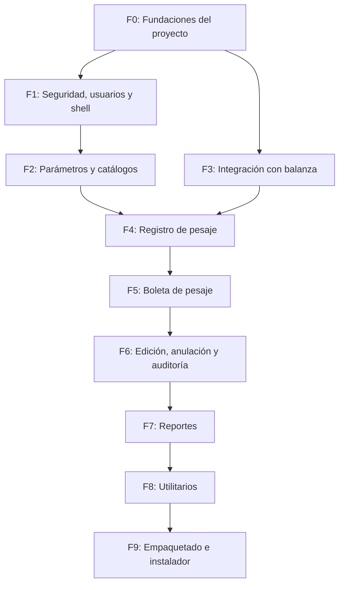

# Guía del Agente y Control de Ejecución (Agents.md)

Este documento registra la arquitectura, convenciones, estado de ejecución fase por fase y bitácora técnica para la reconstrucción del **Sistema de Pesaje para Faeneo**.

---

## 1. Orden y Mapa de Fases

El plan maestro se ejecuta en el siguiente orden estricto de dependencias:

---

## 2. Estado de Ejecución por Fase

| Fase | Título | Estado | HUs Completadas | Total HUs | Fecha de Finalización |
| :--- | :--- | :---: | :---: | :---: | :---: |
| **F0** | **Fundaciones del proyecto** | ✅ Completado | 7 | 7 | 2026-09-24 |
| **F1** | **Seguridad, usuarios y shell principal** | ✅ Completado | 6 | 6 | 2026-09-24 |
| **F2** | **Parámetros y catálogos** | ✅ Completado | 6 | 6 | 2026-09-24 |
| **F3** | **Integración con balanza** | ✅ Completado | 7 | 7 | 2026-09-25 |
| **F4** | **Registro de pesaje** | ⏳ Siguiente en turno | 0 | 7 | — |
| **F5** | **Boleta de pesaje** | ⏳ Pendiente | 0 | 6 | — |
| **F6** | **Edición, anulación y auditoría** | ⏳ Pendiente | 0 | 5 | — |
| **F7** | **Reportes** | ⏳ Pendiente | 0 | 6 | — |
| **F8** | **Utilitarios** | ⏳ Pendiente | 0 | 6 | — |
| **F9** | **Empaquetado, instalador y puesta en marcha** | ⏳ Pendiente | 0 | 6 | — |

---

## 3. Registro Detallado de HUs por Fase

### [x] Fase F0 — Fundaciones del proyecto (COMPLETADA)
- [x] **HU-F0-01:** Estructura de solución y proyectos (`src/PesajeFaeneo.sln`, props, capas limpias, arquitectura tests).
- [x] **HU-F0-02:** Entidades de dominio y enumeraciones (`Usuario`, `ParametrosSistema`, `ConfiguracionBalanza`, `Ganadero`, `Cliente`, `Fletero`, `Pesaje`, `Auditoria`, Enums y Excepciones).
- [x] **HU-F0-03:** Host genérico, DI, configuración y logging (Serilog con retención de 30 días, Host, Mutex `Global\PesajeFaeneo`, `AppPaths`).
- [x] **HU-F0-04:** DbContext, mapeo EF Core y migración inicial (`PesajeDbContext`, SQLite, pesos REAL, índices únicos y compuestos, migración `Inicial`, pragmas WAL).
- [x] **HU-F0-05:** Datos iniciales y hasher de contraseñas (`Pbkdf2PasswordHasher` con SHA256/100k, `DataSeeder` idempotente con admin/admin).
- [x] **HU-F0-06:** Manejo global de excepciones (`ClasificadorErrores`, `ManejadorErrores`, `FormBase` con `EjecutarAsync`).
- [x] **HU-F0-07:** Infraestructura de pruebas (`SqliteDbFixture` en memoria, `SqliteArchivoFixture`, Builders de prueba, `build.ps1` con cobertura).

### [x] Fase F1 — Seguridad, usuarios y shell principal (COMPLETADA)
- [x] **HU-F1-01:** Servicio de autenticación y auditoría base
- [x] **HU-F1-02:** Sesión, permisos y autorización por rol
- [x] **HU-F1-03:** Pantalla de inicio de sesión
- [x] **HU-F1-04:** Shell y menú principal con autorización
- [x] **HU-F1-05:** Gestión de usuarios (CRUD)
- [x] **HU-F1-06:** Cambio de contraseña

### [x] Fase F2 — Parámetros y catálogos (COMPLETADA)
- [x] **HU-F2-01:** Parámetros del Sistema (datos de la empresa)
- [x] **HU-F2-02:** Reglas de validación y normalización de catálogos
- [x] **HU-F2-03:** Gestión de Ganaderos
- [x] **HU-F2-04:** Gestión de Clientes
- [x] **HU-F2-05:** Gestión de Fleteros (F1..F4)
- [x] **HU-F2-06:** Control reutilizable de búsqueda y autocompletado

### [x] Fase F3 — Integración con balanza (COMPLETADA)
- [x] **HU-F3-01:** Abstracción IScaleReader y ciclo de conexión
- [x] **HU-F3-02:** Parser de tramas configurable por regex
- [x] **HU-F3-03:** Detector de estabilidad
- [x] **HU-F3-04:** Lectores Serial (RS-232/USB) y TCP
- [x] **HU-F3-05:** Simulador de balanza
- [x] **HU-F3-06:** Servicio de balanza compartido y entrega segura a la UI
- [x] **HU-F3-07:** Configuración y diagnóstico de balanza

### [ ] Fase F4 — Registro de pesaje
- [ ] **HU-F4-01:** Reglas de dominio del pesaje
- [ ] **HU-F4-02:** Grabar pesaje con numeración atómica y auditoría
- [ ] **HU-F4-03:** Sugerencia de secuencia por ganadero del día
- [ ] **HU-F4-04:** Pantalla de pesaje y display en vivo
- [ ] **HU-F4-05:** Captura de pesos desde la balanza
- [ ] **HU-F4-06:** Flujo por teclado, estados de botones y mensajes guía
- [ ] **HU-F4-07:** Alta rápida de ganadero y cliente desde el pesaje

### [ ] Fase F5 — Boleta de pesaje
- [ ] **HU-F5-01:** Datos de boleta y configuración de impresión por equipo
- [ ] **HU-F5-02:** Renderizador del layout de boleta
- [ ] **HU-F5-03:** Impresión y vista previa con PrintDocument
- [ ] **HU-F5-04:** Imprimir desde el pesaje e impresión automática al grabar
- [ ] **HU-F5-05:** Reimpresión por número y acceso rápido
- [ ] **HU-F5-06:** Selección de impresora, papel y calibración

### [ ] Fase F6 — Edición, anulación y auditoría
- [ ] **HU-F6-01:** Buscador de boletas
- [ ] **HU-F6-02:** Editar boleta sin modificar pesos
- [ ] **HU-F6-03:** Anular boleta con motivo obligatorio
- [ ] **HU-F6-04:** Auditoría con diff antes/después en JSON
- [ ] **HU-F6-05:** Visor de auditoría

### [ ] Fase F7 — Reportes
- [ ] **HU-F7-01:** Servicio común de reportes y regla de totales (Media res = 0.5)
- [ ] **HU-F7-02:** Índices y rendimiento de consultas
- [ ] **HU-F7-03:** Pantalla de filtros común y vista previa
- [ ] **HU-F7-04:** Exportación a PDF con formato original (QuestPDF)
- [ ] **HU-F7-05:** Exportación a Excel e impresión
- [ ] **HU-F7-06:** Reporte de boletas anuladas

### [ ] Fase F8 — Utilitarios
- [ ] **HU-F8-01:** Backup manual consistente (SqliteBackupService)
- [ ] **HU-F8-02:** Backup automático diario con retención
- [ ] **HU-F8-03:** Restauración con validación y reinicio
- [ ] **HU-F8-04:** Importador de datos legado desde CSV (con simulacro)
- [ ] **HU-F8-05:** Lectores opcionales DBF y MDB
- [ ] **HU-F8-06:** Visor de logs

### [ ] Fase F9 — Empaquetado, instalador y puesta en marcha
- [ ] **HU-F9-01:** Publicación self-contained y versionado
- [ ] **HU-F9-02:** Migraciones automáticas al iniciar con backup previo
- [ ] **HU-F9-03:** Instalador Inno Setup
- [ ] **HU-F9-04:** Asistente de primer arranque
- [ ] **HU-F9-05:** Checklist de aceptación en sitio (UAT)
- [ ] **HU-F9-06:** Manual de usuario y guía de balanza

---

## 4. Convenciones Arquitectónicas y de Ingeniería
- **Arquitectura en Capas:**
  - `PesajeFaeneo.Domain`: Sin dependencias externas ni NuGet. Entidades, Enums, Excepciones, Reglas puras.
  - `PesajeFaeneo.Application`: Servicios, Interfaces, DTOs, Seguridad, Validadores. Depende solo de Domain (+ `Microsoft.Extensions.DependencyInjection.Abstractions` para exponer extensiones `IServiceCollection`; **no** referencia `Microsoft.Extensions.Hosting`, EF Core, WinForms ni Serilog).
  - `PesajeFaeneo.Infrastructure`: EF Core, Balanza, Impresión, Exportación, Archivos, Log. Depende de Application y Domain. No referencia WinForms.
  - `PesajeFaeneo.WinForms`: Formularios, Controles, Presentación. Depende de las capas anteriores vía DI. `IFormFactory` vive aquí (no en Application): es un concepto de UI, restringido a `where T : Form`.
  - `PesajeFaeneo.Tests`: Tests unitarios y de integración con xUnit (solo `Assert`). `ArquitecturaTests` hace cumplir las reglas de capas anteriores por reflexión.
- **Persistencia:** SQLite vía EF Core 8. `journal_mode=WAL` se aplica una vez tras migrar (persiste en el archivo); `busy_timeout`, `synchronous=NORMAL` y `foreign_keys=ON` son pragmas **por conexión** y se aplican con `SqlitePragmasInterceptor` (registrado a través de `SqliteOpcionesExtensiones.ConfigurarSqlite`, usado en DI, `DesignTimeDbContextFactory` y los fixtures de prueba) para cubrir a todas las conexiones del pool, no solo a la primera.
- **Fechas y horas:** se persiste todo en **UTC**. `PesajeDbContext.ConfigureConventions` aplica `DateTimeUtcConverter`/`DateTimeUtcNulableConverter` a toda propiedad `DateTime`/`DateTime?` del modelo: al guardar convierte a UTC, al leer marca `DateTimeKind.Utc` explícitamente (SQLite no conserva `DateTimeKind`). Los filtros "del día" (secuencia por ganadero en F4-03, reportes en F7) deben convertir los límites del día local a UTC con `TimeProvider.LocalTimeZone` antes de comparar contra estas columnas.
- **Pesos decimales:** convertidos a `REAL` (double) vía `DecimalARealConverter` (redondeo a 1 decimal, `AwayFromZero`), centralizado y reutilizado en `Pesaje` y `ConfiguracionBalanza`. Resolución de peso: 0,1 kg. Totales calculados en memoria.
- **Búsquedas/unicidad insensibles a mayúsculas:** `Usuario.NombreUsuario`, `Ganadero.Marca`, `Ganadero.Nombre`, `Cliente.Nombre` y `Fletero.Nombre` usan `UseCollation("NOCASE")`.
- **Unidad de trabajo y persistencia F1:** `IUnidadDeTrabajoFactory` singleton + `IUnidadDeTrabajo` transaccional con repositorios `IUsuarioRepositorio` e `IAuditoriaRepositorio`. Las operaciones de negocio y su registro de auditoría se guardan siempre en la misma llamada a `GuardarCambiosAsync` para garantizar atomicidad. Traducción centralizada de excepciones de persistencia: `DbUpdateConcurrencyException` → `ConcurrenciaException`, `SqliteException` 19 UNIQUE → `ConflictoException`, `SqliteException` 19 CHECK → `ReglaNegocioException("BD_CHECK")`.
- **Sesión y autorización:** `ISesionActual` registrado como Singleton en memoria. `ExigirPermiso` se ejecuta como primera línea de defensa en cada método de servicio (defensa en profundidad), mientras que la UI oculta (`Available = false`) las opciones sin permiso mediante `AutorizadorMenu`.
- **Contexto de aplicación y bucle de UI:** `ContextoAplicacion : ApplicationContext` gestiona el ciclo de vida sin asignar `MainForm`, permitiendo transiciones fluidas entre login, cambio obligatorio de contraseña y shell sin terminar el proceso. Nunca se bloquea el hilo de UI (`.Result`, `.Wait()`, etc.) dentro de eventos asíncronos; se usa `FormBase.EjecutarAsync`.
- **Auditoría segura:** los snapshots de usuario en auditoría (`UsuarioAuditoria`) serializan únicamente metadatos (`Id`, `NombreUsuario`, `NombreCompleto`, `Rol`, `Activo`, `DebeCambiarPassword`); jamás se registran contraseñas en texto claro, hashes ni salts en logs, auditorías ni excepciones.
- **Formularios:** `IFormFactory.Crear<T>()` crea un `IServiceScope` propio por formulario (con `ActivatorUtilities.CreateInstance`) y lo libera cuando el formulario se cierra (`form.Disposed`). Los formularios **no** se registran en el contenedor raíz de DI (para no poder resolverlos ni fugarlos desde ahí).
- **`FormBase`:** `EjecutarAsync`/`Ejecutar` usan `UseWaitCursor` (no `Cursor.Current`, que se pierde en el primer `await`) y un campo `_ocupado` que descarta invocaciones reentrantes (protección contra doble clic/doble Enter, crítico para F4 "Grabar pesaje").
- **Seguridad:** Autorización basada en `Permiso` verificado en UI y servicios. Auditoría atómica de cambios. El usuario `admin/admin` se siembra con `DebeCambiarPassword = true`.
- **Tiempo:** Siempre `TimeProvider` inyectado (obligatorio, no opcional; `FakeTimeProvider` en tests).
- **Errores:** `ClasificadorErrores` distingue `Validacion`, `Negocio` (incluye `ConcurrenciaException`, `ConflictoException`, `EntidadNoEncontradaException`, `ReglaNegocioException` y cualquier otra `DomainException`), `NoAutorizado`, `Cancelado` (`OperationCanceledException`: sin log ni MessageBox) e `Inesperado`. Un `AggregateException` solo se desenvuelve si tiene una única excepción interna.
- **Catálogos y normalización en mayúsculas:** persistencia forzada en mayúsculas (`ToUpperInvariant`) y colapso de espacios intermedios (`Regex.Replace(s, @"\s+", " ")`). La collation `NOCASE` de SQLite sólo pliega caracteres ASCII A–Z y no cubre caracteres acentuados ni la letra eñe (p. ej. "PEÑA" y "peña" serían tratados como distintos sin esta normalización).
- **Unidad de trabajo y transacciones explícitas (`ITransaccion`):** extensión de `IUnidadDeTrabajo` con `IniciarTransaccionAsync` y `ITransaccion` para inserciones donde el registro de auditoría requiere el `Id` autogenerado de la entidad (catálogos), garantizando atomicidad completa y soporte de reversión en caso de error.
- **Búsqueda tolerante a acentos y autocompletado en memoria:** plegado de texto a ASCII en mayúsculas vía `NormalizationForm.FormD` despojando marcas no espaciadoras (`UnicodeCategory.NonSpacingMark`) en `TextoBusqueda`. Motor `MotorBusqueda` con ranking en 5 niveles de relevancia (código exacto, prefijo de código, prefijo de descripción, prefijo de palabras, contiene descripción).
- **Control reutilizable de autocompletado (`ControlBusquedaCatalogo`):** `UserControl` con lista desplegable flotante agregada dinámicamente al formulario contenedor (`FindForm().Controls`) y `BringToFront()`, evitando recortes por contenedores padre. Enrutamiento de teclado mediante `PreviewKeyDown` marcando `IsInputKey = true` condicionalmente para Enter y Escape cuando la lista está activa, evitando consumo prematuro por `AcceptButton`/`CancelButton` del formulario.
- **Almacenamiento seguro de logo:** implementado en `AlmacenLogoArchivos` con validación estricta de encabezados binarios (firmas mágicas para PNG, JPEG y BMP) y tamaño máximo de 1 MB. El logo se referencia en base de datos mediante su nombre de archivo relativo y se almacena en `AppPaths.LogoDir`. Las cargas en UI (`FrmParametros`) emplean lectura en flujo y copia a `Bitmap` para evitar el bloqueo del archivo en disco que ocasiona `Image.FromFile`. Limpieza segura de archivos en rollback.
- **Regla de reentrada en UI (`FormBase`, regla 0.10):** jamás invocar un método con `EjecutarAsync` interno dentro del delegado de otro `EjecutarAsync` o `Ejecutar`; los formularios modales y operaciones compuestas deben obtener el resultado y ejecutar las recargas posteriormente para evitar que la bandera `_ocupado` descarte silenciosamente la operación.
- **Balanza e integración de pesaje:** servicio singleton (`IServicioBalanza`) con un único lector activo creado por fábrica (`IFabricaLectorBalanza`). Ciclo de vida explícito en `Program.Main` tras migrar la base de datos (sin `IHostedService`, porque el Host arrancaría antes de migrar y sembrar). El servicio implementa tanto `IAsyncDisposable` como `IDisposable` síncrono para evitar excepciones de MS.DI al cerrar el host. `ConfigureAwait(false)` estricto en todas las operaciones asíncronas de balanza para prevenir interbloqueos con el contexto de sincronización de WinForms al salir. Puerto serie sobre kernel32 directo (`PuertoSerieWin32`, **no** `System.IO.Ports.SerialPort`): se lee el DCB actual del driver y solo se modifican baudios/bits/paridad/parada si difieren; si el driver rechaza `SetCommState`, se relee y se acepta cuando el formato ya coincide. DTR/RTS y control de flujo quedan como los deja el driver. Motivo: `SerialPort.Open()` siempre reescribe el DCB completo y el driver CH340 rechaza cualquier `SetCommState` con error 31 ("el dispositivo no funciona"), incluso sin cambios (verificado en sitio con el indicador RX8 Accurex). Lectura en hilo dedicado (`Thread` con `IsBackground = true`, `AboveNormal`) con `ReadFile` no bloqueante sondeado hasta 250 ms; el cierre usa `SafeFileHandle` (seguro ante un `ReadFile` concurrente). Tramas separadas por fin de línea (CR/LF/ETX) o, si se configura, también por espacio; el peso de la trama puede venir en kilogramos o en gramos (se convierte antes de redondear a 0,1 kg). Entrega segura a la UI por sondeo desacoplado (`MonitorBalanzaUi` con `System.Windows.Forms.Timer` cada 100 ms) sobre una instantánea inmutable (`InstantaneaBalanza`) sin cruzar eventos entre hilos ni fugar referencias a formularios cerrados. Parser de tramas basado en regex con grupos obligatorios `(?<peso>...)` y opcionales `(?<estable>...)`, reemplazo de coma por punto decimal y límite de ejecución de 100 ms contra expresiones catastróficas. Detector de estabilidad con ventana deslizante de lecturas y dispersión menor o igual a la tolerancia configurable. Vigilancia continua para estados `SinDatos` (tras 3 timeouts) y `TramasNoReconocidas` (tras 3 tramas consecutivas sin parsear). Pausa obligatoria de 500 ms tras cerrar un puerto COM para permitir su liberación por el sistema operativo antes de reabrir. Método `EsCapturable` para consumo de F4 (conectada, estable, peso no nulo y lectura reciente dentro del timeout). Diagnóstico interactivo (`ProbarAsync`) que suspende temporalmente el bucle de producción (estado `EnDiagnostico`) y lo reanuda de forma garantizada en `finally`.

### Notas hacia fases futuras (registradas en las revisiones post-F0, post-F2 y post-F3)
- **F4-02 / F6 (R6):** numeración atómica con `UPDATE ParametrosSistema SET SiguienteNumeroBoleta = SiguienteNumeroBoleta + 1 WHERE Id = 1 RETURNING ...` dentro de la misma transacción que el insert del pesaje y la auditoría. Al cambiar la numeración desde Parámetros, verificar en la misma transacción que el valor en BD no haya variado, o gobernarlo mediante el token `Version` de F6.
- **F4-05 (R13):** capturar peso desde la balanza **únicamente** cuando `Instantanea.EsCapturable(ahora, TimeSpan.FromMilliseconds(TimeoutMs))` sea `true` y el peso sea estrictamente positivo (`PesoKg > 0`).
- **F4-07 (R9):** las altas rápidas desde la pantalla de pesaje requieren el permiso `AltaRapidaCatalogos` (Operador). En lugar de relajar `CrearAsync` (que exige `GestionarCatalogos`), implementar `CrearRapidoAsync` en los servicios de catálogo con motivo prefijado "Alta rápida desde pesaje". El evento `AltaRapidaSolicitada` del control ya se encuentra disponible.
- **F4 / F5 (R14):** decidir comportamiento con el modo simulador en producción: (a) solo alerta visual naranja en barra de estado y formularios (comportamiento actual en F3), (b) bloquear la grabación de pesajes en modo simulador para operadores y supervisores (permitido solo a administradores), o (c) imprimir obligatoriamente la leyenda "SIMULADO" en la boleta de pesaje. Además, en F9-04 (asistente de primer arranque) obligar a seleccionar explícitamente el tipo de conexión física.
- **F5 / F8 (R10):** la impresión en F5 y los utilitarios de backup/restauración en F8 deben considerar la carpeta de logos (`AppPaths.LogoDir`). F8 debe incluir el logo en los respaldos y restauraciones; F5 debe tolerar la ausencia o ilegibilidad del logo sin fallar.
- **F6 (R12):** agregar token de concurrencia (`Version` entero con `IsConcurrencyToken`, incrementado en `SaveChanges`) a `Pesaje` y `ParametrosSistema`, y mapear `DbUpdateConcurrencyException` → `ConcurrenciaException`. Si en el futuro se permite acceso multi-terminal concurrente, extender `Version` también a los catálogos.
- **F7:** QuestPDF 2024.x exige `QuestPDF.Settings.License = LicenseType.Community` al iniciar.
- **F9-04 (R11):** `ConfiguracionInicialCompleta` permanece en `false` tras guardar parámetros en F2. El asistente de primer arranque en F9-04 debe decidir si marcarla o si detecta el nombre de empresa distinto del valor por defecto.
- **F9-06 (R21):** la guía de balanza debe documentar cómo fijar el número de puerto COM estático en el Administrador de dispositivos de Windows para adaptadores USB-serie.
- **F9:** el instalador debe dar permisos de Modificar a `Users` sobre `%ProgramData%\PesajeFaeneo` (por defecto, archivos creados por un admin son de solo lectura para usuarios estándar → la app no podría escribir la BD). Revisar si el mutex `Global\` (bloquea a un segundo usuario de Windows en otra sesión) es el comportamiento deseado.
- **F3-Futuro (R22):** si el indicador de balanza del cliente no opera en modo continuo sino bajo demanda, incorporar campo `ComandoSolicitud` (p. ej. `P`, `W` o `ENQ`) y sondeo periódico mediante temporizador.
- **F3 (R23) — resuelto:** el indicador RX8 Accurex del sitio transmite `=NNNNNN ` en **gramos**, separado por espacios y sin CR/LF. Configuración de campo: Serie, COM del adaptador CH340, 9600 8N1, separación de tramas "Inicio con '='" (`DelimitadorTrama.SignoIgual`: en ráfagas el RX8 encadena tramas sin espacio, p. ej. `=650000-=381000-`), unidad "Gramos", patrón sembrado. Pendiente: validar la conversión con un peso patrón conocido; si otro indicador usa libras, agregar `UnidadPesoTrama.Libras`.
- **F3-Futuro (R34):** si algún indicador de balanza específico requiere forzar DTR/RTS o control de flujo por hardware (CTS/RTS o XON/XOFF), hacerlo con `EscapeCommFunction` o flags explícitos y configurables, nunca reescribiendo el DCB completo (rompe CH340). Hoy se respetan los valores del driver.
- **F9-06 (R35):** documentar en la guía de balanza que reconectar el adaptador USB-serie puede cambiar el número de COM (COM3 → COM4 observado en sitio) y dejar entradas fantasma en el Administrador de dispositivos.

---

## 5. Bitácora de Ejecución

### Fase F0 — Fundaciones del proyecto
- **Fecha:** 2026-09-24
- **Estado:** ✅ Completado con éxito (7/7 HUs).
- **Compilación:** `dotnet build` en `Release` con 0 warnings y 0 errores (`TreatWarningsAsErrors=true`).
- **Pruebas:** 17 tests unitarios y de integración ejecutados y en verde (0 fallos, 0 omitidos).
- **Cobertura:** Archivo `coverage.cobertura.xml` generado con éxito vía `build.ps1`.
- **Base de datos:** Migración inicial `Inicial` creada con SQLite, pragmas WAL, índices únicos, checks y conversores REAL para pesos decimales.
- **Siguiente paso:** Fase F1 — Seguridad, usuarios y shell principal.

### Fase F0 — Remediación post-revisión
- **Fecha:** 2026-09-24
- **Origen:** revisión senior de F0 (`docs/plans/F0-remediacion.md`), ejecutada en la rama `fix/f0-remediacion` (sin commit, cambios dejados en el árbol de trabajo para revisión).
- **Defectos P0 corregidos:**
  - T1: `Program.Main` era `async Task` con `[STAThread]` (no se aplica a un `Main` asíncrono; la continuación tras el primer `await` corría en un hilo MTA). Ahora es `static int Main` síncrono, bloqueando con `GetAwaiter().GetResult()` antes de que exista `WindowsFormsSynchronizationContext`.
  - T2: los pragmas `busy_timeout`/`synchronous` son por conexión y solo se aplicaban a la conexión de `DatabaseInitializer`. Nuevo `SqlitePragmasInterceptor` + `SqliteOpcionesExtensiones.ConfigurarSqlite`, compartido por DI, `DesignTimeDbContextFactory` y los fixtures de prueba.
  - T3: `FormFactory` resolvía formularios `Transient` desde el contenedor raíz (MS.DI los retiene para siempre). Ahora crea un `IServiceScope` por formulario y lo libera en `form.Disposed`. `IFormFactory` se movió de Application a WinForms.
- **Defectos P1 corregidos:**
  - T4: Serilog no estaba conectado a `Microsoft.Extensions.Logging` (cualquier `ILogger<T>` inyectado iba a los proveedores por defecto del Host, incluido EventLog). Nuevo `ConfiguracionLogging.ConfigurarSerilog` con `ReadFrom.Configuration` + `ClearProviders()`.
  - T5: `ContentRootPath` dependía de `Directory.GetCurrentDirectory()`; ahora se fija a `AppContext.BaseDirectory`. Se quitó el `AddJsonFile("appsettings.json")` duplicado (el Host ya lo agrega).
  - T6: `AddInfrastructure` creaba su propio `AppPaths` y hacía I/O al registrar servicios (los tests de DI llegaban a crear carpetas reales en `%ProgramData%`). Ahora recibe `AppPaths` ya construido; `ContenedorDITests` usa un directorio temporal y valida con `ValidateOnBuild`/`ValidateScopes`.
  - T7: `ClasificadorErrores` no distinguía `ConcurrenciaException`/`DomainException` genérica (caían en "Error inesperado") ni `OperationCanceledException`; un `AggregateException` con varias internas se desenvolvía sin criterio. Corregido con el nuevo tipo `TipoErrorClasificado.Cancelado`.
  - T8: el manejador de `AppDomain.UnhandledException` no registraba `Log.Fatal` ni cerraba el logger antes de que el proceso terminara.
  - T9: `FormBase.EjecutarAsync`/`Ejecutar` usaban `Cursor.Current` (se pierde en el primer `await`) y no protegían contra reentrada. Ahora usan `UseWaitCursor` y un campo `_ocupado`.
- **Endurecimiento del modelo de datos (T10) y migración regenerada (T11):** collation `NOCASE` en `Usuario.NombreUsuario`, `Ganadero.Marca/Nombre`, `Cliente.Nombre`, `Fletero.Nombre`; conversión UTC centralizada vía `ConfigureConventions`; `DecimalARealConverter` centralizado; nuevas CHECK constraints (`Pesajes.Estado`, pesos no negativos, coherencia de anulación, `Secuencia >= 1`, `Usuarios.Rol`, `ParametrosSistema.SiguienteNumeroBoleta >= 1`, `ConfiguracionesBalanza.TipoConexion/LecturasParaEstable/TimeoutMs`); `Application.csproj` ya no depende de `Microsoft.Extensions.Hosting`. La migración `Inicial` se regeneró desde cero (`dotnet ef migrations remove` + `add Inicial`); `dotnet ef migrations has-pending-model-changes` no reporta cambios pendientes.
- **Pruebas (T12-T13):** `PesajeBuilder.Anulado` ahora sí asigna `MotivoAnulacion`/`AnuladoPorId`/`AnuladoEn` (antes los ignoraba, violando la nueva CK de anulación); los builders usan una fecha fija por defecto (`ConFechaHora` para configurarla) en vez de `DateTime.UtcNow`. Se agregaron pruebas de: pragmas por conexión, siembra idempotente con `HasData`, cada CHECK constraint nueva, collation `NOCASE`, ida y vuelta de `DateTime` en UTC, comparación modelo-vs-snapshot de migraciones (`IMigrationsModelDiffer`), reglas de capas (`Application`/`Infrastructure`) y reentrada de `FormBase`.
- **Compilación:** `dotnet build src/PesajeFaeneo.sln -c Release` con 0 warnings y 0 errores.
- **Pruebas:** 49 tests unitarios y de integración en verde (0 fallos, 0 omitidos); antes de la remediación eran 17.

### Fase F1 — Seguridad, usuarios y shell principal
- **Fecha:** 2026-09-24
- **Estado:** ✅ Completado con éxito (6/6 HUs).
- **Compilación:** `dotnet build` en `Release` con 0 warnings y 0 errores (`TreatWarningsAsErrors=true`).
- **Pruebas:** 172 tests unitarios y de integración ejecutados y en verde (0 fallos, 0 omitidos; incremento de 49 a 172 tests).
- **Migración:** `F1_BloqueoUsuario` añadida, con reconstrucción de tabla en SQLite preservando collation `NOCASE` y restricciones CHECK. `has-pending-model-changes` limpio.
- **Decisiones de diseño aplicadas (D1–D10):**
  - D1: Matriz completa Rol × Permiso centralizada y probada exhaustivamente.
  - D2: Política de contraseña (6–100 caracteres, no igual al usuario, distinta de la anterior al cambiar).
  - D3: Bloqueo tras 5 intentos fallidos por 5 minutos, con tiempo de expiración dinámico y defensas contra enumeración / timing.
  - D4: Normalización de nombre de usuario en minúsculas y regex `^[a-z0-9._-]{3,30}$`.
  - D5: Nuevos usuarios nacen con `DebeCambiarPassword = true`.
  - D6: Eliminación física prohibida, solo borrado lógico (`Activo = false`).
  - D7: Protección del último administrador activo y prevención de auto-degradación/auto-desactivación.
  - D8: Menús sin permiso se ocultan recursivamente (`Available = false`).
  - D9: Módulos de fases futuras deshabilitados con ToolTip explicativo.
  - D10: Mensajes de login unificados ("Usuario o contraseña incorrectos.") con auditoría disociada de credenciales.
- **Siguiente paso:** Fase F2 — Parámetros y catálogos.

### Fase F2 — Parámetros y catálogos
- **Fecha:** 2026-09-24
- **Estado:** ✅ Completado con éxito (6/6 HUs).
- **Compilación:** `dotnet build` en `Release` con 0 warnings y 0 errores (`TreatWarningsAsErrors=true`).
- **Pruebas:** 292 tests unitarios y de integración ejecutados y en verde (0 fallos, 0 omitidos; incremento de 172 a 292 tests, +120 tests añadidos).
- **Migración:** `F2_Catalogos` añadida, con reconstrucción de tablas `Ganaderos` y `Clientes` agregando restricciones CHECK de longitud y rango (`length(Marca) BETWEEN 1 AND 5`, `Codigo BETWEEN 1 AND 999999`), preservando collation `NOCASE`, recreando índices únicos y validando integridad de claves foráneas con `PRAGMA foreign_key_check`.
- **Decisiones de diseño aplicadas (D1–D17):**
  - D1: Guardado en mayúsculas invariantes (`ToUpperInvariant`) y colapso de espacios en blanco intermedios.
  - D2: Validación sintáctica de marcas de ganadero (1 a 5 caracteres, regex `^[\p{Lu}\p{Nd}&./-]{1,5}$`).
  - D3: Nombres de ganaderos y clientes de 3 a 100 caracteres.
  - D4: No forzar unicidad en nombres de ganaderos/clientes (solo en marca y código numérico).
  - D5: Sugerencia de reactivación al intentar dar de alta una clave existente que se encuentra inactiva.
  - D6: Código de cliente como entero 1..999999 con sugerencia del siguiente código correlativo disponible.
  - D7: Límite estricto de 4 fleteros activos numerados de 1 a 4 (F1..F4).
  - D8: Validación de celulares con al menos 6 dígitos numéricos.
  - D9: Eliminación física prohibida en catálogos (solo borrado lógico con `Activo = false`).
  - D10: Auditoría con Id numérico real de la entidad recién creada usando transacción atómica (`ITransaccion`).
  - D11: Normalización de snapshots de auditoría desvinculando propiedades de navegación.
  - D12: Validación fiscal y operativa completa en parámetros del sistema.
  - D13: Protección del contador `SiguienteNumeroBoleta` (debe ser mayor al último número emitido).
  - D14: Almacenamiento seguro del logo con validación de firma binaria (PNG, JPEG, BMP) y límite de 1 MB.
  - D15: Búsqueda en memoria de 5 niveles con plegado de acentos FormD y control reutilizable `ControlBusquedaCatalogo` con dropdown flotante.
  - D16: Sin token de concurrencia en catálogos por contexto mono-usuario / ventanas modales.
  - D17: Prevención de reentrada en `FormBase` estructurando recargas fuera de bloques bloqueados.
- **Siguiente paso:** Fase F3 — Integración con balanza.

### Fase F3 — Integración con balanza
- **Fecha:** 2026-09-25
- **Estado:** ✅ Completado con éxito (7/7 HUs).
- **Compilación:** `dotnet build` en `Release` con 0 warnings y 0 errores (`TreatWarningsAsErrors=true`).
- **Pruebas:** 488 tests unitarios y de integración ejecutados y en verde (0 fallos, 0 omitidos; incremento de 292 a 488 tests, +196 tests añadidos).
- **Migración:** `F3_Balanza` añadida, aplicando 11 restricciones CHECK sobre `ConfiguracionesBalanza` (`TipoConexion`, `PuertoCom`, `BaudRate`, `DataBits`, `Paridad`, `BitsParada`, `PuertoTcp`, `LongitudPatron`, `LecturasParaEstable`, `ToleranciaKg`, `TimeoutMs`), actualizando el patrón por defecto en la fila sembrada a `^[^-+\d]*(?<peso>[-+]?\s*\d+(?:[.,]\d+)?)` (ver nota sobre el grupo `estable` en la remediación post-revisión), preservando collation `NOCASE` y verificando integridad con `PRAGMA foreign_key_check`.
- **Decisiones de diseño aplicadas (D1–D17):**
  - D1: Exclusión de sondeo bidireccional; soporte completo para modo transmisión continua.
  - D2: Separador de tramas configurable por delimitador de fin de línea con búfer de seguridad acotado a 256 bytes y truncado ante sobreflujo.
  - D3: Parser de tramas con grupos nombrados (?<peso>) y (?<estable>), unificación de coma y punto decimal, y timeout de 100 ms contra regex catastrófica.
  - D4: Patrón sembrado robusto que admite espacios intermedios entre signos y dígitos (`[-+]?\s*\d+`).
  - D5: Detector de estabilidad de doble vía (reportado por indicador en trama o deducido matemáticamente por dispersión sobre ventana deslizante).
  - D6: Vigilancia de conexión con estados `SinDatos` (3 timeouts) y `TramasNoReconocidas` (3 tramas consecutivas inválidas), y anulación inmediata de capturabilidad.
  - D7: Lector serie en hilo dedicado (`Thread` prioritario con `IsBackground = true`) con lectura bloqueante en fragmentos y desbloqueo seguro vía `Close()`.
  - D8: Lector TCP asíncrono con `TcpClient` y `NetworkStream` cancelable.
  - D9: Entrega segura a UI desacoplada mediante sondeo con `MonitorBalanzaUi` e inmutabilidad (`InstantaneaBalanza`), erradicando eventos cruzando hilos.
  - D10: Lector simulador con generación senoidal amortiguada hacia peso objetivo, ruido estocástico y simulación de desconexión.
  - D11: Validación integral de todos los campos de configuración independientemente del transporte activo.
  - D12: Diagnóstico con suspensión garantizada y reanudación en `finally` del bucle principal (`ProbarAsync`).
  - D13: Log throttled en warnings de balanza (un solo log por transición o cambio de mensaje de error) y tramas crudas solo en `Debug`.
  - D14: ~~Líneas DTR/RTS habilitadas y descarte de búferes (`DiscardInBuffer`) tras apertura del puerto COM.~~ Reemplazada por D18 (incompatible con CH340).
  - D15: Pausa de 500 ms tras cerrar puertos COM para garantizar su liberación en el sistema operativo.
  - D16: Subgrupos de configuración siempre visibles y solo deshabilitados para evitar errores invisibles.
  - D17: Cancelación de prueba interactiva mediante `CancellationToken` y preservación de cierre de formulario seguro si una prueba está en curso.
- **Siguiente paso:** Fase F4 — Registro de pesaje.

### Fase F3 — Remediación post-revisión
- **Fecha:** 2026-09-25
- **Origen:** revisión QA senior de F3 contra esta matriz (D1–D17), ejecutada sobre el árbol de trabajo de `feat/f3-balanza` (sin commit, cambios dejados en el árbol de trabajo para revisión).
- **Defectos corregidos:**
  - **Patrón sembrado y D5 (severidad alta, con corrección de rumbo):** el patrón por defecto llegó a implementarse sin el grupo `(?<estable>...)` que la bitácora original afirmaba (`^(?<estable>ST)?[^-+\d]*(?<peso>...)`). Al intentar alinear el código a esa afirmación se detectó, vía regresión de pruebas, que ese patrón rompe la detección de estabilidad "de fábrica": toda trama sin el prefijo `ST` (incluida la que emite el simulador) hace que `ParserTramas` reporte `estableReportado = false` explícito, y `DetectorEstabilidad` reinicia su ventana en cada lectura sin llegar nunca a estable. Se corrigió la bitácora en vez del código: el patrón sembrado por defecto es `^[^-+\d]*(?<peso>[-+]?\s*\d+(?:[.,]\d+)?)` (ancla + descarte de basura inicial, D4, sin grupo `estable`), dejando el grupo `(?<estable>...)` como capacidad opcional que un técnico configura para hardware que sí reporta estabilidad en la trama (ya soportado y probado en `ParserTramas`/`ParserTramasTests`).
  - **`ServicioBalanza` no implementaba `IAsyncDisposable`** pese a estar documentado como requisito; `Dispose()` además disponía `_control` sin haberlo adquirido, con riesgo de `ObjectDisposedException` en operaciones concurrentes durante el apagado. Ahora implementa `IDisposable` + `IAsyncDisposable`, con una bandera `_disposed` (Interlocked) verificada antes y después de tomar el semáforo interno en `Iniciar/Detener/Reiniciar/ProbarAsync`, y `DisposeAsync` adquiere ese mismo semáforo antes de cancelar/liberar recursos.
  - **D6 no se cumplía literalmente:** `EstadoBalanza.SinDatos` se publicaba desde el primer timeout (no "tras 3"), y `TramasNoReconocidas` se basaba en tiempo transcurrido en vez de un conteo de tramas inválidas consecutivas. Corregido con contadores explícitos (`vencimientosSeguidos`, `tramasInvalidasSeguidas`) gateados por `ReglasBalanza.TimeoutsAntesDeReconectar`/`TramasInvalidasConsecutivasParaAlerta` (= 3); se añadió `ConexionBalanzaException.EsSinDatos` para que el catch genérico de reconexión no sobrescriba el estado `SinDatos` recién publicado con `Error`.
  - **Falta de defensa en profundidad en `ReiniciarAsync`:** no exigía `Permiso.ConfigurarBalanza` (a diferencia de `ProbarAsync`), pese a ser invocable directamente desde el botón "Reconectar". Se agregó `ExigirPermiso`. `IniciarAsync`/`DetenerAsync` se dejaron sin ese chequeo intencionalmente: son operaciones de ciclo de vida invocadas por `Program.cs` antes de que exista sesión de usuario.
  - **D15 se aplicaba de forma inconsistente:** la pausa de 500 ms tras cerrar un puerto serie se aplicaba antes de probar la configuración candidata en `ProbarAsync`, pero no al reanudar la configuración de producción guardada (ni en `ReiniciarAsync`). Se centralizó en `IniciarInternoAsync` mediante un parámetro `trasDetenerLectorPropio`, aplicado solo cuando el arranque sigue a un cierre propio (evita el error de aplicar la pausa también en el primer arranque de `IniciarAsync`, que no cierra ningún puerto previo).
  - **`ProbarAsync` podía lanzar `OperationCanceledException` sin traducir a `Cancelada = true`** si la cancelación llegaba mientras esperaba el turno del semáforo interno (contención). Se movió la espera del semáforo a un bloque que atrapa esa cancelación puntual.
  - **D10 no implementado:** `GeneradorPesoSimulado` era una aproximación monótona (`actual + diferencia*0.35 + ruido`), sin oscilación. Reescrito como clase con estado (fase/paso, amplitud inicial por cambio de objetivo) que produce una senoidal amortiguada (`amplitud · e^(-ζt) · cos(ωt)`) con snap determinístico al objetivo una vez la envolvente decae bajo el umbral, preservando los límites y la convergencia garantizada en ≤40 pasos.
  - **D7 parcial:** el hilo de lectura serie no fijaba prioridad pese a exigirse "hilo prioritario"; se agregó `ThreadPriority.AboveNormal`.
  - **D16 no se cumplía para el subgrupo del simulador:** `FrmConfiguracionBalanza` ocultaba (`.Visible = false`) el grupo en vez de solo deshabilitarlo, a diferencia de los subgrupos serie/red. Corregido a `.Enabled`, manteniéndolo siempre visible.
  - **Hueco crítico de prueba en D17:** no existía ningún test que cerrara el formulario mientras una prueba de conexión seguía en curso. Se añadió, junto con manejo defensivo de `OperationCanceledException` en `ProbarConexionInternoAsync` y honrando `_cerrarAlTerminar` sin importar el camino de salida del try/catch.
  - **Huecos de prueba en la migración F3:** solo se verificaba una de las 11 CHECK constraints nuevas; se añadieron casos para las 10 restantes.
- **Pruebas:** 509 tests unitarios y de integración en verde (0 fallos, 0 omitidos; incremento de 488 a 509, +21 tests).
- **Compilación:** `dotnet build src/PesajeFaeneo.sln -c Release` con 0 warnings y 0 errores; `dotnet ef migrations has-pending-model-changes` sin cambios pendientes.

### Fase F3 — Integración con hardware real (RX8 Accurex + adaptador CH340)
- **Fecha:** 2026-09-25
- **Síntoma:** "No se pudo abrir el puerto" en Configuración y diagnóstico de balanza (COM3/COM4, 9600 baudios). Reproducido fuera de la app con `System.IO.Ports.SerialPort.Open()`: error Win32 31. La app de referencia ScaleLogger (Tauri/Rust, `src-tauri/src/raw_serial.rs`) sí lee la misma balanza.
- **Causa raíz (verificada con una sonda Win32 sobre el hardware):** el driver CH340 rechaza **cualquier** `SetCommState`, incluso con el DCB idéntico al actual (9600 8N1, flags 0x1001). `SerialPort.Open()` siempre lo invoca; ScaleLogger lo omite cuando no hay cambios. Además el RX8 envía `=000000 =000000 …` sin CR/LF (nuestro separador nunca cortaba una trama) y en gramos.
- **Decisiones nuevas:**
  - D18: `PuertoSerieWin32` (P/Invoke kernel32) reemplaza a `PuertoSerieSystem`, replicando `raw_serial.rs`: preservar el DCB del driver, escribir solo si el formato difiere, verificar tras un rechazo; mensaje accionable si el driver rechaza un formato distinto. Mantiene el contrato de `IPuertoSerie`, por lo que `LectorSerial` no cambió.
  - D19: configuración `DelimitadorTrama` (`FinDeLinea` por defecto | `Espacio` | `SignoIgual`, este último agregado con la migración `F3_DelimitadorSignoIgual` tras observar ráfagas sin espacio en sitio) y `UnidadPeso` (`Kilogramos` por defecto | `Gramos`), con CHECK en BD, validación, auditoría (incluidos en el snapshot para que "Guardar" detecte el cambio) y dos combos en la pantalla. Migración nueva `F3_ProtocoloTrama` (no se editó `F3_Balanza`, ya aplicada en la BD local); las filas existentes quedan en los valores por defecto sin tocar el resto de la configuración.
- **Verificación en hardware:** con el `LectorSerial` de Pesalab sobre COM4 (Espacio + Gramos): conexión correcta, 22/22 tramas válidas, estabilidad alcanzada, reapertura inmediata sin error; puerto inexistente → mensaje de cable/adaptador. Pendiente en sitio: validar la conversión con un peso patrón.
- **Pruebas:** 533 tests en verde (+24: lógica de DCB con el perfil real del CH340, separador por espacio, parser en gramos, validación, auditoría, migración y formulario). Build Release 0 warnings / 0 errores; sin cambios de modelo pendientes.
- **Siguiente paso:** Fase F4 — Registro de pesaje.
