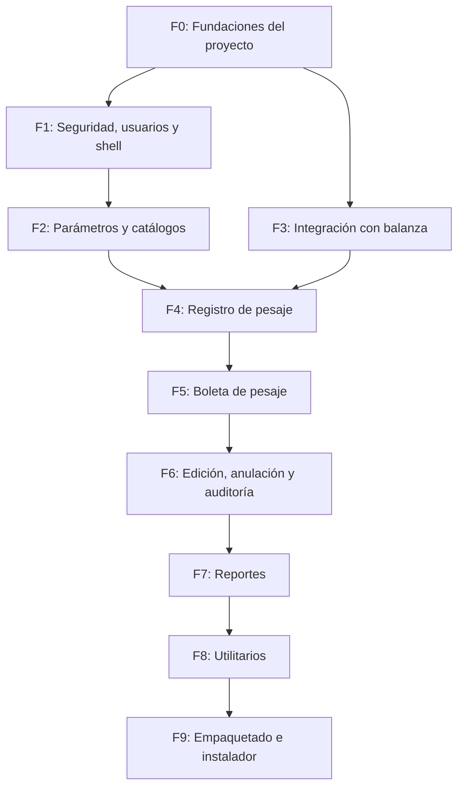

# Guía del Agente y Control de Ejecución (Agents.md)

Este documento registra la arquitectura, convenciones, estado de ejecución fase por fase y bitácora técnica para la reconstrucción del **Sistema de Pesaje para Faeneo**.

---

## 1. Orden y Mapa de Fases

El plan maestro se ejecuta en el siguiente orden estricto de dependencias:

---

## 2. Estado de Ejecución por Fase

| Fase | Título | Estado | HUs Completadas | Total HUs | Fecha de Finalización |
| :--- | :--- | :---: | :---: | :---: | :---: |
| **F0** | **Fundaciones del proyecto** | ✅ Completado | 7 | 7 | 2026-09-24 |
| **F1** | **Seguridad, usuarios y shell principal** | ⏳ Siguiente en turno | 0 | 6 | — |
| **F2** | **Parámetros y catálogos** | ⏳ Pendiente | 0 | 6 | — |
| **F3** | **Integración con balanza** | ⏳ Pendiente | 0 | 7 | — |
| **F4** | **Registro de pesaje** | ⏳ Pendiente | 0 | 7 | — |
| **F5** | **Boleta de pesaje** | ⏳ Pendiente | 0 | 6 | — |
| **F6** | **Edición, anulación y auditoría** | ⏳ Pendiente | 0 | 5 | — |
| **F7** | **Reportes** | ⏳ Pendiente | 0 | 6 | — |
| **F8** | **Utilitarios** | ⏳ Pendiente | 0 | 6 | — |
| **F9** | **Empaquetado, instalador y puesta en marcha** | ⏳ Pendiente | 0 | 6 | — |

---

## 3. Registro Detallado de HUs por Fase

### [x] Fase F0 — Fundaciones del proyecto (COMPLETADA)
- [x] **HU-F0-01:** Estructura de solución y proyectos (`src/PesajeFaeneo.sln`, props, capas limpias, arquitectura tests).
- [x] **HU-F0-02:** Entidades de dominio y enumeraciones (`Usuario`, `ParametrosSistema`, `ConfiguracionBalanza`, `Ganadero`, `Cliente`, `Fletero`, `Pesaje`, `Auditoria`, Enums y Excepciones).
- [x] **HU-F0-03:** Host genérico, DI, configuración y logging (Serilog con retención de 30 días, Host, Mutex `Global\PesajeFaeneo`, `AppPaths`).
- [x] **HU-F0-04:** DbContext, mapeo EF Core y migración inicial (`PesajeDbContext`, SQLite, pesos REAL, índices únicos y compuestos, migración `Inicial`, pragmas WAL).
- [x] **HU-F0-05:** Datos iniciales y hasher de contraseñas (`Pbkdf2PasswordHasher` con SHA256/100k, `DataSeeder` idempotente con admin/admin).
- [x] **HU-F0-06:** Manejo global de excepciones (`ClasificadorErrores`, `ManejadorErrores`, `FormBase` con `EjecutarAsync`).
- [x] **HU-F0-07:** Infraestructura de pruebas (`SqliteDbFixture` en memoria, `SqliteArchivoFixture`, Builders de prueba, `build.ps1` con cobertura).

### [ ] Fase F1 — Seguridad, usuarios y shell principal
- [ ] **HU-F1-01:** Servicio de autenticación y auditoría base
- [ ] **HU-F1-02:** Sesión, permisos y autorización por rol
- [ ] **HU-F1-03:** Pantalla de inicio de sesión
- [ ] **HU-F1-04:** Shell y menú principal con autorización
- [ ] **HU-F1-05:** Gestión de usuarios (CRUD)
- [ ] **HU-F1-06:** Cambio de contraseña

### [ ] Fase F2 — Parámetros y catálogos
- [ ] **HU-F2-01:** Parámetros del Sistema (datos de la empresa)
- [ ] **HU-F2-02:** Reglas de validación y normalización de catálogos
- [ ] **HU-F2-03:** Gestión de Ganaderos
- [ ] **HU-F2-04:** Gestión de Clientes
- [ ] **HU-F2-05:** Gestión de Fleteros (F1..F4)
- [ ] **HU-F2-06:** Control reutilizable de búsqueda y autocompletado

### [ ] Fase F3 — Integración con balanza
- [ ] **HU-F3-01:** Abstracción IScaleReader y ciclo de conexión
- [ ] **HU-F3-02:** Parser de tramas configurable por regex
- [ ] **HU-F3-03:** Detector de estabilidad
- [ ] **HU-F3-04:** Lectores Serial (RS-232/USB) y TCP
- [ ] **HU-F3-05:** Simulador de balanza
- [ ] **HU-F3-06:** Servicio de balanza compartido y entrega segura a la UI
- [ ] **HU-F3-07:** Configuración y diagnóstico de balanza

### [ ] Fase F4 — Registro de pesaje
- [ ] **HU-F4-01:** Reglas de dominio del pesaje
- [ ] **HU-F4-02:** Grabar pesaje con numeración atómica y auditoría
- [ ] **HU-F4-03:** Sugerencia de secuencia por ganadero del día
- [ ] **HU-F4-04:** Pantalla de pesaje y display en vivo
- [ ] **HU-F4-05:** Captura de pesos desde la balanza
- [ ] **HU-F4-06:** Flujo por teclado, estados de botones y mensajes guía
- [ ] **HU-F4-07:** Alta rápida de ganadero y cliente desde el pesaje

### [ ] Fase F5 — Boleta de pesaje
- [ ] **HU-F5-01:** Datos de boleta y configuración de impresión por equipo
- [ ] **HU-F5-02:** Renderizador del layout de boleta
- [ ] **HU-F5-03:** Impresión y vista previa con PrintDocument
- [ ] **HU-F5-04:** Imprimir desde el pesaje e impresión automática al grabar
- [ ] **HU-F5-05:** Reimpresión por número y acceso rápido
- [ ] **HU-F5-06:** Selección de impresora, papel y calibración

### [ ] Fase F6 — Edición, anulación y auditoría
- [ ] **HU-F6-01:** Buscador de boletas
- [ ] **HU-F6-02:** Editar boleta sin modificar pesos
- [ ] **HU-F6-03:** Anular boleta con motivo obligatorio
- [ ] **HU-F6-04:** Auditoría con diff antes/después en JSON
- [ ] **HU-F6-05:** Visor de auditoría

### [ ] Fase F7 — Reportes
- [ ] **HU-F7-01:** Servicio común de reportes y regla de totales (Media res = 0.5)
- [ ] **HU-F7-02:** Índices y rendimiento de consultas
- [ ] **HU-F7-03:** Pantalla de filtros común y vista previa
- [ ] **HU-F7-04:** Exportación a PDF con formato original (QuestPDF)
- [ ] **HU-F7-05:** Exportación a Excel e impresión
- [ ] **HU-F7-06:** Reporte de boletas anuladas

### [ ] Fase F8 — Utilitarios
- [ ] **HU-F8-01:** Backup manual consistente (SqliteBackupService)
- [ ] **HU-F8-02:** Backup automático diario con retención
- [ ] **HU-F8-03:** Restauración con validación y reinicio
- [ ] **HU-F8-04:** Importador de datos legado desde CSV (con simulacro)
- [ ] **HU-F8-05:** Lectores opcionales DBF y MDB
- [ ] **HU-F8-06:** Visor de logs

### [ ] Fase F9 — Empaquetado, instalador y puesta en marcha
- [ ] **HU-F9-01:** Publicación self-contained y versionado
- [ ] **HU-F9-02:** Migraciones automáticas al iniciar con backup previo
- [ ] **HU-F9-03:** Instalador Inno Setup
- [ ] **HU-F9-04:** Asistente de primer arranque
- [ ] **HU-F9-05:** Checklist de aceptación en sitio (UAT)
- [ ] **HU-F9-06:** Manual de usuario y guía de balanza

---

## 4. Convenciones Arquitectónicas y de Ingeniería
- **Arquitectura en Capas:**
  - `PesajeFaeneo.Domain`: Sin dependencias externas ni NuGet. Entidades, Enums, Excepciones, Reglas puras.
  - `PesajeFaeneo.Application`: Servicios, Interfaces, DTOs, Seguridad, Validadores. Depende solo de Domain (+ `Microsoft.Extensions.DependencyInjection.Abstractions` para exponer extensiones `IServiceCollection`; **no** referencia `Microsoft.Extensions.Hosting`, EF Core, WinForms ni Serilog).
  - `PesajeFaeneo.Infrastructure`: EF Core, Balanza, Impresión, Exportación, Archivos, Log. Depende de Application y Domain. No referencia WinForms.
  - `PesajeFaeneo.WinForms`: Formularios, Controles, Presentación. Depende de las capas anteriores vía DI. `IFormFactory` vive aquí (no en Application): es un concepto de UI, restringido a `where T : Form`.
  - `PesajeFaeneo.Tests`: Tests unitarios y de integración con xUnit (solo `Assert`). `ArquitecturaTests` hace cumplir las reglas de capas anteriores por reflexión.
- **Persistencia:** SQLite vía EF Core 8. `journal_mode=WAL` se aplica una vez tras migrar (persiste en el archivo); `busy_timeout`, `synchronous=NORMAL` y `foreign_keys=ON` son pragmas **por conexión** y se aplican con `SqlitePragmasInterceptor` (registrado a través de `SqliteOpcionesExtensiones.ConfigurarSqlite`, usado en DI, `DesignTimeDbContextFactory` y los fixtures de prueba) para cubrir a todas las conexiones del pool, no solo a la primera.
- **Fechas y horas:** se persiste todo en **UTC**. `PesajeDbContext.ConfigureConventions` aplica `DateTimeUtcConverter`/`DateTimeUtcNulableConverter` a toda propiedad `DateTime`/`DateTime?` del modelo: al guardar convierte a UTC, al leer marca `DateTimeKind.Utc` explícitamente (SQLite no conserva `DateTimeKind`). Los filtros "del día" (secuencia por ganadero en F4-03, reportes en F7) deben convertir los límites del día local a UTC con `TimeProvider.LocalTimeZone` antes de comparar contra estas columnas.
- **Pesos decimales:** convertidos a `REAL` (double) vía `DecimalARealConverter` (redondeo a 1 decimal, `AwayFromZero`), centralizado y reutilizado en `Pesaje` y `ConfiguracionBalanza`. Resolución de peso: 0,1 kg. Totales calculados en memoria.
- **Búsquedas/unicidad insensibles a mayúsculas:** `Usuario.NombreUsuario`, `Ganadero.Marca`, `Ganadero.Nombre`, `Cliente.Nombre` y `Fletero.Nombre` usan `UseCollation("NOCASE")`.
- **Formularios:** `IFormFactory.Crear<T>()` crea un `IServiceScope` propio por formulario (con `ActivatorUtilities.CreateInstance`) y lo libera cuando el formulario se cierra (`form.Disposed`). Los formularios **no** se registran en el contenedor raíz de DI (para no poder resolverlos ni fugarlos desde ahí).
- **`FormBase`:** `EjecutarAsync`/`Ejecutar` usan `UseWaitCursor` (no `Cursor.Current`, que se pierde en el primer `await`) y un campo `_ocupado` que descarta invocaciones reentrantes (protección contra doble clic/doble Enter, crítico para F4 "Grabar pesaje").
- **Seguridad:** Autorización basada en `Permiso` verificado en UI y servicios. Auditoría atómica de cambios. El usuario `admin/admin` se siembra con `DebeCambiarPassword = true`.
- **Tiempo:** Siempre `TimeProvider` inyectado (obligatorio, no opcional; `FakeTimeProvider` en tests).
- **Errores:** `ClasificadorErrores` distingue `Validacion`, `Negocio` (incluye `ConcurrenciaException`, `ConflictoException`, `EntidadNoEncontradaException`, `ReglaNegocioException` y cualquier otra `DomainException`), `NoAutorizado`, `Cancelado` (`OperationCanceledException`: sin log ni MessageBox) e `Inesperado`. Un `AggregateException` solo se desenvuelve si tiene una única excepción interna.

### Notas hacia fases futuras (registradas en la revisión post-F0, no implementadas todavía)
- **F2:** traducir `DbUpdateException` por restricción UNIQUE/CHECK de SQLite (`SqliteErrorCode 19`) a `ConflictoException`/`ValidacionException` en Infrastructure; la UI no debe ver `DbUpdateException`.
- **F4-02:** numeración atómica con `UPDATE ParametrosSistema SET SiguienteNumeroBoleta = SiguienteNumeroBoleta + 1 WHERE Id = 1 RETURNING ...` dentro de la misma transacción que el insert del pesaje y la auditoría.
- **F6:** agregar token de concurrencia (`Version` entero con `IsConcurrencyToken`, incrementado en `SaveChanges`) a `Pesaje` y `ParametrosSistema`, y mapear `DbUpdateConcurrencyException` → `ConcurrenciaException`.
- **F7:** QuestPDF 2024.x exige `QuestPDF.Settings.License = LicenseType.Community` al iniciar.
- **F9:** el instalador debe dar permisos de Modificar a `Users` sobre `%ProgramData%\PesajeFaeneo` (por defecto, archivos creados por un admin son de solo lectura para usuarios estándar → la app no podría escribir la BD). Revisar si el mutex `Global\` (bloquea a un segundo usuario de Windows en otra sesión) es el comportamiento deseado.
- **Seguridad F1:** el usuario `admin/admin` con `DebeCambiarPassword = true` exige que F1-03 fuerce el cambio antes de abrir el shell.

---

## 5. Bitácora de Ejecución

### Fase F0 — Fundaciones del proyecto
- **Fecha:** 2026-09-24
- **Estado:** ✅ Completado con éxito (7/7 HUs).
- **Compilación:** `dotnet build` en `Release` con 0 warnings y 0 errores (`TreatWarningsAsErrors=true`).
- **Pruebas:** 17 tests unitarios y de integración ejecutados y en verde (0 fallos, 0 omitidos).
- **Cobertura:** Archivo `coverage.cobertura.xml` generado con éxito vía `build.ps1`.
- **Base de datos:** Migración inicial `Inicial` creada con SQLite, pragmas WAL, índices únicos, checks y conversores REAL para pesos decimales.
- **Siguiente paso:** Fase F1 — Seguridad, usuarios y shell principal.

### Fase F0 — Remediación post-revisión
- **Fecha:** 2026-09-24
- **Origen:** revisión senior de F0 (`docs/plans/F0-remediacion.md`), ejecutada en la rama `fix/f0-remediacion` (sin commit, cambios dejados en el árbol de trabajo para revisión).
- **Defectos P0 corregidos:**
  - T1: `Program.Main` era `async Task` con `[STAThread]` (no se aplica a un `Main` asíncrono; la continuación tras el primer `await` corría en un hilo MTA). Ahora es `static int Main` síncrono, bloqueando con `GetAwaiter().GetResult()` antes de que exista `WindowsFormsSynchronizationContext`.
  - T2: los pragmas `busy_timeout`/`synchronous` son por conexión y solo se aplicaban a la conexión de `DatabaseInitializer`. Nuevo `SqlitePragmasInterceptor` + `SqliteOpcionesExtensiones.ConfigurarSqlite`, compartido por DI, `DesignTimeDbContextFactory` y los fixtures de prueba.
  - T3: `FormFactory` resolvía formularios `Transient` desde el contenedor raíz (MS.DI los retiene para siempre). Ahora crea un `IServiceScope` por formulario y lo libera en `form.Disposed`. `IFormFactory` se movió de Application a WinForms.
- **Defectos P1 corregidos:**
  - T4: Serilog no estaba conectado a `Microsoft.Extensions.Logging` (cualquier `ILogger<T>` inyectado iba a los proveedores por defecto del Host, incluido EventLog). Nuevo `ConfiguracionLogging.ConfigurarSerilog` con `ReadFrom.Configuration` + `ClearProviders()`.
  - T5: `ContentRootPath` dependía de `Directory.GetCurrentDirectory()`; ahora se fija a `AppContext.BaseDirectory`. Se quitó el `AddJsonFile("appsettings.json")` duplicado (el Host ya lo agrega).
  - T6: `AddInfrastructure` creaba su propio `AppPaths` y hacía I/O al registrar servicios (los tests de DI llegaban a crear carpetas reales en `%ProgramData%`). Ahora recibe `AppPaths` ya construido; `ContenedorDITests` usa un directorio temporal y valida con `ValidateOnBuild`/`ValidateScopes`.
  - T7: `ClasificadorErrores` no distinguía `ConcurrenciaException`/`DomainException` genérica (caían en "Error inesperado") ni `OperationCanceledException`; un `AggregateException` con varias internas se desenvolvía sin criterio. Corregido con el nuevo tipo `TipoErrorClasificado.Cancelado`.
  - T8: el manejador de `AppDomain.UnhandledException` no registraba `Log.Fatal` ni cerraba el logger antes de que el proceso terminara.
  - T9: `FormBase.EjecutarAsync`/`Ejecutar` usaban `Cursor.Current` (se pierde en el primer `await`) y no protegían contra reentrada. Ahora usan `UseWaitCursor` y un campo `_ocupado`.
- **Endurecimiento del modelo de datos (T10) y migración regenerada (T11):** collation `NOCASE` en `Usuario.NombreUsuario`, `Ganadero.Marca/Nombre`, `Cliente.Nombre`, `Fletero.Nombre`; conversión UTC centralizada vía `ConfigureConventions`; `DecimalARealConverter` centralizado; nuevas CHECK constraints (`Pesajes.Estado`, pesos no negativos, coherencia de anulación, `Secuencia >= 1`, `Usuarios.Rol`, `ParametrosSistema.SiguienteNumeroBoleta >= 1`, `ConfiguracionesBalanza.TipoConexion/LecturasParaEstable/TimeoutMs`); `Application.csproj` ya no depende de `Microsoft.Extensions.Hosting`. La migración `Inicial` se regeneró desde cero (`dotnet ef migrations remove` + `add Inicial`); `dotnet ef migrations has-pending-model-changes` no reporta cambios pendientes.
- **Pruebas (T12-T13):** `PesajeBuilder.Anulado` ahora sí asigna `MotivoAnulacion`/`AnuladoPorId`/`AnuladoEn` (antes los ignoraba, violando la nueva CK de anulación); los builders usan una fecha fija por defecto (`ConFechaHora` para configurarla) en vez de `DateTime.UtcNow`. Se agregaron pruebas de: pragmas por conexión, siembra idempotente con `HasData`, cada CHECK constraint nueva, collation `NOCASE`, ida y vuelta de `DateTime` en UTC, comparación modelo-vs-snapshot de migraciones (`IMigrationsModelDiffer`), reglas de capas (`Application`/`Infrastructure`) y reentrada de `FormBase`.
- **Compilación:** `dotnet build src/PesajeFaeneo.sln -c Release` con 0 warnings y 0 errores.
- **Pruebas:** 49 tests unitarios y de integración en verde (0 fallos, 0 omitidos); antes de la remediación eran 17.
- **Notas hacia fases futuras:** registradas arriba en esta sección (§4) tal como las dejó la revisión; **no** se implementaron ahora (fuera del alcance de F0).
- **Siguiente paso:** Fase F1 — Seguridad, usuarios y shell principal.
