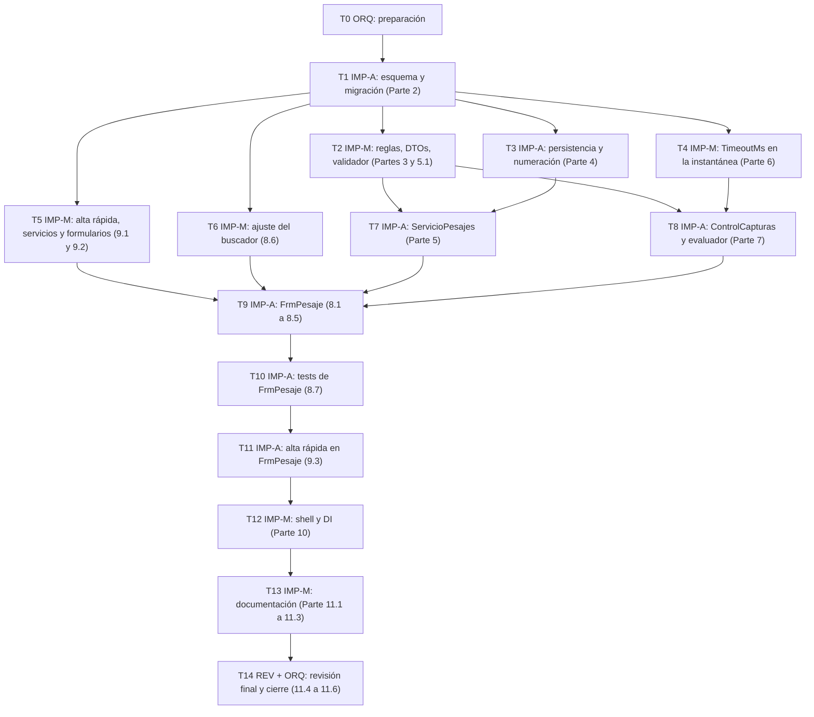

# Plan de implementación F4 — Registro de pesaje

**Autor:** revisión senior (2026-09-26)
**Ejecutor:** un **orquestador** que delega en **subagentes** (Gemini 3.8 Flash para implementar, Gemini 3.1 Pro para revisar en solo lectura). Ver **Parte E** antes que nada.
**Punto de partida:** F3 completado y **commiteado** (`793c489 feat(F3): integración con balanza`, rama `feat/f3-balanza`, árbol limpio). Build Release con 0 warnings; 533 tests en verde según `Agents.md` (mídelo tú mismo antes de empezar y anota el número real).
**HUs:** HU-F4-01 … HU-F4-07 (ver `Agents.md §3`).

**Cómo leer este documento:** la **Parte E** dice *quién* hace *qué* y *en qué orden* (tareas T0–T14, modelo de cada subagente, olas de paralelismo, protocolo de integración). Las **Partes 0–11** son la *especificación* de cada tarea y no cambian por usar subagentes. La **Parte 12** es la revisión de riesgos.

Este documento es **la especificación**. Si algo no está aquí, se aplican las convenciones de `Agents.md §4` y, como plantilla de código, lo que ya hacen F2/F3 (`ServicioGanaderos`, `ServicioParametros`, `FrmConfiguracionBalanza`, `FrmGanaderoEdicion`, `MigracionF3Tests`). Si algo contradice `Agents.md`, manda este documento y la diferencia se anota en el informe final.

La **Parte 12** recoge la revisión de este plan: huecos detectados, cómo se cubrieron y riesgos que quedan abiertos. **Léela entera antes de escribir código**; muchas reglas de las Partes 2–10 existen por lo que se explica allí (se citan como "ver R*n*").

---

## Mapa HU → Partes

| HU | Título | Partes |
|---|---|---|
| HU-F4-01 | Reglas de dominio del pesaje | 2 (esquema), 3 (`ReglasPesaje`, validador) |
| HU-F4-02 | Grabar pesaje con numeración atómica y auditoría | 4 (persistencia), 5 (`ServicioPesajes.RegistrarAsync`) |
| HU-F4-03 | Sugerencia de secuencia por ganadero del día | 4.3 (`RangoDiaLocal`), 5 (`SugerirSecuenciaAsync`) |
| HU-F4-04 | Pantalla de pesaje y display en vivo | 6 (ajuste de `InstantaneaBalanza`), 8 (`FrmPesaje`) |
| HU-F4-05 | Captura de pesos desde la balanza | 7.1 (`ControlCapturas`), 8.4 |
| HU-F4-06 | Flujo por teclado, estados de botones y mensajes guía | 7.2 (`EvaluadorPantallaPesaje`), 8.5, 8.6 (ajuste de `ControlBusquedaCatalogo`) |
| HU-F4-07 | Alta rápida de ganadero y cliente desde el pesaje | 9 |

Orden lógico de las Partes: **2 → 3 → 4 → 5 → 6 → 7 → 9.1–9.2 → 8 → 9.3 → 10 → 11**. Con subagentes, ese orden se convierte en el **grafo de tareas de la Parte E.3** (algunas Partes corren en paralelo). Cada tarea termina con la compuerta de calidad (regla 0.4).

> **Dependencias entre Partes:** `FrmPesaje` (Parte 8) abre los formularios de alta rápida, así que los servicios `CrearRapidoAsync` (9.1) y los modos de alta rápida de los formularios de edición (9.2) van **antes** de la Parte 8. El cableado del evento `AltaRapidaSolicitada` dentro de `FrmPesaje` (9.3) va **después**. El ítem de menú y la aserción de DI de `FrmPesaje` van en la Parte 10, para que las compuertas anteriores compilen.

---

## Parte E — Ejecución con subagentes

Esta Parte la lee y la ejecuta **el orquestador**. Los subagentes **no** leen el plan completo: reciben un *brief* (E.6) con solo lo que necesitan.

### E.1 Limitaciones de los modelos y cómo las neutraliza el plan

Datos públicos a septiembre de 2026 (fichas de Google DeepMind y reportes de la comunidad; ver fuentes al final de la Parte E). **No asumas que desaparecieron**: el diseño de esta Parte existe para que no importen.

| Modelo | Fortalezas útiles aquí | Limitaciones que afectan a F4 | Mitigación en este plan |
|---|---|---|---|
| **Gemini 3.1 Pro** (preview; razonamiento `high` por defecto; 1M de contexto, 64K de salida) | Análisis profundo de un diff contra una especificación; detectar incoherencias entre capas; razonamiento sobre concurrencia y transacciones. | Respuestas **inestables** ante el mismo prompt; **pregunta demasiado** en vez de avanzar; en tareas largas de varios módulos hace **ediciones destructivas fuera de alcance** (reescribe código ajeno, olvida condiciones de filtro) y provoca **regresiones**; más lento y caro; al ser preview, puede cambiar sin aviso. | Se usa **solo como revisor en modo lectura** (sin herramientas de escritura): no puede romper nada. Formato de salida fijo (E.7). Cada hallazgo lo **verifica el orquestador** (con un test, un `grep` o leyendo el código) antes de pasarlo a un implementador: no se persiguen hallazgos alucinados. Nunca se le da una tarea de escritura. |
| **Gemini 3.8 Flash** (razonamiento `low`/`medium`/`high`; 1M de contexto, 64K de salida; corte de conocimiento marzo 2026, en algunos dominios enero 2025) | Mejor en bucles agénticos largos y ediciones **acotadas** (buen puntaje en Terminal-bench); barato y rápido. | **Alucinaciones** (APIs de .NET/EF/WinForms inventadas o de otra versión); con `high` gasta muchos más tokens y puede **tardar o cortar por tiempo**; como todo agente, tiende a **auto-reportar "todo verde"** sin haberlo comprobado y a olvidar reglas dadas muchas páginas antes. | Tareas **pequeñas y autocontenidas** (≤ ~15 archivos, una Parte o menos); el brief **repite** las reglas críticas en lugar de decir "ver Parte 0"; lista blanca de archivos (E.5); APIs críticas ya **verificadas** en el plan (E.8) + Context7; `high` solo donde hace falta (E.4); el orquestador **re-ejecuta** build, tests y comprobaciones automáticas (E.9) y **nunca** acepta el reporte del subagente como prueba. |
| Ambos | Contexto de 1M: caben el plan y todo el código de F0–F3. | Un contexto grande **no** garantiza que se respete una regla puntual de la página 5; los subagentes arrancan **sin memoria** de lo hecho antes. | Brief con la Parte relevante **copiada literal** + filas de la Parte 12 citadas + archivos plantilla a imitar; el orquestador mantiene la bitácora (E.10). |

### E.2 Perfiles de subagente

| Perfil | Modelo y razonamiento | Herramientas | Uso |
|---|---|---|---|
| **ORQ** — orquestador | **Gemini 3.8 Flash, `high`** | Todas (shell, git, edición). | Único dueño de git, de la rama y de las compuertas. Arma los briefs, lanza subagentes, integra, re-ejecuta verificaciones, lleva la bitácora y escribe el informe final. **No implementa** Partes (solo resuelve conflictos triviales de integración: `using`, registros de DI). Se eligió Flash y no 3.1 Pro porque su trabajo es un bucle largo de herramientas, donde 3.1 Pro se detiene a preguntar y es inestable. |
| **IMP-A** — implementador exigente | **Gemini 3.8 Flash, `high`** | Edición + shell **dentro de su worktree**. Sin `git commit`/`push`/`merge`. | Tareas con transacciones, migraciones, hilos de UI, teclado o lógica con muchos casos. |
| **IMP-M** — implementador estándar | **Gemini 3.8 Flash, `medium`** | Ídem IMP-A. | Tareas mecánicas bien especificadas (tablas de reglas, dobles de prueba, documentación, cableado). |
| **REV** — revisor | **Gemini 3.1 Pro, `high`** | **Solo lectura** (leer archivos, `git diff`, `grep`). Sin edición ni shell de escritura. | Revisa el diff de cada tarea contra su Parte y las filas R citadas; devuelve hallazgos con el formato de E.7. También hace la revisión final completa (T14). |
| **EXP** — explorador | **Gemini 3.8 Flash, `low`** | Solo lectura. | Consultas baratas del ORQ: "lista las columnas NOT NULL de `Pesajes` en el Designer de F3", "¿qué tests usan `IServicioClientes`?", comparar el script SQL de la migración con la tabla de CK. |

**Si la plataforma solo ofrece un modelo:** usa Gemini 3.8 Flash para todo, pero el revisor **debe** ser una instancia nueva (contexto limpio), en `high` y **sin herramientas de escritura**. La independencia de contexto y la falta de permisos de escritura importan más que el modelo.

**Si la plataforma no permite fijar el nivel de razonamiento por subagente:** usa `high` para IMP-A y REV, y el valor por defecto (`medium`) para el resto.

### E.3 Grafo de tareas y olas



| Ola | Tareas | ¿En paralelo? | Motivo |
|---|---|---|---|
| 0 | T0 | — | Preparación. |
| 1 | T1 | No | Crea `OrigenPeso` y toca el snapshot de EF: todo lo demás depende de esto y **una sola** tarea puede generar migraciones. |
| 2 | T2, T3, T4, T5, T6 | **Sí** (hasta 5) | Conjuntos de archivos **disjuntos** (E.5). |
| 3 | T7, T8 | **Sí** | Disjuntos (Application/Pesajes vs WinForms/Presentacion). |
| 4 | T9 → T10 → T11 | No | Los tres tocan `FrmPesaje.cs`. T10 lo escribe **otro** subagente distinto de T9: los tests se derivan de la especificación (8.7), no de la implementación. |
| 5 | T12 → T13 | No | Integración y documentación. |
| 6 | T14 | — | Revisión final, verificaciones y arranque. |

**Si la plataforma no tiene worktrees o subagentes en paralelo:** ejecuta las tareas en el orden T1…T14 **una a una** en el árbol principal. El resto del protocolo no cambia.

### E.4 Ficha de cada tarea

"Tarea" = un subagente implementador + una revisión REV + las correcciones. Duración orientativa relativa: S (chica), M, L (grande).

| Tarea | Especificación | Perfil | Tamaño | Por qué este perfil | Archivos permitidos (lista blanca) | Comprobaciones automáticas propias (además de E.9) |
|---|---|---|---|---|---|---|
| **T0** | E.10 | ORQ | S | — | — (solo git) | Árbol limpio, `HEAD = 793c489`, línea base de tests anotada. |
| **T1** | Parte 2 | IMP-A | M | Migración con reconstrucción de tabla SQLite, edición puntual de `defaultValue` (R17) y revisión de SQL: un error aquí rompe BD de clientes. | `Domain/Enums/Enums.cs`, `Domain/Entities/Entities.cs`, `Infrastructure/Persistencia/Configuraciones/PesajeConfiguration.cs`, **archivos nuevos** `Migraciones/*_F4_Pesaje*.cs`, `Migraciones/PesajeDbContextModelSnapshot.cs`, `tests/.../PersistenciaIntegracionTests.cs`, `tests/.../MigracionF4Tests.cs` (nuevo), `tests/.../Builders/EntityBuilders.cs` | `git diff --name-only 793c489 -- src/PesajeFaeneo.Infrastructure/Persistencia/Migraciones` solo muestra los 2 archivos nuevos + el snapshot; `grep -n "defaultValue: 1" *F4_Pesaje.cs` encuentra la columna `OrigenPeso`; `has-pending-model-changes` limpio. **REV** recibe además el script SQL de 2.8 y compara CK, FK e índices con la tabla de la Parte 2. |
| **T2** | Partes 3 y **5.1** (DTOs) | IMP-M | M | Tablas de reglas cerradas, sin concurrencia ni UI. | Nuevos: `Domain/Reglas/ReglasPesaje.cs`, `Application/Pesajes/Dtos/PesajeDtos.cs`, `Application/Pesajes/ValidadorPesaje.cs`, `tests/.../ReglasPesajeTests.cs`, `tests/.../ValidadorPesajeTests.cs` | `grep -rn "using PesajeFaeneo.Application\|using Microsoft" src/PesajeFaeneo.Domain/Reglas` vacío; los mensajes de la tabla 3.1 aparecen **literales** (el ORQ hace `grep` de 3 de ellos). |
| **T3** | Parte 4 | IMP-A | M | `UPDATE … RETURNING` no componible (R3), transacciones, zonas horarias con horas inválidas. | Nuevos: `Application/Abstracciones/Persistencia/IPesajeRepositorio.cs`, `Infrastructure/Persistencia/Repositorios/PesajeRepositorio.cs`, `Application/Comun/RangoDiaLocal.cs`, tests `PesajeRepositorioTests.cs`, `NumeracionBoletaTests.cs`, `RangoDiaLocalTests.cs`, y si hace falta `tests/.../Utilidades/TiempoConZona.cs`. Modificados: `IParametrosRepositorio.cs`, `ParametrosRepositorio.cs`, `IUnidadDeTrabajo.cs`, `UnidadDeTrabajo.cs`, `tests/.../ServicioParametrosTests.cs` (**solo** la propiedad `Pesajes` del `UowDecorador`) | `grep -n -A4 "SqlQuery" ParametrosRepositorio.cs` **no** contiene `SingleAsync`, `FirstAsync`, `Single(`, `.Where(` antes de `ToListAsync`; `grep -n "DateTime.Now\|DateTime.Today\|DateTime.UtcNow" src/PesajeFaeneo.Application/Comun` vacío. |
| **T4** | Parte 6 | IMP-M | S | Cambio pequeño y bien delimitado. | `Application/Balanza/Dtos/BalanzaDtos.cs`, `Application/Balanza/ReglasBalanza.cs`, `Application/Balanza/ServicioBalanza.cs`, `tests/.../ServicioBalanzaTests.cs`, el archivo de tests de `InstantaneaBalanza` que exista (o `DominioTests.cs`) | El constructor posicional de `InstantaneaBalanza` **no** cambió (`git diff` de ese record solo agrega líneas); en `ServicioBalanza.cs`, `git diff` toca solo el campo nuevo, `BucleAsync` (1 línea) y `Publicar`; ningún `await` nuevo sin `.ConfigureAwait(false)`. |
| **T5** | 9.1 y 9.2 | IMP-M | M | Refactor por extracción de método + ajustes de dobles de prueba; reglas explícitas. | `Application/Catalogos/IServicioGanaderos.cs`, `IServicioClientes.cs`, `ServicioGanaderos.cs`, `ServicioClientes.cs`, `WinForms/Formularios/Catalogos/FrmGanaderoEdicion.cs`, `FrmClienteEdicion.cs`, `tests/.../ServicioGanaderosTests.cs`, `ServicioClientesTests.cs`, `FrmGanaderosTests.cs`, `FrmGanaderoEdicionTests.cs`, `FrmClientesTests.cs`, `FrmClienteEdicionTests.cs` | En `ServicioClientesTests.cs`, `git diff` elimina **solo** la aserción de `SugerirSiguienteCodigoAsync` del caso Operador (R14); `CrearAsync` sigue con `ExigirPermiso(Permiso.GestionarCatalogos)` (`grep`). |
| **T6** | 8.6 | IMP-M | S | Cambio de 5 líneas con un test. | `WinForms/Controles/ControlBusquedaCatalogo.cs`, `tests/.../ControlBusquedaCatalogoTests.cs` | `git diff --stat` ≤ ~40 líneas; ningún test existente modificado. |
| **T7** | Parte 5 (salvo 5.1) | IMP-A | L | Orden estricto de la transacción (D9, R4), rollback de numeración (R6), política de simulador (R25), test de concurrencia real (R5). | Nuevos: `Application/Pesajes/IServicioPesajes.cs`, `ServicioPesajes.cs`, `tests/.../ServicioPesajesTests.cs`, `tests/.../ServicioPesajesConcurrenciaTests.cs`. Modificados: `Application/Auditoria/FabricaAuditoria.cs`, `Application/DependencyInjection.cs` (una línea), `tests/.../FabricaAuditoriaTests.cs`, `tests/.../Utilidades/SesionesDePrueba.cs` (sobrecarga) | En `RegistrarAsync`, entre `IniciarTransaccionAsync` y `ReservarNumeroBoletaAsync` no hay ningún `await` (el ORQ lo verifica leyendo el método); `CancellationToken.None` no se usa dentro del servicio. |
| **T8** | Parte 7 | IMP-A | M | Muchas combinaciones de estado; es la red de seguridad antifraude (D6, D7). | Nuevos: `WinForms/Presentacion/Pesaje/ControlCapturas.cs`, `EvaluadorPantallaPesaje.cs`, `tests/.../ControlCapturasTests.cs`, `EvaluadorPantallaPesajeTests.cs` | `grep -n "System.Windows.Forms\|Timer\|DateTime.Now\|UtcNow" src/PesajeFaeneo.WinForms/Presentacion/Pesaje` vacío (lógica pura; el `ahora` entra por parámetro). |
| **T9** | 8.1 a 8.5 | IMP-A | L | Hilos de UI, reentrada de `FormBase` (R8, R39), teclado (R9, R11, R37, R38, R41). Es la tarea con más reglas finas: por eso **no** incluye tests ni alta rápida. | Nuevo: `WinForms/Formularios/Pesaje/FrmPesaje.cs` (y, si lo separas, un `FrmPesaje.Controles.cs` parcial) | `grep` en `FrmPesaje.cs`: **ninguna** coincidencia de `PerformClick(`, `AcceptButton`, `CancelButton`, `KeyPreview = true`, `.Result`, `.Wait()`, `GetAwaiter().GetResult()`, `DateTime.Now`, `DateTime.UtcNow`; `ActualizarSugerenciaAsync` **no** está dentro de un `EjecutarAsync`; cada botón de acción tiene `TabStop = false`; compila y los tests existentes pasan (aún no hay tests del formulario). |
| **T10** | 8.7 | IMP-A (**instancia distinta** de la de T9) | L | STA, `DoEvents`, `TaskCompletionSource`, dobles a mano (R21). Otro subagente escribe los tests a partir de la especificación: si falla un test, se decide contra el plan quién tiene razón. | Nuevos: `tests/.../FrmPesajeTests.cs`, `tests/.../Utilidades/Pesaje/*.cs`. Puede **leer** `FrmPesaje.cs` pero **no modificarlo**: si un gancho `internal` de 8.7 falta o un test revela un defecto, lo informa y el ORQ abre una corrección en T9. | `grep -rn "Thread.Sleep\|Task.Delay(" tests/.../FrmPesajeTests.cs` vacío; todo test con `Form` está dentro de `HiloSta.Ejecutar`; la suite completa pasa **3 veces seguidas**. |
| **T11** | 9.3 | IMP-A | M | Tres bloques `Ejecutar`/`EjecutarAsync` secuenciales sin anidar (regla 0.10). | `FrmPesaje.cs`, `FrmPesajeTests.cs`, `tests/.../Utilidades/Pesaje/FormFactoryFalsa.cs` | Ningún `EjecutarAsync(`/`Ejecutar(` dentro del delegado de otro (revisión manual del ORQ sobre `AltaRapidaGanaderoAsync`/`AltaRapidaClienteAsync`). |
| **T12** | Parte 10 | IMP-M | S | Cableado siguiendo un patrón existente (`AbrirUsuarios`). | `WinForms/Formularios/FrmPrincipal.cs`, `tests/.../ContenedorDITests.cs`, `tests/.../FrmPrincipalTests.cs` | `AutorizadorMenuTests.cs` sin cambios. |
| **T13** | 11.1 a 11.3 | IMP-M | S | Redacción; el ORQ le pasa la bitácora (E.10) con cifras reales. | `Agents.md`, `README.md` | No inventa cifras: los números de tests salen de la bitácora del ORQ. |
| **T14** | 11.4 a 11.6 + revisión final | **REV** (revisión completa en solo lectura) + **ORQ** (verificaciones, arranque, informe) | M | Una mirada independiente sobre el diff completo (`git diff 793c489`) contra las Partes 2–10 y la Parte 12. | — (REV no escribe; las correcciones van como tareas nuevas `T14.n` con perfil IMP-A o IMP-M según tamaño) | Todo E.9 sobre el árbol final + 11.4 (tres corridas) + 11.5 (arranque y cierre). |

### E.5 Aislamiento: worktrees y lista blanca

- Cada tarea de las olas 2 y 3 corre en su **propio worktree** creado por el ORQ desde la punta de `feat/f4-pesaje`:
  ```bash
  git worktree add ../pesalab-f4-T3 -b f4/T3 feat/f4-pesaje
  ```
  Cada worktree tiene su propio `bin/` y `obj/`: los `dotnet build`/`dotnet test` en paralelo **no** se pisan (en el mismo árbol, MSBuild bloquea archivos de `obj/` y fallaría al azar). Las pruebas usan BD en memoria o archivos temporales con GUID, así que no compiten entre sí.
- Las olas 1, 4, 5 y 6 corren en el árbol principal (sin paralelismo).
- La **lista blanca** de E.4 es parte del brief. Al terminar, el ORQ ejecuta en el worktree `git status --porcelain` y compara con la lista: **cualquier archivo fuera de ella** = tarea rechazada. Se descartan esos cambios (`git checkout -- <archivo>` o `git clean` del archivo nuevo) y se reenvía el brief señalando la violación. Esta es la defensa principal contra las ediciones fuera de alcance (E.1).
- Solo T1 ejecuta `dotnet ef`. Si otra tarea cree necesitar un cambio de esquema, **se detiene y lo informa**; el ORQ decide.

### E.6 Plantilla del brief (lo que recibe cada subagente)

El ORQ arma un brief por tarea con **exactamente** estas secciones, en este orden, y sin resumir la especificación:

```text
# Tarea Tn — <título>            Perfil: <IMP-A|IMP-M|REV|EXP> (<modelo>, <razonamiento>)
## Directorio de trabajo
<ruta absoluta del worktree o del árbol principal>
## Objetivo (2–3 líneas)
## Especificación
<Parte(s) del plan copiadas LITERALMENTE, incluidas sus tablas y sus tests>
## Riesgos que debes evitar
<las filas R de la Parte 12 citadas en esa Parte, copiadas literalmente>
## Reglas obligatorias (no negociables)
- Solo puedes crear o modificar estos archivos: <lista blanca>. Si necesitas tocar otro, DETENTE y explícalo en el reporte.
- No preguntes. Si algo es ambiguo, elige la opción más conservadora compatible con la especificación y anótala en "Desviaciones".
- No ejecutes git commit, push, merge, rebase, reset ni checkout de ramas.
- No agregues paquetes NuGet ni cambies .csproj/.props. No desactives warnings, tests ni analizadores. No uses #pragma warning disable.
- Español en identificadores, comentarios y mensajes. Finales de línea CRLF, UTF-8.
- TimeProvider inyectado siempre; nada de DateTime.Now/UtcNow/Today en código de producción; FakeTimeProvider en tests.
- xUnit solo con Assert. Sin librerías de mocks. Nada de Thread.Sleep ni Task.Delay con tiempos fijos en tests.
- <reglas de la Parte 0 que apliquen a esta tarea: 0.9, 0.10, 0.11, 0.12… copiadas literalmente>
- Antes de usar estas APIs, confirma su firma: <lista de E.8 que aplique>. Si tienes Context7, úsalo; si no, learn.microsoft.com.
## Archivos de referencia (léelos antes de escribir; imita su estilo)
<p. ej. ServicioGanaderos.cs, ServicioParametrosTests.cs, MigracionF3Tests.cs, FrmConfiguracionBalanza.cs>
## Criterios de aceptación (ejecútalos tú y pega la salida real)
dotnet build src/PesajeFaeneo.sln -c Release       → 0 warnings, 0 errores
dotnet test src/PesajeFaeneo.sln -c Release        → N tests, 0 fallos
<comprobaciones automáticas propias de la tarea (columna de E.4)>
## Formato de reporte (tu última respuesta, nada más)
ARCHIVOS: <lista con A=agregado, M=modificado>
TESTS: antes=<n> después=<n> fallos=<n>   (pega las 3 últimas líneas de dotnet test)
BUILD: warnings=<n> errores=<n>
DESVIACIONES: <lista o "ninguna">
BLOQUEOS: <lista o "ninguno">
```

### E.7 Revisión por REV (después de cada tarea implementadora)

- **Entrada:** el brief de la tarea (misma especificación y riesgos) + `git diff` de la tarea + acceso de lectura al repositorio.
- **Instrucción fija:** "Revisa solo este diff contra la especificación y los riesgos. No propongas mejoras de estilo ni refactors. No reescribas código. Para cada problema, da un hallazgo con este formato:"
  ```text
  [SEVERIDAD: BLOQUEANTE|MAYOR|MENOR] archivo:línea
  Regla violada: <D#, R#, Parte x.y o regla 0.n>
  Qué pasa: <1–2 frases>
  Cómo demostrarlo: <test concreto o comando que falla>
  ```
  Si no hay hallazgos, responde exactamente `SIN HALLAZGOS`.
- **Filtro del ORQ (obligatorio):** un hallazgo solo se acepta si el ORQ lo **confirma** (lee el código, ejecuta el comando o escribe el test propuesto y lo ve fallar). Los no confirmados se registran en la bitácora como "descartado: no reproducible" y **no** se envían al implementador (3.1 Pro es inestable, E.1).
- **Corrección:** los hallazgos confirmados BLOQUEANTE y MAYOR vuelven al **mismo** perfil implementador (instancia nueva, brief original + lista de hallazgos confirmados). Los MENOR se anotan para el informe; se corrigen solo si son de una línea.
- **Límite:** como máximo **2 ciclos** implementar→revisar por tarea. Si en el tercero sigue habiendo un BLOQUEANTE confirmado, el ORQ lo resuelve con una tarea nueva de perfil IMP-A con brief acotado **solo** a ese defecto, y lo anota como desviación.

### E.8 APIs ya verificadas por la revisión (no hace falta re-investigarlas; sí respetarlas)

| API | Hecho verificado | Fuente |
|---|---|---|
| `DatabaseFacade.SqlQuery<T>` | EF compone como subconsulta cualquier operador LINQ aplicado encima (`Where`, `First…`, `Single…`); para SQL no componible hay que materializar sin componer (`ToListAsync`) y operar en memoria. Los escalares se leen de una columna llamada `Value`. | Documentación oficial de EF Core (consultas SQL y cambio incompatible de EF Core 3.0 sobre SQL no componible), consultada con Context7. |
| `UPDATE … RETURNING` en SQLite | Soportado desde SQLite 3.35; `Microsoft.Data.Sqlite` 8.0.11 trae una versión posterior (EF Core 8 usa `RETURNING` para sus propios `INSERT`). El test 4.4-2 lo confirma en la máquina. | Notas de versión de SQLite; comportamiento de EF Core 8. |
| `NumericUpDown.Value` | El getter valida el texto editado por el usuario antes de devolver el valor. | Código fuente de WinForms (`UpDownBase`/`NumericUpDown`). Confírmalo con Context7 en T9. |
| `Button.PerformClick` | Solo actúa si `CanSelect` (habilitado y visible) y valida el control activo. Por eso el plan **no** lo usa. | Código fuente de WinForms. |
| `FakeTimeProvider.SetLocalTimeZone` | Existe en `Microsoft.Extensions.TimeProvider.Testing` 8.x. Si no compila en 8.10, usa el plan B de 4.3 (`TiempoConZona`). | Documentación del paquete. Confírmalo en T3. |

### E.9 Comprobaciones automáticas del ORQ (después de cada tarea, **en el worktree de la tarea** y otra vez tras integrar)

Ninguna depende del reporte del subagente. Los comandos son de **Git Bash** (la herramienta Bash del entorno), no de PowerShell. `git status --porcelain` se revisa **antes** del `git add -A`.

```bash
dotnet build src/PesajeFaeneo.sln -c Release
dotnet test src/PesajeFaeneo.sln -c Release
```
```bash
# Solo archivos de la lista blanca
git status --porcelain
# Finales de línea: debe salir vacío (después de git add en el worktree)
git add -A && git diff --cached --name-only --diff-filter=AM | xargs -r git ls-files --eol | grep "w/lf"
# Nada de trampas para pasar la compuerta: debe salir vacío
git diff --cached -U0 | grep -E "^\+.*(#pragma warning disable|Skip *=|NoWarn|TreatWarningsAsErrors|PackageReference|Thread\.Sleep)"
# Migraciones existentes intactas: solo deben aparecer archivos *F4_Pesaje* y el snapshot
git diff --cached --name-only 793c489 -- src/PesajeFaeneo.Infrastructure/Persistencia/Migraciones
```
- El número de tests **nunca baja** respecto de la ola anterior (un test borrado es un rechazo, salvo el cambio autorizado de R14, que modifica una aserción y no borra el test).
- Si una comprobación falla: tarea **rechazada** y se reenvía el brief con la salida literal del fallo.

### E.10 Protocolo del ORQ (integración, git y bitácora)

1. **T0:** `git status` limpio y `HEAD = 793c489` (si no, detente y repórtalo); `git switch -c feat/f4-pesaje`; ejecuta la compuerta y anota en la bitácora el número de tests de partida.
2. **Por cada ola:**
   1. Crea los worktrees de la ola desde la punta de `feat/f4-pesaje` (olas 2 y 3) o usa el árbol principal.
   2. Lanza los implementadores de la ola (en paralelo si la ola lo permite).
   3. Por cada tarea terminada: E.9 en su worktree → REV (E.7) → correcciones → E.9 de nuevo.
   4. Aprobada la tarea: `git add -A && git commit -m "wip(F4-Tn): <título>"` en su worktree (olas 2 y 3) o directamente en `feat/f4-pesaje` (olas 1, 4, 5 y 6). El **ORQ** hace el commit, nunca el subagente. **T1 debe estar commiteada antes de crear los worktrees de la ola 2**, porque se crean desde la punta de la rama y no ven cambios sin commit.
   5. Integra en `feat/f4-pesaje`, **de a una tarea y en el orden numérico** (T2, T3, T4…): `git merge --no-ff f4/Tn`. Tras **cada** merge: compuerta completa. Si hay conflicto, será en archivos compartidos por diseño mínimo (p. ej. `using`); resuélvelo tú; si toca lógica, aborta el merge (`git merge --abort`) y relanza la tarea sobre la punta nueva.
   6. Al cerrar la ola, la suite **tres veces seguidas** (olas 3 y 4 obligatorio; en las demás basta una).
   7. `git worktree remove ../pesalab-f4-Tn` y `git branch -d f4/Tn`.
3. **Git — reemplaza la regla 0.3 original:** se permiten **commits locales** `wip(F4-Tn)` en `feat/f4-pesaje` y en las ramas `f4/Tn` (hacen falta para integrar worktrees). **Nunca** `push`. Al terminar T14, anota el SHA del último commit en el informe y ejecuta `git reset --soft 793c489`: todo F4 queda como cambios preparados sin commit, igual que en fases anteriores, para que el usuario lo revise y haga un único commit `feat(F4): registro de pesaje`. (Si algo sale mal, `git reset --soft <SHA anotado>` recupera el historial.)
4. **Bitácora** (`../pesalab-f4-bitacora.md`, **fuera** del repositorio para que ningún `git add -A` la incluya; la mantiene solo el ORQ): por tarea, perfil y modelo usados, número de ciclos, hallazgos de REV (confirmados/descartados), tests antes→después, desviaciones. T13 la usa como fuente de cifras.
5. **Qué nunca delega el ORQ:** git, las compuertas, la decisión de aceptar hallazgos, la prueba de arranque (11.5) y el informe final (11.6).

**Fuentes de E.1** (consultadas el 2026-09-27): ficha del modelo Gemini 3.8 Flash (deepmind.google/models/model-cards/gemini-3-8-flash), ficha de Gemini 3.1 Pro (deepmind.google/models/model-cards/gemini-3-1-pro), comparativa "Gemini 3.8 Flash vs 3.1 Pro" (myclaw.ai), reporte de uso agéntico de 3.1 Pro (dev.to, "I stopped using Gemini 3.1 Pro for agentic coding"). Las limitaciones de 3.1 Pro vienen en parte de reportes de la comunidad, no de la ficha oficial: se trataron como riesgos plausibles, no como hechos medidos.

---

## Parte 0 — Reglas de comportamiento del agente (obligatorias)

1. **Reparto del trabajo:** lo define la **Parte E**. El orquestador (ORQ) delega cada Parte en subagentes según E.4 y **no** implementa Partes él mismo. Los subagentes trabajan solo en su tarea y su lista blanca. Ningún subagente lanza otros subagentes.
2. **No te detengas hasta terminar** (vale para el ORQ y para cada subagente dentro de su tarea). El ORQ responde al usuario **una sola vez**, al final, con el informe de la Parte 11. Si algo bloquea, se documenta, se elige la opción más conservadora compatible con este plan y se continúa. Los subagentes **no hacen preguntas**: anotan la ambigüedad en "Desviaciones".
3. **Git:** lo gobierna **E.10.3** (commits locales `wip` permitidos solo al ORQ, nunca `push`, `reset --soft` al base al terminar). Antes de empezar, `git status` debe estar **limpio** y `HEAD` debe ser el commit de F3 (`793c489`); si no, el ORQ **se detiene y lo reporta**. La rama de trabajo es `feat/f4-pesaje`.
4. **Compuerta de calidad después de cada Parte:**
   ```bash
   dotnet build src/PesajeFaeneo.sln -c Release
   ```
   ```bash
   dotnet test src/PesajeFaeneo.sln -c Release
   ```
   0 warnings (`TreatWarningsAsErrors=true`), 0 errores y todos los tests en verde. **No avances con rojo.** Nunca desactives un warning, un test ni un analizador para pasar la compuerta. Si un test **existente** falla por un cambio de esta fase, corrige los **datos o dobles del test**, nunca la regla nueva, y anótalo en el informe. La única excepción autorizada está en 9.1 (permiso de `SugerirSiguienteCodigoAsync`, ver R14).
   - La suite se ejecuta **tres veces seguidas** al cerrar las olas 3 y 4 de la Parte E (Partes 5 y 8) y en T10. Un test que falla 1 de 3 veces es un test roto: corrígelo, no lo reintentes hasta que pase.
   - El subagente ejecuta la compuerta y pega la salida, pero **el ORQ la vuelve a ejecutar** siempre (E.9): el reporte del subagente no cuenta como prueba.
5. **Convenciones:** identificadores, comentarios, mensajes de UI y de log en **español**; imita el estilo y la densidad de comentarios del código existente. Finales de línea **CRLF**, UTF-8: al terminar cada Parte verifica que ningún archivo nuevo o tocado quede con LF (`git diff --stat` / `git status` muestran "LF will be replaced by CRLF"; conviértelo). xUnit solo con `Assert`. Siempre `TimeProvider` inyectado; en tests, `FakeTimeProvider`. Fechas persistidas en UTC.
6. **Capas** (las hace cumplir `ArquitecturaTests`): Domain sin NuGet ni referencias a otros proyectos; Application sin EF, WinForms, Serilog, Hosting ni `System.IO.Ports`; Infrastructure sin WinForms. **No agregues paquetes NuGet.**
7. **Migraciones:** no modifiques las migraciones existentes (`Inicial` … `F3_DelimitadorSignoIgual`). Los cambios de esquema van en **una** migración nueva (Parte 2). Al terminar, `dotnet ef migrations has-pending-model-changes` no debe reportar cambios.
8. **Librerías:** antes de escribir código contra una API de librería, consulta la documentación con Context7 si la plataforma lo ofrece (EF Core: `/dotnet/entityframework.docs`; .NET/WinForms: `/dotnet/docs` o `/websites/learn_microsoft_en-us_dotnet`); si no, la documentación oficial en learn.microsoft.com. Los hechos de **E.8** ya están verificados. Gemini 3.8 Flash tiene corte de conocimiento en marzo de 2026 (en algunos dominios enero de 2025) y puede inventar firmas: **no escribas de memoria** una API de la lista siguiente. Como mínimo: `DatabaseFacade.SqlQuery<T>` (y por qué **no** se compone sobre un `UPDATE`, ver R3), `DatabaseFacade.CurrentTransaction`, `FakeTimeProvider.SetLocalTimeZone`, `TimeZoneInfo.ConvertTimeToUtc`/`IsInvalidTime`, `Control.ProcessCmdKey`, `Button.PerformClick`, `ComboBox.DroppedDown`, `NumericUpDown.Value`, `Control.SelectNextControl`.
9. **Hilo de UI:** nunca bloquees el hilo de UI con `.Result`, `.Wait()` ni `.GetAwaiter().GetResult()` una vez iniciado el bucle de mensajes. Los manejadores de eventos asíncronos son `async void` (o lambdas `async (_, _) =>`) y delegan en `FormBase.EjecutarAsync` salvo donde este plan diga lo contrario.
10. **Regla de reentrada de `FormBase` (0.10, sigue vigente):** `EjecutarAsync`/`Ejecutar` descartan **en silencio** cualquier invocación mientras otra está en curso. Nunca anides `EjecutarAsync` dentro de otro. **Nuevo en F4:** la sugerencia de secuencia **no** usa `EjecutarAsync` (ver 8.3 y R8): si se descartara en silencio, el operador grabaría una secuencia vieja.
11. **Tests de WinForms:** todo test que cree un `Form`, un control o un `System.Windows.Forms.Timer` corre dentro de `HiloSta.Ejecutar(...)` y desecha lo que crea. Los servicios falsos son clases escritas a mano (sin librerías de mocks) y **devuelven tareas ya completadas** (`Task.FromResult`), nunca una BD real: el patrón existente `form.CargarParaTestAsync().GetAwaiter().GetResult()` se interbloquea si la tarea no está completada (ver R21). Los `MessageBox` no se pueden probar: expón ganchos `internal` que salten la confirmación, como `FrmParametros`/`FrmConfiguracionBalanza`.
12. **Seguridad:** sin puertas traseras. Los pesos **solo** entran por captura desde la balanza: **no** existe ningún campo editable de peso ni gancho "para tests" accesible desde la UI en producción (los ganchos de tests son `internal`). Nada se relaja por compilar en Debug.
13. **Logging:** `Information` al registrar un pesaje (sin datos personales más allá de ids, número de boleta y total). Nunca registres cada instantánea de la balanza ni cada tecla.

---

## Parte 1 — Decisiones de diseño (asumidas; el usuario puede cambiarlas)

Definitivas para esta ejecución. Centralízalas como constantes en `ReglasPesaje` (Parte 3.1) para que cambiarlas sea trivial. Las marcadas con **(P*n*)** dependen de una pregunta al usuario de la Parte 12.

| # | Decisión | Valor |
|---|---|---|
| D1 | Qué es un pesaje | Un registro = una boleta = **un animal** de un ganadero, entregado a un cliente, con el peso de su media res **izquierda** y **derecha**. `PesoTotal = PesoIzquierdo + PesoDerecho`, redondeado a 0,1 kg (`AwayFromZero`). **(P1)** |
| D2 | Tipo de desposte | **Res completa**: ambos lados obligatorios (`> 0`). **Media res**: **exactamente un** lado `> 0` y el otro `= 0` (se entrega solo media res; en los reportes de F7 cuenta como 0,5 animal). Esta regla vive **solo** en `ReglasPesaje.ValidarPesos` (no en la BD) para que cambiarla sea una línea. **(P1)** |
| D3 | Rango de pesos por lado | Si el lado se capturó: **10,0 a 600,0 kg** (`PesoMinimoLadoKg`, `PesoMaximoLadoKg`). El mínimo evita capturar un gancho vacío o ruido. Ambos lados en 0 nunca es válido. **(P2)** |
| D4 | Origen de los pesos | **Solo captura desde la balanza** (F4-05). No hay ingreso manual de pesos. Nueva columna `Pesaje.OrigenPeso` (`Balanza = 1`, `Simulador = 2`, `Importado = 3`; el 3 lo usará F8-04). **(P3)** |
| D5 | Modo simulador (cierra R14 de F3) | Si la balanza activa es el **Simulador**: solo quien tiene `ConfigurarBalanza` (Administrador) puede **capturar y grabar**; para los demás, captura y grabación deshabilitadas con mensaje guía y el servicio lo rechaza (`ReglaNegocioException("PES_SIMULADOR", …)`, defensa en profundidad). Lo grabado queda con `OrigenPeso = Simulador` (F5 imprimirá "SIMULADO"). **(P4)** |
| D6 | Captura (cierra R13 de F3) | Se captura **solo** si, en el instante de la tecla, `servicio.Instantanea.EsCapturable(ahora)` es `true` (conectada, estable, con peso y lectura reciente dentro de `TimeoutMs`) **y** el peso está dentro de D3. Se lee la instantánea **fresca** del servicio, no la última que vio el monitor. |
| D7 | Retorno a cero | Tras cada captura, la siguiente captura exige que la balanza haya pasado por **≤ 2,0 kg** (`UmbralRetornoCeroKg`) estando conectada. Evita capturar la misma media res como izquierda y derecha, o el mismo animal en dos boletas. Al abrir la pantalla no se exige. "Borrar pesos" (F8) borra **ambos** lados y levanta la exigencia (sin pesos no hay duplicado posible). Grabar **no** la levanta. Desactivable con `ExigirRetornoACero = false`. **(P5)** |
| D8 | Numeración | `NumeroBoleta` se asigna **al grabar**, dentro de la transacción, con `UPDATE ParametrosSistema SET SiguienteNumeroBoleta = SiguienteNumeroBoleta + 1 WHERE Id = 1 RETURNING SiguienteNumeroBoleta - 1`. Si cualquier paso posterior falla, el rollback deshace también el incremento (no quedan huecos). La pantalla muestra "Próxima boleta: N" solo como **informativo**. |
| D9 | Transacción de grabado | Orden estricto (ver 5.3): validaciones y lecturas **fuera** de la transacción → `BEGIN` → **primera sentencia: el `UPDATE` de numeración** → `INSERT` del pesaje → `INSERT` de auditoría con el `Id` real → `COMMIT`. |
| D10 | Auditoría | `AccionAuditoria.Crear`, `Entidad = "Pesaje"`, `EntidadId = Id`, `despues = PesajeAuditoria` (snapshot sin navegaciones), `Motivo = "Registro de pesaje (boleta {N})"`. |
| D11 | Fecha y hora | `FechaHora = CreadoEn = TimeProvider.GetUtcNow().UtcDateTime` **del servidor al grabar** (nunca la envía la UI). `ModificadoEn = null`. |
| D12 | Secuencia | Entero 1..9999. Sugerencia = `MAX(Secuencia)` de los pesajes **vigentes** del mismo ganadero en el **día local** + 1 (1 si no hay; tope 9999). Los anulados no cuentan (su secuencia se puede reutilizar). Es solo una sugerencia editable; **no** se exige unicidad. **(P6)** |
| D13 | Día local | `[inicio, fin)` del día calendario en `TimeProvider.LocalTimeZone`, convertido a UTC con `RangoDiaLocal` (Parte 4.3), reutilizable por F7. |
| D14 | Textos | `Direccion` (≤150, opcional, **prellenada** con la dirección del cliente al elegirlo), `ColorRaza` (≤30, opcional), `Observacion` (≤250, opcional, prellenada con `ParametrosSistema.ObservacionPorDefecto`). Los tres se normalizan con `ValidadorCatalogos.NormalizarMayusculas` (trim + colapso de espacios + mayúsculas, igual que los catálogos y la boleta legada). **(P7)** |
| D15 | Sexo | `'M'` (Macho) o `'H'` (Hembra). Por defecto `'M'`. |
| D16 | Ganadero y cliente | Obligatorios, deben existir y estar **activos** al grabar (se relee en el servicio). |
| D17 | Permisos | `IServicioPesajes` (todo): **`Pesar`** (Operador, Supervisor, Administrador). Datos de apoyo: `ListarParaBusquedaAsync` de catálogos e `IServicioParametros.ObtenerAsync` ya exigen solo sesión (F2 D9). Alta rápida: **`AltaRapidaCatalogos`** (Parte 9). Simulador: D5. |
| D18 | Después de grabar | Se **conservan** ganadero, cliente, dirección, sexo y tipo de desposte (el operador pesa la tropa de un ganadero de corrido); se **limpian** pesos y color/raza; observación vuelve al valor por defecto; secuencia = nueva sugerencia; foco a Color/Raza. Mensaje guía verde "Boleta N° {n} grabada — {total} kg" + sonido del sistema. **Sin** `MessageBox`. |
| D19 | Teclado de `FrmPesaje` | `Enter` = siguiente campo (como `Tab`); `F5` = capturar izquierdo; `F6` = capturar derecho; `F8` = borrar pesos; `F12` = grabar; `Esc` = cerrar (confirma si hay pesos sin grabar). **Sin `AcceptButton`** (un `Enter` jamás graba). `F9` queda **reservada** para "Imprimir" de F5. |
| D20 | Pantalla | `FrmPesaje` modal y maximizada, abierta desde Pesaje › Registrar pesaje (**F2** en el shell, ya definido). Display grande del peso en vivo, estado, indicador ESTABLE, banda naranja "MODO SIMULADOR", formulario de datos, pesos capturados, mensaje guía, grilla "Pesajes de hoy" (últimos 50). |
| D21 | Panel del simulador en `FrmPesaje` | Visible **solo** si la balanza activa es el Simulador **y** el usuario tiene `ConfigurarBalanza`: numérico de peso objetivo + "Cargar" + "Vaciar". **Modifica** la regla 10.5 de F3 ("no expongas el control del simulador en otro formulario"); motivo: con D7 no se podría probar el pesaje con el simulador (el formulario de configuración no se puede abrir con `FrmPesaje` abierto, ambos son modales). Ver R15. |
| D22 | Alta rápida | `CrearRapidoAsync` en `ServicioGanaderos`/`ServicioClientes` (permiso `AltaRapidaCatalogos`, mismas validaciones, `Motivo = "Alta rápida desde pesaje"`). `SugerirSiguienteCodigoAsync` pasa a aceptar `GestionarCatalogos` **o** `AltaRapidaCatalogos`. Ver Parte 9. |
| D23 | Esquema | Migración `F4_Pesaje`: columna `OrigenPeso` + CHECK endurecidas en `Pesajes` (Parte 2). No se agregan índices (los de F0 cubren F4-03). **No** se agrega el token `Version` (es de F6). |

---

## Parte 2 — Esquema: `OrigenPeso` y restricciones de `Pesajes`

**Archivos:** `Domain/Enums/Enums.cs`, `Domain/Entities/Entities.cs`, `Infrastructure/Persistencia/Configuraciones/PesajeConfiguration.cs`, migración nueva, `tests/.../PersistenciaIntegracionTests.cs`, test nuevo `MigracionF4Tests.cs`, `tests/.../Builders/EntityBuilders.cs`.

1. En `Enums.cs` agrega:
   ```csharp
   public enum OrigenPeso
   {
       Balanza = 1,
       Simulador = 2,
       Importado = 3
   }
   ```
2. En `Pesaje` agrega `public OrigenPeso OrigenPeso { get; set; } = OrigenPeso.Balanza;` (después de `PesoTotal`).
3. En `PesajeConfiguration`:
   - `builder.Property(p => p.OrigenPeso).IsRequired();` (**sin** `HasDefaultValue`: ver R17).
   - En `ToTable(...)` deja **exactamente** estas CK (conserva las que no cambian, reemplaza `CK_Pesajes_Secuencia`):

   | Nombre | Expresión |
   |---|---|
   | `CK_Pesajes_TipoDesposte` | `TipoDesposte IN (1, 2)` *(sin cambio)* |
   | `CK_Pesajes_Sexo` | `Sexo IN ('M', 'H')` *(sin cambio)* |
   | `CK_Pesajes_Estado` | `Estado IN (1, 2)` *(sin cambio)* |
   | `CK_Pesajes_Pesos` | `PesoIzquierdo >= 0 AND PesoDerecho >= 0 AND PesoTotal >= 0` *(sin cambio)* |
   | `CK_Pesajes_Secuencia` | `Secuencia BETWEEN 1 AND 9999` *(antes `>= 1`)* |
   | `CK_Pesajes_Anulacion` | *(sin cambio)* |
   | `CK_Pesajes_NumeroBoleta` | `NumeroBoleta >= 1` |
   | `CK_Pesajes_PesoTotal` | `abs(PesoTotal - (PesoIzquierdo + PesoDerecho)) < 0.05` |
   | `CK_Pesajes_OrigenPeso` | `OrigenPeso IN (1, 2, 3)` |
   | `CK_Pesajes_Direccion` | `length(Direccion) <= 150` |
   | `CK_Pesajes_ColorRaza` | `length(ColorRaza) <= 30` |
   | `CK_Pesajes_Observacion` | `length(Observacion) <= 250` |
   | `CK_Pesajes_MotivoAnulacion` | `MotivoAnulacion IS NULL OR length(MotivoAnulacion) BETWEEN 1 AND 250` |

   La coherencia desposte↔pesos (D2) **no** va en la BD (depende de P1 y los datos legados de F8 pueden no cumplirla).
4. `PesajeBuilder` (tests): agrega `ConOrigen(OrigenPeso origen)` (por defecto `Balanza`), `ConSecuencia(int)` y `ConEstadoVigente()` si hiciera falta. `ConPesos` ya recalcula el total y los valores por defecto (media res 106,0 / 0,0 / 106,0) cumplen todas las CK nuevas: no los cambies. Para los casos de CK incoherente, modifica la entidad devuelta por `Build()` antes de guardarla.
5. Verifica antes de generar que `TipoDesposte`/`Estado` se persisten como `INTEGER` y `Sexo` como `TEXT` en `PesajeDbContextModelSnapshot.cs`. Si no, **detente** y repórtalo.
6. Genera la migración:
   ```bash
   dotnet ef migrations add F4_Pesaje -p src/PesajeFaeneo.Infrastructure -s src/PesajeFaeneo.WinForms -o Persistencia/Migraciones
   ```
7. **Edita una sola cosa en la migración generada:** en la operación `AddColumn<int>(name: "OrigenPeso", …)`, cambia `defaultValue: 0` por `defaultValue: 1`. Es seguro (el snapshot no guarda ese valor, así que `has-pending-model-changes` sigue limpio) y **necesario**: con `0`, cualquier fila existente violaría `CK_Pesajes_OrigenPeso` durante la copia de la reconstrucción y la migración fallaría (R17). No toques nada más a mano.
8. **Revisa el SQL generado:**
   ```bash
   dotnet ef migrations script F3_DelimitadorSignoIgual F4_Pesaje -p src/PesajeFaeneo.Infrastructure -s src/PesajeFaeneo.WinForms
   ```
   Debe contener: `ALTER TABLE "Pesajes" ADD "OrigenPeso" INTEGER NOT NULL DEFAULT 1;` (o equivalente dentro de la reconstrucción) y la reconstrucción de `Pesajes` (`CREATE TABLE "ef_temp_Pesajes"` … `INSERT INTO … SELECT` … `DROP TABLE` … `ALTER TABLE … RENAME`) con **todas** las CK de la tabla, las 4 FK (`Ganaderos`, `Clientes`, `Usuarios` ×2) y la recreación de los 5 índices (`NumeroBoleta` único, `FechaHora`, `(GanaderoId, FechaHora)`, `(ClienteId, FechaHora)`, `(Estado, FechaHora)`) y del índice de `AnuladoPorId`/`UsuarioId` si existían. Ninguna tabla tiene FK **hacia** `Pesajes`, así que la reconstrucción es segura. Si falta algo, **no** edites el SQL: revisa la configuración y regenera. Anota el resumen en el informe.

**Tests (en `PersistenciaIntegracionTests`, con los helpers que ya use esa clase):** un caso por CK nueva o endurecida, insertando un pesaje válido del builder y alterando un campo: `Secuencia = 10000`, `NumeroBoleta = 0`, `PesoTotal` incoherente (izq 100, der 100, total 150), `OrigenPeso = (OrigenPeso)9`, `Direccion` de 151 caracteres, `ColorRaza` de 31, `Observacion` de 251 → `DbUpdateException`. Y un caso positivo: izq 100,1 / der 99,9 / total 200,0 se guarda (la tolerancia de la CK absorbe el error de `REAL`).

**Test nuevo `MigracionF4Tests`** (mismo esqueleto que `MigracionF3Tests`):
1. `MigrateAsync("20260925171853_F3_DelimitadorSignoIgual")`.
2. Con SQL crudo inserta un usuario, un ganadero, un cliente y **un pesaje** válido (columnas explícitas; no incluyas `OrigenPeso`, aún no existe). Saca la lista de columnas `NOT NULL` y sus tipos de `20260925171853_F3_DelimitadorSignoIgual.Designer.cs` (no la adivines); las fechas van como texto `'2026-09-20 12:00:00'`.
3. `MigrateAsync()` (hasta la última).
4. Verifica: el pesaje sigue ahí con sus datos, `OrigenPeso = 1`, `PRAGMA foreign_key_check` sin filas, y que un `UPDATE Pesajes SET OrigenPeso = 9` con SQL crudo falla por CHECK.

`ModeloVsMigracionTests` debe seguir en verde.

---

## Parte 3 — Reglas de dominio y validación (HU-F4-01)

### 3.1 `Domain/Reglas/ReglasPesaje.cs` (espacio de nombres `PesajeFaeneo.Domain.Reglas`)

Clase estática **pura** (sin dependencias; solo `Domain.Enums` y `Domain.Excepciones.ErrorValidacion`).

```csharp
public static class CamposPesaje
{
    public const string Ganadero = "Ganadero";
    public const string Cliente = "Cliente";
    public const string Direccion = "Direccion";
    public const string Secuencia = "Secuencia";
    public const string ColorRaza = "ColorRaza";
    public const string Sexo = "Sexo";
    public const string TipoDesposte = "TipoDesposte";
    public const string PesoIzquierdo = "PesoIzquierdo";
    public const string PesoDerecho = "PesoDerecho";
    public const string Pesos = "Pesos";
    public const string Observacion = "Observacion";
}

public static class ReglasPesaje
{
    public const decimal PesoMinimoLadoKg = 10.0m;
    public const decimal PesoMaximoLadoKg = 600.0m;
    public const decimal UmbralRetornoCeroKg = 2.0m;
    public const bool ExigirRetornoACero = true;
    public const int SecuenciaMinima = 1;
    public const int SecuenciaMaxima = 9999;
    public const int LongitudMaximaDireccion = 150;
    public const int LongitudMaximaColorRaza = 30;
    public const int LongitudMaximaObservacion = 250;
    public const char SexoMacho = 'M';
    public const char SexoHembra = 'H';
    public const int PesajesDelDiaMaximo = 50;

    public static decimal Redondear(decimal pesoKg);                  // Math.Round(p, 1, AwayFromZero)
    public static decimal CalcularTotal(decimal izq, decimal der);   // Redondear(Redondear(izq) + Redondear(der))
    public static bool EsSexoValido(char sexo);
    public static bool EsPesoLadoValido(decimal pesoKg);             // Min ≤ p ≤ Max (ya redondeado)
    public static IReadOnlyList<ErrorValidacion> ValidarPesos(TipoDesposte tipo, decimal izq, decimal der);
    public static int SugerirSecuencia(int? maximaDelDia);           // null → 1; Math.Min(max + 1, SecuenciaMaxima)
}
```

`ValidarPesos` (redondea ambos antes de evaluar; usa estos mensajes **exactos**, los mostrará la UI):

| Caso | Campo | Mensaje |
|---|---|---|
| `tipo` no definido (`!Enum.IsDefined`) | `TipoDesposte` | "Seleccione el tipo de desposte." |
| Algún lado negativo | `Pesos` | "Los pesos no pueden ser negativos." |
| Ambos en 0 | `Pesos` | "Capture al menos un peso." |
| `ResCompleta` y falta izquierdo | `PesoIzquierdo` | "Res completa: capture el peso izquierdo." |
| `ResCompleta` y falta derecho | `PesoDerecho` | "Res completa: capture el peso derecho." |
| `MediaRes` con ambos `> 0` | `Pesos` | "Media res: capture solo un lado." |
| Lado `> 0` fuera de rango | `PesoIzquierdo` / `PesoDerecho` | "El peso de cada lado debe estar entre 10,0 y 600,0 kg." (formatea los límites con las constantes y cultura `es-BO`, no los escribas a mano) |

Si se detecta "negativo" o "ambos en 0" devuelve solo ese error (no sigas evaluando).

### 3.2 `Application/Pesajes/ValidadorPesaje.cs`

```csharp
public static class ValidadorPesaje
{
    // Normaliza textos (ValidadorCatalogos.NormalizarMayusculas) y devuelve el DTO normalizado + errores.
    public static (RegistrarPesaje Normalizado, IReadOnlyList<ErrorValidacion> Errores) Validar(RegistrarPesaje dto);
}
```
Reglas: `GanaderoId > 0` si no → `Ganadero` "Seleccione el ganadero."; `ClienteId > 0` si no → `Cliente` "Seleccione el cliente."; `Secuencia` en 1..9999 → `Secuencia` "La secuencia debe estar entre 1 y 9999."; `EsSexoValido` (compara en mayúsculas; normaliza `'m'`→`'M'`) → `Sexo` "Seleccione el sexo (M o H)."; longitudes de D14 → "La dirección no puede superar 150 caracteres.", "Color/raza no puede superar 30 caracteres.", "La observación no puede superar 250 caracteres."; más `ReglasPesaje.ValidarPesos`. Los pesos del DTO normalizado quedan **redondeados**.

### 3.3 Tests

- `ReglasPesajeTests` (sin BD): cada fila de la tabla de 3.1; límites exactos 10,0 / 600,0 válidos y 9,9 / 600,1 inválidos; `CalcularTotal(100.05m, 100.04m)` = 200,1 (redondeo por lado); `SugerirSecuencia(null) == 1`, `(4) == 5`, `(9999) == 9999`; `EsSexoValido('X') == false`; `TipoDesposte` 3 → error de desposte.
- `ValidadorPesajeTests`: normalización (`"  rojo   overo "` → `"ROJO OVERO"`), `null` → `""`, cada error con su campo.
- `ArquitecturaTests` debe seguir en verde (Domain no gana referencias).

---

## Parte 4 — Persistencia (base de HU-F4-02 y F4-03)

### 4.1 `IPesajeRepositorio` (Application/Abstracciones/Persistencia) e implementación (Infrastructure/Persistencia/Repositorios/PesajeRepositorio.cs)

```csharp
public interface IPesajeRepositorio
{
    void Agregar(Pesaje pesaje);
    Task<Pesaje?> ObtenerPorIdAsync(int id, CancellationToken cancellationToken = default);   // sin tracking, Include Ganadero y Cliente
    /// MAX(Secuencia) de pesajes VIGENTES del ganadero con FechaHora en [desdeUtc, hastaUtc); null si no hay.
    Task<int?> ObtenerSecuenciaMaximaAsync(int ganaderoId, DateTime desdeUtc, DateTime hastaUtc, CancellationToken cancellationToken = default);
    Task<int> ContarVigentesAsync(int ganaderoId, DateTime desdeUtc, DateTime hastaUtc, CancellationToken cancellationToken = default);
    /// Sin tracking, Include Ganadero y Cliente, orden NumeroBoleta descendente, Take(maximo).
    Task<IReadOnlyList<Pesaje>> ListarPorRangoAsync(DateTime desdeUtc, DateTime hastaUtc, int maximo, CancellationToken cancellationToken = default);
}
```
- `ObtenerSecuenciaMaximaAsync`: `MaxAsync(p => (int?)p.Secuencia)` (el cast evita la excepción sobre secuencia vacía, igual que F2).
- Las comparaciones con `FechaHora` usan parámetros `DateTime` con `Kind = Utc`: el conversor UTC de F0 se aplica también a los parámetros comparados con la columna. Un test lo confirma (4.4).

### 4.2 Numeración en `IParametrosRepositorio`

Agrega:
```csharp
/// Incrementa atómicamente SiguienteNumeroBoleta y devuelve el número reservado (el valor ANTERIOR al incremento).
/// Exige una transacción explícita activa en la unidad de trabajo (InvalidOperationException si no la hay).
Task<long> ReservarNumeroBoletaAsync(CancellationToken cancellationToken = default);
```
Implementación en `ParametrosRepositorio`:
```csharp
if (_context.Database.CurrentTransaction is null)
    throw new InvalidOperationException("ReservarNumeroBoletaAsync requiere una transacción explícita.");

var numeros = await _context.Database
    .SqlQuery<long>($"UPDATE ParametrosSistema SET SiguienteNumeroBoleta = SiguienteNumeroBoleta + 1 WHERE Id = 1 RETURNING SiguienteNumeroBoleta - 1 AS Value")
    .ToListAsync(cancellationToken);

return numeros.Count == 1
    ? numeros[0]
    : throw new InvalidOperationException("No existe la fila de parámetros del sistema (Id = 1).");
```
- **Obligatorio `ToListAsync`** y luego tomar el elemento en memoria. **Prohibido** `SingleAsync`/`FirstAsync`/`Where` sobre este `SqlQuery`: EF lo envolvería en un `SELECT … FROM (UPDATE …)`, que SQLite rechaza (R3).
- La columna se llama `Value` (convención de EF para `SqlQuery` de escalares).
- `SqlQuery` usa la transacción actual del `DbContext` automáticamente; no crees comandos ADO a mano.
- **No** cargues la entidad `ParametrosSistema` con tracking en la misma unidad antes de esto (quedaría con un valor viejo en memoria). `RegistrarAsync` no la carga.

### 4.3 `Application/Comun/RangoDiaLocal.cs`

```csharp
public readonly record struct RangoUtc(DateTime DesdeUtc, DateTime HastaUtc);   // [Desde, Hasta), ambos Kind = Utc

public static class RangoDiaLocal
{
    /// Día calendario local que contiene "ahora" según tiempo.LocalTimeZone.
    public static RangoUtc DeHoy(TimeProvider tiempo);
    /// Día calendario "fecha" en la zona "zona".
    public static RangoUtc DelDia(DateOnly fecha, TimeZoneInfo zona);
}
```
- `DeHoy`: `ahoraLocal = TimeZoneInfo.ConvertTime(tiempo.GetUtcNow(), tiempo.LocalTimeZone)`; `DelDia(DateOnly.FromDateTime(ahoraLocal.DateTime), tiempo.LocalTimeZone)`.
- `DelDia`: inicio local = `fecha.ToDateTime(TimeOnly.MinValue, DateTimeKind.Unspecified)`; fin local = inicio + 1 día. Convierte cada uno con un helper que, si `zona.IsInvalidTime(t)` (medianoche inexistente por cambio de horario), avanza de 1 minuto en 1 minuto hasta un instante válido (máx. 3 h) y luego `TimeZoneInfo.ConvertTimeToUtc(t, zona)`. Devuelve `DateTime` con `Kind = Utc`.
- Tests `RangoDiaLocalTests` con zonas creadas con `TimeZoneInfo.CreateCustomTimeZone` (no dependas de las zonas instaladas en la máquina):
  - Bolivia (`-04:00`, sin horario de verano): `2026-09-26` → `[2026-09-26 04:00Z, 2026-09-27 04:00Z)`.
  - `DeHoy` con `FakeTimeProvider` en `2026-09-27 02:30Z` y zona `-04:00` → el día local es **26** (caso típico de error: comparar con la fecha UTC).
  - Zona con regla de ajuste que salta de 00:00 a 01:00 un día concreto → no lanza y el inicio es 01:00 local.
  - `FakeTimeProvider.SetLocalTimeZone(zona)` fija la zona local. Si la versión instalada (8.10) no tuviera ese método, crea en `tests/.../Utilidades` un `TiempoConZona : FakeTimeProvider` que sobrescriba `LocalTimeZone`, y anótalo.

### 4.4 Unidad de trabajo

- `IUnidadDeTrabajo`: agrega `IPesajeRepositorio Pesajes { get; }`; `UnidadDeTrabajo`: `public IPesajeRepositorio Pesajes => _pesajes ??= new PesajeRepositorio(_context);`.
- **Rompe** el doble `UowDecorador` de `ServicioParametrosTests` (agrega `public IPesajeRepositorio Pesajes => _inner.Pesajes;`). Ver R20.

**Tests `PesajeRepositorioTests` / `NumeracionBoletaTests`** (`BaseDatosEnMemoria`):
1. `ReservarNumeroBoletaAsync` sin transacción → `InvalidOperationException`.
2. Con transacción y `SiguienteNumeroBoleta = 1000` → devuelve 1000; tras `ConfirmarAsync` la fila vale 1001.
3. Con transacción, reservar y **desechar sin confirmar** → la fila sigue en 1000 (rollback).
4. Tres reservas seguidas en la misma transacción → 1000, 1001, 1002.
5. `ObtenerSecuenciaMaximaAsync`: pesajes vigentes con secuencias 1, 2, 5 y uno anulado con 9 del mismo ganadero en el rango, uno con 7 de otro ganadero y uno con 8 fuera del rango → 5. Sin pesajes → `null`.
6. Límite del rango: `FechaHora == DesdeUtc` entra, `FechaHora == HastaUtc` **no** entra.
7. `ListarPorRangoAsync` respeta orden y `maximo`, y trae `Ganadero.Marca` y `Cliente.Nombre`.

---

## Parte 5 — `ServicioPesajes` (HU-F4-02 y HU-F4-03)

### 5.1 DTOs (`Application/Pesajes/Dtos/PesajeDtos.cs`)

```csharp
public sealed record RegistrarPesaje(
    int GanaderoId,
    int ClienteId,
    string? Direccion,
    int Secuencia,
    string? ColorRaza,
    char Sexo,
    TipoDesposte TipoDesposte,
    decimal PesoIzquierdo,
    decimal PesoDerecho,
    string? Observacion,
    bool CapturadoConSimulador);   // la UI lo informa; el servicio solo lo usa para ENDURECER (5.3 paso 4)

public sealed record PesajeRegistrado(int Id, long NumeroBoleta, DateTime FechaHoraUtc, decimal PesoTotal, OrigenPeso Origen);

public sealed record SugerenciaSecuencia(int Siguiente, int PesajesVigentesHoy);

public sealed record PesajeResumen(
    int Id, long NumeroBoleta, DateTime FechaHoraUtc,
    string Marca, string NombreGanadero, int Secuencia, string NombreCliente,
    TipoDesposte TipoDesposte, decimal PesoIzquierdo, decimal PesoDerecho, decimal PesoTotal,
    EstadoPesaje Estado, OrigenPeso Origen);
```

### 5.2 Interfaz (`Application/Pesajes/IServicioPesajes.cs`)

```csharp
public interface IServicioPesajes
{
    Task<SugerenciaSecuencia> SugerirSecuenciaAsync(int ganaderoId, CancellationToken cancellationToken = default);
    Task<PesajeRegistrado> RegistrarAsync(RegistrarPesaje dto, CancellationToken cancellationToken = default);
    Task<IReadOnlyList<PesajeResumen>> ListarDelDiaAsync(CancellationToken cancellationToken = default);   // últimos ReglasPesaje.PesajesDelDiaMaximo
}
```
Registro en `Application/DependencyInjection.cs`: `services.AddTransient<Pesajes.IServicioPesajes, Pesajes.ServicioPesajes>();`.

Constructor: `IUnidadDeTrabajoFactory`, `ISesionActual`, `IServicioBalanza`, `TimeProvider`, `ILogger<ServicioPesajes>` (todos obligatorios, `ArgumentNullException`).

### 5.3 `RegistrarAsync` — orden estricto

1. `ArgumentNullException.ThrowIfNull(dto)`; `_sesion.ExigirPermiso(Permiso.Pesar)`; `var sesion = _sesion.ExigirSesion();`.
2. `var (n, errores) = ValidadorPesaje.Validar(dto)`; si hay errores → `ValidacionException(errores)`.
3. `var instantanea = _servicioBalanza.Instantanea;` `var origen = (instantanea.EsSimulador || dto.CapturadoConSimulador) ? OrigenPeso.Simulador : OrigenPeso.Balanza;` (el indicador de la UI solo puede **endurecer** el origen, nunca rebajarlo).
4. Si `origen == Simulador && !_sesion.TienePermiso(Permiso.ConfigurarBalanza)` → `ReglaNegocioException("PES_SIMULADOR", "La balanza está en modo simulador. Solo un administrador puede grabar pesajes simulados.")`.
5. `await using var uow = await _uowFactory.CrearAsync(ct);` Lee ganadero y cliente (`ObtenerPorIdAsync`); `null` o `!Activo` → `ValidacionException(CamposPesaje.Ganadero, "El ganadero seleccionado no existe o está desactivado.")` (ídem cliente, "El cliente seleccionado no existe o está desactivado."). Estas lecturas van **antes** de abrir la transacción (D9, R4).
6. `var ahora = _timeProvider.GetUtcNow().UtcDateTime;`
7. `await using var tx = await uow.IniciarTransaccionAsync(ct);`
8. `var numero = await uow.Parametros.ReservarNumeroBoletaAsync(ct);` — **primera** sentencia de la transacción. Si `numero > ReglasParametros.SiguienteNumeroBoletaMaximo` → `ReglaNegocioException("PES_NUMERACION_AGOTADA", "Se agotó la numeración de boletas. Revise los parámetros del sistema.")` (el `await using` revierte).
9. Crea el `Pesaje`: `NumeroBoleta = numero`, `FechaHora = CreadoEn = ahora`, ids, textos normalizados, `Sexo`, `TipoDesposte`, pesos redondeados, `PesoTotal = ReglasPesaje.CalcularTotal(...)`, `Estado = Vigente`, `OrigenPeso = origen`, `UsuarioId = sesion.Id`, `ModificadoEn = null`. `uow.Pesajes.Agregar(p)`; `await uow.GuardarCambiosAsync(ct)`.
   - Atrapa **aquí** `ConflictoException` (índice único de `NumeroBoleta`: alguien dejó el contador por debajo de un número existente) y relanza `ReglaNegocioException("PES_NUMERO_DUPLICADO", $"El número de boleta {numero} ya existe. Revise 'Siguiente número de boleta' en Parámetros del sistema.", ex)`.
10. Auditoría (D10) con `EntidadId = p.Id.ToString(CultureInfo.InvariantCulture)`; `uow.Auditoria.Registrar(...)`; `await uow.GuardarCambiosAsync(ct)`; `await tx.ConfirmarAsync(ct)`.
11. `_logger.LogInformation("Pesaje registrado: boleta {Numero}, Id {Id}, ganadero {GanaderoId}, cliente {ClienteId}, total {Total} kg, origen {Origen}, usuario {Usuario}", …)`.
12. Devuelve `PesajeRegistrado`.

La UI llama a `RegistrarAsync` con `CancellationToken.None` (no se cancela un grabado a medias; la transacción lo haría seguro de todos modos, pero así no hay estados raros en la UI).

### 5.4 Auditoría

En `FabricaAuditoria.cs`:
- `EntidadesAuditoria.Pesaje = "Pesaje"`.
- `public sealed record PesajeAuditoria(int Id, long NumeroBoleta, DateTime FechaHora, int GanaderoId, int ClienteId, string Direccion, int Secuencia, string ColorRaza, char Sexo, TipoDesposte TipoDesposte, decimal PesoIzquierdo, decimal PesoDerecho, decimal PesoTotal, string Observacion, EstadoPesaje Estado, OrigenPeso OrigenPeso, int UsuarioId);` — **sin** navegaciones (F6 lo reutilizará para el diff).
- `CrearSnapshot(Pesaje)` y el caso `Pesaje p => CrearSnapshot(p)` en `NormalizarObjeto`.
- Test en `FabricaAuditoriaTests`: el JSON contiene `"Sexo":"M"`, `"TipoDesposte":"ResCompleta"`, `"OrigenPeso":"Balanza"` (enums como texto, igual que el resto) y no contiene `"Ganadero":{`.

### 5.5 `SugerirSecuenciaAsync` y `ListarDelDiaAsync`

- `SugerirSecuenciaAsync(ganaderoId)`: `ExigirPermiso(Pesar)`; `ganaderoId <= 0` → `ValidacionException(Ganadero, "Seleccione el ganadero.")`; `rango = RangoDiaLocal.DeHoy(_timeProvider)`; `max = ObtenerSecuenciaMaximaAsync`, `cuenta = ContarVigentesAsync`; devuelve `new SugerenciaSecuencia(ReglasPesaje.SugerirSecuencia(max), cuenta)`. No valida que el ganadero exista (si no existe, devuelve 1/0; el grabado lo rechazará).
- `ListarDelDiaAsync`: `ExigirPermiso(Pesar)`; `ListarPorRangoAsync(rango, ReglasPesaje.PesajesDelDiaMaximo)`; mapea a `PesajeResumen`.

### 5.6 Tests `ServicioPesajesTests` (`BaseDatosEnMemoria`, `FakeTimeProvider` con zona `-04:00`, `ServicioBalanzaFalso`, `NullLogger`)

Crea un helper `CrearServicio(db, …)` como en `ServicioParametrosTests` y un helper que siembre un ganadero y un cliente activos y devuelva un `RegistrarPesaje` válido (res completa 120,0 / 118,5).

1. Sin sesión → `NoAutorizadoException` en los tres métodos.
2. Operador, Supervisor y Administrador pueden registrar (balanza falsa **no** simulador).
3. Registro válido: `NumeroBoleta` = valor previo del contador; contador +1; `PesoTotal = 238,5`; `FechaHora` = hora del reloj falso en UTC (`Kind = Utc` al releer); `UsuarioId` = sesión; `OrigenPeso = Balanza`; textos en mayúsculas.
4. Auditoría: una fila `Crear`, `Entidad = "Pesaje"`, `EntidadId` = Id, `Motivo` con el número, `DatosDespuesJson` no nulo, `DatosAntesJson` nulo.
5. 20 registros seguidos → números consecutivos sin huecos; contador = inicial + 20.
6. Contador preconfigurado en 5000 → primera boleta 5000.
7. Validación: cada error de 3.1/3.2 llega como `ValidacionException` con el campo correcto y **no** consume número (contador intacto, 0 pesajes, 0 auditorías).
8. Ganadero inactivo / cliente inactivo / id inexistente → `ValidacionException` del campo; contador intacto.
9. Fallo en el guardado de la auditoría (decorador de UoW cuyo **segundo** `GuardarCambiosAsync` lanza, patrón `UowDecorador` de `ServicioParametrosTests`) → excepción propagada, **0 pesajes**, contador intacto (rollback de numeración).
10. Número duplicado: inserta con el builder un pesaje con `NumeroBoleta = 7` y fija el contador en 7 con SQL crudo → `ReglaNegocioException` con `Codigo = "PES_NUMERO_DUPLICADO"`; contador sigue en 7.
11. Simulador: balanza falsa con `EsSimulador = true` → Operador y Supervisor reciben `ReglaNegocioException("PES_SIMULADOR")` sin consumir número; Administrador registra con `OrigenPeso = Simulador`. Balanza real + `CapturadoConSimulador = true` → origen `Simulador` (y operador rechazado).
12. Sugerencia: reloj en `2026-09-27 02:30Z` (26/09 22:30 en Bolivia). Pesajes del ganadero A con `FechaHora` 26/09 12:00Z (sec 3), 27/09 01:00Z (sec 4, que localmente es 26/09 21:00), 26/09 03:00Z (sec 9, localmente 25/09 → fuera) y uno **anulado** hoy con sec 8 → sugerencia 5, `PesajesVigentesHoy = 2`. Ganadero sin pesajes → 1.
13. `ListarDelDiaAsync` devuelve solo los del día local, orden descendente por número, máx. 50.
14. **Concurrencia real** (`SqliteArchivoFixture` + `new UnidadDeTrabajoFactory(fixture.ContextFactory)`; **no** `BaseDatosEnMemoria`, que comparte una sola conexión y no admite transacciones paralelas, R5): 10 `RegistrarAsync` lanzados con `Task.WhenAll(Enumerable.Range(0, 10).Select(_ => Task.Run(() => servicio.RegistrarAsync(dto))))` → 10 números distintos y consecutivos, contador +10. Usa el fixture como `IClassFixture<SqliteArchivoFixture>` en una clase de test propia (o instáncialo y llama a `InitializeAsync`/`DisposeAsync` en `try/finally`). Sesión: siembra un usuario en el fixture y usa una `SesionActual` iniciada con él (el helper `SesionesDePrueba` recibe `BaseDatosEnMemoria`; agrega una sobrecarga que reciba `IDbContextFactory<PesajeDbContext>`). `busy_timeout` = 5000 ms y el reintento propio de `Microsoft.Data.Sqlite` serializan a los escritores; si el test falla con "database is locked", **no** subas tiempos: revisa que el `UPDATE` sea la primera sentencia de la transacción (R4).

---

## Parte 6 — Ajuste de `InstantaneaBalanza` (necesario para HU-F4-05)

**Problema (R1):** `EsCapturable(ahora, antiguedadMaxima)` necesita `TimeoutMs`, pero la configuración de balanza solo la puede leer quien tiene `ConfigurarBalanza` (Administrador). El operador no tiene forma de conocerla.

1. En `ReglasBalanza` agrega `public const int TimeoutPorDefectoMs = 3000;`.
2. En `InstantaneaBalanza` agrega una propiedad **no posicional** (no rompe los `new InstantaneaBalanza(...)` existentes ni los tests):
   ```csharp
   /// TimeoutMs de la configuración con la que se produjo la lectura (para EsCapturable sin leer la configuración).
   public int TimeoutMs { get; init; } = ReglasBalanza.TimeoutPorDefectoMs;

   public bool EsCapturable(DateTimeOffset ahora) => EsCapturable(ahora, TimeSpan.FromMilliseconds(TimeoutMs));
   ```
   (`BalanzaDtos.cs` está en `Application.Balanza.Dtos`; `ReglasBalanza` en `Application.Balanza`: agrega el `using`.)
3. En `ServicioBalanza`: campo `private int _timeoutMsActivo = ReglasBalanza.TimeoutPorDefectoMs;`. Al inicio de `BucleAsync`: `Volatile.Write(ref _timeoutMsActivo, config.TimeoutMs);`. En `Publicar`: `var nueva = new InstantaneaBalanza(...) { TimeoutMs = Volatile.Read(ref _timeoutMsActivo) };`. No cambies nada más del servicio.
4. Tests (`ServicioBalanzaTests` y un test puro en `DominioTests` o donde estén los de `InstantaneaBalanza`): con `TimeoutMs = 2500` guardado, la instantánea publicada tras conectar tiene `TimeoutMs == 2500`; `EsCapturable(ahora)` es `false` si `ahora - InstanteLectura = 2501 ms` y `true` con 2500 ms.

---

## Parte 7 — Lógica pura de la pantalla (HU-F4-05 y HU-F4-06)

Dos clases **sin controles ni temporizadores**, en `src/PesajeFaeneo.WinForms/Presentacion/Pesaje/` (espacio `PesajeFaeneo.WinForms.Presentacion.Pesaje`), `internal sealed`. Se prueban sin STA.

### 7.1 `ControlCapturas`

```csharp
internal enum LadoPesaje { Izquierdo, Derecho }

internal enum MotivoRechazoCaptura
{
    Ninguno,
    BalanzaNoCapturable,     // !EsCapturable(ahora) (desconectada, inestable, sin peso o lectura vieja)
    PesoFueraDeRango,        // < PesoMinimoLadoKg o > PesoMaximoLadoKg
    EsperandoRetornoACero,
    SimuladorNoPermitido,    // EsSimulador y el usuario no tiene ConfigurarBalanza
    LadoNoPermitido          // Media res con el OTRO lado ya capturado
}

internal sealed class ControlCapturas
{
    public ControlCapturas(bool puedeUsarSimulador);

    public decimal? PesoIzquierdo { get; }
    public decimal? PesoDerecho { get; }
    public bool CapturadoConSimulador { get; }     // alguna captura vigente vino del simulador
    public bool EsperandoRetornoACero { get; }     // false al construir
    public bool TienePesos { get; }                // algún lado != null

    /// Llamar con CADA instantánea que ve el monitor: si Estado == Conectada y |PesoKg| <= UmbralRetornoCeroKg,
    /// levanta EsperandoRetornoACero.
    public void Observar(InstantaneaBalanza instantanea);

    /// Evalúa sin modificar estado (lo usa el evaluador para habilitar botones).
    public MotivoRechazoCaptura Evaluar(LadoPesaje lado, TipoDesposte tipo, InstantaneaBalanza instantanea, DateTimeOffset ahora);

    /// Evalúa; si es Ninguno, asigna el lado con ReglasPesaje.Redondear(PesoKg), marca CapturadoConSimulador si
    /// corresponde y EsperandoRetornoACero = ReglasPesaje.ExigirRetornoACero.
    public MotivoRechazoCaptura Capturar(LadoPesaje lado, TipoDesposte tipo, InstantaneaBalanza instantanea, DateTimeOffset ahora);

    /// Borra ambos lados, CapturadoConSimulador = false y EsperandoRetornoACero = false (D7).
    public void BorrarPesos();

    /// Tras grabar: borra ambos lados y CapturadoConSimulador, pero CONSERVA EsperandoRetornoACero (D7).
    public void ReiniciarTrasGrabar();
}
```
Orden de evaluación en `Evaluar`: `SimuladorNoPermitido` → `BalanzaNoCapturable` → `PesoFueraDeRango` → `EsperandoRetornoACero` → `LadoNoPermitido` → `Ninguno`. Recapturar el **mismo** lado está permitido (sobrescribe), sujeto a las mismas reglas.

**Tests `ControlCapturasTests`** (instantáneas construidas a mano, `ahora` fijo): cada motivo; capturar izquierdo y luego derecho sin pasar por cero → `EsperandoRetornoACero`; `Observar` con 1,5 kg conectada → se levanta; con 1,5 kg pero `Estado = SinDatos` → **no** se levanta; `BorrarPesos` levanta la exigencia; `ReiniciarTrasGrabar` no; lectura con 3001 ms de antigüedad y `TimeoutMs = 3000` → `BalanzaNoCapturable`; media res con izquierdo capturado → derecho `LadoNoPermitido`, izquierdo de nuevo permitido (tras cero); valor 123,45 se guarda como 123,5.

### 7.2 `EvaluadorPantallaPesaje`

```csharp
internal enum NivelMensajeGuia { Info, Exito, Advertencia, Error }

internal sealed record DatosPantallaPesaje(
    InstantaneaBalanza Instantanea,
    DateTimeOffset Ahora,
    bool GanaderoSeleccionado,
    bool ClienteSeleccionado,
    TipoDesposte TipoDesposte,
    ControlCapturas Capturas,
    bool PuedeUsarSimulador,
    bool Ocupado);

internal sealed record EstadoUiPesaje(
    bool PuedeCapturarIzquierdo,
    bool PuedeCapturarDerecho,
    bool PuedeBorrarPesos,
    bool PuedeGrabar,
    string Mensaje,
    NivelMensajeGuia Nivel);

internal static class EvaluadorPantallaPesaje
{
    public static EstadoUiPesaje Evaluar(DatosPantallaPesaje d);
}
```
- `PuedeCapturarX = !Ocupado && Capturas.Evaluar(X, …) == Ninguno`.
- `PuedeBorrarPesos = !Ocupado && Capturas.TienePesos`.
- `PuedeGrabar = !Ocupado && GanaderoSeleccionado && ClienteSeleccionado && ReglasPesaje.ValidarPesos(tipo, izq ?? 0, der ?? 0).Count == 0 && !(Capturas.CapturadoConSimulador && !PuedeUsarSimulador)`. **No** exige que la balanza siga conectada (los pesos ya se capturaron).
- Mensaje: la **primera** condición que se cumpla, en este orden:

| # | Condición | Mensaje | Nivel |
|---|---|---|---|
| 1 | `Instantanea.EsSimulador && !PuedeUsarSimulador` | "Balanza en MODO SIMULADOR: solo un administrador puede capturar y grabar." | Error |
| 2 | `Estado != Conectada` y sin pesos completos | `PresentacionBalanza.TextoEstado(i)` + ". No se puede capturar." | Error |
| 3 | `!GanaderoSeleccionado` | "Seleccione el ganadero (marca o nombre)." | Info |
| 4 | `!ClienteSeleccionado` | "Seleccione el cliente (código o nombre)." | Info |
| 5 | Pesos completos y válidos | "Listo para grabar (F12)." | Exito |
| 6 | `Capturas.EsperandoRetornoACero` | "Retire la media res de la balanza (esperando retorno a cero)." | Advertencia |
| 7 | Conectada pero no estable | "Esperando peso estable…" | Info |
| 8 | Peso estable fuera de rango | "Peso fuera de rango (10,0 a 600,0 kg)." (constantes) | Advertencia |
| 9 | Res completa, faltan lados | "Capture el lado izquierdo (F5) y el derecho (F6)." / "Capture el lado derecho (F6)." / "Capture el lado izquierdo (F5)." | Info |
| 10 | Media res sin peso | "Media res: capture un lado (F5 o F6)." | Info |
| 11 | Pesos incoherentes (p. ej. media res con dos lados) | primer mensaje de `ReglasPesaje.ValidarPesos` + " Use F8 para borrar." | Advertencia |

  "Pesos completos" = `ValidarPesos` sin errores.
- El mensaje verde post-grabado (D18) lo pone el formulario y se mantiene hasta el siguiente cambio de datos o captura (8.5), no lo calcula el evaluador.

**Tests `EvaluadorPantallaPesajeTests`:** una prueba por fila de la tabla y por cada bandera de habilitación; `Ocupado = true` deshabilita todo.

---

## Parte 8 — `FrmPesaje` (HU-F4-04, F4-05, F4-06)

**Archivo:** `src/PesajeFaeneo.WinForms/Formularios/Pesaje/FrmPesaje.cs` (espacio `PesajeFaeneo.WinForms.Formularios.Pesaje`), `public class FrmPesaje : FormBase`, construido en código como los demás formularios (sin diseñador).

### 8.1 Dependencias y ciclo de vida

Constructor: `IServicioPesajes`, `IServicioGanaderos`, `IServicioClientes`, `IServicioParametros`, `IServicioBalanza`, `ISimuladorBalanza`, `ISesionActual`, `IFormFactory`, `TimeProvider`. El constructor **solo** construye controles: no llama servicios ni arranca temporizadores (lo construye `ContenedorDITests`).

- `_puedeUsarSimulador = _sesion.TienePermiso(Permiso.ConfigurarBalanza)`; `_capturas = new ControlCapturas(_puedeUsarSimulador)`; `_monitor = new MonitorBalanzaUi(_servicioBalanza)`; `_monitor.Actualizado += (_, i) => AlActualizarBalanza(i)`.
- `Shown`: primero `_monitor.Iniciar()` (**fuera** de `EjecutarAsync`, R32 de F3) y luego `await EjecutarAsync(CargarAsync)`.
- `CargarAsync` (no se envuelve a sí mismo): `ListarParaBusquedaAsync` de ganaderos y clientes → `EstablecerElementos`; `_servicioParametros.ObtenerAsync()` → `_observacionPorDefecto`, `lblProximaBoleta`; `ListarDelDiaAsync()` → grilla. Deja el foco en el control de ganadero.
- `Dispose(bool)`: desecha `_monitor`. `FormClosing`: ver 8.5.

### 8.2 Controles (nombres `internal` para los tests)

Layout con `TableLayoutPanel` (sin coordenadas absolutas). De arriba abajo:

1. **Display** (`pnlDisplay`): `lblPesoVivo` (Segoe UI 48 pt negrita, `PresentacionBalanza.TextoPeso`, color `PresentacionBalanza.ColorEstado`), `lblEstable` ("ESTABLE" verde / "INESTABLE" gris / vacío si sin peso), `lblEstadoBalanza` (`PresentacionBalanza.TextoEstado`), `lblSimulador` ("MODO SIMULADOR — los pesos no son reales", fondo `PresentacionBalanza.ColorFondoSimulador`, visible solo si `EsSimulador`), `lblProximaBoleta` ("Próxima boleta: N" o vacío).
2. **Datos** (en este `TabIndex`): `ctlGanadero` (`ControlBusquedaCatalogo`, placeholder "Marca o nombre del ganadero"), `numSecuencia` (`NumericUpDown` 1..9999) con `lblInfoSecuencia` ("Hoy: N pesajes de este ganadero"), `ctlCliente` (placeholder "Código o nombre del cliente"), `txtDireccion` (`MaxLength 150`, `CharacterCasing.Upper`), `txtColorRaza` (30, Upper), `cmbSexo` (`DropDownList`: "M - MACHO", "H - HEMBRA"), `cmbDesposte` (`DropDownList`: "RES COMPLETA", "MEDIA RES"; por defecto Res completa, P1), `txtObservacion` (250, Upper, **una línea**).
3. **Pesos**: `txtPesoIzquierdo`, `txtPesoDerecho`, `txtPesoTotal` (`ReadOnly = true`, `TabStop = false`, fuente grande; formato `"0.0"` con cultura actual; vacío = sin capturar), botones `btnCapturarIzquierdo` ("Capturar izq. (F5)"), `btnCapturarDerecho` ("Capturar der. (F6)"), `btnBorrarPesos` ("Borrar pesos (F8)").
4. **Acciones**: `btnGrabar` ("&Grabar (F12)"), `btnCerrar` ("Cerrar (Esc)"). `lblGuia` (mensaje guía: fondo según `NivelMensajeGuia`: Info = `SystemColors.Info`, Éxito = verde claro, Advertencia = amarillo claro, Error = rojo claro).
5. **Simulador** (`grpSimulador`): `numPesoSimulado` (0..`ReglasBalanza.PesoMaximoSimuladorKg`, 1 decimal), `btnSimularCarga` ("Cargar"), `btnSimularVaciar` ("Vaciar"). `Visible = _puedeUsarSimulador && instantanea.EsSimulador` (se reevalúa en cada actualización). Sus manejadores llaman a `_simulador.EstablecerPesoObjetivo(...)` directamente, sin `EjecutarAsync`, y con `TabStop = false`.
6. **Grilla** `dgvHoy` (`ReadOnly`, `AllowUserToAddRows = false`, selección por fila, `TabStop = false`): Boleta, Hora (local, `HH:mm`), Marca, Sec., Cliente, Desposte, Izq., Der., Total, Origen (vacío si Balanza, "SIMULADO" si Simulador), Estado.
7. `ErrorProvider _errorProvider` y el diccionario campo→control con `CamposPesaje.*` → `ctlGanadero`, `ctlCliente`, `txtDireccion`, `numSecuencia`, `txtColorRaza`, `cmbSexo`, `cmbDesposte`, `txtPesoIzquierdo`, `txtPesoDerecho`, `txtObservacion`. `CamposPesaje.Pesos` sin control (sale por `MessageBox` de `MostrarErroresValidacion`, aceptable porque la UI ya impide ese caso).

Nada de `AcceptButton` ni `CancelButton` (D19). **No** actives `KeyPreview` (todo el teclado se maneja en `ProcessCmdKey`, 8.5).

**Todos los botones de acción** (`btnCapturarIzquierdo`, `btnCapturarDerecho`, `btnBorrarPesos`, `btnGrabar`, `btnCerrar`, y los del simulador) llevan `TabStop = false` (R41): se accionan con su tecla de función o con el mouse. Así, `Enter` repetido recorre solo los campos de datos y, desde `txtObservacion`, vuelve a `ctlGanadero` (`wrap: true`), en vez de caer sobre "Grabar" y grabar con un `Enter` más.

### 8.3 Selección de ganadero y cliente

- `ctlGanadero.ElementoSeleccionado` → `_ = ActualizarSugerenciaAsync(e.Id)` y `ActualizarEstadoUi()`. `SeleccionBorrada` → `lblInfoSecuencia.Text = ""`, `ActualizarEstadoUi()`.
- `ActualizarSugerenciaAsync(int ganaderoId)` **no** usa `EjecutarAsync` (R8):
  ```csharp
  var version = ++_versionSugerencia;
  try
  {
      var s = await _servicioPesajes.SugerirSecuenciaAsync(ganaderoId);
      if (IsDisposed || version != _versionSugerencia || ctlGanadero.Seleccion?.Id != ganaderoId) return;
      numSecuencia.Value = s.Siguiente;
      lblInfoSecuencia.Text = $"Hoy: {s.PesajesVigentesHoy} pesaje(s) de este ganadero";
  }
  catch (Exception ex)
  {
      Log.Warning(ex, "No se pudo sugerir la secuencia del ganadero {GanaderoId}.", ganaderoId);
      if (!IsDisposed) lblInfoSecuencia.Text = "No se pudo sugerir la secuencia; ingrésela manualmente.";
  }
  ```
- `ctlCliente.ElementoSeleccionado` → `txtDireccion.Text = e.Detalle ?? ""` (siempre sobrescribe), `ActualizarEstadoUi()`.
- Cualquier cambio de datos (`SeleccionBorrada`, `cmbDesposte.SelectedIndexChanged`, etc.) llama a `ActualizarEstadoUi()` y quita el mensaje verde post-grabado.

### 8.4 Captura (HU-F4-05)

- `AlActualizarBalanza(InstantaneaBalanza i)`: `_capturas.Observar(i)`; actualiza display y `grpSimulador.Visible`; `ActualizarEstadoUi()`. Debe ser **simple y sin excepciones**: `MonitorBalanzaUi` traga las excepciones de los suscriptores y solo las registra una vez por tipo (R12), un error aquí dejaría la pantalla congelada en silencio.
- `CapturarLado(LadoPesaje lado)` (manejador **plano**, sin `EjecutarAsync`, es instantáneo):
  ```csharp
  var i = _servicioBalanza.Instantanea;          // fresca, no _monitor.Ultima (D6)
  _capturas.Observar(i);
  var motivo = _capturas.Capturar(lado, TipoSeleccionado, i, _timeProvider.GetUtcNow());
  if (motivo != MotivoRechazoCaptura.Ninguno) { SystemSounds.Beep.Play(); ActualizarEstadoUi(); return; }
  MostrarPesos(); ActualizarEstadoUi();
  ```
- `btnBorrarPesos` → `_capturas.BorrarPesos(); MostrarPesos(); ActualizarEstadoUi();`.
- `MostrarPesos()`: vuelca `PesoIzquierdo`, `PesoDerecho` y el total (`ReglasPesaje.CalcularTotal`, solo si hay algún lado) en los `TextBox` de solo lectura.
- `ActualizarEstadoUi()`: arma `DatosPantallaPesaje` con `_servicioBalanza.Instantanea`, `_timeProvider.GetUtcNow()`, `Ocupado = _grabando || _cargando`; aplica `EstadoUiPesaje` a `Enabled` de los cuatro botones y a `lblGuia` (salvo que haya mensaje post-grabado vigente: las actualizaciones de la balanza, 5–20 por segundo, **no** lo borran; solo lo borran una captura, "Borrar pesos" o un cambio de datos).
- `_cargando` vale `true` durante `CargarAsync` y `RecargarTrasGrabarAsync` (asígnalo dentro de esos métodos con `try/finally`). Sin esto, un F12 durante la carga llamaría a `EjecutarAsync`, que lo descartaría en silencio por `_ocupado` (R39).

### 8.5 Teclado, grabado y cierre (HU-F4-06)

**`ProcessCmdKey(ref Message msg, Keys keyData)`** (compara `keyData` **exacto**: `F5` con Ctrl/Alt/Shift no es `F5`):
```text
var enfocado = ControlEnfocado();   // ver abajo
F5  → if (btnCapturarIzquierdo.Enabled) CapturarLado(Izquierdo); return true
F6  → if (btnCapturarDerecho.Enabled)   CapturarLado(Derecho);   return true
F8  → if (btnBorrarPesos.Enabled)       BorrarPesos();           return true
F12 → if (btnGrabar.Enabled)            _ = GrabarAsync();       return true
Escape:
    si enfocado es ComboBox { DroppedDown: true } → return base (cierra la lista)
    si no → Close(); return true
Enter:
    si enfocado es Button → return base (el botón enfocado se pulsa)
    si enfocado es ComboBox { DroppedDown: true } → return base (cierra la lista)
    si no → SelectNextControl(enfocado, true, true, true, true); return true
resto → return base.ProcessCmdKey(ref msg, keyData)
```
- **No uses `PerformClick`** para las teclas (R37): solo actúa si el botón `CanSelect` (habilitado **y visible**, con toda su cadena de padres), y además dispara la validación del control activo. En los tests el formulario no se muestra y `PerformClick` no haría nada, y en producción un `Validating` futuro podría tragarse la tecla. Llama al mismo método que el `Click` del botón, protegido por `btn.Enabled`, que refleja el estado de 7.2.
- `ControlEnfocado()`: desciende por `ActiveControl` mientras sea un `ContainerControl` con `ActiveControl` no nulo (`Control c = ActiveControl; while (c is ContainerControl cc && cc.ActiveControl is not null) c = cc.ActiveControl; return c;`). **Obligatorio** (R38): con el foco en el `TextBox` interno de `ControlBusquedaCatalogo`, `Form.ActiveControl` devuelve el **`UserControl`**, y `SelectNextControl(userControl, …, nested: true, …)` entra a sus hijos y devuelve su propio `TextBox`: el foco no se movería nunca. Partiendo del `TextBox` interno, el siguiente control es el que sigue al `UserControl` en el orden de tabulación (la lista de resultados tiene `TabStop = false` y no cuenta).
- El `ControlBusquedaCatalogo` marca `Enter`/`Esc` como tecla de entrada cuando su lista está abierta o el texto no está resuelto: en ese caso WinForms **no** llama a `ProcessCmdKey` y el control los procesa (comportamiento de F2, no lo cambies). Por eso `Enter` en el buscador primero resuelve la selección y el siguiente `Enter` avanza de campo.

**Grabar** (`btnGrabar.Click += async (_, _) => await GrabarAsync();`):
```csharp
private async Task GrabarAsync()
{
    PesajeRegistrado? registrado = null;
    _grabando = true; ActualizarEstadoUi();
    try
    {
        await EjecutarAsync(async () =>
        {
            try { registrado = await _servicioPesajes.RegistrarAsync(LeerDto(), CancellationToken.None); }
            catch (Exception ex) when (MostrarErroresValidacion(ex, _errorProvider, _controlesPorCampo)) { }
        }, btnGrabar);
    }
    finally { _grabando = false; }

    if (registrado is not null) { AplicarPostGrabado(registrado); await EjecutarAsync(RecargarTrasGrabarAsync); }
    ActualizarEstadoUi();
}
```
- `LeerDto()`: ids de `ctlGanadero.Seleccion`/`ctlCliente.Seleccion` (0 si no hay), `(int)numSecuencia.Value` (**`Value`, no `Text`**: el getter valida el texto tecleado sin salir del control, R19), textos, `Sexo` del combo, `TipoDesposte` del combo, `_capturas.PesoIzquierdo ?? 0`, `PesoDerecho ?? 0`, `_capturas.CapturadoConSimulador`.
- `AplicarPostGrabado(r)` (D18): `_capturas.ReiniciarTrasGrabar()`; `MostrarPesos()`; `txtColorRaza.Clear()`; `txtObservacion.Text = _observacionPorDefecto`; `_errorProvider.Clear()`; mensaje verde "Boleta N° {r.NumeroBoleta} grabada — {r.PesoTotal:0.0} kg" (más " (SIMULADO)" si `r.Origen == Simulador`); `SystemSounds.Asterisk.Play()`; foco a `txtColorRaza`. Llama al método `protected virtual void OnPesajeGrabado(PesajeRegistrado r) { }` vacío: **punto de extensión para F5-04** (impresión automática); no implementes impresión.
- `RecargarTrasGrabarAsync` (secuencial, fuera del `EjecutarAsync` del grabado; regla 0.10): `ListarDelDiaAsync` → grilla; `_servicioParametros.ObtenerAsync()` → "Próxima boleta"; y luego, **fuera** de ese `EjecutarAsync`, `await ActualizarSugerenciaAsync(ganaderoId)` para el ganadero que sigue seleccionado.
- La protección contra doble grabado es triple: `FormBase._ocupado`, el botón deshabilitado durante la operación, y que tras grabar no quedan pesos (y D7 impide recapturar el mismo animal). Un test lo verifica (8.7).

**Cierre** (`FormClosing`):
1. Si `_grabando` → `e.Cancel = true` (nunca cerrar a mitad de un grabado; R10).
2. Si `_capturas.TienePesos` y `ConfirmarCierre` (gancho `internal bool ConfirmarCierre { get; set; } = true`) → `MessageBox` "Hay pesos capturados sin grabar. ¿Desea cerrar de todos modos?" (Sí/No, No por defecto). Si No → `e.Cancel = true`.

### 8.6 Ajuste de `ControlBusquedaCatalogo` (F2) para el flujo por teclado

Hoy, con **exactamente un** resultado no exacto, `Enter` devuelve `false` (no selecciona y el `Enter` se va al formulario sin selección). En `ProcesarTecla`, caso `Keys.Enter`, después de calcular `resultados` y antes de `if (resultados.Count > 1)`, agrega:
```csharp
if (resultados.Count == 1)
{
    SeleccionarElemento(resultados[0]);
    return true;
}
```
Test nuevo en `ControlBusquedaCatalogoTests`: texto con una sola coincidencia parcial + `ProcesarTecla(Keys.Enter)` → `Seleccion` asignada y `ElementoSeleccionado` disparado. Revisa que ningún test existente afirme lo contrario; si alguno lo hace, repórtalo en el informe (es un cambio de comportamiento deliberado).

### 8.7 Ganchos `internal` y tests de `FrmPesaje`

Ganchos: `CargarParaTestAsync()`, `SondearBalanzaParaTest()` (llama a `_monitor.Sondear()`), `CapturarParaTest(LadoPesaje)`, `GrabarParaTestAsync()`, `ProcesarTeclaParaTest(Keys)` (invoca `ProcessCmdKey` con un `Message` vacío), `EstadoUiActual` (último `EstadoUiPesaje` aplicado), `ConfirmarCierre`.

Dobles nuevos en `tests/PesajeFaeneo.Tests/Utilidades/Pesaje/`: `ServicioPesajesFalso` (graba los DTO recibidos, devuelve `PesajeRegistrado` configurable o lanza la excepción configurada; `SugerirSecuenciaAsync` devuelve lo configurado), `ServicioGanaderosFalso`, `ServicioClientesFalso`, `ServicioParametrosFalso`, `SimuladorBalanzaFalso`, `FormFactoryFalsa` (devuelve formularios preparados o `null`). Reutiliza `ServicioBalanzaFalso` y `FakeTimeProvider`; una instantánea capturable se arma con `InstanteLectura = reloj.GetUtcNow()`.

Tests (STA, `HiloSta.Ejecutar`, todo desechado):
1. Cargar llena ganaderos/clientes, observación por defecto y "Próxima boleta".
2. Seleccionar ganadero (`ctlGanadero.Seleccionar(id)`) → `numSecuencia.Value` = sugerencia del falso y `lblInfoSecuencia` con la cuenta. Seleccionar cliente → `txtDireccion` = `Detalle`.
3. Sugerencia que llega tarde para un ganadero ya cambiado → se descarta (falso con `TaskCompletionSource` por llamada; completa la primera después de la segunda).
4. Instantánea no capturable → `CapturarParaTest(Izquierdo)` no asigna peso; capturable → `txtPesoIzquierdo.Text` = "120,0" (usa cultura `es-BO` fijada en el test o compara con el formato de la cultura actual).
5. Capturar izquierdo, luego derecho sin pasar por cero → rechazado; `SondearBalanzaParaTest()` con instantánea en 0,0 → derecho aceptado.
6. Simulador + Operador: botones de captura y grabar deshabilitados, `lblGuia` con el mensaje de la fila 1, `grpSimulador` oculto. Simulador + Administrador: captura permitida, `grpSimulador` visible, el DTO enviado tiene `CapturadoConSimulador = true`.
7. Grabar envía el DTO con todos los campos; tras éxito: pesos vacíos, color/raza vacío, observación por defecto, ganadero/cliente conservados, `SugerirSecuenciaAsync` invocado de nuevo, mensaje con el número, grilla recargada.
8. Grabar con `ValidacionException(CamposPesaje.Secuencia, …)` del falso → `ErrorProvider` marca `numSecuencia`; los pesos **no** se borran.
9. `ProcesarTeclaParaTest(Keys.F12)` con grabar deshabilitado → el falso no recibe llamadas. Con todo listo → una sola llamada (con el formulario **sin mostrar**: prueba que no se depende de `PerformClick`, R37). Dos `F12` seguidos mientras el falso no completa (TCS) → una sola llamada. `Keys.F12 | Keys.Control` → ninguna.
10. `Enter` en `txtColorRaza` mueve el foco a `cmbSexo`, y `Enter` con el foco en el `TextBox` interno de `ctlCliente` (con cliente ya seleccionado) mueve el foco a `txtDireccion` (R38). El formulario debe estar mostrado: `Show()` + `Application.DoEvents()`, y ciérralo con `ConfirmarCierre = false`.
11. `FormClosing` con pesos y `ConfirmarCierre = false` cierra; durante un grabado pendiente (TCS) no cierra.

---

## Parte 9 — Alta rápida de ganadero y cliente (HU-F4-07)

### 9.1 Servicios

- `IServicioGanaderos.CrearRapidoAsync(CrearGanadero dto, CancellationToken ct = default)` → `Task<int>`; ídem `IServicioClientes.CrearRapidoAsync(CrearCliente dto, …)`.
- Refactoriza `CrearAsync` extrayendo `private async Task<int> CrearInternoAsync(CrearGanadero dto, bool altaRapida, CancellationToken ct)` con **todo** el cuerpo actual después de las comprobaciones de permiso. `CrearAsync` exige `GestionarCatalogos` y llama con `altaRapida: false`; `CrearRapidoAsync` exige `AltaRapidaCatalogos` y llama con `true`. Diferencias con `altaRapida: true`:
  - `Motivo = "Alta rápida desde pesaje"`.
  - Mensaje de clave existente **inactiva**: "La marca '{marca}' pertenece a un ganadero desactivado ({nombre}). Pida a un supervisor que lo reactive." (el operador no puede reactivar; R13). Cliente: "El código {codigo} pertenece a un cliente desactivado ({nombre}). Pida a un supervisor que lo reactive."
  - Log: "… creado por alta rápida …".
- `ServicioClientes.SugerirSiguienteCodigoAsync`: reemplaza `ExigirPermiso(GestionarCatalogos)` por:
  ```csharp
  if (!_sesionActual.TienePermiso(Permiso.GestionarCatalogos) && !_sesionActual.TienePermiso(Permiso.AltaRapidaCatalogos))
      throw new NoAutorizadoException();
  ```
- **Cambio autorizado de un test existente (R14):** en `ServicioClientesTests.Metodos_ConSesionOperador_GestionLanzaNoAutorizadoYBusquedaTieneExito`, la aserción de `SugerirSiguienteCodigoAsync` para Operador pasa de `ThrowsAsync<NoAutorizadoException>` a "devuelve un código ≥ 1". La del caso **sin sesión** se mantiene.
- **Rompe** los falsos que implementan `IServicioGanaderos`/`IServicioClientes` en `FrmGanaderosTests`, `FrmGanaderoEdicionTests`, `FrmClientesTests`, `FrmClienteEdicionTests`: agrega el método (lanzando `NotImplementedException` si el test no lo usa). Ver R20.
- Tests: Operador y Supervisor pueden `CrearRapidoAsync`; sin sesión → `NoAutorizadoException`; mismas validaciones que `CrearAsync` (marca inválida, duplicado activo); duplicado inactivo → mensaje "Pida a un supervisor…"; auditoría con el motivo de alta rápida; `CrearAsync` sigue exigiendo `GestionarCatalogos` para Operador.

### 9.2 Formularios de edición

- `FrmGanaderoEdicion.ConfigurarAltaRapida(string textoBuscado)`: `_esEdicion = false`, `_esAltaRapida = true`, título "Alta rápida de ganadero". Prellenado: `var t = ValidadorCatalogos.NormalizarMarca(textoBuscado);` si `t` cumple `ReglasCatalogos.PatronMarca` → `txtMarca.Text = t` y foco a `txtNombre`; si no → `txtNombre.Text = ValidadorCatalogos.NormalizarMayusculas(textoBuscado)` y foco a `txtMarca`. `GuardarAsync` usa `CrearRapidoAsync` si `_esAltaRapida`.
- `FrmClienteEdicion.ConfigurarAltaRapida(int codigoSugerido, string textoBuscado)`: si `textoBuscado` es un entero en 1..999999 → `numCodigo.Value = ese valor`; si no → `numCodigo.Value = codigoSugerido` y `txtNombre.Text = NormalizarMayusculas(textoBuscado)`. Guardar usa `CrearRapidoAsync`.
- Tests (STA, falsos): prellenado en ambos casos para cada formulario; guardar en modo alta rápida llama a `CrearRapidoAsync` y no a `CrearAsync`; `IdGuardado` asignado.

### 9.3 Cableado en `FrmPesaje`

- `ctlGanadero.PermitirAltaRapida = ctlCliente.PermitirAltaRapida = _sesion.TienePermiso(Permiso.AltaRapidaCatalogos);` (en el constructor).
- `ctlGanadero.AltaRapidaSolicitada += async (_, texto) => await AltaRapidaGanaderoAsync(texto);`
  ```csharp
  private async Task AltaRapidaGanaderoAsync(string texto)
  {
      int? idNuevo = null;
      Ejecutar(() =>
      {
          using var frm = _formFactory.Crear<FrmGanaderoEdicion>();
          frm.ConfigurarAltaRapida(texto);
          if (frm.ShowDialog(this) == DialogResult.OK) idNuevo = frm.IdGuardado;
      });
      if (idNuevo is null) return;
      await EjecutarAsync(async () => ctlGanadero.EstablecerElementos(await _servicioGanaderos.ListarParaBusquedaAsync()));
      ctlGanadero.Seleccionar(idNuevo.Value);   // dispara ElementoSeleccionado → sugerencia (fuera de EjecutarAsync)
      ctlGanadero.Focus();
  }
  ```
- Cliente igual, pero el código sugerido se obtiene **antes** de abrir el diálogo: `await EjecutarAsync(async () => codigo = await _servicioClientes.SugerirSiguienteCodigoAsync())`, luego `Ejecutar(() => { … frm.ConfigurarAltaRapida(codigo, texto) … })`, luego recarga y `Seleccionar`. Tres bloques **secuenciales**, ninguno anidado (regla 0.10).
- Tests (STA, `FormFactoryFalsa` que devuelve un `FrmGanaderoEdicion` con un servicio falso cuyo `CrearRapidoAsync` devuelve 77 y un diálogo que no se muestra — expón en `FrmPesaje` el gancho `internal Func<Form, DialogResult>? MostrarDialogoParaTest` que, si no es null, sustituye a `ShowDialog(this)`): tras el alta, la lista se recarga y `ctlGanadero.Seleccion.Id == 77`; sin permiso `AltaRapidaCatalogos` el control tiene `PermitirAltaRapida == false`.

---

## Parte 10 — Integración con el shell y DI

- `FrmPrincipal`: `itemRegistrarPesaje.Tag = new OpcionMenu(Permiso.Pesar, null)` y `itemRegistrarPesaje.Click += (_, _) => AbrirPesaje();` con el patrón de `AbrirUsuarios` (`Ejecutar` + `_sesion.ExigirPermiso(Permiso.Pesar)` + `using var frm = _formFactory.Crear<FrmPesaje>(); frm.ShowDialog(this);`). `ShortcutKeys = Keys.F2` ya existe.
- `FrmPesaje`: `WindowState = Maximized`, `MinimumSize = 1024×700`, `ShowInTaskbar = false`, título "Registro de pesaje".
- `ContenedorDITests`: `IServicioPesajes` resoluble y `formFactory.Crear<FrmPesaje>()` dentro del bloque `HiloSta` existente (desechado al final).
- `FrmPrincipalTests`: "Registrar pesaje" disponible y habilitado para los tres roles (usa el patrón de los tests existentes con `AutorizadorMenu`). Si algún test afirmaba el ítem deshabilitado con "F4", cámbialo.
- `AutorizadorMenuTests` usa un ítem propio con `"F4"` como ejemplo de fase futura: **no** lo toques (no depende de `FrmPrincipal`).

---

## Parte 11 — Cierre

1. **Arquitectura:** `ArquitecturaTests` en verde.
2. **`Agents.md`:**
   - §2: F4 ✅ Completado, 7/7, fecha; F5 "⏳ Siguiente en turno".
   - §3: marca las 7 HUs de F4.
   - §4: viñeta **"Pesaje"**: reglas puras en `Domain/Reglas/ReglasPesaje` (D1–D3); numeración `UPDATE … RETURNING` como primera sentencia de la transacción, solo con `SqlQuery(...).ToListAsync()`; lecturas antes de la transacción; auditoría `Pesaje` con `Id` real; `OrigenPeso` y política de simulador; `RangoDiaLocal`; captura solo con `EsCapturable(ahora)` + rango + retorno a cero; `TimeoutMs` publicado en la instantánea; sugerencia de secuencia fuera de `EjecutarAsync`; teclado sin `AcceptButton`; `OnPesajeGrabado` como punto de extensión de F5.
   - "Notas hacia fases futuras": reemplaza R13, R14 (resueltos) y R6 (ver Parte 12, R16) por su estado nuevo; agrega los *abiertos* de la Parte 12.
   - §5: entrada "Fase F4" con build, tests antes → después, migración `F4_Pesaje`, decisiones D1–D23 y desviaciones.
3. **`README.md`:** sección "Registro de pesaje": atajo F2, teclas de la pantalla, reglas de desposte y rangos, retorno a cero, numeración, modo simulador.
4. **Verificaciones finales:**
   ```powershell
   .\build.ps1
   ```
   ```bash
   dotnet ef migrations has-pending-model-changes -p src/PesajeFaeneo.Infrastructure -s src/PesajeFaeneo.WinForms
   ```
   Ejecuta `dotnet test` tres veces seguidas y anota los tres resultados.
5. **Prueba de arranque:** copia de seguridad de `C:\ProgramData\PesajeFaeneo\pesaje.db*` si existe; con una BD **nueva** y luego con una copia de la BD de F3, lanza `src\PesajeFaeneo.WinForms\bin\Release\net8.0-windows\PesajeFaeneo.WinForms.exe`, verifica que sigue vivo a los 5 s, que `__EFMigrationsHistory` contiene `F4_Pesaje` y que el log no tiene errores. Ciérralo con `$p.CloseMainWindow()` + `$p.WaitForExit(10000)` (debe devolver `True`). No automatices clics dentro de la aplicación. Restaura la BD original del usuario al terminar.
6. **Informe final** (única respuesta del ORQ al usuario; lo escribe el ORQ, no un subagente):
   - Tabla tarea → perfil y modelo usados → ciclos de revisión → hallazgos confirmados/descartados (de la bitácora).
   - Tabla HU → archivos creados o modificados → tests añadidos.
   - Tests antes → después, los tres resultados, warnings, `has-pending-model-changes`, resumen del SQL de la Parte 2, resultado de arranque/cierre.
   - Desviaciones del plan y su motivo; tests existentes modificados y por qué.
   - **Checklist de prueba manual:**
     1. Como admin con simulador: F2 abre la pantalla maximizada con banda naranja y panel del simulador. "Cargar 150" → el display sube, oscila y queda ESTABLE; F5 captura izquierdo; F6 rechazado (beep, "Retire la media res…"); "Vaciar" y luego "Cargar 148" → F6 captura; total 298,0.
     2. Elegir ganadero por marca con Enter → secuencia sugerida 1; elegir cliente → dirección prellenada; F12 graba: mensaje verde con el número, grilla con la fila "SIMULADO", secuencia sugerida 2, pesos limpios, ganadero y cliente conservados.
     3. Enter nunca graba; Esc con pesos pide confirmación.
     4. Media res: con un lado capturado, el otro botón queda deshabilitado; con ambos (cambiando el tipo después) el mensaje pide F8.
     5. Como Operador con simulador: captura y grabar deshabilitados con el mensaje de simulador; sin panel del simulador.
     6. Ganadero inexistente + Enter en el buscador (Operador) → alta rápida con la marca prellenada; al guardar queda seleccionado. Marca de un ganadero desactivado → mensaje "Pida a un supervisor…".
     7. Balanza desconectada (admin: "Simular desconexión" en Configuración de balanza antes de abrir el pesaje) → captura deshabilitada con el estado en el mensaje.
     8. Tabla `Auditorias`: fila `Crear` / `Pesaje` por cada boleta. `ParametrosSistema.SiguienteNumeroBoleta` avanzó exactamente una vez por boleta.
     9. Parámetros del sistema muestra "Último número emitido" correcto tras grabar.

---

## Parte 12 — Revisión del plan: huecos detectados y riesgos

Resultado de revisar este plan contra el código real de F0–F3 y contra el comportamiento de EF Core 8, SQLite y WinForms. Cada punto indica **qué podía salir mal** y **qué regla lo evita**. Los *abiertos* pasan a "Notas hacia fases futuras".

| # | Hueco o riesgo | Consecuencia si se ignora | Cubierto por |
|---|---|---|---|
| R1 | `EsCapturable` necesita `TimeoutMs`, que solo puede leer un Administrador (`IServicioConfiguracionBalanza` exige `ConfigurarBalanza`). | El operador no podría capturar, o el agente "arreglaría" relajando el permiso de la configuración o fijando 3000 ms a mano (lecturas viejas aceptadas si el técnico configuró menos). | Parte 6: `TimeoutMs` viaja en la instantánea + `EsCapturable(ahora)`. |
| R2 | Capturar con la última instantánea del monitor (hasta 100 ms de antigüedad) o con el reloj del sistema en vez del `TimeProvider`. | Pesos viejos o tests no deterministas. | D6 y 8.4: instantánea fresca del servicio y `_timeProvider.GetUtcNow()` (el mismo reloj que sella `InstanteLectura`). |
| R3 | `SqlQuery<long>(UPDATE … RETURNING).SingleAsync()` hace que EF componga `SELECT … FROM (UPDATE …)`. | Error de sintaxis de SQLite en tiempo de ejecución (compila bien). | 4.2: solo `ToListAsync()` y selección en memoria; test 4.4-2. |
| R4 | Transacción SQLite que primero lee y después escribe (`BEGIN` diferido): con dos escritores, el que intenta subir de lectura a escritura recibe `SQLITE_BUSY` **sin** esperar `busy_timeout`. | Fallos intermitentes "database is locked" al grabar. | D9: lecturas fuera de la transacción y el `UPDATE` como primera sentencia (adquiere el bloqueo de escritura de entrada). Test de concurrencia 5.6-14. |
| R5 | `BaseDatosEnMemoria` comparte **una** conexión entre todos los contextos. | Un test de concurrencia ahí fallaría con "transacciones anidadas no soportadas" y parecería un defecto del servicio. | 5.6-14 usa `SqliteArchivoFixture`. |
| R6 | Número de boleta consumido por un grabado fallido. | Huecos en la numeración oficial (reclamos de auditoría fiscal). | La numeración está dentro de la transacción; validaciones antes; tests 5.6-7/8/9/10 verifican el contador intacto. |
| R7 | Doble grabado (doble F12, doble clic, reintento tras un error de UI). | Boletas duplicadas del mismo animal. | `_ocupado` de `FormBase`, botón deshabilitado, pesos borrados tras grabar, retorno a cero (D7); test 8.7-9. |
| R8 | La sugerencia de secuencia envuelta en `EjecutarAsync` se descarta **en silencio** si coincide con otra operación envuelta (carga de la grilla, recarga tras grabar). | Secuencia vieja grabada sin que nadie lo note. | 8.3: sugerencia fuera de `EjecutarAsync`, con versión y comprobación del ganadero actual; test 8.7-3. |
| R9 | `AcceptButton = btnGrabar` (patrón de los diálogos de F1/F2). | Un `Enter` en cualquier campo grabaría una boleta. | D19: sin `AcceptButton`; `Enter` = siguiente campo en `ProcessCmdKey`. |
| R10 | Cerrar el formulario (Esc) mientras el grabado está en curso. | La continuación toca controles desechados; el operador no sabe si se grabó. | 8.5: `FormClosing` cancela el cierre si `_grabando`. |
| R11 | `Enter` interceptado por `ProcessCmdKey` con un `ComboBox` desplegado o un botón enfocado. | La lista del combo no se cierra con Enter; "Cerrar" enfocado no respondería a Enter. | 8.5: excepciones explícitas para `Button` y `DroppedDown`. |
| R12 | `MonitorBalanzaUi` traga las excepciones de sus suscriptores y las registra una sola vez por tipo. | Un error en `AlActualizarBalanza` deja el display congelado sin mensaje. | 8.4: manejador simple; la lógica está en clases puras probadas (Parte 7). |
| R13 | El operador no puede reactivar catálogos, pero el mensaje de F2 le dice "Reactívelo". | Instrucción imposible de cumplir; el operador crea variantes de la marca para salir del paso. | 9.1: mensaje distinto en alta rápida. |
| R14 | `SugerirSiguienteCodigoAsync` exige `GestionarCatalogos`; el operador no podría obtener el código del cliente nuevo. Hay un test F2 que afirma ese rechazo. | Alta rápida de clientes inutilizable para el Operador, o el agente relaja el permiso y además borra el test sin avisar. | 9.1: permiso ampliado a `AltaRapidaCatalogos` y cambio **autorizado y acotado** del test existente. |
| R15 | La regla 10.5 de F3 prohíbe exponer el control del simulador fuera de su formulario; con D7, el pesaje no se podría probar con el simulador (ambos formularios son modales). | Pruebas manuales imposibles o se desactiva el retorno a cero "para probar". | D21: panel en `FrmPesaje` solo con `ConfigurarBalanza` y simulador activo; desviación documentada. |
| R16 | R6 de F2 (un `FrmParametros` abierto podría pisar el contador que ahora incrementa F4). | Números repetidos. | *Resuelto por construcción:* `FrmPesaje` y `FrmParametros` son modales sobre el mismo shell y el mutex impide una segunda instancia, así que no pueden estar abiertos a la vez. Aun así, `ServicioParametros` solo escribe el contador si cambió y exige que sea mayor que el último emitido; el índice único y `PES_NUMERO_DUPLICADO` son la última defensa. **Reabrir si se habilita multi-terminal** (F6 `Version`). |
| R17 | Columna nueva `NOT NULL` con `defaultValue: 0` + `CHECK (OrigenPeso IN (1,2,3))` y reconstrucción de tabla. | La migración falla en cualquier BD con pesajes (bases de prueba del cliente, datos importados). `HasDefaultValue` en un enum, en cambio, cambia la semántica de inserción de EF y genera advertencias de centinela. | Parte 2.7: `defaultValue: 1` en la operación generada + `MigracionF4Tests` con un pesaje existente. |
| R18 | Filtro "del día" con la fecha UTC o con `DateTime.Today` del sistema. | Entre las 20:00 y las 24:00 en Bolivia, los pesajes caen en el día siguiente: la secuencia vuelve a 1 a mitad de la jornada nocturna. | `RangoDiaLocal` con `TimeProvider.LocalTimeZone`; tests 4.3 y 5.6-12 con la hora crítica. |
| R19 | `NumericUpDown` leído por `Text` o antes de confirmar lo tecleado. | Se graba la secuencia anterior a la que el operador escribió. | 8.5: usar `Value` (su getter valida el texto editado). Test 8.7-7 lo cubre si se teclea el valor en el test (`numSecuencia.Text = "7"` y luego grabar). |
| R20 | Ampliar interfaces (`IUnidadDeTrabajo.Pesajes`, `CrearRapidoAsync`, `IParametrosRepositorio.ReservarNumeroBoletaAsync`) rompe dobles de tests existentes. | Compuerta en rojo por causas ajenas; tentación de borrar tests. | 4.4 y 9.1 enumeran los archivos afectados. `IParametrosRepositorio` no tiene dobles propios (el decorador delega la propiedad). |
| R21 | Tests de formularios que esperan tareas no completadas con `.GetAwaiter().GetResult()` en el hilo STA (que ya tiene `WindowsFormsSynchronizationContext` al crear el primer control). | Interbloqueo: la suite se cuelga. | Regla 0.11: falsos con `Task.FromResult`; para las esperas intencionales (TCS), bombear con `Application.DoEvents()` en un bucle con límite de 5 s, como `FrmConfiguracionBalanzaTests`. |
| R22 | `ControlBusquedaCatalogo` no selecciona con Enter cuando hay un único resultado parcial. | El operador pulsa Enter, el foco avanza sin ganadero y el mensaje guía queda en "Seleccione el ganadero": flujo por teclado roto en el caso más común (marca parcial única). | 8.6 + test. |
| R23 | Pesos con más de un decimal o total recalculado en la UI con otra regla. | Total impreso distinto de la suma de lados; diferencias en reportes. | `ReglasPesaje.Redondear`/`CalcularTotal` únicos, usados por UI y servicio; CK `PesoTotal` en BD. |
| R24 | Tipo de desposte o sexo fuera de rango llegando del DTO (casts de enteros, `'\0'`). | Violación de CHECK en BD con un mensaje genérico `BD_CHECK`. | `ValidadorPesaje` (`Enum.IsDefined`, `EsSexoValido`) antes de tocar la BD. |
| R25 | La política del simulador solo en la UI. | Un error de UI (o un futuro formulario) permitiría grabar pesos inventados. | D5: el servicio también la aplica y decide el origen con la instantánea del servicio; la UI solo puede endurecerlo. |
| R26 | Formulario construido por `ContenedorDITests` que llama servicios o arranca timers en el constructor. | Test de DI con efectos (BD real en `%TEMP%`, timers vivos) o fallos intermitentes. | 8.1: el constructor solo arma controles; todo arranca en `Shown`. |
| R27 | *Abierto (P1).* Interpretación de "media res" / "res completa" y cuál es el caso habitual. | Si el negocio usa otra semántica, la validación rechazaría boletas legítimas y F7 contaría mal los animales. | Regla aislada en `ReglasPesaje.ValidarPesos` y fuera de la BD: cambiarla es una función y sus tests. |
| R28 | *Abierto (P2).* Rango 10–600 kg por lado. | Rechazo de animales muy grandes o aceptación de ganchos vacíos. | Constantes en `ReglasPesaje`. |
| R29 | *Abierto (P5).* Retorno a cero en rieles donde la siguiente media res se cuelga antes de retirar la anterior, o balanzas que no vuelven a ≤ 2 kg por la tara del gancho. | Operación bloqueada. | `UmbralRetornoCeroKg` y `ExigirRetornoACero` configurables en una línea; el checklist lo prueba. Si la tara del gancho es fija, lo correcto es tararla en el indicador. |
| R30 | *Abierto (P6).* Secuencia no única por ganadero/día (dos medias reses del mismo animal podrían compartirla). | Secuencias repetidas por error de tipeo no se detectan. | Aceptado: la sugerencia minimiza errores; F6 podrá editar la secuencia. |
| R31 | *Abierto (F8).* El importador legado debe usar `OrigenPeso.Importado`, recalcular `PesoTotal` (CK) y dejar `SiguienteNumeroBoleta` por encima del máximo importado. | Migración de datos rechazada por CHECK, o `PES_NUMERO_DUPLICADO` en el primer pesaje tras importar. | Nota para F8-04 en `Agents.md`. |
| R32 | *Abierto (F5).* Impresión automática y reimpresión desde la grilla "Pesajes de hoy". | — | `OnPesajeGrabado` como punto de extensión; F9 reservada; `PesajeRegistrado.Id` disponible. |
| R33 | *Abierto (F9-04).* Una instalación nueva arranca en Simulador; con D5 el operador no puede pesar hasta que el administrador configure la balanza real. | Primer día de operación bloqueado si nadie configuró la balanza. | Es el comportamiento buscado (evita pesos falsos). El asistente de F9-04 debe obligar a elegir la conexión física. |
| R34 | *(Revisión del propio plan.)* La primera versión del plan ponía el cableado del alta rápida y el ítem de menú dentro de la Parte 8, antes de que existieran `CrearRapidoAsync` y los modos de alta rápida. | La compuerta de la Parte 8 no compilaría y el agente podría crear stubs. | Orden explícito: 9.1–9.2 antes de la 8; 9.3 y la Parte 10 después. |
| R35 | *(Revisión del propio plan.)* El evaluador de la Parte 7 exigía "balanza conectada" para habilitar Grabar. | Con los pesos ya capturados, un corte momentáneo de la balanza impediría grabar y obligaría a recapturar (y D7 exigiría descolgar la res). | 7.2: `PuedeGrabar` no depende del estado de la balanza. |
| R36 | *(Revisión del propio plan.)* "Borrar pesos" mantenía la exigencia de retorno a cero. | Un operador que captura en el lado equivocado debería descolgar la res para corregirlo. | D7: borrar **ambos** lados levanta la exigencia (sin pesos no hay duplicado posible); grabar no la levanta. |
| R37 | *(Revisión del propio plan.)* La primera versión mapeaba F5/F6/F8/F12 a `Button.PerformClick()`. `PerformClick` solo actúa si el botón `CanSelect` (habilitado **y visible**) y además valida el control activo. | Tests de teclado en rojo sin defecto real (formulario sin mostrar) y, en producción, teclas tragadas por una validación futura. | 8.5: se llama al método del botón protegido por `Enabled`; test 8.7-9 con el formulario sin mostrar. |
| R38 | *(Revisión del propio plan.)* `SelectNextControl(ActiveControl, …)` con el foco dentro del `ControlBusquedaCatalogo`: `Form.ActiveControl` es el `UserControl` y la búsqueda anidada vuelve a su propio `TextBox`. | `Enter` en los buscadores de ganadero/cliente no avanzaría nunca: el flujo por teclado de F4-06 roto en los dos campos más usados. | 8.5: `ControlEnfocado()` desciende al control realmente enfocado; test 8.7-10. |
| R39 | *(Revisión del propio plan.)* `Ocupado` solo reflejaba el grabado. | Un F12 durante la carga inicial o la recarga posterior se descartaría en silencio (`_ocupado` de `FormBase`) sin mensaje. | 8.4: `_cargando` también deshabilita las acciones. |
| R41 | *(Revisión del propio plan.)* Con los botones en el orden de tabulación, `Enter` repetido desde el último campo enfoca "Grabar" y el siguiente `Enter` lo pulsa (regla "botón enfocado → base" de 8.5). | Se viola D19 por la puerta de atrás: boletas grabadas con un `Enter` de más. | 8.2: botones de acción con `TabStop = false`. |
| R42 | *(Subagentes.)* Dos subagentes editan el mismo archivo en paralelo, o compilan en el mismo árbol a la vez. | Conflictos de merge en lógica, o builds que fallan al azar por archivos de `obj/` bloqueados. | E.3/E.5: olas con archivos disjuntos, un worktree por tarea paralela, integración de a una tarea con compuerta tras cada merge. |
| R43 | *(Subagentes.)* Un subagente "arregla" algo fuera de su tarea (limitación reportada de Gemini 3.1 Pro y riesgo general de cualquier agente). | Regresiones en F0–F3 que nadie pidió tocar. | Lista blanca por tarea verificada con `git status` (E.5); 3.1 Pro solo en modo lectura (E.2). |
| R44 | *(Subagentes.)* Un subagente reporta "0 fallos" sin haber corrido los tests, o borra/salta tests para ponerse en verde. | Compuertas falsas; defectos que llegan a producción. | E.9: el ORQ re-ejecuta todo, controla que el número de tests no baje y busca `Skip`, `#pragma`, `NoWarn` en el diff. |
| R45 | *(Subagentes.)* El revisor alucina hallazgos (respuestas inestables de 3.1 Pro) y el implementador los "corrige" rompiendo algo correcto. | Ciclos infinitos o código correcto reemplazado por incorrecto. | E.7: solo se aplican hallazgos confirmados por el ORQ con código, comando o test; máximo 2 ciclos por tarea. |
| R46 | *(Subagentes.)* El brief resume la especificación y se pierde una regla fina (p. ej. "`ToListAsync`, no `SingleAsync`"). | Justo los errores que la Parte 12 quería evitar. | E.6: la Parte y las filas R se copian **literales**; las comprobaciones automáticas de E.4 atrapan las violaciones más caras con `grep`. |
| R47 | *(Subagentes.)* Los tests de `FrmPesaje` los escribe el mismo agente que lo implementó y copian sus errores. | Tests en verde que validan un comportamiento equivocado. | T10 es un subagente distinto que trabaja desde 8.7 y no puede modificar `FrmPesaje.cs`. |
| R48 | *(Subagentes.)* Commits intermedios `wip` que el usuario no pidió (en F3 la regla era no commitear). | Historial que el usuario no quiere o, peor, un `push` accidental. | E.10.3: solo el ORQ commitea, nunca `push`, y al final `git reset --soft 793c489` deja todo sin commit con el SHA anotado para recuperarlo. |
| R40 | *(Revisión del propio plan.)* Evidencia sobre P1 en el propio repositorio: `PesajeBuilder` (armado en F0 con una boleta real de muestra: número 32779, "FRIAL EJEMPLO", "SIN NOVEDAD") usa **media res con izquierdo 106,0 y derecho 0,0**. | — | Respalda D2 (media res = un solo lado). Sigue abierta la pregunta de cuál es el caso más frecuente. |

**Preguntas para el usuario (no bloquean; el plan ya asume una respuesta):**
1. **(P1)** ¿Cómo se pesa en la planta? El plan asume: una boleta = un animal; "res completa" = se pesan las dos medias reses (izquierda y derecha); "media res" = se entrega solo una (un lado en 0, cuenta 0,5 en reportes). Lo respalda la boleta de muestra usada en F0 (R40). ¿Es así? ¿Cuál es el caso más frecuente (define el valor por defecto de la pantalla; hoy "Res completa")? ¿"Dirección" es el destino de entrega (p. ej. un frial)?
2. **(P2)** ¿Rango razonable por media res? (asumido 10–600 kg).
3. **(P3)** ¿Se necesita ingreso **manual** de pesos cuando la balanza falla? El plan lo prohíbe (antifraude). Si se necesita, habría que agregar `OrigenPeso.Manual` con permiso de Supervisor y motivo obligatorio.
4. **(P4)** ¿Aceptan la política de simulador (solo administradores graban y la boleta dirá "SIMULADO")?
5. **(P5)** ¿La balanza vuelve a cero entre media res y media res (se descuelga una antes de colgar la otra)? ¿El gancho está tarado en el indicador?
6. **(P6)** ¿La secuencia es el número de animal de la tropa del ganadero en el día? ¿Debe ser única por ganadero y día?
7. **(P7)** ¿Color/raza y dirección son obligatorios en la boleta?
