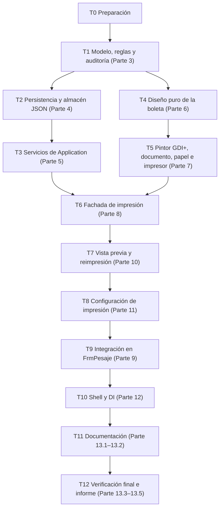

# Plan de implementación F5 — Boleta de pesaje

**Autor:** revisión senior (2026-09-28)
**Ejecutor:** un agente implementador (puede ser uno solo, secuencial). Si la plataforma permite subagentes, ver E.6; el orden y las compuertas no cambian.
**Punto de partida:** F4 completado **y commiteado** en `feat/f4-pesaje` (commit único `feat(F4): registro de pesaje` sobre `793c489`). Build Release con 0 warnings; 664 tests en verde según `Agents.md` (mídelo tú mismo en T0 y anota el número real).
**HUs:** HU-F5-01 … HU-F5-06 (ver `Agents.md §3`).

**Cómo leer este documento:**
- La **Parte E** dice *qué* tarea hacer, *en qué orden*, *qué archivos* puedes tocar y *cómo* se comprueba cada tarea. Síguela al pie de la letra.
- Las **Partes 0–13** son la *especificación*. Cada tarea de la Parte E apunta a una o más Partes.
- La **Parte 14** es la revisión del plan: huecos detectados, cómo se cubren y riesgos abiertos. **Léela entera antes de escribir código.** Muchas reglas existen por lo que se explica allí (se citan como "ver R*n*").

Este documento es **la especificación**. Si algo no está aquí, se aplican las convenciones de `Agents.md §4` y, como plantilla de código, lo que ya hacen F2–F4 (`ServicioParametros`, `ServicioPesajes`, `AlmacenLogoArchivos`, `FrmConfiguracionBalanza`, `FrmParametros`, `FrmPesaje` y sus tests). Si algo contradice `Agents.md`, manda este documento y la diferencia se anota en el informe final.

---

## Mapa HU → Partes

| HU | Título | Partes |
|---|---|---|
| HU-F5-01 | Datos de boleta y configuración de impresión por equipo | 3 (DTOs, reglas), 4 (persistencia), 5 (`ServicioBoletas`, `ServicioConfiguracionImpresion`) |
| HU-F5-02 | Renderizador del layout de boleta | 6 (diseño puro), 7.1–7.2 (pintor GDI+) |
| HU-F5-03 | Impresión y vista previa con `PrintDocument` | 7.3–7.6 (`DocumentoBoleta`, papel, impresor), 8 (fachada), 10.1 (`FrmVistaPrevia`) |
| HU-F5-04 | Imprimir desde el pesaje e impresión automática al grabar | 9 (`FrmPesaje`) |
| HU-F5-05 | Reimpresión por número y acceso rápido | 10.2 (`FrmReimprimirBoleta`), 12 (menú + F3) |
| HU-F5-06 | Selección de impresora, papel y calibración | 6.4 (calibración), 11 (`FrmConfiguracionImpresion`) |

**F5 no tiene migración de base de datos** (ver D4 y R3). Si en algún momento crees necesitar una, **detente** y repórtalo.

---

## Parte E — Ejecución

### E.1 Por qué el plan es tan explícito

El ejecutor es un agente de menor capacidad. Los fallos típicos que este plan neutraliza:

| Fallo típico | Cómo lo neutraliza el plan |
|---|---|
| Inventar APIs de .NET/WinForms o usarlas con la semántica de otra versión. | Las APIs críticas de impresión ya están **verificadas** en la Parte 2 (con fuente). No las cambies ni "mejores". Para cualquier otra API de librería, consulta Context7 (`/websites/learn_microsoft_en-us_dotnet`) o learn.microsoft.com antes de escribirla. |
| Olvidar una regla dada muchas páginas antes. | Cada Parte repite las reglas que le aplican; cada tarea tiene comprobaciones automáticas con `grep` (E.3). |
| Reportar "todo verde" sin haberlo ejecutado. | La compuerta (E.4) se ejecuta **siempre** y se pega la salida real en la bitácora. |
| Tocar archivos fuera de alcance ("ya que estaba…"). | Lista blanca por tarea, verificada con `git status --porcelain` (E.3). |
| Borrar o saltar tests para ponerse en verde. | El número de tests nunca baja; `Skip`, `#pragma warning disable`, `NoWarn` están prohibidos y se buscan con `grep` (E.4). |
| Anidar `EjecutarAsync` y perder operaciones en silencio. | Regla 0.9 repetida en cada Parte de UI + revisión manual obligatoria en T9. |

### E.2 Orden de tareas

Ejecuta **una tarea a la vez, en este orden**. No empieces la siguiente hasta que la compuerta de la actual esté en verde y la tarea esté commiteada (E.5).



Orden lineal: **T0, T1, T2, T3, T4, T5, T6, T7, T8, T9, T10, T11, T12.**

### E.3 Ficha de cada tarea

Rutas relativas a `src/` o `tests/PesajeFaeneo.Tests/` según corresponda. "Nuevo" = archivo a crear.

| Tarea | Especificación | Archivos permitidos (lista blanca) | Comprobaciones automáticas propias (además de E.4) |
|---|---|---|---|
| **T0** | E.5 | — (solo git) | `git status` limpio; `git log -1` muestra el commit de F4; línea base de tests anotada. |
| **T1** | Parte 3 | Nuevos: `PesajeFaeneo.Application/Boletas/Dtos/BoletaDtos.cs`, `PesajeFaeneo.Application/Boletas/Dtos/ConfiguracionImpresionDtos.cs`, `PesajeFaeneo.Application/Boletas/ReglasImpresion.cs`, `PesajeFaeneo.Application/Boletas/ValidadorConfiguracionImpresion.cs`, `tests/.../ValidadorConfiguracionImpresionTests.cs`. Modificados: `PesajeFaeneo.Application/Auditoria/FabricaAuditoria.cs`, `tests/.../FabricaAuditoriaTests.cs` | `grep -rn "System.Drawing\|System.Windows" src/PesajeFaeneo.Application/Boletas` vacío. |
| **T2** | Parte 4 | Nuevos: `PesajeFaeneo.Application/Abstracciones/IAlmacenConfiguracionImpresion.cs`, `PesajeFaeneo.Infrastructure/Archivos/AlmacenConfiguracionImpresionJson.cs`, `tests/.../AlmacenConfiguracionImpresionJsonTests.cs`, `tests/.../BoletaRepositorioTests.cs`. Modificados: `IPesajeRepositorio.cs`, `PesajeRepositorio.cs`, `IAuditoriaRepositorio.cs`, `AuditoriaRepositorio.cs`, `PesajeFaeneo.Infrastructure/Common/AppPaths.cs` | `git diff --name-only HEAD -- src/PesajeFaeneo.Infrastructure/Persistencia/Migraciones` **vacío**; `grep -n "Contains(" src/PesajeFaeneo.Infrastructure/Persistencia/Repositorios/AuditoriaRepositorio.cs` vacío (R21); el constructor de `AlmacenConfiguracionImpresionJson` no llama a `File.`/`Directory.` (revisión manual, R27). |
| **T3** | Parte 5 | Nuevos: `IServicioBoletas.cs`, `ServicioBoletas.cs`, `IServicioConfiguracionImpresion.cs`, `ServicioConfiguracionImpresion.cs` (todos en `Application/Boletas/`), `tests/.../ServicioBoletasTests.cs`, `tests/.../ServicioConfiguracionImpresionTests.cs`, `tests/.../Utilidades/Boletas/AlmacenConfiguracionImpresionFalso.cs`, `tests/.../Utilidades/Boletas/AlmacenLogoFalso.cs`. Modificados: `PesajeFaeneo.Application/DependencyInjection.cs`, `PesajeFaeneo.Infrastructure/DependencyInjection.cs` | `grep -n "DateTime.Now\|DateTime.UtcNow\|DateTime.Today\|ToLocalTime" src/PesajeFaeneo.Application/Boletas` vacío; `grep -n "Environment.MachineName" src/PesajeFaeneo.Application` vacío. |
| **T4** | Parte 6 | Nuevos: `PesajeFaeneo.Application/Boletas/Diseno/ElementosBoleta.cs`, `TextosBoleta.cs`, `DisenoBoleta.cs`, `DisenoCalibracion.cs` (en `Application/Boletas/Diseno/`), `tests/.../DisenoBoletaTests.cs`, `tests/.../TextosBoletaTests.cs`, `tests/.../DisenoCalibracionTests.cs` | `grep -rn "CurrentCulture\|DateTime.Now" src/PesajeFaeneo.Application/Boletas/Diseno` vacío; `grep -rnE "\{[A-Za-z.]+:(dd|HH|0)" src/PesajeFaeneo.Application/Boletas` vacío (ningún formato dentro de una interpolación, R42); `ArquitecturaTests` en verde (Application sigue sin `System.Drawing`). |
| **T5** | Parte 7 | Nuevos en `PesajeFaeneo.WinForms/Impresion/`: `PintorBoleta.cs`, `DocumentoBoleta.cs`, `SelectorPapel.cs`, `CargadorLogo.cs`, `IImpresorBoletas.cs`, `ImpresorBoletasGdi.cs`. Tests nuevos: `tests/.../Impresion/PintorBoletaTests.cs`, `DocumentoBoletaTests.cs`, `SelectorPapelTests.cs`, `CargadorLogoTests.cs`, `ImpresorBoletasGdiTests.cs` | `grep -rn "TextRenderer\|PrintControllerWithStatusDialog\|OriginAtMargins = true" src/PesajeFaeneo.WinForms/Impresion` vacío; `grep -n "StandardPrintController" src/PesajeFaeneo.WinForms/Impresion/DocumentoBoleta.cs` encuentra 1 línea; `grep -n "OnBeginPrint" .../DocumentoBoleta.cs` encuentra el reinicio del contador (R8). |
| **T6** | Parte 8 | Nuevos: `PesajeFaeneo.WinForms/Impresion/IServicioImpresionBoletas.cs`, `ServicioImpresionBoletas.cs`, `tests/.../Impresion/ServicioImpresionBoletasTests.cs`, `tests/.../Utilidades/Boletas/ServicioBoletasFalso.cs`, `ServicioConfiguracionImpresionFalso.cs`, `ImpresorBoletasFalso.cs`, `DatosBoletaDePrueba.cs`. Modificado: `PesajeFaeneo.WinForms/DependencyInjection.cs` (8.5) | `grep -n "catch (Exception" src/PesajeFaeneo.WinForms/Impresion/ServicioImpresionBoletas.cs` → solo el bloque de `RegistrarImpresionAsync` (8.3 paso 6); `ContenedorDITests` sigue en verde (valida el contenedor con `ValidateOnBuild`). |
| **T7** | Parte 10 | Nuevos: `PesajeFaeneo.WinForms/Formularios/Boletas/FrmVistaPrevia.cs`, `FrmReimprimirBoleta.cs`, `tests/.../FrmReimprimirBoletaTests.cs`, `tests/.../Utilidades/Boletas/ServicioImpresionBoletasFalso.cs` | En `FrmReimprimirBoleta.cs`: ningún `EjecutarAsync(`/`Ejecutar(` dentro del delegado de otro (revisión manual); `grep -n "\.Result\|\.Wait()\|GetAwaiter().GetResult()" ` vacío. |
| **T8** | Parte 11 | Nuevos: `PesajeFaeneo.WinForms/Formularios/Administracion/FrmConfiguracionImpresion.cs`, `tests/.../FrmConfiguracionImpresionTests.cs` | Ídem T7. |
| **T9** | Parte 9 | Modificados: `PesajeFaeneo.WinForms/Formularios/Pesaje/FrmPesaje.cs`, `tests/.../FrmPesajeTests.cs` | `grep -n "PerformClick(\|AcceptButton\|CancelButton\|KeyPreview = true\|\.Result\|\.Wait()" FrmPesaje.cs` vacío; revisión manual de `GrabarAsync`/`ImprimirTrasGrabarAsync`/`ImprimirSeleccionadaAsync`: ningún `EjecutarAsync` anidado; `btnImprimir.TabStop == false`. |
| **T10** | Parte 12 | Modificados: `PesajeFaeneo.WinForms/Formularios/FrmPrincipal.cs`, `tests/.../ContenedorDITests.cs`, `tests/.../FrmPrincipalTests.cs` | `AutorizadorMenuTests.cs` sin cambios (`git diff --stat` no lo lista). |
| **T11** | 13.1–13.2 | `Agents.md`, `README.md` | Las cifras de tests salen de la bitácora (no inventadas). |
| **T12** | 13.3–13.5 | — (solo verificación; correcciones como tareas `T12.n` con su propia lista blanca, declarada en la bitácora antes de tocar nada) | Todo E.4 sobre el árbol final + 13.3 (tres corridas) + 13.4 (arranque y cierre). |

**Verificación de la lista blanca** (al terminar cada tarea, **antes** del `git add`):
```bash
git status --porcelain
```
Cualquier archivo fuera de la lista = la tarea no está terminada: revierte ese archivo (`git checkout -- <archivo>` o bórralo si es nuevo) y rehaz lo necesario dentro de la lista. Si de verdad necesitas tocar otro archivo, anótalo en la bitácora como **desviación** con el motivo, y solo si es imprescindible para compilar (p. ej. un doble de prueba que implementa una interfaz ampliada).

### E.4 Compuerta de calidad (después de cada tarea, sin excepción)

Comandos de **Git Bash** (herramienta Bash), no de PowerShell:
```bash
dotnet build src/PesajeFaeneo.sln -c Release
```
```bash
dotnet test src/PesajeFaeneo.sln -c Release
```
```bash
# Finales de línea: debe salir vacío (después de git add)
git add -A && git diff --cached --name-only --diff-filter=AM | xargs -r git ls-files --eol | grep "w/lf"
# Nada de trampas: debe salir vacío
git diff --cached -U0 | grep -E "^\+.*(#pragma warning disable|Skip *=|NoWarn|TreatWarningsAsErrors|PackageReference|Thread\.Sleep|SuppressMessage)"
# Sin migraciones nuevas ni cambios de modelo en F5: debe salir vacío
git diff --cached --name-only <SHA_F4> -- src/PesajeFaeneo.Infrastructure/Persistencia/Migraciones
```
- 0 warnings (`TreatWarningsAsErrors=true`), 0 errores, todos los tests en verde. **No avances con rojo.**
- El número de tests **nunca baja** respecto de la tarea anterior.
- Si un test **existente** falla por un cambio de esta fase, corrige los **datos o dobles del test**, nunca la regla nueva, y anótalo. Los únicos tests existentes que este plan autoriza a modificar están listados en la tarea correspondiente (T1: `FabricaAuditoriaTests`; T9: `FrmPesajeTests`; T10: `ContenedorDITests`, `FrmPrincipalTests`).
- Al cerrar T5, T7, T9 y T12 ejecuta la suite **tres veces seguidas**. Un test que falla 1 de 3 veces es un test roto: corrígelo, no lo reintentes hasta que pase.

### E.5 Protocolo de git y bitácora

1. **T0:**
   - `git status` debe estar **limpio** y `git log -1 --format=%s` debe ser el commit de F4 (`feat(F4): …`). **Si F4 sigue con cambios sin commit** (estado al escribir este plan: archivos preparados sin commit en `feat/f4-pesaje`), **detente y repórtalo al usuario**: no commitees F4 por tu cuenta ni mezcles F4 y F5 en el mismo diff.
   - Anota `<SHA_F4> = git rev-parse HEAD` en la bitácora.
   - `git switch -c feat/f5-boleta`.
   - Ejecuta la compuerta y anota el número de tests de partida.
2. **Por cada tarea:** implementa → compuerta E.4 → comprobaciones propias de E.3 → `git status --porcelain` contra la lista blanca → `git add -A && git commit -m "wip(F5-Tn): <título>"`.
3. **Nunca** `push`, `merge`, `rebase`, `reset --hard` ni `checkout` de otras ramas. No commitees la bitácora.
4. **Al terminar T12:** anota el SHA del último commit en la bitácora y en el informe, y ejecuta `git reset --soft <SHA_F4>`: todo F5 queda como cambios preparados sin commit, igual que en fases anteriores, para que el usuario lo revise y haga un único commit `feat(F5): boleta de pesaje`. (Si algo sale mal, `git reset --soft <SHA anotado>` recupera el historial.)
5. **Bitácora** (`../pesalab-f5-bitacora.md`, **fuera** del repositorio para que `git add -A` no la incluya): por tarea, tests antes → después, salida literal de las 3 últimas líneas de `dotnet test`, desviaciones y decisiones tomadas ante ambigüedades. T11 la usa como fuente de cifras.

### E.6 Si la plataforma ofrece subagentes

- Mantén el orden de E.2 (no hay olas en paralelo en F5: casi todas las tareas tocan la cadena Application → WinForms y el beneficio no compensa el riesgo de conflictos).
- Un subagente por tarea, con un brief que contenga **copiadas literalmente**: la Parte de la especificación, las filas R citadas en ella, la lista blanca de E.3, las reglas de la Parte 0 y los hechos de la Parte 2. Nunca resumas la especificación.
- Los tests de `FrmPesaje` (T9) y de `FrmReimprimirBoleta` (T7) los debería escribir **una instancia distinta** de la que implementó el formulario, a partir de la especificación (R33).
- El agente principal **re-ejecuta** siempre la compuerta; el reporte de un subagente no cuenta como prueba.

---

## Parte 0 — Reglas de comportamiento (obligatorias)

1. **No te detengas hasta terminar.** Responde al usuario **una sola vez**, al final, con el informe de 13.5. Si algo es ambiguo, elige la opción más conservadora compatible con este plan, anótala en la bitácora como desviación y continúa. La única parada autorizada es la de T0 (F4 sin commit) y "necesito una migración".
2. **Git:** lo gobierna E.5.
3. **Compuerta:** E.4 después de cada tarea. Nunca desactives un warning, un test ni un analizador.
4. **Convenciones:** identificadores, comentarios, mensajes de UI y de log en **español**; imita el estilo y la densidad de comentarios del código existente. CRLF, UTF-8. xUnit solo con `Assert`. Sin librerías de mocks: dobles escritos a mano.
5. **Capas** (las hace cumplir `ArquitecturaTests`): Domain sin dependencias; Application sin EF, WinForms, Serilog, Hosting, **`System.Drawing`** ni `System.IO.Ports`; Infrastructure sin WinForms. **No agregues paquetes NuGet ni cambies `.csproj`/`.props`.** Todo lo que use `System.Drawing` (GDI+, `PrintDocument`, `Image`, `Font`) vive en **`PesajeFaeneo.WinForms`** (ver D2 y R1).
6. **Tiempo:** siempre `TimeProvider` inyectado. Nada de `DateTime.Now`, `DateTime.UtcNow`, `DateTime.Today` ni `ToLocalTime()` en producción. La hora local se obtiene con `TimeZoneInfo.ConvertTimeFromUtc(utc, _timeProvider.LocalTimeZone)`. En tests, `FakeTimeProvider` con `SetLocalTimeZone` (ya se usa en F4).
7. **Cultura:** todo texto de la boleta se formatea con `CultureInfo.GetCultureInfo("es-BO")` (constante `TextosBoleta.Cultura`), **nunca** con `CurrentCulture` (R12). Eso incluye fechas: **prohibido** `$"{fecha:dd/MM/yyyy}"` o `$"{peso:0.0}"` dentro de una interpolación (usa `CurrentCulture`, y en un formato personalizado de fecha el `/` es el separador *de la cultura*, R42). Escribe siempre `fecha.ToString("dd/MM/yyyy HH:mm", TextosBoleta.Cultura)` o, mejor, los ayudantes de `TextosBoleta` (6.2).
8. **Hilo de UI:** nunca `.Result`, `.Wait()` ni `.GetAwaiter().GetResult()` una vez iniciado el bucle de mensajes. Manejadores asíncronos `async void`/lambdas `async (_, _) =>` que delegan en `FormBase.EjecutarAsync`.
9. **Regla de reentrada de `FormBase` (sigue vigente y es la más fácil de romper en F5):** `EjecutarAsync`/`Ejecutar` descartan **en silencio** cualquier invocación mientras otra está en curso. **Nunca** llames a un método que use `EjecutarAsync`/`Ejecutar` desde dentro del delegado de otro. Las operaciones compuestas (grabar → imprimir → recargar) son **bloques secuenciales**, cada uno con su propio `EjecutarAsync`. Los métodos "internos" (los que no se envuelven a sí mismos) llevan el sufijo `InternoAsync` o se documentan con un comentario "no se envuelve".
10. **Tests de WinForms:** todo test que cree un `Form`, un control, un `Bitmap`, un `Graphics` o un `PrintDocument` corre dentro de `HiloSta.Ejecutar(...)` y desecha lo que crea. Los servicios falsos devuelven **tareas ya completadas** (`Task.FromResult`); para esperas intencionales usa `TaskCompletionSource` y bombea con `Application.DoEvents()` en un bucle con límite de 5 s (patrón de `FrmPesajeTests`/`FrmConfiguracionBalanzaTests`). Nada de `Thread.Sleep` ni `Task.Delay` fijos. Los `MessageBox` no se prueban: expón ganchos `internal`.
11. **Tests e impresoras:** **ningún test** puede depender de que haya impresoras instaladas ni imprimir de verdad (R17). Se prueba el diseño (puro), el pintor sobre un `Bitmap`, el documento invocando su método interno de pintado, el selector de papel (puro) y la fachada con dobles. La única prueba contra el sistema de impresión real usa un **nombre de impresora que no existe** (resultado determinista en cualquier máquina).
12. **Seguridad y antifraude:** toda impresión real de una boleta queda auditada (D11). Una segunda impresión del mismo pesaje **siempre** lleva la leyenda "REIMPRESIÓN" (D10). La vista previa **no** tiene botón de imprimir propio (la impresión pasa siempre por la fachada que audita, R16). Los pesos de la boleta salen **solo** de la base de datos, nunca de la UI.
13. **Logging:** `Information` por cada boleta enviada a la impresora (número, impresora, copias, reimpresión sí/no); `Warning` por fallos de impresión esperables (impresora no válida, logo ilegible, configuración ilegible); `Error` si la impresión salió pero la auditoría falló. Nunca registres datos personales más allá de ids y número de boleta.
14. **APIs de librería:** los hechos de la **Parte 2** están verificados; respétalos tal cual. Para cualquier otra API (p. ej. `PrintPreviewControl.AutoZoom`, `PaperSize`, `PrinterSettings.PaperSizes`, `StringFormat`), confirma la firma con Context7 (`/websites/learn_microsoft_en-us_dotnet`) o learn.microsoft.com antes de usarla. No escribas de memoria.

---

## Parte 1 — Decisiones de diseño (asumidas; el usuario puede cambiarlas)

Las marcadas **(P*n*)** dependen de una pregunta al usuario de la Parte 14.

| # | Decisión | Valor |
|---|---|---|
| D1 | Qué se imprime | Una boleta por pesaje, con: datos de la empresa (nombre, dirección, ciudad, teléfono, registro sanitario, teléfonos de reclamos, logo), número de boleta, fecha y hora **locales** del pesaje, ganadero (marca y nombre), secuencia, cliente (código y nombre), dirección, color/raza, sexo, tipo de desposte, pesos izquierdo/derecho/total, observación, fleteros activos (F1..F4 con celular), operador que pesó, leyendas (D9, D10) y pie con fecha de impresión. **(P1)** |
| D2 | Dónde vive la impresión | El **modelo de la boleta** (DTOs) y el **diseño** (lista de elementos posicionados en mm) viven en **Application** (puros, sin `System.Drawing`, probados sin STA). El **pintor GDI+**, `PrintDocument`, selección de papel, carga del logo y formularios viven en **WinForms/Impresion**. **No** en Infrastructure: es `net8.0` sin `System.Drawing.Common`, y agregarlo exigiría un paquete nuevo y rompería la compilación con CA1416 (R1). Esto **modifica** la frase de `Agents.md §4` "Infrastructure: … Impresión": se actualiza en T11. |
| D3 | Formatos de boleta | `FormatoBoleta.MediaCarta` (216 × 140 mm, **por defecto**) y `FormatoBoleta.Ticket80mm` (80 mm de ancho, alto según contenido, para impresoras térmicas de rollo). **(P1)** |
| D4 | Configuración de impresión | **Por equipo**, en un archivo JSON local `%ProgramData%\PesajeFaeneo\config\impresion.json`, **no** en la base de datos: los nombres de impresora son propios de cada PC y una BD restaurada en otra PC (F8) no debe arrastrarlos. El archivo guarda el nombre del equipo; si no coincide con `Environment.MachineName`, se ignora (R14). Sin migración. |
| D5 | Campos de la configuración | Impresora (`null` = predeterminada de Windows), formato (D3), papel del driver (`null` = automático, ver 7.4), copias (1..3), imprimir al grabar (sí/no), desplazamiento de calibración X e Y (−20,0..+20,0 mm, paso 0,5). |
| D6 | Valores por defecto | Sin archivo (o archivo inválido/de otro equipo): impresora predeterminada, media carta, papel automático, 1 copia, **impresión automática desactivada**, desplazamientos 0. `Configurada = false`. La impresión automática solo se activa cuando un administrador guarda la configuración explícitamente (evita diálogos de "Guardar como" de impresoras virtuales en cada grabado, R10). **(P3)** |
| D7 | Quién configura | Permiso **`GestionarParametros`** (Administrador). No se agrega un permiso nuevo (no se toca `Permiso` ni `MatrizPermisos`). Leer la configuración solo exige sesión (el operador la necesita para imprimir). **(P5)** |
| D8 | Copias | Las genera el propio documento como páginas sucesivas (`HasMorePages`), **no** `PrinterSettings.Copies` (muchos drivers lo ignoran, R9). Con más de una copia: la primera lleva "ORIGINAL" y las siguientes "COPIA 1", "COPIA 2". **(P2)** |
| D9 | Leyendas de estado | En este orden de prioridad: "MUESTRA — SIN VALOR" (boleta de muestra de la configuración), "ANULADA: {motivo}", "PESO SIMULADO — SIN VALOR COMERCIAL" (`OrigenPeso.Simulador`, cierra la nota R14 de F3/F4), "IMPORTADA DEL SISTEMA ANTERIOR" (`OrigenPeso.Importado`). En media carta, además, marca de agua gris grande sobre los pesos ("MUESTRA" / "ANULADA" / "SIMULADO"). |
| D10 | Reimpresión | "Impresiones previas" = cantidad de auditorías `Imprimir`/`Reimprimir` del pesaje. Si es > 0, la boleta lleva "REIMPRESIÓN {n}" (n = impresiones previas) con fecha y hora de esta impresión. La primera impresión nunca lleva esa leyenda. **(P4)** |
| D11 | Auditoría de impresión | Tras **cada** envío exitoso a la impresora (no la vista previa, no la muestra, no la calibración): una fila `AccionAuditoria.Imprimir` (primera vez) o `Reimprimir` (siguientes), `Entidad = "Pesaje"`, `EntidadId = Id` (mismo formato invariante que la auditoría `Crear` de F4), `despues = ImpresionAuditoria`, `Motivo` con número, copias e impresora. Se registra **después** de que `Print()` retorne (R15). |
| D12 | Permisos de impresión | Obtener datos para imprimir: `ImprimirBoleta` si nunca se imprimió, `ReimprimirBoleta` si ya se imprimió (hoy los tres roles tienen ambos; la regla existe por defensa en profundidad). Muestra de configuración: solo sesión. |
| D13 | Fecha y hora impresas | Las del pesaje (`FechaHora` UTC) convertidas a hora local con `TimeProvider.LocalTimeZone` **en el servicio**, no en la UI (R11). Formato `dd/MM/yyyy HH:mm`. |
| D14 | Datos maestros en reimpresiones | Empresa, logo y fleteros se toman **actuales** al imprimir (no hay historial). Ganadero, cliente y operador salen de las relaciones del pesaje (sus nombres actuales). **(P7)** |
| D15 | Impresión automática al grabar | En `FrmPesaje`, después de grabar con éxito y **fuera** del `EjecutarAsync` del grabado (regla 0.9): si la configuración del equipo está `Configurada` y `ImprimirAlGrabar`, se imprime. Un fallo de impresión **no** deshace ni oculta el grabado: el mensaje guía lo dice y ofrece F9 (R6). |
| D16 | F9 en `FrmPesaje` | "Imprimir (F9)": imprime la boleta de la fila actual de la grilla "Pesajes de hoy"; si no hay fila actual, la primera (= la última grabada, la grilla está en orden descendente). Botón `btnImprimir` con `TabStop = false`. Cumple la reserva de F9 hecha en F4 (D19 de F4). |
| D17 | Reimpresión por número | Formulario `FrmReimprimirBoleta` (Boletas › Reimprimir boleta, atajo **F3** en el shell). Prellenado con el último número emitido; Enter busca; muestra resumen y "Impresiones previas: n"; F4 = vista previa; F9 = imprimir. **Enter nunca imprime.** |
| D18 | Vista previa | `FrmVistaPrevia` con `PrintPreviewControl`, **sin** botón de imprimir (regla 0.12). Muestra exactamente lo que se imprimiría ahora (incluida la leyenda de reimpresión que correspondería). |
| D19 | Calibración | Botón "Imprimir página de calibración" en la configuración: un recuadro a 10 mm de cada borde, reglas cada 10 mm, cruz central e instrucciones. El técnico mide y ajusta los desplazamientos. No se audita. |
| D20 | Coordenadas | El diseño trabaja en **mm desde la esquina física superior izquierda del papel**. Al imprimir se compensa el margen físico del driver (`HardMarginX/Y`); en vista previa no (Parte 2, H3–H4, R7). El desplazamiento de calibración se suma siempre (positivo X = hacia la derecha, positivo Y = hacia abajo). |
| D21 | Orientación y papel | Los decide `SelectorPapel` (7.4): media carta usa el papel "Statement"/5,5 × 8,5 in en horizontal si el driver lo tiene; si no, Carta vertical (la boleta ocupa la mitad superior); si no, tamaño personalizado. El técnico puede fijar un papel del driver por nombre. |
| D22 | Número de boleta | Se imprime `N° {número}` sin ceros a la izquierda (igual que el mensaje de `FrmPesaje`). **(P6)** |
| D23 | Hilo de impresión | `PrintDocument.Print()` se llama **en el hilo de UI**, síncrono, con `StandardPrintController` (sin diálogo de estado). Una boleta de 1–3 páginas se envía a la cola en menos de un segundo; mover GDI+ a otro hilo agrega riesgos sin beneficio real (R19). |
| D24 | Sin cambios de esquema | F5 no agrega tablas, columnas ni índices: el índice `(Entidad, EntidadId)` de `Auditorias` (F0) cubre el conteo de impresiones. `has-pending-model-changes` debe seguir limpio. |
| D25 | Punto de extensión de F4 | `FrmPesaje.OnPesajeGrabado` (virtual, `void`) **no** se usa para imprimir: es síncrono y no puede esperar el `await` (R24). Se deja como está. La impresión se inyecta como servicio (`IServicioImpresionBoletas`), opción ya prevista en la nota R15 de `Agents.md`. |

---

## Parte 2 — Hechos de API verificados (no los re-investigues; respétalos)

Verificados el 2026-09-28 en learn.microsoft.com (vista `windowsdesktop-8.0`) y en el código fuente de `dotnet/winforms` rama `release/8.0`.

| # | API | Hecho verificado | Consecuencia en el plan |
|---|---|---|---|
| H1 | `PrintDocument.PrintController` | El valor por defecto es un **`PrintControllerWithStatusDialog`** (muestra un diálogo "Imprimiendo página…"). | `DocumentoBoleta` asigna `PrintController = new StandardPrintController()` en su constructor (R5). |
| H2 | `PrintDocument.OriginAtMargins` | Por defecto `false`: el origen del `Graphics` de cada página es la esquina superior izquierda del **área imprimible** (no del papel); `Margins` se ignora. El área imprimible varía por impresora y no es simétrica. | D20: se deja en `false` y se traslada por `−HardMargin` al imprimir. |
| H3 | `PreviewPrintController.OnStartPage` | Crea un metarchivo del tamaño de la página y, con `OriginAtMargins = false`, **no** aplica ninguna traslación: en vista previa el origen es la esquina **física** del papel. `IsPreview` devuelve `true`. | En vista previa **no** se compensa el margen físico; al imprimir sí. Se decide con un indicador explícito del documento (`paraVistaPrevia`), no con `IsPreview` (R7). |
| H4 | `PageSettings.HardMarginX` / `HardMarginY` | En **centésimas de pulgada** (margen físico que impone la impresora). | Conversión a mm: `× 0,254f`. |
| H5 | `PrintController.IsPreview` | En la clase base devuelve `false`. | No se usa para decidir la compensación (H3). |
| H6 | `PrintPreviewControl.ComputePreview` (WinForms 8) | Guarda el `PrintController` del documento, lo reemplaza **temporalmente** por `PrintControllerWithStatusDialog(new PreviewPrintController())`, llama a `Print()` y **restaura** el original. Una excepción durante la generación se **traga** y el control muestra un texto de error genérico. | 1) `StandardPrintController` sobrevive a la vista previa. 2) Cada vista previa ejecuta `OnBeginPrint` → el contador de copias se reinicia allí (R8). 3) Los errores previsibles (impresora inválida) se detectan **antes** de mostrar la vista previa, al construir el documento (7.6). |
| H7 | `PrinterSettings.IsValid` | Indica si `PrinterName` designa una impresora válida. Ciertas propiedades lanzan excepción si la impresora no es válida; se recomienda consultar `IsValid` tras fijar `PrinterName`. | `ImpresorBoletasGdi` consulta `IsValid` antes de tocar `PaperSizes`/`DefaultPageSettings` y lanza `ReglaNegocioException("IMP_…")` con mensaje para el usuario. |
| H8 | `System.Drawing.Common` en `net8.0` | Está anotado `[SupportedOSPlatform("windows")]`; en un proyecto `net8.0` (no `-windows`) el analizador CA1416 lo reporta como warning (= error con `TreatWarningsAsErrors`). En `net8.0-windows` con `UseWindowsForms` ya está disponible sin paquetes. | D2: todo GDI+ en `PesajeFaeneo.WinForms` (y los tests, que ya son `net8.0-windows`). |

Otros hechos del repositorio que el plan usa (comprobados leyendo el código):
- `IAlmacenLogo.ObtenerRutaCompleta(nombre)` devuelve `null` si el nombre no es válido o el archivo no existe (F2, R10).
- `IServicioParametros.ObtenerAsync` solo exige sesión y devuelve `UltimoNumeroBoletaEmitido`.
- `IFleteroRepositorio.ListarAsync(incluirInactivos)` ordena por `Activo` descendente (no por `Orden`): el servicio debe ordenar por `Orden` (5.2).
- `PesajeRepositorio.ObtenerPorIdAsync` incluye `Ganadero` y `Cliente` pero **no** `Usuario`.
- `Auditorias` tiene índice `(Entidad, EntidadId)`.
- La auditoría `Crear` de F4 usa `EntidadId = pesaje.Id.ToString(CultureInfo.InvariantCulture)`.
- `ClasificadorErrores` trata `ReglaNegocioException` y `ValidacionException` como errores de negocio y muestra su mensaje; cualquier otra excepción es "inesperada".
- `MatrizPermisos`: Operador, Supervisor y Administrador tienen `ImprimirBoleta` y `ReimprimirBoleta`; solo Administrador tiene `GestionarParametros`.
- `AccionAuditoria` ya tiene `CambioConfigImpresion = 11`, `Imprimir = 12`, `Reimprimir = 13`.

---

## Parte 3 — Modelo, reglas y auditoría (HU-F5-01) — tarea T1

Espacio de nombres base: `PesajeFaeneo.Application.Boletas`. **Nada** de `System.Drawing` aquí (lo verifica `ArquitecturaTests`).

### 3.1 `Application/Boletas/Dtos/BoletaDtos.cs` (espacio `PesajeFaeneo.Application.Boletas.Dtos`)

```csharp
public sealed record EmpresaBoleta(
    string Nombre,
    string Direccion,
    string Ciudad,
    string Telefono,
    string RegistroSanitario,
    string TelefonosReclamos,
    string? RutaLogo);                 // ruta completa o null si no hay logo o no existe

public sealed record FleteroBoleta(int Orden, string Nombre, string Celular);

public sealed record DatosBoleta(
    int PesajeId,                      // 0 en la muestra
    long NumeroBoleta,                 // 0 en la muestra
    DateTime FechaHoraLocal,           // hora local del pesaje (Kind = Unspecified)
    EmpresaBoleta Empresa,
    string MarcaGanadero,
    string NombreGanadero,
    int Secuencia,
    int CodigoCliente,
    string NombreCliente,
    string Direccion,
    string ColorRaza,
    char Sexo,
    TipoDesposte TipoDesposte,
    decimal PesoIzquierdo,
    decimal PesoDerecho,
    decimal PesoTotal,
    string Observacion,
    OrigenPeso Origen,
    EstadoPesaje Estado,
    string? MotivoAnulacion,
    string NombreOperador,
    IReadOnlyList<FleteroBoleta> Fleteros,
    int ImpresionesPrevias,            // auditorías Imprimir/Reimprimir existentes (D10)
    DateTime GeneradoEnLocal,          // hora local en que se arma la boleta (pie y leyenda de reimpresión)
    bool EsMuestra = false)
{
    public bool EsReimpresion => ImpresionesPrevias > 0;
}

public sealed record RegistroImpresion(
    int PesajeId,
    long NumeroBoleta,
    bool EsReimpresion,
    int Copias,
    string Impresora,                  // nombre real o "(predeterminada)"
    FormatoBoleta Formato,
    string NombreEquipo);
```

### 3.2 `Application/Boletas/Dtos/ConfiguracionImpresionDtos.cs`

```csharp
public enum FormatoBoleta
{
    MediaCarta = 1,
    Ticket80mm = 2
}

public sealed record ConfiguracionImpresion(
    string? NombreImpresora,           // null = predeterminada de Windows
    FormatoBoleta Formato,
    string? NombrePapel,               // null = automático (7.4)
    int Copias,
    bool ImprimirAlGrabar,
    decimal DesplazamientoXMm,
    decimal DesplazamientoYMm);

public sealed record ConfiguracionImpresionEquipo(
    ConfiguracionImpresion Configuracion,
    bool Configurada,                  // false = se usan los valores por defecto (D6)
    string NombreEquipo);
```

### 3.3 `Application/Boletas/ReglasImpresion.cs`

```csharp
public static class CamposImpresion
{
    public const string Impresora = "Impresora";
    public const string Formato = "Formato";
    public const string Papel = "Papel";
    public const string Copias = "Copias";
    public const string DesplazamientoX = "DesplazamientoX";
    public const string DesplazamientoY = "DesplazamientoY";
}

public static class CamposBoleta
{
    public const string Numero = "Numero";
}

public static class ReglasImpresion
{
    public const int CopiasMinimas = 1;
    public const int CopiasMaximas = 3;
    public const decimal DesplazamientoMaximoMm = 20.0m;       // rango [-20, +20]
    public const int LongitudMaximaNombreImpresora = 200;
    public const int LongitudMaximaNombrePapel = 100;
    public const string TextoImpresoraPredeterminada = "(predeterminada)";

    public static readonly ConfiguracionImpresion PorDefecto =
        new(null, FormatoBoleta.MediaCarta, null, 1, false, 0m, 0m);
}
```

### 3.4 `Application/Boletas/ValidadorConfiguracionImpresion.cs`

```csharp
public static class ValidadorConfiguracionImpresion
{
    /// Normaliza (trim; vacío o solo espacios → null en impresora y papel; desplazamientos redondeados
    /// a 1 decimal AwayFromZero) y devuelve la configuración normalizada + errores.
    public static (ConfiguracionImpresion Normalizada, IReadOnlyList<ErrorValidacion> Errores) Validar(ConfiguracionImpresion c);
}
```
Mensajes **exactos**:

| Caso | Campo | Mensaje |
|---|---|---|
| `!Enum.IsDefined(Formato)` | `Formato` | "Seleccione el formato de boleta." |
| Copias fuera de 1..3 | `Copias` | "Las copias deben estar entre 1 y 3." |
| \|X\| > 20 | `DesplazamientoX` | "El desplazamiento horizontal debe estar entre -20 y 20 mm." |
| \|Y\| > 20 | `DesplazamientoY` | "El desplazamiento vertical debe estar entre -20 y 20 mm." |
| Impresora > 200 caracteres | `Impresora` | "El nombre de la impresora es demasiado largo." |
| Papel > 100 caracteres | `Papel` | "El nombre del papel es demasiado largo." |

Los límites en los mensajes salen de las constantes, no escritos a mano, formateados con `ToString("0", CultureInfo.InvariantCulture)` (para que `20.0m` produzca exactamente "20", no "20.0", R43).

### 3.5 Auditoría (`Application/Auditoria/FabricaAuditoria.cs`)

- `EntidadesAuditoria.ConfiguracionImpresion = "ConfiguracionImpresion"`.
- Snapshots nuevos (sin navegaciones):
  ```csharp
  public sealed record ConfiguracionImpresionAuditoria(
      string NombreEquipo, string? NombreImpresora, FormatoBoleta Formato, string? NombrePapel,
      int Copias, bool ImprimirAlGrabar, decimal DesplazamientoXMm, decimal DesplazamientoYMm);

  public sealed record ImpresionAuditoria(
      long NumeroBoleta, bool EsReimpresion, int Copias, string Impresora, FormatoBoleta Formato, string NombreEquipo);
  ```
- `public static ConfiguracionImpresionAuditoria CrearSnapshot(ConfiguracionImpresion c, string nombreEquipo)` y `public static ImpresionAuditoria CrearSnapshot(RegistroImpresion r)`. **No** los agregues a `NormalizarObjeto` (no son entidades; se pasan ya como snapshot).

### 3.6 Tests (T1)

- `ValidadorConfiguracionImpresionTests`: cada fila de 3.4; límites exactos válidos (1 y 3 copias, ±20,0 mm) e inválidos (0, 4, ±20,1); `"   "` → `null`; `"  HP LaserJet  "` → `"HP LaserJet"`; `2.55m` → `2.6m`; `PorDefecto` no tiene errores.
- `FabricaAuditoriaTests` (**modificación autorizada: solo agregar casos**): el JSON de `ImpresionAuditoria` contiene `"Formato":"MediaCarta"` (enums como texto) y `"EsReimpresion":true`.

---

## Parte 4 — Persistencia y almacén de configuración (HU-F5-01) — tarea T2

### 4.1 `IPesajeRepositorio` / `PesajeRepositorio`

Agrega (no modifiques los métodos existentes):
```csharp
/// Sin tracking; Include Ganadero, Cliente y Usuario. null si no existe.
Task<Pesaje?> ObtenerParaBoletaPorIdAsync(int id, CancellationToken cancellationToken = default);
/// Sin tracking; Include Ganadero, Cliente y Usuario. null si no existe.
Task<Pesaje?> ObtenerParaBoletaPorNumeroAsync(long numeroBoleta, CancellationToken cancellationToken = default);
```

### 4.2 `IAuditoriaRepositorio` / `AuditoriaRepositorio`

```csharp
/// Cantidad de auditorías Imprimir o Reimprimir del pesaje (Entidad = "Pesaje", EntidadId = id invariante).
Task<int> ContarImpresionesPesajeAsync(int pesajeId, CancellationToken cancellationToken = default);
```
Implementación:
```csharp
var entidadId = pesajeId.ToString(CultureInfo.InvariantCulture);
return await _context.Auditorias.CountAsync(a =>
    a.Entidad == EntidadesAuditoria.Pesaje &&
    a.EntidadId == entidadId &&
    (a.Accion == AccionAuditoria.Imprimir || a.Accion == AccionAuditoria.Reimprimir),
    cancellationToken);
```
Comparaciones explícitas con `||`: **no** uses `lista.Contains(a.Accion)` (R21). `EntidadesAuditoria` está en Application (Infrastructure ya la referencia).

### 4.3 `AppPaths`

Agrega `public string ConfigDir { get; }` = `Path.Combine(BaseDir, "config")` y créalo en `AsegurarDirectorios()`. Nada más.

### 4.4 `Application/Abstracciones/IAlmacenConfiguracionImpresion.cs`

```csharp
public interface IAlmacenConfiguracionImpresion
{
    /// Nombre de este equipo (Environment.MachineName en producción).
    string NombreEquipo { get; }

    /// null si no hay archivo, está dañado, tiene otra versión, pertenece a otro equipo o sus valores
    /// no pasan ValidadorConfiguracionImpresion. NUNCA lanza por esas causas (registra Warning).
    Task<ConfiguracionImpresion?> LeerAsync(CancellationToken cancellationToken = default);

    /// Escribe de forma atómica (archivo temporal + reemplazo). Lanza si no puede escribir.
    Task GuardarAsync(ConfiguracionImpresion configuracion, CancellationToken cancellationToken = default);
}
```

### 4.5 `Infrastructure/Archivos/AlmacenConfiguracionImpresionJson.cs`

- Constructor: `(AppPaths appPaths, ILogger<AlmacenConfiguracionImpresionJson> logger, string nombreEquipo)`. **Sin E/S en el constructor** (lo construye `ContenedorDITests`, R27). `nombreEquipo` vacío → `ArgumentException`.
- Ruta: `Path.Combine(appPaths.ConfigDir, "impresion.json")`.
- Formato del archivo (registro privado serializado con `System.Text.Json`, `WriteIndented = true`, `JsonStringEnumConverter`):
  ```csharp
  private sealed record ArchivoConfiguracion(
      int Version, string NombreEquipo, string? NombreImpresora, FormatoBoleta Formato, string? NombrePapel,
      int Copias, bool ImprimirAlGrabar, decimal DesplazamientoXMm, decimal DesplazamientoYMm);
  ```
  `Version = 1`.
- `GuardarAsync`: `Directory.CreateDirectory(ConfigDir)`; serializa a `impresion.json.tmp` (con `FileStream` + `JsonSerializer.SerializeAsync`); luego `File.Move(tmp, destino, overwrite: true)`. Si falla, borra el `.tmp` (mejor esfuerzo) y relanza.
- `LeerAsync`: si no existe → `null` (sin log). Atrapa **solo** `JsonException`, `IOException`, `UnauthorizedAccessException`, `NotSupportedException` → `LogWarning("No se pudo leer la configuración de impresión ({Ruta}); se usan los valores por defecto.")` y `null`. `Version != 1` → Warning y `null`. `NombreEquipo` distinto (comparación `OrdinalIgnoreCase`) → Warning "La configuración de impresión pertenece al equipo {Otro}; se ignora en {Este}." y `null`. Valores con errores de `ValidadorConfiguracionImpresion` → Warning y `null`. Si todo va bien devuelve la configuración **normalizada**.
- Registro en DI (lo hace T3): `services.AddSingleton<IAlmacenConfiguracionImpresion>(sp => new AlmacenConfiguracionImpresionJson(appPaths, sp.GetRequiredService<ILogger<AlmacenConfiguracionImpresionJson>>(), Environment.MachineName));` (factoría explícita: MS.DI no sabe resolver un `string`).

### 4.6 Tests (T2)

`BoletaRepositorioTests` (`BaseDatosEnMemoria`, builders existentes):
1. `ObtenerParaBoletaPorIdAsync` trae `Ganadero.Marca`, `Cliente.Codigo` y `Usuario.NombreCompleto`; id inexistente → `null`.
2. `ObtenerParaBoletaPorNumeroAsync` con número existente e inexistente.
3. `ContarImpresionesPesajeAsync`: con 2 auditorías `Imprimir`/`Reimprimir` del pesaje 5, una `Crear` del pesaje 5, una `Imprimir` del pesaje 6 y una `Imprimir` con `Entidad = "Usuario"`, `EntidadId = "5"` → **2**. Sin auditorías → 0.

`AlmacenConfiguracionImpresionJsonTests` (directorio temporal con GUID, como `AlmacenLogoArchivosTests`; bórralo en `finally`/`Dispose`):
1. Sin archivo → `null`.
2. Guardar y leer: ida y vuelta de todos los campos (incluido `DesplazamientoXMm = -2.5m` e impresora `null`).
3. Tras guardar, no queda `impresion.json.tmp`.
4. Archivo con `NombreEquipo = "OTRA-PC"` → `null` (sin excepción).
5. JSON dañado (`"{ no es json"`) → `null` (sin excepción).
6. `Version = 2` → `null`.
7. `Copias = 9` escrito a mano en el JSON → `null`.
8. `Formato = "Desconocido"` en el JSON → `null` (el `JsonException` se atrapa).
9. El constructor no crea la carpeta `config` (verifica `Directory.Exists == false` antes del primer guardado).

---

## Parte 5 — Servicios de Application (HU-F5-01, F5-05, F5-06) — tarea T3

### 5.1 `IServicioBoletas`

```csharp
public interface IServicioBoletas
{
    Task<DatosBoleta> ObtenerPorIdAsync(int pesajeId, CancellationToken cancellationToken = default);
    Task<DatosBoleta> ObtenerPorNumeroAsync(long numeroBoleta, CancellationToken cancellationToken = default);
    Task RegistrarImpresionAsync(RegistroImpresion registro, CancellationToken cancellationToken = default);
    Task<DatosBoleta> CrearMuestraAsync(CancellationToken cancellationToken = default);
}
```
Constructor de `ServicioBoletas`: `IUnidadDeTrabajoFactory`, `ISesionActual`, `IAlmacenLogo`, `TimeProvider`, `ILogger<ServicioBoletas>` (todos obligatorios, `ArgumentNullException`).

### 5.2 `ObtenerPorIdAsync` / `ObtenerPorNumeroAsync`

1. `_sesion.ExigirSesion()`. Si `!TienePermiso(ImprimirBoleta) && !TienePermiso(ReimprimirBoleta)` → `NoAutorizadoException()`.
2. Por número: `numeroBoleta <= 0` → `ValidacionException(CamposBoleta.Numero, "Ingrese un número de boleta válido.")`. Por id: `pesajeId <= 0` → `ArgumentOutOfRangeException`.
3. `await using var uow = …`; pesaje con `ObtenerParaBoletaPor…Async`. No existe: por número → `ValidacionException(CamposBoleta.Numero, $"No existe la boleta N° {n}.")`; por id → `EntidadNoEncontradaException("Pesaje", id)`.
4. `previas = await uow.Auditoria.ContarImpresionesPesajeAsync(p.Id)`. Si `previas > 0 && !TienePermiso(ReimprimirBoleta)` → `NoAutorizadoException("No tiene permiso para reimprimir boletas.")`; si `previas == 0 && !TienePermiso(ImprimirBoleta)` → `NoAutorizadoException("No tiene permiso para imprimir boletas.")`.
5. Empresa: `var par = await uow.Parametros.ObtenerAsync()`; `RutaLogo = _almacenLogo.ObtenerRutaCompleta(par.LogoPath)`.
6. Fleteros: `(await uow.Fleteros.ListarAsync(incluirInactivos: false)).OrderBy(f => f.Orden)` → `FleteroBoleta` (ordena **tú**, el repositorio no ordena por `Orden`).
7. `FechaHoraLocal = TimeZoneInfo.ConvertTimeFromUtc(DateTime.SpecifyKind(p.FechaHora, DateTimeKind.Utc), _timeProvider.LocalTimeZone)`; `GeneradoEnLocal = TimeZoneInfo.ConvertTimeFromUtc(_timeProvider.GetUtcNow().UtcDateTime, _timeProvider.LocalTimeZone)`.
8. Mapea el resto tal cual (`NombreOperador = p.Usuario.NombreCompleto`, `CodigoCliente = p.Cliente.Codigo`, textos `?? string.Empty`).

Un método privado común `MapearAsync(uow, pesaje, ct)` evita duplicar 4–8.

### 5.3 `RegistrarImpresionAsync`

1. `ArgumentNullException.ThrowIfNull`; `var sesion = _sesion.ExigirSesion()`; permiso `EsReimpresion ? ReimprimirBoleta : ImprimirBoleta` con `ExigirPermiso`.
2. `PesajeId <= 0` o copias fuera de 1..3 → `ArgumentOutOfRangeException` (error de programación, no de usuario).
3. Auditoría: `FabricaAuditoria.Crear(_timeProvider, sesion.Id, EsReimpresion ? Reimprimir : Imprimir, EntidadesAuditoria.Pesaje, PesajeId.ToString(InvariantCulture), despues: FabricaAuditoria.CrearSnapshot(registro), motivo: $"{(re ? "Reimpresión" : "Impresión")} de boleta {n}: {copias} copia(s) en '{impresora}'")`; `Registrar`; `GuardarCambiosAsync`.
4. `LogInformation("Boleta {Numero} {Tipo} en {Impresora} ({Copias} copias) por {Usuario}", …)`.

### 5.4 `CrearMuestraAsync`

`ExigirSesion()`. Empresa, logo y fleteros **reales** (pasos 5–6 de 5.2); resto ficticio: `PesajeId = 0`, `NumeroBoleta = 0`, `FechaHoraLocal = GeneradoEnLocal = ahora local`, marca `"AH"`, `"GANADERO DE MUESTRA"`, secuencia 1, cliente 110 `"CLIENTE DE MUESTRA"`, `"DIRECCIÓN DE MUESTRA"`, `"OVERO"`, `'M'`, `ResCompleta`, 120,0 / 118,5 / 238,5, observación = `par.ObservacionPorDefecto` (o `"SIN NOVEDAD"` si está vacía), `Balanza`, `Vigente`, operador = `sesion.NombreCompleto`, `ImpresionesPrevias = 0`, `EsMuestra = true`.

### 5.5 `IServicioConfiguracionImpresion`

```csharp
public interface IServicioConfiguracionImpresion
{
    Task<ConfiguracionImpresionEquipo> ObtenerAsync(CancellationToken cancellationToken = default);   // sesión
    Task GuardarAsync(ConfiguracionImpresion configuracion, CancellationToken cancellationToken = default);   // GestionarParametros
}
```
Constructor: `IAlmacenConfiguracionImpresion`, `IUnidadDeTrabajoFactory`, `ISesionActual`, `TimeProvider`, `ILogger<ServicioConfiguracionImpresion>`.

- `ObtenerAsync`: `ExigirSesion()`; `var leida = await _almacen.LeerAsync()`; devuelve `new(leida ?? ReglasImpresion.PorDefecto, leida is not null, _almacen.NombreEquipo)`.
- `GuardarAsync` — **orden estricto** (R13):
  1. `ExigirPermiso(GestionarParametros)`; `sesion = ExigirSesion()`.
  2. `ValidadorConfiguracionImpresion.Validar` → `ValidacionException(errores)` si hay.
  3. `antes = await _almacen.LeerAsync()`.
  4. `await using var uow`; `await using var tx = await uow.IniciarTransaccionAsync()`.
  5. Auditoría `CambioConfigImpresion`, `Entidad = EntidadesAuditoria.ConfiguracionImpresion`, `EntidadId = _almacen.NombreEquipo`, `antes = antes is null ? null : CrearSnapshot(antes, equipo)`, `despues = CrearSnapshot(normalizada, equipo)`, `Motivo = $"Configuración de impresión del equipo {equipo}"`; `GuardarCambiosAsync`.
  6. `await _almacen.GuardarAsync(normalizada)` (si lanza, el `await using` de la transacción revierte la auditoría).
  7. `await tx.ConfirmarAsync()`. `LogInformation`.

### 5.6 Registro en DI

- `Application/DependencyInjection.cs`: `AddTransient<Boletas.IServicioBoletas, Boletas.ServicioBoletas>()` y `AddTransient<Boletas.IServicioConfiguracionImpresion, Boletas.ServicioConfiguracionImpresion>()`.
- `Infrastructure/DependencyInjection.cs`: el registro con factoría de 4.5 (necesita `using Microsoft.Extensions.Logging;`).

### 5.7 Tests (T3)

Dobles nuevos en `tests/.../Utilidades/Boletas/`: `AlmacenLogoFalso` (devuelve una ruta configurable o `null`) y `AlmacenConfiguracionImpresionFalso` (guarda en memoria; `NombreEquipo = "PC-PRUEBA"`; puede configurarse para lanzar `IOException` en `GuardarAsync`).

`ServicioBoletasTests` (`BaseDatosEnMemoria`, `FakeTimeProvider` con `SetLocalTimeZone` −04:00 como en `ServicioPesajesTests`, `SesionesDePrueba`, `NullLogger`):
1. Sin sesión → `NoAutorizadoException` en los cuatro métodos.
2. `ObtenerPorIdAsync` devuelve todos los campos; con `FechaHora = 2026-09-27 02:30Z` → `FechaHoraLocal = 2026-09-26 22:30` (**el caso típico de error**, R11).
3. Fleteros: activos con órdenes 3, 1, 2 y uno inactivo → lista `[1, 2, 3]`, sin el inactivo. Sin fleteros → lista vacía.
4. Logo: `AlmacenLogoFalso` con `null` → `RutaLogo == null`.
5. `ImpresionesPrevias == 0`; tras `RegistrarImpresionAsync(EsReimpresion: false)` → 1 fila `Imprimir` con `EntidadId` = id invariante y motivo con el número; `ObtenerPorIdAsync` otra vez → `ImpresionesPrevias == 1` y `EsReimpresion`; tras registrar una reimpresión → fila `Reimprimir` y `ImpresionesPrevias == 2`.
6. `ObtenerPorNumeroAsync(0)` y `(999999)` → `ValidacionException` con campo `Numero`.
7. Pesaje anulado (usa `PesajeBuilder.Anulado`) → `Estado = Anulado` y `MotivoAnulacion`. Pesaje con `OrigenPeso.Simulador` → `Origen = Simulador`.
8. `CrearMuestraAsync`: `EsMuestra`, empresa real (nombre sembrado en `ParametrosSistema`), `NumeroBoleta == 0`, no escribe auditoría.
9. Operador (rol real) puede obtener, registrar impresión y reimpresión (la rama negativa de permisos por rol no es alcanzable con la matriz actual: se cubre con "sin sesión", anótalo).

`ServicioConfiguracionImpresionTests`:
1. Sin sesión: `ObtenerAsync` → `NoAutorizadoException`.
2. Operador: `ObtenerAsync` sin archivo → `PorDefecto`, `Configurada == false`, `NombreEquipo == "PC-PRUEBA"`. `GuardarAsync` → `NoAutorizadoException`.
3. Administrador guarda válido → el almacén tiene la configuración normalizada; 1 auditoría `CambioConfigImpresion` con `EntidadId = "PC-PRUEBA"`, `DatosAntesJson == null`; segundo guardado → `DatosAntesJson` no nulo; `ObtenerAsync` → `Configurada == true`.
4. Copias = 5 → `ValidacionException` (campo `Copias`); almacén intacto; 0 auditorías.
5. Almacén que lanza `IOException` al guardar → la excepción se propaga y hay **0** auditorías (rollback).

---

## Parte 6 — Diseño puro de la boleta (HU-F5-02, F5-06) — tarea T4

Espacio `PesajeFaeneo.Application.Boletas.Diseno`. Todo es **puro**: sin `System.Drawing`, sin reloj, sin E/S. Las coordenadas son **mm desde la esquina superior izquierda física del papel**; `float` (las consume GDI+).

### 6.1 `ElementosBoleta.cs`

```csharp
public enum AlineacionTexto { Izquierda, Centro, Derecha }
public enum TonoTinta { Negro, Gris }

public abstract record ElementoBoleta;
public sealed record TextoBoleta(
    float X, float Y, float Ancho, float Alto, string Texto, float TamanoPt,
    bool Negrita = false, AlineacionTexto Alineacion = AlineacionTexto.Izquierda,
    bool VariasLineas = false, TonoTinta Tono = TonoTinta.Negro) : ElementoBoleta;
public sealed record LineaBoleta(float X1, float Y1, float X2, float Y2, float GrosorMm = 0.3f) : ElementoBoleta;
public sealed record RectanguloBoleta(float X, float Y, float Ancho, float Alto, float GrosorMm = 0.3f) : ElementoBoleta;
public sealed record LogoBoleta(float X, float Y, float Ancho, float Alto) : ElementoBoleta;   // el pintor dibuja el logo si lo tiene

public sealed record PaginaBoleta(float AnchoMm, float AltoMm, IReadOnlyList<ElementoBoleta> Elementos);
```
Los elementos se dibujan **en el orden de la lista** (la marca de agua va primero, queda debajo).

### 6.2 `TextosBoleta.cs` (formato puro, reutilizado por diseño y tests)

```csharp
public static class TextosBoleta
{
    public static readonly CultureInfo Cultura = CultureInfo.GetCultureInfo("es-BO");
    public static string Peso(decimal kg);                  // kg > 0 → "120,0 kg"; 0 → "—"
    public static string Sexo(char s);                      // 'H' → "HEMBRA"; otro → "MACHO"
    public static string Desposte(TipoDesposte t);          // "RES COMPLETA" / "MEDIA RES"
    public static string Fecha(DateTime local);             // local.ToString("dd/MM/yyyy", Cultura)
    public static string Hora(DateTime local);              // local.ToString("HH:mm", Cultura)
    public static string FechaHora(DateTime local);         // Fecha(local) + " " + Hora(local)
    public static string PieImpreso(DatosBoleta d);         // "Impreso: " + FechaHora(d.GeneradoEnLocal)
    public static string Numero(DatosBoleta d);             // EsMuestra → "MUESTRA"; si no "N° {n}" (D22)
    public static string Ganadero(DatosBoleta d);           // "{Marca} - {Nombre}"
    public static string Cliente(DatosBoleta d);            // "{Codigo} - {Nombre}"
    public static string Fletero(FleteroBoleta f);          // "F{Orden}: {Nombre}" + (" - {Celular}" si no vacío)
    public static string UnirNoVacios(string separador, params string?[] partes);   // omite null/espacios
    /// Leyendas en orden D9 + reimpresión (D10) + copia (D8).
    public static IReadOnlyList<string> Leyendas(DatosBoleta d, int numeroCopia, int totalCopias);
    /// "MUESTRA" / "ANULADA" / "SIMULADO" / null (misma prioridad que D9; Importado no lleva marca de agua).
    public static string? MarcaDeAgua(DatosBoleta d);
}
```
`Leyendas`, en este orden, solo las que apliquen:
1. `EsMuestra` → "MUESTRA — SIN VALOR"
2. `Estado == Anulado` → `$"ANULADA: {MotivoAnulacion}"`
3. `Origen == Simulador` → "PESO SIMULADO — SIN VALOR COMERCIAL"
4. `Origen == Importado` → "IMPORTADA DEL SISTEMA ANTERIOR"
5. `EsReimpresion` → `"REIMPRESIÓN " + ImpresionesPrevias.ToString(Cultura) + " — " + FechaHora(GeneradoEnLocal)`
6. `totalCopias > 1` → `numeroCopia == 1 ? "ORIGINAL" : $"COPIA {numeroCopia - 1}"`

### 6.3 `DisenoBoleta.cs`

```csharp
public static class DisenoBoleta
{
    public const float AnchoMediaCartaMm = 216f;
    public const float AltoMediaCartaMm = 140f;
    public const float AnchoTicketMm = 80f;

    /// numeroCopia en 1..totalCopias.
    public static PaginaBoleta Crear(DatosBoleta datos, FormatoBoleta formato, int numeroCopia, int totalCopias);
}
```
Argumentos inválidos (`datos` nulo, copia fuera de rango, formato no definido) → `ArgumentException`.

**Media carta** (página 216 × 140). Todas las coordenadas en mm; "pt" = `TamanoPt`; "N" = negrita; texto sin `VariasLineas` salvo donde se indica. Omite un elemento de texto si su texto queda vacío.

| Elemento | X | Y | Ancho | Alto | pt | Estilo / contenido |
|---|---|---|---|---|---|---|
| Marca de agua (si `MarcaDeAgua != null`) — **primer elemento** | 8 | 70 | 200 | 26 | 44 | N, centro, `Gris` |
| Logo (si `RutaLogo != null`) | 8 | 8 | 30 | 20 | — | `LogoBoleta` |
| Nombre de empresa | 40 | 8 | 108 | 7 | 13 | N, centro |
| Dirección — ciudad (`UnirNoVacios(" — ")`) | 40 | 15 | 108 | 5 | 8 | centro |
| "Tel.: {t}" · "Reg. Sanitario: {r}" (`UnirNoVacios("   ")`, cada parte solo si su valor no está vacío) | 40 | 20 | 108 | 5 | 8 | centro |
| Recuadro del número | 152 | 8 | 56 | 21 | — | `RectanguloBoleta` |
| "BOLETA DE PESAJE" | 152 | 9 | 56 | 6 | 10 | N, centro |
| `Numero(d)` | 152 | 16 | 56 | 11 | 18 | N, centro |
| Leyendas unidas con "  ·  " (si hay) | 8 | 31 | 200 | 5 | 9 | N, centro |
| Línea | 8→208 | 37 | | | | `LineaBoleta` |
| Filas de datos: Y = 39; 45,5; 52; 58,5; 65 (paso 6,5; alto 5,5) | | | | | | |
| Etiquetas columna izquierda | 8 | fila | 26 | 5,5 | 9 | N: "Fecha:", "Ganadero:", "Secuencia:", "Cliente:", "Dirección:" |
| Valores columna izquierda | 34 | fila | 88 | 5,5 | 10 | `Fecha + "  " + Hora`, `Ganadero(d)`, secuencia, `Cliente(d)`, dirección |
| Etiquetas columna derecha | 126 | fila | 24 | 5,5 | 9 | N: "Color/Raza:", "Sexo:", "Desposte:", "Operador:" (4 filas) |
| Valores columna derecha | 150 | fila | 58 | 5,5 | 10 | color/raza, `Sexo`, `Desposte`, operador |
| Recuadros de pesos | 8 / 76 / 144 | 73 | 64 | 20 | — | tres `RectanguloBoleta` |
| Títulos de pesos | ídem | 74 | 64 | 5 | 9 | N, centro: "IZQUIERDO", "DERECHO", "TOTAL" |
| Valores de pesos | ídem | 80 | 64 | 11 | 16 / 16 / **18** | N, centro: `Peso(izq)`, `Peso(der)`, `Peso(total)` |
| "Observación:" | 8 | 96 | 26 | 5 | 9 | N |
| Observación | 34 | 96 | 174 | 10 | 9 | `VariasLineas = true` |
| Línea | 8→208 | 107 | | | | |
| "Fleteros:" (si hay fleteros) | 8 | 109 | 26 | 5 | 9 | N |
| Fleteros (máx. 4): 1.º (34,109), 2.º (121,109), 3.º (34,114), 4.º (121,114) | | | 87 | 5 | 8 | `Fletero(f)` |
| "Reclamos: {t}" (si no vacío) | 8 | 121 | 120 | 5 | 8 | |
| Línea de firma | 140→205 | 128 | | | | |
| "Recibí conforme" | 140 | 129 | 65 | 4 | 8 | centro |
| Pie: `TextosBoleta.PieImpreso(d)` | 8 | 133 | 100 | 4 | 7 | izquierda |
| Pie: "Sistema de Pesaje para Faeneo" | 108 | 133 | 100 | 4 | 7 | derecha |

**Ticket 80 mm** (ancho 80; contenido en X = 4, ancho 72). Diseño **de flujo**: un cursor `y` que empieza en 3; cada línea es un `TextoBoleta(4, y, 72, alto, …)` y luego `y += alto + 0,5`. Altos por tamaño: 7 pt → 3,5; 8 pt → 4; 9 pt → 4,5; 10 pt → 5; 12 pt → 6; 14 pt → 7; 16 pt → 8. Una línea con `VariasLineas = true` y *k* líneas tiene alto `k × alto`. Sin marca de agua (las térmicas no imprimen gris legible): las leyendas van como líneas de texto. Orden:
1. Logo (si hay): `LogoBoleta(20, y, 40, 18)`, `y += 20`.
2. Empresa: 12 pt N centro, 2 líneas. Dirección — ciudad: 8 pt centro, 2 líneas. Tel./Reg. sanitario: 8 pt centro, 2 líneas.
3. Línea separadora (`LineaBoleta(4, y, 76, y)`, `y += 1,5`).
4. "BOLETA DE PESAJE" 10 pt N centro; `Numero(d)` 16 pt N centro.
5. Cada leyenda: 9 pt N centro, 2 líneas.
6. Línea separadora.
7. Datos, 9 pt izquierda, formato "Etiqueta: valor" en una sola cadena: fecha y hora; ganadero (2 líneas); secuencia; cliente (2 líneas); dirección (2 líneas); color/raza; sexo; desposte.
8. Línea separadora.
9. "Izquierdo: {Peso}", "Derecho: {Peso}" 10 pt; "TOTAL: {Peso}" 14 pt N.
10. Si `MarcaDeAgua != null`: `$"*** {marca} ***"` 12 pt N centro.
11. Línea separadora.
12. "Observación: {texto}" 9 pt, 3 líneas.
13. Si hay fleteros: "Fleteros:" 8 pt N y cada `Fletero(f)` 8 pt.
14. Reclamos 8 pt (2 líneas, si no vacío); "Operador: {nombre}" 8 pt; pie "Impreso: …" 7 pt.
15. `AltoMm = y + 10` (margen de corte).

### 6.4 `DisenoCalibracion.cs`

```csharp
public static class DisenoCalibracion
{
    public const float MargenReferenciaMm = 10f;
    public static PaginaBoleta Crear(FormatoBoleta formato);   // media carta 216×140; ticket 80×120
}
```
Elementos: `RectanguloBoleta(10, 10, ancho − 20, alto − 20)`; marcas de regla cada 10 mm en el borde superior (líneas verticales de 3 mm desde Y = 10) con su número en mm (7 pt); ídem en el borde izquierdo; cruz central (dos líneas de 10 mm); textos centrados (9 pt): "PÁGINA DE CALIBRACIÓN", "El recuadro debe quedar a 10 mm de cada borde del papel.", "Si queda a más de 10 mm del borde izquierdo, reste la diferencia al desplazamiento X; si queda a menos, súmela.", "Igual con el borde superior y el desplazamiento Y." (en ticket, `VariasLineas = true`).

### 6.5 Tests (T4)

`TextosBoletaTests`: `Peso(238.5m) == "238,5 kg"`, `Peso(0m) == "—"`, `Peso(100m) == "100,0 kg"`; sexo; desposte; `FechaHora` devuelve "26/09/2026 22:30" **también** con `CultureInfo.CurrentCulture` fijada a una cultura con otro separador de fecha (p. ej. `nl-NL`, que usa "-"; restaura la cultura en `finally`) — prueba R42; `Numero` de muestra; `Fletero` con y sin celular; `UnirNoVacios` con nulos y espacios; `Leyendas` en el orden exacto de 6.2 con todas activas; `REIMPRESIÓN 2 — 26/09/2026 22:30`; copias 1/3 → "ORIGINAL", 3/3 → "COPIA 2"; una sola copia → sin leyenda de copia; `MarcaDeAgua` por prioridad e `Importado` → `null`.

`DisenoBoletaTests` (helper `TextosDe(pagina)` que junta los `TextoBoleta.Texto`):
1. Media carta contiene "N° 32779", "AH - GANADERO EJEMPLO", "110 - CLIENTE EJEMPLO", "120,0 kg", "118,5 kg", "238,5 kg", la fecha local y el nombre de la empresa.
2. Media res 106,0 / 0 → contiene "—" en el valor derecho.
3. Simulado → leyenda + **primer** elemento es un `TextoBoleta` `Gris` con "SIMULADO". Vigente de balanza → ningún elemento `Gris`.
4. Sin logo → ningún `LogoBoleta`; con logo → uno.
5. 0 fleteros → no aparece "Fleteros:"; 4 fleteros → 4 textos "F1: …" … "F4: …".
6. **Límites**, para ambos formatos, con nombres de 100 caracteres, dirección de 150, observación de 250, 4 fleteros y todas las leyendas: cada elemento cumple `0 ≤ X`, `0 ≤ Y`, `X + Ancho ≤ AnchoMm`, `Y + Alto ≤ AltoMm` (para líneas, ambos extremos dentro). Protege contra texto fuera del papel (R18).
7. Ticket: el alto crece con los fleteros (con 4 > sin fleteros) y todos los `TextoBoleta` tienen `X = 4` y `Ancho = 72` (salvo el logo).
8. `Crear` con `numeroCopia = 0` o `> totalCopias` → `ArgumentException`.

`DisenoCalibracionTests`: el primer rectángulo está en (10, 10) con ancho `216 − 20` y alto `140 − 20` (media carta) y `80 − 20` × `120 − 20` (ticket); todos los elementos dentro de la página.

---

## Parte 7 — Pintor GDI+, documento, papel e impresor (HU-F5-02, F5-03) — tarea T5

Carpeta nueva `src/PesajeFaeneo.WinForms/Impresion/` (espacio `PesajeFaeneo.WinForms.Impresion`). Clases `internal` salvo las interfaces que usan formularios públicos (una interfaz `internal` en el constructor de un `Form` público no compila: CS0051), que son `public`.

### 7.1 `PintorBoleta` (`internal static`)

```csharp
internal static class PintorBoleta
{
    public const string FamiliaFuente = "Arial";

    /// Dibuja la página con origen en (origenXMm, origenYMm) del Graphics, en mm.
    public static void Pintar(Graphics g, PaginaBoleta pagina, Image? logo, float origenXMm, float origenYMm);
}
```
- `var unidad = g.PageUnit; var estado = g.Save();` … `finally { g.Restore(estado); g.PageUnit = unidad; }` (restaura también la unidad de forma explícita: no dependas de qué incluye `GraphicsState`).
- `g.PageUnit = GraphicsUnit.Millimeter; g.TranslateTransform(origenXMm, origenYMm);` (con `PageUnit = Millimeter`, la traslación de mundo está en mm).
- `TextoBoleta`: `using var fuente = new Font(FamiliaFuente, t.TamanoPt, t.Negrita ? FontStyle.Bold : FontStyle.Regular, GraphicsUnit.Point);` pincel negro (`Brushes.Black`) o gris (`new SolidBrush(Color.FromArgb(190, 190, 190))`, desechado); `using var formato = new StringFormat { Alignment = …, LineAlignment = StringAlignment.Near, Trimming = StringTrimming.EllipsisCharacter };` `formato.FormatFlags |= StringFormatFlags.LineLimit;` y `|= StringFormatFlags.NoWrap` si `!VariasLineas`. `g.DrawString(t.Texto, fuente, pincel, new RectangleF(t.X, t.Y, t.Ancho, t.Alto), formato)`.
  **Usa `Graphics.DrawString` (GDI+), nunca `TextRenderer`** (GDI; ignora las transformaciones y la unidad de página del `Graphics` de impresión, R20).
- `LineaBoleta` / `RectanguloBoleta`: `using var lapiz = new Pen(Color.Black, grosorMm);` (con `PageUnit = Millimeter`, el ancho del lápiz está en mm).
- `LogoBoleta`: si `logo is null` no dibuja nada. Si no, ajusta conservando proporción: `escala = min(Ancho / logo.Width, Alto / logo.Height)` (en píxeles), rectángulo centrado de `logo.Width × escala` por `logo.Height × escala`, `g.DrawImage(logo, rect)`.
- Nunca lanza por un texto vacío; `ArgumentNullException` si `g` o `pagina` son nulos.

### 7.2 `CargadorLogo` (`internal static`)

```csharp
/// null si ruta es null, no existe o la imagen es ilegible. Nunca deja el archivo bloqueado.
public static Image? Cargar(string? ruta, ILogger logger);
```
`using var fs = new FileStream(ruta, FileMode.Open, FileAccess.Read, FileShare.Read); using var original = Image.FromStream(fs); return new Bitmap(original);` (mismo patrón que `FrmParametros`). Atrapa `IOException`, `UnauthorizedAccessException`, `ArgumentException`, `OutOfMemoryException` (GDI+ la lanza para imágenes inválidas) y `System.Runtime.InteropServices.ExternalException` → `LogWarning` y `null`. La boleta se imprime igual sin logo (R10 de F2).

### 7.3 `DocumentoBoleta` (`internal sealed class : PrintDocument`)

```csharp
internal sealed class DocumentoBoleta : PrintDocument
{
    public DocumentoBoleta(
        Func<int, PaginaBoleta> crearPagina,   // recibe el número de copia (1..totalCopias)
        int totalCopias,
        Image? logo,                           // el documento lo desecha en Dispose
        float desplazamientoXMm,
        float desplazamientoYMm,
        bool paraVistaPrevia,
        string nombreDocumento);

    /// Pinta la copia actual, avanza el contador y devuelve si quedan páginas. La usan OnPrintPage y los tests.
    internal bool ProcesarPagina(Graphics g, float margenFisicoXMm, float margenFisicoYMm);
    /// Solo para tests: invoca OnBeginPrint(new PrintEventArgs()).
    internal void SimularInicioParaTest();
}
```
- Constructor: `PrintController = new StandardPrintController();` (H1, R5); `OriginAtMargins = false;` (H2); `DocumentName = nombreDocumento;`; `totalCopias` fuera de 1..3 → `ArgumentOutOfRangeException`.
- `protected override void OnBeginPrint(PrintEventArgs e) { base.OnBeginPrint(e); _copiaActual = 1; }` — **obligatorio**: la vista previa y la impresión llaman a `Print()` por separado sobre el mismo documento (H6); sin este reinicio, la segunda pasada saldría vacía o con copias de más (R8).
- `protected override void OnPrintPage(PrintPageEventArgs e)`:
  ```csharp
  base.OnPrintPage(e);
  float mx = 0f, my = 0f;
  if (!_paraVistaPrevia)
  {
      mx = e.PageSettings.HardMarginX * 0.254f;   // H4: centésimas de pulgada → mm
      my = e.PageSettings.HardMarginY * 0.254f;
  }
  e.HasMorePages = ProcesarPagina(e.Graphics!, mx, my);
  ```
- `ProcesarPagina(g, mx, my)`: `PintorBoleta.Pintar(g, _crearPagina(_copiaActual), _logo, _desplX - mx, _desplY - my); var hayMas = _copiaActual < _totalCopias; _copiaActual++; return hayMas;`.
  (El origen del `Graphics` al imprimir es el área imprimible; restar el margen físico lleva el origen a la esquina del papel, H2–H3, R7.)
- `Dispose(bool disposing)`: si `disposing`, `_logo?.Dispose()`; luego `base.Dispose(disposing)`.

### 7.4 `SelectorPapel` (`internal static`, puro: sin `System.Drawing`)

```csharp
internal sealed record PapelDisponible(string Nombre, int AnchoCentPulg, int AltoCentPulg, bool EsPersonalizado = false);
internal sealed record EleccionPapel(PapelDisponible Papel, bool Horizontal);

internal static class SelectorPapel
{
    public const int Tolerancia = 15;   // centésimas de pulgada (~4 mm)
    public static EleccionPapel Elegir(FormatoBoleta formato, string? nombreConfigurado,
                                       IReadOnlyList<PapelDisponible> disponibles, float altoContenidoMm);
}
```
Reglas, en orden (dimensiones en centésimas de pulgada; media carta = 850 × 550; carta = 850 × 1100; 80 mm = 315):
1. `nombreConfigurado` no nulo y presente en `disponibles` (comparación `OrdinalIgnoreCase`) → ese papel. `Horizontal` = formato `MediaCarta` **y** `papel.Ancho < 850 − Tolerancia` **y** `papel.Alto ≥ 850 − Tolerancia` (el papel es más angosto que la boleta pero la cabe acostado). Para ticket, `Horizontal = false`.
2. `MediaCarta` automático:
   a. Primer papel con `{Ancho, Alto} ≈ {550, 850}` (en cualquier orden, ±Tolerancia) → ese papel; `Horizontal = papel.Ancho < papel.Alto`.
   b. Si no, primer papel ≈ 850 × 1100 → ese papel, `Horizontal = false` (la boleta ocupa la mitad superior).
   c. Si no, `new PapelDisponible("Media carta (personalizado)", 850, 550, EsPersonalizado: true)`, `Horizontal = false`.
3. `Ticket80mm` automático:
   a. Primer papel con `Ancho` en `[315 − Tolerancia, 315 + Tolerancia]` → ese papel, `Horizontal = false`.
   b. Si no, `new PapelDisponible("Ticket 80 mm (personalizado)", 315, (int)Math.Ceiling(altoContenidoMm / 0.254f), true)`, `Horizontal = false`.
4. Si `nombreConfigurado` no se encontró, se aplica la regla automática (quien llama registra un Warning, 7.6).

### 7.5 `IImpresorBoletas` (`public`)

```csharp
public interface IImpresorBoletas
{
    IReadOnlyList<string> ListarImpresoras();                 // PrinterSettings.InstalledPrinters
    string? ObtenerImpresoraPredeterminada();                 // new PrinterSettings(): PrinterName si IsValid, si no null
    IReadOnlyList<string> ListarPapeles(string? nombreImpresora);   // [] si la impresora no es válida
    void Imprimir(DatosBoleta datos, ConfiguracionImpresion configuracion);
    PrintDocument CrearVistaPrevia(DatosBoleta datos, ConfiguracionImpresion configuracion);   // el llamador lo desecha
    void ImprimirCalibracion(ConfiguracionImpresion configuracion);
}
```
Errores previsibles → `ReglaNegocioException` con estos códigos y mensajes **exactos** (los muestra `ClasificadorErrores` y la fachada):

| Código | Cuándo | Mensaje |
|---|---|---|
| `IMP_SIN_IMPRESORA` | `NombreImpresora == null` y no hay predeterminada válida | "No hay una impresora predeterminada en este equipo. Configúrela en Administración › Configuración de impresión." |
| `IMP_IMPRESORA_NO_VALIDA` | `NombreImpresora` no es válida | "La impresora '{nombre}' no está instalada en este equipo. Revise Administración › Configuración de impresión." |
| `IMP_ERROR_IMPRESORA` | `Print()` lanzó `InvalidPrinterException` o `Win32Exception` | "No se pudo imprimir en '{impresora}': {mensaje de la excepción}" (con la excepción como `inner`) |

### 7.6 `ImpresorBoletasGdi` (`internal sealed`, implementa `IImpresorBoletas`)

Constructor: `ILogger<ImpresorBoletasGdi>`. **Sin estado mutable** (se registra como singleton).

Método privado central:
```csharp
private DocumentoBoleta ConstruirDocumento(
    Func<int, PaginaBoleta> crearPagina, int totalCopias, float altoContenidoMm, FormatoBoleta formato,
    string? rutaLogo, ConfiguracionImpresion config, bool paraVistaPrevia, string nombreDocumento)
```
1. `var logo = CargadorLogo.Cargar(rutaLogo, _logger);` `var doc = new DocumentoBoleta(crearPagina, totalCopias, logo, (float)config.DesplazamientoXMm, (float)config.DesplazamientoYMm, paraVistaPrevia, nombreDocumento);`
2. **Todo lo que sigue va en `try { … } catch { doc.Dispose(); throw; }`** (no fugues el documento ni el logo).
3. Si `config.NombreImpresora is not null` → `doc.PrinterSettings.PrinterName = config.NombreImpresora`.
4. Si `!doc.PrinterSettings.IsValid` → `IMP_SIN_IMPRESORA` o `IMP_IMPRESORA_NO_VALIDA` según corresponda (H7). **Antes** de tocar `PaperSizes` o `DefaultPageSettings`.
5. Papeles: `doc.PrinterSettings.PaperSizes.Cast<PaperSize>()` → `PapelDisponible(p.PaperName, p.Width, p.Height)`. `eleccion = SelectorPapel.Elegir(formato, config.NombrePapel, papeles, altoContenidoMm)`; si `config.NombrePapel` no era nulo y no se encontró → `LogWarning`.
6. `doc.DefaultPageSettings.PaperSize = eleccion.Papel.EsPersonalizado ? new PaperSize(nombre, ancho, alto) : <el PaperSize original de la colección con ese nombre>`; `doc.DefaultPageSettings.Landscape = eleccion.Horizontal;` `doc.DefaultPageSettings.Margins = new Margins(0, 0, 0, 0);` `doc.PrinterSettings.Copies = 1;` (D8).
7. Devuelve `doc`.

- `Imprimir(datos, config)`: `using var doc = ConstruirDocumento(c => DisenoBoleta.Crear(datos, config.Formato, c, config.Copias), config.Copias, DisenoBoleta.Crear(datos, config.Formato, 1, config.Copias).AltoMm, config.Formato, datos.Empresa.RutaLogo, config, paraVistaPrevia: false, $"Boleta {datos.NumeroBoleta}");` luego `doc.Print()` dentro de `try` que traduce `InvalidPrinterException`/`Win32Exception` a `IMP_ERROR_IMPRESORA`. `LogInformation("Boleta {Numero} enviada a {Impresora}: {Copias} copia(s), papel {Papel}, horizontal {Horizontal}.")`.
- `CrearVistaPrevia(datos, config)`: igual pero `paraVistaPrevia: true` y **sin** `Print()`; devuelve el documento (el llamador lo desecha).
- `ImprimirCalibracion(config)`: `ConstruirDocumento(_ => DisenoCalibracion.Crear(config.Formato), 1, DisenoCalibracion.Crear(config.Formato).AltoMm, …, rutaLogo: null, …, "Calibración de boleta")` + `Print()` con la misma traducción de errores. Sin auditoría.
- `ListarImpresoras()`: `PrinterSettings.InstalledPrinters.Cast<string>().ToList()`. `ListarPapeles(nombre)`: `new PrinterSettings()`, fija `PrinterName` si no es nulo; si `!IsValid` → `[]`; si no, nombres de `PaperSizes`. `ObtenerImpresoraPredeterminada()`: `new PrinterSettings()` → `IsValid ? PrinterName : null`. Los tres atrapan `Win32Exception` (servicio "Cola de impresión" detenido) → `LogWarning` y lista vacía / `null` (R39): la pantalla de configuración debe abrir igual y mostrar "ninguna".

### 7.7 Tests (T5) — todos en `HiloSta.Ejecutar` salvo `SelectorPapelTests`

- `SelectorPapelTests` (puro): cada regla de 7.4 — configurado presente (y en otra capitalización), configurado ausente → automático; "Statement" 550 × 850 → horizontal; 850 × 550 → no horizontal; solo carta → carta vertical; nada → personalizado 850 × 550; ticket con "80mm x 297mm" (315 × 1169) → ese; ticket sin papel → personalizado con alto `ceil(alto / 0,254)`.
- `PintorBoletaTests`: dibujar una página de media carta y una de ticket (de `DisenoBoleta.Crear` con datos del builder y todas las leyendas) sobre `new Bitmap(900, 600)` no lanza; con `logo = null` y con un `Bitmap(50, 20)` no lanza; tras pintar, el `Graphics` conserva su `PageUnit` original (se restauró el estado); un `TextoBoleta` negro en un área conocida deja píxeles no blancos dentro de esa área (convierte mm → píxeles con `g.DpiX`/`DpiY` del bitmap, o usa un rectángulo grande y comprueba que *algún* píxel del área es oscuro).
- `DocumentoBoletaTests` (sobre un `Graphics` de `new Bitmap(900, 600)`): `PrintController is StandardPrintController`; `OriginAtMargins == false`; `totalCopias = 0` → `ArgumentOutOfRangeException`; `Dispose` desecha el logo (tras `Dispose`, acceder a `logo.Width` lanza `ArgumentException`). Contador (R8): con 2 copias, `SimularInicioParaTest()` y luego `ProcesarPagina(g, 0, 0)` dos veces → `true`, `false`; otro `SimularInicioParaTest()` y dos más → `true`, `false`; el delegado `crearPagina` recibió `1, 2, 1, 2`. Compensación (R7): con desplazamiento 0 y `ProcesarPagina(g, 4f, 3f)`, el `PaginaBoleta` se pinta con origen (−4, −3) — compruébalo con un delegado `crearPagina` que devuelva una página con un único `RectanguloBoleta(10, 10, 5, 5)` y verificando que hay píxeles oscuros cerca de (6 mm, 7 mm) y no cerca de (10 mm, 10 mm) (convierte con `px = mm × g.DpiX / 25,4`; no supongas 96 ppp: la resolución por defecto de un `Bitmap` puede seguir a la de la pantalla).
- `CargadorLogoTests` (carpeta temporal): `null` → `null`; ruta inexistente → `null`; archivo con bytes basura y extensión `.png` → `null` sin excepción; PNG válido (créalo con `new Bitmap(10, 10).Save(ruta, ImageFormat.Png)`) → imagen de 10 × 10 y el archivo se puede **borrar** inmediatamente después (no quedó bloqueado).
- `ImpresorBoletasGdiTests`: `Imprimir` con `NombreImpresora = "IMPRESORA-INEXISTENTE-" + Guid` → `ReglaNegocioException` con `Codigo == "IMP_IMPRESORA_NO_VALIDA"` (determinista en cualquier máquina); `ListarPapeles` de esa impresora → vacío; `ListarImpresoras()` no lanza. **No** pruebes la impresora predeterminada ni imprimas de verdad (regla 0.11).

---

## Parte 8 — Fachada de impresión (HU-F5-03, F5-04) — tarea T6

Orquesta: configuración del equipo → datos de la boleta → impresión → auditoría. La usan `FrmPesaje` y `FrmReimprimirBoleta`. Vive en WinForms porque llama a `IImpresorBoletas` (GDI+).

### 8.1 Tipos (`WinForms/Impresion/IServicioImpresionBoletas.cs`, `public`)

```csharp
public enum SolicitudImpresion { AutomaticaAlGrabar, Manual }
public enum EstadoImpresion { Impresa, Omitida, Fallida }

public sealed record ResultadoImpresion(EstadoImpresion Estado, string Mensaje, long NumeroBoleta, bool EsReimpresion);

public interface IServicioImpresionBoletas
{
    Task<ResultadoImpresion> ImprimirAsync(int pesajeId, SolicitudImpresion solicitud, CancellationToken cancellationToken = default);
    /// Documento listo para PrintPreviewControl (el llamador lo desecha). Lanza las ReglaNegocioException IMP_*.
    Task<PrintDocument> CrearVistaPreviaAsync(int pesajeId, CancellationToken cancellationToken = default);
}
```

### 8.2 `ServicioImpresionBoletas` (`public sealed`)

Constructor: `IServicioBoletas`, `IServicioConfiguracionImpresion`, `IImpresorBoletas`, `ILogger<ServicioImpresionBoletas>`.

### 8.3 `ImprimirAsync` — orden estricto

1. `var equipo = await _configuracion.ObtenerAsync(ct);`
2. Si `solicitud == AutomaticaAlGrabar && (!equipo.Configurada || !equipo.Configuracion.ImprimirAlGrabar)` → `new(Omitida, "La impresión automática está desactivada en este equipo.", 0, false)`. **No** llama a `IServicioBoletas` ni al impresor.
3. `var datos = await _boletas.ObtenerPorIdAsync(pesajeId, ct);` — sus excepciones (p. ej. `NoAutorizadoException`) **se propagan**.
4. `try { _impresor.Imprimir(datos, equipo.Configuracion); }`
   `catch (ReglaNegocioException ex) when (ex.Codigo.StartsWith("IMP_", StringComparison.Ordinal)) { LogWarning; return new(Fallida, ex.Message, datos.NumeroBoleta, datos.EsReimpresion); }`
   Cualquier otra excepción del impresor se propaga (es un defecto; la UI la muestra).
5. `var registro = new RegistroImpresion(datos.PesajeId, datos.NumeroBoleta, datos.EsReimpresion, equipo.Configuracion.Copias, equipo.Configuracion.NombreImpresora ?? ReglasImpresion.TextoImpresoraPredeterminada, equipo.Configuracion.Formato, equipo.NombreEquipo);`
6. `try { await _boletas.RegistrarImpresionAsync(registro, CancellationToken.None); }` `catch (Exception ex) { LogError(ex, …); return new(Impresa, $"Boleta N° {n} impresa, pero no se pudo registrar la impresión en la auditoría.", n, re); }` — la hoja ya salió: no se informa como fallo (R15). `CancellationToken.None` porque la hoja ya se imprimió.
7. `return new(Impresa, re ? $"Reimpresión de la boleta N° {n} enviada a la impresora." : $"Boleta N° {n} enviada a la impresora.", n, re);`

### 8.4 `CrearVistaPreviaAsync`

`equipo = ObtenerAsync`; `datos = ObtenerPorIdAsync`; `return _impresor.CrearVistaPrevia(datos, equipo.Configuracion);`.

### 8.5 Registro en DI (en T6, **no** en T10)

`WinForms/DependencyInjection.cs`: `services.AddSingleton<Impresion.IImpresorBoletas, Impresion.ImpresorBoletasGdi>();` y `services.AddTransient<Impresion.IServicioImpresionBoletas, Impresion.ServicioImpresionBoletas>();`. Va aquí porque en T9 `FrmPesaje` pasa a depender de `IServicioImpresionBoletas` y `ContenedorDITests` construye `FrmPesaje` desde el contenedor real: si el registro esperara a T10, la compuerta de T9 fallaría (R41). `ImpresorBoletasGdi` es `internal`: MS.DI lo registra igual desde el mismo ensamblado. Los formularios siguen **sin** registrarse.

### 8.6 Tests (T6)

Dobles en `tests/.../Utilidades/Boletas/`: `ServicioBoletasFalso` (devuelve `DatosBoleta` configurables; registra los `RegistroImpresion` recibidos; puede lanzar en `RegistrarImpresionAsync` o en `ObtenerPorIdAsync`), `ServicioConfiguracionImpresionFalso` (devuelve el `ConfiguracionImpresionEquipo` configurado; registra lo guardado), `ImpresorBoletasFalso` (registra llamadas a `Imprimir`/`CrearVistaPrevia`/`ImprimirCalibracion`; puede lanzar una excepción configurada; `CrearVistaPrevia` devuelve `new PrintDocument()`; listas de impresoras y papeles configurables). Un helper `DatosBoletaDePrueba.Crear(...)` con valores por defecto (reúsalo en T7–T9).

`ServicioImpresionBoletasTests` (sin STA salvo el caso de vista previa):
1. Automática + `Configurada = false` → `Omitida`; impresor y servicio de boletas **no** invocados.
2. Automática + configurada + `ImprimirAlGrabar = false` → `Omitida`.
3. Automática + activada → `Impresa`; `Imprimir` 1 vez con la configuración del equipo; 1 `RegistroImpresion` con `EsReimpresion = false`, copias e impresora; impresora `null` → `"(predeterminada)"`.
4. Manual sin configuración → imprime con `PorDefecto` → `Impresa`.
5. `ImpresionesPrevias = 2` → registro con `EsReimpresion = true` y mensaje "Reimpresión de la boleta…".
6. Impresor lanza `ReglaNegocioException("IMP_IMPRESORA_NO_VALIDA", "x")` → `Fallida` con mensaje "x"; **0** registros de auditoría.
7. `RegistrarImpresionAsync` lanza → `Impresa` con el mensaje de auditoría fallida.
8. `ObtenerPorIdAsync` lanza `NoAutorizadoException` → se propaga.
9. Impresor lanza `InvalidOperationException` → se propaga.
10. `CrearVistaPreviaAsync` → el impresor recibe `CrearVistaPrevia` con los datos del pesaje y la configuración del equipo; no se registra auditoría.

---

## Parte 9 — Integración en `FrmPesaje` (HU-F5-04) — tarea T9

**Reglas que más se rompen aquí (léelas dos veces):** regla 0.9 (nada de `EjecutarAsync` anidado), R6 (un fallo de impresión no es un fallo de grabado), R25 (no cerrar a mitad de una impresión), R26 (F9 durante una operación).

### 9.1 Dependencia nueva

Constructor: agrega **al final** `IServicioImpresionBoletas servicioImpresion` (`ArgumentNullException` si es nulo). En `FrmPesajeTests`, `ContextoPruebaFrmPesaje` agrega `public ServicioImpresionBoletasFalso ServicioImpresion { get; } = new();` y lo pasa en `CrearFormulario()`. El falso, por defecto, devuelve `Omitida` con `Task.FromResult` (así los tests existentes no cambian de comportamiento). **Modificación autorizada de `FrmPesajeTests`**: solo el contexto y tests nuevos; no cambies aserciones existentes (la de la línea "Boleta N° 99 grabada" usa `Contains` y sigue valiendo).

### 9.2 Controles

- `internal Button btnImprimir` "Imprimir (F9)", `TabStop = false`, en `ConstruirPanelAcciones` (entre "Grabar" y "Cerrar"; recuerda que el panel es `RightToLeft`). `Click += async (_, _) => await ImprimirSeleccionadaAsync();`.
- En `CargarGrillaHoyAsync`: guarda el id en cada fila: `var i = dgvHoy.Rows.Add(...); dgvHoy.Rows[i].Tag = p.Id;`.
- `private int? IdBoletaParaImprimir()`: `var fila = dgvHoy.CurrentRow ?? (dgvHoy.Rows.Count > 0 ? dgvHoy.Rows[0] : null); return fila?.Tag as int?;` (la grilla está en orden descendente: la primera fila es la última boleta, D16, R26).
- Campo `private bool _imprimiendo;`. En `ActualizarEstadoUi`: `var ocupado = _grabando || _cargando || _imprimiendo;` y, **después** de aplicar el `EstadoUiPesaje`, `btnImprimir.Enabled = !ocupado && IdBoletaParaImprimir() is not null;` (no toques `EvaluadorPantallaPesaje`).

### 9.3 Teclado

En `ProcessCmdKey` agrega (comparación exacta de `keyData`, igual que las otras teclas):
```text
F9 → if (btnImprimir.Enabled) _ = ImprimirSeleccionadaAsync(); return true
```
Sin `PerformClick` (R37 de F4).

### 9.4 Impresión automática tras grabar

`GrabarAsync` queda así (los bloques son **secuenciales**; ninguno está dentro del delegado de otro):
```csharp
if (registrado is not null)
{
    AplicarPostGrabado(registrado);                 // mensaje verde base + OnPesajeGrabado (sin cambios)
    await ImprimirTrasGrabarAsync(registrado);      // bloque propio (usa su propio EjecutarAsync)
    await EjecutarAsync(RecargarTrasGrabarAsync);   // igual que en F4
    if (ctlGanadero.Seleccion != null) await ActualizarSugerenciaAsync(ctlGanadero.Seleccion.Id);
}
ActualizarEstadoUi();
```
```csharp
private async Task ImprimirTrasGrabarAsync(PesajeRegistrado r)
{
    ResultadoImpresion? resultado = null;
    _imprimiendo = true;
    ActualizarEstadoUi();
    try
    {
        await EjecutarAsync(async () =>
            resultado = await _servicioImpresion.ImprimirAsync(r.Id, SolicitudImpresion.AutomaticaAlGrabar));
    }
    finally
    {
        _imprimiendo = false;
    }
    AplicarResultadoImpresionTrasGrabar(r, resultado);
}
```
`AplicarResultadoImpresionTrasGrabar(r, resultado)` fija `_mensajePostGrabado`/`_nivelPostGrabado` (usa el mismo texto base que ya arma `AplicarPostGrabado`: `$"Boleta N° {n} grabada — {total} kg{extraSimulado}"`; extráelo a un método privado `TextoBaseGrabado(r)` para no duplicarlo):

| `resultado` | Mensaje (exacto) | Nivel | Sonido |
|---|---|---|---|
| `Impresa` | base + " — impresa." | `Exito` | — |
| `Omitida` | base + " — pulse F9 para imprimir." | `Exito` | — |
| `Fallida` | `$"Boleta N° {n} grabada, pero NO se imprimió: {resultado.Mensaje} Pulse F9 para reintentar."` | `Error` | `SystemSounds.Beep` (en `try/catch` vacío, como el resto del formulario) |
| `null` (excepción inesperada ya mostrada por `EjecutarAsync`) | `$"Boleta N° {n} grabada, pero NO se imprimió. Pulse F9 para reintentar."` | `Error` | — |

El grabado **nunca** se revierte ni se repite por un fallo de impresión.

### 9.5 Impresión manual (F9)

```csharp
private async Task ImprimirSeleccionadaAsync()
{
    var id = IdBoletaParaImprimir();
    if (id is null) { try { SystemSounds.Beep.Play(); } catch { } return; }
    ResultadoImpresion? resultado = null;
    _imprimiendo = true;
    ActualizarEstadoUi();
    try
    {
        await EjecutarAsync(async () =>
            resultado = await _servicioImpresion.ImprimirAsync(id.Value, SolicitudImpresion.Manual), btnImprimir);
    }
    finally
    {
        _imprimiendo = false;
    }
    if (resultado is not null)
    {
        _mensajePostGrabado = resultado.Mensaje;
        _nivelPostGrabado = resultado.Estado == EstadoImpresion.Impresa ? NivelMensajeGuia.Exito : NivelMensajeGuia.Error;
    }
    ActualizarEstadoUi();
}
```

### 9.6 Cierre

En `OnFormClosing`, la primera condición pasa a `if (_grabando || _imprimiendo) { e.Cancel = true; return; }` (R25).

### 9.7 Gancho `internal` nuevo

`internal Task ImprimirParaTestAsync() => ImprimirSeleccionadaAsync();` y `internal int? IdBoletaParaImprimirParaTest => IdBoletaParaImprimir();`.

### 9.8 Tests (T9, en `FrmPesajeTests`, STA)

`ServicioImpresionBoletasFalso` (`tests/.../Utilidades/Boletas/`, creado en T7): registra `(pesajeId, solicitud)`; devuelve el `ResultadoImpresion` configurado o un `TaskCompletionSource` pendiente.
1. Grabar con resultado `Impresa` → el falso recibió exactamente `(IdDelRegistrado, AutomaticaAlGrabar)` una vez; `lblGuia` contiene "grabada" y "impresa".
2. `Omitida` → `lblGuia` contiene "pulse F9 para imprimir".
3. `Fallida("Sin papel")` → `lblGuia` contiene "NO se imprimió: Sin papel" y los pesos siguen vacíos (el grabado se mantuvo).
4. Grabado con `ValidacionException` → el falso de impresión **no** recibe llamadas.
5. Grilla con dos pesajes (ids 5 y 4, en ese orden) → `IdBoletaParaImprimirParaTest == 5`; `ProcesarTeclaParaTest(Keys.F9)` → el falso recibe `(5, Manual)`. Grilla vacía → `btnImprimir.Enabled == false` y F9 no llama.
6. Dos F9 seguidos con la impresión pendiente (TCS) → **una** sola llamada; `FormClosing` durante esa impresión pendiente → no cierra (`ConfirmarCierre = false`); al completar el TCS, se puede cerrar.
7. `Keys.F9 | Keys.Control` → ninguna llamada.

---

## Parte 10 — Vista previa y reimpresión (HU-F5-03, F5-05) — tarea T7

### 10.1 `Formularios/Boletas/FrmVistaPrevia.cs`

`public class FrmVistaPrevia : FormBase`, constructor `(PrintDocument documento, string titulo)` (se crea con `new`, **no** con `IFormFactory`: no tiene dependencias de DI y `ActivatorUtilities` no podría proveer el `PrintDocument`).
- `Text = titulo`, `Size = 900 × 700`, `StartPosition = CenterParent`, `ShowInTaskbar = false`, `MinimizeBox = false`.
- `internal PrintPreviewControl ppcVista` (`Dock = Fill`, `Document = documento`, `AutoZoom = true`, `UseAntiAlias = true`). Confirma `AutoZoom`/`UseAntiAlias` con Context7 (regla 0.14).
- Botón `btnCerrar` "Cerrar (Esc)" en un panel inferior; `CancelButton = btnCerrar`. **Ningún** botón de imprimir (regla 0.12, R16).
- `Dispose(bool)`: desecha el `documento` (el formulario es su dueño).

### 10.2 `Formularios/Boletas/FrmReimprimirBoleta.cs`

`public class FrmReimprimirBoleta : FormBase`. Constructor: `IServicioBoletas`, `IServicioImpresionBoletas`, `IServicioParametros`. **Solo** construye controles (lo construye `ContenedorDITests`).

Controles (`internal`):
- `numBoleta` (`NumericUpDown`, `Minimum = 1`, `Maximum = 999999999`, `ThousandsSeparator = false`), `btnBuscar` "&Buscar (Enter)".
- Resumen (`Label`s de solo lectura): `lblFecha`, `lblGanadero`, `lblCliente`, `lblDesposte`, `lblTotal`, `lblEstado` (Vigente/ANULADA + motivo; "SIMULADO" si corresponde), `lblImpresiones` ("Impresiones previas: n" o "Aún no se imprimió").
- `btnVistaPrevia` "Vista previa (F4)", `btnImprimir` "&Imprimir (F9)", `btnCerrar` "Cerrar (Esc)".
- `lblMensaje` (resultado de la última impresión).
- `ErrorProvider _errorProvider`; diccionario `{ CamposBoleta.Numero → numBoleta }`.
- `AcceptButton = btnBuscar` (**Enter busca, nunca imprime**, D17); `CancelButton = btnCerrar`. `Text = "Reimprimir boleta"`, `StartPosition = CenterParent`, tamaño fijo ~ 560 × 380, `FormBorderStyle = FixedDialog`.

Comportamiento (regla 0.9: cada manejador envuelve **una** operación; los métodos `…InternoAsync` no se envuelven):
- `Shown += async (_, _) => await EjecutarAsync(CargarInternoAsync);`
  `CargarInternoAsync`: `var p = await _parametros.ObtenerAsync();` si `p.UltimoNumeroBoletaEmitido is long u` → `numBoleta.Value = u` y `await BuscarInternoAsync();` si no → `lblMensaje.Text = "Aún no hay boletas emitidas."`. Foco a `numBoleta` (selecciona todo el texto).
- `btnBuscar.Click += async (_, _) => await EjecutarAsync(BuscarInternoAsync, btnBuscar);`
  `BuscarInternoAsync`: `_errorProvider.Clear()`; `try { _datos = await _boletas.ObtenerPorNumeroAsync((long)numBoleta.Value); MostrarResumen(_datos); } catch (Exception ex) when (MostrarErroresValidacion(ex, _errorProvider, _controles)) { _datos = null; LimpiarResumen(); }` y `ActualizarBotones()` (en `finally`). `numBoleta.Value` (no `.Text`: el getter valida lo tecleado, R19 de F4).
- `ActualizarBotones()`: `btnVistaPrevia.Enabled = btnImprimir.Enabled = _datos is not null;`.
- **Imprimir** (`btnImprimir.Click` y F9):
  ```csharp
  private async Task ImprimirAsync()
  {
      if (_datos is null) return;
      ResultadoImpresion? r = null;
      await EjecutarAsync(async () => r = await _impresion.ImprimirAsync(_datos.PesajeId, SolicitudImpresion.Manual), btnImprimir);
      if (r is null) return;
      lblMensaje.Text = r.Mensaje;
      if (r.Estado == EstadoImpresion.Fallida) MostrarAdvertencia(r.Mensaje);
      await EjecutarAsync(BuscarInternoAsync);   // refresca "Impresiones previas" (bloque secuencial, no anidado)
  }
  ```
  `MostrarAdvertencia(texto)`: `MessageBox` de advertencia, salvo que el gancho `internal Action<string>? MostrarAdvertenciaParaTest` no sea nulo.
- **Vista previa** (`btnVistaPrevia.Click` y F4):
  ```csharp
  private async Task VistaPreviaAsync()
  {
      if (_datos is null) return;
      PrintDocument? doc = null;
      await EjecutarAsync(async () => doc = await _impresion.CrearVistaPreviaAsync(_datos.PesajeId), btnVistaPrevia);
      if (doc is null) return;
      Ejecutar(() =>
      {
          using var frm = new FrmVistaPrevia(doc, $"Vista previa — boleta N° {_datos.NumeroBoleta}");
          if (MostrarDialogoParaTest is not null) MostrarDialogoParaTest(frm); else frm.ShowDialog(this);
      });
  }
  ```
  (Si `CrearVistaPreviaAsync` lanza, `EjecutarAsync` muestra el error de negocio y `doc` queda nulo. El `FrmVistaPrevia` desecha el documento.)
- `ProcessCmdKey`: `F9` → `if (btnImprimir.Enabled) _ = ImprimirAsync(); return true;` `F4` → `if (btnVistaPrevia.Enabled) _ = VistaPreviaAsync(); return true;` resto → `base`.
- Ganchos `internal`: `CargarParaTestAsync()` (= `CargarInternoAsync`), `BuscarParaTestAsync()` (= `BuscarInternoAsync`), `ImprimirParaTestAsync()`, `VistaPreviaParaTestAsync()`, `ProcesarTeclaParaTest(Keys)`, `MostrarDialogoParaTest`, `MostrarAdvertenciaParaTest`.

### 10.3 Tests (T7) — `FrmReimprimirBoletaTests` (STA, dobles de T6 + `ServicioParametrosFalso` de F4)

1. Cargar con `UltimoNumeroBoletaEmitido = 120` → `numBoleta.Value == 120`, resumen lleno, botones habilitados.
2. Cargar sin boletas → mensaje "Aún no hay boletas emitidas." y botones deshabilitados.
3. Buscar número inexistente (el falso lanza `ValidacionException(Numero, …)`) → `_errorProvider.GetError(numBoleta)` no vacío; botones deshabilitados.
4. Imprimir → el falso recibe `(PesajeId, Manual)`; `lblMensaje` con el mensaje; luego se vuelve a buscar (el falso de boletas registra 2 llamadas a `ObtenerPorNumeroAsync`).
5. Imprimir con `Fallida` → `MostrarAdvertenciaParaTest` recibe el mensaje.
6. F9 sin datos → ninguna llamada; `Keys.Enter` **no** imprime (con `AcceptButton = btnBuscar`, verifica que `ProcesarTeclaParaTest(Keys.Enter)` no llama al servicio de impresión).
7. Vista previa → `MostrarDialogoParaTest` recibe un `FrmVistaPrevia` cuyo `ppcVista.Document` es el documento del falso; al desechar el formulario el documento queda desechado (usa un `PrintDocument` derivado en el test que marque `Disposed`, o el evento `Disposed` de `Component`).
8. Estado anulado → `lblEstado` contiene "ANULADA".

---

## Parte 11 — Configuración de impresión y calibración (HU-F5-06) — tarea T8

`Formularios/Administracion/FrmConfiguracionImpresion.cs`, `public class FrmConfiguracionImpresion : FormBase`. Constructor: `IServicioConfiguracionImpresion`, `IServicioBoletas`, `IImpresorBoletas`. **Solo** construye controles.

### 11.1 Controles (`internal`)

- `lblEquipo` ("Equipo: {NombreEquipo}"), `lblEstadoConfig` ("Configuración guardada" / "Sin configurar: se usan valores por defecto").
- `cmbImpresora` (`DropDownList`): ítem 0 = `$"(Predeterminada de Windows: {pred ?? "ninguna"})"` (valor `null`), luego las impresoras instaladas. Usa un tipo de ítem `private sealed record ItemTexto(string Texto, string? Valor) { public override string ToString() => Texto; }`.
- `cmbFormato` (`DropDownList`): "Media carta (216 × 140 mm)" → `MediaCarta`; "Ticket 80 mm" → `Ticket80mm`.
- `cmbPapel` (`DropDownList`): ítem 0 "(Automático)" (valor `null`) + `ListarPapeles(impresoraSeleccionada)`.
- `numCopias` (1..3), `chkImprimirAlGrabar` ("Imprimir la boleta automáticamente al grabar"), `numDesplX` y `numDesplY` (`Minimum = -20`, `Maximum = 20`, `DecimalPlaces = 1`, `Increment = 0.5m`), con etiquetas "Desplazamiento horizontal (mm, + = derecha)" y "Desplazamiento vertical (mm, + = abajo)".
- `lblAdvertencia` (rojo oscuro, vacío por defecto).
- Botones: `btnVistaPrevia` "Vista previa (muestra)", `btnImprimirMuestra` "Imprimir muestra", `btnCalibracion` "Imprimir página de calibración", `btnGuardar` "&Guardar" (`AcceptButton`), `btnCancelar` "Cancelar" (`CancelButton`).
- `ErrorProvider` + diccionario `CamposImpresion.* → control`.

### 11.2 Comportamiento

- `Shown += async (_, _) => await EjecutarAsync(CargarInternoAsync);`: `equipo = await _config.ObtenerAsync()`; llena `cmbImpresora` con `ListarImpresoras()`. Si `equipo.Configuracion.NombreImpresora` no es nulo y **no** está instalada → agrega `$"{nombre} (NO INSTALADA)"` con ese valor, lo selecciona y muestra en `lblAdvertencia` "La impresora configurada no está instalada en este equipo." (**no** la reemplaces en silencio, R28). Selecciona formato, papel (si el nombre guardado no está en la lista del driver, agrégalo como `$"{nombre} (no disponible)"`), copias, casilla y desplazamientos.
- `cmbImpresora.SelectedIndexChanged` → recarga `cmbPapel` conservando el papel seleccionado si existe en la nueva lista (si no, "(Automático)") y llama a `ActualizarAdvertencias()`.
- `ActualizarAdvertencias()` (también en `chkImprimirAlGrabar.CheckedChanged`): si la impresora efectiva (seleccionada o predeterminada) `EsImpresoraVirtual` y la casilla está marcada → `lblAdvertencia.Text = "Impresora virtual: pedirá un nombre de archivo en cada impresión. No se recomienda con la impresión automática."`. `internal static bool EsImpresoraVirtual(string? nombre)`: contiene (`OrdinalIgnoreCase`) "PDF", "XPS", "OneNote" o "Fax" (R10).
- `LeerConfiguracion()` → `ConfiguracionImpresion` desde los controles (ítems 0 → `null`; `numDesplX.Value`, **no** `.Text`).
- **Guardar**: `await EjecutarAsync(async () => { try { await _config.GuardarAsync(LeerConfiguracion()); guardado = true; } catch (Exception ex) when (MostrarErroresValidacion(ex, _errorProvider, _controles)) { } }, btnGuardar);` y, **fuera** del bloque, si `guardado` → `DialogResult = DialogResult.OK; Close();`.
- **Vista previa (muestra)**: bloque 1 `EjecutarAsync`: `datos = await _boletas.CrearMuestraAsync()`; `doc = _impresor.CrearVistaPrevia(datos, LeerConfiguracion())`. Bloque 2 (secuencial) `Ejecutar`: abre `FrmVistaPrevia(doc, "Vista previa — boleta de muestra")` (gancho `MostrarDialogoParaTest`). Usa la configuración **en edición**, sin guardar.
- **Imprimir muestra**: `EjecutarAsync`: `datos = await _boletas.CrearMuestraAsync(); _impresor.Imprimir(datos, LeerConfiguracion());` (sin auditoría: es una muestra; `EsMuestra` imprime "MUESTRA — SIN VALOR").
- **Calibración**: `Ejecutar(() => _impresor.ImprimirCalibracion(LeerConfiguracion()))`.
- Los errores `IMP_*` de los tres botones los muestra `EjecutarAsync`/`Ejecutar` vía `ManejadorErrores` (negocio → advertencia con el mensaje).
- Ganchos `internal`: `CargarParaTestAsync()`, `GuardarParaTestAsync()`, `VistaPreviaParaTestAsync()`, `ImprimirMuestraParaTestAsync()`, `CalibrarParaTest()`, `LeerConfiguracionParaTest()`, `MostrarDialogoParaTest` (`Func<Form, DialogResult>?`, sustituye a `ShowDialog`). Los métodos de prueba llaman a los mismos métodos privados que los botones.

### 11.3 Tests (T8) — `FrmConfiguracionImpresionTests` (STA)

1. Carga sin configuración → ítem 0 seleccionado, "(Automático)", 1 copia, casilla desmarcada, `lblEstadoConfig` "Sin configurar…".
2. Carga con impresora configurada no instalada → ítem "… (NO INSTALADA)" seleccionado y advertencia visible.
3. Cambiar de impresora recarga los papeles del falso (el falso devuelve listas distintas por impresora).
4. Guardar con impresora "HP 1" seleccionada, papel automático, 2 copias, X = −2,5 → el falso de configuración recibe exactamente esos valores (`NombrePapel == null`).
5. Guardar con el falso lanzando `ValidacionException(Copias, …)` → error en `numCopias`; el formulario sigue abierto (`DialogResult != OK`).
6. `EsImpresoraVirtual`: "Microsoft Print to PDF" → `true`; "EPSON LX-350" → `false`; `null` → `false`.
7. Calibración → el impresor falso recibe `ImprimirCalibracion` con la configuración en edición (no la guardada).
8. Vista previa → `MostrarDialogoParaTest` recibe un `FrmVistaPrevia`; `CrearMuestraAsync` invocado.

---

## Parte 12 — Shell y DI (HU-F5-05) — tarea T10

- El registro de DI de WinForms ya se hizo en T6 (8.5). Aquí no se toca `DependencyInjection.cs`.
- `FrmPrincipal`:
  - `itemReimprimir`: `Tag = new OpcionMenu(Permiso.ReimprimirBoleta, null)`, `ShortcutKeys = Keys.F3`, `Click += (_, _) => AbrirReimpresion();` con el patrón de `AbrirUsuarios` (`Ejecutar` + `_sesion.ExigirPermiso(Permiso.ReimprimirBoleta)` + `using var frm = _formFactory.Crear<FrmReimprimirBoleta>(); frm.ShowDialog(this);`).
  - Nuevo `itemImpresion` "Configuración de &impresión" en Administración, **después** de "Configuración de balanza": `Tag = new OpcionMenu(Permiso.GestionarParametros, null)`, `AbrirConfiguracionImpresion()` con el mismo patrón y `Permiso.GestionarParametros`.
- `ContenedorDITests` (modificación autorizada: solo agregar): `IServicioBoletas`, `IServicioConfiguracionImpresion`, `IAlmacenConfiguracionImpresion`, `IImpresorBoletas`, `IServicioImpresionBoletas` resolubles; dentro del bloque `HiloSta` existente, `formFactory.Crear<FrmReimprimirBoleta>()` y `formFactory.Crear<FrmConfiguracionImpresion>()` (desechados). `FrmPesaje` sigue construyéndose (ahora con la dependencia nueva).
- `FrmPrincipalTests` (modificación autorizada: agregar casos): "Reimprimir boleta" disponible **y habilitado** para los tres roles con `ShortcutKeys == Keys.F3`; "Configuración de impresión" disponible solo para Administrador. Si algún test existente afirmaba "Reimprimir" deshabilitado por fase futura, actualízalo y anótalo.
- `AutorizadorMenuTests`: **no** lo toques (usa su propio ítem con "F5" como ejemplo).

---

## Parte 13 — Cierre — tareas T11 y T12

### 13.1 `Agents.md` (T11)

- §2: F5 ✅ Completado, 6/6, fecha real; F6 "⏳ Siguiente en turno".
- §3: marca las 6 HUs de F5.
- §4: corrige la viñeta de capas (Infrastructure ya **no** menciona "Impresión"; WinForms agrega "Impresión GDI+ (`WinForms/Impresion`)" con el motivo de D2) y agrega la viñeta **"Boleta e impresión (F5)"**: modelo y diseño puros en `Application/Boletas` (mm, cultura es-BO, sin `System.Drawing`); pintor GDI+ con `DrawString`; `DocumentoBoleta` con `StandardPrintController`, `OriginAtMargins = false`, compensación de `HardMargin` solo al imprimir, contador reiniciado en `OnBeginPrint`, copias propias; configuración por equipo en `config\impresion.json` (atómica, validada, atada a `MachineName`); auditoría `Imprimir`/`Reimprimir` tras `Print()`; leyenda "REIMPRESIÓN n"; impresión automática en bloque secuencial tras el grabado; F9 en `FrmPesaje`, F3 en el shell.
- "Notas hacia fases futuras": R14 de F3/F4 (SIMULADO en la boleta) y R15 (impresión automática) → **resueltos en F5**; R10 → parte F5 resuelta (logo tolerado), queda la de F8; agrega los *abiertos* de la Parte 14 (R14, R29, R30, R31, R32, R40).
- §5: entrada "Fase F5" con build, tests antes → después (de la bitácora), "sin migración", decisiones D1–D25 y desviaciones.

### 13.2 `README.md` (T11)

Sección "Boleta de pesaje e impresión": formatos, configuración por equipo (Administración › Configuración de impresión), calibración paso a paso, impresión automática, F9 en el pesaje, F3 para reimprimir, leyendas (SIMULADO, ANULADA, REIMPRESIÓN, ORIGINAL/COPIA), auditoría de impresiones. Actualiza la línea de capas de Infrastructure/WinForms.

### 13.3 Verificaciones finales (T12)

```powershell
.\build.ps1
```
```bash
dotnet ef migrations has-pending-model-changes -p src/PesajeFaeneo.Infrastructure -s src/PesajeFaeneo.WinForms
```
(Debe decir que no hay cambios: F5 no toca el modelo.) Ejecuta `dotnet test` **tres veces seguidas** y anota los tres resultados. `git diff --stat <SHA_F4>` no debe listar archivos de `Persistencia/Migraciones`.

### 13.4 Prueba de arranque (T12)

Copia de seguridad de `C:\ProgramData\PesajeFaeneo\pesaje.db*` y de `C:\ProgramData\PesajeFaeneo\config\` si existen. Lanza `src\PesajeFaeneo.WinForms\bin\Release\net8.0-windows\PesajeFaeneo.WinForms.exe`; verifica que sigue vivo a los 5 s y que el log del día no tiene `[ERR]` ni `[FTL]` nuevos. Ciérralo con `$p.CloseMainWindow()` + `$p.WaitForExit(10000)` (debe devolver `True`). No automatices clics dentro de la aplicación **ni imprimas**. Restaura lo respaldado.

### 13.5 Informe final (única respuesta al usuario)

- Tabla tarea → archivos creados/modificados → tests añadidos → desviaciones.
- Tests antes → después, los tres resultados, warnings, `has-pending-model-changes`, resultado de arranque/cierre, SHA anotado antes del `reset --soft`.
- Tests existentes modificados y por qué.
- **Checklist de prueba manual** (la hace el usuario; necesita una impresora física o "Microsoft Print to PDF"):
  1. Como admin: Administración › Configuración de impresión. Sin configurar: mensaje "Sin configurar". Elegir la impresora, "Imprimir página de calibración", medir el recuadro (debe quedar a 10 mm de cada borde), ajustar X/Y y repetir hasta que coincida. Guardar con "Imprimir al grabar". Reabrir: valores conservados. Tabla `Auditorias`: fila `CambioConfigImpresion`.
  2. "Vista previa (muestra)" e "Imprimir muestra": la hoja dice "MUESTRA — SIN VALOR", trae los datos reales de la empresa, el logo y los fleteros.
  3. Pesaje (F2) con simulador: grabar → sale la boleta con "PESO SIMULADO — SIN VALOR COMERCIAL" y la marca de agua; mensaje verde "… — impresa.". F9 → sale "REIMPRESIÓN 1 — {fecha}".
  4. Desconectar/apagar la impresora o elegir una inexistente editando el JSON → grabar: la boleta se graba, el mensaje rojo dice "NO se imprimió… Pulse F9 para reintentar."; tras reconectar, F9 imprime (como original si el primer intento no llegó a la cola).
  5. Boletas › Reimprimir (F3): muestra el último número; Enter busca; F4 vista previa (sin botón de imprimir); F9 imprime con "REIMPRESIÓN n"; "Impresiones previas" aumenta.
  6. Configurar 2 copias → salen "ORIGINAL" y "COPIA 1"; auditoría: **una** fila por impresión (no por copia).
  7. Formato ticket 80 mm en una térmica (si hay): el texto no se corta a los lados y el alto se ajusta.
  8. Borrar el archivo de logo de `C:\ProgramData\PesajeFaeneo\logo\` → la boleta se imprime sin logo y sin error.
  9. Como Operador: no ve "Configuración de impresión"; sí puede imprimir (F9) y reimprimir (F3).

---

## Parte 14 — Revisión del plan: huecos detectados y riesgos

Resultado de revisar este plan contra el código real de F0–F4, la documentación de `System.Drawing.Printing` y el código fuente de WinForms 8. Cada fila indica **qué podía salir mal** y **qué regla lo evita**. Las *abiertas* pasan a "Notas hacia fases futuras".

| # | Hueco o riesgo | Consecuencia si se ignora | Cubierto por |
|---|---|---|---|
| R1 | `Agents.md` ubica "Impresión" en Infrastructure, que es `net8.0` sin `System.Drawing.Common`. | Un agente agrega el paquete (prohibido) o cambia el TFM de Infrastructure; con `TreatWarningsAsErrors`, CA1416 rompe la compilación; o pone GDI+ en Application y `ArquitecturaTests` falla. | D2 + H8: modelo/diseño puros en Application, GDI+ en WinForms; T11 corrige `Agents.md`. |
| R2 | Diseñar la boleta directamente con `Graphics` (coordenadas y textos mezclados con GDI+). | Nada de lo importante (textos, leyendas, límites) sería comprobable sin impresora; los tests serían capturas frágiles. | Parte 6: diseño puro como lista de elementos en mm, probado sin STA; el pintor solo traduce. |
| R3 | Guardar la configuración de impresión en la BD (tabla o columna nueva). | Migración innecesaria; al restaurar un backup en otra PC (F8) la boleta apuntaría a impresoras inexistentes. | D4: archivo por equipo, con `NombreEquipo` verificado (R14). Sin migración (D24). |
| R4 | Detectar "ya impresa" con una columna nueva en `Pesajes`. | Reconstrucción de la tabla `Pesajes` con todas sus CK (riesgo de migración alto, ver F4 R17) para un dato que la auditoría ya tiene. | D10/D11: conteo de auditorías `Imprimir`/`Reimprimir` con el índice existente `(Entidad, EntidadId)`. |
| R5 | `PrintDocument` usa por defecto `PrintControllerWithStatusDialog` (H1). | Un diálogo "Imprimiendo página 1…" en cada grabado, que roba el foco del flujo por teclado de F4. | 7.3: `StandardPrintController` en el constructor; comprobación `grep` de T5; test en `DocumentoBoletaTests`. |
| R6 | Tratar un fallo de impresión como fallo del grabado (o imprimir dentro del `EjecutarAsync` del grabado). | El operador cree que no se grabó y vuelve a pesar (boleta duplicada), o un `MessageBox` de error queda sobre la pantalla con la boleta ya grabada. Si se anida, la impresión se descarta en silencio (regla 0.9). | D15, 9.4: bloque secuencial propio, mensaje "grabada, pero NO se imprimió… F9"; tests 9.8-3 y 9.8-4. |
| R7 | Con `OriginAtMargins = false`, el origen al imprimir es el área imprimible, pero en vista previa es la esquina física (H2–H3). | La vista previa y el papel no coinciden por el margen físico (3–6 mm típicos); la calibración sería distinta por impresora y el técnico nunca lograría alinear. | D20, 7.3: se compensa `HardMargin` solo al imprimir, con un indicador explícito del documento (no con `IsPreview`). |
| R8 | La vista previa y la impresión llaman a `Print()` por separado sobre el mismo documento (H6). | Con un contador de copias que no se reinicia, la segunda pasada imprime páginas vacías o de más. | 7.3: reinicio en `OnBeginPrint`; test del contador (7.7). |
| R9 | Confiar en `PrinterSettings.Copies`. | Muchos drivers (térmicas, matriciales genéricos) lo ignoran: sale una sola copia. Además no permite distinguir ORIGINAL/COPIA. | D8: copias como páginas propias; `Copies = 1`. |
| R10 | Impresoras virtuales ("Microsoft Print to PDF", XPS, OneNote) como predeterminadas. | Con impresión automática, cada grabado abriría un diálogo "Guardar como" (modal, detiene el pesaje). | D6: impresión automática desactivada hasta que un administrador configure; advertencia en 11.2. |
| R11 | Imprimir `FechaHora` (UTC) sin convertir, o convertir con `ToLocalTime()` / la zona de la máquina en la UI. | Boletas con 4 horas de diferencia; entre las 20:00 y 24:00, con la fecha del día siguiente (reclamos). | D13, 5.2-7: conversión en el servicio con `TimeProvider.LocalTimeZone`; test con 02:30Z → 22:30 del día anterior. |
| R12 | Formatear pesos con `CurrentCulture`. | La misma boleta sale con "238.5" en una PC y "238,5" en otra; los tests dependen de la máquina. | Regla 0.7: `TextosBoleta.Cultura = es-BO`; `grep` de T4. |
| R13 | Configuración guardada en archivo y auditoría en BD no son atómicas. | Cambio de impresora sin rastro, o auditoría de un cambio que no ocurrió. | 5.5: auditoría dentro de una transacción abierta, archivo escrito antes del `COMMIT`; si el archivo falla, la auditoría se revierte (test 5.7-5). Queda un residuo aceptado: `COMMIT` fallido tras escribir el archivo (improbable). |
| R14 | *Parcialmente abierto (F8).* Un backup que incluya `config\impresion.json`, restaurado en otra PC. | Impresoras inexistentes en la nueva PC. | El archivo se ignora si `NombreEquipo` no coincide (se usan valores por defecto con Warning). **F8** debe decidir si respalda la carpeta `config` (recomendado **no** restaurarla en otra PC). |
| R15 | Registrar la auditoría antes de imprimir, o no registrarla si `Print()` retornó. | Antes: un fallo de impresora dejaría la boleta marcada como impresa y la siguiente saldría "REIMPRESIÓN" sin que exista original. Después sin registrar: dos "originales". | D11, 8.3: auditoría **después** de `Print()`; si la auditoría falla, se informa como impresa y se registra `Error`. Residuo aceptado: `Print()` solo garantiza la entrega a la cola, no el papel (atasco → la reimpresión dirá "REIMPRESIÓN 1"). |
| R16 | Botón "Imprimir" dentro de la vista previa (`PrintPreviewDialog` estándar lo trae). | Impresiones sin auditoría y sin leyenda de reimpresión: agujero antifraude. | D18, 10.1: `PrintPreviewControl` propio, sin botón de imprimir. |
| R17 | Tests que dependen de impresoras instaladas (o que "se saltan" si no hay). | Suite roja en otra máquina, o un `if (sin impresoras) return;` que oculta que nada se probó; `Skip` está prohibido. | Regla 0.11 y 7.7: diseño puro, pintor sobre `Bitmap`, ganchos del documento y una sola prueba con impresora inexistente (determinista). |
| R18 | Textos largos (cliente de 100, observación de 250) que se salen del papel o pisan otros campos. | Boletas ilegibles o con datos cortados sin aviso. | 7.1: rectángulos con `EllipsisCharacter`, `NoWrap`/`LineLimit`; test de límites 6.5-6 con los máximos. |
| R19 | Imprimir en un hilo de fondo (`Task.Run`). | `Image` y `Font` compartidos entre hilos (GDI+ no es seguro entre hilos), excepciones fuera del hilo de UI, diálogos de drivers sin dueño. | D23: impresión síncrona en el hilo de UI; es rápida para 1–3 páginas. |
| R20 | Usar `TextRenderer.DrawText` (GDI) para "texto más nítido". | En el `Graphics` de impresión ignora `PageUnit`/transformaciones: textos fuera de lugar o diminutos. | 7.1: solo `Graphics.DrawString`; `grep` de T5. |
| R21 | `acciones.Contains(a.Accion)` sobre una lista en EF Core 8 con SQLite. | EF 8 lo traduce con `json_each` (colecciones primitivas); funciona en la versión empaquetada, pero es un modo de traducción nuevo y sin necesidad. | 4.2: dos comparaciones explícitas con `||`. |
| R22 | Cargar el logo con `Image.FromFile` o sin tolerar archivos dañados. | Archivo bloqueado (F2 ya lo evitó en `FrmParametros`) o boleta que no se imprime por un logo corrupto. | 7.2: `FromStream` + copia a `Bitmap`; cualquier fallo → sin logo y Warning (cierra R10 de F2 en su parte de F5). |
| R23 | `PrintPreviewControl` traga las excepciones de la generación (H6). | Impresora no válida → vista previa con un texto de error genérico y sin pista para el usuario. | 7.6: el documento se valida (impresora, papel) **al construirlo**, antes de mostrarlo; los errores `IMP_*` llegan como mensaje de negocio. |
| R24 | Usar `OnPesajeGrabado` (virtual, `void`) para imprimir, como sugería F4. | Imposible esperar la impresión: `async void` dentro de un método síncrono, excepciones sin capturar y carrera con la recarga de la grilla. | D25, 9.4: servicio inyectado y bloque secuencial. |
| R25 | Cerrar `FrmPesaje` (Esc) durante la impresión automática o manual. | La continuación toca controles desechados; el operador no sabe si salió la boleta. | 9.6: `FormClosing` cancela si `_imprimiendo`; test 9.8-6. |
| R26 | F9 sin fila seleccionada, o durante otra operación. | Excepción de referencia nula, o la tecla se pierde en silencio por `_ocupado`. | 9.2: `IdBoletaParaImprimir` con respaldo a la primera fila; `btnImprimir.Enabled` incluye `_imprimiendo`/`_cargando`/`_grabando`; tests 9.8-5/6. |
| R27 | E/S en el constructor del almacén JSON o del impresor (p. ej. crear la carpeta o leer impresoras). | `ContenedorDITests` crearía carpetas reales o consultaría el spooler (lento o colgado sin servicio de cola). | 4.5 y 7.6: constructores sin E/S; comprobación manual en T2; test 4.6-9. |
| R28 | La impresora configurada ya no existe y el formulario de configuración la reemplaza en silencio por otra. | El administrador guarda sin darse cuenta otra impresora, o la boleta sale en la impresora de la oficina. | 11.2: se muestra "(NO INSTALADA)" con advertencia; la impresión falla con `IMP_IMPRESORA_NO_VALIDA` y mensaje claro. |
| R29 | *Abierto (P1).* El formato real de la boleta del sistema anterior es desconocido (no hay muestra en el repositorio). Podría ser un formulario **preimpreso** (solo se imprimen valores en casilleros) o papel continuo en matricial. | Rechazo del cliente: "no es nuestra boleta". | Diseño aislado en una tabla de coordenadas (6.3) fácil de ajustar; calibración por desplazamiento. Si es preimpreso, bastaría un tercer formato que omita títulos y recuadros. **Pedir una boleta escaneada.** |
| R30 | *Abierto (P7).* Reimpresiones con datos maestros actuales (empresa, logo, fleteros; nombres actuales de ganadero/cliente/operador). | Una reimpresión meses después puede mostrar un teléfono o un fletero distinto al original. | Aceptado y documentado (D14). Si se exige fidelidad histórica, F6 podría guardar un snapshot JSON de la boleta en la auditoría `Imprimir` y reimprimir desde él. |
| R31 | *Abierto (F9-06).* Impresoras matriciales con drivers genéricos GDI son lentas y el texto puede salir "dentado"; algunos sitios preferirían impresión en modo texto (ESC/P crudo). | Quejas de velocidad o nitidez en sitio. | Fuera de alcance; si ocurre, agregar un `IImpresorBoletas` alternativo en modo texto sin tocar el resto (la fachada ya abstrae el impresor). La guía de F9-06 debe incluir cómo instalar el driver correcto. |
| R32 | *Abierto (F9).* El instalador debe dar permiso de escritura a `Users` sobre `%ProgramData%\PesajeFaeneo\config` (igual que para la BD). | El administrador no podría guardar la configuración si el instalador creó la carpeta con otra cuenta. | Nota para F9 en `Agents.md`. |
| R33 | Tests de formularios escritos por el mismo agente que los implementó, "copiando" sus errores. | Tests en verde que validan un comportamiento equivocado. | E.6: instancia distinta si hay subagentes; en cualquier caso, los tests se escriben desde 9.8/10.3/11.3, no leyendo la implementación. |
| R34 | Interfaces `internal` en constructores de formularios públicos. | Error CS0051 de accesibilidad inconsistente; el agente "arregla" haciendo todo `public` o los formularios `internal` (y `IFormFactory.Crear<T>` o los tests dejan de compilar). | 7 y 8: `IImpresorBoletas` e `IServicioImpresionBoletas` son `public`; las implementaciones y utilidades GDI+ son `internal`. |
| R35 | F4 sigue sin commit al empezar F5. | El diff de F5 mezclado con F4; imposible revisar o revertir por separado. | T0: parada obligatoria y aviso al usuario. |
| R36 | *(Revisión del propio plan.)* La primera versión imprimía desde la vista previa estándar y decidía "reimpresión" en la UI. | Agujero antifraude (R16) y lógica de negocio en la UI. | La decisión vive en `ServicioBoletas` (conteo de auditorías) y la fachada es el único camino a la impresora. |
| R37 | *(Revisión del propio plan.)* La primera versión dejaba la impresión automática activada por defecto. | En las PCs de desarrollo y en instalaciones nuevas con "Microsoft Print to PDF" como predeterminada, cada grabado abriría un diálogo. | D6/R10. |
| R38 | *(Revisión del propio plan.)* Ticket de 80 mm con el diseño de media carta escalado. | Letra ilegible en térmicas (~4 pt). | 6.3: diseño de flujo propio para ticket. |
| R39 | *(Segundo repaso.)* Servicio "Cola de impresión" (Spooler) detenido: `PrinterSettings.InstalledPrinters` y `new PrinterSettings()` lanzan `Win32Exception`. | La pantalla de configuración no abre ("error inesperado") y el administrador no puede ni ver el problema. | 7.6: listar impresoras/papeles/predeterminada atrapa `Win32Exception` → vacío + Warning; imprimir da `IMP_SIN_IMPRESORA`/`IMP_ERROR_IMPRESORA` con mensaje claro. |
| R40 | *(Segundo repaso, aceptado.)* `Print()` es síncrono: con una impresora de red caída o un driver colgado puede tardar varios segundos. | UI congelada (cursor de espera) durante ese tiempo; el monitor de la balanza se pausa. | Aceptado por D23 (el riesgo de GDI+ en otro hilo es mayor). Si en sitio es un problema real, mover solo `Print()` a un hilo STA dedicado con el documento creado **en** ese hilo (cambio acotado a `ImpresorBoletasGdi`). Anotar en "Notas hacia fases futuras". |
| R41 | *(Segundo repaso.)* La primera versión registraba la fachada de impresión en DI recién en T10, pero en T9 `FrmPesaje` ya depende de ella y `ContenedorDITests` construye `FrmPesaje` desde el contenedor real. | Compuerta de T9 en rojo por una causa ajena, y tentación de "arreglarla" tocando `ContenedorDITests` o haciendo opcional la dependencia. | 8.5: el registro de WinForms va en T6. |
| R42 | *(Segundo repaso.)* `$"{fecha:dd/MM/yyyy}"` usa `CurrentCulture`; en un formato de fecha personalizado, `/` es el separador **de la cultura**, no una barra literal. | En una PC con otra configuración regional la boleta imprime "26-09-2026" (o con otro separador) y los tests dependen de la máquina. | Regla 0.7 + ayudantes de `TextosBoleta` con `Cultura` explícita; `grep` de T4; test con `nl-NL` (6.5). |
| R43 | *(Segundo repaso.)* Mensajes de validación con límites formateados desde `decimal` (`20.0m.ToString()` → "20.0"). | El mensaje no coincide con el texto exacto de la tabla y el test falla, o el agente cambia el test en vez del formato. | 3.4: formato `"0"` con cultura invariante. |
| R44 | *(Segundo repaso.)* Suponer 96 ppp al verificar píxeles en tests del pintor. | Tests que pasan en una PC y fallan en otra con escalado de pantalla. | 7.7: convertir mm → px con `g.DpiX`/`g.DpiY`. |
| R45 | *(Segundo repaso.)* `IAuditoriaRepositorio` e `IPesajeRepositorio` ganan métodos. | Si algún doble de prueba los implementara, la compilación rompería. | Verificado: solo los implementan los repositorios reales; los `UowDecorador` de `ServicioParametrosTests` y `ServicioPesajesTests` delegan las **propiedades** `Auditoria`/`Pesajes`, así que no se rompen. |

**Preguntas para el usuario (no bloquean; el plan ya asume una respuesta):**
1. **(P1)** ¿Pueden compartir una foto o escaneo de la boleta del sistema anterior? ¿Es papel en blanco, formulario **preimpreso** o papel continuo? ¿Qué impresora usan (láser, matricial, térmica de 80 mm)? El plan asume media carta en blanco con el diseño de 6.3, y ticket de 80 mm como alternativa.
2. **(P2)** ¿Cuántas copias por boleta (p. ej. una para el cliente y otra para archivo)? ¿Les sirve "ORIGINAL"/"COPIA 1"?
3. **(P3)** ¿Quieren que la impresión automática al grabar esté activada desde el primer día? El plan la deja desactivada hasta que un administrador configure la impresora.
4. **(P4)** ¿Aceptan la leyenda "REIMPRESIÓN n — fecha" en toda impresión posterior a la primera?
5. **(P5)** ¿Solo el administrador configura la impresora? (El plan reutiliza el permiso de Parámetros del sistema.)
6. **(P6)** ¿El número de boleta se imprime con ceros a la izquierda (p. ej. 00032779)?
7. **(P7)** ¿Es aceptable que una reimpresión muestre los datos actuales de la empresa y de los fleteros, o debe reproducir exactamente la boleta original?
