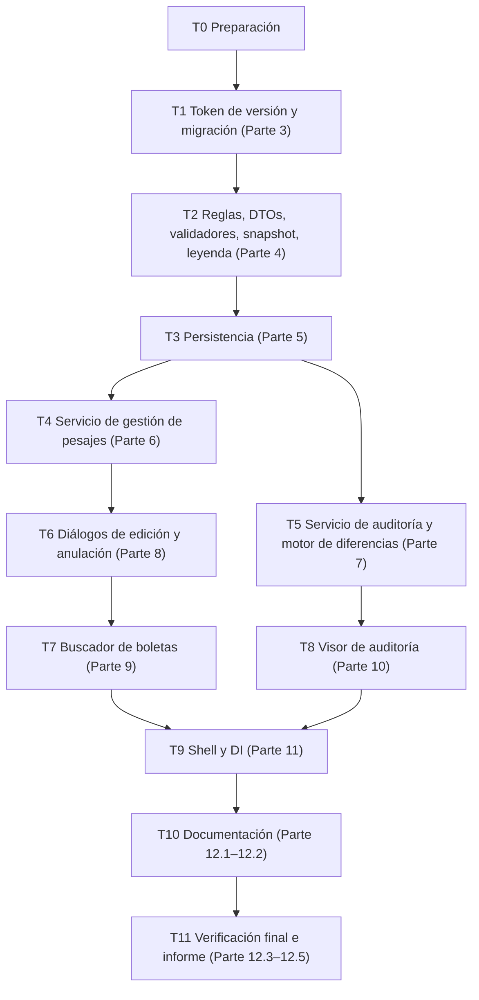

# Plan de implementación F6 — Edición, anulación y auditoría

**Autor:** revisión senior (2026-09-29)
**Ejecutor:** un agente implementador (puede ser uno solo, secuencial). Si la plataforma permite subagentes, ver E.6; el orden y las compuertas no cambian.
**Punto de partida:** F5 completado **y commiteado** (commit `feat(F5): boleta de pesaje` sobre `b28d0e3`). Build Release con 0 warnings; 816 tests en verde según `Agents.md` (mídelo tú mismo en T0 y anota el número real).
**Estado al escribir este plan:** F5 está en la rama `feat/f5-boleta` **preparado (`git add`) pero sin commit** (HEAD = `b28d0e3`, el commit de F4). Ver T0: si sigue así, **detente**.
**HUs:** HU-F6-01 … HU-F6-05 (ver `Agents.md §3`).

**Cómo leer este documento:**
- La **Parte E** dice *qué* tarea hacer, *en qué orden*, *qué archivos* puedes tocar y *cómo* se comprueba cada tarea. Síguela al pie de la letra.
- Las **Partes 0–12** son la *especificación*. Cada tarea de la Parte E apunta a una o más Partes.
- La **Parte 13** es la revisión del plan: huecos detectados, cómo se cubren y riesgos abiertos. **Léela entera antes de escribir código.** Muchas reglas existen por lo que se explica allí (se citan como "ver R*n*").

Este documento es **la especificación**. Si algo no está aquí, se aplican las convenciones de `Agents.md §4` y, como plantilla de código, lo que ya hacen F2–F5 (`ServicioUsuarios`, `ServicioGanaderos`, `ServicioPesajes`, `ServicioBoletas`, `FrmGanaderos`, `FrmGanaderoEdicion`, `FrmReimprimirBoleta` y sus tests). Si algo contradice `Agents.md`, manda este documento y la diferencia se anota en el informe final.

---

## Mapa HU → Partes

| HU | Título | Partes |
|---|---|---|
| HU-F6-01 | Buscador de boletas | 4 (filtros, DTOs), 5 (repositorio), 6.2 (servicio), 9 (`FrmBuscarBoletas`) |
| HU-F6-02 | Editar boleta sin modificar pesos | 3 (token de versión), 4 (validación), 6.3 (servicio), 8.1 (`FrmEditarBoleta`) |
| HU-F6-03 | Anular boleta con motivo obligatorio | 4 (validación, leyenda R-F6-1), 6.4 (servicio), 8.2 (`FrmAnularBoleta`) |
| HU-F6-04 | Auditoría con diff antes/después en JSON | 4.4 (snapshot enriquecido), 7.3 (motor de diferencias) |
| HU-F6-05 | Visor de auditoría | 5.2 (repositorio), 7 (servicio), 10 (`FrmVisorAuditoria`) |

**F6 tiene una sola migración de base de datos, mínima:** `AddColumn Pesajes.Version` (Parte 3). No se tocan CHECKs, índices ni otras tablas. Si el generador de EF produce **cualquier otra operación**, **detente** y repórtalo (R3).

---

## Parte E — Ejecución

### E.1 Por qué el plan es tan explícito

El ejecutor es un agente de menor capacidad. Los fallos típicos que este plan neutraliza:

| Fallo típico | Cómo lo neutraliza el plan |
|---|---|
| Inventar APIs de EF Core/WinForms o usarlas con la semántica de otra versión. | Las APIs críticas están **verificadas** en la Parte 2 (con fuente). No las cambies ni "mejores". Para cualquier otra API de librería, consulta Context7 (`/dotnet/entityframework.docs`, `/websites/learn_microsoft_en-us_dotnet`) antes de escribirla. |
| Reutilizar un método `AsNoTracking` para editar (los cambios no se guardan) o cambiar el estado de la entidad a mano. | 5.1 y 6.3 dicen qué método tracked usar y **qué no tocar** (solo claves foráneas, nunca propiedades de navegación). |
| Olvidar una regla dada muchas páginas antes. | Cada Parte repite las reglas que le aplican; cada tarea tiene comprobaciones automáticas con `grep` (E.3). |
| Reportar "todo verde" sin haberlo ejecutado. | La compuerta (E.4) se ejecuta **siempre** y se pega la salida real en la bitácora. |
| Tocar archivos fuera de alcance ("ya que estaba…"). | Lista blanca por tarea, verificada con `git status --porcelain` (E.3). |
| Borrar o saltar tests para ponerse en verde. | El número de tests nunca baja; `Skip`, `#pragma warning disable`, `NoWarn` están prohibidos y se buscan con `grep` (E.4). |
| Anidar `EjecutarAsync` y perder operaciones en silencio. | Regla 0.9 repetida en cada Parte de UI + revisión manual obligatoria en T6, T7 y T8. |
| Permitir editar pesos, tipo de desposte, número o fecha "porque el formulario ya los tiene". | D2 y D3: el DTO de edición **no tiene esos campos**; no hay forma de que lleguen al servicio. |

### E.2 Orden de tareas

Ejecuta **una tarea a la vez, en este orden**. No empieces la siguiente hasta que la compuerta de la actual esté en verde y la tarea esté commiteada (E.5).



Orden lineal: **T0, T1, T2, T3, T4, T5, T6, T7, T8, T9, T10, T11.**

### E.3 Ficha de cada tarea

Rutas relativas a `src/` o `tests/PesajeFaeneo.Tests/` según corresponda. "Nuevo" = archivo a crear.

| Tarea | Especificación | Archivos permitidos (lista blanca) | Comprobaciones automáticas propias (además de E.4) |
|---|---|---|---|
| **T0** | E.5 | — (solo git) | `git status` limpio; `git log -1 --format=%s` empieza por `feat(F5)`; línea base de tests anotada. |
| **T1** | Parte 3 | Modificados: `PesajeFaeneo.Domain/Entities/Entities.cs`, `PesajeFaeneo.Infrastructure/Persistencia/Configuraciones/PesajeConfiguration.cs`, `PesajeFaeneo.Infrastructure/Persistencia/PesajeDbContext.cs`, `PesajeFaeneo.Infrastructure/Persistencia/Migraciones/PesajeDbContextModelSnapshot.cs`. Nuevos: `Persistencia/Migraciones/*_F6_VersionPesaje.cs` y `*_F6_VersionPesaje.Designer.cs`, `tests/.../MigracionF6Tests.cs`, `tests/.../PesajeVersionTests.cs` | `git diff --name-only <SHA_F5> -- src/PesajeFaeneo.Infrastructure/Persistencia/Migraciones` lista **solo** los 2 archivos nuevos + el snapshot; `grep -n "AddColumn<int>" *_F6_VersionPesaje.cs` encuentra exactamente 1 y `grep -c "CreateTable\|DropColumn\|AddCheckConstraint\|DropCheckConstraint" *_F6_VersionPesaje.cs` da 0 en `Up`; `dotnet ef migrations has-pending-model-changes` limpio. |
| **T2** | Parte 4 | Nuevos: `PesajeFaeneo.Domain/Reglas/ReglasGestionPesajes.cs`, `PesajeFaeneo.Application/Pesajes/Dtos/GestionPesajesDtos.cs`, `PesajeFaeneo.Application/Pesajes/ValidadorGestionPesajes.cs`, `tests/.../ValidadorGestionPesajesTests.cs`. Modificados: `PesajeFaeneo.Application/Auditoria/FabricaAuditoria.cs`, `PesajeFaeneo.Application/Boletas/Diseno/TextosBoleta.cs`, `PesajeFaeneo.Application/Boletas/Diseno/DisenoBoleta.cs`, `tests/.../FabricaAuditoriaTests.cs`, `tests/.../TextosBoletaTests.cs`, `tests/.../DisenoBoletaTests.cs` | `grep -rn "System.Drawing\|System.Windows" src/PesajeFaeneo.Application` vacío; `grep -n "DateTime.Now\|DateTime.UtcNow\|CurrentCulture" src/PesajeFaeneo.Application/Pesajes/ValidadorGestionPesajes.cs` vacío; los tests **existentes** de `TextosBoletaTests`/`DisenoBoletaTests`/`FabricaAuditoriaTests` no cambian sus aserciones (solo se **agregan** casos, salvo lo indicado en 4.5). |
| **T3** | Parte 5 | Nuevos: `PesajeFaeneo.Application/Abstracciones/Persistencia/CriteriosPersistencia.cs`, `tests/.../GestionRepositoriosTests.cs`. Modificados: `IPesajeRepositorio.cs`, `PesajeRepositorio.cs`, `IAuditoriaRepositorio.cs`, `AuditoriaRepositorio.cs` | `git diff --name-only <SHA_F5> -- src/PesajeFaeneo.Infrastructure/Persistencia/Migraciones` sigue igual que en T1; `grep -n "Contains(" .../AuditoriaRepositorio.cs .../PesajeRepositorio.cs` vacío (R21 de F5). |
| **T4** | Parte 6 | Nuevos: `PesajeFaeneo.Application/Pesajes/IServicioGestionPesajes.cs`, `ServicioGestionPesajes.cs`, `tests/.../ServicioGestionPesajesTests.cs`. Modificado: `PesajeFaeneo.Application/DependencyInjection.cs` | `grep -n "DateTime.Now\|DateTime.UtcNow\|DateTime.Today\|ToLocalTime" src/PesajeFaeneo.Application/Pesajes` vacío; `grep -n "AsNoTracking" src/PesajeFaeneo.Infrastructure/Persistencia/Repositorios/PesajeRepositorio.cs` **no** aparece dentro de `ObtenerParaEdicionAsync`; el servicio **no** tiene ningún parámetro de peso, desposte, número ni fecha en `EditarPesaje`. |
| **T5** | Parte 7 | Nuevos: `PesajeFaeneo.Application/Auditoria/IServicioAuditoria.cs`, `ServicioAuditoria.cs`, `DiferenciasAuditoria.cs`, `Dtos/AuditoriaDtos.cs` (en `Application/Auditoria/`), `tests/.../ServicioAuditoriaTests.cs`, `tests/.../DiferenciasAuditoriaTests.cs`. Modificado: `PesajeFaeneo.Application/DependencyInjection.cs` | `grep -rn "using System.Text.Json" src/PesajeFaeneo.Application/Auditoria` solo en `FabricaAuditoria.cs` y `DiferenciasAuditoria.cs`; `ArquitecturaTests` en verde (`System.Text.Json` de la BCL es lo único permitido). |
| **T6** | Parte 8 | Nuevos: `PesajeFaeneo.WinForms/Formularios/Boletas/FrmEditarBoleta.cs`, `FrmAnularBoleta.cs`, `tests/.../Formularios/FrmEditarBoletaTests.cs`, `FrmAnularBoletaTests.cs`, `tests/.../Utilidades/Gestion/ServicioGestionPesajesFalso.cs`, `tests/.../Utilidades/Gestion/DatosGestionDePrueba.cs` | En los `.cs` nuevos de WinForms: `grep -n "\.Result\|\.Wait()\|GetAwaiter().GetResult()"` vacío; revisión manual: ningún `EjecutarAsync(`/`Ejecutar(` dentro del delegado de otro. |
| **T7** | Parte 9 | Nuevos: `PesajeFaeneo.WinForms/Formularios/Boletas/FrmBuscarBoletas.cs`, `tests/.../Formularios/FrmBuscarBoletasTests.cs`, `tests/.../Utilidades/Gestion/SesionFalsa.cs`. Modificado (solo si extraes los ayudantes compartidos de 9.1-2): archivos nuevos de T6 | Ídem T6 + `grep -n "AcceptButton" FrmBuscarBoletas.cs` encuentra 1 línea (`= btnBuscar`). |
| **T8** | Parte 10 | Nuevos: `PesajeFaeneo.WinForms/Formularios/Administracion/FrmVisorAuditoria.cs`, `tests/.../Formularios/FrmVisorAuditoriaTests.cs`, `tests/.../Utilidades/Gestion/ServicioAuditoriaFalso.cs` | Ídem T6. |
| **T9** | Parte 11 | Modificados: `PesajeFaeneo.WinForms/Formularios/FrmPrincipal.cs`, `tests/.../ContenedorDITests.cs`, `tests/.../FrmPrincipalTests.cs` | `AutorizadorMenuTests.cs` sin cambios (`git diff --stat` no lo lista); `grep -n "\"F6\"" FrmPrincipal.cs` vacío (ya no queda ninguna opción marcada como fase futura F6). |
| **T10** | 12.1–12.2 | `Agents.md`, `README.md` | Las cifras de tests salen de la bitácora (no inventadas). |
| **T11** | 12.3–12.5 | — (solo verificación; correcciones como tareas `T11.n` con su propia lista blanca, declarada en la bitácora antes de tocar nada) | Todo E.4 sobre el árbol final + 12.3 (tres corridas) + 12.4 (arranque y cierre). |

**Verificación de la lista blanca** (al terminar cada tarea, **antes** del `git add`):
```bash
git status --porcelain
```
Cualquier archivo fuera de la lista = la tarea no está terminada: revierte ese archivo (`git checkout -- <archivo>` o bórralo si es nuevo) y rehaz lo necesario dentro de la lista. Si de verdad necesitas tocar otro archivo, anótalo en la bitácora como **desviación** con el motivo, y solo si es imprescindible para compilar (p. ej. un doble de prueba que implementa una interfaz ampliada).

### E.4 Compuerta de calidad (después de cada tarea, sin excepción)

Comandos de **Git Bash** (herramienta Bash), no de PowerShell:
```bash
dotnet build src/PesajeFaeneo.sln -c Release
```
```bash
dotnet test src/PesajeFaeneo.sln -c Release
```
```bash
# Finales de línea: debe salir vacío (después de git add)
git add -A && git diff --cached --name-only --diff-filter=AM | xargs -r git ls-files --eol | grep "w/lf"
# Nada de trampas: debe salir vacío
git diff --cached -U0 | grep -E "^\+.*(#pragma warning disable|Skip *=|NoWarn|TreatWarningsAsErrors|PackageReference|Thread\.Sleep|SuppressMessage)"
# Migraciones: solo la de T1 (2 archivos nuevos + snapshot); desde T2 en adelante no debe cambiar nada más
git diff --cached --name-only <SHA_F5> -- src/PesajeFaeneo.Infrastructure/Persistencia/Migraciones
```
- 0 warnings (`TreatWarningsAsErrors=true`), 0 errores, todos los tests en verde. **No avances con rojo.**
- El número de tests **nunca baja** respecto de la tarea anterior.
- Si un test **existente** falla por un cambio de esta fase, corrige los **datos o dobles del test**, nunca la regla nueva, y anótalo. Los únicos tests existentes que este plan autoriza a modificar están listados en la tarea correspondiente (T2: `FabricaAuditoriaTests`, `TextosBoletaTests`, `DisenoBoletaTests`; T9: `ContenedorDITests`, `FrmPrincipalTests`).
- Al cerrar T1, T4, T7 y T11 ejecuta la suite **tres veces seguidas**. Un test que falla 1 de 3 veces es un test roto: corrígelo, no lo reintentes hasta que pase.

### E.5 Protocolo de git y bitácora

1. **T0:**
   - `git status` debe estar **limpio** y `git log -1 --format=%s` debe ser el commit de F5 (`feat(F5): …`). **Si F5 sigue con cambios preparados/sin commit** (estado al escribir este plan: rama `feat/f5-boleta`, HEAD = `b28d0e3` = F4), **detente y repórtalo al usuario**: no commitees F5 por tu cuenta ni mezcles F5 y F6 en el mismo diff.
   - Anota `<SHA_F5> = git rev-parse HEAD` en la bitácora.
   - `git switch -c feat/f6-gestion-boletas`.
   - Ejecuta la compuerta y anota el número de tests de partida (debe ser 816; si es otro, anótalo y sigue).
2. **Por cada tarea:** implementa → compuerta E.4 → comprobaciones propias de E.3 → `git status --porcelain` contra la lista blanca → `git add -A && git commit -m "wip(F6-Tn): <título>"`.
3. **Nunca** `push`, `merge`, `rebase`, `reset --hard` ni `checkout` de otras ramas. No commitees la bitácora.
4. **Al terminar T11:** anota el SHA del último commit en la bitácora y en el informe, y ejecuta `git reset --soft <SHA_F5>`: todo F6 queda como cambios preparados sin commit, igual que en fases anteriores, para que el usuario lo revise y haga un único commit `feat(F6): edición, anulación y auditoría`. (Si algo sale mal, `git reset --soft <SHA anotado>` recupera el historial.)
5. **Bitácora** (`../pesalab-f6-bitacora.md`, **fuera** del repositorio para que `git add -A` no la incluya): por tarea, tests antes → después, salida literal de las 3 últimas líneas de `dotnet test`, desviaciones y decisiones tomadas ante ambigüedades. T10 la usa como fuente de cifras.

### E.6 Si la plataforma ofrece subagentes

- Mantén el orden de E.2. T4 y T5 son independientes entre sí (ambas dependen de T3) y **podrían** ir en paralelo, pero tocan el mismo `DependencyInjection.cs`: si las paralelizas, la segunda en terminar **rebasa su cambio** de DI a mano. Recomendación: secuencial.
- Un subagente por tarea, con un brief que contenga **copiadas literalmente**: la Parte de la especificación, las filas R citadas en ella, la lista blanca de E.3, las reglas de la Parte 0 y los hechos de la Parte 2. Nunca resumas la especificación.
- Los tests de `FrmEditarBoleta`, `FrmAnularBoleta`, `FrmBuscarBoletas` y `FrmVisorAuditoria` los debería escribir **una instancia distinta** de la que implementó el formulario, a partir de la especificación (R30).
- El agente principal **re-ejecuta** siempre la compuerta; el reporte de un subagente no cuenta como prueba.

---

## Parte 0 — Reglas de comportamiento (obligatorias)

1. **No te detengas hasta terminar.** Responde al usuario **una sola vez**, al final, con el informe de 12.5. Si algo es ambiguo, elige la opción más conservadora compatible con este plan, anótala en la bitácora como desviación y continúa. Las únicas paradas autorizadas son: T0 (F5 sin commit), "el generador de migraciones produjo algo distinto de un único `AddColumn`" y "necesito otra migración".
2. **Git:** lo gobierna E.5.
3. **Compuerta:** E.4 después de cada tarea. Nunca desactives un warning, un test ni un analizador.
4. **Convenciones:** identificadores, comentarios, mensajes de UI y de log en **español**; imita el estilo y la densidad de comentarios del código existente. CRLF, UTF-8. xUnit solo con `Assert`. Sin librerías de mocks: dobles escritos a mano.
5. **Capas** (las hace cumplir `ArquitecturaTests`): Domain sin dependencias; Application sin EF, WinForms, Serilog, Hosting, `System.Drawing` ni `System.IO.Ports`; Infrastructure sin WinForms. **No agregues paquetes NuGet ni cambies `.csproj`/`.props`.**
6. **Tiempo:** siempre `TimeProvider` inyectado. Nada de `DateTime.Now`, `DateTime.UtcNow`, `DateTime.Today` ni `ToLocalTime()` en producción. La hora local se obtiene con `TimeZoneInfo.ConvertTimeFromUtc(utc, _timeProvider.LocalTimeZone)` **en el servicio**, no en la UI (D13 de F5). En tests, `FakeTimeProvider` con `SetLocalTimeZone` (patrón de `ServicioPesajesTests`).
7. **Cultura:** todo texto que salga de un servicio hacia una pantalla (fechas, pesos) se formatea con `TextosBoleta.Cultura` (es-BO), **nunca** con `CurrentCulture`. **Prohibido** `$"{fecha:dd/MM/yyyy}"` o `$"{peso:0.0}"` dentro de una interpolación (R42 de F5): usa `x.ToString("formato", TextosBoleta.Cultura)` o los ayudantes de `TextosBoleta` (`FechaHora`, `Peso`). Las **pantallas nuevas** formatean con esos mismos ayudantes (no con `CurrentCulture`, a diferencia de la grilla de `FrmPesaje`).
8. **Hilo de UI:** nunca `.Result`, `.Wait()` ni `.GetAwaiter().GetResult()` una vez iniciado el bucle de mensajes. Manejadores asíncronos con lambdas `async (_, _) =>` que delegan en `FormBase.EjecutarAsync`.
9. **Regla de reentrada de `FormBase` (la más fácil de romper en F6):** `EjecutarAsync`/`Ejecutar` descartan **en silencio** cualquier invocación mientras otra está en curso. **Nunca** llames a un método que use `EjecutarAsync`/`Ejecutar` desde dentro del delegado de otro. Los métodos internos (los que no se envuelven a sí mismos) llevan el sufijo `InternoAsync`. **Recargar la grilla tras cerrar un diálogo** es un bloque secuencial: primero el diálogo (dentro de su `Ejecutar`/`EjecutarAsync`), después, **fuera**, la recarga con su propio `EjecutarAsync`. (Excepción tolerada, patrón ya presente en `FrmGanaderos`: llamar a un método `...InternoAsync` que **no** se envuelve, dentro del delegado.)
10. **Tests de WinForms:** todo test que cree un `Form` o un control corre dentro de `HiloSta.Ejecutar(...)` y desecha lo que crea. Los servicios falsos devuelven **tareas ya completadas**; para esperas intencionales usa `TaskCompletionSource` y bombea con `Application.DoEvents()` en un bucle con límite de 5 s. Nada de `Thread.Sleep` ni `Task.Delay` fijos. Los `MessageBox` no se prueban: expón ganchos `internal` (`...ParaTest`).
11. **Tests de servicios y repositorios:** con **SQLite en memoria real** (`BaseDatosEnMemoria`, ejecuta las migraciones reales), no con dobles de repositorio. Sesiones con `SesionesDePrueba.IniciarAsync(db, sesion, Rol.Supervisor|Administrador|Operador)`. Datos con los `*Builder` de `EntityBuilders.cs`.
12. **Seguridad y antifraude:** toda edición y toda anulación queda auditada **en el mismo `GuardarCambiosAsync`** que el cambio (nunca un cambio sin auditoría ni una auditoría sin cambio). Los pesos, el tipo de desposte, el número, la fecha y el origen de una boleta **no se pueden modificar jamás** desde F6. La anulación es **irreversible** (no existe "desanular"). El visor de auditoría es **solo lectura** (sin borrar, sin editar, sin exportar).
13. **Logging:** `Information` por cada edición y anulación (número de boleta, Id, usuario; **sin** valores anteriores/nuevos ni el motivo completo: eso vive en la auditoría). `Warning` por rechazos de negocio esperables solo si aporta (no por cada validación). Nunca registres datos personales más allá de ids y número de boleta.
14. **APIs de librería:** los hechos de la **Parte 2** están verificados; respétalos tal cual. Para cualquier otra API, confirma la firma con Context7 o learn.microsoft.com antes de usarla. No escribas de memoria.
15. **Espacio de nombres `Auditoria`:** `PesajeFaeneo.Application.Auditoria` es un espacio de nombres **y** existe la entidad `PesajeFaeneo.Domain.Entities.Auditoria`. Dentro de esos espacios de nombres, para referirte a la entidad usa el alias `using AuditoriaEntidad = PesajeFaeneo.Domain.Entities.Auditoria;` (como ya hacen `FabricaAuditoria.cs` y `AuditoriaRepositorio.cs`). Nunca escribas `Auditoria` a secas para la entidad (R22).

---

## Parte 1 — Decisiones de diseño (asumidas; el usuario puede cambiarlas)

Las marcadas **(P*n*)** dependen de una pregunta al usuario de la Parte 13.

| # | Decisión | Valor |
|---|---|---|
| D1 | Servicios nuevos | `IServicioGestionPesajes` (buscar, obtener para edición, editar, anular) en `Application/Pesajes/`, e `IServicioAuditoria` (consultar) en `Application/Auditoria/`. **No** se amplía `IServicioPesajes` (F4, permiso `Pesar`, tiene otro propósito) ni `IServicioBoletas` (F5, datos de impresión). Ambos `Transient`, registrados en `Application/DependencyInjection.cs`. |
| D2 | Qué se puede editar | Ganadero, cliente, dirección, secuencia, color/raza, sexo y observación (+ un motivo opcional del cambio). |
| D3 | Qué **nunca** se edita | `NumeroBoleta`, `FechaHora`, `PesoIzquierdo`, `PesoDerecho`, `PesoTotal`, `OrigenPeso`, `UsuarioId`, `Estado`. **`TipoDesposte` tampoco**: con los pesos fijos es imposible cambiarlo con validez (media res exige un solo lado > 0; res completa exige ambos) — cualquier cambio violaría `ReglasPesaje.ValidarPesos`. El formulario muestra todo esto de solo lectura. **Para corregir un peso hay que anular y registrar una boleta nueva** (P1). |
| D4 | Quién | Buscar: `EditarBoleta` **o** `AnularBoleta`. Editar: `EditarBoleta`. Anular: `AnularBoleta`. Hoy Supervisor y Administrador tienen ambos; el Operador ninguno. No se toca `Permiso` ni `MatrizPermisos`. Visor de auditoría: `VerAuditoria` (Supervisor y Administrador). |
| D5 | Boleta anulada | No se puede editar ni volver a anular (`ReglaNegocioException`, códigos `PES_ANULADA` y `PES_YA_ANULADA`). La anulación es **irreversible**. El número **no** se reutiliza ni se retrocede el contador. Una boleta anulada **sí** se puede reimprimir/imprimir (F5 la marca con "ANULADA: …" y marca de agua; sin cambios en F5 salvo R-F6-1, ver D9). |
| D6 | Motivo de anulación | **Obligatorio**, 5 a 100 caracteres tras normalizar (mayúsculas invariantes + colapso de espacios, como los catálogos). El CHECK de BD ya permite 1..250. Mensaje: "Ingrese el motivo de la anulación (mínimo 5 caracteres)." / "El motivo no puede superar 100 caracteres." |
| D7 | Motivo de edición | **Opcional**, máximo 100 caracteres. Solo se registra en `Auditoria.Motivo`. **(P2)** |
| D8 | Concurrencia optimista | Token entero `Pesaje.Version` (`IsConcurrencyToken`), incrementado en cada `SaveChanges` de un `Pesaje` modificado (Parte 3). `EditarPesaje` y `AnularPesaje` llevan `VersionEsperada`; si no coincide con la de BD → `ConcurrenciaException`. **`ParametrosSistema` queda fuera de F6** (R4): la nota R12 de `Agents.md` se resuelve **solo para `Pesaje`**; se documenta el resto. |
| D9 | Leyenda de anulación en la boleta (R-F6-1) | `TextosBoleta.Leyendas` imprime `ANULADA: {motivo corto}`: el motivo se recorta a **30** caracteres con "…" (`TextosBoleta.MotivoCorto`). El motivo completo vive en BD y auditoría. Además, en **media carta**, si el texto unido de las leyendas supera 85 caracteres se baja el tamaño de letra de esa fila (9 → 7 pt hasta 110 caracteres, 6 pt más allá) para que las leyendas prioritarias (SIMULADO, REIMPRESIÓN) no se corten con "…". El ticket ya usa una fila por leyenda con varias líneas: sin cambios. |
| D10 | Diff antes/después (HU-F6-04) | Las filas de auditoría **siguen guardando los dos snapshots completos** (`DatosAntesJson`, `DatosDespuesJson`), que es lo que ya hacen `Modificar`/`Cambio*` desde F1–F5. F6 (a) **enriquece** el snapshot de `Pesaje` (campos de anulación + marca/nombre de ganadero y nombre/código de cliente, para que el diff sea legible sin consultar otras tablas), y (b) agrega un **motor puro** `DiferenciasAuditoria` que calcula el diff campo a campo a partir de los dos JSON, usado por el visor y probado sin UI. Se descarta guardar solo los campos cambiados: rompería la compatibilidad con las auditorías existentes y con el formato único. **(P3)** |
| D11 | Compatibilidad del snapshot | Los campos nuevos de `PesajeAuditoria` se agregan **al final, con valor por defecto** (`= null`), para no romper ninguna construcción existente. Las auditorías `Crear` ya grabadas no los tienen: el motor de diferencias trata una propiedad ausente como `null`. |
| D12 | Sin cambios = sin auditoría | Si tras normalizar no cambia ningún campo (snapshot antes == después), `EditarAsync` **no guarda, no audita y no incrementa `Version`**; devuelve `HuboCambios = false`. |
| D13 | Validez del ganadero/cliente en edición | Solo se exige "existe y está activo" **si cambia** respecto del actual. Una boleta cuyo ganadero fue desactivado después se puede seguir editando (dirección, observación…) sin obligar a cambiarlo. |
| D14 | Secuencia | Se valida 1..9999 (como F4). **No** se exige unicidad por ganadero/día (F4 tampoco la exige; no hay índice). Documentado en R11. |
| D15 | Dirección al cambiar de cliente | **No** se rellena automáticamente (a diferencia de `FrmPesaje`): evita pisar una dirección corregida a mano. El operador la edita explícitamente. |
| D16 | Buscador | Filtros: rango de fechas (día local, ambos opcionales), N° de boleta exacto, ganadero, cliente, estado (Todos/Vigente/Anulado). Todos se combinan con **AND**. Orden: `NumeroBoleta` descendente. Máximo **200** filas; se consulta 201 para saber si hubo más y avisar "Se muestran las primeras 200; refine la búsqueda". Cuando el usuario escribe un N° de boleta, **la pantalla** envía fechas nulas (el servicio no ignora nada: es AND puro). |
| D17 | Listas de ganaderos/clientes del buscador y del diálogo | Salen del **servicio de gestión** (no de `IServicioGanaderos`/`IServicioClientes`) para no depender de `GestionarCatalogos`. En el buscador incluyen **inactivos** (historial); en el diálogo de edición, los **activos + el actual aunque esté inactivo**. |
| D18 | Auditoría: consulta | Filtros: rango de fechas (día local), entidad, acción, usuario, N° de boleta (resuelve el `Id` del pesaje y fuerza `Entidad = "Pesaje"`, mostrando así todo su historial: Crear, Imprimir, Reimprimir, Modificar, Anular). AND puro. Orden `FechaHora` desc, `Id` desc. Máximo **500** filas con aviso de truncado. Por defecto el visor abre con **hoy**. |
| D19 | Privacidad en el visor | Las filas `LoginFallido` **sin usuario asociado** guardan en `EntidadId` el texto que se tecleó como usuario, que a veces es una contraseña tecleada en el campo equivocado. El **servicio** sustituye ese valor por `(usuario no existente)`; el texto original nunca llega a la pantalla (R14). |
| D20 | Fechas en el visor | Las fechas de la fila salen en hora local (servicio). Dentro del JSON las fechas están en UTC ISO-8601 (`...Z`): el motor de diferencias las convierte a hora local con la zona que recibe, formato `dd/MM/yyyy HH:mm:ss`, cultura es-BO. |
| D21 | Atajos | Menú Boletas › "Buscar / editar boleta": **F6**. "Anular boleta": sin atajo (mismo formulario). Visor de auditoría: sin atajo. En `FrmBuscarBoletas`: Enter busca, F4 edita, F8 anula, Esc cierra; Enter con el foco en la grilla **edita** (no busca). En `FrmEditarBoleta`: F12 guarda, Esc cancela. |
| D22 | Un solo formulario para dos opciones de menú | "Buscar / editar boleta" y "Anular boleta" abren `FrmBuscarBoletas`; los botones Editar/Anular se habilitan según los permisos de la sesión. |
| D23 | Sin nueva migración de índices | Las consultas usan índices existentes: `Pesajes(FechaHora)`, `Pesajes(NumeroBoleta)` único, `(Estado, FechaHora)`, `(GanaderoId, FechaHora)`, `(ClienteId, FechaHora)`; `Auditorias(FechaHora)` y `(Entidad, EntidadId)`. La afinación de rendimiento es F7-02. |
| D24 | Fuera de alcance de F6 | Marcar boletas editadas con una leyenda "MODIFICADA" al reimprimir (**P4**, R6); snapshot JSON de la boleta en la auditoría `Imprimir` (nota R30 de F5); exportar auditoría; desanular; editar pesos; reportes (F7); token de versión en `ParametrosSistema`. |

---

## Parte 2 — Hechos verificados (no los re-investigues; respétalos)

**Librería (verificados el 2026-09-29 con Context7, `/dotnet/entityframework.docs`, documentación oficial de EF Core):**

| # | Hecho | Consecuencia en el plan |
|---|---|---|
| H1 | SQLite, migraciones: `AddColumn` es una operación **soportada de forma nativa** (sin reconstruir la tabla). `DropColumn`, `AddCheckConstraint`, `DropCheckConstraint`, `AlterColumn`, `AddForeignKey`… **sí** provocan una reconstrucción de tabla. | Parte 3: la migración de F6 debe ser **solo** un `AddColumn` (no toca CHECKs). Cualquier otra operación en el `Up` generado = parada. El `Down` (`DropColumn`) reconstruiría la tabla, pero nunca se ejecuta en producción. |
| H2 | Un token de concurrencia **gestionado por la aplicación** no lo genera la BD: hay que **asignar un valor nuevo en cada guardado**. Ante un conflicto, `SaveChanges` lanza `DbUpdateConcurrencyException`. | 3.3: el `DbContext` incrementa `Version` de los `Pesaje` modificados. `UnidadDeTrabajo.GuardarCambiosAsync` ya traduce la excepción a `ConcurrenciaException`. |
| H3 | El valor **original** de una propiedad (`Property(...).OriginalValue`) es el leído de BD; la cláusula `WHERE` del `UPDATE` usa el original del token. | 3.3: `CurrentValue = OriginalValue + 1` (idempotente si `SaveChanges` se reintenta). |

**Del repositorio (comprobados leyendo el código):**

- `Pesaje` ya tiene `Estado`, `MotivoAnulacion`, `AnuladoPorId`, `AnuladoEn`, `ModificadoEn`; el CHECK `CK_Pesajes_Anulacion` exige coherencia (Vigente ⇒ los tres nulos; Anulado ⇒ los tres no nulos) y `CK_Pesajes_MotivoAnulacion` limita el motivo a 1..250. **No hay migración que hacer para la anulación.**
- `Pesajes` no tiene índice único por (ganadero, día, secuencia): las secuencias repetidas son posibles.
- `PesajeRepositorio.ObtenerPorIdAsync` es **`AsNoTracking`** con Include de `Ganadero`/`Cliente`. `GanaderoRepositorio.ObtenerPorIdAsync`, `ClienteRepositorio.ObtenerPorIdAsync` y `UsuarioRepositorio.ObtenerPorIdAsync` son **con tracking** (sin `AsNoTracking`) — verificado (ver R7). `IUsuarioRepositorio.ListarAsync(incluirInactivos)` es sin tracking y ordena por `NombreUsuario`.
- **`ManejadorErrores.Mostrar` (lo que llama `FormBase.EjecutarAsync` ante una excepción) abre un `MessageBox` modal.** En una prueba eso **cuelga** el hilo STA. Por eso los formularios de F6 **atrapan ellos mismos** las excepciones de negocio esperables (concurrencia, boleta ya anulada) y las muestran con un gancho `MostrarAdvertenciaParaTest` (patrón de `FrmReimprimirBoleta`); ningún test de formulario puede dejar pasar una excepción hasta `ManejadorErrores` (R41). `MostrarErroresValidacion` (FormBase) solo abre `MessageBox` para campos **sin** control asociado: en F6 todos los campos tienen control.
- `UnidadDeTrabajo.GuardarCambiosAsync` traduce `DbUpdateConcurrencyException` → `ConcurrenciaException`, `UNIQUE` → `ConflictoException`, `CHECK` → `ReglaNegocioException("BD_CHECK")`, `FOREIGN KEY` → `ReglaNegocioException("BD_FK")`.
- Patrón de servicio con auditoría: `ServicioPesajes.RegistrarAsync` y `ServicioUsuarios.EditarAsync` (cambio + `uow.Auditoria.Registrar` + **un** `GuardarCambiosAsync`).
- `FabricaAuditoria.Crear` trunca `EntidadId` a 50 y `Motivo` a 250 y acepta objetos de dominio (`Pesaje`) que normaliza vía `NormalizarObjeto` → `CrearSnapshot`. `EntidadesAuditoria.Pesaje = "Pesaje"`. Los enums se serializan como texto (`JsonStringEnumConverter`); sin política de nombres (propiedades en PascalCase).
- Las auditorías `Imprimir`/`Reimprimir` (F5) usan `Entidad = "Pesaje"`, `EntidadId = Id` (formato invariante). `Modificar`/`Anular` de F6 usarán **el mismo** `EntidadId`, así el visor muestra el historial completo de una boleta.
- `ServicioBoletas.MapearAsync` lee `p.Estado`/`p.MotivoAnulacion`: una boleta anulada ya se imprime con leyenda y marca de agua; **no** hay que tocarlo.
- `TextosBoleta.Leyendas` (F5) y `TextosBoleta.MarcaDeAgua` ya tratan `EstadoPesaje.Anulado`.
- `MatrizPermisos`: `EditarBoleta`, `AnularBoleta`, `VerAuditoria` los tienen Supervisor y Administrador; el Operador ninguno.
- `FrmPrincipal` (F1/F5) ya tiene los ítems "Buscar / editar boleta" (`EditarBoleta`, `FaseFutura = "F6"`), "Anular boleta" (`AnularBoleta`, `"F6"`) y "Visor de auditoría" (`VerAuditoria`, `"F6"`), **deshabilitados** por `AutorizadorMenu` mientras `FaseFutura` no sea nulo. T9 los activa.
- Los diálogos de edición reciben sus datos con un método público de configuración tras `IFormFactory.Crear<T>()` (patrón `FrmGanaderoEdicion.ConfigurarEdicion(dto)`), porque `Crear<T>()` no admite argumentos. Se sigue ese patrón.
- `ControlBusquedaCatalogo`: `EstablecerElementos(IReadOnlyList<ElementoBusqueda>)`, `Seleccionar(int id)` (solo si el id está en los elementos), `Limpiar()`, `Seleccion`; **no filtra por `Activo`** (muestra lo que se le da).
- `RangoDiaLocal.DelDia(DateOnly, TimeZoneInfo)` → `RangoUtc(DesdeUtc, HastaUtc)` con `HastaUtc` **exclusivo** (inicio del día siguiente).
- El índice `(Entidad, EntidadId)` y `FechaHora` existen en `Auditorias`.
- `PesajeBuilder` (tests) ya tiene `Anulado(motivo, anuladoPorId)`, `ConEstadoVigente()`, `ConFechaHora`, `ConNumeroBoleta`, `ConSecuencia`, `ConOrigen`, `ConPesos`, `ConDesposte`.
- Los `UowDecorador` de `ServicioPesajesTests` (y similares) delegan las **propiedades** `Auditoria`/`Pesajes` de `IUnidadDeTrabajo`; agregar **métodos** a `IPesajeRepositorio`/`IAuditoriaRepositorio` no los rompe. **No** se agregan propiedades a `IUnidadDeTrabajo` en F6 (rompería esos dobles).
- Los archivos nuevos de F5 llegaron en LF a la compuerta (H1 de `F5-remediacion.md`): los archivos que crees con la herramienta de escritura pueden quedar en LF; conviértelos a CRLF **antes** de la compuerta (E.4 lo detecta).

---

## Parte 3 — Token de versión y migración (HU-F6-02, concurrencia) — tarea T1

### 3.1 `Domain/Entities/Entities.cs`

En `Pesaje`, **después** de `ModificadoEn`, agrega:
```csharp
    // Token de concurrencia optimista gestionado por la aplicación (SQLite no tiene rowversion):
    // PesajeDbContext lo incrementa en cada guardado de un Pesaje modificado.
    public int Version { get; set; }
```
Nada más en `Entities.cs`.

### 3.2 `PesajeConfiguration.cs`

Agrega (junto a las demás propiedades, p. ej. después de `MotivoAnulacion`):
```csharp
        builder.Property(p => p.Version)
            .IsConcurrencyToken();
```
**No** uses `HasDefaultValue` (cambia la semántica de inserción de EF con valores centinela; ver R17 de F4). El valor por defecto de la columna lo pone la migración (`defaultValue: 0`, que EF genera solo para una columna `int` no nula).

### 3.3 `PesajeDbContext.cs`

Agrega los `using` necesarios y estos miembros (el resto de la clase queda igual):
```csharp
    public override int SaveChanges(bool acceptAllChangesOnSuccess)
    {
        IncrementarVersionPesajes();
        return base.SaveChanges(acceptAllChangesOnSuccess);
    }

    public override Task<int> SaveChangesAsync(bool acceptAllChangesOnSuccess, CancellationToken cancellationToken = default)
    {
        IncrementarVersionPesajes();
        return base.SaveChangesAsync(acceptAllChangesOnSuccess, cancellationToken);
    }

    // Token gestionado por la aplicación (H2): cada Pesaje modificado avanza su Version a partir del
    // valor ORIGINAL leído de BD (H3), de modo que reintentar SaveChanges no la incrementa dos veces.
    private void IncrementarVersionPesajes()
    {
        ChangeTracker.DetectChanges();
        foreach (var entrada in ChangeTracker.Entries<Pesaje>().Where(e => e.State == EntityState.Modified).ToList())
        {
            var version = entrada.Property(p => p.Version);
            version.CurrentValue = version.OriginalValue + 1;
        }
    }
```
Las sobrecargas sin el parámetro `bool` (`SaveChanges()`, `SaveChangesAsync(ct)`) llaman a estas; **no las sobrescribas**.

### 3.4 Migración

```bash
dotnet ef migrations add F6_VersionPesaje -p src/PesajeFaeneo.Infrastructure -s src/PesajeFaeneo.WinForms -o Persistencia/Migraciones
```
Revisa el archivo generado. **Debe** contener en `Up` exactamente:
```csharp
migrationBuilder.AddColumn<int>(
    name: "Version",
    table: "Pesajes",
    type: "INTEGER",
    nullable: false,
    defaultValue: 0);
```
y nada más. Si aparece cualquier otra operación (`CreateTable`, `DropCheckConstraint`, `AddCheckConstraint`, `AlterColumn`…), **detente** (R3): significa que el snapshot y el modelo estaban desfasados antes de F6; repórtalo, no lo "arregles". **No edites nada a mano** en la migración. Confirma que el snapshot cambió y que:
```bash
dotnet ef migrations has-pending-model-changes -p src/PesajeFaeneo.Infrastructure -s src/PesajeFaeneo.WinForms
```
dice que no hay cambios.

### 3.5 Tests (T1)

`MigracionF6Tests` (patrón de `MigracionF4Tests`, con `SqliteConnection` en memoria y `IMigrator`):
1. Migrar hasta `20260927144821_F4_Pesaje`, insertar con SQL crudo un usuario, un ganadero, un cliente y un pesaje **vigente** y otro **anulado** (`Estado = 2` con motivo, `AnuladoPorId`, `AnuladoEn`); migrar a la última; verificar que ambos siguen con sus datos, `Version == 0` en los dos, `PRAGMA foreign_key_check` sin filas, y que `UPDATE Pesajes SET Estado = 2 WHERE Id = <vigente>` (sin motivo) **falla** con `SqliteException` (el CHECK sigue vivo).

`PesajeVersionTests` (`BaseDatosEnMemoria`, contextos directos):
2. Insertar un pesaje: `Version == 0`. Modificar `Observacion` y guardar con `SaveChangesAsync`: `Version == 1`; volver a modificar y guardar: `2`.
3. `SaveChanges()` **síncrono** también incrementa (usa un contexto y `SaveChanges()`).
4. Guardar sin modificar nada **no** incrementa.
5. Dos contextos leen el mismo pesaje (tracking); ambos modifican; el primero guarda bien; el segundo lanza `DbUpdateConcurrencyException`. Tras el fallo, la BD tiene el valor del primero y `Version == 1`.
6. Modificar solo `Estado`/`MotivoAnulacion`/`AnuladoPorId`/`AnuladoEn` (una anulación) también incrementa.
7. Un pesaje **agregado** (estado `Added`) no toca `Version` (queda 0).

Mínimo: **8 tests nuevos** entre las dos clases.

---

## Parte 4 — Reglas, DTOs, validadores, snapshot y leyenda (HU-F6-01…04) — tarea T2

Nada de `System.Drawing` ni `DateTime.Now` aquí.

### 4.1 `Domain/Reglas/ReglasGestionPesajes.cs` (espacio `PesajeFaeneo.Domain.Reglas`)

```csharp
public static class CamposGestionPesajes
{
    public const string Motivo = "Motivo";
    public const string FechaDesde = "FechaDesde";
    public const string FechaHasta = "FechaHasta";
    public const string NumeroBoleta = "NumeroBoleta";
}

public static class ReglasGestionPesajes
{
    public const int MotivoAnulacionMinimo = 5;
    public const int MotivoAnulacionMaximo = 100;
    public const int MotivoEdicionMaximo = 100;
    public const int BusquedaMaximoFilas = 200;
    public const int AuditoriaMaximoFilas = 500;
    public const int MotivoLeyendaMaximo = 30;
}
```
(Los campos ganadero/cliente/dirección/secuencia/color/sexo/observación reutilizan `CamposPesaje`.)

### 4.2 `Application/Pesajes/Dtos/GestionPesajesDtos.cs` (espacio `PesajeFaeneo.Application.Pesajes.Dtos`)

```csharp
public sealed record FiltroBoletas(
    DateOnly? Desde,
    DateOnly? Hasta,
    long? NumeroBoleta,
    int? GanaderoId,
    int? ClienteId,
    EstadoPesaje? Estado);

public sealed record BoletaEncontrada(
    int Id,
    long NumeroBoleta,
    int Version,
    DateTime FechaHoraLocal,          // Kind = Unspecified, hora local (regla 0.6)
    string Marca,
    string NombreGanadero,
    int Secuencia,
    string NombreCliente,
    TipoDesposte TipoDesposte,
    decimal PesoIzquierdo,
    decimal PesoDerecho,
    decimal PesoTotal,
    OrigenPeso Origen,
    EstadoPesaje Estado,
    string? MotivoAnulacion);

public sealed record ResultadoBusquedaBoletas(
    IReadOnlyList<BoletaEncontrada> Boletas,
    bool Truncado);                   // true si había más de BusquedaMaximoFilas

public sealed record OpcionesBusquedaBoletas(
    IReadOnlyList<ElementoBusqueda> Ganaderos,    // incluye inactivos
    IReadOnlyList<ElementoBusqueda> Clientes);    // incluye inactivos

public sealed record BoletaParaEdicion(
    int Id,
    long NumeroBoleta,
    int Version,
    DateTime FechaHoraLocal,
    int GanaderoId,
    int ClienteId,
    string Direccion,
    int Secuencia,
    string ColorRaza,
    char Sexo,
    string Observacion,
    TipoDesposte TipoDesposte,        // solo lectura
    decimal PesoIzquierdo,            // solo lectura
    decimal PesoDerecho,              // solo lectura
    decimal PesoTotal,                // solo lectura
    OrigenPeso Origen,                // solo lectura
    string NombreOperador,            // solo lectura
    IReadOnlyList<ElementoBusqueda> Ganaderos,    // activos + el actual aunque esté inactivo
    IReadOnlyList<ElementoBusqueda> Clientes);    // ídem

public sealed record EditarPesaje(
    int PesajeId,
    int VersionEsperada,
    int GanaderoId,
    int ClienteId,
    string? Direccion,
    int Secuencia,
    string? ColorRaza,
    char Sexo,
    string? Observacion,
    string? Motivo);

public sealed record ResultadoEdicion(
    bool HuboCambios,
    IReadOnlyList<string> CamposModificados);     // etiquetas legibles: "Ganadero", "Secuencia", …

public sealed record AnularPesaje(
    int PesajeId,
    int VersionEsperada,
    string? Motivo);
```
`EditarPesaje` **no** tiene pesos, desposte, número ni fecha (regla 0.12, E.1). `ElementoBusqueda` es de `PesajeFaeneo.Application.Catalogos.Busqueda`.

### 4.3 `Application/Pesajes/ValidadorGestionPesajes.cs` (`public static class`)

Usa `ValidadorCatalogos.NormalizarMayusculas(string?)` (mayúsculas invariantes + colapso de espacios; devuelve `string` no nulo) y las constantes de `ReglasPesaje`.

`public static (EditarPesaje Normalizado, IReadOnlyList<ErrorValidacion> Errores) ValidarEdicion(EditarPesaje dto)`:
- Normaliza `Direccion`, `ColorRaza`, `Observacion`, `Motivo` con `NormalizarMayusculas`; `Sexo = char.ToUpperInvariant(dto.Sexo)`; devuelve `dto with { … }`.
- Errores (**textos exactos**, campos de `CamposPesaje` salvo el motivo):
  - `GanaderoId <= 0` → (`Ganadero`, "Seleccione el ganadero.")
  - `ClienteId <= 0` → (`Cliente`, "Seleccione el cliente.")
  - `Secuencia` fuera de 1..9999 → (`Secuencia`, "La secuencia debe estar entre 1 y 9999.")
  - `!ReglasPesaje.EsSexoValido(sexo)` → (`Sexo`, "Seleccione el sexo (M o H).")
  - Dirección > 150 → (`Direccion`, "La dirección no puede superar 150 caracteres.")
  - Color/raza > 30 → (`ColorRaza`, "Color/raza no puede superar 30 caracteres.")
  - Observación > 250 → (`Observacion`, "La observación no puede superar 250 caracteres.")
  - Motivo > 100 → (`CamposGestionPesajes.Motivo`, "El motivo no puede superar 100 caracteres.")

`public static (AnularPesaje Normalizado, IReadOnlyList<ErrorValidacion> Errores) ValidarAnulacion(AnularPesaje dto)`:
- Normaliza `Motivo`.
- Vacío o menor de 5 → (`Motivo`, "Ingrese el motivo de la anulación (mínimo 5 caracteres).")
- Mayor de 100 → (`Motivo`, "El motivo no puede superar 100 caracteres.")

### 4.4 Snapshot enriquecido (`Application/Auditoria/FabricaAuditoria.cs`)

1. `PesajeAuditoria`: agrega **al final**, con valores por defecto (D11):
```csharp
    string? MotivoAnulacion = null,
    int? AnuladoPorId = null,
    DateTime? AnuladoEn = null,
    string? MarcaGanadero = null,
    string? NombreGanadero = null,
    int? CodigoCliente = null,
    string? NombreCliente = null);
```
2. Nueva sobrecarga pública:
```csharp
public static PesajeAuditoria CrearSnapshot(Pesaje pesaje, Ganadero? ganadero, Cliente? cliente)
```
que arma el record con los 17 campos actuales **más** `pesaje.MotivoAnulacion`, `pesaje.AnuladoPorId`, `pesaje.AnuladoEn`, `ganadero?.Marca`, `ganadero?.Nombre`, `cliente?.Codigo`, `cliente?.Nombre`.
3. `CrearSnapshot(Pesaje pesaje)` (existente) pasa a delegar: `return CrearSnapshot(pesaje, pesaje.Ganadero, pesaje.Cliente);` (las propiedades de navegación son `null!` en tiempo de ejecución si no se cargaron; el parámetro es anulable y compila sin advertencia).
4. `EntidadesAuditoria`: agrega
```csharp
    public static readonly IReadOnlyList<string> Todas = new[]
    {
        Usuario, Ganadero, Cliente, Fletero, ParametrosSistema,
        ConfiguracionBalanza, Pesaje, ConfiguracionImpresion
    };
```
(debe ir **después** de las constantes; en una clase `static` con `const` no hay problema de orden de inicialización, pero déjalo al final del bloque).

`Version` **no** entra en el snapshot (cambiaría en cada edición y ensuciaría el diff).

### 4.5 Leyenda de anulación (R-F6-1)

En `TextosBoleta.cs`:
```csharp
public static string MotivoCorto(string? motivo, int maximo = ReglasGestionPesajes.MotivoLeyendaMaximo)
```
- Normaliza espacios (`Regex.Replace(s.Trim(), @"\s+", " ")`), `null` → `""`; si mide más que `maximo`, devuelve `s[..(maximo - 1)].TrimEnd() + "…"`; si no, `s`.
- En `Leyendas`, la línea de anulación pasa a `"ANULADA: " + MotivoCorto(d.MotivoAnulacion)`.

En `DisenoBoleta.cs` (**solo** la construcción de media carta, el elemento "9. Leyendas unidas con `  ·  `"):
```csharp
var textoLeyendas = string.Join("  ·  ", leyendas);
var tamanoLeyendas = textoLeyendas.Length <= 85 ? 9f : textoLeyendas.Length <= 110 ? 7f : 6f;
```
y usa `Texto: textoLeyendas`, `TamanoPt: tamanoLeyendas`. El ticket **no** cambia.

Tests existentes: si algún test de F5 afirma `"ANULADA: " + <motivo de más de 30 caracteres>`, **cambia el motivo de ese test** por uno de ≤ 30 (no la regla) y anótalo. Los demás no cambian.

### 4.6 Tests (T2)

- `ValidadorGestionPesajesTests` (≥ 14): cada error con su **texto exacto**; normalización (mayúsculas, colapso de espacios, sexo `m` → `M`); motivo de anulación vacío, 4 caracteres (error), 5 (ok), 100 (ok), 101 (error); motivo de edición de 101 (error) y nulo (ok); varias fallas juntas devuelven todas.
- `FabricaAuditoriaTests` (agregar): `CrearSnapshot(pesaje, ganadero, cliente)` incluye marca/nombre/código y los campos de anulación; `CrearSnapshot(pesaje)` con navegaciones nulas produce `MarcaGanadero == null` sin lanzar; el JSON de un `Pesaje` **anulado** contiene `"Estado":"Anulado"` y `"MotivoAnulacion":"…"`; `EntidadesAuditoria.Todas` contiene las 8 y `"Pesaje"`. El test existente `Crear_Pesaje_Serializa…` sigue verde tal cual.
- `TextosBoletaTests` (agregar): `MotivoCorto` con nulo, corto, exactamente 30 y 31 (termina en "…" y mide 30); espacios múltiples colapsados; `Leyendas` de anulada con motivo de 100 caracteres → la leyenda mide `9 + 30`.
- `DisenoBoletaTests` (agregar): media carta con las 5 leyendas activas (anulada + simulado + reimpresión + copia + muestra) usa `TamanoPt` 6; solo simulado (≤ 85 caracteres) usa 9; el rango medio usa 7; el ticket sigue con una fila por leyenda.

---

## Parte 5 — Persistencia (HU-F6-01, F6-05) — tarea T3

### 5.1 Repositorio de pesajes

`Application/Abstracciones/Persistencia/CriteriosPersistencia.cs` (nuevo):
```csharp
public sealed record CriteriosBusquedaPesaje(
    DateTime? DesdeUtc,               // inclusivo
    DateTime? HastaUtc,               // EXCLUSIVO
    long? NumeroBoleta,
    int? GanaderoId,
    int? ClienteId,
    EstadoPesaje? Estado);

public sealed record CriteriosAuditoria(
    DateTime? DesdeUtc,               // inclusivo
    DateTime? HastaUtc,               // EXCLUSIVO
    string? Entidad,
    AccionAuditoria? Accion,
    int? UsuarioId,
    string? EntidadId);
```

`IPesajeRepositorio` agrega (con comentario XML como los demás):
```csharp
/// CON tracking (los cambios se guardan con GuardarCambiosAsync); Include Ganadero y Cliente; null si no existe.
Task<Pesaje?> ObtenerParaEdicionAsync(int id, CancellationToken cancellationToken = default);

/// Sin tracking; Include Ganadero y Cliente; orden NumeroBoleta descendente; Take(maximo).
Task<IReadOnlyList<Pesaje>> BuscarAsync(CriteriosBusquedaPesaje criterios, int maximo, CancellationToken cancellationToken = default);
```
`PesajeRepositorio`:
- `ObtenerParaEdicionAsync`: `_context.Pesajes.Include(p => p.Ganadero).Include(p => p.Cliente).FirstOrDefaultAsync(p => p.Id == id, ct)` — **sin** `AsNoTracking`.
- `BuscarAsync`: `AsNoTracking` + Includes; aplica cada criterio **solo si tiene valor** (`if (c.DesdeUtc is { } d) q = q.Where(p => p.FechaHora >= DateTime.SpecifyKind(d, DateTimeKind.Utc));` — calcula la variable `dUtc` **fuera** de la expresión, como hace `ListarPorRangoAsync`); orden `OrderByDescending(p => p.NumeroBoleta)`; `Take(maximo)`.

### 5.2 Repositorio de auditoría

`IAuditoriaRepositorio` agrega:
```csharp
/// Sin tracking; Include Usuario (puede ser null); orden FechaHora desc, Id desc; Take(maximo).
Task<IReadOnlyList<AuditoriaEntidad>> ConsultarAsync(CriteriosAuditoria criterios, int maximo, CancellationToken cancellationToken = default);
```
(con el alias `AuditoriaEntidad`, ya declarado en ese archivo). Implementación análoga: filtros opcionales (`Entidad`, `Accion`, `UsuarioId`, `EntidadId` con `==`), **sin** `Contains` (R21 de F5).

### 5.3 Tests (T3) — `GestionRepositoriosTests` (`BaseDatosEnMemoria`; contextos directos y repositorios reales)

1. `ObtenerParaEdicionAsync` devuelve la entidad **tracked**: tras la llamada, `ctx.ChangeTracker.Entries<Pesaje>()` tiene 1 entrada; cambiar `Observacion` y `SaveChangesAsync` persiste (compruébalo releyendo con otro contexto). Inexistente → `null`.
2. `BuscarAsync`: por rango de fechas (límite inferior inclusivo, superior **exclusivo**: un pesaje justo en `HastaUtc` no sale); por número exacto; por ganadero; por cliente; por estado; combinación de dos criterios (AND); sin criterios devuelve todo; orden por número descendente; `maximo` respetado (con 5 filas y `maximo = 3` devuelve 3); las navegaciones vienen cargadas y **sin** tracking.
3. `ConsultarAsync`: por rango; por entidad; por acción; por usuario; por `EntidadId`; AND; orden `FechaHora` desc y desempate por `Id` desc (dos filas con la misma hora); `Usuario` nulo se devuelve (fila `LoginFallido` con `UsuarioId = null`) y no rompe el `Include`; `maximo` respetado.

Mínimo: **12 tests**.

---

## Parte 6 — Servicio de gestión de pesajes (HU-F6-01, 02, 03) — tarea T4

### 6.1 Interfaz `IServicioGestionPesajes` (`Application/Pesajes/`)

```csharp
public interface IServicioGestionPesajes
{
    Task<OpcionesBusquedaBoletas> ObtenerOpcionesBusquedaAsync(CancellationToken cancellationToken = default);
    Task<ResultadoBusquedaBoletas> BuscarAsync(FiltroBoletas filtro, CancellationToken cancellationToken = default);
    Task<BoletaParaEdicion> ObtenerParaEdicionAsync(int pesajeId, CancellationToken cancellationToken = default);
    Task<ResultadoEdicion> EditarAsync(EditarPesaje dto, CancellationToken cancellationToken = default);
    Task AnularAsync(AnularPesaje dto, CancellationToken cancellationToken = default);
}
```
`ServicioGestionPesajes : IServicioGestionPesajes` con constructor `(IUnidadDeTrabajoFactory uowFactory, ISesionActual sesion, TimeProvider timeProvider, ILogger<ServicioGestionPesajes> logger)`, todos con `?? throw new ArgumentNullException`. Registro: `services.AddTransient<Pesajes.IServicioGestionPesajes, Pesajes.ServicioGestionPesajes>();`.

Método privado `ExigirPermisoGestion()`: `_sesion.ExigirSesion(); if (!TienePermiso(EditarBoleta) && !TienePermiso(AnularBoleta)) throw new NoAutorizadoException();`.

### 6.2 `ObtenerOpcionesBusquedaAsync` y `BuscarAsync`

**`ObtenerOpcionesBusquedaAsync`:** `ExigirPermisoGestion()`; `uow.Ganaderos.ListarAsync(incluirInactivos: true)` y `uow.Clientes.ListarAsync(incluirInactivos: true)` → `ElementoBusqueda(g.Id, g.Marca, g.Nombre, null, g.Activo)` y `ElementoBusqueda(c.Id, c.Codigo.ToString(CultureInfo.InvariantCulture), c.Nombre, c.Direccion, c.Activo)` (mismo mapeo que `ServicioClientes.ListarParaBusquedaAsync`: **compruébalo leyéndolo** y copia su forma exacta de `codigo`).

**`BuscarAsync(filtro)`:**
1. `ExigirPermisoGestion()`; `filtro` nulo → `ArgumentNullException`.
2. Validaciones (lanzan `ValidacionException`):
   - `Desde` y `Hasta` con valor y `Desde > Hasta` → (`FechaHasta`, "La fecha final no puede ser anterior a la inicial.")
   - `NumeroBoleta` con valor `<= 0` → (`NumeroBoleta`, "Ingrese un número de boleta válido.")
3. Zona = `_timeProvider.LocalTimeZone`. `DesdeUtc = filtro.Desde is { } d ? RangoDiaLocal.DelDia(d, zona).DesdeUtc : null`; `HastaUtc = filtro.Hasta is { } h ? RangoDiaLocal.DelDia(h, zona).HastaUtc : null` (exclusivo).
4. `uow.Pesajes.BuscarAsync(criterios, ReglasGestionPesajes.BusquedaMaximoFilas + 1)`. `Truncado = lista.Count > max`; conserva solo las primeras `max`.
5. Mapea a `BoletaEncontrada` con la hora local (`DateTime.SpecifyKind(TimeZoneInfo.ConvertTimeFromUtc(DateTime.SpecifyKind(p.FechaHora, Utc), zona), Unspecified)`).

### 6.3 `ObtenerParaEdicionAsync` y `EditarAsync`

**`ObtenerParaEdicionAsync(pesajeId)`:** `_sesion.ExigirPermiso(EditarBoleta)`; `pesajeId <= 0` → `ArgumentOutOfRangeException`; carga con `uow.Pesajes.ObtenerParaEdicionAsync` (es tracked pero aquí solo se lee) — nulo → `EntidadNoEncontradaException("Pesaje", id)`; `Estado == Anulado` → `ReglaNegocioException("PES_ANULADA", $"La boleta N° {n} está anulada y no se puede modificar.")`. Para el operador (`NombreOperador`) necesitas el `Usuario`: **el método tracked no lo incluye**, así que léelo con `uow.Usuarios.ObtenerPorIdAsync(p.UsuarioId)` (existe; si devuelve `null`, `NombreOperador = "(desconocido)"`). Listas: `uow.Ganaderos.ListarAsync(false)` → activos; agrega el ganadero **actual** si no está (aunque esté inactivo); igual con clientes. `NombreOperador` = `NombreCompleto` (o `NombreUsuario` si vacío).

**`EditarAsync(dto)`** — orden estricto:
1. `ArgumentNullException.ThrowIfNull`; `_sesion.ExigirPermiso(EditarBoleta)`; `var sesion = _sesion.ExigirSesion();` `PesajeId <= 0` → `ArgumentOutOfRangeException`.
2. `ValidadorGestionPesajes.ValidarEdicion` → si hay errores, `throw new ValidacionException(errores)`.
3. `await using var uow`; `var p = await uow.Pesajes.ObtenerParaEdicionAsync(id)`; nulo → `EntidadNoEncontradaException("Pesaje", id)`.
4. `p.Estado == Anulado` → `ReglaNegocioException("PES_ANULADA", …)` (mismo texto que arriba).
5. `p.Version != n.VersionEsperada` → `ConcurrenciaException("La boleta fue modificada por otro usuario o en otra ventana. Ciérrela y vuelva a abrirla.")`.
6. Ganadero actual y cliente actual = `p.Ganadero`, `p.Cliente`. **`antes = FabricaAuditoria.CrearSnapshot(p, p.Ganadero, p.Cliente)`** — **antes** de tocar nada.
7. Si `n.GanaderoId != p.GanaderoId`: `var g = await uow.Ganaderos.ObtenerPorIdAsync(n.GanaderoId)`; nulo o `!Activo` → `ValidacionException(CamposPesaje.Ganadero, "El ganadero seleccionado no existe o está desactivado.")`; guarda `ganaderoNuevo = g`. Ídem cliente (`CamposPesaje.Cliente`, "El cliente seleccionado no existe o está desactivado."). (D13)
8. Aplica **solo** estos campos a `p`: `GanaderoId`, `ClienteId` (**solo las claves foráneas; no asignes `p.Ganadero`/`p.Cliente`**, R7), `Direccion`, `Secuencia`, `ColorRaza`, `Sexo`, `Observacion`. Los valores normalizados nunca son `null` (`?? string.Empty`).
9. `despues = FabricaAuditoria.CrearSnapshot(p, ganaderoNuevo ?? p.Ganadero, clienteNuevo ?? p.Cliente)`.
10. `if (antes == despues) return new ResultadoEdicion(false, Array.Empty<string>());` (D12, `record` compara por valor). **No** cambies `ModificadoEn` antes de este punto.
11. `CamposModificados`: lista de etiquetas comparando `antes` y `despues` en este orden fijo: "Ganadero" (`GanaderoId`), "Secuencia", "Cliente" (`ClienteId`), "Dirección", "Color/raza", "Sexo", "Observación". (Los nombres de ganadero/cliente son consecuencia del id: no se cuentan aparte.)
12. `p.ModificadoEn = _timeProvider.GetUtcNow().UtcDateTime;`
13. Auditoría: `FabricaAuditoria.Crear(_timeProvider, sesion.Id, AccionAuditoria.Modificar, EntidadesAuditoria.Pesaje, p.Id.ToString(CultureInfo.InvariantCulture), antes, despues, motivo)` con `motivo = $"Edición de boleta {p.NumeroBoleta}: {string.Join(", ", campos)}"` y, si hay `n.Motivo`, `" — " + n.Motivo` (la fábrica trunca a 250). `uow.Auditoria.Registrar(aud);`.
14. **Un solo** `await uow.GuardarCambiosAsync(ct);` (cambio + auditoría atómicos; `ConcurrenciaException` sube tal cual).
15. `LogInformation("Boleta {Numero} (Id {Id}) editada por {Usuario}", …)`. Devuelve `new ResultadoEdicion(true, campos)`.

### 6.4 `AnularAsync`

1. `ArgumentNullException.ThrowIfNull`; `_sesion.ExigirPermiso(AnularBoleta)`; `sesion = ExigirSesion()`; `PesajeId <= 0` → `ArgumentOutOfRangeException`.
2. `ValidadorGestionPesajes.ValidarAnulacion` → `ValidacionException`.
3. Carga tracked (`ObtenerParaEdicionAsync`); nulo → `EntidadNoEncontradaException`. `Estado == Anulado` → `ReglaNegocioException("PES_YA_ANULADA", $"La boleta N° {n} ya está anulada.")`.
4. `Version != VersionEsperada` → `ConcurrenciaException` (mismo texto que 6.3-5).
5. `antes = CrearSnapshot(p, p.Ganadero, p.Cliente)`.
6. `ahora = _timeProvider.GetUtcNow().UtcDateTime`; asigna `p.Estado = Anulado`, `p.MotivoAnulacion = n.Motivo`, `p.AnuladoPorId = sesion.Id`, `p.AnuladoEn = ahora`, `p.ModificadoEn = ahora`. **No** toques pesos, número ni el contador `SiguienteNumeroBoleta`.
7. `despues = CrearSnapshot(p, p.Ganadero, p.Cliente)`.
8. Auditoría `AccionAuditoria.Anular`, `EntidadesAuditoria.Pesaje`, `p.Id` invariante, `antes`, `despues`, `motivo: $"Anulación de boleta {p.NumeroBoleta}: {n.Motivo}"`.
9. **Un solo** `GuardarCambiosAsync`. `LogInformation` sin el motivo (regla 0.13).

### 6.5 Tests (T4) — `ServicioGestionPesajesTests` (`BaseDatosEnMemoria`, `FakeTimeProvider` con zona UTC-4)

Búsqueda:
1. Sin sesión → `NoAutorizadoException`; Operador → `NoAutorizadoException`; Supervisor y Administrador buscan.
2. Fecha "del día local": un pesaje a las 02:30Z del 28 (= 22:30 del 27 local) aparece al buscar `Desde = Hasta = 27`, y **no** al buscar el 28 (R-fechas).
3. `Desde > Hasta` → `ValidacionException` con campo `FechaHasta`; `NumeroBoleta = 0` → `ValidacionException` con campo `NumeroBoleta`.
4. Filtros por número, ganadero, cliente, estado; AND de dos filtros.
5. Truncado: con 201 pesajes devuelve 200 y `Truncado = true`; con 200 exactos, `Truncado = false`. (Insértalos por SQL/contexto directo; es lento con builders uno a uno: usa `AddRange`.)
6. `FechaHoraLocal` viene convertida a hora local.
7. `ObtenerOpcionesBusquedaAsync` incluye inactivos.

Edición:
8. Operador no puede editar (`NoAutorizadoException`); Supervisor sí.
9. Cambiar dirección + observación: se guardan en mayúsculas normalizadas; `Version` sube 0→1; `ModificadoEn` = ahora; los pesos, número, fecha, desposte, origen y usuario **no cambian**; una fila `Modificar` con `EntidadId` = Id invariante, `DatosAntesJson` y `DatosDespuesJson` no nulos, el "antes" con la dirección vieja y el "después" con la nueva; el motivo contiene `Edición de boleta {n}: Dirección, Observación`.
10. Cambiar ganadero y cliente a otros activos: se persisten (releer con otro contexto); el snapshot "después" trae la **marca y el nombre nuevos** (`MarcaGanadero`, `NombreCliente`) y el "antes" los viejos (R7).
11. Cambiar a un ganadero **inactivo** → `ValidacionException` (campo `Ganadero`); y a uno inexistente, igual. Mantener el ganadero **actual inactivo** sin cambiarlo **sí** se puede editar (D13).
12. Sin cambios (mismos valores, incluso con distinto uso de mayúsculas/espacios que se normalizan al mismo valor) → `HuboCambios = false`, `Version` intacta, **ninguna** fila de auditoría nueva.
13. `VersionEsperada` distinta → `ConcurrenciaException`; nada cambia.
14. Conflicto real: se abre la boleta (versión 0), otro contexto la modifica y guarda (versión 1), se llama a `EditarAsync` con `VersionEsperada = 0` → `ConcurrenciaException`.
15. Boleta anulada → `ReglaNegocioException` con `Codigo == "PES_ANULADA"`; boleta inexistente → `EntidadNoEncontradaException`.
16. Validación: secuencia 0, sexo `X`, dirección de 151 → `ValidacionException` con los campos correctos y **sin** tocar BD.
17. Atomicidad estructural: con un `UowDecorador` que **cuenta** las llamadas a `GuardarCambiosAsync` (patrón de `ServicioPesajesTests`), `EditarAsync` con cambios llama **exactamente una vez**; y si el decorador **lanza** en esa llamada, ni el pesaje ni ninguna fila de auditoría quedan cambiados (relee con otro contexto). Sin cambios (test 12) llama **cero** veces.
18. `ObtenerParaEdicionAsync`: devuelve solo lectura (desposte, pesos, operador) y las listas incluyen el ganadero actual aunque esté inactivo; una anulada → `PES_ANULADA`.
19. Editar **no** afecta el conteo de impresiones (`ContarImpresionesPesajeAsync` no cambia) ni el contador `SiguienteNumeroBoleta`.

Anulación:
20. Operador no puede anular; Supervisor sí.
21. Anular: `Estado = Anulado`, `MotivoAnulacion` normalizado, `AnuladoPorId = sesión`, `AnuladoEn = ahora`, `Version` +1, **pesos y número intactos**, `SiguienteNumeroBoleta` intacto; fila `Anular` con antes (`Vigente`) y después (`Anulado`, motivo, `AnuladoPorId`).
22. Motivo vacío / 4 caracteres / 101 caracteres → `ValidacionException` (campo `Motivo`), nada cambia.
23. Anular una ya anulada → `PES_YA_ANULADA`; versión desfasada → `ConcurrenciaException`; inexistente → `EntidadNoEncontradaException`.
24. Tras anular, `EditarAsync` → `PES_ANULADA`; `SugerirSecuenciaAsync` (F4) ya no cuenta esa boleta (su secuencia queda libre); `ServicioBoletas.ObtenerPorIdAsync` devuelve `Estado = Anulado` con el motivo (integración con F5).
25. Atomicidad de la anulación (igual que 17: exactamente **una** llamada a `GuardarCambiosAsync`; si lanza, nada cambia).

Mínimo: **30 tests** (varios de los anteriores se desdoblan).

---

## Parte 7 — Servicio de auditoría y motor de diferencias (HU-F6-04, F6-05) — tarea T5

### 7.1 DTOs (`Application/Auditoria/Dtos/AuditoriaDtos.cs`, espacio `PesajeFaeneo.Application.Auditoria.Dtos`)

```csharp
public sealed record FiltroAuditoria(
    DateOnly? Desde,
    DateOnly? Hasta,
    string? Entidad,
    AccionAuditoria? Accion,
    int? UsuarioId,
    long? NumeroBoleta);

public sealed record RegistroAuditoria(
    long Id,
    DateTime FechaHoraLocal,          // Unspecified, hora local
    string Usuario,                   // NombreUsuario; "(sistema)" si UsuarioId es null
    AccionAuditoria Accion,
    string Entidad,
    string EntidadId,                 // enmascarado en LoginFallido sin usuario (D19)
    string? Motivo,
    string? DatosAntesJson,
    string? DatosDespuesJson);

public sealed record ResultadoAuditoria(
    IReadOnlyList<RegistroAuditoria> Registros,
    bool Truncado);

public sealed record UsuarioFiltro(int Id, string NombreUsuario, string NombreCompleto);
```
(Se llama `UsuarioFiltro` a propósito: `UsuarioAuditoria` ya existe en `FabricaAuditoria.cs`, R23.)

### 7.2 `IServicioAuditoria` / `ServicioAuditoria` (`Application/Auditoria/`)

```csharp
public interface IServicioAuditoria
{
    Task<IReadOnlyList<UsuarioFiltro>> ListarUsuariosAsync(CancellationToken cancellationToken = default);
    Task<ResultadoAuditoria> ConsultarAsync(FiltroAuditoria filtro, CancellationToken cancellationToken = default);
}
```
Constructor `(IUnidadDeTrabajoFactory, ISesionActual, TimeProvider, ILogger<ServicioAuditoria>)`. Registro en `DependencyInjection.cs`: `services.AddTransient<Auditoria.IServicioAuditoria, Auditoria.ServicioAuditoria>();`. Recuerda la regla 0.15 (alias de la entidad).

- Ambos métodos: `_sesion.ExigirPermiso(Permiso.VerAuditoria)`.
- `ListarUsuariosAsync`: `uow.Usuarios.ListarAsync(incluirInactivos: true)` → `UsuarioFiltro`, orden por `NombreUsuario`. **Nunca** expongas hash, salt ni nada más.
- `ConsultarAsync`:
  1. Valida `Desde > Hasta` → `ValidacionException(CamposGestionPesajes.FechaHasta, "La fecha final no puede ser anterior a la inicial.")`; `NumeroBoleta <= 0` → `ValidacionException(CamposGestionPesajes.NumeroBoleta, "Ingrese un número de boleta válido.")`.
  2. Rango UTC con `RangoDiaLocal.DelDia` (igual que 6.2).
  3. Si hay `NumeroBoleta`: `var p = await uow.Pesajes.ObtenerParaBoletaPorNumeroAsync(n)`; nulo → `ValidacionException(NumeroBoleta, $"No existe la boleta N° {n}.")`; entonces `Entidad = EntidadesAuditoria.Pesaje` y `EntidadId = p.Id.ToString(CultureInfo.InvariantCulture)` (**el número gana** sobre cualquier `Entidad` del filtro).
  4. `uow.Auditoria.ConsultarAsync(criterios, AuditoriaMaximoFilas + 1)`; `Truncado` y recorte como en 6.2.
  5. Mapeo: hora local; `Usuario = a.Usuario?.NombreUsuario ?? "(sistema)"`; **D19**: si `a.Accion == LoginFallido && a.UsuarioId is null` → `EntidadId = "(usuario no existente)"`.

### 7.3 `DiferenciasAuditoria` (`Application/Auditoria/DiferenciasAuditoria.cs`, pura)

```csharp
public sealed record CambioCampo(string Campo, string? Antes, string? Despues, bool Cambio);

public static class DiferenciasAuditoria
{
    public static IReadOnlyList<CambioCampo> Calcular(string? antesJson, string? despuesJson, TimeZoneInfo zona);
    public static string EtiquetaCampo(string entidad, string campo);
}
```
`Calcular` (usa `System.Text.Json.JsonDocument`; ambos `using` de `JsonDocument` con `Dispose`):
1. Ambos nulos/vacíos → lista vacía.
2. Cada JSON no vacío debe ser un **objeto**; si falla `JsonException` o la raíz no es objeto → devuelve **una** fila `("(datos)", antesJson, despuesJson, true)` (sin lanzar).
3. Campos = propiedades de "antes" en su orden, seguidas de las de "después" que no estaban. Para cada campo, texto del valor:
   - `String`: `GetString()`; si coincide con `^\d{4}-\d{2}-\d{2}T\d{2}:\d{2}:\d{2}(\.\d+)?Z$`, parsea con `DateTime.Parse(s, CultureInfo.InvariantCulture, DateTimeStyles.AdjustToUniversal | DateTimeStyles.AssumeUniversal)`, convierte con `TimeZoneInfo.ConvertTimeFromUtc(dt, zona)` y formatea `ToString("dd/MM/yyyy HH:mm:ss", TextosBoleta.Cultura)` (D20).
   - `Number`: `GetRawText()`.
   - `True`/`False`: "Sí"/"No".
   - `Null` o propiedad ausente: `null`.
   - `Object`/`Array`: `GetRawText()`.
4. `Cambio = !string.Equals(antes, despues, StringComparison.Ordinal)`.
5. Devuelve **todos** los campos (con `Cambio` verdadero o falso); la UI decide resaltar los que cambiaron. `Crear` (antes nulo) → todos con `Antes == null`, `Cambio == true` salvo que el valor sea también nulo.

`EtiquetaCampo(entidad, campo)`: diccionario **solo para `Pesaje`** (otras entidades devuelven el nombre del campo tal cual): `NumeroBoleta`→"N° de boleta", `FechaHora`→"Fecha y hora", `GanaderoId`→"Ganadero (id)", `MarcaGanadero`→"Ganadero (marca)", `NombreGanadero`→"Ganadero (nombre)", `ClienteId`→"Cliente (id)", `CodigoCliente`→"Cliente (código)", `NombreCliente`→"Cliente (nombre)", `Direccion`→"Dirección", `Secuencia`→"Secuencia", `ColorRaza`→"Color/raza", `Sexo`→"Sexo", `TipoDesposte`→"Tipo de desposte", `PesoIzquierdo`→"Peso izquierdo", `PesoDerecho`→"Peso derecho", `PesoTotal`→"Peso total", `Observacion`→"Observación", `Estado`→"Estado", `OrigenPeso`→"Origen del peso", `UsuarioId`→"Usuario (id)", `MotivoAnulacion`→"Motivo de anulación", `AnuladoPorId`→"Anulado por (id)", `AnuladoEn`→"Anulado en".

### 7.4 Verificación de las demás auditorías (HU-F6-04)

Sin modificar código fuera de alcance: ejecuta `grep -rn "AccionAuditoria.Modificar\|AccionAuditoria.Anular\|AccionAuditoria.Cambio" src/PesajeFaeneo.Application` y confirma que **todas** pasan `antes:` y `despues:` (al escribir este plan lo hacen todas: ServicioUsuarios, ServicioClientes, ServicioGanaderos, ServicioFleteros, ServicioParametros, ServicioConfiguracionBalanza, ServicioConfiguracionImpresion). Anótalo en la bitácora; si encuentras una excepción, **repórtala** en el informe (no la corrijas).

### 7.5 Tests (T5)

`DiferenciasAuditoriaTests` (≥ 14, zona UTC-4):
1. Modificación de un campo: solo ese `Cambio == true`; los demás `false`.
2. Alta (antes nulo): todos con `Antes == null`.
3. Propiedad presente solo en "después" (snapshot enriquecido vs `Crear` antiguo): `Antes == null`, `Cambio == true`.
4. Números: `238.5` igual en ambos → sin cambio; `120.0` vs `121.0` → cambio.
5. Booleanos → "Sí"/"No". Enums (texto) sin transformar.
6. Fecha UTC `2026-09-27T14:00:00Z` → `27/09/2026 10:00:00` en UTC-4 (y con `nl-NL` como `CurrentCulture` del hilo el resultado es el mismo: R-cultura).
7. Un texto de observación que **parece** fecha pero sin `Z` no se convierte.
8. JSON inválido, raíz no objeto (`[1,2]`) → una fila `(datos)` sin lanzar.
9. Ambos nulos → vacío.
10. Orden: campos de "antes", luego los nuevos.
11. Objeto anidado → `GetRawText()`.
12. `EtiquetaCampo("Pesaje","NumeroBoleta")` = "N° de boleta"; entidad distinta → nombre crudo; campo desconocido → crudo.
13. Round-trip real: `FabricaAuditoria.Crear` con un `Pesaje` antes y después de cambiar la dirección → `Calcular` marca solo `Direccion` (y `ModificadoEn` no está en el snapshot).

`ServicioAuditoriaTests` (≥ 12, `BaseDatosEnMemoria`):
1. Sin sesión/Operador → `NoAutorizadoException`; Supervisor/Administrador consultan.
2. Filtros por fecha (día local), entidad, acción, usuario; AND.
3. Filtro por N° de boleta: devuelve Crear + Imprimir + Modificar + Anular de **esa** boleta y ninguna de otra; boleta inexistente → `ValidacionException`; el número gana sobre `Entidad = "Usuario"`.
4. `Desde > Hasta` → `ValidacionException`.
5. Truncado a 500 (inserta 501 con `AddRange`).
6. Fila con `UsuarioId` nulo → `Usuario == "(sistema)"`.
7. **D19:** una fila `LoginFallido` sin usuario con `EntidadId = "miClaveSecreta"` sale con `EntidadId == "(usuario no existente)"` y en **ningún** campo del resultado aparece "miClaveSecreta"; una `LoginFallido` **con** usuario conserva su `EntidadId`.
8. Hora local convertida. Orden desc.
9. `ListarUsuariosAsync`: incluye inactivos, ordenados, solo id/usuario/nombre.

---

## Parte 8 — Diálogos de edición y anulación (HU-F6-02, F6-03) — tarea T6

Espacio `PesajeFaeneo.WinForms.Formularios.Boletas`. Hereda de `FormBase`. Regla 0.9 y 0.10 aplican. Los formularios **no** se registran en el contenedor.

### 8.1 `FrmEditarBoleta`

- Constructor: `public FrmEditarBoleta(IServicioGestionPesajes servicio)` (nulo → `ArgumentNullException`). `Text = "Editar boleta"`, `FormBorderStyle = FixedDialog`, `StartPosition = CenterParent`, sin maximizar/minimizar, `ClientSize` ≈ 640×560, `KeyPreview = false`.
- Método público `void Configurar(BoletaParaEdicion dto)`: guarda `_dto`, llena los controles, `ctlGanadero.EstablecerElementos(dto.Ganaderos)` + `Seleccionar(dto.GanaderoId)`; ídem cliente; `lblTitulo.Text = $"Boleta N° {dto.NumeroBoleta}"`.
- Controles `internal` (los tests los usan):
  - Solo lectura (labels o `TextBox ReadOnly`, sin `TabStop`): `lblTitulo`, `lblFechaHora` (`TextosBoleta.FechaHora`), `lblDesposte` (`TextosBoleta.Desposte`), `txtPesoIzquierdo`, `txtPesoDerecho`, `txtPesoTotal` (`TextosBoleta.Peso`), `lblOrigen` ("SIMULADO" en rojo si `Origen == Simulador`, "IMPORTADA" si `Importado`, si no vacío), `lblOperador`.
  - Editables (en este orden de TabIndex): `ctlGanadero` (`ControlBusquedaCatalogo`), `numSecuencia` (1..9999), `ctlCliente`, `txtDireccion` (`MaxLength 150`), `txtColorRaza` (`MaxLength 30`), `cmbSexo` (M/H; **DropDownList**, texto "MACHO"/"HEMBRA" con valor `'M'`/`'H'`), `txtObservacion` (`MaxLength 250`), `txtMotivo` (`MaxLength 100`, con etiqueta "Motivo del cambio (opcional)").
  - `lblAviso` (fijo): "Los pesos, el tipo de desposte, el número y la fecha no se pueden modificar. Para corregir un peso, anule la boleta y registre una nueva." y `lblMensaje` (texto de estado).
  - `btnGuardar` ("&Guardar (F12)"), `btnCancelar` ("Cancelar (Esc)"), `_errorProvider` (`ErrorProvider`).
- `_controlesPorCampo` (para `MostrarErroresValidacion`): `CamposPesaje.Ganadero`→`ctlGanadero`, `Cliente`→`ctlCliente`, `Direccion`→`txtDireccion`, `Secuencia`→`numSecuencia`, `ColorRaza`→`txtColorRaza`, `Sexo`→`cmbSexo`, `Observacion`→`txtObservacion`, `CamposGestionPesajes.Motivo`→`txtMotivo`.
- `CancelButton = btnCancelar`. **Sin** `AcceptButton` (Enter no guarda; el flujo es Tab). `ProcessCmdKey`: **F12** → si `btnGuardar.Enabled`, `_ = GuardarAsync()`; `return true`. Enter dentro de `ControlBusquedaCatalogo` lo maneja el propio control.
- `GuardarAsync()` (no se envuelve a sí mismo salvo por su `EjecutarAsync` externo; llámalo desde el clic y la tecla):
  1. Arma `EditarPesaje` con `_dto.Id`, `_dto.Version`, `ctlGanadero.Seleccion?.Id ?? 0`, `ctlCliente.Seleccion?.Id ?? 0`, textos, `numSecuencia.Value`, `cmbSexo` → `char`, `txtMotivo.Text`.
  2. `bool desfasado = false; await EjecutarAsync(async () => { try { resultado = await _servicio.EditarAsync(dto); } catch (Exception ex) when (EsEstadoDesfasado(ex)) { desfasado = true; MostrarAdvertencia(ex.Message); } catch (Exception ex) when (MostrarErroresValidacion(ex, _errorProvider, _controlesPorCampo)) { } }, btnGuardar);`
  3. `EsEstadoDesfasado(Exception ex)` (método `private static`): `ex is ConcurrenciaException || ex is ReglaNegocioException { Codigo: "PES_ANULADA" or "PES_YA_ANULADA" } || ex is EntidadNoEncontradaException`. **Estas excepciones NO se dejan llegar a `ManejadorErrores`** (abriría un `MessageBox` que cuelga los tests, R41): el propio formulario las muestra con `MostrarAdvertencia` (`internal Action<string>? MostrarAdvertenciaParaTest`, si es nulo `MessageBox.Show(this, texto, "Boleta", OK, Warning)`).
  4. Si `desfasado` → `DialogResult = DialogResult.Retry; Close();` (la boleta cambió o desapareció: el buscador **recarga**; no tiene sentido seguir editando datos viejos).
  5. Si `resultado` es nulo y no `desfasado` (falló la validación, o excepción inesperada ya mostrada por `FormBase`) → no cierres. Si `resultado.HuboCambios` → `CamposModificados = resultado.CamposModificados`, `DialogResult = OK`, `Close()`. Si no hubo cambios → `lblMensaje.Text = "No se modificó ningún dato."` y **no** cierres.
- Propiedades públicas: `IReadOnlyList<string> CamposModificados { get; private set; }` (inicial: lista vacía).
- Ganchos para test: `internal Task GuardarParaTestAsync() => GuardarAsync();`, `internal bool ProcesarTeclaParaTest(Keys)`, `internal Action<string>? MostrarAdvertenciaParaTest`.
- **D15:** al cambiar de cliente **no** se toca `txtDireccion`.

### 8.2 `FrmAnularBoleta`

- Constructor: `public FrmAnularBoleta(IServicioGestionPesajes servicio)`. `Text = "Anular boleta"`, `FixedDialog`, `CenterParent`, ≈ 560×360.
- `void Configurar(BoletaEncontrada b)`: guarda `_boleta`; muestra en labels `internal`: `lblTitulo` ("Boleta N° {n}"), `lblResumen` (fecha/hora, `TextosBoleta.Ganadero`-estilo "marca - nombre", cliente, desposte, total con `TextosBoleta.Peso`).
- Controles `internal`: `txtMotivo` (`MaxLength 100`, `Focus` inicial), `lblAdvertencia` ("Esta acción NO se puede deshacer. La boleta quedará anulada, conservará su número y no volverá a estar vigente."), `btnAnular` ("&Anular boleta"), `btnCancelar` ("Cancelar (Esc)"), `_errorProvider`.
- `AcceptButton = btnAnular`, `CancelButton = btnCancelar` (hay confirmación explícita, así que Enter es seguro).
- `AnularAsync()`:
  1. Antes de llamar al servicio, confirmación: `internal Func<string, bool>? ConfirmarParaTest`; si es nulo, `MessageBox.Show(this, $"Se anulará la boleta N° {n}.\r\n\r\n¿Desea continuar?", "Anular boleta", YesNo, Warning, MessageBoxDefaultButton.Button2) == DialogResult.Yes`. Si no confirma → no hace nada.
  2. `bool ok = false, desfasado = false; await EjecutarAsync(async () => { try { await _servicio.AnularAsync(new AnularPesaje(_boleta.Id, _boleta.Version, txtMotivo.Text)); ok = true; } catch (Exception ex) when (EsEstadoDesfasado(ex)) { desfasado = true; MostrarAdvertencia(ex.Message); } catch (Exception ex) when (MostrarErroresValidacion(ex, _errorProvider, _controles)) { } }, btnAnular);` con `_controles = { [CamposGestionPesajes.Motivo] = txtMotivo }` y el mismo `EsEstadoDesfasado`/`MostrarAdvertencia` de 8.1-3 (R41).
  3. Si `ok` → `DialogResult = OK; Close();`. Si `desfasado` → `DialogResult = Retry; Close();`. Si no, sigue abierto.
  - El `MessageBox` de confirmación va **antes** del `EjecutarAsync`, nunca dentro.
- Ganchos: `internal Task AnularParaTestAsync()`, `internal Func<string, bool>? ConfirmarParaTest`, `internal Action<string>? MostrarAdvertenciaParaTest`.

### 8.3 Tests (T6)

Doble `ServicioGestionPesajesFalso` (en `Utilidades/Gestion/`): implementa `IServicioGestionPesajes`; propiedades para preprogramar respuestas y excepciones (`ExcepcionEditar`, `ResultadoEditar`, `ExcepcionAnular`, `BoletaParaEdicion`, `ResultadoBusqueda`, `Opciones`), y listas que registran las llamadas (`EdicionesRecibidas`, `AnulacionesRecibidas`, `FiltrosRecibidos`). `DatosGestionDePrueba` con fábricas de `BoletaParaEdicion`/`BoletaEncontrada` (con `ElementoBusqueda`s).

`FrmEditarBoletaTests` (STA, ≥ 12):
1. `Configurar` llena solo-lectura y editables; ganadero/cliente preseleccionados; los pesos y desposte **no** son editables (`ReadOnly == true`/labels); el aviso está presente.
2. Guardar sin cambios de valores → el falso devuelve `HuboCambios = false`: el formulario **no** cierra (`DialogResult != OK`) y `lblMensaje` dice "No se modificó ningún dato.".
3. Guardar con cambios: el falso recibe un `EditarPesaje` con `PesajeId`, `VersionEsperada` del DTO y los valores de los controles; `DialogResult == OK`; `CamposModificados` poblado.
4. `ValidacionException` (campos `Secuencia` y `Direccion`) → `ErrorProvider` en esos controles, no cierra.
5. El falso lanza `ConcurrenciaException("…")` → `DialogResult == Retry`, el formulario se cierra y `MostrarAdvertenciaParaTest` recibió el mensaje de la excepción **una** vez (nunca se llegó a `ManejadorErrores`, R41).
6. Ídem con `ReglaNegocioException("PES_ANULADA", …)` y con `EntidadNoEncontradaException("Pesaje", 1)`: `Retry` + advertencia. Una `ReglaNegocioException` con **otro** código **no** entra en este camino (no la pruebes a nivel de formulario: llegaría a `ManejadorErrores`).
7. F12 con el botón habilitado dispara el guardado (`ProcesarTeclaParaTest(Keys.F12)`); deshabilitado, no.
8. Cambiar de cliente **no** modifica `txtDireccion` (D15).
9. Doble F12/doble clic en menos de lo que tarda el servicio falso (usa `TaskCompletionSource`): el servicio se llama **una** vez (reentrada `FormBase`).
10. El sexo `'H'` del DTO selecciona "HEMBRA" y se envía como `'H'`.
11. Enter no guarda (no hay `AcceptButton`; `AcceptButton == null`).
12. Escape (`CancelButton`) → `DialogResult == Cancel`.

`FrmAnularBoletaTests` (STA, ≥ 9):
1. `Configurar` muestra número, resumen y advertencia; `btnAnular` habilitado.
2. Sin confirmación (`ConfirmarParaTest = _ => false`) → el servicio **no** se llama.
3. Confirmado + motivo válido → el falso recibe `AnularPesaje(Id, Version, motivo)`; `DialogResult == OK`.
4. `ValidacionException` en `Motivo` → error en `txtMotivo`; no cierra; el diálogo sigue abierto.
5. `ConcurrenciaException` y `ReglaNegocioException("PES_YA_ANULADA", …)` → `DialogResult == Retry`, cierra y muestra la advertencia por `MostrarAdvertenciaParaTest`.
6. La confirmación se pide **antes** de llamar al servicio (registra el orden).
7. `txtMotivo.MaxLength == 100`.
8. `AcceptButton == btnAnular`, `CancelButton == btnCancelar`.
9. Doble activación → una sola llamada.

---

## Parte 9 — Buscador de boletas (HU-F6-01) — tarea T7

### 9.1 `FrmBuscarBoletas` (`WinForms/Formularios/Boletas/`)

- Constructor: `(IServicioGestionPesajes servicio, IFormFactory formFactory, ISesionActual sesion, TimeProvider timeProvider)`. `Text = "Buscar / editar boletas"`, `WindowState = Maximized`, `MinimumSize` 1000×600.
- Controles `internal`:
  - Filtros: `dtpDesde`, `dtpHasta` (`DateTimePicker`, `Format = Short`, `ShowCheckBox = true`; **por defecto marcados con la fecha de hoy local**: `TimeZoneInfo.ConvertTimeFromUtc(_timeProvider.GetUtcNow().UtcDateTime, _timeProvider.LocalTimeZone)`), `txtNumero` (`TextBox`, solo dígitos, `MaxLength 9`), `cmbEstado` (Todos / Vigente / Anulado), `ctlGanadero`, `ctlCliente` (`ControlBusquedaCatalogo` con `Placeholder` "Todos"), `btnBuscar` ("&Buscar (Enter)"), `btnLimpiar` ("&Limpiar").
  - `dgvResultados`: `ReadOnly`, `AllowUserToAddRows = false`, `AllowUserToDeleteRows = false`, `SelectionMode = FullRowSelect`, `MultiSelect = false`, `AutoGenerateColumns = false`, `RowHeadersVisible = false`. Columnas (nombre → título): `Numero` "N°", `FechaHora` "Fecha y hora", `Marca` "Marca", `Ganadero` "Ganadero", `Secuencia` "Sec.", `Cliente` "Cliente", `Desposte` "Desposte", `Izq` "Izq.", `Der` "Der.", `Total` "Total", `Origen` "Origen" ("SIMULADO"/"IMPORTADA"/vacío), `Estado` ("VIGENTE"/"ANULADA"). Formatos con `TextosBoleta` (regla 0.7). `Rows[i].Tag = BoletaEncontrada`. Las filas anuladas: `DefaultCellStyle.ForeColor = Color.Gray`.
  - `lblResumen` ("{n} boleta(s)"; si `Truncado`: "Se muestran las primeras 200 boletas; refine la búsqueda." en color de advertencia; sin resultados: "No se encontraron boletas.").
  - `btnEditar` ("&Editar (F4)"), `btnAnular` ("A&nular (F8)"), `btnCerrar` ("Cerrar (Esc)").
- Hijos de `Shown`: `await EjecutarAsync(CargarInternoAsync)`: `ObtenerOpcionesBusquedaAsync` → `ctlGanadero.EstablecerElementos`, `ctlCliente.EstablecerElementos`; luego `BuscarInternoAsync()` con los filtros por defecto (hoy). (`CargarInternoAsync` **no** se envuelve; llama a `BuscarInternoAsync`, también sin envolver: patrón de `FrmReimprimirBoleta`.)
- **Filtro efectivo** (`ConstruirFiltro()`): `Desde`/`Hasta` = `DateOnly.FromDateTime(dtp.Value)` si `Checked`, si no `null`; **si `txtNumero` tiene texto, `Desde` y `Hasta` van nulos** (D16) y se muestra en `lblResumen`/tooltip "Con N° de boleta se ignoran las fechas"; `txtNumero` no numérico o `0` → `ValidacionException(NumeroBoleta, "Ingrese un número de boleta válido.")` (la lanza el propio formulario al construir el filtro para que el `ErrorProvider` la muestre); `Estado` del combo; ganadero/cliente `Seleccion?.Id`.
- `BuscarInternoAsync(FiltroBoletas? filtro = null, int? reseleccionarId = null)`: si `filtro` es nulo, lo construye con `ConstruirFiltro()` (lo que hay **ahora** en los controles: botón Buscar/Enter/carga inicial); **las recargas tras editar/anular pasan `_ultimoFiltro`** (el filtro de la última búsqueda ejecutada, no lo que el usuario haya tecleado después sin buscar, R43). try/`catch (Exception ex) when (MostrarErroresValidacion(ex, _errorProvider, _controles))` (con `_controles`: `NumeroBoleta`→`txtNumero`, `FechaDesde`→`dtpDesde`, `FechaHasta`→`dtpHasta`); `_ultimoFiltro = filtro`; llena la grilla; reselecciona `reseleccionarId` si sigue en la lista; `ActualizarBotones()`. Token de versión `_versionBusqueda` (patrón `_versionNumero` de `FrmReimprimirBoleta`): una respuesta que llega con una versión vieja **se descarta** (cambiar un filtro mientras busca no debe pintar resultados de otra consulta). **No** incrementes la versión al tipear en filtros (solo al iniciar una búsqueda nueva).
- `ActualizarBotones()`: `btnEditar.Enabled = fila is not null && fila.Estado == Vigente && _sesion.TienePermiso(EditarBoleta)`; `btnAnular.Enabled` análogo con `AnularBoleta`. Se llama tras buscar y en `SelectionChanged`.
- **Teclado (D21):** `AcceptButton = btnBuscar`; `CancelButton = btnCerrar`; `ProcessCmdKey`: `F4` → editar (si `btnEditar.Enabled`), `F8` → anular (si `btnAnular.Enabled`), `Enter` **con `dgvResultados.Focused`** → editar (si habilitado) y `return true` (para que **no** dispare el `AcceptButton`); resto a `base`. Doble clic en fila → editar.
- `EditarSeleccionadoAsync()`:
  1. `var fila = Seleccionada; if (fila is null) return;`
  2. `BoletaParaEdicion? dto = null; bool desfasado = false; await EjecutarAsync(async () => { try { dto = await _servicio.ObtenerParaEdicionAsync(fila.Id); } catch (Exception ex) when (EsEstadoDesfasado(ex)) { desfasado = true; MostrarAdvertencia(ex.Message); } }, btnEditar);` — `EsEstadoDesfasado` y `MostrarAdvertencia` (con `internal Action<string>? MostrarAdvertenciaParaTest`) son **los mismos** de 8.1-3 (R41); cópialos como métodos privados de este formulario (o extráelos a una clase `internal static` compartida en `Formularios/Boletas/`, **sin** cambiar `FormBase`).
  3. Si `desfasado` → **fuera** del delegado anterior: `await EjecutarAsync(() => BuscarInternoAsync(_ultimoFiltro, fila.Id));` y termina (otra persona ya cambió/anuló esa boleta: se refresca la grilla). Si `dto is null` sin `desfasado` (error inesperado ya mostrado por `FormBase`) → termina.
  4. `DialogResult r = None; Ejecutar(() => { using var frm = _formFactory.Crear<FrmEditarBoleta>(); frm.Configurar(dto); r = MostrarDialogo(frm); });` (`MostrarDialogo` usa el gancho `internal Func<Form, DialogResult>? MostrarDialogoParaTest`, como `FrmPesaje`).
  5. **Fuera** de los delegados: `if (r is DialogResult.OK or DialogResult.Retry) await EjecutarAsync(() => BuscarInternoAsync(_ultimoFiltro, fila.Id));` (`Retry` = el diálogo detectó que la boleta cambió).
- `AnularSeleccionadoAsync()`: análogo sin los pasos 2–3 (usa `fila` directamente: `FrmAnularBoleta.Configurar(fila)`); tras `OK` o `Retry`, recarga con `_ultimoFiltro` (la boleta sale como ANULADA si el filtro de estado lo permite).
- Ganchos: `internal Task CargarParaTestAsync()`, `BuscarParaTestAsync()`, `EditarParaTestAsync()`, `AnularParaTestAsync()`, `bool ProcesarTeclaParaTest(Keys)`, `Func<Form, DialogResult>? MostrarDialogoParaTest`, `Action<string>? MostrarAdvertenciaParaTest`, `IReadOnlyList<BoletaEncontrada> FilasParaTest`.

### 9.2 Tests (T7) — `FrmBuscarBoletasTests` (STA; `ServicioGestionPesajesFalso`, `FormFactoryFalsa`, `SesionActual` con `SesionesDePrueba` o un doble, `FakeTimeProvider`)

1. Al cargar: llena los `ControlBusquedaCatalogo` con las opciones y busca con `Desde = Hasta = hoy local` (verifica el `FiltroBoletas` recibido, con zona UTC-4 y una hora que cruza medianoche UTC).
2. Con `txtNumero = "123"` el filtro enviado tiene `NumeroBoleta = 123` y `Desde = Hasta = null`.
3. `txtNumero` con letras o "0" → error en el `ErrorProvider` y **no** llama al servicio.
4. Fechas desmarcadas → `Desde`/`Hasta` nulos.
5. Resultados con una boleta vigente y una anulada: la anulada se ve gris y con "ANULADA"; con la anulada seleccionada `btnEditar` y `btnAnular` están **deshabilitados**; con la vigente, habilitados (Supervisor).
6. Un usuario con `EditarBoleta` pero sin `AnularBoleta` → `btnAnular` deshabilitado (defensa en profundidad; hoy no existe ese rol). Usa `SesionFalsa : ISesionActual` (nuevo, `Utilidades/Gestion/SesionFalsa.cs`, con un `HashSet<Permiso>` configurable; `ExigirPermiso` lanza `NoAutorizadoException` si falta). Para los demás tests basta `new SesionActual()` + `Iniciar(new UsuarioSesion(1, "sup", "Supervisor", Rol.Supervisor, false))` (no necesita BD).
7. `Truncado = true` → `lblResumen` contiene "primeras 200"; lista vacía → "No se encontraron boletas.".
8. Enter con foco en la grilla **edita**: se pide `ObtenerParaEdicionAsync` y **no** se hace una nueva búsqueda (cuenta de llamadas a `BuscarAsync` no cambia).
9. F4 edita; F8 anula; ambos ignoran la tecla si el botón está deshabilitado.
10. Editar: el `FormFactoryFalsa` entrega un `FrmEditarBoleta` real (con `ServicioGestionPesajesFalso`); `MostrarDialogoParaTest` devuelve `OK` → se **vuelve a buscar** (una llamada más a `BuscarAsync`, con el **mismo** filtro que la búsqueda anterior) y se reselecciona el `Id`; con `Retry`, también; con `Cancel`, **no** se vuelve a buscar.
11. Reentrada: la recarga tras el diálogo **no** se pierde (regla 0.9): el conteo de búsquedas es el esperado.
12. `ObtenerParaEdicionAsync` lanza `ReglaNegocioException("PES_ANULADA", …)` (otro usuario la anuló) → no se abre el diálogo, `MostrarAdvertenciaParaTest` recibe el mensaje **una** vez y **sí** se recarga la grilla.
12b. El usuario cambia un filtro **sin** pulsar Buscar y luego edita una boleta: la recarga tras el diálogo usa el filtro **de la última búsqueda**, no el de los controles (R43).
13. Respuesta tardía descartada: dos búsquedas seguidas (la primera controlada con `TaskCompletionSource`) → gana la segunda.
14. `AcceptButton == btnBuscar`, `CancelButton == btnCerrar`.

---

## Parte 10 — Visor de auditoría (HU-F6-05) — tarea T8

### 10.1 `FrmVisorAuditoria` (`WinForms/Formularios/Administracion/`)

- Constructor: `(IServicioAuditoria servicio, TimeProvider timeProvider)`. `Text = "Visor de auditoría"`, `WindowState = Maximized`, `MinimumSize` 1000×650. **Solo lectura**: ningún control edita, borra ni exporta (regla 0.12).
- Controles `internal`:
  - Filtros: `dtpDesde`, `dtpHasta` (igual que 9.1, por defecto hoy), `cmbEntidad` (`(Todas)` + `EntidadesAuditoria.Todas`), `cmbAccion` (`(Todas)` + valores de `AccionAuditoria` por nombre), `cmbUsuario` (`(Todos)` + `UsuarioFiltro` como "usuario — nombre"), `txtBoleta` (dígitos, `MaxLength 9`), `btnBuscar` ("&Buscar (Enter)"), `btnLimpiar`.
  - `dgvRegistros` (solo lectura, `FullRowSelect`): `FechaHora` (`TextosBoleta.FechaHora` + segundos: usa `ToString("dd/MM/yyyy HH:mm:ss", TextosBoleta.Cultura)`), `Usuario`, `Accion`, `Entidad`, `EntidadId`, `Motivo`. `Rows[i].Tag = RegistroAuditoria`.
  - Detalle (`TabControl` `tabDetalle`): pestaña "Cambios" con `dgvCambios` (columnas `Campo`, `Antes`, `Despues`; **resalta** con `BackColor` amarillo suave las filas con `Cambio == true` y deja las demás normales; los `null` se muestran como "—") y pestaña "JSON" con dos `TextBox` multilínea de solo lectura `txtAntesJson`, `txtDespuesJson` (fuente monoespaciada, `ScrollBars = Both`).
  - `lblResumen` ("{n} registro(s)"; truncado: "Se muestran los primeros 500 registros; refine la búsqueda."; vacío: "No hay registros para esos filtros."), `btnCerrar`.
- `Shown`: `await EjecutarAsync(CargarInternoAsync)`: `ListarUsuariosAsync` → `cmbUsuario`; luego `BuscarInternoAsync()` (hoy).
- `BuscarInternoAsync()`: arma `FiltroAuditoria` (`txtBoleta` inválido → `ValidacionException(NumeroBoleta, …)` con `ErrorProvider`; errores del servicio con `MostrarErroresValidacion` y control `txtBoleta`/`dtpHasta`), token `_versionBusqueda` (descarta respuestas viejas), llena la grilla, limpia el detalle.
- `SelectionChanged` de `dgvRegistros` → **síncrono** (`MostrarDetalle(registro)`): `DiferenciasAuditoria.Calcular(reg.DatosAntesJson, reg.DatosDespuesJson, _timeProvider.LocalTimeZone)`; etiqueta con `EtiquetaCampo(reg.Entidad, campo)`; rellena `txtAntesJson`/`txtDespuesJson` con el JSON tal cual (vacío si nulo). No dispares el detalle mientras se está llenando la grilla (`_llenando`), y sin filas → detalle vacío.
- Teclado: `AcceptButton = btnBuscar`; `CancelButton = btnCerrar`; **Enter con la grilla enfocada** no busca (`ProcessCmdKey` como en 9.1: `return true` sin acción).
- Ganchos: `CargarParaTestAsync()`, `BuscarParaTestAsync()`, `MostrarDetalleParaTest(RegistroAuditoria)`, `FilasParaTest`.

### 10.2 Tests (T8) — `FrmVisorAuditoriaTests` (STA, `ServicioAuditoriaFalso`)

1. Al cargar: usuarios en el combo; busca con hoy local (verifica el `FiltroAuditoria`).
2. Filtros: entidad/acción/usuario/boleta se envían al servicio; `(Todas)` → `null`.
3. `txtBoleta` con letras → error en `ErrorProvider`, sin llamada.
4. Seleccionar un registro `Modificar` de un pesaje con JSON antes/después reales (usa `FabricaAuditoria.Crear`) → `dgvCambios` tiene una fila por campo, **solo** las cambiadas tienen el color de resaltado, las etiquetas son las legibles ("Dirección"), y los TextBox de JSON traen el texto crudo.
5. Registro `Crear` (antes nulo) → todos los campos con "—" en Antes.
6. JSON inválido → una fila "(datos)"; no lanza.
7. `Truncado = true` → mensaje "primeros 500"; lista vacía → "No hay registros…"; el detalle queda vacío.
8. Fila `LoginFallido` con el `EntidadId` enmascarado que devuelve el servicio se muestra tal cual (el enmascarado lo hace el servicio: test de servicio en T5).
9. Respuesta tardía descartada (dos búsquedas, patrón `TaskCompletionSource`).
10. No existe ningún botón de exportar/borrar/editar: recorre `Controls` recursivamente y comprueba que los únicos `Button` son `btnBuscar`, `btnLimpiar` y `btnCerrar`.
11. `AcceptButton == btnBuscar`; Enter con la grilla enfocada no llama al servicio.
12. Fechas del detalle convertidas a hora local (un `FechaHora` UTC del JSON aparece en local).

---

## Parte 11 — Shell y DI (HU-F6-01, F6-05) — tarea T9

- **DI:** ya registrado en T4 (`IServicioGestionPesajes`) y T5 (`IServicioAuditoria`); aquí **no** se toca `DependencyInjection.cs` de Application ni de WinForms.
- `FrmPrincipal.ConfigurarMenu`:
  - `itemBuscarEditar`: `ShortcutKeys = Keys.F6`, `Tag = new OpcionMenu(Permiso.EditarBoleta, null)`, `Click += (_, _) => AbrirGestionBoletas(Permiso.EditarBoleta);`.
  - `itemAnular`: `Tag = new OpcionMenu(Permiso.AnularBoleta, null)`, **sin** `ShortcutKeys`, `Click += (_, _) => AbrirGestionBoletas(Permiso.AnularBoleta);`.
  - `itemAuditoria`: `Tag = new OpcionMenu(Permiso.VerAuditoria, null)`, `Click += (_, _) => AbrirVisorAuditoria();`.
  - `AbrirGestionBoletas(Permiso permiso)` y `AbrirVisorAuditoria()` con el patrón exacto de `AbrirReimpresion` (`Ejecutar` + `_sesion.ExigirPermiso(...)` + `using var frm = _formFactory.Crear<...>(); frm.ShowDialog(this);`). Agrega el `using PesajeFaeneo.WinForms.Formularios.Administracion;` si aún no está (ya está por `FrmParametros`).
  - Ya no debe quedar **ningún** `"F6"` como fase futura en `FrmPrincipal.cs` (los ítems de F7 "F7" y de F8 "F8" **no se tocan**).
- `ContenedorDITests` (modificación autorizada: solo agregar): `IServicioGestionPesajes` e `IServicioAuditoria` resolubles; dentro del bloque `HiloSta` existente, `formFactory.Crear<FrmBuscarBoletas>()`, `Crear<FrmEditarBoleta>()`, `Crear<FrmAnularBoleta>()` y `Crear<FrmVisorAuditoria>()` (desechados).
- `FrmPrincipalTests` (modificación autorizada: agregar casos): "Buscar / editar boleta" y "Anular boleta" y "Visor de auditoría" disponibles **y habilitados** para Supervisor y Administrador, **no disponibles** para el Operador; "Buscar / editar boleta" con `ShortcutKeys == Keys.F6`; los ítems de Reportes y Utilitarios siguen deshabilitados con su tooltip. Si algún test existente afirmaba esos tres ítems deshabilitados por fase futura, actualízalo y anótalo.
- `AutorizadorMenuTests`: **no** lo toques.

---

## Parte 12 — Cierre — tareas T10 y T11

### 12.1 `Agents.md` (T10)

- §2: F6 ✅ Completado, 5/5, fecha real; F7 "⏳ Siguiente en turno".
- §3: marca las 5 HUs de F6.
- §4: agrega la viñeta **"Gestión de boletas y auditoría (F6)"**: token de concurrencia `Pesaje.Version` gestionado en `PesajeDbContext` (incremento en `SaveChanges`, `OriginalValue + 1`), `AddColumn` sin reconstrucción; servicios `IServicioGestionPesajes` e `IServicioAuditoria`; qué se puede y qué no se puede editar (D2–D3) y por qué `TipoDesposte` no; anulación irreversible con motivo 5–100; un solo `GuardarCambiosAsync` por operación; edición sin cambios no audita; snapshot de `Pesaje` enriquecido y `DiferenciasAuditoria` (D10–D11); enmascarado de `LoginFallido` sin usuario (D19); leyenda de anulación recortada a 30 y tamaño de letra adaptativo en media carta (D9); `FrmBuscarBoletas` con AND de filtros, tope de 200/500 y descarte de respuestas tardías.
- "Notas hacia fases futuras": **R-F6-1** y **R12** (para `Pesaje`) → resueltos en F6; R12 sigue abierta para `ParametrosSistema`; agrega los *abiertos* de la Parte 13 (R5, R6, R10, R13, R16, R17) y una nota para **F7** ("los reportes deben excluir `Estado = Anulado` de los totales; el reporte de anuladas usa `MotivoAnulacion`, `AnuladoPorId` y `AnuladoEn`; las consultas de búsqueda ya usan los índices de D23") y para **F8** ("el backup/restauración debe conservar `Version`: una BD restaurada sigue siendo válida").
- §5: entrada "Fase F6" con build, tests antes → después (de la bitácora), la migración `F6_VersionPesaje`, decisiones D1–D24 y desviaciones.

### 12.2 `README.md` (T10)

Sección "Búsqueda, edición y anulación de boletas": permisos, qué se puede editar, cómo corregir un peso (anular + nueva), anulación irreversible, atajo F6, F4/F8 en el buscador, visor de auditoría (filtros, historial por N° de boleta, diff), leyenda "ANULADA" y marca de agua, límites de 200/500 filas.

### 12.3 Verificaciones finales (T11)

```powershell
.\build.ps1
```
```bash
dotnet ef migrations has-pending-model-changes -p src/PesajeFaeneo.Infrastructure -s src/PesajeFaeneo.WinForms
```
(Debe decir que no hay cambios.) Ejecuta `dotnet test` **tres veces seguidas** y anota los tres resultados. `git diff --stat <SHA_F5> -- src/PesajeFaeneo.Infrastructure/Persistencia/Migraciones` debe listar **solo** los 2 archivos de `F6_VersionPesaje` y el snapshot.

### 12.4 Prueba de arranque y de migración sobre datos reales (T11)

Copia de seguridad de `C:\ProgramData\PesajeFaeneo\pesaje.db*` y de `C:\ProgramData\PesajeFaeneo\config\` si existen. **Trabaja sobre la copia de seguridad, no sobre el original, para la comprobación de la migración** (F6 modifica el esquema de la BD real al arrancar): lanza `src\PesajeFaeneo.WinForms\bin\Release\net8.0-windows\PesajeFaeneo.WinForms.exe`; verifica que sigue vivo a los 5 s y que el log del día no tiene `[ERR]` ni `[FTL]` nuevos; consulta con `sqlite3` (si existe) `PRAGMA table_info(Pesajes);` y comprueba la columna `Version`. Ciérralo con `$p.CloseMainWindow()` + `$p.WaitForExit(10000)` (debe devolver `True`). No automatices clics dentro de la aplicación. **Restaura lo respaldado** al terminar (la BD del usuario debe quedar como estaba: el usuario aplicará la migración cuando ejecute F6).

### 12.5 Informe final (única respuesta al usuario)

- Tabla tarea → archivos creados/modificados → tests añadidos → desviaciones.
- Tests antes → después, los tres resultados, warnings, `has-pending-model-changes`, resultado de arranque/cierre y de la migración sobre la copia, SHA anotado antes del `reset --soft`.
- Tests existentes modificados y por qué.
- Resultado del `grep` de 7.4 (auditorías con antes/después).
- **Checklist de prueba manual** (la hace el usuario; sirve "Microsoft Print to PDF" para las boletas):
  1. Como Supervisor: Boletas › Buscar / editar (F6). Abre con las boletas de hoy. Buscar por N° de una boleta de días anteriores: aparece (las fechas se ignoran al escribir el número).
  2. Editar una boleta: cambiar dirección y observación → Guardar (F12). La grilla se recarga y conserva la selección. Reimprimir (F3) → los datos nuevos, con "REIMPRESIÓN n" si ya se había impreso. Con el foco en la grilla, **Enter abre la edición** (no vuelve a buscar); F4 edita y F8 anula.
  3. Editar cambiando ganadero y cliente. Editar dejando todo igual → "No se modificó ningún dato." y **ninguna** fila nueva en auditoría.
  4. Confirmar que pesos, desposte, número y fecha son de solo lectura y que el aviso explica cómo corregir un peso.
  5. Anular con motivo de 3 letras → error; con un motivo válido → confirmación (por defecto "No") → la boleta queda ANULADA en gris; ya no se puede editar ni anular; Editar/Anular deshabilitados.
  6. Imprimir la anulada (F9 en pesaje o F3): marca de agua "ANULADA" y leyenda "ANULADA: {motivo}" recortada a 30 caracteres; con un motivo de 100 letras y una boleta simulada reimpresa, las leyendas SIMULADO y REIMPRESIÓN se ven completas (letra más pequeña).
  7. En `FrmPesaje` la boleta anulada aparece con "Anulado" en la grilla del día y su secuencia vuelve a quedar libre en la sugerencia.
  8. Administración › Visor de auditoría: filtrar por N° de boleta → se ven Crear, Imprimir, Reimprimir, Modificar y Anular de esa boleta; seleccionar la fila Modificar → pestaña "Cambios" resalta solo lo modificado (con ganadero/cliente legibles) y la pestaña "JSON" muestra los dos snapshots; las horas están en hora local.
  9. Intentar iniciar sesión con un usuario inexistente (o con una contraseña tecleada en el campo usuario) → en el visor la fila dice "(usuario no existente)", nunca el texto tecleado.
  10. Como Operador: no ve "Buscar / editar boleta", "Anular boleta" ni "Visor de auditoría"; F6 no hace nada.
  11. Abrir el buscador con más de 200 resultados (quitar fechas) → aviso de las primeras 200.

---

## Parte 13 — Revisión del plan: huecos detectados y riesgos

Resultado de revisar este plan contra el código real de F0–F5, la documentación de EF Core (Context7) y los planes anteriores. Cada fila indica **qué podía salir mal** y **qué regla lo evita**. Las *abiertas* pasan a "Notas hacia fases futuras".

| # | Hueco o riesgo | Consecuencia si se ignora | Cubierto por |
|---|---|---|---|
| R1 | F5 sigue sin commit al empezar F6 (rama `feat/f5-boleta`, HEAD = F4). | El diff de F6 mezclado con F5 (816 tests, 48+ archivos): imposible revisar o revertir por separado. | T0: parada obligatoria y aviso al usuario. |
| R2 | Editar pesos, `TipoDesposte`, número o fecha "porque el formulario ya los muestra". | Fraude: cambiar el peso de una boleta ya impresa; o un desposte incoherente con los pesos que viola `ValidarPesos`. | D3 + `EditarPesaje` sin esos campos + regla 0.12 + tests 6.5-9/19. El desposte además es **matemáticamente** intocable (media res ↔ res completa exigen pesos distintos). |
| R3 | La migración generada trae operaciones extra (`DropCheckConstraint`/`AlterColumn`/reconstrucción de `Pesajes`). | Riesgo de perder CHECKs o datos de clientes en producción (F4 R17). Significaría que el snapshot y el modelo ya estaban desfasados antes de F6. | 3.4: solo un `AddColumn` (H1: nativo en SQLite); comprobaciones `grep` de T1; parada si no. `MigracionF6Tests` con boletas vigente y anulada y verificación de CK y FK. |
| R4 | La nota R12 de `Agents.md` pedía token de versión para **`Pesaje` y `ParametrosSistema`**. | Si se añade a `ParametrosSistema`, `ReservarNumeroBoletaAsync` (`UPDATE … RETURNING`) **no** actualiza `Version`; y `FrmParametros` fallaría si se registra un pesaje mientras se edita. Además implica una segunda columna/migración y tocar tests de F2/F4. | D8: solo `Pesaje` en F6; `ParametrosSistema` documentado como abierto (no hay acceso multi-terminal; el mutex `Global\` lo impide). Pregunta **P5**. |
| R5 | *Abierto (P1).* Si un peso está mal, la única vía es anular y registrar una boleta nueva (nuevo número). | Fricción en el flujo real del cliente; el número de la anulada queda "consumido". | D3/D5 documentados y avisados en el propio formulario. Si el negocio quiere corregir pesos, requiere una política antifraude (autorización, motivo obligatorio, leyenda) que es otra HU. |
| R6 | *Abierto (P4).* Una boleta editada tras haberse impreso se reimprime con "REIMPRESIÓN n" pero **sin** aviso de que fue modificada. | El papel original y la reimpresión difieren sin que el lector lo sepa. | D24: fuera de F6. Si se decide, agregar `Modificada` (p. ej. `ContarModificacionesAsync` por auditoría `Modificar`) a `DatosBoleta` y una leyenda "MODIFICADA"; toca F5. |
| R7 | Usar `ObtenerPorIdAsync` (`AsNoTracking`) para editar; o asignar `pesaje.Ganadero = otroGanadero` con una entidad desconectada. | Los cambios no se guardan; o EF intenta insertar/adjuntar entidades del catálogo. | 5.1 (`ObtenerParaEdicionAsync` con tracking), 6.3-8 (**solo claves foráneas**), 6.3-6/9 (los snapshots se arman con los objetos explícitos); tests 6.5-10 (ganadero/cliente persisten y el snapshot trae los nombres correctos). |
| R8 | Comparar `antes == despues` con un `record` que incluye `decimal`/`DateTime`. | Falsos positivos de cambio (por ejemplo por `Kind` de `DateTime`) que auditan y suben `Version` sin necesidad. | Ambos snapshots salen del **mismo** `Pesaje` cargado y solo difieren en los campos editables; `AnuladoEn`/`FechaHora` no cambian en la edición. Test 6.5-12. |
| R9 | `Version` incrementada dos veces si `SaveChanges` se reintenta, o no incrementada en `SaveChanges()` síncrono. | Conflictos falsos o ausencia de protección. | 3.3 (`OriginalValue + 1`, ambas sobrecargas con `bool`); tests 3.5-2/3/4. |
| R10 | *Abierto.* `Version` solo protege ediciones de `Pesaje` hechas **por la aplicación**. Un importador (F8) o restauración que inserte/sobrescriba pesajes no la incrementa. | Poco riesgo (inserta con 0 y el token solo compara). | Nota para F8 en `Agents.md`. |
| R11 | Secuencias duplicadas al editar (dos boletas del mismo ganadero y día con la misma secuencia). | Confusión en reportes por ganadero. | D14: coherente con F4 (no hay unicidad); anotado como abierto para F7. **No** se agrega un índice único (rompería datos existentes). |
| R12 | Búsqueda por fecha con `Date` local mal convertido a UTC. | Boletas de la noche del día anterior aparecen en el día equivocado (mismo error que R11 de F5). | 6.2-3 con `RangoDiaLocal.DelDia` (maneja horas inválidas de DST); test 6.5-2 (02:30Z = 22:30 del día anterior). |
| R13 | *Abierto (F7-02).* La búsqueda sin fechas ni filtros recorre toda la tabla ordenando por `NumeroBoleta`. | Lento con cientos de miles de boletas. | Tope de 200 filas (D16) y `NumeroBoleta` tiene índice único; el afinado es F7-02. |
| R14 | El visor de auditoría expone `EntidadId` de `LoginFallido` (texto tecleado como usuario). | Un supervisor podría ver una contraseña tecleada por error en el campo de usuario. | D19: el **servicio** enmascara; test 7.5-7 verifica que el texto no aparece en **ningún** campo. |
| R15 | Mostrar JSON crudo con fechas UTC (`…Z`) o con nombres técnicos. | Confusión por 4 horas de diferencia; diff ilegible. | D20 + `DiferenciasAuditoria` (fechas locales, etiquetas). |
| R16 | *Abierto.* El visor no muestra el contenido de auditorías de otras entidades con etiquetas amigables (solo `Pesaje` tiene etiquetas). | Nombres de campo técnicos para Usuario/Catálogos/Parámetros. | Aceptado: el diff funciona igual con nombres crudos; ampliar `EtiquetaCampo` es trivial y se puede pedir. |
| R17 | *Abierto.* El visor no permite exportar. | El auditor externo no puede sacar los datos. | D24: F7 (reportes/exportación) o una HU futura; F6 es lectura en pantalla. |
| R18 | Anidar `EjecutarAsync` al recargar la grilla tras cerrar un diálogo. | La recarga se descarta **en silencio**: el operador ve datos viejos tras editar/anular. | Regla 0.9; 9.1 (diálogo dentro de `Ejecutar`, recarga **fuera** con su propio `EjecutarAsync`); tests 9.2-10/11. |
| R19 | `AcceptButton = btnBuscar` + Enter con la grilla enfocada. | Enter dispara una nueva búsqueda en vez de abrir la boleta (o pierde la selección). | 9.1: `ProcessCmdKey` intercepta Enter con `dgvResultados.Focused`; test 9.2-8. `ControlBusquedaCatalogo` ya gestiona su propio Enter (F2). |
| R20 | Respuestas de búsqueda tardías que pisan a las nuevas. | Resultados de otro filtro en pantalla. | Token `_versionBusqueda` (patrón de F4/F5); tests 9.2-13 y 10.2-9. |
| R21 | Dos ventanas/instancias editan/anulan la misma boleta. | Última escritura gana en silencio, o doble anulación. | D8 + `VersionEsperada` + `PES_YA_ANULADA` + tests 6.5-13/14/23. (Con el mutex de instancia única el riesgo real es bajo; la protección es defensa en profundidad.) |
| R22 | El espacio de nombres `PesajeFaeneo.Application.Auditoria` colisiona con la entidad `Auditoria`. | Error de compilación CS0118/ambigüedad; o el agente renombra el espacio de nombres (rompe todo). | Regla 0.15 (alias `AuditoriaEntidad`); ya se usa en F1–F5. |
| R23 | Un `record` positional nuevo llamado `UsuarioAuditoria` para el filtro. | Colisión con `UsuarioAuditoria` de `FabricaAuditoria.cs` (snapshot de usuario). | 7.1: se llama `UsuarioFiltro`. |
| R24 | Agregar propiedades a `IUnidadDeTrabajo` (p. ej. un repositorio nuevo). | Rompe los `UowDecorador` de las pruebas existentes. | Regla de la Parte 2: solo métodos nuevos en los repositorios existentes. |
| R25 | Modificar el orden de `TextosBoleta.Leyendas` para "proteger" la leyenda importante. | Rompe `TextosBoletaTests` y el orden que F5 define en 6.2. | D9: no se reordena; se acorta el motivo y se reduce la letra según longitud. |
| R26 | El recorte del motivo a 30 en la boleta oculta información. | Alguien lee "ANULADA: ERROR DE DIGITACIÓN DEL O…" y no el motivo completo. | El motivo completo vive en BD y auditoría (visible en el visor y en `lblEstado` de `FrmReimprimirBoleta`, que **no** se recorta). |
| R27 | *Verificación visual pendiente.* Los umbrales 85/110 caracteres y los tamaños 9/7/6 pt de D9 se calcularon estimando el ancho de letra, no midiendo. | Una combinación extrema podría seguir cortándose con "…". | Pasos 6 del checklist manual con PDF; si falla, subir el umbral o bajar `MotivoLeyendaMaximo`; es un cambio de una línea. |
| R28 | Editar un ganadero/cliente **inactivo** que ya estaba en la boleta. | El formulario exigiría cambiarlo aunque solo se quisiera corregir la dirección. | D13 + 6.3-7 (solo se valida si cambia) + listas con el actual incluido (D17); test 6.5-11/18. |
| R29 | Editar sin cambios reales (el operador abre y guarda). | Auditoría y versión inflados con "modificaciones" vacías. | D12; test 6.5-12. |
| R30 | Tests de formularios escritos por el mismo agente que los implementó. | Tests que validan un comportamiento equivocado. | E.6: instancia distinta si hay subagentes; en cualquier caso, los tests se escriben desde 8.3/9.2/10.2, no leyendo la implementación. |
| R31 | *(Primer repaso.)* La primera versión de este plan guardaba en la auditoría solo los campos cambiados (diff), para "cumplir" HU-F6-04 al pie de la letra. | Incompatible con las auditorías ya grabadas por F1–F5 (snapshots completos) y con `Crear`; el visor tendría dos formatos. | D10: se mantiene el snapshot completo y el diff se **calcula** al leer (motor puro, probado). Pregunta **P3**. |
| R32 | *(Primer repaso.)* La primera versión permitía cambiar `TipoDesposte` en la edición. | Ningún cambio de desposte es válido con pesos inmutables (un lado vs. dos lados) y habría que reescribir pesos. | D3. |
| R33 | *(Primer repaso.)* La primera versión sacaba las listas de ganaderos/clientes de `IServicioGanaderos`/`IServicioClientes`. | Exigen `GestionarCatalogos` (o solo activos): el buscador no vería inactivos y el diálogo acoplaría permisos ajenos. | D17: el propio servicio de gestión entrega las listas. |
| R34 | *(Primer repaso.)* La primera versión rellenaba la dirección al cambiar de cliente (como `FrmPesaje`). | Pisaría una dirección corregida a mano. | D15. |
| R35 | *(Segundo repaso.)* Confirmar la anulación con un `MessageBox` **dentro** del `EjecutarAsync`. | El diálogo modal corre con `_ocupado = true`; funciona, pero mezcla UI bloqueante con operación en curso y es imposible de probar. | 8.2-1: la confirmación va antes, con un gancho `ConfirmarParaTest`. |
| R41 | *(Tercer repaso, defecto real de la versión anterior.)* Dejar que `ConcurrenciaException`/"boleta ya anulada" lleguen a `FormBase.EjecutarAsync` → `ManejadorErrores.Mostrar` → `MessageBox.Show` modal. | En producción está bien, pero **el test correspondiente cuelga el hilo STA para siempre** (y la suite entera). La versión anterior del plan hasta pedía "rethrow" para mostrar el mensaje. | Parte 2 (hecho verificado) + 8.1-3, 8.2-2, 9.1-2: el formulario atrapa esas excepciones, muestra la advertencia por un gancho `MostrarAdvertenciaParaTest` y cierra con `DialogResult.Retry`; los tests 8.3-5/6, 8.3 (anular) y 9.2-12 lo comprueban. Ningún test de formulario puede provocar otra excepción de negocio. |
| R42 | *(Tercer repaso.)* Tras un conflicto, dejar el diálogo abierto pidiendo "cierre y vuelva a abrir". | El usuario pierde lo tecleado igualmente, la grilla queda desactualizada y puede reintentar sobre datos viejos. | `Retry` cierra el diálogo y el buscador **recarga** con el mismo filtro (9.1-5). |
| R43 | *(Tercer repaso.)* La recarga tras editar/anular usa los controles del filtro **actuales**. | Si el usuario tocó un filtro sin pulsar Buscar, la grilla cambia de criterio "sola" y la boleta editada puede desaparecer de la vista. | 9.1: la recarga usa `_ultimoFiltro`; test 9.2-12b. |
| R44 | *(Tercer repaso.)* Un test de atomicidad que solo comprueba "no se guarda nada si el decorador lanza". | Pasa aunque el servicio haga **dos** `GuardarCambiosAsync` (cambio y auditoría por separado), que es justo la violación de la regla 0.12. | Tests 6.5-17/25: además se exige **exactamente una** llamada (y cero si no hay cambios). |
| R45 | *(Tercer repaso.)* Suponer que existe un doble de `ISesionActual` en las pruebas. | No existe (solo `SesionesDePrueba`, que exige BD): el agente inventa uno distinto en cada test. | T7 lo declara (`Utilidades/Gestion/SesionFalsa.cs`) y 9.2-6 explica cuándo usar la `SesionActual` real. |
| R36 | *(Segundo repaso.)* `BoletaEncontrada` sin `Version`, y la anulación sin `VersionEsperada`. | Se podría anular una boleta cuyo contenido cambió desde que se listó (sin haber visto el cambio). | 4.2: `Version` en `BoletaEncontrada`; `AnularPesaje.VersionEsperada`; tras cada operación se **recarga** la grilla. |
| R37 | *(Segundo repaso.)* El `Down` de la migración (`DropColumn`) reconstruye la tabla. | Nadie lo ejecuta en producción, pero una prueba que lo invoque tocaría CHECKs. | H1; no se prueba el `Down`. |
| R38 | *(Segundo repaso.)* Los archivos creados con la herramienta de escritura quedan en LF. | La compuerta E.4 (CRLF) falla en cada tarea (pasó con los 48 archivos de F5). | Parte 2 (último punto): convertir a CRLF antes de la compuerta. |
| R39 | *(Segundo repaso.)* `FrmPrincipal` mantiene `"F7"` y `"F8"` como fase futura y tests que las cuentan. | El agente "limpia" también los de otras fases. | 11 y comprobación de T9: solo se eliminan las marcas `"F6"`. |
| R40 | *(Segundo repaso.)* Ambas opciones del menú (Buscar/editar y Anular) abren el mismo formulario. | Parece un duplicado; el atajo F6 duplicado sobre dos ítems solo dispara el primero. | D22: el atajo solo va en "Buscar / editar"; el formulario habilita cada botón según el permiso. Pregunta **P6**. |

**Preguntas para el usuario (no bloquean; el plan ya asume una respuesta):**
1. **(P1)** ¿Es aceptable que para corregir un peso haya que anular la boleta y registrar una nueva? ¿Existe un proceso de autorización para corregir pesos que deba modelarse aparte?
2. **(P2)** ¿El motivo de una **edición** debe ser obligatorio (como el de la anulación)? El plan lo deja opcional.
3. **(P3)** ¿Basta con que el visor muestre el diff calculado a partir de los dos snapshots, o exigen que la auditoría guarde solo los campos modificados?
4. **(P4)** ¿Quieren una leyenda "MODIFICADA" al reimprimir una boleta editada después de su primera impresión?
5. **(P5)** ¿Se prevé algún día acceso multi-terminal a la misma base? Si sí, el token de versión de `ParametrosSistema` debe entrar en una fase próxima.
6. **(P6)** ¿Prefieren dos opciones de menú (Buscar/editar y Anular) o una sola? El plan mantiene las dos, que abren la misma pantalla.
7. **(P7)** ¿Debe haber un límite de tiempo para editar/anular (p. ej. solo el mismo día, o requerir administrador después de N días)? El plan no impone ninguno; todo queda auditado.
