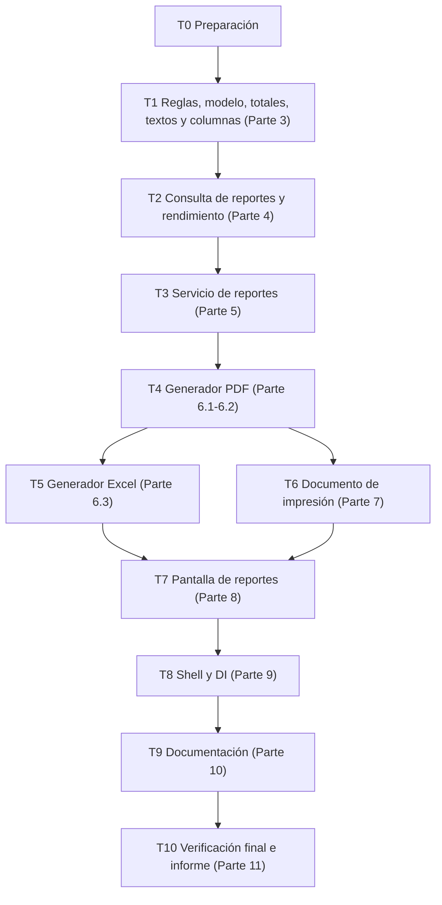

# Plan de implementación F7 — Reportes

**Autor:** revisión senior (2026-09-30)
**Ejecutor:** un **orquestador** en Google Antigravity (agente principal, Gemini 3.8 Flash High) que delega cada tarea en **subagentes** (implementador y escritor de tests en `flash`, revisor de solo lectura en `pro`). Ver **E.6** antes que nada. Sin subagentes, el mismo plan se ejecuta secuencialmente con E.1–E.5.
**Punto de partida:** F6 completado **y commiteado** (commit `feat(F6): edición, anulación y auditoría` sobre `48589ad`). Build Release con 0 warnings; 993 tests en verde según `Agents.md` (mídelo tú mismo en T0 y anota el número real).
**Estado al escribir este plan:** F6 está en la rama `feat/f6-gestion-boletas` **preparado (`git add`) y con cambios sin preparar y archivos sin seguimiento** (remediación post-prueba manual), HEAD = `48589ad` (F5). Ver T0: si sigue así, **detente**.
**HUs:** HU-F7-01 … HU-F7-06 (ver `Agents.md §3`).

**Cómo leer este documento:**
- La **Parte E** dice *qué* tarea hacer, *en qué orden*, *qué archivos* puedes tocar, *cómo* se comprueba cada tarea y, en **E.6**, *quién* la hace (orquestador y subagentes de Antigravity). Síguela al pie de la letra.
- Las **Partes 0–11** son la *especificación*. Cada tarea de la Parte E apunta a una o más Partes.
- La **Parte 12** es la revisión del plan: huecos detectados, cómo se cubren y riesgos abiertos. **Léela entera antes de escribir código.** Muchas reglas existen por lo que se explica allí (se citan como "ver R*n*").

Este documento es **la especificación**. Si algo no está aquí, se aplican las convenciones de `Agents.md §4` y, como plantilla de código, lo que ya hacen F4–F6 (`ServicioGestionPesajes`, `ServicioAuditoria`, `PesajeRepositorio.BuscarAsync`, `FrmBuscarBoletas`, `FrmVisorAuditoria`, `DocumentoBoleta`, `FrmVistaPrevia` y sus tests). Si algo contradice `Agents.md`, manda este documento y la diferencia se anota en el informe final.

---

## Mapa HU → Partes

| HU | Título | Partes |
|---|---|---|
| HU-F7-01 | Servicio común de reportes y regla de totales (Media res = 0,5) | 3 (reglas, modelo, totales, textos), 5 (servicio) |
| HU-F7-02 | Índices y rendimiento de consultas | 4 (consulta, `ANALYZE`, pruebas de plan de consulta) |
| HU-F7-03 | Pantalla de filtros común y vista previa | 8 (`FrmReportes`), 7 (vista previa de impresión) |
| HU-F7-04 | Exportación a PDF con formato original (QuestPDF) | 3.5 (columnas), 6.0 (logo), 6.1–6.2 (generador PDF), 8 (botón) |
| HU-F7-05 | Exportación a Excel e impresión | 6.3 (generador Excel), 7 (documento de impresión), 8 (botones) |
| HU-F7-06 | Reporte de boletas anuladas | 3–8 (tipo `Anuladas` en cada capa) |

**F7 no tiene migraciones de base de datos.** La carpeta `Persistencia/Migraciones` no se toca (E.4 lo comprueba). HU-F7-02 se resuelve con estadísticas del planificador (`ANALYZE`) y pruebas del plan de consulta, no con índices nuevos (ver H7 y R4: se probó que un índice nuevo **no** cambia la elección de SQLite). Si crees que necesitas una migración, **detente** y repórtalo.

**F7 no agrega paquetes NuGet.** QuestPDF 2024.3.0 y ClosedXML 0.102.3 **ya están** referenciados en `PesajeFaeneo.Infrastructure.csproj` (y versionados en `Directory.Packages.props`).

---

## Parte E — Ejecución

### E.1 Por qué el plan es tan explícito

El ejecutor es un agente de menor capacidad. Los fallos típicos que este plan neutraliza:

| Fallo típico | Cómo lo neutraliza el plan |
|---|---|
| Inventar APIs de QuestPDF/ClosedXML o usar las de otra versión (la documentación en línea es de 2025.x; aquí se usa **2024.3.0** y **0.102.3**). | Todas las APIs de librería que usa el plan se **compilaron y ejecutaron** contra esas versiones exactas (Parte 2, H1–H6). Usa **solo** esas. Si necesitas otra, confírmala con Context7 (`/websites/questpdf`, `/closedxml/closedxml`) **y** compílala antes de depender de ella. |
| Sumar pesos en SQL (`SUM` sobre `REAL`) o con `double`. | Regla 0.7 y 3.3: totales en memoria con `decimal`, en una sola función probada. |
| Contar "reses" como boletas (1 por boleta). | `ReglasReportes.Reses` (media res = 0,5) es la **única** fuente; tests con casos mixtos. |
| Incluir boletas anuladas en los totales. | 5.2-4: el estado lo fija el tipo de reporte en el servicio, no la pantalla; tests. |
| Exportar datos distintos de los que se ven (volver a consultar al exportar). | D15: se exporta la **instantánea** `_reporte`; cambiar un filtro la invalida; tests 8.3. |
| Congelar la pantalla (20 000 filas en la grilla, PDF en el hilo de UI). | D7 (vista de 1 000 filas), D20 (`Task.Run` en el generador). |
| Imprimir con `Process.Start` del PDF o con un segundo diseño GDI+ distinto del PDF. | D14: un solo diseño (QuestPDF) → imágenes → `PrintDocument`. |
| Poner `System.Drawing` o `QuestPDF` donde no van. | Regla 0.5 + greps de E.3 (CA1416 rompería el build de Infrastructure; los nombres `Image`/`IContainer`/`Colors` chocan en WinForms, H4). |
| Tests que cuelgan (MessageBox, SaveFileDialog, PrintDialog, `Process.Start`). | Regla 0.10 y 8.1: **todo** diálogo o proceso externo pasa por un gancho `...ParaTest`. |
| Reportar "todo verde" sin haberlo ejecutado. | La compuerta (E.4) se ejecuta **siempre** y se pega la salida real en la bitácora. |
| Tocar archivos fuera de alcance ("ya que estaba…"). | Lista blanca por tarea, verificada con `git status --porcelain` (E.3). |
| Borrar o saltar tests para ponerse en verde. | El número de tests nunca baja; `Skip`, `#pragma warning disable`, `NoWarn` están prohibidos y se buscan con `grep` (E.4). |

### E.2 Orden de tareas

Ejecuta **una tarea a la vez, en este orden**. No empieces la siguiente hasta que la compuerta de la actual esté en verde y la tarea esté commiteada (E.5).



Orden lineal: **T0, T1, T2, T3, T4, T5, T6, T7, T8, T9, T10.**

### E.3 Ficha de cada tarea

Rutas relativas a `src/` o `tests/PesajeFaeneo.Tests/` según corresponda. "Nuevo" = archivo a crear.

| Tarea | Especificación | Archivos permitidos (lista blanca) | Comprobaciones automáticas propias (además de E.4) |
|---|---|---|---|
| **T0** | E.5 | — (solo git) | `git status` limpio; `git log -1 --format=%s` empieza por `feat(F6)`; línea base de tests anotada. |
| **T1** | Parte 3 | Nuevos: `PesajeFaeneo.Domain/Reglas/ReglasReportes.cs`, `PesajeFaeneo.Application/Reportes/Dtos/ReporteDtos.cs`, `PesajeFaeneo.Application/Reportes/CalculadoraTotalesReporte.cs`, `PesajeFaeneo.Application/Reportes/TextosReporte.cs`, `PesajeFaeneo.Application/Reportes/ColumnasReporte.cs`, `tests/.../ReglasReportesTests.cs`, `tests/.../CalculadoraTotalesReporteTests.cs`, `tests/.../TextosReporteTests.cs`, `tests/.../ColumnasReporteTests.cs` | `grep -rn --include=*.cs "System.Drawing\|System.Windows\|QuestPDF\|ClosedXML" src/PesajeFaeneo.Application` vacío; `grep -n "CurrentCulture\|DateTime.Now\|DateTime.UtcNow\|double\|float" src/PesajeFaeneo.Application/Reportes/CalculadoraTotalesReporte.cs src/PesajeFaeneo.Domain/Reglas/ReglasReportes.cs` vacío. **Siempre `--include=*.cs`** en los `grep -r` sobre `src/`: sin él aparecen `obj/` y `bin/` (falsos positivos, R49). |
| **T2** | Parte 4 | Modificados: `PesajeFaeneo.Application/Abstracciones/Persistencia/CriteriosPersistencia.cs`, `IPesajeRepositorio.cs`, `PesajeFaeneo.Infrastructure/Persistencia/Repositorios/PesajeRepositorio.cs`, `PesajeFaeneo.Infrastructure/Persistencia/DatabaseInitializer.cs`, `tests/.../DatabaseInitializerTests.cs` (solo agregar). Nuevos: `tests/.../ReporteRepositorioTests.cs`, `tests/.../PlanConsultasReportesTests.cs`, `tests/.../Utilidades/Reportes/PlanConsultaSqlite.cs` | `git diff --name-only <SHA_F6> -- src/PesajeFaeneo.Infrastructure/Persistencia/Migraciones` **vacío**; `dotnet ef migrations has-pending-model-changes` limpio; `grep -n "Contains(" .../PesajeRepositorio.cs` vacío; `grep -n "Sum\|Average" .../PesajeRepositorio.cs` vacío (regla 0.7; hoy ambos greps salen vacíos). |
| **T3** | Parte 5 | Nuevos: `PesajeFaeneo.Application/Reportes/IServicioReportes.cs`, `ServicioReportes.cs`, `tests/.../ServicioReportesTests.cs`. Modificado: `PesajeFaeneo.Application/DependencyInjection.cs` | `grep -rn --include=*.cs "DateTime.Now\|DateTime.UtcNow\|DateTime.Today\|ToLocalTime\|CurrentCulture" src/PesajeFaeneo.Application/Reportes` vacío. |
| **T4** | Parte 6.0–6.2 | Nuevos: `PesajeFaeneo.Application/Reportes/IGeneradorPdfReportes.cs`, `PesajeFaeneo.Infrastructure/Reportes/GeneradorPdfReportes.cs`, `PesajeFaeneo.Infrastructure/Reportes/DisenoPdfReporte.cs`, `PesajeFaeneo.Infrastructure/Reportes/CargadorLogoReporte.cs`, `tests/.../GeneradorPdfReportesTests.cs`, `tests/.../CargadorLogoReporteTests.cs`, `tests/.../Utilidades/Reportes/DatosReporteDePrueba.cs`. Modificados: `PesajeFaeneo.Infrastructure/DependencyInjection.cs`, `tests/.../ArquitecturaTests.cs` (solo agregar, 6.2) | `grep -rln --include=*.cs "QuestPDF" src` lista **solo** los tres archivos de `Infrastructure/Reportes/` de esta tarea (`GeneradorPdfReportes.cs`, `DisenoPdfReporte.cs`, `CargadorLogoReporte.cs`); `grep -rn --include=*.cs "System.Drawing" src/PesajeFaeneo.Infrastructure` vacío; `ArquitecturaTests` en verde. |
| **T5** | Parte 6.3 | Nuevos: `PesajeFaeneo.Application/Reportes/IGeneradorExcelReportes.cs`, `PesajeFaeneo.Infrastructure/Reportes/GeneradorExcelReportes.cs`, `tests/.../GeneradorExcelReportesTests.cs`. Modificado: `PesajeFaeneo.Infrastructure/DependencyInjection.cs` | `grep -rln --include=*.cs "ClosedXML" src` lista **solo** `GeneradorExcelReportes.cs`; `grep -n "FormulaA1\|FormulaR1C1\|SetFormula" .../GeneradorExcelReportes.cs` vacío (R21). |
| **T6** | Parte 7 | Nuevos: `PesajeFaeneo.WinForms/Impresion/DocumentoPaginasReporte.cs`, `tests/.../Impresion/DocumentoPaginasReporteTests.cs` | `grep -rn --include=*.cs "QuestPDF\|ClosedXML" src/PesajeFaeneo.WinForms` vacío; `grep -n "DefaultPageSettings" src/PesajeFaeneo.WinForms/Impresion/DocumentoPaginasReporte.cs` vacío (R50); ningún test llama a `Print()` (R14): `grep -n "\.Print()" tests/PesajeFaeneo.Tests/Impresion/DocumentoPaginasReporteTests.cs` vacío. |
| **T7** | Parte 8 | Nuevos: `PesajeFaeneo.WinForms/Formularios/Reportes/FrmReportes.cs`, `tests/.../FrmReportesTests.cs`, `tests/.../Utilidades/Reportes/ServicioReportesFalso.cs`, `GeneradorPdfReportesFalso.cs`, `GeneradorExcelReportesFalso.cs`. Modificado: `tests/.../LayoutFormulariosTests.cs` (solo agregar) | En `FrmReportes.cs`: `grep -n "\.Result\|\.Wait()\|GetAwaiter().GetResult()\|QuestPDF\|ClosedXML\|WriteAllBytesAsync"` vacío (R48); revisión manual: ningún `EjecutarAsync(`/`Ejecutar(` dentro del delegado de otro, y ningún `MessageBox`/`SaveFileDialog`/`PrintDialog`/`Process.Start` fuera de su método envoltorio con gancho (8.1). |
| **T8** | Parte 9 | Modificados: `PesajeFaeneo.WinForms/Formularios/FrmPrincipal.cs`, `tests/.../ContenedorDITests.cs`, `tests/.../FrmPrincipalTests.cs` | `AutorizadorMenuTests.cs` sin cambios; `grep -n "\"F7\"" FrmPrincipal.cs` vacío; `grep -c "\"F8\"" FrmPrincipal.cs` da **3** (no se tocan). |
| **T9** | Parte 10 | `Agents.md`, `README.md` | Las cifras de tests salen de la bitácora (no inventadas). |
| **T10** | Parte 11 | — (solo verificación; correcciones como tareas `T10.n` con su propia lista blanca, declarada en la bitácora antes de tocar nada) | Todo E.4 sobre el árbol final + 11.1 (tres corridas) + 11.2 (arranque y cierre) + 11.3 (medición de rendimiento). |

**Verificación de la lista blanca** (al terminar cada tarea, **antes** del `git add`):
```bash
git status --porcelain
```
Cualquier archivo fuera de la lista = la tarea no está terminada: revierte ese archivo (`git checkout -- <archivo>` o bórralo si es nuevo) y rehaz lo necesario dentro de la lista. Si de verdad necesitas tocar otro archivo, anótalo en la bitácora como **desviación** con el motivo, y solo si es imprescindible para compilar.

### E.4 Compuerta de calidad (después de cada tarea, sin excepción)

Comandos de **Git Bash** (herramienta Bash), no de PowerShell:
```bash
dotnet build src/PesajeFaeneo.sln -c Release
```
```bash
dotnet test src/PesajeFaeneo.sln -c Release
```
```bash
# Finales de línea: debe salir vacío (después de git add)
git add -A && git diff --cached --name-only --diff-filter=AM | xargs -r git ls-files --eol | grep "w/lf"
# Nada de trampas: debe salir vacío
git diff --cached -U0 | grep -E "^\+.*(#pragma warning disable|Skip *=|NoWarn|TreatWarningsAsErrors|PackageReference|PackageVersion|Thread\.Sleep|Task\.Delay\(|SuppressMessage)"
# Migraciones: F7 no tiene ninguna; debe salir vacío en TODAS las tareas
git diff --cached --name-only <SHA_F6> -- src/PesajeFaeneo.Infrastructure/Persistencia/Migraciones
```
- 0 warnings (`TreatWarningsAsErrors=true`), 0 errores, todos los tests en verde. **No avances con rojo.**
- El número de tests **nunca baja** respecto de la tarea anterior.
- Si un test **existente** falla por un cambio de esta fase, corrige los **datos o dobles del test**, nunca la regla nueva, y anótalo. Los únicos tests existentes que este plan autoriza a modificar: `DatabaseInitializerTests` (T2, solo agregar), `ArquitecturaTests` (T4, solo agregar), `LayoutFormulariosTests` (T7, solo agregar), `ContenedorDITests` y `FrmPrincipalTests` (T8).
- Al cerrar T2, T4, T7 y T10 ejecuta la suite **tres veces seguidas**. Un test que falla 1 de 3 veces es un test roto: corrígelo, no lo reintentes hasta que pase.

### E.5 Protocolo de git y bitácora

1. **T0:**
   - `git status` debe estar **limpio** y `git log -1 --format=%s` debe ser el commit de F6 (`feat(F6): …`). **Si F6 sigue con cambios preparados/sin preparar/sin seguimiento** (estado al escribir este plan: rama `feat/f6-gestion-boletas`, HEAD = `48589ad` = F5), **detente y repórtalo al usuario**: no commitees F6 por tu cuenta ni mezcles F6 y F7 en el mismo diff.
   - Anota `<SHA_F6> = git rev-parse HEAD` en la bitácora.
   - `git switch -c feat/f7-reportes`.
   - Ejecuta la compuerta y anota el número de tests de partida (debe ser 993; si es otro, anótalo y sigue).
2. **Por cada tarea:** implementa → compuerta E.4 → comprobaciones propias de E.3 → `git status --porcelain` contra la lista blanca → `git add -A && git commit -m "wip(F7-Tn): <título>"`.
3. **Nunca** `push`, `merge`, `rebase`, `reset --hard` ni `checkout` de otras ramas. No commitees la bitácora. Con subagentes, **solo el ORQ** ejecuta git de escritura y escribe la bitácora (E.6.8).
4. **Al terminar T10:** anota el SHA del último commit en la bitácora y en el informe, y ejecuta `git reset --soft <SHA_F6>`: todo F7 queda como cambios preparados sin commit, igual que en fases anteriores, para que el usuario lo revise y haga un único commit `feat(F7): reportes`. (Si algo sale mal, `git reset --soft <SHA anotado>` recupera el historial.)
5. **Bitácora** (`../pesalab-f7-bitacora.md`, **fuera** del repositorio para que `git add -A` no la incluya): por tarea, tests antes → después, salida literal de las 3 últimas líneas de `dotnet test`, desviaciones y decisiones tomadas ante ambigüedades. T9 la usa como fuente de cifras.

### E.6 Ejecución orquestada en Antigravity (orquestador + subagentes)

Esta sección la lee y la ejecuta **el orquestador (ORQ)**: el agente principal de Antigravity al que el usuario le entrega este plan. Los subagentes **no** leen el plan completo: reciben un *brief* (E.6.6) con solo lo que necesitan. Todo lo de E.1–E.5 sigue vigente; aquí se dice **quién** hace cada cosa. Si Antigravity no permitiera subagentes en tu instalación, ejecuta T0…T10 tú mismo, secuencialmente, con E.1–E.5 (es el modo original del plan).

#### E.6.1 Hechos de Antigravity en los que se apoya esta sección

Consultados el 2026-09-30 en la documentación oficial (`antigravity.google/docs/subagents/`, `antigravity.google/docs/hooks/`, `antigravity.google/blog/google-io-2026-feature-deep-dive`). **Si tu versión difiere, manda lo que veas en tu instalación** y anótalo en la bitácora.

| # | Hecho | Consecuencia |
|---|---|---|
| A1 | El agente principal lanza subagentes con la herramienta `invoke_subagent`; pueden correr en paralelo; al terminar envían un mensaje de resultado al padre y quedan inactivos. Profundidad máxima de anidamiento: 10. | ORQ = agente principal. Los subagentes **no** lanzan otros subagentes (lo prohíbe el brief, E.6.6). |
| A2 | Subagentes propios: archivo Markdown con frontmatter YAML en `.agents/agents/<nombre>.md` (del espacio de trabajo) o `~/.gemini/config/agents/<nombre>.md` (global). Campos: `name`, `description` (obligatorios), `tools` (lista), `model` (`inherit`, `flash`, `pro`), `commandExecutionPolicy` (`off`, `auto`, `eager`, `sandbox`; por defecto `sandbox`), `mainAgent`, `subagent`. Hay tres incorporados: `research` (explorar código), `browser` y `self` (clon del padre). | E.6.3 trae los tres archivos listos para copiar. **No se puede fijar el nivel de razonamiento** por subagente (solo el tier `flash`/`pro`). |
| A3 | **Problema conocido:** un nombre de herramienta mal escrito o no mapeado en `tools` puede **colgar** al subagente. Nombres que aparecen en la documentación: `view_file`, `grep_search`, `replace_file_content`, `write_to_file`, `run_command`. | E.6.3 usa **solo** esos cinco. T0 comprueba que existen en la lista de herramientas del ORQ antes de crear los agentes. |
| A4 | Espacio de trabajo del subagente: `inherit` (el del padre), `branch` (worktree de git aislado) o `share`. **Los worktrees temporales se borran automáticamente** cuando el subagente termina. | F7 trabaja **secuencialmente en `inherit`**: un worktree `branch` se perdería con su trabajo si el ORQ no integra antes de que se borre, y F7 casi no tiene paralelismo que ganar (E.6.4). |
| A5 | Hooks: `.agents/hooks.json` (espacio de trabajo) o `~/.gemini/config/hooks.json`; eventos `PreToolUse`, `PostToolUse`, `PreInvocation`, `PostInvocation`, `Stop`; `matcher` por nombre de herramienta (`run_command`, regex permitida); el comando recibe JSON por **stdin** y en `PreToolUse` responde por **stdout** `{"decision":"allow"|"deny"|"ask"|…, "reason":"…"}`. **No está documentado si los hooks se aplican a las acciones de los subagentes.** | E.6.3: un hook que **deniega** comandos destructivos o prohibidos por el plan. Es defensa en profundidad: las reglas del brief y la verificación del ORQ siguen siendo la protección principal. |
| A6 | Modelos disponibles en Antigravity a septiembre de 2026: Gemini 3.8 Flash (y anteriores), Gemini 3.1 Pro, además de modelos de terceros. | Perfiles de E.6.2 (los mismos que funcionaron en F4). |

#### E.6.2 Perfiles

| Perfil | Agente de Antigravity | Modelo | Herramientas | Uso |
|---|---|---|---|---|
| **ORQ** — orquestador | Agente principal | **Gemini 3.8 Flash**, razonamiento **High** (elígelo en el selector de modelo antes de pegar el plan) | Todas | Único dueño de git, de la bitácora, de las compuertas y del informe final. Arma los briefs, lanza subagentes, verifica, integra. **No implementa** tareas (solo corrige trivialidades de integración: un `using`, un registro de DI, CRLF). Flash y no Pro: su trabajo es un bucle largo de herramientas, donde 3.1 Pro tiende a detenerse a preguntar (E.1 de F4). |
| **IMP** — implementador | `f7-implementador` | `flash` | `view_file`, `grep_search`, `replace_file_content`, `write_to_file`, `run_command` | Implementa una tarea dentro de su lista blanca y ejecuta la compuerta. Sin git de escritura. |
| **TST** — escritor de tests | `f7-tests` | `flash` | Las mismas que IMP | Escribe tests **desde la especificación**, sin modificar código de producción (T7b). Instancia distinta de la que implementó (R60). |
| **REV** — revisor | `f7-revisor` | `pro` (Gemini 3.1 Pro) | **Solo** `view_file`, `grep_search` (sin escribir y sin terminal: no puede romper nada) | Revisa el diff de cada tarea contra su especificación (E.6.7) y hace la revisión final (T10). |
| **EXP** — explorador | `research` (incorporado) | el suyo | el suyo | Consultas baratas del ORQ ("¿qué tests usan `IPesajeRepositorio`?"). Nunca escribe. |

Como no se puede fijar el razonamiento por subagente (A2), la exigencia se compensa con briefs más acotados: las tareas exigentes (marcadas **A** en E.6.4) llevan además la sección "Trampas conocidas" (E.6.5).

#### E.6.3 Preparación en T0 (el ORQ crea estos archivos; **no** se commitean)

1. Excluir de git la carpeta de Antigravity, **sin** tocar `.gitignore` (que está versionado):
   ```bash
   mkdir -p .agents/agents .agents/hooks && (grep -qxF ".agents/" .git/info/exclude || echo ".agents/" >> .git/info/exclude)
   ```
   Comprueba que `git status --porcelain` sigue vacío tras crear los archivos de abajo. Si `.agents/` aparece, la exclusión falló: corrígela antes de seguir (si no, T0 no pasaría la verificación de árbol limpio y E.4 los commitearía con `git add -A`).
2. Verifica que `view_file`, `grep_search`, `replace_file_content`, `write_to_file` y `run_command` existen **con ese nombre** en tu propia lista de herramientas. Si alguno se llama distinto en tu versión, usa el nombre real en los tres archivos y anótalo (A3: un nombre mal escrito cuelga al subagente).
3. `.agents/agents/f7-implementador.md`:
   ```markdown
   ---
   name: f7-implementador
   description: Implementa UNA tarea del plan F7 (docs/plans/F7-reportes.md) a partir del brief que recibe, solo dentro de su lista blanca de archivos, y ejecuta la compuerta de build y tests. No hace commits.
   tools:
     - view_file
     - grep_search
     - replace_file_content
     - write_to_file
     - run_command
   model: flash
   commandExecutionPolicy: sandbox
   mainAgent: false
   subagent: true
   ---
   Eres un implementador. Trabajas SOLO en la tarea del brief y SOLO en los archivos de su lista blanca.
   - No preguntes: si algo es ambiguo, elige la opción más conservadora compatible con la especificación y anótala en DESVIACIONES.
   - Nunca: git commit, push, merge, rebase, reset, checkout de ramas, stash, clean; dotnet ef; dotnet add package; editar .csproj/.props; #pragma warning disable; Skip en tests; borrar tests.
   - No lances subagentes.
   - Antes de usar una API de librería que no esté en los hechos verificados del brief, confirma su firma con Context7 o learn.microsoft.com y compílala.
   - Los archivos que crees o toques deben quedar con finales de línea CRLF y UTF-8.
   - Tu última respuesta es SOLO el reporte con el formato del brief.
   ```
4. `.agents/agents/f7-tests.md`: igual que el anterior, con `name: f7-tests`, `description: Escribe los tests de una tarea del plan F7 a partir de la especificación del brief, sin modificar código de producción.` y, en las instrucciones, agrega: "No modifiques ningún archivo bajo `src/`. Puedes LEER el código de producción para conocer los nombres de los ganchos `internal`, pero el comportamiento esperado sale de la especificación, no de la implementación. Si un test revela un defecto o falta un gancho, NO lo arregles: descríbelo en BLOQUEOS."
5. `.agents/agents/f7-revisor.md`:
   ```markdown
   ---
   name: f7-revisor
   description: Revisa en solo lectura el diff de una tarea del plan F7 contra su especificación y devuelve hallazgos con formato fijo.
   tools:
     - view_file
     - grep_search
   model: pro
   commandExecutionPolicy: off
   mainAgent: false
   subagent: true
   ---
   Eres un revisor de solo lectura. No escribes archivos ni ejecutas comandos. Revisa SOLO el diff que recibes contra la especificación y los riesgos del brief. No propongas mejoras de estilo ni refactors. Responde solo con hallazgos en el formato del brief, o exactamente SIN HALLAZGOS.
   ```
6. Hook de guardia, `.agents/hooks/guardia-f7.ps1` (Windows PowerShell 5.1). Lee **todo** el JSON de entrada como texto y lo compara con patrones, para no depender del nombre exacto del campo que trae el comando:
   ```powershell
   $entrada = [Console]::In.ReadToEnd()
   $prohibidos = @(
       'git\s+push', 'git\s+reset\s+--hard', 'git\s+clean\s', 'git\s+rebase', 'git\s+stash',
       'git\s+checkout\s+(?!--)', 'git\s+merge', 'git\s+branch\s+-D',
       'dotnet\s+ef\s+migrations\s+(add|remove)', 'dotnet\s+ef\s+database',
       'dotnet\s+add\s+\S*\s*package', 'rm\s+-rf', 'Remove-Item[^\r\n]*-Recurse'
   )
   foreach ($p in $prohibidos) {
       if ($entrada -match $p) {
           @{ decision = 'deny'; reason = "Bloqueado por el plan F7 (patron '$p'). Si de verdad hace falta, el ORQ debe registrarlo como desviacion y pedirselo al usuario." } | ConvertTo-Json -Compress
           exit 0
       }
   }
   '{"decision":"allow"}'
   ```
   y `.agents/hooks.json`:
   ```json
   {
     "guardia-f7": {
       "PreToolUse": [
         {
           "matcher": "run_command",
           "hooks": [
             { "type": "command", "command": "powershell -NoProfile -ExecutionPolicy Bypass -File .agents/hooks/guardia-f7.ps1", "timeout": 10 }
           ]
         }
       ]
     }
   }
   ```
   (El mensaje va sin tildes a propósito: Windows PowerShell 5.1 lee un `.ps1` sin BOM como ANSI.) **Verificado** el 2026-09-30 con entradas JSON simuladas: deniega `echo "prueba git push"`, `git push`, `git reset --hard`, `git checkout master`, `dotnet ef migrations add`, `dotnet add … package`; permite `git commit`, `git add -A`, `git checkout -- <archivo>`, `git switch -c`, `git reset --soft`, `git diff`, `dotnet build` y `dotnet ef migrations has-pending-model-changes`.
   El ORQ **sí** necesita `git switch -c`, `git add`, `git commit`, `git checkout -- <archivo>` y `git reset --soft`: ninguno coincide con los patrones. **Prueba del hook** (T0): ejecuta `echo "prueba git push"`. Si se deniega, el hook está activo (anótalo). Si se ejecuta, el hook no está activo en tu versión: anótalo y sigue (las reglas del brief y E.6.8 siguen protegiendo). El primer subagente IMP repite la prueba (E.6.6), y así se sabe si los hooks alcanzan a los subagentes (A5).
7. Configuración del proyecto en Antigravity (la hace el **usuario** antes de pegar el plan; el ORQ solo la verifica y la anota): que los planes y artefactos del agente **no** esperen aprobación manual en cada paso, y que la terminal pueda ejecutar `dotnet` y `git` dentro del espacio de trabajo. Si un subagente con `commandExecutionPolicy: sandbox` **no puede** compilar (por ejemplo, acceso denegado a la caché de NuGet o a `%TEMP%`), cambia ese campo a `auto` en `f7-implementador.md` y `f7-tests.md` y anótalo como desviación. **No** uses `eager`.

#### E.6.4 Mapa de tareas para los briefs

Orden **estrictamente secuencial**, todas con espacio de trabajo `inherit` (A4). **A** = tarea exigente (brief con "Trampas conocidas"). Las filas R se copian **literalmente** de la Parte 12 en la sección "Riesgos" del brief; las reglas, de la Parte 0; los hechos, de la Parte 2.

| Tarea | Perfil | Especificación (copiar literal) | Filas R | Reglas de la Parte 0 | Hechos (Parte 2) | Archivos de referencia a imitar |
|---|---|---|---|---|---|---|
| T1 | IMP | Parte 3 completa + D3, D4, D6, D11 | R2, R7, R20, R22, R23, R37, R46, R47, R49 | 0.4, 0.5, 0.7, 0.8 | H6 | `ReglasGestionPesajes.cs`, `TextosBoleta.cs`, `TextosBoletaTests.cs` |
| T2 **A** | IMP | Parte 4 completa + D16 | R4, R5, R6, R7, R31, R49, R55, R59 | 0.1, 0.5, 0.7, 0.12 | H7, H8 y el bloque "Del repositorio" | `PesajeRepositorio.cs` (`BuscarAsync`), `GestionRepositoriosTests.cs`, `DatabaseInitializerTests.cs` |
| T3 **A** | IMP | Parte 5 completa + D2, D3, D4, D5, D7, D8, D9, D10, D17 | R3, R8, R9, R10, R29, R30, R33, R46, R52, R61 | 0.6, 0.8, 0.12, 0.13, 0.14 | "Del repositorio" (logo, patrón de servicio) | `ServicioGestionPesajes.cs`, `ServicioGestionPesajesTests.cs` |
| T4 **A** | IMP | 6.0, 6.1 (solo `IGeneradorPdfReportes`), 6.2 completa + D10, D12, D20 | R15, R16, R17, R18, R24, R25, R47, R53, R56, R61, R63, R64 | 0.5, 0.15 | H1, H2, H3, H4, H10 | `ImpresorBoletasGdi.cs` (tolerancia a errores), `CargadorLogo.cs`, `ArquitecturaTests.cs` |
| T5 | IMP | 6.1 (solo `IGeneradorExcelReportes`), 6.3 completa + D13 | R21, R22, R42, R57, R61, R62 | 0.5, 0.8 | H5, H11 | el `GeneradorPdfReportes.cs` de T4 |
| T6 | IMP | Parte 7 completa + D14 | R13, R14, R36, R50 | 0.5, 0.11 | H9 | `DocumentoBoleta.cs`, `DocumentoBoletaTests.cs` |
| T7a **A** | IMP | 8.1 completa + D7, D8, D15, D18, D19 | R11, R12, R19, R26, R27, R28, R32, R43, R48, R54, R61 | 0.8, 0.9, 0.10, 0.11, 0.14 | H4, H9, "Del repositorio" (DisenoFiltros, ControlBusquedaCatalogo, FrmVistaPrevia, ManejadorErrores) | `FrmBuscarBoletas.cs`, `FrmVisorAuditoria.cs` |
| T7b **A** | **TST** (instancia nueva) | 8.2 y 8.3 completas + la tabla de ganchos de 8.1 | R27, R28, R43, R48, R54, R58, R60 | 0.11 | — | `FrmBuscarBoletasTests.cs` (bucle con `DoEvents`), `LayoutFormulariosTests.cs`, `ServicioAuditoriaFalso.cs` |
| T8 | IMP | Parte 9 completa + D18 | R38, R39 | 0.5, 0.11 | "Del repositorio" (FrmPrincipal, FrmPrincipalTests, ContenedorDITests) | `FrmPrincipal.AbrirGestionBoletas` |
| T9 | IMP | Parte 10 + la **bitácora completa** (fuente de cifras) | R40, R65 | 0.4 | — | entrada "Fase F6" de `Agents.md` |
| T10 | **REV** + ORQ | Parte 11 + revisión final de `git diff <SHA_F6>` contra las Partes 3–10 y la Parte 12 | todas | todas | todos | — |

**Lista blanca de T7a y T7b** (la T7 de E.3 se parte en dos): T7a = solo `PesajeFaeneo.WinForms/Formularios/Reportes/FrmReportes.cs` (debe compilar y no romper ningún test existente; todavía no tiene tests propios). T7b = `tests/.../FrmReportesTests.cs`, `tests/.../Utilidades/Reportes/ServicioReportesFalso.cs`, `GeneradorPdfReportesFalso.cs`, `GeneradorExcelReportesFalso.cs` y `tests/.../LayoutFormulariosTests.cs` (solo agregar); puede **leer** `FrmReportes.cs`, nunca modificarlo. Si un test de T7b falla, el ORQ decide **contra la especificación** quién está mal: si es el formulario, abre `T7a.n` (IMP, instancia nueva, brief de T7a + el test que falla); si es el test, `T7b.n`. La compuerta de "tres corridas" de T7 (E.4) se aplica al cerrar T7b.

Ninguna otra tarea se paraleliza. (T5 y T6 son independientes, pero lanzarlas a la vez en `inherit` haría que dos `dotnet build` compitan por los mismos `obj/`, y en `branch` sus worktrees se borrarían al terminar, A4: no compensa.)

#### E.6.5 Trampas conocidas (sección extra del brief de las tareas A)

- **T2:** el plan de consulta se verifica sobre el SQL **real** de `ConsultaReporte` (no una copia); la siembra va en una `IClassFixture` (R55); si una expectativa de plan falla con los datos exactos, **detente y repórtalo en BLOQUEOS**, no cambies datos ni expectativas (regla 0.1); `DatabaseInitializer` conserva el constructor de un parámetro (los tests de F0 lo usan).
- **T3:** el estado (vigente/anulado) y los filtros efectivos los fija el **servicio**, no el filtro recibido (R8); el límite usa la propiedad `MaximoFilas`, no la constante (R52); el servicio no abre el archivo del logo.
- **T4:** escribe `QuestPDF.Infrastructure.Image` con su nombre completo; la imagen de QuestPDF no tiene `Width`/`Height` ni `Dispose` (R64); licencia en los constructores estáticos de `DisenoPdfReporte` y `CargadorLogoReporte` (R15); nada de `System.Drawing` en Infrastructure (R17); el PDF no se puede leer como texto: no inventes aserciones de contenido (R47).
- **T7a:** ningún diálogo dentro de `EjecutarAsync`; cada diálogo y `Process.Start` solo dentro de su método envoltorio con gancho; `File.WriteAllBytes` **síncrono** (R48); `LimpiarVista()` al empezar a generar (R54); `DocumentoPaginasReporte` no se toca.
- **T7b:** una tarea no completada + `.GetAwaiter().GetResult()` en el hilo STA = test colgado para siempre (R48): usa `CompletarBombeando`; ningún test puede abrir un `MessageBox`, `SaveFileDialog`, `PrintDialog` ni `FrmVistaPrevia` real; archivos solo en un directorio temporal propio, borrado en `finally`.

#### E.6.6 Plantilla del brief

El ORQ arma un brief por tarea con **exactamente** estas secciones, en este orden, **sin resumir** la especificación (copiar y pegar del plan):

```text
# Tarea Tn — <título>            Perfil: <IMP|TST|REV> (agente <f7-implementador|f7-tests|f7-revisor>)
## Directorio de trabajo
<ruta absoluta del repositorio>   (espacio de trabajo: inherit)
## Objetivo (2–3 líneas)
## Especificación
<Partes de E.6.4 copiadas LITERALMENTE, con sus tablas, bloques de código y tests>
## Decisiones y hechos que aplican
<filas D y H de E.6.4, copiadas literalmente>
## Riesgos que debes evitar
<filas R de E.6.4, copiadas literalmente>
## Trampas conocidas            (solo tareas A, de E.6.5)
## Reglas obligatorias (no negociables)
- Solo puedes crear o modificar estos archivos: <lista blanca de E.3, o de E.6.4 para T7a/T7b>. Si necesitas tocar otro, DETENTE y explícalo en BLOQUEOS.
- No preguntes. Si algo es ambiguo, elige la opción más conservadora compatible con la especificación y anótala en DESVIACIONES.
- No ejecutes git commit, push, merge, rebase, reset, stash, clean ni checkout de ramas. No ejecutes dotnet ef. No lances subagentes.
- No agregues paquetes NuGet ni cambies .csproj/.props. No desactives warnings, tests ni analizadores.
- <reglas de la Parte 0 indicadas en E.6.4, copiadas literalmente>
## Archivos de referencia (léelos antes de escribir; imita su estilo)
<columna de E.6.4>
## Criterios de aceptación (ejecútalos tú y pega la salida real)
dotnet build src/PesajeFaeneo.sln -c Release       → 0 warnings, 0 errores
dotnet test src/PesajeFaeneo.sln -c Release        → N tests (≥ <número actual>), 0 fallos
<comprobaciones automáticas propias de la tarea (columna de E.3)>
Convierte a CRLF los archivos que creaste o tocaste.
## Formato de reporte (tu última respuesta, nada más)
ARCHIVOS: <lista con A=agregado, M=modificado>
TESTS: antes=<n> después=<n> fallos=<n>   (pega las 3 últimas líneas de dotnet test)
BUILD: warnings=<n> errores=<n>
COMPROBACIONES: <salida de cada comprobación propia>
DESVIACIONES: <lista o "ninguna">
BLOQUEOS: <lista o "ninguno">
```

Solo en el brief de T1, agrega como primer criterio de aceptación: `echo "prueba git push"` → informa si fue denegado (E.6.3-6).

#### E.6.7 Revisión por REV (después de cada tarea de implementación o de tests)

- **Entrada:** el brief de la tarea (misma especificación, riesgos y reglas) + la salida de `git diff` de la tarea, que el ORQ ejecuta y **pega** en el brief del revisor (REV no tiene terminal) + la ruta del repositorio para leer archivos.
- **Instrucción fija:** "Revisa solo este diff contra la especificación y los riesgos. No propongas mejoras de estilo ni refactors. Para cada problema, da un hallazgo con este formato:"
  ```text
  [SEVERIDAD: BLOQUEANTE|MAYOR|MENOR] archivo:línea
  Regla violada: <D#, H#, R#, Parte x.y o regla 0.n>
  Qué pasa: <1–2 frases>
  Cómo demostrarlo: <test concreto o comando que falla>
  ```
  Si no hay hallazgos, responde exactamente `SIN HALLAZGOS`.
- **Filtro del ORQ (obligatorio):** un hallazgo solo se acepta si el ORQ lo **confirma** (lee el código, ejecuta el comando o escribe el test propuesto y lo ve fallar). Los no confirmados se anotan como "descartado: no reproducible" y no se envían al implementador.
- **Corrección:** los BLOQUEANTE y MAYOR confirmados vuelven a una **instancia nueva** del mismo perfil (brief original + hallazgos confirmados). Los MENOR se anotan; se corrigen solo si son de una línea.
- **Límite:** como máximo **2 ciclos** implementar → revisar por tarea. Si en el tercero sigue un BLOQUEANTE confirmado, el ORQ lanza una tarea `Tn.x` de perfil IMP con un brief acotado **solo** a ese defecto, y lo anota como desviación.
- **Sin revisión:** T9 (documentación) no pasa por REV; el ORQ verifica a mano que las cifras coinciden con la bitácora.

#### E.6.8 Protocolo del ORQ

1. **T0** (sin subagentes): E.5-1 completo (si F6 no está commiteado, **detente**); luego E.6.3 completo; anota en la bitácora la versión de Antigravity, el modelo elegido, si el hook está activo y los nombres de herramientas verificados.
2. **Por cada tarea T1…T9, en orden:**
   1. Arma el brief (E.6.6) y lanza el subagente con `invoke_subagent` (perfil de E.6.4, espacio `inherit`). Espera su resultado; no lances otro mientras tanto.
   2. **Re-ejecuta tú** la compuerta E.4, las comprobaciones propias de E.3 y `git status --porcelain` contra la lista blanca. El reporte del subagente **nunca** cuenta como prueba.
   3. Si algo falla o hay archivos fuera de la lista blanca: tarea **rechazada**; revierte lo que esté fuera de la lista (`git checkout -- <archivo>` o borra el archivo nuevo) y relanza una instancia nueva con el brief original + la salida literal del fallo.
   4. Si pasa: lanza REV (E.6.7) y aplica sus correcciones; vuelve a 2.2.
   5. Aprobada: `git add -A && git commit -m "wip(F7-Tn): <título>"`. **Solo el ORQ commitea.**
   6. Anota en la bitácora: perfil, ciclos, hallazgos (confirmados/descartados), tests antes → después, desviaciones, bloqueos.
   7. Si un subagente no devuelve resultado (colgado, A3) en un tiempo razonable para su tamaño (orientativo: 30 min las tareas normales, 60 min las **A**), detenlo, revisa `git status` (descarta los cambios a medias), comprueba los nombres de `tools` de su archivo de agente y relánzalo una vez; si se repite, ejecuta tú esa tarea con E.1–E.5 y anótalo.
3. **Paradas:** si un subagente informa en BLOQUEOS una de las paradas autorizadas de la regla 0.1 (migración necesaria, plan de consulta de 4.5 que falla, API que no compila), el ORQ **no** la resuelve por su cuenta: la registra y la incluye en el informe final; si impide seguir, se detiene y lo reporta.
4. **T10:** lanza REV con `git diff <SHA_F6>` completo (en partes si es muy grande: una por capa) contra las Partes 3–10 y la Parte 12; filtra y corrige como en E.6.7 (tareas `T10.n`); después el ORQ ejecuta él mismo 11.1, 11.2 y 11.3 y escribe el informe 11.4.
5. **Qué nunca delega el ORQ:** git, la bitácora, las compuertas, la decisión de aceptar hallazgos, la prueba de arranque (11.2), la medición de rendimiento (11.3), el `reset --soft` final y el informe.
6. Al terminar, el ORQ puede borrar `.agents/` o dejarla (está excluida de git); anota qué hizo. **No** modifiques `.gitignore`.

---

## Parte 0 — Reglas de comportamiento (obligatorias)

1. **No te detengas hasta terminar** (vale para el ORQ y para cada subagente dentro de su tarea). El ORQ responde al usuario **una sola vez**, al final, con el informe de 11.4; los subagentes **no hacen preguntas** y responden solo al ORQ con su reporte (E.6.6). Si algo es ambiguo, elige la opción más conservadora compatible con este plan, anótala en la bitácora como desviación y continúa. Las únicas paradas autorizadas son: T0 (F6 sin commit), "necesito una migración", "una prueba de plan de consulta de 4.5 falla con los datos especificados" y "una API de las Partes 2/6 no compila con la versión instalada".
2. **Git:** lo gobierna E.5.
3. **Compuerta:** E.4 después de cada tarea. Nunca desactives un warning, un test ni un analizador.
4. **Convenciones:** identificadores, comentarios, mensajes de UI y de log en **español**; imita el estilo y la densidad de comentarios del código existente. CRLF, UTF-8. xUnit solo con `Assert`. Sin librerías de mocks: dobles escritos a mano.
5. **Capas** (las hace cumplir `ArquitecturaTests`):
   - Domain sin dependencias.
   - Application sin EF, WinForms, Serilog, Hosting, `System.Drawing`, `System.IO.Ports`, **QuestPDF ni ClosedXML**. Solo define interfaces (`IGeneradorPdfReportes`, `IGeneradorExcelReportes`) que trabajan con `Stream` y `byte[]`.
   - Infrastructure sin WinForms y **sin `System.Drawing`** (es `net8.0`: `System.Drawing` dispara CA1416 y rompe el build con `TreatWarningsAsErrors`). **QuestPDF y ClosedXML viven solo en `Infrastructure/Reportes/`.**
   - WinForms **nunca** hace `using QuestPDF…` ni `using ClosedXML…` (aunque compilaría por referencia transitiva): recibe PNG como `byte[]` y los dibuja con `System.Drawing` (H4).
   - **No agregues paquetes NuGet ni cambies `.csproj`/`.props`.**
6. **Tiempo:** siempre `TimeProvider` inyectado. Nada de `DateTime.Now`, `DateTime.UtcNow`, `DateTime.Today` ni `ToLocalTime()` en producción. La hora local se obtiene con `TimeZoneInfo.ConvertTimeFromUtc(utc, _timeProvider.LocalTimeZone)` **en el servicio**. Los límites de día con `RangoDiaLocal.DelDia(fecha, zona)` (`HastaUtc` exclusivo). En tests, `FakeTimeProvider` con `SetLocalTimeZone` (zona fija UTC-4, como `ServicioGestionPesajesTests`).
7. **Pesos y totales:** los pesos son `decimal` en todo el código de F7. **Prohibido** `double`/`float` para pesos o reses, y **prohibido** `Sum`/`Average` en consultas LINQ-to-SQL (la columna es `REAL`: SQLite sumaría en coma flotante). Los totales se calculan **en memoria**, en `CalculadoraTotalesReporte` (única función).
8. **Cultura:** todo texto con fechas o números que vaya a una pantalla, un PDF o un nombre de archivo se formatea con `TextosBoleta.Cultura` (es-BO) mediante los ayudantes de `TextosReporte`/`TextosBoleta`, **nunca** con `CurrentCulture`. **Prohibido** `$"{peso:0.0}"`/`$"{fecha:dd/MM/yyyy}"` dentro de una interpolación: usa `x.ToString("formato", TextosBoleta.Cultura)`. En Excel los números y fechas se escriben como **valores** (no texto) y el formato lo da la celda (6.3).
9. **Hilo de UI:** nunca `.Result`, `.Wait()` ni `.GetAwaiter().GetResult()` una vez iniciado el bucle de mensajes. Manejadores asíncronos con lambdas `async (_, _) =>` que delegan en `FormBase.EjecutarAsync`.
10. **Regla de reentrada de `FormBase`:** `EjecutarAsync`/`Ejecutar` descartan **en silencio** cualquier invocación mientras otra está en curso. **Nunca** llames a un método que use `EjecutarAsync`/`Ejecutar` desde dentro del delegado de otro. Los métodos internos (los que no se envuelven a sí mismos) llevan el sufijo `InternoAsync`. **Los diálogos modales (`SaveFileDialog`, `PrintDialog`, `MessageBox`, `FrmVistaPrevia`) se muestran fuera de `EjecutarAsync`**: primero se obtiene el dato (dentro de su `EjecutarAsync`), después, fuera, el diálogo (dentro de su propio `Ejecutar` si abre un formulario).
11. **Tests de WinForms:** todo test que cree un `Form` o un control corre dentro de `HiloSta.Ejecutar(...)` y desecha lo que crea. Los dobles devuelven **tareas ya completadas** (así `form.XParaTestAsync().GetAwaiter().GetResult()` termina sin bloquear, como en los tests de F6). **Cuidado (R48):** en cuanto el hilo STA crea un control queda instalado un `WindowsFormsSynchronizationContext`; si el código del formulario espera una tarea que **no** está completada (E/S real, `TaskCompletionSource`), su continuación se encola en ese hilo y un `.GetAwaiter().GetResult()` lo **bloquea para siempre**. Para esas esperas: `var t = form.XParaTestAsync();` y luego un bucle `while (!t.IsCompleted && sw.Elapsed < 5 s) Application.DoEvents();`, `Assert.True(t.IsCompleted)`, `t.GetAwaiter().GetResult()` (patrón de `FrmBuscarBoletasTests`, líneas con `DoEvents`). Escribe ese bucle una vez como método privado `static void CompletarBombeando(Task t)` de la clase de test. Nada de `Thread.Sleep` ni `Task.Delay` fijos. **Ningún test puede abrir un `MessageBox`, `SaveFileDialog`, `PrintDialog`, `FrmVistaPrevia` modal ni un proceso externo**: cada uno tiene su gancho `internal ...ParaTest` (8.1). **Ninguna excepción esperable puede llegar a `ManejadorErrores`** (abre un `MessageBox` que cuelga el hilo STA, R41 de F6): los formularios las atrapan y las muestran por `MostrarAdvertencia`/`ErrorProvider`.
12. **Tests de servicios y repositorios:** con **SQLite en memoria real** (`BaseDatosEnMemoria`, ejecuta las migraciones reales), no con dobles de repositorio. Sesiones con `SesionesDePrueba.IniciarAsync(db, sesion, Rol.Supervisor|Administrador|Operador)`. Datos con los `*Builder` de `Builders/EntityBuilders.cs`; para muchos registros, `AddRange` + un solo `SaveChangesAsync`.
13. **Seguridad:** los reportes son de **solo lectura**. Ningún método de F7 modifica la BD (salvo `ANALYZE` en el arranque, que solo escribe estadísticas internas de SQLite). Permiso `VerReportes` exigido en **cada** método público del servicio (defensa en profundidad) además de ocultar el menú.
14. **Logging:** `Information` por cada reporte generado (tipo, rango, número de filas, **id** de usuario) y por cada archivo exportado (tipo, formato, número de filas; **sin** la ruta completa: puede contener el nombre del usuario de Windows). Nunca registres nombres de ganaderos/clientes ni contenidos.
15. **APIs de librería:** los hechos de la **Parte 2** están verificados; respétalos tal cual. Para cualquier otra API, confirma la firma con Context7 o learn.microsoft.com **y compílala** antes de usarla.

---

## Parte 1 — Decisiones de diseño (asumidas; el usuario puede cambiarlas)

Las marcadas **(P*n*)** dependen de una pregunta al usuario de la Parte 12. La fuente del "formato original" es la cotización del cliente (`COTIZACION SISTEMA DE PESAJE PARA FAENEO.docx`, fuera del repositorio): enumera "Reportes de pesada del día, Pesada de Faeneo entre fechas, Pesaje por Ganadero entre fechas, Pesaje de Clientes entre fechas" y muestra tres capturas del sistema legado ("Reporte de Pesajes Fecha a Fecha", "Reporte Por Ganadero", "Reporte Por CLIENTE Fecha a Fecha"), transcritas en D6.

| # | Decisión | Valor |
|---|---|---|
| D1 | Tipos de reporte | `enum TipoReporte { PesajesDelDia = 1, PesajesEntreFechas = 2, PorGanadero = 3, PorCliente = 4, Anuladas = 5 }`. Los cuatro primeros son los del legado; `Anuladas` es HU-F7-06. |
| D2 | Qué boletas entran | Tipos 1–4: **solo `Estado = Vigente`** (las anuladas no aparecen ni suman). Tipo 5: **solo `Estado = Anulado`**. El filtro de fechas es por **fecha de la boleta** (`FechaHora`) en los cinco, también en anuladas **(P3)**. |
| D3 | Regla de totales (HU-F7-01) | **Total peso neto** = Σ `PesoTotal`. **Cantidad de reses** = Σ `ReglasReportes.Reses(TipoDesposte)`: `ResCompleta` = 1, `MediaRes` = 0,5. Además: n.º de boletas, n.º de res completa, n.º de media res, Σ izquierdo, Σ derecho. Todo en `decimal`, en memoria (regla 0.7). **Atención:** la captura legada del reporte fecha a fecha muestra 8 res completa + 3 media res con "Cantidad Reses: 8"; con la regla de la HU daría **9,5**. Se implementa la HU (**P1**); la regla está aislada en una función para cambiarla en una línea. |
| D4 | Pesos simulados e importados | Las boletas `OrigenPeso.Simulador` **se incluyen** (son boletas vigentes emitidas), se marcan con `*` tras el número y el reporte muestra "(*) n boleta(s) con peso SIMULADO — sin valor comercial." **(P2)**. `Importado`: se incluyen sin marca. |
| D5 | Orden | `FechaHora` ascendente y, a igualdad, `NumeroBoleta` ascendente. La columna "Item" numera 1..n en ese orden (la asigna el servicio). |
| D6 | Columnas (formato original) | Reportes 1–4 (idénticas en los cuatro, como en el legado): Item · N° Bol. · Fecha · N° Res (secuencia) · Marca · Cliente (código) · Dirección (la de la boleta) · PESO KG. IZQ. · DER. · TOTAL NETO · Tipo Corte. Encabezado: nombre de la empresa arriba a la izquierda, título en un recuadro centrado, subtítulo centrado con el rango (y el ganadero o cliente). Pie de datos: "Total Peso Neto: … Kg." y "Cantidad Reses: …". Anuladas: Item · N° Bol. · Fecha · Marca · Cliente · Tipo Corte · TOTAL NETO · Anulada el · Anulada por · Motivo (completo). Detalle en 3.5. |
| D7 | Límites | Máximo **20 000** boletas por reporte: si hay más, `ValidacionException` ("El reporte supera el máximo de 20.000 boletas. Reduzca el rango de fechas.") — **no** se trunca (un reporte truncado daría totales falsos). La grilla de la pantalla muestra las primeras **1 000** filas (los totales y las exportaciones usan **todas**). Imprimir y la vista previa de impresión admiten hasta **2 000** filas; más allá, se pide exportar a PDF (H3: rasterizar 323 páginas tardó 40 s y 63 MB). |
| D8 | Fechas | Desde y Hasta **obligatorias** (sin casilla), días locales, `Desde > Hasta` → error. En `PesajesDelDia` solo cuenta `Desde` (el servicio usa `Hasta = Desde`; la pantalla deshabilita Hasta). Sin límite de días (lo acota D7). Por defecto: hoy. |
| D9 | Permisos y auditoría | `VerReportes` (Supervisor y Administrador; el Operador no) para ambos métodos del servicio y para los dos ítems de menú. Generar/exportar **no** crea filas de `Auditorias` (no existe una `AccionAuditoria` para ello y agregarla es tocar el enum que usan los CHECK de F1); se registra en el log (regla 0.14) **(P4)**. |
| D10 | Empresa y logo | `ParametrosSistema.NombreEmpresa` (vacío → "SISTEMA DE PESAJE PARA FAENEO"). **Logo obligatorio en los reportes (decisión del usuario, 2026-09-30):** el del sistema (`ParametrosSistema.LogoPath`, el mismo de la boleta), en el encabezado del PDF (y por lo tanto de la vista previa y la impresión, que rasterizan ese PDF) y en la celda A1 del Excel. Si no hay logo configurado, o el archivo falta, pesa más de 1 MB o no se puede decodificar, el reporte **sale igual, sin logo** (mismo criterio que la boleta en F5, R61): no se bloquea un reporte por una imagen; la pantalla avisa cuando no hay logo configurado. Los parámetros se leen con `uow.Parametros.ObtenerAsync()` (no con `IServicioParametros`, que exige `GestionarParametros`); la ruta, con `IAlmacenLogo.ObtenerRutaCompleta` (como `ServicioBoletas`). Detalle en 6.0. |
| D11 | Formatos | **Pesos con decimal (decisión del usuario, 2026-09-30)**, a la resolución de 0,1 kg del sistema, aunque el legado los imprima enteros. es-BO: kg `#,##0.0` (2038 → "2.038,0"; 0 → "0,0", **no** "—" como en la boleta), reses `#,##0.#` (8 → "8", 9,5 → "9,5"), fecha `dd/MM/yyyy`, fecha y hora `dd/MM/yyyy HH:mm`, N° de boleta sin separador de miles. En Excel: números y fechas **reales** con formato de celda (pesos y reses con `#,##0.0`, ver R22). |
| D12 | PDF | QuestPDF 2024.3.0, carta vertical, márgenes 1,2 cm, Arial 7,5 pt; encabezado de página y encabezado de tabla repetidos en cada hoja; pie "Generado el dd/MM/yyyy HH:mm por {usuario}" y "Página x de y". |
| D13 | Excel | ClosedXML 0.102.3, un libro con una hoja ("Pesajes" o "Anuladas"): 4 filas de encabezado, fila 6 de títulos, datos desde la fila 7, totales al final. Números y fechas como valores; **sin fórmulas**; un texto que empieza con `=` queda como texto (H5, R21). Columnas extra respecto del PDF: nombre del ganadero, nombre del cliente, origen del peso (6.3). |
| D14 | Impresión (HU-F7-05) | Un solo diseño: el mismo documento QuestPDF se rasteriza a PNG (200 ppp) y un `PrintDocument` (`DocumentoPaginasReporte`) dibuja cada imagen ajustada a la hoja. `PrintDialog` para elegir impresora y copias. La **vista previa** reutiliza `FrmVistaPrevia` (F5) con ese mismo documento. Se descartan: un segundo diseño GDI+ (duplicaría el formato) y abrir el PDF con el visor del sistema (depende de un programa externo). |
| D15 | Lo que se ve es lo que se exporta | La pantalla guarda el último `ReportePesajes` generado (`_reporte`). PDF, Excel, vista previa e impresión usan **esa instancia**, sin volver a consultar. Cualquier cambio de filtro **invalida** el reporte (se limpia la vista y se deshabilitan las acciones hasta volver a generar). |
| D16 | Rendimiento (HU-F7-02) | **Sin migración ni índices nuevos.** Los índices existentes cubren las consultas **si SQLite tiene estadísticas**: `DatabaseInitializer` ejecuta `PRAGMA analysis_limit=1000; ANALYZE;` en cada arranque, tras migrar. Pruebas del plan de consulta (`EXPLAIN QUERY PLAN` sobre el SQL real de EF) fijan el índice que usa cada reporte (4.5). Motivo: sin estadísticas, el reporte por cliente usa `(Estado, FechaHora)` y recorre todas las boletas vigentes del rango (H7). |
| D17 | Listas de ganaderos/clientes | Salen del propio servicio de reportes e incluyen **inactivos** (historial), como el buscador de F6. |
| D18 | Menú | "Reportes › Reportes de pesaje" abre `FrmReportes` con `PesajesDelDia` (el primero de la lista del legado y el de uso diario); "Reportes › Boletas anuladas" lo abre con `Anuladas`. Un solo formulario con un combo de los 5 tipos. Sin atajo de teclado. |
| D19 | Archivos | El PDF/Excel se genera **en memoria** y luego se escribe al archivo elegido en un `SaveFileDialog` (carpeta inicial: Documentos; nombre sugerido por `TextosReporte.NombreArchivo`). Errores de E/S (archivo abierto en Excel, sin permiso) → advertencia, no error inesperado. Tras guardar se ofrece abrirlo. |
| D20 | Hilo de UI | La generación de PDF, Excel e imágenes corre en `Task.Run` **dentro** de los generadores (Infrastructure); la pantalla solo espera con `EjecutarAsync` (cursor de espera, sin reentrada). |
| D21 | Fuera de alcance | Exportar el visor de auditoría (R17 de F6, sigue abierto), resúmenes agrupados (por día/ganadero/cliente), gráficos, CSV, envío por correo, reportes programados, auditoría de exportaciones (P4), un logo **distinto** del de la boleta. |

---

## Parte 2 — Hechos verificados (no los re-investigues; respétalos)

**Verificados el 2026-09-30 compilando y ejecutando un proyecto de prueba** contra los paquetes **exactos** del repositorio (QuestPDF 2024.3.0, ClosedXML 0.102.3, EF Core 8.0.11 / Microsoft.Data.Sqlite con SQLitePCLRaw 2.1.6) y contra el ensamblado real `PesajeFaeneo.Infrastructure` (migraciones reales). La documentación de Context7 (`/websites/questpdf`, `/closedxml/closedxml`) describe versiones más nuevas: **ante una diferencia, manda esta tabla**.

| # | Hecho | Consecuencia en el plan |
|---|---|---|
| H1 | QuestPDF 2024.3.0 compila y funciona con: `using QuestPDF.Fluent; using QuestPDF.Helpers; using QuestPDF.Infrastructure;` · `QuestPDF.Settings.License = LicenseType.Community;` · `Document.Create(c => c.Page(p => { … }))` · `p.Size(PageSizes.Letter)` · `p.Margin(1.2f, Unit.Centimetre)` · `p.PageColor(Colors.White)` · `p.DefaultTextStyle(x => x.FontSize(7.5f).FontFamily(Fonts.Arial))` · `p.Header()/Content()/Footer()` · `.Column(col => col.Item()…)` · `.Row(r => { r.RelativeItem()…; r.ConstantItem(150)…; })` · `.Table(t => { t.ColumnsDefinition(cd => { cd.ConstantColumn(24); cd.RelativeColumn(); }); t.Header(h => …); t.Cell()…; t.Footer(f => …); })` · `h.Cell().RowSpan(2)` y `h.Cell().ColumnSpan(2)` en el encabezado (se escriben primero las celdas de la fila 1 en orden de columna y después las de la fila 2; QuestPDF las ubica en los huecos) · `.Border(1)`, `.BorderBottom(0.5f)`, `.BorderColor(Colors.Grey.Lighten1)`, `.Background(Colors.Grey.Lighten3)`, `.PaddingVertical(2)`, `.PaddingTop(4)`, `.AlignCenter()`, `.AlignRight()`, `.AlignBottom()`, `.LineHorizontal(0.5f)` · `.Text("…").Bold().FontSize(12).Italic().FontColor(Colors.Red.Darken2).LetterSpacing(0.2f)` · `.Text(x => { x.Span("…").Bold(); x.CurrentPageNumber(); x.TotalPages(); })` · `"…\n…"` hace salto de línea · `.WithMetadata(new DocumentMetadata { Title = …, Author = …, Creator = … })` · `document.GeneratePdf(Stream)` (no cierra el stream) · `document.GenerateImages(new ImageGenerationSettings { ImageFormat = ImageFormat.Png, RasterDpi = 200 })` → `IEnumerable<byte[]>` (un PNG por página; carta a 200 ppp = 1700 × 2200 px). Con 11 columnas y anchos de 3.5, un texto de 150 caracteres sin espacios **se parte** sin lanzar `DocumentLayoutException`. | Parte 6 usa **exactamente** estas llamadas. No uses `IDocument`, `ShowOnce`, `ExtendHorizontal` ni otras. |
| H2 | Sin `Settings.License` QuestPDF lanza al generar. `CheckIfAllTextGlyphsAreAvailable` por defecto solo está activo con depurador; con Arial y `CheckIfAllTextGlyphsAreAvailable = true` se generaron "Ñ", "—", "°", "…" y tildes sin error. | 6.2: licencia en el **constructor estático** del generador (cubre app y tests; no se toca `Program.cs`). Fuente Arial en todo el documento. |
| H3 | Rendimiento medido (5 000 filas, 11 columnas con un texto largo): `GeneratePdf` 1,8 s y 1 MB; `GenerateImages` a 200 ppp 40 s, 323 páginas, 63 MB; Excel 0,8 s. | D7 (tope de impresión 2 000 filas), D20 (`Task.Run`). |
| H4 | En un proyecto WinForms con `using QuestPDF.Infrastructure;` y `System.Drawing`, `Image` es **ambiguo** (CS0104); lo mismo pasa con `IContainer` (`System.ComponentModel`) y `Colors`. | Regla 0.5: WinForms nunca importa QuestPDF. |
| H5 | ClosedXML 0.102.3 compila y funciona con: `using ClosedXML.Excel;` · `new XLWorkbook()` · `wb.Worksheets.Add("Pesajes")` · `ws.Cell(f, c).Value = <string|int|long|decimal|DateTime>` · `.Style.NumberFormat.Format = "#,##0.0"` · `.Style.DateFormat.Format = "dd/MM/yyyy HH:mm"` · `.Style.Font.Bold = true` · `.Style.Font.FontSize = 14` · `.Style.Font.Italic = true` · `.Style.Alignment.Horizontal = XLAlignmentHorizontalValues.Center` · `ws.Range(f1, c1, f2, c2).Merge()` · `ws.Range(…).Style.Fill.BackgroundColor = XLColor.LightGray` · `ws.Range(…).Style.Border.BottomBorder = XLBorderStyleValues.Thin` · `ws.Columns(1, n).AdjustToContents(filaInicio, filaFin)` (ignora la fila 1 combinada) · `ws.SheetView.FreezeRows(6)` · `ws.PageSetup.PageOrientation = XLPageOrientation.Portrait` · `ws.PageSetup.PaperSize = XLPaperSize.LetterPaper` · `ws.PageSetup.FitToPages(1, 0)` · `ws.PageSetup.SetRowsToRepeatAtTop(6, 6)` · `wb.SaveAs(Stream)`. Lectura en tests: `new XLWorkbook(stream)`, `wb.Worksheet("Pesajes")`, `cell.GetString()`, `cell.GetValue<decimal>()`, `cell.DataType` (`XLDataType.Number`, `.Text`, `.DateTime`), `cell.HasFormula`, `ws.MergedRanges.Count`, `ws.LastRowUsed()!.RowNumber()`. **Asignar `Value = "=1+1"` o `"=HYPERLINK(…)"` guarda TEXTO** (`HasFormula == false`). | Parte 6.3 usa **exactamente** estas llamadas; los tests leen el libro generado. |
| H6 | .NET 8 (ICU) con `CultureInfo.GetCultureInfo("es-BO")`: `2038.0m.ToString("#,##0.0")` = `"2.038,0"`; `9.5m` = `"9,5"`; `0m.ToString("0.0")` = `"0,0"`; `8m.ToString("#,##0.#")` = `"8"`. | Los tests de 3.6 pueden afirmar esos textos literales. |
| H7 | **Planes de consulta reales** (SQLite 3.41.2, SQL generado por EF para la consulta de 4.2, 3 000 pesajes cada 20 min desde 2026-01-01 UTC, ganadero `i % 60`, cliente `i % 40`, anulada si `i % 100 == 0`, rango días 5–20). Sin `ANALYZE`: rango → `IX_Pesajes_Estado_FechaHora`; ganadero → `IX_Pesajes_GanaderoId_FechaHora`; **cliente → `IX_Pesajes_Estado_FechaHora` (malo)**; anuladas → `IX_Pesajes_Estado_FechaHora`. Con `PRAGMA analysis_limit=1000; ANALYZE;`: rango → `Estado_FechaHora`; ganadero → `GanaderoId_FechaHora`; **cliente → `IX_Pesajes_ClienteId_FechaHora`**; anuladas → `Estado_FechaHora`. En todos la tabla `p` aparece como `SEARCH p USING INDEX …` (nunca `SCAN p`). Con estadísticas, la consulta de secuencia de F4 sigue usando `IX_Pesajes_GanaderoId_FechaHora` y la búsqueda de F6 sin filtros sigue con `SCAN p USING INDEX IX_Pesajes_NumeroBoleta` + `LIMIT`. Se probó además agregar índices `(ClienteId, Estado, FechaHora)` y `(GanaderoId, Estado, FechaHora)`: **sin estadísticas SQLite siguió eligiendo `(Estado, FechaHora)`** (prefiere el índice que evita ordenar por `FechaHora`). | D16: `ANALYZE` en el arranque, **sin** migración. 4.5 fija estas expectativas. |
| H8 | `ToQueryString()` de EF sobre SQLite devuelve primero líneas `.param set @__nombre_0 'valor'` (o sin comillas si es número), una línea vacía y luego el SQL. Con `Take(n)`, EF envuelve la consulta en una subconsulta (el plan muestra `CO-ROUTINE t`). `ExecuteSqlRawAsync("PRAGMA analysis_limit=1000; ANALYZE;")` ejecuta ambas sentencias y crea `sqlite_stat1`. | 4.4 (ayudante de plan) y 4.3 (`DatabaseInitializer`). |
| H9 | `PrintDocument` + `PreviewPrintController` + `Image.FromStream(new MemoryStream(png))` dibujado con `DrawImage(img, RectangleF)` funciona. Pero `Print()` exige una impresora instalada; en un equipo sin impresoras lanza. | 7: los tests **no** llaman a `Print()`; prueban `ProcesarPagina` sobre un `Graphics` de `Bitmap` (patrón `DocumentoBoletaTests`). |
| H10 | **Logo en QuestPDF 2024.3.0** (probado con el logo real de Pesalab, 1122 × 354 px, y con PNG/JPEG/BMP generados, apaisados y verticales): `QuestPDF.Infrastructure.Image.FromBinaryData(byte[])` decodifica PNG, JPEG y BMP; con bytes corruptos lanza **al cargar** `QuestPDF.Drawing.Exceptions.DocumentComposeException` ("Cannot decode the provided image."). Se dibuja con `row.ConstantItem(120).Height(45).AlignLeft().AlignMiddle().Image(imagen).FitArea();` dentro de `p.Header()`: se repite en todas las páginas sin error. El tipo `Image` de QuestPDF **no** es `IDisposable` y **no** tiene `Width`/`Height`. En un proyecto con `System.Drawing` (implícito en WinForms) `Image` es ambiguo: escribe siempre `QuestPDF.Infrastructure.Image` completo. | 6.0: el logo se valida **una vez** con `FromBinaryData`; si falla, reporte sin logo. |
| H11 | **Logo en ClosedXML 0.102.3:** `var pic = ws.AddPicture(new MemoryStream(bytes));` acepta PNG, JPEG y BMP (`pic.Format`); `pic.OriginalWidth`/`pic.OriginalHeight` dan el tamaño en px; `pic.MoveTo(ws.Cell(1, 1)).WithSize(ancho, alto)` lo ubica y escala (el logo real queda en 120 × 38 conservando la proporción); `ws.Row(1).Height = 36` agranda la fila; al releer, `ws.Pictures.Count == 1`. Con bytes cuya cabecera no es de imagen lanza `ArgumentException` ("Unable to determine the format of the image."), **pero solo mira la cabecera**: un PNG truncado con cabecera válida pasaría y quedaría roto dentro del libro. | 6.0: el Excel usa los bytes **ya validados** por QuestPDF, nunca el archivo directo (R62). |

**Del repositorio (comprobados leyendo el código):**

- `PesajeFaeneo.Infrastructure.csproj` ya referencia `QuestPDF` y `ClosedXML`; `InternalsVisibleTo("PesajeFaeneo.Tests")` existe en Application, Infrastructure y WinForms.
- Índices de `Pesajes`: `NumeroBoleta` (único), `FechaHora`, `(GanaderoId, FechaHora)`, `(ClienteId, FechaHora)`, `(Estado, FechaHora)`, `UsuarioId`, `AnuladoPorId`. Nombres generados por EF: `IX_Pesajes_<Columnas separadas por _>`.
- `Pesaje` tiene navegaciones `Ganadero`, `Cliente`, `Usuario`, `AnuladoPor` (anulable) y los campos `MotivoAnulacion`, `AnuladoPorId`, `AnuladoEn`. Pesos `decimal` (columna `REAL` vía `DecimalARealConverter`, redondeo a 0,1). Fechas en UTC (`DateTimeKind.Utc` al leer).
- Patrón de repositorio para fechas: calcular `var dUtc = DateTime.SpecifyKind(d, DateTimeKind.Utc);` **fuera** de la expresión LINQ (`PesajeRepositorio.BuscarAsync`).
- Patrón de servicio: `ServicioGestionPesajes` (constructor `(IUnidadDeTrabajoFactory, ISesionActual, TimeProvider, ILogger<T>)`, `await using var uow = await _uowFactory.CrearAsync(ct);`, mapeo de ganaderos/clientes a `ElementoBusqueda`, conversión a hora local `DateTime.SpecifyKind(TimeZoneInfo.ConvertTimeFromUtc(DateTime.SpecifyKind(p.FechaHora, Utc), zona), Unspecified)`).
- `IGanaderoRepositorio.ObtenerPorIdAsync`/`IClienteRepositorio.ObtenerPorIdAsync` existen (con tracking; aquí solo se leen). `ListarAsync(incluirInactivos, ct)` existe en ambos. `IParametrosRepositorio.ObtenerAsync()` devuelve `ParametrosSistema`.
- **No** se agregan propiedades a `IUnidadDeTrabajo` (rompería los `UowDecorador` de las pruebas): solo un **método** nuevo en `IPesajeRepositorio`.
- `ValidacionException(string campo, string mensaje)` y `ValidacionException(IEnumerable<ErrorValidacion>)`.
- `FormBase.MostrarErroresValidacion(ex, errorProvider, controlesPorCampo)` abre un `MessageBox` para los errores cuyo campo **no** tenga control: en F7 **todo** campo de error tiene control.
- `ManejadorErrores.Mostrar` (lo que llama `FormBase.EjecutarAsync` ante una excepción) abre un `MessageBox` modal → cuelga cualquier test (R41 de F6).
- `DisenoFiltros` (WinForms/Infraestructura): `CrearPanel()`, `CrearGrupo(titulo, panel)`, `Etiqueta(texto)`, `Fecha(valor)` (**crea el `DateTimePicker` con `ShowCheckBox = true`**: en F7 hay que poner `ShowCheckBox = false` después, D8), `Boton(texto, anchoMinimo)`, `FormatoFecha`.
- `ControlBusquedaCatalogo`: `EstablecerElementos`, `Seleccionar(id)`, `Limpiar()`, `Seleccion`, `Placeholder`, eventos `ElementoSeleccionado` y `SeleccionBorrada`.
- Logo (F2/F5): `ParametrosSistema.LogoPath` guarda solo el **nombre** del archivo; `IAlmacenLogo.ObtenerRutaCompleta(nombre)` (Application) devuelve la ruta completa en `AppPaths.LogoDir`, o `null` si el nombre es vacío, inválido o el archivo **no existe**. `ServicioBoletas` lo usa así (`EmpresaBoleta.RutaLogo`). `AlmacenLogoArchivos.TamanoMaximoBytes` (= 1 048 576, `public const`) es el tope de tamaño. En tests: `Utilidades/Boletas/AlmacenLogoFalso(rutaConfigurada)` devuelve siempre la ruta configurada. `CargadorLogo` (WinForms) es el modelo de carga tolerante: ante cualquier fallo, advierte en el log y sigue sin logo.
- `FrmVistaPrevia(PrintDocument documento, string titulo)` se crea con `new` (no con `IFormFactory`), muestra un `PrintPreviewControl` sin botón de imprimir y **desecha el documento** en su `Dispose`.
- `DocumentoBoleta` (F5) es la plantilla de `PrintDocument`: `PrintController = new StandardPrintController()`, `OriginAtMargins = false`, compensa `HardMarginX/Y` solo al imprimir (no en vista previa), reinicia su contador en `OnBeginPrint`, expone `ProcesarPagina(...)` y `SimularInicioParaTest()` para tests.
- `FrmPrincipal` tiene "Reportes › Reportes de pesaje" y "Reportes › Boletas anuladas" con `OpcionMenu(Permiso.VerReportes, "F7")` y **sin** `Click`. `FrmPrincipalTests.FrmPrincipal_ReportesYUtilitarios_PermanecenDeshabilitadosPorFaseFutura` afirma que están deshabilitados: **T8 debe modificarlo** (autorizado).
- `ContenedorDITests` construye el contenedor real con `ValidateOnBuild`/`ValidateScopes` y crea cada formulario con `formFactory.Crear<T>()` dentro de `HiloSta`.
- `LayoutFormulariosTests` + `Utilidades/VerificadorLayout` (`Verificar(form)`, `VerificarEscalado(form)`) detectan textos cortados y controles fuera de su contenedor a 96 ppp y con escalado 1,25.
- `BaseDatosEnMemoria` comparte **una** `SqliteConnection` abierta entre todos sus contextos: `(SqliteConnection)ctx.Database.GetDbConnection()` devuelve esa conexión (ya abierta).
- `DatabaseInitializer(IDbContextFactory<PesajeDbContext>)`: `MigrateAsync` + `PRAGMA journal_mode=WAL;`. Se usa en `Program.Main` antes del bucle de mensajes y en `DatabaseInitializerTests` (fixture `SqliteArchivoFixture`).
- Los archivos que crees con la herramienta de escritura pueden quedar en LF: conviértelos a CRLF **antes** de la compuerta (E.4 lo detecta).

---

## Parte 3 — Reglas, modelo, totales, textos y columnas (HU-F7-01, 04, 06) — tarea T1

Nada de `System.Drawing`, QuestPDF, ClosedXML ni `DateTime.Now` aquí.

### 3.1 `Domain/Reglas/ReglasReportes.cs` (espacio `PesajeFaeneo.Domain.Reglas`)

```csharp
using PesajeFaeneo.Domain.Enums;

namespace PesajeFaeneo.Domain.Reglas;

public static class CamposReportes
{
    public const string Tipo = "Tipo";
    public const string FechaDesde = "FechaDesde";
    public const string FechaHasta = "FechaHasta";
    public const string Ganadero = "Ganadero";
    public const string Cliente = "Cliente";
}

public static class ReglasReportes
{
    public const int MaximoFilas = 20_000;
    public const int MaximoFilasVista = 1_000;
    public const int MaximoFilasImpresion = 2_000;
    public const int ResolucionImpresionDpi = 200;

    // HU-F7-01: una res completa (dos medias reses pesadas) cuenta 1 animal; una media res, 0,5.
    // Única fuente de la regla: cambiarla (P1) es cambiar esta función y sus tests.
    public static decimal Reses(TipoDesposte tipo) => tipo switch
    {
        TipoDesposte.ResCompleta => 1.0m,
        TipoDesposte.MediaRes => 0.5m,
        _ => throw new ArgumentOutOfRangeException(nameof(tipo), tipo, "Tipo de desposte desconocido.")
    };
}
```

### 3.2 `Application/Reportes/Dtos/ReporteDtos.cs` (espacio `PesajeFaeneo.Application.Reportes.Dtos`)

```csharp
public enum TipoReporte
{
    PesajesDelDia = 1,
    PesajesEntreFechas = 2,
    PorGanadero = 3,
    PorCliente = 4,
    Anuladas = 5
}

public sealed record FiltroReporte(
    TipoReporte Tipo,
    DateOnly Desde,
    DateOnly Hasta,               // en PesajesDelDia se ignora (el servicio usa Desde)
    int? GanaderoId,              // solo PorGanadero
    int? ClienteId);              // solo PorCliente

public sealed record OpcionesReportes(
    IReadOnlyList<ElementoBusqueda> Ganaderos,    // incluye inactivos
    IReadOnlyList<ElementoBusqueda> Clientes);    // incluye inactivos

public sealed record FilaReporte(
    int Item,                     // 1..n en el orden del reporte
    int PesajeId,
    long NumeroBoleta,
    DateTime FechaHoraLocal,      // Kind = Unspecified, hora local
    int Secuencia,
    string MarcaGanadero,
    string NombreGanadero,
    int CodigoCliente,
    string NombreCliente,
    string Direccion,             // la de la boleta (no la del cliente)
    TipoDesposte TipoDesposte,
    decimal PesoIzquierdo,
    decimal PesoDerecho,
    decimal PesoTotal,
    OrigenPeso Origen,
    DateTime? AnuladoEnLocal,     // solo anuladas; Unspecified, hora local
    string? AnuladoPor,           // solo anuladas; NombreCompleto o, si está vacío, NombreUsuario
    string? MotivoAnulacion);     // solo anuladas; completo (sin recortar)

public sealed record TotalesReporte(
    int Boletas,
    int ResesCompletas,
    int MediasReses,
    decimal Reses,
    decimal TotalIzquierdoKg,
    decimal TotalDerechoKg,
    decimal TotalNetoKg,
    int Simuladas);

public sealed record ReportePesajes(
    TipoReporte Tipo,
    DateOnly Desde,
    DateOnly Hasta,               // en PesajesDelDia, igual a Desde
    string? ClaveFiltro,          // marca del ganadero (PorGanadero) o código del cliente (PorCliente); null en los demás
    string Empresa,
    string? RutaLogo,             // ruta completa del logo del sistema, o null si no hay (D10); lo carga el generador
    string Titulo,
    string Subtitulo,
    string GeneradoPor,
    DateTime GeneradoEnLocal,     // Unspecified, hora local
    IReadOnlyList<FilaReporte> Filas,
    TotalesReporte Totales)
{
    public bool EsAnuladas => Tipo == TipoReporte.Anuladas;
}
```
`ElementoBusqueda` es de `PesajeFaeneo.Application.Catalogos.Busqueda`.

### 3.3 `Application/Reportes/CalculadoraTotalesReporte.cs` (`public static class`)

```csharp
public static TotalesReporte Calcular(IReadOnlyList<FilaReporte> filas)
```
- `ArgumentNullException.ThrowIfNull(filas)`.
- Un solo `foreach`: cuenta `ResCompleta` y `MediaRes`; `reses += ReglasReportes.Reses(f.TipoDesposte)`; suma `PesoIzquierdo`, `PesoDerecho`, `PesoTotal` en variables `decimal`; cuenta `Origen == OrigenPeso.Simulador`.
- Devuelve `new TotalesReporte(filas.Count, completas, medias, reses, izq, der, total, simuladas)`.
- Lista vacía → todo en 0.
- **No** redondea (los pesos ya vienen a 0,1 y la suma de decimales a 0,1 es exacta).

### 3.4 `Application/Reportes/TextosReporte.cs` (`public static class`, espacio `PesajeFaeneo.Application.Reportes`)

Usa `TextosBoleta.Cultura` (`PesajeFaeneo.Application.Boletas.Diseno`) en todo. Métodos (textos **exactos**):

| Método | Resultado |
|---|---|
| `const string EmpresaPorDefecto` | `"SISTEMA DE PESAJE PARA FAENEO"` |
| `NombreTipo(TipoReporte)` | `"Pesajes del día"`, `"Pesajes entre fechas"`, `"Pesajes por ganadero"`, `"Pesajes por cliente"`, `"Boletas anuladas"`; otro valor → `t.ToString()` |
| `Titulo(TipoReporte)` | `"Reporte de Pesajes del Día"`, `"Reporte de Pesajes Fecha a Fecha"`, `"Reporte por Ganadero"`, `"Reporte por Cliente Fecha a Fecha"`, `"Reporte de Boletas Anuladas"`; otro → `ArgumentOutOfRangeException` |
| `Rango(DateOnly desde, DateOnly hasta)` | iguales → `"Del día: 04/08/2018"`; distintas → `"De fecha: 01/08/2018 a 10/09/2018"` (formato `dd/MM/yyyy`, cultura es-BO) |
| `Subtitulo(TipoReporte, DateOnly desde, DateOnly hasta, string? ganadero, string? cliente)` | `PorGanadero` → `Rango(...) + " — Ganadero: " + ganadero`; `PorCliente` → `Rango(...) + " — Cliente: " + cliente`; `Anuladas` → `Rango(...) + " (fecha de emisión de la boleta)"`; resto → `Rango(...)` |
| `Kg(decimal)` | `kg.ToString("#,##0.0", Cultura)` (0 → `"0,0"`) |
| `Reses(decimal)` | `r.ToString("#,##0.#", Cultura)` |
| `Entero(int)` | `n.ToString("#,##0", Cultura)` |
| `NumeroBoleta(FilaReporte f)` | `f.NumeroBoleta.ToString(CultureInfo.InvariantCulture)` + (`"*"` si `f.Origen == Simulador`) — **sin** separador de miles |
| `Fecha(DateTime local)` / `FechaHora(DateTime local)` | delegan en `TextosBoleta.Fecha` / `TextosBoleta.FechaHora` |
| `Origen(OrigenPeso)` | `"BALANZA"`, `"SIMULADO"`, `"IMPORTADA"` |
| `Generado(string usuario, DateTime local)` | `"Generado el " + FechaHora(local) + " por " + usuario` |
| `TotalPesoNeto(TotalesReporte t)` | `"Total Peso Neto: " + Kg(t.TotalNetoKg) + " Kg."` |
| `CantidadReses(TotalesReporte t)` | `"Cantidad Reses: " + Reses(t.Reses)` |
| `DetalleBoletas(TotalesReporte t)` | `"Boletas: " + Entero(t.Boletas) + " (res completa: " + Entero(t.ResesCompletas) + " · media res: " + Entero(t.MediasReses) + ")"` |
| `BoletasAnuladas(TotalesReporte t)` | `"Boletas anuladas: " + Entero(t.Boletas)` |
| `PesoNetoAnulado(TotalesReporte t)` | `"Peso neto anulado: " + Kg(t.TotalNetoKg) + " Kg."` |
| `NotaSimuladas(int n)` | `n == 0` → `null`; si no, `"(*) " + Entero(n) + " boleta(s) con peso SIMULADO — sin valor comercial."` |
| `SinBoletas` (const) | `"No hay boletas para los filtros seleccionados."` |
| `MaximoSuperado` (const) | `"El reporte supera el máximo de 20.000 boletas. Reduzca el rango de fechas."` (escrito literal; un test comprueba que coincide con `ReglasReportes.MaximoFilas` formateado) |
| `NombreHoja(bool anuladas)` | `"Anuladas"` / `"Pesajes"` |
| `NombreArchivo(ReportePesajes r, string extension)` | prefijo: `PesajesDelDia` → `"Pesajes_del_dia"`, `PesajesEntreFechas` → `"Pesajes"`, `PorGanadero` → `"Ganadero_" + ClaveFiltro`, `PorCliente` → `"Cliente_" + ClaveFiltro`, `Anuladas` → `"Anuladas"`; luego `"_" + Desde.ToString("yyyy-MM-dd", Invariant)` y, si `Hasta != Desde`, `"_a_" + Hasta.ToString("yyyy-MM-dd", Invariant)`; luego `extension` (`".pdf"` o `".xlsx"`). Finalmente **cada** carácter de `Path.GetInvalidFileNameChars()` y cada espacio se reemplaza por `'_'` (una marca puede contener `/`, R20). |

### 3.5 `Application/Reportes/ColumnasReporte.cs` (formato original, HU-F7-04)

Definición **pura** de las columnas del PDF, compartida por el diseño PDF (6.2) y por la grilla de la pantalla (8.1). El Excel tiene su propia lista (6.3).

```csharp
public sealed record ColumnaReporte(
    string Clave,          // identificador estable, p. ej. "Item"
    string Titulo,         // encabezado impreso (puede contener "\n")
    string? Grupo,         // encabezado agrupador de la fila superior (solo "PESO KG."); null = ocupa las dos filas
    float AnchoPt,         // 0 = columna relativa (ocupa el resto)
    bool AlineadaDerecha);

public static class ColumnasReporte
{
    public static IReadOnlyList<ColumnaReporte> Para(bool anuladas);
    public static IReadOnlyList<string> Textos(FilaReporte f, bool anuladas);
}
```
Reportes 1–4 (`anuladas = false`), en este orden exacto:

| Clave | Título | Grupo | Ancho pt | Derecha | Texto de la celda |
|---|---|---|---|---|---|
| `Item` | `Item` | — | 24 | no | `Entero(f.Item)` |
| `Numero` | `N° Bol.` | — | 40 | no | `NumeroBoleta(f)` |
| `Fecha` | `Fecha` | — | 44 | no | `Fecha(f.FechaHoraLocal)` |
| `Secuencia` | `N° Res` | — | 26 | no | `f.Secuencia.ToString(Cultura)` |
| `Marca` | `Marca` | — | 30 | no | `f.MarcaGanadero` |
| `Cliente` | `Cliente` | — | 30 | no | `f.CodigoCliente.ToString(Cultura)` |
| `Direccion` | `Dirección` | — | 0 | no | `f.Direccion` |
| `Izquierdo` | `IZQ.` | `PESO KG.` | 34 | sí | `Kg(f.PesoIzquierdo)` |
| `Derecho` | `DER.` | `PESO KG.` | 34 | sí | `Kg(f.PesoDerecho)` |
| `Total` | `TOTAL\nNETO` | — | 40 | sí | `Kg(f.PesoTotal)` |
| `Desposte` | `Tipo Corte` | — | 58 | no | `TextosBoleta.Desposte(f.TipoDesposte)` |

Anuladas (`anuladas = true`):

| Clave | Título | Ancho pt | Derecha | Texto |
|---|---|---|---|---|
| `Item` | `Item` | 24 | no | `Entero(f.Item)` |
| `Numero` | `N° Bol.` | 40 | no | `NumeroBoleta(f)` |
| `Fecha` | `Fecha` | 44 | no | `Fecha(f.FechaHoraLocal)` |
| `Marca` | `Marca` | 30 | no | `f.MarcaGanadero` |
| `Cliente` | `Cliente` | 30 | no | `f.CodigoCliente.ToString(Cultura)` |
| `Desposte` | `Tipo Corte` | 58 | no | `TextosBoleta.Desposte(f.TipoDesposte)` |
| `Total` | `TOTAL\nNETO` | 40 | sí | `Kg(f.PesoTotal)` |
| `AnuladaEl` | `Anulada el` | 60 | no | `f.AnuladoEnLocal is { } a ? FechaHora(a) : ""` |
| `AnuladaPor` | `Anulada por` | 60 | no | `f.AnuladoPor ?? ""` |
| `Motivo` | `Motivo` | 0 | no | `f.MotivoAnulacion ?? ""` |

(Anuladas no tiene `Grupo`.) Los anchos suman 360 pt (normal) y 386 pt (anuladas); el ancho útil de una carta con márgenes de 1,2 cm es ≈ 544 pt, así que la columna relativa recibe ≈ 184 / 158 pt (probado, H1). **Exactamente una** columna relativa por lista.

### 3.6 Tests (T1)

- `ReglasReportesTests` (≥ 4): `Reses(ResCompleta) == 1.0m`, `Reses(MediaRes) == 0.5m`, `(TipoDesposte)99` → `ArgumentOutOfRangeException`; `MaximoFilasVista < MaximoFilasImpresion < MaximoFilas`.
- `CalculadoraTotalesReporteTests` (≥ 8): vacía → ceros; **el caso de la captura legada**: 8 res completa de 215,0 (109 + 106) + 3 media res de 106,0 → `Boletas 11`, `ResesCompletas 8`, `MediasReses 3`, `Reses 9.5m`, `TotalNetoKg 2038.0m` (es el total impreso por el legado; R2); solo medias reses impares (3 → 1,5); pesos con decimales (`109.3m + 106.7m` suma exacta `216.0m`, sin error de coma flotante); cuenta de simuladas; izquierdo/derecho sumados por separado; un `TipoDesposte` inválido propaga `ArgumentOutOfRangeException`.
- `TextosReporteTests` (≥ 16): cada fila de la tabla de 3.4 con su texto exacto; `Kg(2038.0m) == "2.038,0"`, `Kg(0m) == "0,0"`, `Reses(8m) == "8"`, `Reses(9.5m) == "9,5"` (H6); `NumeroBoleta` con 32768 → `"32768"` y simulado → `"32768*"`; `Rango` igual y distinto; `Subtitulo` de los 5 tipos; `NotaSimuladas(0) == null`; `NombreArchivo` de los 5 tipos con y sin rango, y con marca `"A/B"` → sin `/` (R20); **independencia de cultura**: con `CultureInfo.CurrentCulture = new CultureInfo("en-US")` (restaurada en `finally`) los resultados no cambian (R23); `MaximoSuperado` contiene `ReglasReportes.MaximoFilas.ToString("#,##0", TextosBoleta.Cultura)`.
- `ColumnasReporteTests` (≥ 8): 11 y 10 columnas con las claves en el orden de 3.5; exactamente una relativa en cada lista; suma de anchos fijos 360 y 386; solo `Izquierdo`/`Derecho` tienen `Grupo == "PESO KG."`; `Textos` devuelve tantos textos como columnas y en el mismo orden; media res izquierda → `"106,0"`, `"0,0"`; anulada con `AnuladoEnLocal` y motivo largo (100 caracteres) completo; anulada con `AnuladoPor == null` → `""`.

Mínimo: **36 tests nuevos**.

---

## Parte 4 — Consulta de reportes y rendimiento (HU-F7-02) — tarea T2

### 4.1 Criterios (`CriteriosPersistencia.cs`, agregar al final)

```csharp
public sealed record CriteriosReporte(
    DateTime DesdeUtc,                // inclusivo
    DateTime HastaUtc,                // EXCLUSIVO
    EstadoPesaje Estado,
    int? GanaderoId,
    int? ClienteId);
```

### 4.2 Repositorio

`IPesajeRepositorio` agrega (con comentario XML como los demás):
```csharp
/// <summary>
/// Sin tracking; Include Ganadero, Cliente y AnuladoPor; orden FechaHora y NumeroBoleta ascendentes; Take(maximo).
/// </summary>
Task<IReadOnlyList<Pesaje>> ListarParaReporteAsync(CriteriosReporte criterios, int maximo, CancellationToken cancellationToken = default);
```
`PesajeRepositorio`:
```csharp
    // Expuesto (internal) para las pruebas del plan de consulta (HU-F7-02): deben verificar el SQL EXACTO que ejecuta
    // ListarParaReporteAsync, no una copia escrita a mano.
    internal IQueryable<Pesaje> ConsultaReporte(CriteriosReporte criterios, int maximo)
    {
        ArgumentNullException.ThrowIfNull(criterios);

        var dUtc = DateTime.SpecifyKind(criterios.DesdeUtc, DateTimeKind.Utc);
        var hUtc = DateTime.SpecifyKind(criterios.HastaUtc, DateTimeKind.Utc);
        var estado = criterios.Estado;

        IQueryable<Pesaje> q = _context.Pesajes
            .AsNoTracking()
            .Where(p => p.Estado == estado && p.FechaHora >= dUtc && p.FechaHora < hUtc);

        if (criterios.GanaderoId is { } gid)
        {
            q = q.Where(p => p.GanaderoId == gid);
        }

        if (criterios.ClienteId is { } cid)
        {
            q = q.Where(p => p.ClienteId == cid);
        }

        return q
            .Include(p => p.Ganadero)
            .Include(p => p.Cliente)
            .Include(p => p.AnuladoPor)
            .OrderBy(p => p.FechaHora)
            .ThenBy(p => p.NumeroBoleta)
            .Take(maximo);
    }

    public async Task<IReadOnlyList<Pesaje>> ListarParaReporteAsync(CriteriosReporte criterios, int maximo, CancellationToken cancellationToken = default)
    {
        if (maximo <= 0)
        {
            throw new ArgumentOutOfRangeException(nameof(maximo));
        }

        return await ConsultaReporte(criterios, maximo).ToListAsync(cancellationToken);
    }
```
No cambies ningún otro método del repositorio. **No** uses `Sum`, `Count` ni `Contains` en SQL.

### 4.3 `DatabaseInitializer.InicializarAsync` (HU-F7-02)

1. Constructor: agrega un parámetro **opcional** al final, sin cambiar el existente (los tests de F0 hacen `new DatabaseInitializer(factory)` y deben seguir compilando; MS.DI inyecta el logger porque está registrado):
   ```csharp
   private readonly ILogger<DatabaseInitializer>? _logger;

   public DatabaseInitializer(IDbContextFactory<PesajeDbContext> contextFactory, ILogger<DatabaseInitializer>? logger = null)
   ```
   (`using Microsoft.Data.Sqlite;` y `using Microsoft.Extensions.Logging;`).
2. Después de la línea del `PRAGMA journal_mode=WAL;`, agrega:
```csharp
        // Estadísticas del planificador (F7-02). Sin sqlite_stat1, SQLite resuelve el reporte por cliente con el índice
        // (Estado, FechaHora) y recorre todas las boletas vigentes del rango en vez de usar (ClienteId, FechaHora).
        // analysis_limit acota el costo (ANALYZE por muestreo) para que el arranque no crezca con la base; se recalcula
        // en cada arranque para seguir la distribución real de los datos. Es una optimización: si falla, la aplicación
        // arranca igual (los reportes solo serían más lentos).
        try
        {
            await context.Database.ExecuteSqlRawAsync("PRAGMA analysis_limit=1000; ANALYZE;", cancellationToken);
        }
        catch (SqliteException ex)
        {
            _logger?.LogWarning(ex, "No se pudieron actualizar las estadísticas de la base de datos (ANALYZE).");
        }
```
Nada más en ese archivo. (Un fallo de `MigrateAsync` o del `PRAGMA journal_mode` **sí** sigue impidiendo el arranque, como hoy.)

### 4.4 Ayudante de pruebas `tests/.../Utilidades/Reportes/PlanConsultaSqlite.cs`

```csharp
using Microsoft.Data.Sqlite;
using Microsoft.EntityFrameworkCore;

namespace PesajeFaeneo.Tests.Utilidades.Reportes;

/// <summary>
/// EXPLAIN QUERY PLAN del SQL que EF genera para una consulta (ToQueryString), con los parámetros de las líneas
/// ".param set" que EF antepone. Devuelve la columna "detail" de cada fila del plan.
/// </summary>
internal static class PlanConsultaSqlite
{
    private const string PrefijoParametro = ".param set ";

    public static async Task<IReadOnlyList<string>> ObtenerAsync(SqliteConnection conexion, IQueryable consulta)
    {
        var lineas = consulta.ToQueryString().Split('\n').Select(l => l.TrimEnd('\r')).ToList();

        await using var cmd = conexion.CreateCommand();
        foreach (var linea in lineas.Where(l => l.StartsWith(PrefijoParametro, StringComparison.Ordinal)))
        {
            var partes = linea.Substring(PrefijoParametro.Length).Split(' ', 2);
            cmd.Parameters.AddWithValue(partes[0], partes[1].Trim('\''));
        }

        cmd.CommandText = "EXPLAIN QUERY PLAN " + string.Join("\n", lineas.Where(l => !l.StartsWith(PrefijoParametro, StringComparison.Ordinal)));

        var detalles = new List<string>();
        await using var lector = await cmd.ExecuteReaderAsync();
        while (await lector.ReadAsync())
        {
            detalles.Add(lector.GetString(3));
        }

        return detalles;
    }

    /// <summary>La línea del plan correspondiente a la tabla Pesajes (alias "p" en el SQL de EF).</summary>
    public static string LineaPesajes(IReadOnlyList<string> plan) =>
        plan.Single(d => d.StartsWith("SEARCH p ", StringComparison.Ordinal) || d.StartsWith("SCAN p", StringComparison.Ordinal));
}
```
(`ToQueryString` es la extensión `EntityFrameworkQueryableExtensions.ToQueryString(this IQueryable)` de `Microsoft.EntityFrameworkCore`.)

### 4.5 Tests (T2)

**`PlanConsultasReportesTests`** (≥ 9). Datos **exactamente** así (son los de H7; si cambias la distribución, el planificador puede cambiar de elección). La siembra se hace **una sola vez por clase**, no por test (xUnit crea una instancia de la clase de test por cada test: un `IAsyncLifetime` en la propia clase sembraría 3 000 filas × 2 bases en cada test): una clase fixture `PlanConsultasReportesFixture : IAsyncLifetime` (en el mismo archivo) usada con `IClassFixture<PlanConsultasReportesFixture>`, que expone dos `BaseDatosEnMemoria`, `SinEstadisticas` y `ConEstadisticas`, ambas sembradas con el mismo método `SembrarAsync(db)`, y sobre `ConEstadisticas` ejecuta en `InitializeAsync` `await new DatabaseInitializer(ConEstadisticas.ContextFactory).InicializarAsync()` (el **código de producción**; sobre una BD en memoria `journal_mode=WAL` no falla); `DisposeAsync` desecha ambas. Cada siembra (en un contexto de `db.ContextFactory`): primero un usuario (`UsuarioBuilder`), 60 ganaderos (`GanaderoBuilder().ConMarca("G" + i)`, i = 1..60, en una `List` en ese orden) y 40 clientes (`ClienteBuilder().ConCodigo(i)`, i = 1..40) con un `SaveChangesAsync` (para tener sus `Id`); después **3 000** pesajes con `PesajeBuilder` (i = 1..3000): `ConNumeroBoleta(i)`, `ConFechaHora(2026-01-01T00:00Z + i × 20 min)` (en UTC, `DateTimeKind.Utc`), `ConGanaderoId(ganaderos[i % 60].Id)`, `ConClienteId(clientes[i % 40].Id)`, `ConUsuarioId(usuario.Id)` y, si `i % 100 == 0`, `.Anulado("ERROR DE PRUEBA", usuario.Id)` **después** de `ConFechaHora` (el builder copia la fecha en `AnuladoEn` al llamarlo); todo con `AddRange` y un `SaveChangesAsync`. Rango de las consultas: `DesdeUtc = 2026-01-06T00:00Z`, `HastaUtc = 2026-01-21T00:00Z`. Ganadero `ganaderos[3].Id`, cliente `clientes[5].Id`. El plan se obtiene, con un contexto nuevo de la base que corresponda, con `new PesajeRepositorio(ctx).ConsultaReporte(criterios, ReglasReportes.MaximoFilas + 1)` y `PlanConsultaSqlite.ObtenerAsync((SqliteConnection)ctx.Database.GetDbConnection(), consulta)` (la conexión compartida de `BaseDatosEnMemoria` ya está abierta).
1. Sin estadísticas: vigentes por rango → `LineaPesajes` empieza por `"SEARCH p USING INDEX IX_Pesajes_Estado_FechaHora"` **o** `"SEARCH p USING INDEX IX_Pesajes_FechaHora"`.
2. Sin estadísticas: por ganadero → empieza por `"SEARCH p USING INDEX IX_Pesajes_GanaderoId_FechaHora"`.
3. Sin estadísticas: anuladas → `"SEARCH p USING INDEX IX_Pesajes_Estado_FechaHora"`.
4. En `ConEstadisticas` existe la tabla `sqlite_stat1` (`SELECT count(*) FROM sqlite_master WHERE name = 'sqlite_stat1'` = 1) y en `SinEstadisticas` no.
5. Con estadísticas: rango → como 1.
6. Con estadísticas: ganadero → como 2.
7. Con estadísticas: **cliente → `"SEARCH p USING INDEX IX_Pesajes_ClienteId_FechaHora"`** (el caso que motiva D16).
8. Con estadísticas: anuladas → como 3.
9. En ningún plan de 1–8 hay una línea igual a `"SCAN p"` ni que empiece por `"SCAN p "` (sin recorrido completo).
(El caso "cliente **sin** estadísticas" **no** se afirma: usa el índice de estado, y es justamente lo que corrige D16; anótalo como comentario en la clase.) **Si una expectativa falla con estos datos, detente** (regla 0.1): no cambies los datos ni la expectativa para que pase. Los tests de esta clase **solo leen**: no insertes ni borres nada en las bases de la fixture.

**`ReporteRepositorioTests`** (≥ 10, `BaseDatosEnMemoria`, contextos directos):
1. Rango: límite inferior inclusivo, superior **exclusivo** (un pesaje justo en `HastaUtc` no sale; uno justo en `DesdeUtc` sí).
2. `Estado = Vigente` excluye anuladas; `Estado = Anulado` solo trae anuladas.
3. Por ganadero; por cliente; ambos nulos → todos los del rango.
4. Orden: dos pesajes con la misma `FechaHora` salen por `NumeroBoleta` ascendente; y uno más temprano con número mayor sale primero (orden por fecha, R31).
5. `maximo` respetado (5 filas, `maximo = 3` → 3); `maximo = 0` → `ArgumentOutOfRangeException`.
6. `Ganadero`, `Cliente` cargados; `AnuladoPor` cargado en una anulada y `null` en una vigente; el contexto **no** rastrea entidades (`ctx.ChangeTracker.Entries().Count() == 0`).
7. Pesos decimales (`109.3m`, `106.7m`) vuelven exactos.

**`DatabaseInitializerTests`** (solo agregar, ≥ 1): tras `InicializarAsync`, `sqlite_stat1` existe; ejecutarlo dos veces sigue sin error.

Mínimo: **20 tests nuevos**. Compuerta con **tres** corridas (E.4).

---

## Parte 5 — Servicio de reportes (HU-F7-01, 06) — tarea T3

### 5.1 Interfaz `IServicioReportes` (`Application/Reportes/`)

```csharp
public interface IServicioReportes
{
    Task<OpcionesReportes> ObtenerOpcionesAsync(CancellationToken cancellationToken = default);
    Task<ReportePesajes> GenerarAsync(FiltroReporte filtro, CancellationToken cancellationToken = default);
}
```
`ServicioReportes : IServicioReportes` con constructor `(IUnidadDeTrabajoFactory uowFactory, ISesionActual sesion, TimeProvider timeProvider, IAlmacenLogo almacenLogo, ILogger<ServicioReportes> logger)`, todos con `?? throw new ArgumentNullException` (`IAlmacenLogo` es `PesajeFaeneo.Application.Abstracciones.IAlmacenLogo`, ya registrado como singleton en Infrastructure). Registro en `Application/DependencyInjection.cs`: `services.AddTransient<Reportes.IServicioReportes, Reportes.ServicioReportes>();`.

Costura para tests (R52): `internal int MaximoFilas { get; init; } = ReglasReportes.MaximoFilas;` — el servicio usa **esta** propiedad (no la constante) en 5.2-7. Así el test del límite usa `MaximoFilas = 10` con 11 boletas en vez de insertar 20 001; otro test comprueba que el valor por defecto es la constante. El texto del error sigue siendo `TextosReporte.MaximoSuperado` (con el 20.000 de producción).

### 5.2 Métodos

**`ObtenerOpcionesAsync`:** `_sesion.ExigirPermiso(Permiso.VerReportes)`; `uow.Ganaderos.ListarAsync(incluirInactivos: true)` y `uow.Clientes.ListarAsync(incluirInactivos: true)` → **el mismo mapeo** que `ServicioGestionPesajes.ObtenerOpcionesBusquedaAsync` (cópialo de ahí: `new ElementoBusqueda(g.Id, g.Marca, g.Nombre, null, g.Activo)` y `new ElementoBusqueda(c.Id, c.Codigo.ToString(CultureInfo.InvariantCulture), c.Nombre, c.Direccion, c.Activo)`).

**`GenerarAsync(filtro)`** — orden estricto:
1. `ArgumentNullException.ThrowIfNull(filtro)`; `_sesion.ExigirPermiso(Permiso.VerReportes)`; `var sesion = _sesion.ExigirSesion();`.
2. Validación (acumula **todos** los errores en una lista y, si hay alguno, `throw new ValidacionException(errores)`; textos **exactos**):
   - `!Enum.IsDefined(filtro.Tipo)` → (`CamposReportes.Tipo`, "Seleccione el tipo de reporte.") y lanza de inmediato (sin tipo no se puede validar el resto).
   - `var hasta = filtro.Tipo == TipoReporte.PesajesDelDia ? filtro.Desde : filtro.Hasta;`
   - `filtro.Desde > hasta` → (`CamposReportes.FechaHasta`, "La fecha final no puede ser anterior a la inicial.")
   - `Tipo == PorGanadero` y `GanaderoId` nulo o `<= 0` → (`CamposReportes.Ganadero`, "Seleccione el ganadero.")
   - `Tipo == PorCliente` y `ClienteId` nulo o `<= 0` → (`CamposReportes.Cliente`, "Seleccione el cliente.")
3. **Filtros efectivos (R8):** `int? ganaderoId = Tipo == PorGanadero ? filtro.GanaderoId : null;` y `int? clienteId = Tipo == PorCliente ? filtro.ClienteId : null;` (un ganadero que quedó seleccionado en la pantalla **no** filtra un reporte "entre fechas"). `var estado = Tipo == Anuladas ? EstadoPesaje.Anulado : EstadoPesaje.Vigente;`
4. `await using var uow = await _uowFactory.CrearAsync(ct);`
5. Si `ganaderoId` tiene valor: `var g = await uow.Ganaderos.ObtenerPorIdAsync(id)`; nulo → `ValidacionException(CamposReportes.Ganadero, "El ganadero seleccionado no existe.")`. Texto para el subtítulo: `TextosBoleta.UnirNoVacios(" - ", g.Marca, g.Nombre)`; `ClaveFiltro = g.Marca`. Ídem cliente (`"El cliente seleccionado no existe."`, texto `UnirNoVacios(" - ", c.Codigo.ToString(TextosBoleta.Cultura), c.Nombre)`, `ClaveFiltro = c.Codigo.ToString(CultureInfo.InvariantCulture)`). Un ganadero/cliente **inactivo** es válido (historial).
6. `var zona = _timeProvider.LocalTimeZone;` `var criterios = new CriteriosReporte(RangoDiaLocal.DelDia(filtro.Desde, zona).DesdeUtc, RangoDiaLocal.DelDia(hasta, zona).HastaUtc, estado, ganaderoId, clienteId);`
7. `var lista = await uow.Pesajes.ListarParaReporteAsync(criterios, MaximoFilas + 1, ct);` Si `lista.Count > MaximoFilas` (la propiedad de la costura, 5.1) → `throw new ValidacionException(CamposReportes.FechaHasta, TextosReporte.MaximoSuperado);` (**no** se trunca, D7; el campo tiene control en la pantalla, regla 0.11).
8. `var parametros = await uow.Parametros.ObtenerAsync(ct);` `empresa = string.IsNullOrWhiteSpace(parametros.NombreEmpresa) ? TextosReporte.EmpresaPorDefecto : parametros.NombreEmpresa.Trim();` `var rutaLogo = _almacenLogo.ObtenerRutaCompleta(parametros.LogoPath);` (D10: el servicio **no** lee el archivo; solo resuelve la ruta, como `ServicioBoletas`).
9. Mapeo a `FilaReporte` en el orden recibido (`Item = índice + 1`): hora local como en F6 (Parte 2); `MarcaGanadero = p.Ganadero?.Marca ?? ""`, `NombreGanadero = p.Ganadero?.Nombre ?? ""`, `CodigoCliente = p.Cliente?.Codigo ?? 0`, `NombreCliente = p.Cliente?.Nombre ?? ""`, `Direccion = p.Direccion`; solo si `estado == Anulado`: `AnuladoEnLocal` (conversión a local de `p.AnuladoEn`), `AnuladoPor = p.AnuladoPor is null ? null : (string.IsNullOrWhiteSpace(p.AnuladoPor.NombreCompleto) ? p.AnuladoPor.NombreUsuario : p.AnuladoPor.NombreCompleto)`, `MotivoAnulacion = p.MotivoAnulacion`; en vigentes los tres van `null`.
10. `var totales = CalculadoraTotalesReporte.Calcular(filas);` `var ahoraLocal = DateTime.SpecifyKind(TimeZoneInfo.ConvertTimeFromUtc(_timeProvider.GetUtcNow().UtcDateTime, zona), DateTimeKind.Unspecified);` `generadoPor = string.IsNullOrWhiteSpace(sesion.NombreCompleto) ? sesion.NombreUsuario : sesion.NombreCompleto;`
11. `return new ReportePesajes(filtro.Tipo, filtro.Desde, hasta, clave, empresa, rutaLogo, TextosReporte.Titulo(filtro.Tipo), TextosReporte.Subtitulo(filtro.Tipo, filtro.Desde, hasta, textoGanadero, textoCliente), generadoPor, ahoraLocal, filas.AsReadOnly(), totales);`
12. `_logger.LogInformation("Reporte {Tipo} generado: {Filas} boleta(s) del {Desde} al {Hasta} por el usuario {UsuarioId}.", filtro.Tipo, filas.Count, filtro.Desde, hasta, sesion.Id);` (regla 0.14: sin nombres).

### 5.3 Tests (T3) — `ServicioReportesTests` (`BaseDatosEnMemoria`, `FakeTimeProvider` con zona UTC-4, ahora = 2026-09-30T14:00Z)

Permisos:
1. Sin sesión → `NoAutorizadoException` en ambos métodos; Operador → `NoAutorizadoException`; Supervisor y Administrador generan.

Regla de reses y totales (HU-F7-01):
2. **Caso legado:** 8 res completa (109,0 + 106,0) + 3 media res (106,0 izquierda) vigentes del día → `Filas.Count == 11`, `Totales.Reses == 9.5m`, `TotalNetoKg == 2038.0m`, `ResesCompletas == 8`, `MediasReses == 3`.
3. Una anulada del mismo día **no** aparece ni suma en `PesajesDelDia` ni en `PesajesEntreFechas`.
4. Una simulada vigente aparece, suma y `Totales.Simuladas == 1`.

Fechas (día local):
5. Un pesaje a las 02:30Z del 28 (= 22:30 del 27 local) sale en `PesajesDelDia` del 27 y **no** en el del 28.
6. `PesajesDelDia` con `Hasta` distinta de `Desde` usa solo `Desde` (`reporte.Hasta == reporte.Desde` y no trae boletas del día `Hasta`).
7. `Desde > Hasta` en `PesajesEntreFechas` → `ValidacionException` con campo `FechaHasta`.
8. `FechaHoraLocal` y `GeneradoEnLocal` en hora local (UTC-4) con `Kind == Unspecified`.

Tipos:
9. `PorGanadero` sin ganadero → `ValidacionException` (`Ganadero`); con uno inexistente → idem con "El ganadero seleccionado no existe."; con uno **inactivo** que tiene pesajes → genera; solo trae sus boletas; subtítulo contiene `"— Ganadero: G1 - "`; `ClaveFiltro == marca`.
10. `PorCliente` análogo (campo `Cliente`, `ClaveFiltro == código`).
11. **R8:** `PesajesEntreFechas` con `GanaderoId` y `ClienteId` informados trae **todas** las boletas del rango (se ignoran).
12. `Anuladas`: solo anuladas del rango (por fecha de boleta, aunque `AnuladoEn` sea de otro día), con `AnuladoPor` (nombre completo del usuario que anuló; si su `NombreCompleto` está vacío, el `NombreUsuario`), `AnuladoEnLocal` en hora local y `MotivoAnulacion` completo de 100 caracteres.
13. Vigentes: `AnuladoPor`, `AnuladoEnLocal` y `MotivoAnulacion` nulos.
14. Tipo inválido (`(TipoReporte)99`) → `ValidacionException` con campo `Tipo`.
15. Varios errores juntos (`PorGanadero` sin ganadero **y** `Desde > Hasta`) → una `ValidacionException` con los dos campos.

Orden, límite, encabezado:
16. Orden por fecha y número; `Item` = 1..n.
17. **Límite** (con `new ServicioReportes(...) { MaximoFilas = 10 }`): 11 pesajes en el rango → `ValidacionException` (`FechaHasta`, texto `TextosReporte.MaximoSuperado`); 10 exactos → genera las 10. Otro test: un servicio sin inicializador tiene `MaximoFilas == ReglasReportes.MaximoFilas`. (El volumen real de 20 000 se mide en 11.3, no en la suite.)
18. Empresa: el `NombreEmpresa` de parámetros (recortado); vacío → `EmpresaPorDefecto`.
18b. Logo: con `new AlmacenLogoFalso(@"C:\x\logo.png")` → `RutaLogo == @"C:\x\logo.png"`; con `new AlmacenLogoFalso(null)` → `RutaLogo == null` y el reporte se genera igual. (El servicio nunca abre el archivo: la ruta del falso no necesita existir.)
19. `GeneradoPor`: `NombreCompleto` de la sesión.
20. Sin boletas → `Filas` vacía, totales en cero, sin excepción.
21. Solo lectura: tras generar, el número de filas de `Auditorias` y los `Version` de los pesajes no cambian (regla 0.13).
22. `ObtenerOpcionesAsync` incluye ganaderos y clientes inactivos, con `Activo == false`.

Mínimo: **24 tests** (varios de los anteriores se desdoblan).

---

## Parte 6 — Generadores PDF y Excel (HU-F7-04, 05, 06) — tareas T4 y T5

### 6.0 Logo del reporte (T4): `Infrastructure/Reportes/CargadorLogoReporte.cs`

Un único punto que lee **y valida** el logo, usado por los dos generadores (H10, H11, R61, R62):

```csharp
using Microsoft.Extensions.Logging;
using PesajeFaeneo.Infrastructure.Archivos;
using QuestPDF.Drawing.Exceptions;

namespace PesajeFaeneo.Infrastructure.Reportes;

/// Logo ya decodificado: Datos (bytes originales, para el Excel) e Imagen (para QuestPDF). Si existe, es válido.
internal sealed record LogoReporte(byte[] Datos, QuestPDF.Infrastructure.Image Imagen);

internal static class CargadorLogoReporte
{
    /// null si no hay logo configurado o si no se puede usar (falta, > 1 MB, ilegible o no es una imagen):
    /// el reporte sale sin logo y queda una advertencia en el log (D10). Nunca lanza por el logo.
    public static LogoReporte? Cargar(string? ruta, ILogger logger)
}
```
Pasos de `Cargar` (en este orden):
1. `string.IsNullOrWhiteSpace(ruta)` → `null` **sin** advertencia (no hay logo configurado: lo avisa la pantalla, 8.1).
2. `!File.Exists(ruta)` → advertencia y `null`.
3. `new FileInfo(ruta).Length > AlmacenLogoArchivos.TamanoMaximoBytes` → advertencia y `null` (el almacén ya lo impide al guardar; esto cubre un archivo reemplazado a mano).
4. `byte[] datos = File.ReadAllBytes(ruta)` dentro de `try … catch (Exception ex) when (ex is IOException or UnauthorizedAccessException)` → advertencia y `null`.
5. `var imagen = QuestPDF.Infrastructure.Image.FromBinaryData(datos)` dentro de `try … catch (Exception ex) when (ex is DocumentComposeException or ArgumentException)` → advertencia y `null`. (La decodificación completa la hace QuestPDF: así un PNG truncado se descarta **antes** de llegar al Excel, cuyo `AddPicture` solo mira la cabecera, H11.)
6. `return new LogoReporte(datos, imagen);`

Advertencia (una sola plantilla): `logger.LogWarning(ex, "No se pudo usar el logo «{Archivo}» en el reporte ({Motivo}). Se generará sin logo.", Path.GetFileName(ruta), motivo)` con `motivo` = "no existe", "supera 1 MB", "no se pudo leer", "no es una imagen válida" (sin `ex` en los casos 2 y 3). Solo el **nombre** del archivo, no la ruta (regla 0.14).

Como `FromBinaryData` necesita la licencia de QuestPDF ya declarada, `CargadorLogoReporte` también tiene el constructor estático de la licencia (el mismo bloque de 6.2; duplicarlo es inofensivo y evita depender del orden en que se tocan las clases).

### 6.1 Interfaces (Application/Reportes)

`IGeneradorPdfReportes.cs` (T4):
```csharp
public interface IGeneradorPdfReportes
{
    /// Escribe el PDF en "destino" (no lo cierra). Corre fuera del hilo que llama (Task.Run).
    Task GenerarPdfAsync(ReportePesajes reporte, Stream destino, CancellationToken cancellationToken = default);

    /// Un PNG por página del MISMO documento que GenerarPdfAsync (para imprimir y para la vista previa).
    Task<IReadOnlyList<byte[]>> GenerarPaginasAsync(ReportePesajes reporte, int dpi, CancellationToken cancellationToken = default);
}
```
`IGeneradorExcelReportes.cs` (T5):
```csharp
public interface IGeneradorExcelReportes
{
    /// Escribe el .xlsx en "destino" (no lo cierra). Corre fuera del hilo que llama (Task.Run).
    Task GenerarExcelAsync(ReportePesajes reporte, Stream destino, CancellationToken cancellationToken = default);
}
```

### 6.2 PDF (T4): `Infrastructure/Reportes/DisenoPdfReporte.cs` y `GeneradorPdfReportes.cs`

**`internal static class DisenoPdfReporte`** con `internal static Document Crear(ReportePesajes r, LogoReporte? logo)` (el logo lo carga el generador **una vez** por documento y QuestPDF lo incrusta una sola vez aunque se repita en cada página). Usa **solo** las APIs de H1. Lleva el constructor estático de la licencia (R15: va en **esta** clase, que construye el documento, para que también lo cumpla cualquier test que la use directamente; `CargadorLogoReporte` lleva el mismo bloque, 6.0):
```csharp
    static DisenoPdfReporte()
    {
        // QuestPDF exige declarar la licencia antes de generar (nota F7 de Agents.md). Aquí y no en Program.cs:
        // así la cumplen también los tests, que generan documentos sin pasar por el arranque.
        QuestPDF.Settings.License = LicenseType.Community;
    }
```
Estructura:

```text
Document.Create(c => c.Page(p =>
  p.Size(PageSizes.Letter); p.Margin(1.2f, Unit.Centimetre); p.PageColor(Colors.White);
  p.DefaultTextStyle(x => x.FontSize(7.5f).FontFamily(Fonts.Arial));

  p.Header().Column(col =>
     col.Item().Row(row =>
        if (logo is not null)
           row.ConstantItem(120).Height(45).AlignLeft().AlignMiddle().Image(logo.Imagen).FitArea();
        row.RelativeItem().PaddingLeft(logo is null ? 0 : 8).AlignMiddle().Text(r.Empresa).FontSize(10).LetterSpacing(0.2f);
     );
     col.Item().PaddingTop(4).Border(1).PaddingVertical(2).AlignCenter().Text(r.Titulo).FontSize(12);
     col.Item().PaddingTop(2).AlignCenter().Text(r.Subtitulo).FontSize(9);
     col.Item().PaddingTop(6)  // separación
  );

  p.Content().Column(col =>
     col.Item().Border(1).Table(t => …tabla…);
     col.Item().PaddingTop(8).LineHorizontal(0.5f);
     …bloque de totales…
  );

  p.Footer().Row(row =>
     row.RelativeItem().Text(TextosReporte.Generado(r.GeneradoPor, r.GeneradoEnLocal)).FontSize(7);
     row.RelativeItem().AlignRight().Text(x => { x.Span("Página ").FontSize(7); x.CurrentPageNumber().FontSize(7); x.Span(" de ").FontSize(7); x.TotalPages().FontSize(7); });
  );
)).WithMetadata(new DocumentMetadata { Title = r.Titulo, Author = r.Empresa, Creator = "PesajeFaeneo" });
```

**Tabla** (`var columnas = ColumnasReporte.Para(r.EsAnuladas);`):
- `t.ColumnsDefinition`: por cada columna, `AnchoPt > 0 ? cd.ConstantColumn(AnchoPt) : cd.RelativeColumn()`.
- `t.Header`: si **alguna** columna tiene `Grupo` (solo el reporte normal):
  - Fila 1, recorriendo las columnas en orden: columna sin grupo → `h.Cell().RowSpan(2).Element(EstiloEncabezado).AlignBottom()` + texto (con `AlignRight()` si corresponde) y `.Bold()`; al llegar a la **primera** columna de un grupo, `h.Cell().ColumnSpan(k).AlignCenter().Text(grupo).Bold()` (k = columnas consecutivas con ese grupo) y salta las demás de ese grupo.
  - Fila 2: solo las columnas con grupo, en orden: `h.Cell().Element(EstiloEncabezado)` + título, `AlignRight` si corresponde.
  - Sin grupos (anuladas): una sola fila, `h.Cell().Element(EstiloEncabezado)` + título.
  - `EstiloEncabezado(IContainer c) => c.Background(Colors.Grey.Lighten3).BorderBottom(1).PaddingVertical(2).PaddingHorizontal(2)` (función local estática; `IContainer` es `QuestPDF.Infrastructure.IContainer`).
- Filas: `foreach (var f in r.Filas)`, `var textos = ColumnasReporte.Textos(f, r.EsAnuladas);` y por cada índice `i`: `var celda = t.Cell().BorderBottom(0.5f).BorderColor(Colors.Grey.Lighten1).PaddingVertical(2).PaddingHorizontal(2);` → `(columnas[i].AlineadaDerecha ? celda.AlignRight() : celda).Text(textos[i]);`.
- Sin filas: `t.Cell().ColumnSpan((uint)columnas.Count).PaddingVertical(6).AlignCenter().Text(TextosReporte.SinBoletas).Italic();` (`ColumnSpan` recibe `uint` en QuestPDF: convierte explícitamente).

**Bloque de totales:**
- Normal: `col.Item().Row(row => { row.RelativeItem().Text(TextosReporte.TotalPesoNeto(r.Totales)).Bold().FontSize(10); row.RelativeItem().AlignRight().Text(TextosReporte.CantidadReses(r.Totales)).Bold().FontSize(10); });` y debajo `col.Item().Text(TextosReporte.DetalleBoletas(r.Totales)).FontSize(8);`.
- Anuladas: `Row` con `TextosReporte.BoletasAnuladas(...)` y `TextosReporte.PesoNetoAnulado(...)` (sin reses).
- Si `TextosReporte.NotaSimuladas(r.Totales.Simuladas)` no es nulo: `col.Item().PaddingTop(4).Text(nota).Italic().FontColor(Colors.Red.Darken2);`.

**`public sealed class GeneradorPdfReportes : IGeneradorPdfReportes`** (sin constructor estático: la licencia la ponen `DisenoPdfReporte` y `CargadorLogoReporte`), con constructor `GeneradorPdfReportes(ILogger<GeneradorPdfReportes> logger)` (nulo → `ArgumentNullException`):
```csharp
    public Task GenerarPdfAsync(ReportePesajes reporte, Stream destino, CancellationToken cancellationToken = default)
    {
        ArgumentNullException.ThrowIfNull(reporte);
        ArgumentNullException.ThrowIfNull(destino);
        return Task.Run(() =>
        {
            var logo = CargadorLogoReporte.Cargar(reporte.RutaLogo, _logger);
            DisenoPdfReporte.Crear(reporte, logo).GeneratePdf(destino);
        }, cancellationToken);
    }

    public Task<IReadOnlyList<byte[]>> GenerarPaginasAsync(ReportePesajes reporte, int dpi, CancellationToken cancellationToken = default)
    {
        ArgumentNullException.ThrowIfNull(reporte);
        if (dpi is < 72 or > 600)
        {
            throw new ArgumentOutOfRangeException(nameof(dpi), dpi, "La resolución debe estar entre 72 y 600 ppp.");
        }

        return Task.Run<IReadOnlyList<byte[]>>(
            () => DisenoPdfReporte.Crear(reporte, CargadorLogoReporte.Cargar(reporte.RutaLogo, _logger))
                .GenerateImages(new ImageGenerationSettings { ImageFormat = ImageFormat.Png, RasterDpi = dpi })
                .ToList(),
            cancellationToken);
    }
```
Registro en `Infrastructure/DependencyInjection.cs` (junto a los demás singletons): `services.AddSingleton<Application.Reportes.IGeneradorPdfReportes, Reportes.GeneradorPdfReportes>();`.

**Tests (T4)** — `Utilidades/Reportes/DatosReporteDePrueba.cs` (nuevo): `static ReportePesajes Crear(TipoReporte tipo = PesajesEntreFechas, int filas = 5, int simuladas = 0, string? direccion = null, string? motivo = null, string? rutaLogo = null)` y `static string CrearLogo(string directorio, string extension = ".png", int ancho = 400, int alto = 120)` (escribe un `Bitmap` relleno con `System.Drawing.Imaging.ImageFormat.Png/Jpeg/Bmp` según la extensión y devuelve la ruta; el proyecto de tests es `net8.0-windows`, así que ahí `System.Drawing` sí está permitido). Los tests con archivos usan un directorio temporal propio (`Path.Combine(Path.GetTempPath(), "pesalab-f7-" + Guid.NewGuid().ToString("N"))`) que borran en `finally`. Los generadores reales se construyen con `NullLogger<T>.Instance` (`Microsoft.Extensions.Logging.Abstractions`) o, donde se afirme la advertencia, con un `ILogger<T>` falso escrito a mano que guarde los mensajes.

`CargadorLogoReporteTests` (≥ 8): ruta nula/vacía → `null` y **ninguna** advertencia; PNG, JPEG y BMP válidos → no nulo y `Datos` igual a los bytes del archivo; archivo inexistente → `null` + 1 advertencia; archivo de `AlmacenLogoArchivos.TamanoMaximoBytes + 1` bytes → `null` + advertencia; archivo con bytes aleatorios → `null` + advertencia (sin excepción); **PNG truncado** (los primeros 40 bytes de un PNG válido: cabecera correcta, contenido incompleto) → `null` (es el caso que el Excel no detectaría, R62); archivo abierto con `FileShare.None` por el test → `null` + advertencia; la advertencia contiene el nombre del archivo y **no** el directorio.

`DatosReporteDePrueba.Crear` arma filas con `FilaReporte` válidos (mezcla res completa y media res; para `Anuladas` rellena `AnuladoEnLocal`, `AnuladoPor`, `MotivoAnulacion`) y usa `CalculadoraTotalesReporte.Calcular` para los totales. `GeneradorPdfReportesTests` (≥ 14):
1. `GenerarPdfAsync` escribe un PDF: los primeros 5 bytes del `MemoryStream` son `"%PDF-"`; el stream **sigue abierto** después (se puede leer `Length`).
2. `GenerarPaginasAsync(…, 72)` de un reporte de 5 filas → 1 página; cada elemento empieza con la firma PNG `0x89 0x50 0x4E 0x47`.
3. 1 500 filas → más de una página (y la cuenta es estable entre dos llamadas).
4. Datos extremos: dirección de 150 caracteres sin espacios, marca de 5, cliente 999999, pesos 600,0 y totales de 20 cifras → sin `DocumentLayoutException` (R25).
5. Anuladas con motivo de 100 caracteres y `AnuladoPor` de 100 → sin excepción, 1 página con 5 filas.
6. Reporte **vacío** (0 filas) → PDF válido de 1 página (D7: la pantalla no lo permite, pero el generador no debe fallar).
7. Caracteres especiales en todos los textos ("PEÑA", "JOSÉ", "N°", "—", "…") con `QuestPDF.Settings.CheckIfAllTextGlyphsAreAvailable = true` (restáuralo a `false` en `finally`) → sin excepción (H2, R24).
8. Con simuladas > 0 → sin excepción (bloque de nota).
9. `dpi = 50` y `dpi = 700` → `ArgumentOutOfRangeException`; `reporte` nulo → `ArgumentNullException`.
10. La generación no corre en el hilo que llama (D20): dentro de `HiloSta.Ejecutar` (hilo dedicado, **no** del pool, y sin crear controles, así que `.GetAwaiter().GetResult()` es seguro ahí), llama a `GenerarPdfAsync` con un destino `class StreamQueAnotaHilo : MemoryStream` que sobrescribe `Write(byte[], int, int)` y `Write(ReadOnlySpan<byte>)` y anota `Thread.CurrentThread.IsThreadPoolThread` y `Environment.CurrentManagedThreadId` (luego delega en `base`). Afirma que hubo escrituras, que **todas** fueron en un hilo del pool y con un id distinto del hilo STA.
11. El generador se construye con `new GeneradorPdfReportes(NullLogger<GeneradorPdfReportes>.Instance)`; logger nulo → `ArgumentNullException`.
11b. **Logo (D10):** con `rutaLogo` de un PNG apaisado (400 × 120), uno vertical (120 × 400), un JPEG y un BMP → PDF válido sin excepción; con 1 500 filas y logo → más de una página y sin excepción (el logo va en el encabezado repetido).
11c. Logo inexistente, corrupto o truncado → el PDF **se genera igual** y el logger falso recibió una advertencia (D10: nunca se bloquea el reporte por el logo).
11d. Con logo, la página 1 rasterizada (`GenerarPaginasAsync(…, 72)`) tiene píxeles del color del logo (rellénalo de rojo puro `Color.FromArgb(255, 0, 0)`) dentro del recuadro superior izquierdo del encabezado (x < 30 % del ancho, y < 12 % del alto; con márgenes de 1,2 cm el recuadro de 120 × 45 pt ocupa x ≈ 34–154 pt e y ≈ 34–79 pt de una carta de 612 × 792 pt) y **no** los tiene sin logo: es la única forma de comprobar que se dibuja (R47). Decodifica el PNG con `System.Drawing.Bitmap` en el test y tolera el suavizado: busca algún píxel con R > 200, G < 60, B < 60.
12. Los tests de PDF reales viven **todos en esta clase** (xUnit no ejecuta en paralelo los tests de una misma clase): el test 7 cambia `QuestPDF.Settings`, que es global (R53).
(El contenido textual del PDF no se puede leer —QuestPDF comprime el contenido—: la corrección de textos y columnas la prueban `TextosReporteTests` y `ColumnasReporteTests`; aquí solo se prueba que el diseño se genera sin fallar, R47.)

**`ArquitecturaTests`** (solo agregar, ≥ 2; usa el ayudante `VerificarSinReferenciasProhibidas` existente): `Application` (`typeof(IDatabaseInitializer).Assembly`) no referencia `"QuestPDF"` ni `"ClosedXML"`; `WinForms` (`typeof(PesajeFaeneo.WinForms.Formularios.FrmPrincipal).Assembly`) no referencia `"QuestPDF"` ni `"ClosedXML"` (un ensamblado solo referencia los que usa de verdad, así que esto detecta un `using QuestPDF…` en WinForms aunque compile por referencia transitiva, H4).

### 6.3 Excel (T5): `Infrastructure/Reportes/GeneradorExcelReportes.cs`

`public sealed class GeneradorExcelReportes : IGeneradorExcelReportes` con constructor `GeneradorExcelReportes(ILogger<GeneradorExcelReportes> logger)`; `GenerarExcelAsync` valida nulos y hace `Task.Run(() => Escribir(reporte, CargadorLogoReporte.Cargar(reporte.RutaLogo, _logger), destino), ct)`. `internal static void Escribir(ReportePesajes r, LogoReporte? logo, Stream destino)` con **solo** las APIs de H5 y H11 (este archivo no necesita `using QuestPDF…`: del logo solo usa `logo.Datos`):

Columnas (título en la fila 6, en este orden):
- Normal (14): 1 `Item` · 2 `N° boleta` · 3 `Fecha` · 4 `N° res (secuencia)` · 5 `Marca` · 6 `Ganadero` · 7 `Cliente (código)` · 8 `Nombre del cliente` · 9 `Dirección` · 10 `Izq. (kg)` · 11 `Der. (kg)` · 12 `Total neto (kg)` · 13 `Tipo corte` · 14 `Origen`.
- Anuladas (13): 1 `Item` · 2 `N° boleta` · 3 `Fecha` · 4 `Marca` · 5 `Ganadero` · 6 `Cliente (código)` · 7 `Nombre del cliente` · 8 `Tipo corte` · 9 `Total neto (kg)` · 10 `Anulada el` · 11 `Anulada por` · 12 `Motivo` · 13 `Origen`.

Contenido:
1. `using var wb = new XLWorkbook(); var ws = wb.Worksheets.Add(TextosReporte.NombreHoja(r.EsAnuladas));` `n` = número de columnas.
2. Fila 1: `r.Empresa` (negrita, 14 pt, centrado, `Range(1,1,1,n).Merge()`). **Logo (D10)**, solo si `logo` no es nulo: `ws.Row(1).Height = 36;` `var pic = ws.AddPicture(new MemoryStream(logo.Datos));` `var escala = Math.Min(120.0 / pic.OriginalWidth, 45.0 / pic.OriginalHeight);` `pic.MoveTo(ws.Cell(1, 1)).WithSize((int)Math.Round(pic.OriginalWidth * escala), (int)Math.Round(pic.OriginalHeight * escala));` (proporción conservada; queda sobre el borde izquierdo de la fila combinada, con el nombre centrado). Mantén ese `MemoryStream` vivo hasta **después** de `wb.SaveAs` (un `using var` al nivel del método): no se verificó si ClosedXML copia el flujo al agregarlo o lo lee al guardar. Fila 2: `r.Titulo` (negrita, 12 pt, centrado, combinada); fila 3: `r.Subtitulo` (centrado, combinada); fila 4: `TextosReporte.Generado(...)` (cursiva, combinada). Fila 5 vacía.
3. Fila 6: títulos; `ws.Range(6,1,6,n)` en negrita, fondo `XLColor.LightGray`, borde inferior `Thin`.
4. Desde la fila 7, una fila por `FilaReporte`, con **valores tipados**: `Item` (int), `N° boleta` (long; **sin** asterisco: el origen va en su columna), `Fecha` (`DateTime` `FechaHoraLocal`, formato `"dd/MM/yyyy HH:mm"`), `N° res` (int), `Marca`/`Ganadero`/`Nombre del cliente`/`Dirección` (string), `Cliente (código)` (int), pesos (`decimal`, formato `"#,##0.0"`), `Tipo corte` (`TextosBoleta.Desposte`), `Origen` (`TextosReporte.Origen`); anuladas: `Anulada el` (`DateTime`, `"dd/MM/yyyy HH:mm"`; celda vacía si nulo), `Anulada por`, `Motivo` (string; vacío si nulo).
5. Totales (dejando una fila vacía tras la última fila de datos `u`; col `T` = 12 en normal, 9 en anuladas):
   - Normal: fila `u+2`: A = `"Total peso neto (kg)"`, T = `TotalNetoKg` (`"#,##0.0"`); fila `u+3`: A = `"Cantidad de reses"`, T = `Reses` (`"#,##0.0"`, R22); fila `u+4`: A = `"Boletas"`, T = `Boletas`; fila `u+5`: A = `"Res completa / media res"`, T = `TextosReporte.Entero(ResesCompletas) + " / " + TextosReporte.Entero(MediasReses)` (texto).
   - Anuladas: fila `u+2`: A = `"Boletas anuladas"`, T = `Boletas`; fila `u+3`: A = `"Peso neto anulado (kg)"`, T = `TotalNetoKg` (`"#,##0.0"`).
   - Si hay nota de simuladas, en la fila siguiente, A = la nota (cursiva).
   - Etiquetas de totales en negrita.
   - Sin filas: fila 7, A = `TextosReporte.SinBoletas` y se toma `u = 7`; los totales siguen las mismas reglas.
   - Por lo tanto la última fila usada es: normal `u + 5`, anuladas `u + 3`, **más 1** si hay nota de simuladas (con `u = 6 + n.º de filas`, o 7 si no hay filas). Los tests lo afirman.
6. `ws.Columns(1, n).AdjustToContents(6, ultimaFilaUsada)`; `ws.SheetView.FreezeRows(6)`; `PageSetup`: vertical, carta, `FitToPages(1, 0)`, `SetRowsToRepeatAtTop(6, 6)`.
7. `wb.SaveAs(destino);`
8. **Nunca** `FormulaA1`/`FormulaR1C1`: todo es valor (R21).

Registro: `services.AddSingleton<Application.Reportes.IGeneradorExcelReportes, Reportes.GeneradorExcelReportes>();`.

**Tests (T5)** — `GeneradorExcelReportesTests` (≥ 10), leyendo el libro con `new XLWorkbook(stream)` tras `stream.Position = 0`:
1. Hoja `"Pesajes"` (normal) y `"Anuladas"` (tipo 5).
2. Filas 1–4: empresa, título, subtítulo, generado; `MergedRanges.Count >= 4`.
3. Fila 6: los 14 (13) títulos exactos en orden.
4. Fila 7: tipos correctos — `Item`, `N° boleta`, pesos → `XLDataType.Number`; `Fecha` → `XLDataType.DateTime`; `GetValue<decimal>()` del total == `PesoTotal` exacto (p. ej. 216,0 de 109,3 + 106,7).
5. Totales: con el caso legado (8 + 3), el total neto = 2038,0 y reses = 9,5 en la columna 12, en las filas `u+2` y `u+3`.
6. Anuladas: `Anulada el` como fecha, `Anulada por` y `Motivo` (100 caracteres) completos; totales de anuladas.
7. **Inyección de fórmulas (R21):** una dirección `"=HYPERLINK(\"http://x\")"` y un motivo `"=1+1"` quedan con `HasFormula == false` y `GetString()` igual al texto original.
8. Simuladas: la columna Origen dice `"SIMULADO"` y aparece la nota; `N° boleta` es numérico (sin `*`).
9. Reporte vacío: sin excepción, `SinBoletas` en A7.
10. 20 000 filas sin simuladas → sin excepción, `LastRowUsed()!.RowNumber() == 6 + 20 000 + 5` (anota el tiempo en la bitácora). Además, 3 filas con 1 simulada → `6 + 3 + 5 + 1`; anuladas de 3 filas → `6 + 3 + 3`.
11. El stream sigue abierto tras generar; nulos → `ArgumentNullException`.
12. **Logo (D10):** con un PNG válido de 400 × 120 → `ws.Pictures.Count == 1` al releer; sin logo, con logo inexistente, corrupto o **PNG truncado** → `ws.Pictures.Count == 0`, libro válido y una advertencia en el logger falso (R62). Con JPEG y BMP → 1 imagen.

---

## Parte 7 — Documento de impresión (HU-F7-05) — tarea T6

`WinForms/Impresion/DocumentoPaginasReporte.cs` (espacio `PesajeFaeneo.WinForms.Impresion`), plantilla: `DocumentoBoleta`.

```csharp
internal sealed class DocumentoPaginasReporte : PrintDocument
{
    private readonly IReadOnlyList<byte[]> _paginas;
    private readonly bool _paraVistaPrevia;
    private int _indice;

    public DocumentoPaginasReporte(IReadOnlyList<byte[]> paginas, bool paraVistaPrevia, string nombreDocumento)
    // paginas nulo → ArgumentNullException; vacío → ArgumentException("El reporte no tiene páginas.")
    // PrintController = new StandardPrintController(); OriginAtMargins = false;
    // DocumentName = nombreDocumento vacío ? "Reporte" : nombreDocumento
    // NO toques DefaultPageSettings ni PrinterSettings aquí (R50): leerlos consulta la impresora y en un equipo sin
    // impresoras lanza InvalidPrinterException (le pasó a F5). La orientación se fija al imprimir (8.1, Imprimir).

    protected override void OnBeginPrint(PrintEventArgs e) { base.OnBeginPrint(e); _indice = 0; }

    protected override void OnPrintPage(PrintPageEventArgs e)
    {
        base.OnPrintPage(e);
        float mx = 0f, my = 0f;
        if (!_paraVistaPrevia)
        {
            mx = e.PageSettings.HardMarginX;    // centésimas de pulgada, igual que PageBounds
            my = e.PageSettings.HardMarginY;
        }

        e.HasMorePages = ProcesarPagina(e.Graphics!, new SizeF(e.PageBounds.Width, e.PageBounds.Height), mx, my);
    }

    internal bool ProcesarPagina(Graphics g, SizeF pagina, float margenFisicoX, float margenFisicoY)
    {
        using var ms = new MemoryStream(_paginas[_indice], writable: false);
        using var imagen = Image.FromStream(ms);
        g.DrawImage(imagen, CalcularDestino(pagina, imagen.Size, margenFisicoX, margenFisicoY));
        _indice++;
        return _indice < _paginas.Count;
    }

    // Ajusta la página rasterizada (carta) a la hoja real conservando la proporción y centrándola: si la impresora
    // tiene A4, la carta se reduce un poco en vez de deformarse o cortarse. Al imprimir, el origen del Graphics está
    // en el margen físico (OriginAtMargins = false), por eso se resta HardMargin (R13).
    internal static RectangleF CalcularDestino(SizeF pagina, Size imagenPx, float margenFisicoX, float margenFisicoY)
    {
        var escala = Math.Min(pagina.Width / imagenPx.Width, pagina.Height / imagenPx.Height);
        var ancho = imagenPx.Width * escala;
        var alto = imagenPx.Height * escala;
        return new RectangleF(
            (pagina.Width - ancho) / 2f - margenFisicoX,
            (pagina.Height - alto) / 2f - margenFisicoY,
            ancho,
            alto);
    }

    internal void SimularInicioParaTest() => OnBeginPrint(new PrintEventArgs());
}
```
(`Image`, `Graphics`, `SizeF`, `Size`, `RectangleF` son de `System.Drawing`; en este archivo **no** hay `using QuestPDF…`, H4.)

**Tests (T6)** — `Impresion/DocumentoPaginasReporteTests` (≥ 8; los PNG de prueba se crean con `new Bitmap(170, 220)` rellenado de negro y guardado con `bmp.Save(ms, ImageFormat.Png)` de `System.Drawing.Imaging`):
1. `CalcularDestino(new SizeF(850, 1100), new Size(1700, 2200), 0, 0)` = `(0, 0, 850, 1100)`.
2. A4 (827 × 1169) con carta (1700 × 2200): ancho 827, alto ≈ 1070,2, x = 0, y ≈ 49,4 (tolerancia 0,5).
3. Márgenes físicos (25, 20) se restan de x e y.
4. `ProcesarPagina` con 3 páginas: devuelve `true`, `true`, `false`; tras `SimularInicioParaTest()` vuelve a empezar (`true` en la siguiente).
5. `ProcesarPagina` sobre un `Graphics` de `new Bitmap(850, 1100)` con fondo blanco dibuja píxeles oscuros en el centro de la página (la imagen negra ocupa toda el área).
6. Lista vacía → `ArgumentException`; nula → `ArgumentNullException`.
7. `PrintController is StandardPrintController`; `OriginAtMargins == false`; `DocumentName` por defecto `"Reporte"`.
8. **No** se llama a `Print()` en ningún test (H9, R14).

---

## Parte 8 — Pantalla de reportes (HU-F7-03, 04, 05, 06) — tarea T7

### 8.1 `FrmReportes` (`WinForms/Formularios/Reportes/`, espacio `PesajeFaeneo.WinForms.Formularios.Reportes`)

Hereda de `FormBase`. Reglas 0.9–0.11. No se registra en el contenedor.

- **Constructor:** `public FrmReportes(IServicioReportes servicio, IGeneradorPdfReportes pdf, IGeneradorExcelReportes excel, TimeProvider timeProvider)` (nulos → `ArgumentNullException`). `Text = "Reportes"`, `WindowState = Maximized`, `MinimumSize = new Size(1000, 600)`. `Shown += async (_, _) => await EjecutarAsync(CargarInternoAsync);` (carga las listas; **no** genera nada al abrir).
- **`public void Configurar(TipoReporte tipo)`**: selecciona el tipo en `cmbTipo` (lo llama `FrmPrincipal` antes de `ShowDialog`).
- **Controles `internal`** (construidos con `DisenoFiltros`, **sin** `Location` fijas, como `FrmBuscarBoletas`):
  - Grupo "Filtros del reporte" (`DisenoFiltros.CrearGrupo`) con un `DisenoFiltros.CrearPanel()`: `cmbTipo` (`DropDownList`, ancho 200; ítems `OpcionTipo(TipoReporte Tipo, string Texto)` —record `private sealed` con `ToString() => Texto`— para los 5 tipos con `TextosReporte.NombreTipo`, en el orden del enum), `dtpDesde`, `dtpHasta` (`DisenoFiltros.Fecha(hoyLocal)` y luego **`ShowCheckBox = false`**, D8), `btnGenerar` (`DisenoFiltros.Boton("&Generar (Enter)", 130)`, negrita); salto de fila (`SetFlowBreak(btnGenerar, true)`); `ctlGanadero`, `ctlCliente` (`ControlBusquedaCatalogo`, ancho 300, `Placeholder = "Seleccione…"`), cada uno con su `DisenoFiltros.Etiqueta`.
  - `dgvVista` (`Dock = Fill`, `ReadOnly`, sin agregar/borrar filas, `FullRowSelect`, `MultiSelect = false`, `AutoGenerateColumns = false`, `RowHeadersVisible = false`): columnas **según** `ColumnasReporte.Para(anuladas)` (se reconstruyen al mostrar un reporte de otro tipo): `Name = "col" + Clave`, `HeaderText = Titulo.Replace("\n", " ")` (y la columna de grupo con su grupo delante: `"PESO KG. IZQ."`, `"PESO KG. DER."`), alineación derecha si corresponde, y estos anchos en px a 96 ppp (la pantalla usa Segoe UI 10, más ancha que el Arial 7,5 del PDF): `Item` 50, `Numero` 80, `Fecha` 130, `Secuencia` 60, `Marca` 65, `Cliente` 65, `Izquierdo` 85, `Derecho` 85, `Total` 95, `Desposte` 120, `AnuladaEl` 130, `AnuladaPor` 150; `Direccion` y `Motivo` con `AutoSizeMode = DataGridViewAutoSizeColumnMode.Fill` y `MinimumWidth = 150`. Las celdas con `ColumnasReporte.Textos(...)` — excepto `Fecha`, que en pantalla usa `TextosReporte.FechaHora` (más útil en pantalla; el PDF conserva la del legado). `Rows[i].Tag = FilaReporte`.
  - Panel de totales (`FlowLayoutPanel` `Dock = Bottom`, `AutoSize`, `FlowDirection = TopDown`, `WrapContents = false`): `lblTotales` (`AutoSize`, negrita), `lblAviso` (`AutoSize`, color de advertencia `Color.DarkOrange`).
  - Panel de acciones (`DisenoFiltros.CrearPanel()` y **después** `Dock = DockStyle.Bottom`: `CrearPanel` lo crea con `Dock = Top`): `btnVistaPrevia` ("&Vista previa"), `btnImprimir` ("&Imprimir…"), `btnPdf` ("Exportar &PDF…"), `btnExcel` ("Exportar &Excel…"), `btnCerrar` ("Cerrar (Esc)", `DialogResult = Cancel`, `Click += (_, _) => Close()`), todos con `DisenoFiltros.Boton(texto, 120)`.
  - `_errorProvider` (`ErrorProvider { ContainerControl = this }`); `_controles`: `CamposReportes.Tipo`→`cmbTipo`, `FechaDesde`→`dtpDesde`, `FechaHasta`→`dtpHasta`, `Ganadero`→`ctlGanadero`, `Cliente`→`ctlCliente` (**todos** los campos de 5.2 tienen control, regla 0.11).
  - `Controls.Add` en este orden (como `FrmBuscarBoletas`): `dgvVista`, panel de totales, panel de acciones, grupo de filtros.
  - `AcceptButton = btnGenerar`; `CancelButton = btnCerrar`.
- **Habilitación por tipo** (`ActualizarControlesPorTipo()`, al cambiar `cmbTipo`): `dtpHasta.Enabled = tipo != PesajesDelDia`; `ctlGanadero.Enabled = tipo == PorGanadero`; `ctlCliente.Enabled = tipo == PorCliente`. Los deshabilitados siguen **visibles** (D16 de F3) y **conservan** su selección. En `PesajesDelDia`, al cambiar `dtpDesde`, `dtpHasta.Value = dtpDesde.Value`.
- **Invalidación (D15, `InvalidarReporte()`):** se suscribe a `cmbTipo.SelectedIndexChanged`, `dtpDesde.ValueChanged`, `dtpHasta.ValueChanged`, `ctlGanadero.ElementoSeleccionado`, `ctlGanadero.SeleccionBorrada`, `ctlCliente.ElementoSeleccionado`, `ctlCliente.SeleccionBorrada`. Hace: `_versionGeneracion++;` `LimpiarVista();` y, **solo si había un reporte**, `lblAviso.Text = "Los filtros cambiaron: presione Generar para actualizar el reporte."`. `LimpiarVista()`: `_reporte = null`, limpia filas de la grilla, `lblTotales.Text = ""`, `lblAviso.Text = ""`, `ActualizarAcciones()`.
- **`ActualizarAcciones()`:** `bool hay = _reporte is { Filas.Count: > 0 };` `btnPdf.Enabled = btnExcel.Enabled = hay;` `btnVistaPrevia.Enabled = btnImprimir.Enabled = hay && _reporte!.Filas.Count <= ReglasReportes.MaximoFilasImpresion;`.
- **`ConstruirFiltro()`:** `new FiltroReporte(tipo, DateOnly.FromDateTime(dtpDesde.Value), DateOnly.FromDateTime(dtpHasta.Value), tipo == PorGanadero ? ctlGanadero.Seleccion?.Id : null, tipo == PorCliente ? ctlCliente.Seleccion?.Id : null)`.
- **`GenerarInternoAsync()`** (lo envuelve el clic: `btnGenerar.Click += async (_, _) => await EjecutarAsync(GenerarInternoAsync, btnGenerar);`):
  1. `_errorProvider.Clear();` `var filtro = ConstruirFiltro();` `int version = ++_versionGeneracion;` `LimpiarVista();` (el reporte anterior se descarta **al empezar**: así PDF/Excel/Imprimir quedan deshabilitados mientras se genera y no se puede exportar un reporte viejo con los filtros nuevos ya puestos, R54).
  2. `ReportePesajes reporte; try { reporte = await _servicio.GenerarAsync(filtro); } catch (Exception ex) when (MostrarErroresValidacion(ex, _errorProvider, _controles)) { if (version == _versionGeneracion) LimpiarVista(); return; }`
  3. `if (version != _versionGeneracion) return;` (respuesta tardía, R28).
  4. `MostrarReporte(reporte)`: `_reporte = reporte`; reconstruye columnas si cambió `EsAnuladas`; agrega **como máximo** `ReglasReportes.MaximoFilasVista` filas (`dgvVista.Rows.Add` dentro de `SuspendLayout`/`ResumeLayout`); `lblTotales.Text` = normal: `TextosReporte.TotalPesoNeto(t) + "    " + TextosReporte.CantidadReses(t) + "    " + TextosReporte.DetalleBoletas(t)`; anuladas: `BoletasAnuladas(t) + "    " + PesoNetoAnulado(t)` (siempre de `reporte.Totales`, **nunca** recalculado de la grilla, R43); `lblAviso.Text` = líneas no vacías de: `TextosReporte.SinBoletas` si no hay filas; `"La vista muestra las primeras 1.000 boletas; el PDF y el Excel incluyen las " + Entero(n) + "."` si `n > MaximoFilasVista`; `"Para imprimir más de 2.000 boletas, exporte a PDF e imprímalo desde el lector de PDF."` si `n > MaximoFilasImpresion`; `NotaSimuladas`; `"No hay un logo configurado: el reporte sale sin logo (Administración › Parámetros del sistema)."` si `reporte.RutaLogo is null` (D10; si el logo existe pero está dañado, el aviso queda solo en el log, porque el servicio no abre el archivo). `ActualizarAcciones()`.
- **Teclado:** `ProcessCmdKey`: `Enter` con la grilla enfocada (`GrillaTieneFoco()`, cópialo de `FrmBuscarBoletas`) → `return true` sin acción (no dispara Generar). El resto a `base`. El Enter dentro de `ControlBusquedaCatalogo` lo maneja el control.
- **Exportar (`ExportarAsync(bool pdf)`)** — secuencial, regla 0.10:
  1. `var reporte = _reporte; if (reporte is null || reporte.Filas.Count == 0) return;`
  2. `var extension = pdf ? ".pdf" : ".xlsx";` `var ruta = ElegirRutaGuardar(TextosReporte.NombreArchivo(reporte, extension), pdf ? "Documento PDF (*.pdf)|*.pdf" : "Libro de Excel (*.xlsx)|*.xlsx");` — **fuera** de cualquier `EjecutarAsync`. `null` → return.
  3. `bool guardado = false; await EjecutarAsync(async () => { using var ms = new MemoryStream(); if (pdf) await _pdf.GenerarPdfAsync(reporte, ms); else await _excel.GenerarExcelAsync(reporte, ms); try { File.WriteAllBytes(ruta, ms.ToArray()); guardado = true; } catch (Exception ex) when (ex is IOException or UnauthorizedAccessException) { MostrarAdvertencia("No se pudo guardar el archivo «" + Path.GetFileName(ruta) + "». Verifique que no esté abierto en otro programa y que tenga permiso para escribir en esa carpeta."); } }, pdf ? btnPdf : btnExcel);` — se genera **antes** de tocar el archivo (un error de generación no deja un archivo a medias, R19), y la escritura es **síncrona** a propósito: son pocos MB ya en memoria, y `WriteAllBytesAsync` dejaría una continuación pendiente en el hilo de UI que cuelga los tests STA (R48). **Prohibido** `WriteAllBytesAsync` aquí (E.3 lo busca).
  4. Si `guardado`: `Log.Information("Reporte {Tipo} exportado a {Formato}: {Filas} boleta(s).", reporte.Tipo, pdf ? "PDF" : "Excel", reporte.Filas.Count);` (Serilog estático, como `FrmPrincipal`; **sin** ruta, regla 0.14) y, **fuera** del `EjecutarAsync`, `if (PreguntarAbrir(ruta)) AbrirArchivo(ruta);`.
  - Clics: `btnPdf.Click += async (_, _) => await ExportarAsync(pdf: true);` ídem Excel.
- **Vista previa (`VistaPreviaAsync()`):**
  1. `var reporte = _reporte;` si es nulo, vacío o supera `MaximoFilasImpresion` → return (el botón ya está deshabilitado; defensa).
  2. `IReadOnlyList<byte[]>? paginas = null; await EjecutarAsync(async () => paginas = await _pdf.GenerarPaginasAsync(reporte, ReglasReportes.ResolucionImpresionDpi), btnVistaPrevia);`
  3. `if (paginas is not { Count: > 0 }) return;` **Fuera:** `Ejecutar(() => { using var frm = new FrmVistaPrevia(new DocumentoPaginasReporte(paginas, paraVistaPrevia: true, reporte.Titulo), "Vista previa — " + reporte.Titulo); MostrarDialogo(frm); });` (`FrmVistaPrevia` desecha el documento).
- **Imprimir (`ImprimirAsync()`):** pasos 1–2 como la vista previa (botón `btnImprimir`). Luego, **fuera**: `Ejecutar(() => { using var doc = new DocumentoPaginasReporte(paginas, paraVistaPrevia: false, reporte.Titulo); try { if (!ElegirImpresora(doc)) return; EnviarAImpresora(doc); } catch (Exception ex) when (ex is InvalidPrinterException or Win32Exception) { MostrarAdvertencia("No se pudo imprimir el reporte: " + ex.Message); } });`. El diálogo de impresora también va dentro del `try`: sin impresoras instaladas puede lanzar. La orientación vertical se fija **dentro** de `EnviarAImpresora` (camino real), no en el documento (R50).
- **Métodos envoltorio con gancho** (cada diálogo o efecto externo vive **solo** aquí; si el gancho es nulo, hace lo real):

| Método | Gancho `internal` | Comportamiento real |
|---|---|---|
| `string? ElegirRutaGuardar(string nombre, string filtro)` | `Func<string, string, string?>? ElegirRutaGuardarParaTest` | `using var dlg = new SaveFileDialog { FileName = nombre, Filter = filtro, AddExtension = true, OverwritePrompt = true, InitialDirectory = Environment.GetFolderPath(Environment.SpecialFolder.MyDocuments) };` → `dlg.ShowDialog(this) == DialogResult.OK ? dlg.FileName : null` |
| `bool PreguntarAbrir(string ruta)` | `Func<string, bool>? PreguntarAbrirParaTest` | `MessageBox.Show(this, "Se guardó el archivo:\r\n" + ruta + "\r\n\r\n¿Desea abrirlo ahora?", "Reportes", YesNo, Question) == DialogResult.Yes` |
| `void AbrirArchivo(string ruta)` | `Action<string>? AbrirArchivoParaTest` | `try { Process.Start(new ProcessStartInfo(ruta) { UseShellExecute = true })?.Dispose(); } catch (Win32Exception) { MostrarAdvertencia("No hay un programa asociado para abrir el archivo. Se guardó en:\r\n" + ruta); }` |
| `bool ElegirImpresora(PrintDocument doc)` | `Func<PrintDocument, bool>? ElegirImpresoraParaTest` | `using var dlg = new PrintDialog { Document = doc, UseEXDialog = true, AllowSomePages = false, AllowSelection = false };` → `dlg.ShowDialog(this) == DialogResult.OK` (`UseEXDialog = true`: sin él, en Windows de 64 bits el diálogo puede no mostrarse, R12) |
| `void EnviarAImpresora(PrintDocument doc)` | `Action<PrintDocument>? EnviarAImpresoraParaTest` | `doc.DefaultPageSettings.Landscape = false; doc.Print();` (aquí ya hay una impresora elegida) |
| `DialogResult MostrarDialogo(Form f)` | `Func<Form, DialogResult>? MostrarDialogoParaTest` | `f.ShowDialog(this)` |
| `void MostrarAdvertencia(string texto)` | `Action<string>? MostrarAdvertenciaParaTest` | `MessageBox.Show(this, texto, "Reportes", OK, Warning)` |

- Otros ganchos: `internal Task CargarParaTestAsync() => CargarInternoAsync();`, `internal Task GenerarParaTestAsync() => GenerarInternoAsync();`, `internal Task ExportarPdfParaTestAsync()`, `ExportarExcelParaTestAsync()`, `VistaPreviaParaTestAsync()`, `ImprimirParaTestAsync()`, `internal ReportePesajes? ReporteActual => _reporte;`, `internal bool ProcesarTeclaParaTest(Keys)` (patrón `FrmBuscarBoletas`). **Los ganchos de exportar/imprimir/vista previa llaman a los métodos completos** (los que usan `EjecutarAsync`), no a partes internas.

### 8.2 Dobles de prueba (`Utilidades/Reportes/`)

- `ServicioReportesFalso : IServicioReportes`: `Opciones` (configurable), `Resultado` (`ReportePesajes`, por defecto `DatosReporteDePrueba.Crear()`), `Excepcion`, `Func<Task>? PausaGenerarAsync` (patrón `ServicioAuditoriaFalso`), `List<FiltroReporte> FiltrosRecibidos`.
- `GeneradorPdfReportesFalso : IGeneradorPdfReportes`: escribe `"%PDF-falso"` (ASCII) en el destino; `GenerarPaginasAsync` devuelve `Paginas` (por defecto, 2 PNG válidos de 170 × 220 creados como en T6); registra las llamadas (`ReportesPdf`, `ReportesPaginas`, `DpiRecibidos`); `Excepcion` opcional; `Func<Task>? PausaPdfAsync` (si no es nulo, se espera **antes** de registrar y escribir; sin pausa, todo es síncrono y devuelve `Task.CompletedTask`).
- `GeneradorExcelReportesFalso : IGeneradorExcelReportes`: escribe `"PK-falso"`; registra `ReportesExcel`.

### 8.3 Tests (T7) — `FrmReportesTests` (STA; `FakeTimeProvider` UTC-4 con ahora 2026-09-28T02:00Z = 27/09 22:00 local)

1. Al cargar: los `ControlBusquedaCatalogo` reciben las opciones; **no** se llamó a `GenerarAsync`; fechas = 27/09/2026 (hoy local); `dtpDesde.ShowCheckBox == false`.
2. Sin `Configurar`, el tipo inicial es `PesajesDelDia`; `Configurar(Anuladas)` selecciona ese tipo; `Configurar(PesajesEntreFechas)` ídem.
3. Habilitación por tipo: `PesajesDelDia` → `dtpHasta.Enabled == false`; `PorGanadero` → solo `ctlGanadero` habilitado; `PorCliente` → solo `ctlCliente`; `Anuladas`/`EntreFechas` → ninguno de los dos.
4. Filtro enviado: `PorGanadero` con un ganadero seleccionado envía su `Id` y `ClienteId == null`; `PesajesEntreFechas` con ganadero y cliente seleccionados (de antes) envía **ambos nulos** (R8).
5. Generar muestra filas (con `Tag` `FilaReporte`), `lblTotales` con los textos de `TextosReporte` de `Resultado.Totales` y habilita PDF/Excel/Vista previa/Imprimir.
6. Reporte de anuladas → la grilla tiene las columnas de anuladas (`colMotivo` existe, `colDireccion` no); al volver a uno normal, al revés.
7. `ValidacionException` (campo `Ganadero`) del servicio → error en `ctlGanadero` del `ErrorProvider`, la vista queda limpia y las acciones deshabilitadas; ídem `FechaHasta` → `dtpHasta` (incluido el texto `MaximoSuperado`).
8. Reporte con 0 filas → `lblAviso` contiene `SinBoletas`; las 4 acciones deshabilitadas.
8b. Reporte con `RutaLogo == null` → `lblAviso` contiene "No hay un logo configurado"; con una ruta → no lo contiene. Las acciones siguen habilitadas en ambos casos (D10).
9. Reporte con 1 500 filas → la grilla tiene **1 000** filas, `lblTotales` refleja las 1 500 (de `Totales`), aviso de "primeras 1.000"; Vista previa/Imprimir habilitados. Con 2 500 → Vista previa/Imprimir **deshabilitados** y aviso de exportar a PDF.
10. **D15:** tras generar, cambiar `dtpDesde` (o el tipo, o el ganadero) → `ReporteActual == null`, grilla vacía, acciones deshabilitadas y aviso "Los filtros cambiaron…".
11. Respuesta tardía (R28): primera generación retenida con `TaskCompletionSource`, se cambia un filtro, se libera → el resultado **no** se muestra.
12. Exportar PDF: `ElegirRutaGuardarParaTest` recibe el nombre sugerido (`TextosReporte.NombreArchivo(reporte, ".pdf")`) y devuelve una ruta en un directorio temporal del test → el archivo existe con el contenido `"%PDF-falso"`; el generador recibió **la misma instancia** de `ReporteActual` (`Assert.Same`); `PreguntarAbrirParaTest` recibió la ruta; con respuesta `true`, `AbrirArchivoParaTest` recibió la ruta; con `false`, no. Borra el directorio temporal en `finally`.
13. Exportar Excel: análogo con `"PK-falso"` y extensión `.xlsx`.
14. `ElegirRutaGuardarParaTest` devuelve `null` → no se genera nada (el falso no registra llamadas).
15. Archivo bloqueado: abre la ruta de destino con `new FileStream(ruta, FileMode.Create, FileAccess.ReadWrite, FileShare.None)` durante la exportación → `MostrarAdvertenciaParaTest` recibe un texto que contiene "No se pudo guardar el archivo" y **no** se pregunta abrir (R19; ninguna excepción llega a `ManejadorErrores`).
16. Vista previa: `GenerarPaginasAsync` recibió `ReglasReportes.ResolucionImpresionDpi`; `MostrarDialogoParaTest` recibió un `FrmVistaPrevia` (verifica `is FrmVistaPrevia`, devuelve `DialogResult.OK` sin mostrarlo).
17. Imprimir: `ElegirImpresoraParaTest` recibe un `PrintDocument` (`is DocumentoPaginasReporte`); si devuelve `false`, `EnviarAImpresoraParaTest` **no** se llama; si `true`, se llama una vez. Si `EnviarAImpresoraParaTest` lanza `new Win32Exception(5)` (no uses `InvalidPrinterException`: su constructor necesita un `PrinterSettings` válido) → `MostrarAdvertenciaParaTest` recibe un texto que empieza por "No se pudo imprimir el reporte: ".
18. Reentrada: con `GeneradorPdfReportesFalso.PausaPdfAsync` retenida por un `TaskCompletionSource`, se llama dos veces a `ExportarPdfParaTestAsync()` sin esperar; se libera la pausa y se bombea con `CompletarBombeando` (regla 0.11) → el generador registró **una** sola llamada.
(Los tests 11 y 18 **no** pueden usar `.GetAwaiter().GetResult()` directo: la tarea retenida tiene la continuación en el hilo STA, R48.)
19. `AcceptButton == btnGenerar`, `CancelButton == btnCerrar`; Enter con la grilla enfocada no llama a `GenerarAsync` (`ProcesarTeclaParaTest(Keys.Enter)` con foco en la grilla).
20. No hay ningún `Button` además de los 6 de 8.1 (recorre `Controls` recursivamente); no hay controles que editen datos (solo lectura, regla 0.13).

`LayoutFormulariosTests` (solo agregar, ≥ 2): `FrmReportes` con `ServicioReportesFalso` y generadores falsos: `VerificadorLayout.Verificar` y `VerificarEscalado` tras `Show()`, **antes** y **después** de generar un reporte de 5 filas (textos de totales y avisos no cortados).

Mínimo: **22 tests nuevos**. Compuerta con **tres** corridas.

---

## Parte 9 — Shell y DI (HU-F7-03, 06) — tarea T8

- **DI:** `IServicioReportes` ya registrado en T3; los generadores en T4/T5. Aquí **no** se toca ningún `DependencyInjection.cs`.
- `FrmPrincipal.ConfigurarMenu`:
  - `itemReportesPesaje`: `Tag = new OpcionMenu(Permiso.VerReportes, null)`, `Click += (_, _) => AbrirReportes(TipoReporte.PesajesDelDia);` (D18).
  - `itemReportesAnuladas`: `Tag = new OpcionMenu(Permiso.VerReportes, null)`, `Click += (_, _) => AbrirReportes(TipoReporte.Anuladas);`.
  - Nuevo método con el patrón exacto de `AbrirGestionBoletas`:
    ```csharp
    private void AbrirReportes(TipoReporte tipo)
    {
        Ejecutar(() =>
        {
            _sesion.ExigirPermiso(Permiso.VerReportes);
            using var frm = _formFactory.Crear<FrmReportes>();
            frm.Configurar(tipo);
            frm.ShowDialog(this);
        });
    }
    ```
  - `using PesajeFaeneo.Application.Reportes.Dtos;` y `using PesajeFaeneo.WinForms.Formularios.Reportes;`.
  - Ya no debe quedar **ningún** `"F7"` en `FrmPrincipal.cs`; los tres `"F8"` de Utilitarios **no se tocan** (R38).
- `ContenedorDITests` (solo agregar): `IServicioReportes`, `IGeneradorPdfReportes`, `IGeneradorExcelReportes` resolubles; dentro del bloque `HiloSta` existente, `formFactory.Crear<FrmReportes>()` (desechado).
- `FrmPrincipalTests` (modificación autorizada):
  - El test `FrmPrincipal_ReportesYUtilitarios_PermanecenDeshabilitadosPorFaseFutura` pasa a llamarse `FrmPrincipal_Utilitarios_PermanecenDeshabilitadosPorFaseFutura` y **solo** conserva las aserciones de Utilitarios (anótalo en el informe).
  - Nuevos: "Reportes de pesaje" y "Boletas anuladas" **disponibles y habilitados** para Supervisor y Administrador (sin `ToolTipText` de fase futura); el menú "Reportes" **no disponible** para el Operador.
- `AutorizadorMenuTests`: **no** lo toques.

---

## Parte 10 — Documentación — tarea T9

### 10.1 `Agents.md`

- §2: F7 ✅ Completado, 6/6, fecha real; F8 "⏳ Siguiente en turno".
- §3: marca las 6 HUs de F7.
- §4: agrega la viñeta **"Reportes (F7)"**: servicio `IServicioReportes` (permiso `VerReportes`, solo lectura), 5 tipos (D1), vigentes vs anuladas (D2), regla de reses en `ReglasReportes.Reses` y totales en memoria con `decimal` (D3), simuladas incluidas y marcadas (D4), límites 20 000 / 1 000 / 2 000 (D7), columnas en `ColumnasReporte` (D6), PDF con QuestPDF (licencia en los constructores estáticos de `DisenoPdfReporte` y `CargadorLogoReporte`), logo del sistema en PDF/Excel cargado y validado una sola vez por `CargadorLogoReporte` (si falta o es inválido, reporte sin logo + advertencia en el log), pesos con decimal (D10–D11), Excel con ClosedXML sin fórmulas, impresión por rasterizado del mismo PDF + `DocumentoPaginasReporte` + `FrmVistaPrevia` (D14), instantánea exportada e invalidación por filtros (D15), `ANALYZE` al arrancar en `DatabaseInitializer` y pruebas de plan de consulta (D16), QuestPDF/ClosedXML solo en `Infrastructure/Reportes` (regla 0.5).
- "Notas hacia fases futuras": la nota **F7** existente (anuladas fuera de totales) → resuelta; la de QuestPDF (licencia) → resuelta; R10 de F5 (logo en backups) → ahora también afecta a los reportes; R13 de F6 (búsqueda sin filtros) → verificada (usa el índice único con `LIMIT`); agrega los *abiertos* de la Parte 12 (P1–P6, R17 de F6 sigue abierta) y una nota para **F9** ("la publicación self-contained debe incluir la librería nativa de QuestPDF de `runtimes/win-x64/native`; verificar que el instalador la copie", R40) y para **F8** ("un backup copia también `sqlite_stat1`; tras restaurar, el siguiente arranque recalcula las estadísticas").
- §5: entrada "Fase F7" con build, tests antes → después (de la bitácora), "sin migraciones", decisiones D1–D21, desviaciones y los tiempos medidos en 11.3.

### 10.2 `README.md`

Sección "Reportes": permisos, los 5 tipos, logo (el mismo de la boleta, se cambia en Parámetros del sistema; sin logo el reporte sale igual y la pantalla lo avisa), qué boletas entran y regla de reses (media res = 0,5), simuladas marcadas, límites, exportar PDF/Excel (dónde se guarda, cómo abrir), imprimir y vista previa, que el reporte exportado es el que se ve en pantalla.

---

## Parte 11 — Cierre — tarea T10

### 11.1 Verificaciones finales

```powershell
.\build.ps1
```
```bash
dotnet ef migrations has-pending-model-changes -p src/PesajeFaeneo.Infrastructure -s src/PesajeFaeneo.WinForms
```
(Debe decir que no hay cambios.) Ejecuta `dotnet test` **tres veces seguidas** y anota los tres resultados. `git diff --stat <SHA_F6> -- src/PesajeFaeneo.Infrastructure/Persistencia/Migraciones` debe salir **vacío**.

### 11.2 Prueba de arranque (T10)

Copia de seguridad de `C:\ProgramData\PesajeFaeneo\pesaje.db*` y de `C:\ProgramData\PesajeFaeneo\config\` si existen. Lanza `src\PesajeFaeneo.WinForms\bin\Release\net8.0-windows\PesajeFaeneo.WinForms.exe`; verifica que sigue vivo a los 5 s y que el log del día no tiene `[ERR]` ni `[FTL]` nuevos. Ciérralo con `$p.CloseMainWindow()` + `$p.WaitForExit(10000)` (debe devolver `True`). No automatices clics dentro de la aplicación. Si existe `sqlite3`, comprueba sobre la **copia** que `sqlite_stat1` existe tras el arranque. **Restaura lo respaldado** al terminar.

### 11.3 Medición de rendimiento (T10, se anota, no se afirma en tests)

Con una prueba temporal (no se commitea) o un test existente, mide y anota en la bitácora: generar un reporte de 20 000 filas (servicio), su PDF, su Excel, y las páginas de un reporte de 2 000 filas a 200 ppp. Si alguno supera 30 s en este equipo, anótalo como riesgo en el informe (no cambies los límites por tu cuenta).

### 11.4 Informe final (única respuesta al usuario)

- Tabla tarea → archivos creados/modificados → tests añadidos → desviaciones.
- Tests antes → después, los tres resultados, warnings, `has-pending-model-changes`, resultado de arranque/cierre, tiempos de 11.3, SHA anotado antes del `reset --soft`.
- Tests existentes modificados y por qué (T8: `FrmPrincipalTests`).
- **Checklist de prueba manual** (la hace el usuario; sirve "Microsoft Print to PDF" para imprimir):
  1. Como Supervisor: Reportes › Reportes de pesaje. Tipo "Pesajes del día", hoy → Generar. Los totales coinciden con la suma de la grilla de `FrmPesaje` del día; una media res suma 0,5 en "Cantidad Reses"; una boleta anulada hoy no aparece.
  2. "Pesajes entre fechas" de un mes: exportar PDF → abrirlo: **logo** a la izquierda del nombre de la empresa en **todas** las hojas, título en recuadro, subtítulo "De fecha: … a …", encabezado "PESO KG. IZQ./DER." repetido en cada hoja, "Página x de y", totales al final. Compararlo con la captura legada.
  3. "Pesajes por ganadero": sin ganadero → error en el campo; con ganadero → solo sus boletas, subtítulo con marca y nombre. Ídem "por cliente".
  4. Exportar Excel → abrirlo: logo en la esquina superior izquierda, sin aviso de "reparar" al abrir; números alineados a la derecha y sumables con Autosuma; fechas reales; totales al final; con el archivo abierto en Excel, volver a exportar al mismo nombre → aviso "No se pudo guardar…" (no un error inesperado).
  5. Vista previa → se ve igual que el PDF; Imprimir → diálogo de impresora; imprimir en "Microsoft Print to PDF" y comparar.
  6. Cambiar una fecha después de generar → la vista se limpia y pide "Generar" de nuevo.
  7. Reportes › Boletas anuladas: aparecen las anuladas del rango con "Anulada el", "Anulada por" y el motivo completo; no aparecen en los otros reportes.
  8. Con una boleta de peso simulado (como Administrador): aparece con `*` y la nota en rojo.
  9. Como Operador: no ve el menú Reportes.
  9b. Quitar el logo en Parámetros del sistema (o renombrar el archivo en `C:\ProgramData\PesajeFaeneo\logo`) → el reporte se genera sin logo; con el logo quitado, la pantalla avisa "No hay un logo configurado"; con el archivo renombrado, el log del día tiene la advertencia. Restaurar el logo.
  10. Un rango de varios años con muchos datos (si hay) → el aviso de máximo o, si entra, que no se congela la pantalla (cursor de espera).

---

## Parte 12 — Revisión del plan: huecos detectados y riesgos

Resultado de revisar este plan contra el código real de F0–F6, la cotización del cliente (capturas del sistema legado), la documentación de QuestPDF/ClosedXML (Context7) y **prototipos compilados y ejecutados** contra las versiones exactas del repositorio (Parte 2). Cada fila indica **qué podía salir mal** y **qué regla lo evita**. Las *abiertas* pasan a "Notas hacia fases futuras". Las marcadas *(Repaso)* son defectos de la **primera versión de este mismo plan**, encontrados al repasarlo y ya corregidos arriba.

| # | Hueco o riesgo | Consecuencia si se ignora | Cubierto por |
|---|---|---|---|
| R1 | F6 sigue sin commit al empezar F7 (rama `feat/f6-gestion-boletas`, HEAD = F5, con cambios preparados, sin preparar y archivos sin seguimiento). | El diff de F7 mezclado con F6: imposible revisar o revertir por separado; `<SHA_F6>` no existe. | T0: parada obligatoria y aviso al usuario. |
| R2 | *Abierto (P1).* La captura legada "Fecha a Fecha" suma 8 res completa + 3 media res y muestra "Cantidad Reses: 8"; la HU-F7-01 pide media res = 0,5 (daría 9,5). | Si el cliente compara con el legado verá números distintos y desconfiará del sistema; o, al revés, se implementa el legado y se incumple la HU. | D3: se implementa la HU; la regla vive solo en `ReglasReportes.Reses` (una línea); test con el caso exacto de la captura (3.6, 5.3-2). Preguntar antes de la UAT. |
| R3 | Sumar boletas anuladas en los reportes de pesaje (nota F7 de `Agents.md`). | Totales inflados; fraude por anular y seguir cobrando. | D2: el **servicio** fija `Estado` según el tipo; tests 5.3-3 y 5.3-12. |
| R4 | Sin estadísticas, SQLite resuelve el reporte por cliente con `(Estado, FechaHora)`: recorre todas las boletas vigentes del rango (H7). Se probó que un índice `(ClienteId, Estado, FechaHora)` **no** cambia la elección. | Con años de datos, un reporte de cliente por un rango amplio lee decenas de miles de filas de más. Una migración de índices no lo arreglaría y arriesgaría reconstrucciones de tabla. | D16: `ANALYZE` en el arranque (4.3), sin migración; `PlanConsultasReportesTests` sobre el SQL real de EF (4.5). |
| R5 | `ANALYZE` cambia los planes de **todas** las consultas (F4–F6), no solo de los reportes. | Una regresión de rendimiento en pesaje o búsqueda. | H7: con estadísticas, la secuencia de F4 sigue con `GanaderoId_FechaHora` y la búsqueda de F6 sin filtros sigue con `NumeroBoleta` + `LIMIT`; la suite completa corre tres veces; el costo del arranque lo acota `analysis_limit`. |
| R6 | Un fallo de `ANALYZE` impide abrir la aplicación. | Una optimización deja a la planta sin pesar. | 4.3: `try/catch (SqliteException)` con advertencia en el log; migración y WAL siguen siendo obligatorios. |
| R7 | Totales con `SUM` en SQL sobre `REAL` o con `double`. | 2 038,0 se muestra como 2 037,9999…; diferencias de centésimas entre PDF y Excel. | Regla 0.7, `CalculadoraTotalesReporte` única, greps de T1/T2, test con 109,3 + 106,7. |
| R8 | El ganadero o cliente que quedó seleccionado en la pantalla filtra un reporte "entre fechas" o "del día". | Un reporte "de todo el día" que en realidad es de un ganadero, sin que nadie lo note. | 5.2-3 (el servicio ignora los filtros que no aplican) + 8.1 `ConstruirFiltro` (la pantalla tampoco los envía); tests 5.3-11 y 8.3-4. |
| R9 | Día local mal convertido a UTC. | Las boletas de la noche (después de las 20:00 en UTC-4) caen en el día siguiente (mismo error que R11 de F5). | Regla 0.6 + `RangoDiaLocal`; test 5.3-5 (02:30Z = 22:30 del día anterior). |
| R10 | Truncar un reporte grande "como el buscador de F6". | Totales falsos firmados como reales. | D7: más de 20 000 → error con mensaje, nunca truncado; test 5.3-17. |
| R11 | Cargar 20 000 filas en el `DataGridView`. | La pantalla se congela varios segundos. | D7: la grilla muestra 1 000; totales y exportaciones usan todas; test 8.3-9. |
| R12 | `PrintDialog.ShowDialog()` sin `UseEXDialog = true`. | En Windows de 64 bits el diálogo puede no aparecer y devolver Cancelar: "Imprimir no hace nada". | 8.1, tabla de envoltorios. |
| R13 | Imprimir la imagen de una carta en una hoja A4 o sin compensar el margen físico. | Contenido deformado, cortado o corrido. | 7: `CalcularDestino` (proporción conservada, centrado, resta `HardMargin` solo al imprimir); tests 7-1/2/3. |
| R14 | Tests que llaman a `PrintDocument.Print()` o abren una vista previa real. | Fallan en un equipo sin impresoras; cuelgan con diálogos. | H9, regla 0.11, ganchos de 8.1, grep de T6. |
| R15 | *(Repaso.)* La primera versión ponía la licencia de QuestPDF en el constructor estático de `GeneradorPdfReportes`. | Un test que use `DisenoPdfReporte.Crear(...).GeneratePdf(...)` directamente lanzaría por falta de licencia (el constructor estático del generador nunca corre). | 6.2/6.0: la licencia va en las clases que construyen objetos de QuestPDF (`DisenoPdfReporte` y `CargadorLogoReporte`). |
| R16 | `using QuestPDF…` en WinForms (compila por referencia transitiva). | Ambigüedades `Image`/`IContainer`/`Colors` (H4) y dos diseños de reporte. | Regla 0.5, grep de T6/T7 y `ArquitecturaTests` nuevos (6.2). |
| R17 | `System.Drawing` en Infrastructure (`net8.0`). | CA1416 → build roto con `TreatWarningsAsErrors`. | Regla 0.5; el generador devuelve PNG como `byte[]`; grep de T4. |
| R18 | Generar el PDF/las imágenes en el hilo de UI. | Pantalla "No responde" con reportes de un mes (H3: 40 s para 323 páginas). | D20 (`Task.Run`), test 6.2-10; límite de impresión D7. |
| R19 | Archivo de destino abierto en Excel o carpeta sin permiso. | "Error inesperado" y, si se escribía mientras se generaba, un archivo a medias. | 8.1-Exportar: se genera en memoria y luego se escribe; `IOException`/`UnauthorizedAccessException` → advertencia; test 8.3-15. |
| R20 | La marca del ganadero (`&./-` permitidos) en el nombre de archivo sugerido. | `Ganadero_A/B_…pdf` es una ruta inválida: el `SaveFileDialog` falla o crea carpetas. | 3.4 `NombreArchivo` reemplaza los caracteres inválidos; test con `"A/B"`. |
| R21 | Inyección de fórmulas en Excel (una dirección `=HYPERLINK(...)` tecleada en la boleta). | Al abrir el Excel se ejecuta una fórmula/enlace controlado por quien escribió la boleta. | H5 (asignar `Value` guarda texto), D13, grep de T5, test 6.3-7. |
| R22 | Formato `#,##0.#` en Excel. | Excel muestra "8," (separador colgando) para un entero. | 6.3: reses con `#,##0.0` en Excel (en PDF/pantalla `#,##0.#` funciona, H6). |
| R23 | Formatear con `CurrentCulture` (equipo en inglés). | "2,038.0" en un equipo y "2.038,0" en otro. | Regla 0.8; test de `TextosReporte` con `en-US`. |
| R24 | Glifos faltantes (Ñ, —, °, …). | Cuadros vacíos en el PDF, o excepción con el depurador activo. | H2 (Arial verificada), test 6.2-7. |
| R25 | `DocumentLayoutException` con textos extremos (dirección de 150 caracteres sin espacios, motivo de 100). | El PDF de un día concreto no se puede generar. | H1 (se parte la palabra), test 6.2-4/5. |
| R26 | Anidar `EjecutarAsync` o abrir diálogos dentro de él. | Operaciones descartadas en silencio; diálogos con la pantalla "ocupada". | Regla 0.10; 8.1 separa dato → diálogo; revisión manual de T7. |
| R27 | Excepciones esperables que llegan a `ManejadorErrores` en tests. | `MessageBox` modal que cuelga la suite (R41 de F6). | Regla 0.11; todos los campos de error de 5.2 tienen control; E/S e impresión van por `MostrarAdvertencia`. |
| R28 | Respuesta tardía de una generación que pisa a la siguiente. | Se ve (y se exporta) un reporte de otros filtros. | `_versionGeneracion` + invalidación; test 8.3-11. |
| R29 | `PesajesDelDia` con un `Hasta` distinto (la pantalla deshabilita el control, pero conserva su valor). | Un "reporte del día" de varios días. | 5.2-2 (`hasta = Desde`) y 8.1 (Hasta sigue a Desde); test 5.3-6. |
| R30 | *Abierto (P3).* Anuladas filtradas por fecha de la **boleta**, no de la anulación. | Una boleta del 30 anulada el 2 no aparece en "anuladas de octubre". | D2 + subtítulo "(fecha de emisión de la boleta)". Si se cambia a `AnuladoEn`, el índice `(Estado, FechaHora)` sigue acotando a las anuladas (son pocas): no requeriría migración. |
| R31 | Orden por número en vez de por fecha (o al revés) con datos importados del legado (F8), cuyos números no siguen la fecha. | Un reporte "desordenado" respecto del legado. | D5: fecha y luego número; test 4.5-4 (`ReporteRepositorioTests`). |
| R32 | Los anchos de columna del `DataGridView` no escalan con el DPI (igual que en F6). | Al 125 % algunos valores se abrevian con "…" en la grilla (no en el PDF). | Aceptado (fuera de alcance en F6); anchos holgados en 8.1. |
| R33 | *Abierto (P2).* Las boletas de peso simulado suman en los totales comerciales. | Datos de prueba de un administrador inflan un reporte real. | D4: se incluyen y se marcan con `*` y nota en rojo; si se decide excluirlas, es un `Where` en 5.2 y sus tests. |
| R34 | *Abierto (P4).* Exportar e imprimir no queda auditado. | Un archivo con la cartera de clientes sale del sistema sin rastro en `Auditorias`. | D9: log `Information` (tipo, formato, filas, usuario). Agregar una `AccionAuditoria` exige revisar el enum y sus usos; queda para decisión. |
| R35 | Vista previa en un equipo **sin** impresoras instaladas. | `PrintPreviewControl` falla al medir la página (igual que la vista previa de boletas de F5). | Aceptado; el PDF sigue disponible; documentar en el manual (F9-06). |
| R36 | Memoria de la impresión (PNG en memoria). | Con 2 000 filas ≈ 60 páginas ≈ 12 MB: aceptable; sin límite, cientos de MB. | D7 + H3. |
| R37 | *Resuelto por el usuario (2026-09-30): pesos con decimal.* El legado imprime pesos enteros ("109") y separador de miles inglés ("2,038.0"); F7 imprime "109,0" y "2.038,0". | Si un agente "copia" el legado, perdería la resolución de 0,1 kg (F4). | D11; `TextosReporteTests` fija `"2.038,0"` y `"0,0"`. |
| R38 | Al habilitar los menús de F7, "limpiar" también las marcas `"F8"`. | Opciones de Utilitarios activas sin implementación. | Parte 9; comprobación de T8 (`"F7"` = 0, `"F8"` = 3). |
| R39 | `FrmPrincipalTests.FrmPrincipal_ReportesYUtilitarios_PermanecenDeshabilitadosPorFaseFutura` afirma que Reportes está deshabilitado. | El test existente falla tras T8 y el agente lo borra entero (perdiendo la verificación de Utilitarios). | Parte 9: se renombra y conserva las aserciones de Utilitarios; modificación autorizada. |
| R40 | *Abierto (F9).* QuestPDF usa una librería nativa (`runtimes/win-x64/native`). | La versión publicada o instalada falla al generar el primer PDF. | Nota para F9 en `Agents.md` (10.1). |
| R41 | *Abierto (P6).* El diseño replica la estructura del legado (encabezado con logo, recuadro, columnas, totales al pie) pero no las líneas verticales internas ni el espaciado exacto. | El cliente puede pedir ajustes finos. | `ColumnasReporte` y `DisenoPdfReporte` aíslan el formato; checklist 11.4-2 compara con la captura. |
| R42 | El Excel tiene columnas que el PDF no tiene (nombre del ganadero, nombre del cliente, origen). | Confusión ("no es el mismo reporte"). | D13 lo documenta: el Excel es para analizar; el PDF reproduce el legado. |
| R43 | Totales calculados a partir de la grilla (que muestra solo 1 000 filas). | Totales de pantalla menores que los del PDF. | 8.1 `MostrarReporte`: siempre `reporte.Totales`; test 8.3-9. |
| R44 | Archivos nuevos en LF. | La compuerta E.4 falla (pasó con 48 archivos en F5). | Parte 2 (último punto) y E.4. |
| R45 | Borrar o desactivar tests para pasar la compuerta. | Regresiones ocultas. | E.4 (conteo nunca baja; greps de `Skip`, `#pragma`, `NoWarn`). |
| R46 | Numerar "Item" en la pantalla o en el PDF por separado. | El Item del PDF y el de la grilla no coinciden. | 3.2/5.2-9: el servicio lo asigna una vez. |
| R47 | Intentar afirmar textos dentro del PDF generado. | QuestPDF comprime el contenido: tests imposibles o frágiles. | 3.5/3.6: el contenido se prueba en `ColumnasReporte`/`TextosReporte` (puros); el PDF solo se prueba "se genera, páginas, sin excepción". El Excel sí se lee de vuelta (H5). |
| R48 | *(Repaso, defecto real de la primera versión.)* `await File.WriteAllBytesAsync` dentro del formulario y tests con `.GetAwaiter().GetResult()`. | El hilo STA tiene `WindowsFormsSynchronizationContext`: la continuación queda encolada en el hilo que está bloqueado esperando → **el test cuelga para siempre** (y la suite). Lo mismo con cualquier `TaskCompletionSource`. | 8.1: escritura **síncrona** (pocos MB en memoria); regla 0.11 con `CompletarBombeando`; grep de `WriteAllBytesAsync` en T7. |
| R49 | *(Repaso.)* Los greps de comprobación de la primera versión (`grep -rln "QuestPDF" src`) recorrían `obj/` y `bin/`. | Falsos positivos (se comprobó: lista `project.assets.json`, `.deps.json`, `.pdb`…) y el agente "arregla" archivos generados o ignora la comprobación. | E.3: `--include=*.cs` en todos los `grep -r` sobre `src/`. |
| R50 | *(Repaso, defecto real de la primera versión.)* `DocumentoPaginasReporte` fijaba `DefaultPageSettings.Landscape` en el constructor. | Leer `DefaultPageSettings` consulta la impresora: en un equipo sin impresoras lanza `InvalidPrinterException` y **todos** los tests de T6 y la vista previa fallan (F5 tuvo el mismo problema). | 7: el constructor no toca `DefaultPageSettings`/`PrinterSettings`; la orientación se fija en `EnviarAImpresora` (camino real); grep de T6. |
| R51 | *(Repaso.)* La primera versión abría "Reportes de pesaje" con "entre fechas". | El uso diario (pesada del día, primer reporte de la cotización) requería cambiar el tipo cada vez. | D18: abre con `PesajesDelDia`. |
| R52 | *(Repaso.)* El test del límite insertaba 20 001 pesajes con EF. | Decenas de segundos por corrida × 3 corridas por tarea: el agente acaba saltándolo. | 5.1: costura `internal MaximoFilas` (10 en el test); el volumen real se mide en 11.3. |
| R53 | *(Repaso.)* El test de glifos cambia `QuestPDF.Settings` (global) mientras otros tests generan PDF en paralelo. | Resultados que dependen del orden de ejecución. | 6.2-12: todos los tests de PDF real en **una** clase (xUnit no paraleliza dentro de una clase). |
| R54 | *(Repaso.)* Mientras se genera un reporte nuevo, el anterior seguía exportable. | Se exporta el reporte viejo creyendo que es el nuevo. | 8.1 `GenerarInternoAsync` paso 1: `LimpiarVista()` al empezar. |
| R55 | *(Repaso.)* La primera versión sembraba los datos del plan de consulta con `IAsyncLifetime` en la propia clase de test. | xUnit crea una instancia por test: 9 tests × 2 bases × 3 000 filas. | 4.5: `IClassFixture` con siembra única. |
| R56 | *(Repaso.)* Comprobar "corre en otro hilo" comparando ids desde un test async de xUnit. | Puede coincidir el hilo o pasar sin `Task.Run` (falso positivo). | 6.2-10: desde un hilo dedicado de `HiloSta` y verificando `IsThreadPoolThread` en las escrituras. |
| R57 | *(Repaso.)* En el Excel sin filas, el texto "sin boletas" iba en la fila 7 y los totales empezaban en `u + 2` con `u = 6` (fila 8, pegada). | Totales mal ubicados y un test de "última fila" inconsistente. | 6.3: `u = 7` sin filas y fórmula exacta de la última fila. |
| R58 | *(Repaso.)* Simular un fallo de impresora con `new InvalidPrinterException(...)` en un test. | Su constructor exige un `PrinterSettings`: el propio test falla sin impresoras. | 8.3-17: `new Win32Exception(5)`. |
| R59 | *Abierto (P7).* HU-F7-02 se titula "Índices…" y F7 **no** crea índices. | Un revisor puede leerlo como HU no cumplida. | D16 + H7 (evidencia medida: un índice nuevo no cambia el plan; las estadísticas sí) + pruebas que fijan el plan. Si el cliente exige índices, son una migración de `CreateIndex` (nativa en SQLite) en una HU aparte. |
| R60 | Tests de formularios y generadores escritos por el mismo agente que los implementó. | Tests que validan un comportamiento equivocado. | E.6: instancia distinta si hay subagentes; en cualquier caso, los tests se escriben desde 3.6/4.5/5.3/6/7/8.3, no leyendo la implementación. |
| R61 | *(Logo, decisión del usuario.)* El logo configurado falta, pesa más de 1 MB, está bloqueado o no es una imagen (alguien lo reemplazó a mano en `C:\ProgramData\PesajeFaeneo\logo`). | Si se tratara como error, **ningún** reporte se podría generar por una imagen; si se ignora sin rastro, nadie sabe por qué no sale. | D10 + 6.0: reporte sin logo + advertencia en el log con el nombre del archivo; aviso en pantalla cuando no hay logo configurado; tests de `CargadorLogoReporteTests`, 6.2-11c, 6.3-12, 8.3-8b. |
| R62 | *(Logo.)* Pasar el archivo directo a `ws.AddPicture`: ClosedXML solo mira la cabecera (H11). | Un PNG truncado genera un Excel con una imagen rota (Excel pide reparar el libro al abrirlo). | 6.0: el Excel usa los bytes ya decodificados con éxito por QuestPDF; test con PNG truncado (6.3-12). |
| R63 | *(Logo.)* Cargar el logo por página o crear un `Image` de QuestPDF por página. | PDF más pesado y lento (el logo se repite en el encabezado de cada hoja). | 6.0/6.2: se carga **una vez** por documento y se pasa a `DisenoPdfReporte.Crear`; QuestPDF lo incrusta una sola vez. |
| R64 | *(Logo.)* `Image` ambiguo entre `System.Drawing` y QuestPDF, y suponer `Width`/`Height` o `Dispose` en la imagen de QuestPDF. | Errores de compilación CS0104/CS1061 (los dos ocurrieron en el prototipo). | H10: nombre completo `QuestPDF.Infrastructure.Image`; no se desecha (no es `IDisposable`); el tamaño lo resuelve `FitArea()`. |
| R65 | *(Logo, abierto para F8.)* El logo vive fuera de la BD. | Un backup sin la carpeta `logo` restaura reportes y boletas sin logo. | Ya anotado para F8 (R10 de F5): incluir `LogoDir` en backups y restauraciones. |

**Preguntas para el usuario (no bloquean; el plan ya asume una respuesta):**
1. **(P1)** "Cantidad de reses": ¿media res = 0,5 (como dice la HU-F7-01) o como el legado, que en la captura "Fecha a Fecha" muestra 8 con 8 res completa + 3 media res? ¿Es un error del legado o una regla distinta (p. ej. contar solo reses completas)?
2. **(P2)** ¿Las boletas de peso **simulado** deben aparecer en los reportes (marcadas, como asume el plan) o excluirse?
3. **(P3)** El reporte de anuladas, ¿por fecha de la boleta (asumido) o por fecha de anulación?
4. **(P4)** ¿Se debe auditar en `Auditorias` cada exportación/impresión de reportes (quién sacó qué datos)?
5. ~~**(P5)** ¿Logo de la empresa en los reportes?~~ **Respondida (2026-09-30): sí, se requiere** → D10, 6.0.
6. **(P6)** Fidelidad del formato: ~~¿pesos con decimal o enteros?~~ **Respondida (2026-09-30): con decimal** → D11. Siguen abiertas: ¿hace falta replicar las líneas verticales del legado? ¿Existen otros reportes del legado (resúmenes por ganadero/día) que no aparecen en la cotización?
7. **(P7)** ¿Aceptan que HU-F7-02 se resuelva con estadísticas del planificador y pruebas de plan, sin índices nuevos (evidencia en H7)?
