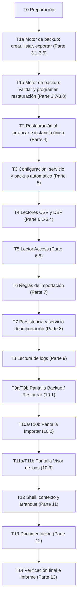

# Plan de implementación F8 — Utilitarios

**Autor:** revisión senior (2026-10-01)
**Ejecutor:** un **orquestador** en Google Antigravity (agente principal, Gemini 3.8 Flash High) que delega cada tarea en **subagentes** (implementador y escritor de tests en `flash`, revisor de solo lectura en `pro`). Ver **E.6** antes que nada. Sin subagentes, el mismo plan se ejecuta secuencialmente con E.1–E.5.
**Punto de partida:** F7 completado **y commiteado** (`c4c6c44 feat(F7): reportes`, rama `feat/f7-reportes`, árbol limpio). Build Release con 0 warnings; **1200 tests en verde** (medido el 2026-10-01; mídelo tú mismo en T0 y anota el número real).
**HUs:** HU-F8-01 … HU-F8-06 (ver `Agents.md §3`).

**Cómo leer este documento:**
- La **Parte E** dice *qué* tarea hacer, *en qué orden*, *qué archivos* puedes tocar, *cómo* se comprueba cada tarea y, en **E.6**, *quién* la hace. Síguela al pie de la letra.
- Las **Partes 0–13** son la *especificación*. Cada tarea de la Parte E apunta a una o más Partes.
- La **Parte 14** es la revisión del plan: huecos detectados, cómo se cubren, riesgos abiertos y preguntas al usuario. **Léela entera antes de escribir código.** Muchas reglas existen por lo que se explica allí (se citan como "ver R*n*").

Este documento es **la especificación**. Si algo no está aquí, se aplican las convenciones de `Agents.md §4` y, como plantilla de código, lo que ya hacen F2–F7 (`AlmacenConfiguracionImpresionJson`, `ServicioGestionPesajes`, `ServicioReportes`, `FrmReportes`, `FrmVisorAuditoria`, `DatabaseInitializer` y sus tests). Si algo contradice `Agents.md`, manda este documento y la diferencia se anota en el informe final.

---

## Mapa HU → Partes

| HU | Título | Partes |
|---|---|---|
| HU-F8-01 | Backup manual consistente (`SqliteBackupService`) | 3 (motor de backup), 5 (servicio, auditoría), 10.1 (pantalla) |
| HU-F8-02 | Backup automático diario con retención | 3.2 y 3.6 (nombres y retención), 5.1–5.3 (configuración y programador), 11 (arranque y cierre), 10.1 |
| HU-F8-03 | Restauración con validación y reinicio | 3.7–3.8 (validar y programar), 4 (aplicar al arrancar e instancia única), 10.1, 11 |
| HU-F8-04 | Importador de datos legado desde CSV (con simulacro) | 6.1–6.3 (lector CSV), 7 (reglas), 8 (persistencia y servicio), 10.2 |
| HU-F8-05 | Lectores opcionales DBF y MDB | 6.4 (DBF), 6.5 (Access `.mdb`/`.accdb`) |
| HU-F8-06 | Visor de logs | 9 (lectura y análisis), 10.3 (pantalla) |

**F8 no tiene migraciones de base de datos.** Todo lo que necesita ya existe en el esquema: `AccionAuditoria.Backup = 14`, `Restauracion = 15`, `Importacion = 16` (sin CHECK sobre `Accion`), `OrigenPeso.Importado = 3` (permitido por `CK_Pesajes_OrigenPeso`) y `AppPaths.BackupsDir`/`RestoreDir` (ya se crean al arrancar). La carpeta `Persistencia/Migraciones` no se toca (E.4 lo comprueba). Si crees que necesitas una migración, **detente** y repórtalo.

**F8 agrega un solo paquete NuGet, y solo en T5:** `System.Data.OleDb` 8.0.1 (lector de Access, HU-F8-05; ver D20 y P1). Ninguna otra tarea agrega paquetes. CsvHelper 33.0.1 **ya está** referenciado en `PesajeFaeneo.Infrastructure.csproj` desde F0 (sin usar hasta ahora).

---

## Parte E — Ejecución

### E.1 Por qué el plan es tan explícito

El ejecutor es un agente de menor capacidad. Los fallos típicos que este plan neutraliza:

| Fallo típico | Cómo lo neutraliza el plan |
|---|---|
| Copiar `pesaje.db` con `File.Copy` mientras la aplicación escribe. | La base está en WAL: los datos confirmados recientes viven en `pesaje.db-wal`; la copia queda incompleta o inconsistente. H1: se usa la API de backup de SQLite (`SqliteConnection.BackupDatabase`); grep de T1 prohíbe `File.Copy` sobre la base viva. |
| Dejar la copia en modo WAL. | H2: abrirla aunque sea en solo lectura crea `-wal`/`-shm` al lado. 3.6: la copia se pasa a `journal_mode=DELETE` antes de comprimirla. |
| Conexiones con *pool* sobre archivos que luego se mueven o borran. | H3: Microsoft.Data.Sqlite mantiene el archivo abierto; `File.Delete`/`Move` lanza `IOException`. Regla 0.16: toda conexión abierta a mano lleva `Pooling=False`. |
| Reemplazar `pesaje.db` con la aplicación abierta, o dejar el `-wal` viejo junto a la base nueva. | SQLite aplicaría el WAL viejo sobre la base nueva → corrupción. Parte 4: la restauración se aplica **solo al arrancar**, antes de abrir la base, moviendo **juntos** `pesaje.db`, `-wal` y `-shm`. |
| Restaurar una copia de una versión más nueva, o una que no migra. | La aplicación no arranca y la planta no puede pesar. 3.7: se rechaza la versión más nueva y se hace una **migración de prueba** sobre una copia; 4.4: si aun así falla al arrancar, se revierte sola. |
| Extraer el zip sin validar las rutas (*zip-slip*). | Un `.zip` manipulado escribe fuera de la carpeta. 3.5: lista blanca de entradas + comprobación de ruta final; H6 muestra los casos. |
| Importar 100 000 boletas con el `ChangeTracker` lleno o sin transacción. | Minutos de espera, memoria disparada o importación a medias. H9: lotes de 1 000 con `AutoDetectChangesEnabled = false` + `ChangeTracker.Clear()` dentro de **una** transacción (8.1). |
| Un "simulacro" que valida distinto de la importación real. | El simulacro dice "todo bien" y la importación falla. D14: el simulacro ejecuta **la misma** escritura y hace *rollback*; la importación vuelve a preparar todo desde cero. |
| Comillas sin cerrar en un CSV. | H11: CsvHelper se traga el resto del archivo en un campo **sin avisar** (`BadDataFound` no se dispara). 6.3: un campo con salto de línea rechaza el archivo. |
| Leer el log del día con `FileShare.Read`. | H7: `IOException` (Serilog lo tiene abierto para escribir). 9.3: `FileShare.ReadWrite \| FileShare.Delete`. |
| Inventar APIs (`BackupDatabase`, `PeriodicTimer`, CsvHelper, OleDb) o usar las de otra versión. | Todas las APIs de la Parte 2 se **compilaron y ejecutaron** contra las versiones exactas. Usa **solo** esas; para otra, confírmala con Context7 **y compílala**. |
| Temporizadores con `Thread.Sleep`/`Task.Delay`. | Regla 0.17 y H13: `PeriodicTimer(periodo, TimeProvider)`; los tests usan `FakeTimeProvider`. |
| Tests que cuelgan (MessageBox, OpenFileDialog, FolderBrowserDialog, SaveFileDialog, `Process.Start`). | Regla 0.11: todo diálogo o proceso externo pasa por un gancho `...ParaTest` (10.x). |
| Tocar `Program.cs` sin poder probarlo. | 11.3 da el código **completo** del nuevo `Main`; 13.2 lo prueba de punta a punta con la aplicación real. |
| Reportar "todo verde" sin haberlo ejecutado; tocar archivos fuera de alcance; borrar o saltar tests. | E.3 (lista blanca), E.4 (compuerta siempre ejecutada, salida real pegada, conteo de tests nunca baja, greps de `Skip`/`#pragma`/`NoWarn`). |

### E.2 Orden de tareas

Ejecuta **una tarea a la vez, en este orden**. No empieces la siguiente hasta que la compuerta de la actual esté en verde y la tarea esté commiteada (E.5).



Orden lineal: **T0, T1a, T1b, T2, T3, T4, T5, T6, T7, T8, T9a, T9b, T10a, T10b, T11a, T11b, T12, T13, T14.** (Donde el plan dice "T1" sin letra, vale para T1a y T1b.)

### E.3 Ficha de cada tarea

Rutas relativas a la raíz del repositorio. `App` = `src/PesajeFaeneo.Application`, `Infra` = `src/PesajeFaeneo.Infrastructure`, `WF` = `src/PesajeFaeneo.WinForms`, `Tests` = `tests/PesajeFaeneo.Tests`. "Nuevo" = archivo a crear. **Siempre `--include=*.cs`** en los `grep -r` sobre `src/` (sin él aparecen `obj/` y `bin/`).

| Tarea | Especificación | Archivos permitidos (lista blanca) | Comprobaciones automáticas propias (además de E.4) |
|---|---|---|---|
| **T0** | E.5 | — (solo git) | `git status` limpio; `git log -1 --format=%s` empieza por `feat(F7)`; línea base de tests anotada. |
| **T1a** | 3.1–3.6, 3.9, 3.10 (solo `EntornoArchivosPrueba`), tests de 3.11 marcados **[T1a]** | Nuevos: `App/Utilitarios/Backup/Dtos/BackupDtos.cs`, `App/Utilitarios/Backup/IMotorBackup.cs`, `App/Utilitarios/Backup/ReglasBackup.cs`, `Infra/Utilitarios/Backup/SqliteBackupService.cs` (con `ValidarParaRestaurarAsync`, `ProgramarRestauracionAsync` y `DescartarValidacionAsync` que por ahora lanzan `NotImplementedException`), `Infra/Utilitarios/Backup/ManifiestoBackup.cs`, `Infra/Utilitarios/Backup/ArchivoBackupZip.cs`, `Tests/Utilidades/Backup/EntornoArchivosPrueba.cs`, `Tests/SqliteBackupServiceTests.cs`, `Tests/ArchivoBackupZipTests.cs`, `Tests/ReglasBackupTests.cs`. Modificado: `Infra/DependencyInjection.cs` | `grep -n "File\.Copy\|File\.Move\|File\.Delete" src/PesajeFaeneo.Infrastructure/Utilitarios/Backup/SqliteBackupService.cs` **no** debe mostrar ninguna línea con `DatabasePath`; `grep -rn --include=*.cs "new SqliteConnection(" src/PesajeFaeneo.Infrastructure/Utilitarios` → cada aparición construye su cadena con `SqliteConnectionStringBuilder { … Pooling = false }` (revisión manual de cada línea); `grep -rn --include=*.cs "System.IO.Compression\|Microsoft.Data.Sqlite" src/PesajeFaeneo.Application` vacío. |
| **T1b** | 3.7, 3.8, 3.10 (`ZipBackupDePrueba`), tests de 3.11 marcados **[T1b]** | Modificados: `Infra/Utilitarios/Backup/SqliteBackupService.cs` (reemplaza los tres `NotImplementedException`), `Tests/SqliteBackupServiceTests.cs` (solo agregar). Nuevo: `Tests/Utilidades/Backup/ZipBackupDePrueba.cs` | Las mismas de T1a; además `grep -n "NotImplementedException" src/PesajeFaeneo.Infrastructure/Utilitarios/Backup/SqliteBackupService.cs` vacío. |
| **T2** | Parte 4 | Nuevos: `App/Utilitarios/Backup/IAplicadorRestauracion.cs`, `Infra/Utilitarios/Backup/AplicadorRestauracion.cs`, `WF/Infraestructura/InstanciaUnica.cs`, `Tests/AplicadorRestauracionTests.cs`, `Tests/InstanciaUnicaTests.cs`. Modificados: `App/Auditoria/FabricaAuditoria.cs` (solo agregar `EntidadesAuditoria.Sistema`), `Tests/FabricaAuditoriaTests.cs` (solo el test de `Todas`), `Infra/DependencyInjection.cs` | `grep -n "File\.\(Copy\|Move\|Delete\)" src/PesajeFaeneo.Infrastructure/Utilitarios/Backup/AplicadorRestauracion.cs` → toda operación sobre `DatabasePath` está dentro de `AplicarPendiente`/`Revertir`/sus privados (revisión manual). |
| **T3** | Parte 5 | Nuevos: `App/Utilitarios/Backup/IAlmacenConfiguracionBackup.cs`, `App/Utilitarios/Backup/IServicioBackup.cs`, `App/Utilitarios/Backup/ServicioBackup.cs`, `App/Utilitarios/Backup/IProgramadorBackupAutomatico.cs`, `App/Utilitarios/Backup/ProgramadorBackupAutomatico.cs`, `Infra/Utilitarios/Backup/AlmacenConfiguracionBackupJson.cs`, `Tests/ServicioBackupTests.cs`, `Tests/ProgramadorBackupAutomaticoTests.cs`, `Tests/AlmacenConfiguracionBackupJsonTests.cs`, `Tests/Utilidades/Backup/MotorBackupFalso.cs`, `Tests/Utilidades/Backup/AlmacenConfiguracionBackupFalso.cs`, `Tests/Utilidades/Backup/ProgramadorBackupFalso.cs`. Modificados: `App/DependencyInjection.cs`, `Infra/DependencyInjection.cs` | `grep -rn --include=*.cs "DateTime.Now\|DateTime.UtcNow\|DateTime.Today\|Thread.Sleep\|Task.Delay(" src/PesajeFaeneo.Application/Utilitarios` vacío. |
| **T4** | Parte 6.1–6.4 | Nuevos: `App/Utilitarios/Importacion/Dtos/OrigenDatosDtos.cs`, `App/Utilitarios/Importacion/ILectorOrigenDatos.cs`, `App/Utilitarios/Importacion/ReglasImportacion.cs`, `Infra/Utilitarios/Importacion/LectorOrigenDatos.cs`, `Infra/Utilitarios/Importacion/DetectorCodificacion.cs`, `Infra/Utilitarios/Importacion/LectorCsv.cs`, `Infra/Utilitarios/Importacion/LectorDbf.cs`, `Tests/LectorCsvTests.cs`, `Tests/LectorDbfTests.cs`, `Tests/DetectorCodificacionTests.cs`, `Tests/LectorOrigenDatosTests.cs`, `Tests/Utilidades/Importacion/EscritorDbfDePrueba.cs`, `Tests/Utilidades/Importacion/ArchivosDbfDePrueba.cs`. Modificado: `Infra/DependencyInjection.cs` | `grep -rln --include=*.cs "CsvHelper" src` lista **solo** `LectorCsv.cs`; `grep -rn --include=*.cs "CsvHelper\|System.Data.OleDb" src/PesajeFaeneo.Application src/PesajeFaeneo.WinForms` vacío. |
| **T5** | Parte 6.5 | Nuevos: `Infra/Utilitarios/Importacion/LectorAccessOleDb.cs`, `Infra/Utilitarios/Importacion/ConversorValoresOrigen.cs`, `Tests/LectorAccessOleDbTests.cs`, `Tests/ConversorValoresOrigenTests.cs`. Modificados: `Directory.Packages.props` (**solo** una línea `PackageVersion`), `src/PesajeFaeneo.Infrastructure/PesajeFaeneo.Infrastructure.csproj` (**solo** una línea `PackageReference`), `Infra/Utilitarios/Importacion/LectorOrigenDatos.cs`, `Tests/ArquitecturaTests.cs` (solo agregar), `Tests/LectorOrigenDatosTests.cs` (solo agregar) | `git diff --cached -U0 -- Directory.Packages.props src/PesajeFaeneo.Infrastructure/PesajeFaeneo.Infrastructure.csproj \| grep "^+[^+]"` muestra **exactamente** `<PackageVersion Include="System.Data.OleDb" Version="8.0.1" />` y `<PackageReference Include="System.Data.OleDb" />`; `grep -rln --include=*.cs "System.Data.OleDb" src` lista **solo** `LectorAccessOleDb.cs`. |
| **T6** | Parte 7 | Nuevos: `App/Utilitarios/Importacion/Dtos/ImportacionDtos.cs`, `App/Utilitarios/Importacion/CamposImportacion.cs`, `App/Utilitarios/Importacion/ConversoresImportacion.cs`, `App/Utilitarios/Importacion/SugeridorMapeo.cs`, `App/Utilitarios/Importacion/PreparadorImportacion.cs`, `App/Utilitarios/Importacion/InformeImportacion.cs`, `Tests/ConversoresImportacionTests.cs`, `Tests/SugeridorMapeoTests.cs`, `Tests/PreparadorImportacionTests.cs`, `Tests/InformeImportacionTests.cs` | `grep -rn --include=*.cs "CurrentCulture\|DateTime.Now\|DateTime.UtcNow\|double\|float\|ToLocalTime" src/PesajeFaeneo.Application/Utilitarios/Importacion` vacío. |
| **T7** | Parte 8 | Nuevos: `App/Utilitarios/Importacion/IRepositorioImportacion.cs`, `App/Utilitarios/Importacion/IServicioImportacion.cs`, `App/Utilitarios/Importacion/ServicioImportacion.cs`, `Infra/Utilitarios/Importacion/RepositorioImportacion.cs`, `Tests/RepositorioImportacionTests.cs`, `Tests/ServicioImportacionTests.cs`, `Tests/Utilidades/Importacion/LectorOrigenDatosFalso.cs`. Modificados: `App/DependencyInjection.cs`, `Infra/DependencyInjection.cs` | `grep -n "Sum(\|Average(" src/PesajeFaeneo.Infrastructure/Utilitarios/Importacion/RepositorioImportacion.cs` vacío; `grep -n "SaveChanges" …/RepositorioImportacion.cs` solo dentro de `EscribirAsync`. |
| **T8** | Parte 9 | Nuevos: `App/Utilitarios/Logs/Dtos/LogDtos.cs`, `App/Utilitarios/Logs/ParserLog.cs`, `App/Utilitarios/Logs/ILectorArchivosLog.cs`, `App/Utilitarios/Logs/IServicioLogs.cs`, `App/Utilitarios/Logs/ServicioLogs.cs`, `Infra/Utilitarios/Logs/LectorArchivosLog.cs`, `Tests/ParserLogTests.cs`, `Tests/LectorArchivosLogTests.cs`, `Tests/ServicioLogsTests.cs`. Modificados: `App/DependencyInjection.cs`, `Infra/DependencyInjection.cs` | `grep -n "FileShare" src/PesajeFaeneo.Infrastructure/Utilitarios/Logs/LectorArchivosLog.cs` muestra `FileShare.ReadWrite \| FileShare.Delete` (H7). |
| **T9a** | 10.1 (implementación) | Nuevos: `WF/Formularios/Utilitarios/FrmBackupRestaurar.cs`, `WF/Formularios/Utilitarios/FrmConfirmarRestauracion.cs` | Ver fila T9b. En los dos archivos: `grep -n "\.Result\|\.Wait()\|GetAwaiter().GetResult()"` vacío; revisión manual: ningún `MessageBox`/`OpenFileDialog`/`SaveFileDialog`/`FolderBrowserDialog`/`Process.Start`/`ShowDialog` fuera de su método envoltorio con gancho, y ningún `EjecutarAsync(`/`Ejecutar(` dentro del delegado de otro. |
| **T9b** | 10.1 (tests) | Nuevos: `Tests/FrmBackupRestaurarTests.cs`, `Tests/FrmConfirmarRestauracionTests.cs`, `Tests/Utilidades/Backup/ServicioBackupFalso.cs`. Modificado: `Tests/LayoutFormulariosTests.cs` (solo agregar) | Tres corridas seguidas de la suite. |
| **T10a** | 10.2 (implementación) | Nuevo: `WF/Formularios/Utilitarios/FrmImportarLegado.cs` | Mismas comprobaciones que T9a; además `grep -n "WriteAllBytesAsync\|CsvHelper\|OleDb" …/FrmImportarLegado.cs` vacío. |
| **T10b** | 10.2 (tests) | Nuevos: `Tests/FrmImportarLegadoTests.cs`, `Tests/Utilidades/Importacion/ServicioImportacionFalso.cs`. Modificado: `Tests/LayoutFormulariosTests.cs` (solo agregar) | Tres corridas seguidas. |
| **T11a** | 10.3 (implementación) | Nuevo: `WF/Formularios/Utilitarios/FrmVisorLogs.cs` | Mismas comprobaciones que T9a. |
| **T11b** | 10.3 (tests) | Nuevos: `Tests/FrmVisorLogsTests.cs`, `Tests/Utilidades/Logs/ServicioLogsFalso.cs`. Modificado: `Tests/LayoutFormulariosTests.cs` (solo agregar) | Tres corridas seguidas. |
| **T12** | Parte 11 | Modificados: `WF/Formularios/FrmPrincipal.cs`, `WF/Infraestructura/ContextoAplicacion.cs`, `WF/Program.cs`, `Tests/FrmPrincipalTests.cs`, `Tests/ContenedorDITests.cs` | `grep -c "\"F8\"" src/PesajeFaeneo.WinForms/Formularios/FrmPrincipal.cs` da **0**; `AutorizadorMenuTests.cs` sin cambios; `grep -n "new Mutex" src/PesajeFaeneo.WinForms/Program.cs` vacío (lo hace `InstanciaUnica`). |
| **T13** | Parte 12 | `Agents.md`, `README.md` | Las cifras de tests salen de la bitácora (no inventadas). |
| **T14** | Parte 13 | — (solo verificación; correcciones como tareas `T14.n` con su propia lista blanca, declarada en la bitácora antes de tocar nada) | Todo E.4 sobre el árbol final + 13.1 (tres corridas) + 13.2 (prueba de punta a punta con la aplicación real) + 13.3 (mediciones). |

**Verificación de la lista blanca** (al terminar cada tarea, **antes** del `git add`):
```bash
git status --porcelain
```
Cualquier archivo fuera de la lista = la tarea no está terminada: revierte ese archivo (`git checkout -- <archivo>` o bórralo si es nuevo) y rehaz lo necesario dentro de la lista. Si de verdad necesitas tocar otro archivo, anótalo en la bitácora como **desviación** con el motivo, y solo si es imprescindible para compilar.

### E.4 Compuerta de calidad (después de cada tarea, sin excepción)

Comandos de **Git Bash** (herramienta Bash), no de PowerShell:
```bash
dotnet build src/PesajeFaeneo.sln -c Release
```
```bash
dotnet test src/PesajeFaeneo.sln -c Release
```
```bash
# Finales de línea: debe salir vacío (después de git add)
git add -A && git diff --cached --name-only --diff-filter=AM | xargs -r git ls-files --eol | grep "w/lf"
# Nada de trampas: debe salir vacío (en T5, las dos únicas líneas permitidas son las de System.Data.OleDb de E.3)
git diff --cached -U0 | grep -E "^\+.*(#pragma warning disable|Skip *=|NoWarn|TreatWarningsAsErrors|PackageReference|PackageVersion|Thread\.Sleep|Task\.Delay\(|SuppressMessage)"
# Migraciones: F8 no tiene ninguna; debe salir vacío en TODAS las tareas
git diff --cached --name-only <SHA_F7> -- src/PesajeFaeneo.Infrastructure/Persistencia/Migraciones
```
- 0 warnings (`TreatWarningsAsErrors=true`), 0 errores, todos los tests en verde. **No avances con rojo.**
- El número de tests **nunca baja** respecto de la tarea anterior.
- Si un test **existente** falla por un cambio de esta fase, corrige los **datos o dobles del test**, nunca la regla nueva, y anótalo. Los únicos tests existentes que este plan autoriza a modificar: `FabricaAuditoriaTests` (T2, solo el test de `EntidadesAuditoria.Todas`), `ArquitecturaTests` y `LectorOrigenDatosTests` (T5, solo agregar), `LayoutFormulariosTests` (T9b, T10b, T11b, solo agregar), `FrmPrincipalTests` y `ContenedorDITests` (T12).
- Al cerrar T1a, T1b, T2, T7, T9b, T10b, T11b y T14 ejecuta la suite **tres veces seguidas**. Un test que falla 1 de 3 veces es un test roto: corrígelo, no lo reintentes hasta que pase.
- Los tests que crean archivos lo hacen **solo** en un directorio temporal propio (`Path.GetTempPath()` + GUID), borrado en `DisposeAsync`/`finally`. **Ningún** test toca `C:\ProgramData\PesajeFaeneo`.

### E.5 Protocolo de git y bitácora

1. **T0:**
   - `git status` debe estar **limpio** y `git log -1 --format=%s` debe ser el commit de F7 (`feat(F7): reportes`). Si hay cambios sin commitear o HEAD es otro commit, **detente y repórtalo al usuario**: no commitees nada por tu cuenta ni mezcles fases.
   - Anota `<SHA_F7> = git rev-parse HEAD` en la bitácora (al escribir este plan: `c4c6c44…`).
   - `git switch -c feat/f8-utilitarios`.
   - Ejecuta la compuerta y anota el número de tests de partida (debe ser 1200; si es otro, anótalo y sigue).
2. **Por cada tarea:** implementa → compuerta E.4 → comprobaciones propias de E.3 → `git status --porcelain` contra la lista blanca → `git add -A && git commit -m "wip(F8-Tn): <título>"`.
3. **Nunca** `push`, `merge`, `rebase`, `reset --hard` ni `checkout` de otras ramas. No commitees la bitácora. Con subagentes, **solo el ORQ** ejecuta git de escritura y escribe la bitácora (E.6.8).
4. **Al terminar T14:** anota el SHA del último commit en la bitácora y en el informe, y ejecuta `git reset --soft <SHA_F7>`: todo F8 queda como cambios preparados sin commit, igual que en fases anteriores, para que el usuario lo revise y haga un único commit `feat(F8): utilitarios`. (Si algo sale mal, `git reset --soft <SHA anotado>` recupera el historial.)
5. **Bitácora** (`../pesalab-f8-bitacora.md`, **fuera** del repositorio para que `git add -A` no la incluya): por tarea, tests antes → después, salida literal de las 3 últimas líneas de `dotnet test`, desviaciones y decisiones tomadas ante ambigüedades. T13 la usa como fuente de cifras.

### E.6 Ejecución orquestada en Antigravity (orquestador + subagentes)

Esta sección la lee y la ejecuta **el orquestador (ORQ)**: el agente principal de Antigravity al que el usuario le entrega este plan. Los subagentes **no** leen el plan completo: reciben un *brief* (E.6.6) con solo lo que necesitan. Todo lo de E.1–E.5 sigue vigente; aquí se dice **quién** hace cada cosa. Si Antigravity no permitiera subagentes en tu instalación, ejecuta T0…T14 tú mismo, secuencialmente, con E.1–E.5.

#### E.6.1 Hechos de Antigravity en los que se apoya esta sección

Los mismos que funcionaron en F7 (consultados el 2026-09-30 en `antigravity.google/docs/subagents/` y `antigravity.google/docs/hooks/`). **Si tu versión difiere, manda lo que veas en tu instalación** y anótalo en la bitácora.

| # | Hecho | Consecuencia |
|---|---|---|
| A1 | El agente principal lanza subagentes con `invoke_subagent`; al terminar envían un mensaje de resultado al padre. | ORQ = agente principal. Los subagentes **no** lanzan otros subagentes (lo prohíbe el brief). |
| A2 | Subagentes propios: Markdown con frontmatter YAML en `.agents/agents/<nombre>.md`. Campos: `name`, `description` (obligatorios), `tools`, `model` (`inherit`, `flash`, `pro`), `commandExecutionPolicy` (`off`, `auto`, `eager`, `sandbox`), `mainAgent`, `subagent`. | E.6.3 trae los archivos listos para copiar. No se puede fijar el nivel de razonamiento por subagente. |
| A3 | **Problema conocido:** un nombre de herramienta mal escrito en `tools` puede **colgar** al subagente. Nombres documentados: `view_file`, `grep_search`, `replace_file_content`, `write_to_file`, `run_command`. | E.6.3 usa **solo** esos cinco. T0 comprueba que existen antes de crear los agentes. |
| A4 | Espacio de trabajo del subagente: `inherit`, `branch` (worktree aislado, **se borra al terminar**) o `share`. | F8 trabaja **secuencialmente en `inherit`**. |
| A5 | Hooks en `.agents/hooks.json`; evento `PreToolUse` con `matcher` por nombre de herramienta; el comando recibe JSON por stdin y responde `{"decision":"allow"}` o `{"decision":"deny", "reason":"…"}`. No está documentado si alcanzan a los subagentes. | E.6.3: hook de guardia como defensa en profundidad. |

#### E.6.2 Perfiles

| Perfil | Agente de Antigravity | Modelo | Herramientas | Uso |
|---|---|---|---|---|
| **ORQ** — orquestador | Agente principal | **Gemini 3.8 Flash**, razonamiento **High** | Todas | Único dueño de git, de la bitácora, de las compuertas y del informe final. Arma los briefs, lanza subagentes, verifica, integra. **No implementa** tareas (solo corrige trivialidades de integración: un `using`, un registro de DI, CRLF). |
| **IMP** — implementador | `f8-implementador` | `flash` | `view_file`, `grep_search`, `replace_file_content`, `write_to_file`, `run_command` | Implementa una tarea dentro de su lista blanca y ejecuta la compuerta. Sin git de escritura. |
| **TST** — escritor de tests | `f8-tests` | `flash` | Las mismas que IMP | Escribe tests **desde la especificación**, sin modificar código de producción (T9b, T10b, T11b). Instancia distinta de la que implementó. |
| **REV** — revisor | `f8-revisor` | `pro` | **Solo** `view_file`, `grep_search` | Revisa el diff de cada tarea contra su especificación (E.6.7) y hace la revisión final (T14). |
| **EXP** — explorador | `research` (incorporado) | el suyo | el suyo | Consultas baratas del ORQ. Nunca escribe. |

#### E.6.3 Preparación en T0 (el ORQ crea estos archivos; **no** se commitean)

1. Excluir de git la carpeta de Antigravity, **sin** tocar `.gitignore`:
   ```bash
   mkdir -p .agents/agents .agents/hooks && (grep -qxF ".agents/" .git/info/exclude || echo ".agents/" >> .git/info/exclude)
   ```
   Comprueba que `git status --porcelain` sigue vacío tras crear los archivos de abajo.
2. Verifica que `view_file`, `grep_search`, `replace_file_content`, `write_to_file` y `run_command` existen **con ese nombre** en tu lista de herramientas. Si alguno se llama distinto, usa el nombre real en los tres archivos y anótalo.
3. `.agents/agents/f8-implementador.md`:
   ```markdown
   ---
   name: f8-implementador
   description: Implementa UNA tarea del plan F8 (docs/plans/F8-utilitarios.md) a partir del brief que recibe, solo dentro de su lista blanca de archivos, y ejecuta la compuerta de build y tests. No hace commits.
   tools:
     - view_file
     - grep_search
     - replace_file_content
     - write_to_file
     - run_command
   model: flash
   commandExecutionPolicy: sandbox
   mainAgent: false
   subagent: true
   ---
   Eres un implementador. Trabajas SOLO en la tarea del brief y SOLO en los archivos de su lista blanca.
   - No preguntes: si algo es ambiguo, elige la opción más conservadora compatible con la especificación y anótala en DESVIACIONES.
   - Nunca: git commit, push, merge, rebase, reset, checkout de ramas, stash, clean; dotnet ef; dotnet add package; editar .csproj/.props (salvo que el brief lo autorice explícitamente); #pragma warning disable; Skip en tests; borrar tests.
   - No lances subagentes.
   - Antes de usar una API de librería que no esté en los hechos verificados del brief, confirma su firma con Context7 o learn.microsoft.com y compílala.
   - Ningún test puede tocar C:\ProgramData: usa un directorio temporal propio y bórralo al final.
   - Los archivos que crees o toques deben quedar con finales de línea CRLF y UTF-8 sin BOM.
   - Tu última respuesta es SOLO el reporte con el formato del brief.
   ```
4. `.agents/agents/f8-tests.md`: igual que el anterior, con `name: f8-tests`, `description: Escribe los tests de una tarea del plan F8 a partir de la especificación del brief, sin modificar código de producción.` y agrega: "No modifiques ningún archivo bajo `src/`. Puedes LEER el código de producción para conocer los nombres de los ganchos `internal`, pero el comportamiento esperado sale de la especificación, no de la implementación. Si un test revela un defecto o falta un gancho, NO lo arregles: descríbelo en BLOQUEOS."
5. `.agents/agents/f8-revisor.md`:
   ```markdown
   ---
   name: f8-revisor
   description: Revisa en solo lectura el diff de una tarea del plan F8 contra su especificación y devuelve hallazgos con formato fijo.
   tools:
     - view_file
     - grep_search
   model: pro
   commandExecutionPolicy: off
   mainAgent: false
   subagent: true
   ---
   Eres un revisor de solo lectura. No escribes archivos ni ejecutas comandos. Revisa SOLO el diff que recibes contra la especificación y los riesgos del brief. No propongas mejoras de estilo ni refactors. Responde solo con hallazgos en el formato del brief, o exactamente SIN HALLAZGOS.
   ```
6. Hook de guardia `.agents/hooks/guardia-f8.ps1` (Windows PowerShell 5.1; mensaje sin tildes a propósito):
   ```powershell
   $entrada = [Console]::In.ReadToEnd()
   $prohibidos = @(
       'git\s+push', 'git\s+reset\s+--hard', 'git\s+clean\s', 'git\s+rebase', 'git\s+stash',
       'git\s+checkout\s+(?!--)', 'git\s+merge', 'git\s+branch\s+-D',
       'dotnet\s+ef\s+migrations\s+(add|remove)', 'dotnet\s+ef\s+database',
       'dotnet\s+add\s+\S*\s*package', 'rm\s+-rf', 'Remove-Item[^\r\n]*-Recurse',
       'ProgramData\\\\PesajeFaeneo[^\r\n]*(Remove-Item|del\s|rm\s)'
   )
   foreach ($p in $prohibidos) {
       if ($entrada -match $p) {
           @{ decision = 'deny'; reason = "Bloqueado por el plan F8 (patron '$p'). Si de verdad hace falta, el ORQ debe registrarlo como desviacion y pedirselo al usuario." } | ConvertTo-Json -Compress
           exit 0
       }
   }
   '{"decision":"allow"}'
   ```
   y `.agents/hooks.json`:
   ```json
   {
     "guardia-f8": {
       "PreToolUse": [
         {
           "matcher": "run_command",
           "hooks": [
             { "type": "command", "command": "powershell -NoProfile -ExecutionPolicy Bypass -File .agents/hooks/guardia-f8.ps1", "timeout": 10 }
           ]
         }
       ]
     }
   }
   ```
   El paquete de T5 se agrega **editando** `Directory.Packages.props` y el `.csproj` (no con `dotnet add package`), por eso el hook no lo bloquea. **Prueba del hook** (T0): ejecuta `echo "prueba git push"`. Si se deniega, el hook está activo (anótalo). Si se ejecuta, anótalo y sigue.
7. Configuración del proyecto en Antigravity (la hace el **usuario**; el ORQ la verifica): planes y artefactos sin aprobación manual por paso; terminal con permiso para `dotnet` y `git`. Si un subagente con `sandbox` no puede compilar (caché de NuGet o `%TEMP%`), cambia ese campo a `auto` en `f8-implementador.md` y `f8-tests.md` y anótalo. **No** uses `eager`. **T5 necesita acceso a la red** para restaurar `System.Data.OleDb` (nuget.org): si el sandbox lo impide, el ORQ ejecuta `dotnet restore src/PesajeFaeneo.sln` él mismo antes de lanzar el subagente de T5.

#### E.6.4 Mapa de tareas para los briefs

Orden **estrictamente secuencial**, espacio de trabajo `inherit`. **A** = tarea exigente (brief con "Trampas conocidas", E.6.5). Las filas R se copian **literalmente** de la Parte 14; las reglas, de la Parte 0; los hechos, de la Parte 2; las decisiones, de la Parte 1.

| Tarea | Perfil | Especificación (copiar literal) | Decisiones | Filas R | Reglas Parte 0 | Hechos | Archivos de referencia a imitar |
|---|---|---|---|---|---|---|---|
| T1a **A** | IMP | 3.1–3.6, 3.9, 3.10 (`EntornoArchivosPrueba`), tests [T1a] de 3.11 | D1–D3, D6, D7 | R1–R10, R40 | 0.4, 0.5, 0.6, 0.12, 0.16, 0.17, 0.18 | H1–H6, H15, H16, "Del repositorio" | `AlmacenConfiguracionImpresionJson.cs`, `AlmacenLogoArchivos.cs`, `DatabaseInitializer.cs`, `SqliteArchivoFixture.cs`, `DatabaseInitializerTests.cs` |
| T1b **A** | IMP | 3.5 (para leer), 3.7, 3.8, 3.10 (`ZipBackupDePrueba`), tests [T1b] de 3.11 | D8, D9 | R5, R9–R12, R16, R19, R40, R41 | 0.4, 0.6, 0.12, 0.16, 0.17 | H3–H5, H15 | el `SqliteBackupService.cs` de T1a |
| T2 **A** | IMP | Parte 4 completa | D8, D10–D13 | R13–R21 | 0.4, 0.6, 0.12, 0.16, 0.17 | H1–H4, H8, "Del repositorio" | `DatabaseInitializer.cs`, `FabricaAuditoria.cs`, `SqliteArchivoFixture.cs` |
| T3 | IMP | Parte 5 completa | D3–D7, D9, D11 | R5, R22–R26 | 0.4, 0.6, 0.12, 0.13, 0.14, 0.17 | H13, "Del repositorio" | `AlmacenConfiguracionImpresionJson.cs`, `ServicioConfiguracionImpresion.cs`, `ServicioBalanza.cs` (ciclo `Iniciar/Detener`), `ServicioParametrosTests.cs` |
| T4 **A** | IMP | 6.1–6.4 completas | D15–D19 | R27–R33 | 0.4, 0.5, 0.8, 0.16 | H10, H11, H12, H14 | el `LectorDbf` de referencia de 6.4 (cópialo), `AlmacenLogoArchivos.cs` |
| T5 | IMP | 6.5 completa | D20 | R34–R36, R78 | 0.5, 0.15 | H14 | `LectorDbf.cs` de T4 |
| T6 **A** | IMP | Parte 7 completa | D14, D21–D27 | R37–R48, R77, R80 | 0.6, 0.7, 0.8 | H12 | `ValidadorCatalogos.cs`, `ReglasPesaje.cs`, `TextoBusqueda.cs`, `RangoDiaLocal.cs` |
| T7 **A** | IMP | Parte 8 completa | D14, D24, D28, D29 | R39, R49–R54 | 0.6, 0.12, 0.13, 0.14 | H9 | `ServicioGestionPesajes.cs`, `PesajeRepositorio.cs`, `ParametrosRepositorio.cs`, `ServicioGestionPesajesTests.cs` |
| T8 | IMP | Parte 9 completa | D30, D31 | R55–R57 | 0.13, 0.14, 0.16 | H7 | `ServicioAuditoria.cs`, `AlmacenLogoArchivos.cs` |
| T9a **A** | IMP | 10.0 y 10.1 (implementación) | D5, D10, D11, D32 | R18, R58–R63 | 0.9, 0.10, 0.11 | "Del repositorio" (DisenoFiltros, FormBase, ManejadorErrores) | `FrmReportes.cs` (ganchos), `FrmVisorAuditoria.cs` (layout) |
| T9b **A** | **TST** | 10.0 y 10.1 (tests) + la tabla de ganchos de 10.1 | — | R58–R63 | 0.11 | — | `FrmReportesTests.cs` (`CompletarBombeando`), `LayoutFormulariosTests.cs` |
| T10a **A** | IMP | 10.0 y 10.2 (implementación) | D14, D21, D32 | R58–R60, R64–R66 | 0.9, 0.10, 0.11 | "Del repositorio" | `FrmReportes.cs`, `FrmBuscarBoletas.cs` |
| T10b **A** | **TST** | 10.0 y 10.2 (tests) + ganchos | — | R58–R60, R64–R66 | 0.11 | — | `FrmReportesTests.cs` |
| T11a | IMP | 10.0 y 10.3 (implementación) | D31, D32 | R56, R58 | 0.9, 0.10, 0.11 | — | `FrmVisorAuditoria.cs` |
| T11b | **TST** | 10.0 y 10.3 (tests) + ganchos | — | R56, R58 | 0.11 | — | `FrmReportesTests.cs` |
| T12 **A** | IMP | Parte 11 completa | D10–D13, D32 | R13, R16, R21, R67–R70, R81 | 0.9, 0.11, 0.17 | H8, H13 | `FrmPrincipal.AbrirReportes`, `ContextoAplicacion.cs`, `Program.cs` actual |
| T13 | IMP | Parte 12 + la **bitácora completa** | — | R71 | 0.4 | — | entrada "Fase F7" de `Agents.md` |
| T14 | **REV** + ORQ | Parte 13 + revisión final de `git diff <SHA_F7>` contra las Partes 3–12 y la Parte 14 | todas | todas | todas | todos | — |

**Lista blanca de las tareas partidas:** T9a/T10a/T11a = solo los archivos de producción de su fila en E.3 (deben compilar y no romper ningún test existente; todavía no tienen tests propios). T9b/T10b/T11b = solo los archivos de test de su fila; pueden **leer** el formulario, nunca modificarlo. Si un test falla, el ORQ decide **contra la especificación** quién está mal: si es el formulario, abre `Tna.n` (IMP, instancia nueva, brief de `Tna` + el test que falla); si es el test, `Tnb.n`.

Ninguna tarea se paraleliza (dos `dotnet build` en `inherit` compiten por los mismos `obj/`).

#### E.6.5 Trampas conocidas (sección extra del brief de las tareas A)

- **T1a/T1b:** la copia se hace **solo** con `BackupDatabase` (H1) y después `PRAGMA journal_mode=DELETE` en el destino (H2); toda conexión manual con `SqliteConnectionStringBuilder { Pooling = false }` (H3, H15); el semáforo `_bloqueo` **no es reentrante**: los métodos públicos lo toman y llaman a privados `…InternoAsync` que no lo toman (si `ProgramarRestauracionAsync` llamara a `CrearAsync` público, se bloquearía para siempre); los tests crean sus zips "manipulados" con `ZipBackupDePrueba`, nunca editando un zip en el lugar; los nombres de archivo usan la **hora local** del `TimeProvider` (`FakeTimeProvider` con zona UTC-4: 14:00Z = 10:00 local).
- **T2:** `AplicarPendiente` **nunca lanza** (Program depende de eso): todo error → `Fallida` + log; mover **los tres** archivos de la base (`pesaje.db`, `-wal`, `-shm`) juntos (R14); `SqliteConnection.ClearAllPools()` antes de mover; los tests de `InstanciaUnica` crean y liberan el mutex **en el mismo hilo** (un `Mutex` pertenece al hilo que lo adquirió) y usan nombres `Local\…` con GUID.
- **T4:** el lector DBF de 6.4 está **verificado** contra archivos generados por otra implementación (H12): cópialo tal cual y no lo "mejores"; un campo con salto de línea en un CSV **rechaza el archivo** (H11); `Encoding.RegisterProvider(CodePagesEncodingProvider.Instance)` antes de pedir las páginas 850/437/1252.
- **T6:** todo es puro (sin BD ni archivos); `decimal` en pesos; las fechas del archivo son **locales** y se convierten a UTC con la zona recibida; los mensajes son literales de 7.5 (los tests los comparan).
- **T7:** el plan de importación son **records** (no entidades EF): el repositorio crea entidades nuevas en cada llamada (R50); el simulacro y la importación usan la **misma** `EscribirAsync` con `confirmar: false/true`; `ConfigureAwait(false)` en todo `await` del repositorio.
- **T9a/T10a:** ningún diálogo dentro de `EjecutarAsync`; toda `DomainException` esperable se atrapa **dentro** del delegado y se muestra **después**, fuera, con `MostrarAdvertencia` (si llega a `ManejadorErrores`, los tests cuelgan con un `MessageBox`, R59).
- **T9b/T10b:** los dobles devuelven tareas **ya completadas**; si alguna no lo está, usa `CompletarBombeando` (regla 0.11); ningún test puede abrir un diálogo real; archivos solo en un directorio temporal propio.
- **T12:** el nuevo `Main` está escrito completo en 11.3: cópialo; no cambies el orden de los pasos (la restauración va **antes** de `DatabaseInitializer`, R13); las esperas posteriores a `WinFormsApp.Run` van dentro de `Task.Run(...)` (R69).

#### E.6.6 Plantilla del brief

El ORQ arma un brief por tarea con **exactamente** estas secciones, en este orden, **sin resumir** la especificación (copiar y pegar del plan):

```text
# Tarea Tn — <título>            Perfil: <IMP|TST|REV> (agente <f8-implementador|f8-tests|f8-revisor>)
## Directorio de trabajo
<ruta absoluta del repositorio>   (espacio de trabajo: inherit)
## Objetivo (2–3 líneas)
## Especificación
<Partes de E.6.4 copiadas LITERALMENTE, con sus tablas, bloques de código y tests>
## Decisiones y hechos que aplican
<filas D y H de E.6.4, copiadas literalmente>
## Riesgos que debes evitar
<filas R de E.6.4, copiadas literalmente>
## Trampas conocidas            (solo tareas A, de E.6.5)
## Reglas obligatorias (no negociables)
- Solo puedes crear o modificar estos archivos: <lista blanca de E.3>. Si necesitas tocar otro, DETENTE y explícalo en BLOQUEOS.
- No preguntes. Si algo es ambiguo, elige la opción más conservadora compatible con la especificación y anótala en DESVIACIONES.
- No ejecutes git commit, push, merge, rebase, reset, stash, clean ni checkout de ramas. No ejecutes dotnet ef. No lances subagentes.
- No agregues paquetes NuGet ni cambies .csproj/.props (salvo T5, exactamente lo de E.3). No desactives warnings, tests ni analizadores.
- Ningún test toca C:\ProgramData\PesajeFaeneo.
- <reglas de la Parte 0 indicadas en E.6.4, copiadas literalmente>
## Archivos de referencia (léelos antes de escribir; imita su estilo)
<columna de E.6.4>
## Criterios de aceptación (ejecútalos tú y pega la salida real)
dotnet build src/PesajeFaeneo.sln -c Release       → 0 warnings, 0 errores
dotnet test src/PesajeFaeneo.sln -c Release        → N tests (≥ <número actual>), 0 fallos
<comprobaciones automáticas propias de la tarea (columna de E.3)>
Convierte a CRLF los archivos que creaste o tocaste.
## Formato de reporte (tu última respuesta, nada más)
ARCHIVOS: <lista con A=agregado, M=modificado>
TESTS: antes=<n> después=<n> fallos=<n>   (pega las 3 últimas líneas de dotnet test)
BUILD: warnings=<n> errores=<n>
COMPROBACIONES: <salida de cada comprobación propia>
DESVIACIONES: <lista o "ninguna">
BLOQUEOS: <lista o "ninguno">
```

Solo en el brief de T1a, agrega como primer criterio de aceptación: `echo "prueba git push"` → informa si fue denegado.

#### E.6.7 Revisión por REV (después de cada tarea de implementación o de tests)

- **Entrada:** el brief de la tarea + la salida de `git diff` de la tarea, que el ORQ ejecuta y **pega** (REV no tiene terminal) + la ruta del repositorio.
- **Instrucción fija:** "Revisa solo este diff contra la especificación y los riesgos. No propongas mejoras de estilo ni refactors. Para cada problema, da un hallazgo con este formato:"
  ```text
  [SEVERIDAD: BLOQUEANTE|MAYOR|MENOR] archivo:línea
  Regla violada: <D#, H#, R#, Parte x.y o regla 0.n>
  Qué pasa: <1–2 frases>
  Cómo demostrarlo: <test concreto o comando que falla>
  ```
  Si no hay hallazgos, responde exactamente `SIN HALLAZGOS`.
- **Filtro del ORQ (obligatorio):** un hallazgo solo se acepta si el ORQ lo **confirma** (lee el código, ejecuta el comando o escribe el test propuesto y lo ve fallar). Los no confirmados se anotan como "descartado: no reproducible".
- **Corrección:** los BLOQUEANTE y MAYOR confirmados vuelven a una **instancia nueva** del mismo perfil (brief original + hallazgos confirmados). Los MENOR se anotan; se corrigen solo si son de una línea.
- **Límite:** como máximo **2 ciclos** implementar → revisar por tarea. Si en el tercero sigue un BLOQUEANTE confirmado, el ORQ lanza una tarea `Tn.x` de perfil IMP acotada **solo** a ese defecto, y lo anota como desviación.
- **Sin revisión:** T13 (documentación); el ORQ verifica a mano que las cifras coinciden con la bitácora.

#### E.6.8 Protocolo del ORQ

1. **T0** (sin subagentes): E.5-1 completo; luego E.6.3 completo; anota la versión de Antigravity, el modelo, si el hook está activo y los nombres de herramientas.
2. **Por cada tarea T1…T13, en orden:**
   1. Arma el brief (E.6.6) y lanza el subagente (perfil de E.6.4, `inherit`). Espera su resultado; no lances otro mientras tanto.
   2. **Re-ejecuta tú** la compuerta E.4, las comprobaciones propias de E.3 y `git status --porcelain` contra la lista blanca. El reporte del subagente **nunca** cuenta como prueba.
   3. Si algo falla o hay archivos fuera de la lista blanca: tarea **rechazada**; revierte lo que esté fuera y relanza una instancia nueva con el brief original + la salida literal del fallo.
   4. Si pasa: lanza REV (E.6.7), aplica sus correcciones; vuelve a 2.2.
   5. Aprobada: `git add -A && git commit -m "wip(F8-Tn): <título>"`. **Solo el ORQ commitea.**
   6. Anota en la bitácora: perfil, ciclos, hallazgos (confirmados/descartados), tests antes → después, desviaciones, bloqueos.
   7. Si un subagente no devuelve resultado en un tiempo razonable (orientativo: 30 min las tareas normales, 60 min las **A**), detenlo, revisa `git status` (descarta los cambios a medias), comprueba los nombres de `tools` y relánzalo una vez; si se repite, ejecuta tú esa tarea con E.1–E.5 y anótalo.
3. **Paradas:** si un subagente informa en BLOQUEOS una de las paradas autorizadas de la regla 0.1, el ORQ **no** la resuelve por su cuenta: la registra y la incluye en el informe final; si impide seguir, se detiene y lo reporta.
4. **T14:** lanza REV con `git diff <SHA_F7>` completo (en partes: una por capa) contra las Partes 3–12 y la Parte 14; filtra y corrige como en E.6.7 (tareas `T14.n`); después el ORQ ejecuta él mismo 13.1, 13.2 y 13.3 y escribe el informe 13.4.
5. **Qué nunca delega el ORQ:** git, la bitácora, las compuertas, la decisión de aceptar hallazgos, la prueba de punta a punta (13.2), las mediciones (13.3), el `reset --soft` final y el informe.
6. Al terminar, el ORQ puede borrar `.agents/` o dejarla (está excluida de git); anota qué hizo. **No** modifiques `.gitignore`.

---

## Parte 0 — Reglas de comportamiento (obligatorias)

1. **No te detengas hasta terminar** (vale para el ORQ y para cada subagente dentro de su tarea). El ORQ responde al usuario **una sola vez**, al final, con el informe de 13.4; los subagentes **no hacen preguntas**. Si algo es ambiguo, elige la opción más conservadora compatible con este plan, anótala como desviación y continúa. Las únicas paradas autorizadas son: T0 (F7 sin commit o árbol sucio), "necesito una migración", "una API de la Parte 2 no compila con la versión instalada", "no se puede restaurar `System.Data.OleDb` 8.0.1" (T5: sin red) y "la prueba de punta a punta 13.2 deja la aplicación sin poder arrancar".
2. **Git:** lo gobierna E.5.
3. **Compuerta:** E.4 después de cada tarea. Nunca desactives un warning, un test ni un analizador.
4. **Convenciones:** identificadores, comentarios, mensajes de UI y de log en **español**; imita el estilo y la densidad de comentarios del código existente. CRLF, UTF-8 sin BOM. xUnit solo con `Assert`. Sin librerías de mocks: dobles escritos a mano. `ArgumentNullException.ThrowIfNull` en los constructores, como el resto del código.
5. **Capas** (las hace cumplir `ArquitecturaTests`):
   - Domain sin dependencias. **F8 no toca Domain.**
   - Application sin EF, WinForms, Serilog, Hosting, `System.Drawing`, `System.IO.Ports`, QuestPDF, ClosedXML, **CsvHelper, `System.Data.OleDb`, `Microsoft.Data.Sqlite` ni `System.IO.Compression`**. Solo define interfaces, DTOs, reglas puras y servicios que orquestan.
   - Infrastructure sin WinForms y sin `System.Drawing`. **CsvHelper solo en `LectorCsv.cs`; `System.Data.OleDb` solo en `LectorAccessOleDb.cs`; zip y SQLite manual solo en `Infra/Utilitarios/Backup/`.**
   - WinForms nunca hace `using` de CsvHelper, OleDb, `Microsoft.Data.Sqlite` ni `System.IO.Compression`.
   - **No agregues paquetes NuGet ni cambies `.csproj`/`.props`** (única excepción: T5, E.3).
6. **Tiempo:** siempre `TimeProvider` inyectado. Nada de `DateTime.Now`, `DateTime.UtcNow`, `DateTime.Today` ni `ToLocalTime()` en producción. Hora local: `TimeZoneInfo.ConvertTimeFromUtc(utc, _timeProvider.LocalTimeZone)`. En tests, `FakeTimeProvider` con `SetLocalTimeZone` (zona fija UTC-4: `TimeZoneInfo.CreateCustomTimeZone("UTC-4", TimeSpan.FromHours(-4), "UTC-4", "UTC-4")`, como los tests de F7) y ahora = **2026-10-01T14:00Z** (= 10:00 local) salvo que el test diga otra cosa.
7. **Pesos:** `decimal` en todo F8. **Prohibido** `double`/`float` para pesos (la única excepción es leer un campo binario `B` de DBF o un `double` de Access, que se convierten a **texto** con `"R"` invariante y luego a `decimal` con los conversores de 7.3). Redondeo con `ReglasPesaje.Redondear`/`CalcularTotal`.
8. **Cultura:** los números y fechas que **se leen** de un archivo se interpretan con `CultureInfo.InvariantCulture` y las reglas explícitas de 7.3 (nunca con `CurrentCulture`). Los números y fechas que **se muestran** (mensajes, pantallas, nombres de archivo) se formatean con `TextosBoleta.Cultura` (es-BO) o, en nombres de archivo, con `CultureInfo.InvariantCulture`. **Prohibido** `$"{x:0.0}"` dentro de una interpolación: usa `x.ToString("formato", cultura)`.
9. **Hilo de UI:** nunca `.Result`, `.Wait()` ni `.GetAwaiter().GetResult()` una vez iniciado el bucle de mensajes. Manejadores asíncronos con lambdas `async (_, _) =>` que delegan en `FormBase.EjecutarAsync`.
10. **Regla de reentrada de `FormBase`:** `EjecutarAsync`/`Ejecutar` descartan **en silencio** cualquier invocación mientras otra está en curso. **Nunca** llames a un método que use `EjecutarAsync`/`Ejecutar` desde dentro del delegado de otro. Los diálogos modales (`MessageBox`, `OpenFileDialog`, `SaveFileDialog`, `FolderBrowserDialog`, `FrmConfirmarRestauracion`) se muestran **fuera** de `EjecutarAsync`: primero se obtiene el dato (dentro de su `EjecutarAsync`), después, fuera, el diálogo.
11. **Tests de WinForms:** todo test que cree un `Form` corre dentro de `HiloSta.Ejecutar(...)` y desecha lo que crea. Los dobles devuelven **tareas ya completadas**. Si el código espera una tarea no completada, usa `static void CompletarBombeando(Task t)` (bucle `while (!t.IsCompleted && sw.Elapsed < 5 s) Application.DoEvents();`, como `FrmReportesTests`). Nada de `Thread.Sleep` ni `Task.Delay`. **Ningún test puede abrir un `MessageBox`, un diálogo de archivo/carpeta, `FrmConfirmarRestauracion` modal ni un proceso externo**: cada uno tiene su gancho `internal ...ParaTest` (10.x). **Ninguna excepción esperable puede llegar a `ManejadorErrores`** (abre un `MessageBox` que cuelga el hilo STA).
12. **Tests de servicios y repositorios:** con **SQLite real** — en memoria (`BaseDatosEnMemoria`) para lógica de datos, y **en archivo** (`EntornoArchivosPrueba`, 3.10) para todo lo que haga backup o restauración. Sesiones con `SesionesDePrueba.IniciarAsync(db, sesion, Rol.X)`. Datos con los `*Builder` de `Builders/EntityBuilders.cs`.
13. **Seguridad:** permiso exigido en **cada** método público de servicio (defensa en profundidad), además de ocultar el menú: `BackupRestore` (backup/restauración), `ImportarLegado` (importación), `GestionarParametros` (visor de logs). Los tres son solo del Administrador (`MatrizPermisos`). El programador automático y el aplicador de restauración corren **sin sesión** (los invoca `Program`, no un usuario).
14. **Logging:** `Information` por cada backup creado (tipo, nombre de archivo, tamaño, milisegundos), restauración programada/aplicada/fallida, importación o simulacro (tipo, formato, filas leídas, a importar, con error, id de usuario) y exportación. **Nunca** la ruta completa de un archivo elegido por el usuario (solo `Path.GetFileName`: la ruta puede contener el nombre del usuario de Windows), **nunca** contenidos de filas importadas, **nunca** datos de la tabla `Usuarios`.
15. **APIs de librería:** los hechos de la **Parte 2** están verificados; respétalos tal cual. Para cualquier otra API, confirma la firma con Context7 o learn.microsoft.com **y compílala** antes de usarla.
16. **Archivos y SQLite:**
    - Todas las rutas salen de `AppPaths` (nunca `C:\ProgramData` escrito a mano).
    - Toda `SqliteConnection` creada a mano (fuera de EF) usa `new SqliteConnectionStringBuilder { DataSource = ruta, Pooling = false, … }.ToString()` (H3, H15).
    - **Prohibido** `File.Copy`/`File.Move`/`File.Delete` sobre `AppPaths.DatabasePath` o sus `-wal`/`-shm` fuera de `AplicadorRestauracion` (Parte 4).
    - Escritura atómica: se escribe a un temporal en la **misma carpeta** y se publica con `File.Move(tmp, destino, overwrite)` (H16).
    - Limpieza de temporales en `finally`, de mejor esfuerzo (`try { … } catch (IOException) { } catch (UnauthorizedAccessException) { }`).
17. **Hilos y tiempo de espera:** nada de `Thread.Sleep`/`Task.Delay`; las esperas periódicas con `PeriodicTimer(periodo, TimeProvider)` (H13). Todo `await` del código de F8 que corre fuera de la UI (motor de backup, aplicador, almacén, programador, lectores, repositorio, servicios) lleva `.ConfigureAwait(false)`: `Program` espera algunas de esas tareas después de cerrar la UI (R69). El trabajo pesado y síncrono (ADO.NET de SQLite, zip, lectura de archivos, análisis de 100 000 filas) va dentro de `Task.Run` en Infrastructure o en el servicio.
18. **Los backups contienen todo** (incluidos los hashes de contraseñas de `Usuarios`): nunca se copian a una carpeta que no haya elegido el Administrador; la pantalla lo advierte al exportar (10.1).

---

## Parte 1 — Decisiones de diseño (asumidas; el usuario puede cambiarlas)

Las marcadas **(P*n*)** dependen de una pregunta al usuario de la Parte 14.

| # | Decisión | Valor |
|---|---|---|
| D1 | Formato del backup | Un **`.zip`** (System.IO.Compression, en la BCL) con: `manifest.json`, `pesaje.db` (copia consistente en `journal_mode=DELETE`) y `logo/<archivo>` (los logos de `AppPaths.LogoDir`). **No** incluye `config/` (la configuración de impresión y de backup es propia de cada PC, R14 de F5) ni `logs/`. Extensión `.zip` para que un técnico pueda inspeccionarlo. **(P6)** |
| D2 | Copia consistente (HU-F8-01) | `SqliteConnection.BackupDatabase` desde una conexión de **solo lectura** a la base viva hacia un archivo temporal (H1: incluye lo confirmado que está en el `-wal`, excluye lo no confirmado, no bloquea a quien escribe), luego `PRAGMA journal_mode=DELETE` y `PRAGMA quick_check` sobre la copia. Si `quick_check` no da `ok`, **no** se publica el backup (`BAK_INTEGRIDAD`). La copia conserva `Pesaje.Version` y `sqlite_stat1` tal cual (notas F6/F7 de `Agents.md`). |
| D3 | Carpetas y nombres | `BackupsDir/automaticos/PesajeFaeneo_automatico_{yyyy-MM-dd}.zip` (uno por día local; el segundo del mismo día **reemplaza** al primero), `BackupsDir/manuales/PesajeFaeneo_manual_{yyyy-MM-dd_HHmmss}.zip`, `BackupsDir/seguridad/PesajeFaeneo_prerestauracion_{…}.zip` y `…_preimportacion_{…}.zip`. Fecha y hora **locales**, cultura invariante. Colisión de nombre (no automático) → sufijo `_2`, `_3`… |
| D4 | Backup automático (HU-F8-02) | Lo hace `ProgramadorBackupAutomatico` (singleton, ciclo de vida explícito en `Program`, como la balanza): primera revisión **2 min** después de arrancar y luego **cada 60 min**: si está activo y **no existe** el automático del día local → lo crea. Además, **al cerrar** la aplicación (si `AlCerrar`) crea el del día otra vez (reemplazándolo), así el último automático de cada día tiene los datos del cierre. Sin sesión de usuario. Si la PC no se usa un día, ese día no hay automático (documentado). **(P5)** |
| D5 | Configuración del backup | Archivo por equipo `config/backup.json` (mismo patrón que `impresion.json`, **sin** migración): `AutomaticoActivo` (por defecto `true`), `AlCerrar` (`true`), `DiasRetencion` (30; rango 7–365), `CarpetaSecundaria` (null). La edita el Administrador en la pantalla de backup. Guardarla se audita como `CambioParametros` sobre la entidad `Sistema`. |
| D6 | Retención | Automáticos: se conservan los de los últimos `DiasRetencion` días (incluido hoy) y **siempre** los 3 más recientes (si la PC estuvo apagada meses, no se borra todo). Seguridad: los 10 más recientes **de cada tipo**. Manuales: **nunca** se borran solos. Solo se borran archivos cuyo nombre cumple el patrón exacto de D3 (un archivo ajeno en la carpeta nunca se toca). |
| D7 | Carpeta secundaria | Opcional (pendrive, disco externo, carpeta de red): tras crear un backup automático o manual se **copia** ahí también (mismo nombre, reemplazando) y se aplica la misma retención de automáticos a esa carpeta. Si falla (pendrive ausente), el backup principal queda bien y el resultado lleva una advertencia (no es un error). Al guardarla se verifica que exista, que se pueda escribir y que **no** esté dentro de `AppPaths.BaseDir`. |
| D8 | Validación de una copia (HU-F8-03) | Antes de restaurar: el zip solo puede tener las entradas de D1 (lista blanca, sin rutas raras); `manifest.json` válido; SHA-256 de `pesaje.db` igual al del manifiesto; `PRAGMA integrity_check` = `ok`; `PRAGMA foreign_key_check` sin filas; existen las tablas del sistema; el historial de migraciones de la copia es un **subconjunto** de las migraciones de esta versión (si tiene una desconocida → "versión más nueva", rechazada); existe `ParametrosSistema` Id = 1; hay **al menos un Administrador activo**; si la copia es de una versión anterior, se ejecuta una **migración de prueba** sobre un duplicado. Todo ocurre sobre una copia extraída en `RestoreDir/validacion-{guid}`. |
| D9 | Copia de resguardo | Antes de programar una restauración se crea automáticamente un backup `PreRestauracion` de la base actual; antes de importar, uno `PreImportacion`. Si el resguardo falla, la operación **no** se hace. |
| D10 | Aplicación de la restauración | **Nunca en caliente.** Programar = dejar la copia validada en `RestoreDir/pendiente-{guid}` + un marcador `RestoreDir/pendiente.json`; la aplicación se cierra y **se vuelve a abrir sola** (`--reinicio`). Al arrancar, **antes** de abrir la base, `AplicadorRestauracion` mueve `pesaje.db` + `-wal` + `-shm` y la carpeta de logos actuales a `RestoreDir/reemplazada-{fecha}` y pone la copia en su lugar; luego `DatabaseInitializer` la migra si hace falta. **(P4)** |
| D11 | Confirmación | El Administrador ve un resumen (fecha del backup, equipo, versión, boletas, última boleta, usuarios, advertencias) y debe **escribir `RESTAURAR`** para habilitar el botón. |
| D12 | Reversión automática | Si después de aplicar una restauración `DatabaseInitializer` falla al arrancar, `Program` llama a `Revertir`: la base restaurada pasa a `RestoreDir/fallida-{fecha}` y vuelve la anterior; se avisa al usuario y la aplicación sigue con la base anterior. |
| D13 | Auditoría de restauración | Programarla → `Restauracion` en la base actual (quién, archivo, resguardo). Aplicada → `Restauracion` **en la base restaurada**, con `UsuarioId = null` (el usuario que la pidió puede no existir en la copia: una FK fallaría, R17) y `SolicitadoPor` en el JSON. Backup manual → `Backup`. Los automáticos solo van al log (no se escribe la BD desde un temporizador). Entidad de auditoría nueva: **`Sistema`**. |
| D14 | Simulacro (HU-F8-04) | El simulacro hace **todo** lo que hace la importación (lee, valida, inserta en una transacción) y al final hace **rollback**. La importación real exige un simulacro previo con **la misma huella** (archivo + tipo + formato + tabla + codificación + mapeo, SHA-256) y vuelve a preparar todo desde cero (no reutiliza nada del simulacro). Cualquier cambio en la pantalla invalida el simulacro. |
| D15 | Formatos de origen | CSV/TXT (CsvHelper; delimitador detectado: punto y coma, coma, tabulador o barra vertical; cabecera obligatoria), DBF (dBase III/IV, FoxPro, Visual FoxPro; lector propio, sin paquete) y Access `.mdb`/`.accdb` (OleDb + motor ACE de 64 bits, D20). El formato sale de la extensión. |
| D16 | Codificación | CSV: BOM (UTF-8/UTF-16) → esa; sin BOM → UTF-8 si los bytes son UTF-8 válido, si no **Windows-1252**. DBF: la del byte de idioma de la cabecera (850, 437, 1252…), y si no hay → 1252. En ambos el usuario puede forzar UTF-8, Windows-1252, DOS 850 o DOS 437. Access: Unicode nativo. |
| D17 | Límites de lectura | CSV/DBF ≤ 100 MB; Access ≤ 500 MB; ≤ **300 000** filas; ≤ 255 columnas. Más → error con mensaje (dividir el archivo). |
| D18 | Columnas y valores | Nombres de columna recortados; vacío → `COLUMNA{n}`; repetido → `{nombre}_2` + advertencia. Valores recortados; vacío → `null`. DBF/Access entregan texto canónico invariante: números `123.5`, fechas `yyyy-MM-dd` o `yyyy-MM-dd HH:mm:ss`, lógicos `true`/`false`. |
| D19 | Registros borrados y memos | DBF: los registros marcados como borrados (`*`) se ignoran y se informa cuántos; los campos memo/general (`M`, `G`, `P`) se leen como vacíos con una advertencia. |
| D20 | Access (HU-F8-05, "opcional") | `System.Data.OleDb` 8.0.1 (paquete nuevo, solo Infrastructure) con los proveedores `Microsoft.ACE.OLEDB.16.0` y `12.0`. Si ninguno está registrado (H14: en esta PC de desarrollo no hay ninguno de 64 bits), el sistema dice que instale "Microsoft Access Database Engine 2016 Redistributable (64 bits)" **o** que exporte la tabla a CSV desde Access. Sin motor, todo lo demás funciona. **(P1)** |
| D21 | Qué se importa | Tres tipos, **en este orden**: Ganaderos, Clientes, Pesajes (boletas). No se importan usuarios, fleteros ni parámetros. Las boletas referencian ganaderos por **marca** y clientes por **código**, que deben existir (importados antes o dados de alta a mano). |
| D22 | Existentes y duplicados | Catálogo ya existente (misma marca / mismo código) → **omitido** ("ya existe"; no se modifica). Boleta con un número ya **importado** antes → omitida (reimportar es idempotente). Boleta con un número que **emitió este sistema** (origen Balanza/Simulador) → **error** (nunca se pisa una boleta real). Duplicado dentro del mismo archivo → error en la segunda aparición. **(P3)** |
| D23 | Filas con error | Una fila con al menos un error **no** se importa; el resto sí. La pantalla lo muestra en el simulacro y lo vuelve a decir en la confirmación. **(P2)** |
| D24 | Pesajes importados | `OrigenPeso = Importado`; `UsuarioId` = el administrador que importa; `CreadoEn` = ahora; `PesoTotal` recalculado (`ReglasPesaje.CalcularTotal`); fecha y hora del archivo interpretadas como **hora local** y guardadas en UTC; anuladas con `AnuladoPorId` = quien importa, `AnuladoEn` = fecha de la boleta y motivo del archivo o "ANULADA EN EL SISTEMA ANTERIOR". Al terminar, `SiguienteNumeroBoleta = max(actual, mayor número importado + 1)` en la **misma** transacción (R31 de F4). |
| D25 | Tolerancia con datos legados | Error solo ante lo que la BD rechazaría o lo absurdo (negativo, ambos lados en cero, un lado > 1 200 kg, total informado distinto de la suma, fechas fuera de 1990…mañana). Lo que viola las reglas **actuales** de F4 (rangos 10–600 kg, coherencia desposte/lados) entra con **advertencia**. Textos más largos que el máximo se **recortan** con advertencia. Sexo vacío → `M` con advertencia. Desposte sin columna o vacío → se deduce de los pesos. |
| D26 | Secuencia (N° de res) | Columna opcional. Si falta o está vacía, se calcula por ganadero y día local, en orden de fecha y número de boleta (7.4-P7). |
| D27 | Mapeo de columnas | La pantalla sugiere el mapeo por nombre de columna (alias de 7.2, sin acentos ni signos) y el Administrador lo corrige con un combo por campo. Campos obligatorios sin columna, o una columna asignada a dos campos → error de validación antes de simular. |
| D28 | Auditoría de importación | Una sola fila `Importacion` (entidad `Sistema`, `EntidadId` = tipo) con el resumen (archivo sin ruta, formato, tabla, conteos, huella, backup previo). No se audita fila por fila (100 000 filas de auditoría). El simulacro no se audita (solo log). |
| D29 | Rendimiento de la importación | Una transacción; lotes de 1 000 entidades con `AutoDetectChangesEnabled = false` y `ChangeTracker.Clear()` tras cada `SaveChangesAsync` (H9: 100 000 boletas ≈ 7 s). |
| D30 | Visor de logs (HU-F8-06) | Lista `logs/pesaje-*.log` (más reciente primero), lee como máximo los **últimos 4 MB** del archivo elegido (sin bloquear al que escribe, H7), agrupa cada entrada con sus líneas de excepción y la muestra más reciente primero (máximo 10 000 entradas). Filtros en memoria por nivel mínimo y texto. Solo lectura; sin borrar ni exportar. Botón para abrir la carpeta. |
| D31 | Permiso del visor | `GestionarParametros` (ya fijado en F1 para "Visor de logs"). |
| D32 | Menú | "Utilitarios › Backup / Restaurar" (`BackupRestore`), "Utilitarios › Importar datos legados" (`ImportarLegado`), "Utilitarios › Visor de logs" (`GestionarParametros`). Sin atajos de teclado. Se quitan las tres marcas `"F8"`. |

---

## Parte 2 — Hechos verificados (no los re-investigues; respétalos)

**Verificados el 2026-10-01 compilando y ejecutando prototipos** contra los paquetes **exactos** del repositorio (EF Core 8.0.11 / Microsoft.Data.Sqlite, CsvHelper 33.0.1, Serilog.Sinks.File 6.0.0, Microsoft.Extensions.TimeProvider.Testing 8.10.0), contra `System.Data.OleDb` 8.0.1 y contra el ensamblado real `PesajeFaeneo.Infrastructure` (migraciones reales), con `net8.0`, `Nullable` y `TreatWarningsAsErrors` como en el repositorio.

| # | Hecho | Consecuencia en el plan |
|---|---|---|
| H1 | `origen.BackupDatabase(destino)` (`Microsoft.Data.Sqlite.SqliteConnection`) con `origen` abierto en `Mode=ReadOnly` sobre una base **WAL** viva, mientras otra conexión tenía una fila confirmada **solo en el `-wal`** (`wal_autocheckpoint=0`) y una transacción **sin confirmar**: la copia contiene la confirmada y **no** la no confirmada. 30 MB (100 000 boletas) en **80 ms**. | D2, 3.6. Test 3.11-3 reproduce este escenario. |
| H2 | La copia hecha con `BackupDatabase` queda en `journal_mode=wal`. Abrir una base en modo WAL **aunque sea con `Mode=ReadOnly`** crea `-wal` y `-shm` al lado. `PRAGMA journal_mode=DELETE;` sobre la conexión destino devuelve `delete` y deja un único archivo. `VACUUM INTO` también funciona (174 ms, archivo un 8 % menor), pero no se usa: `BackupDatabase` es lo que pide la HU. | 3.6: siempre `journal_mode=DELETE` en la copia. |
| H3 | Con el *pool* por defecto, después de `Dispose()` de la conexión el archivo sigue abierto: `File.Delete` lanza `IOException`; tras `SqliteConnection.ClearAllPools()` funciona. Con `Pooling=False` el archivo se libera al cerrar (un `File.Move` inmediato funciona). | Regla 0.16; 4.2 llama a `ClearAllPools()` antes de mover la base. |
| H4 | `PRAGMA integrity_check` sobre 30 MB: `ok` en 181 ms; `quick_check` 40 ms; `foreign_key_check` sin filas. Archivo con bytes aleatorios → `SqliteException` con `SqliteErrorCode` **26** ("file is not a database") al primer comando. Base truncada a la mitad → **11** ("database disk image is malformed"). Archivo vacío (0 bytes) → **abre sin error** y `sqlite_master` tiene 0 filas. Archivo inexistente con `Mode=ReadOnly` → **14**. | 3.7: 26 y 11 → "dañada / no es una base"; archivo vacío → "no pertenece a este sistema" (faltan tablas). |
| H5 | `ctx.Database.GetMigrations()` (sin abrir la base) devuelve las 8 migraciones del ensamblado, en orden: `20260924154916_Inicial` … `20260930142130_F6_VersionPesaje`. `SELECT MigrationId FROM __EFMigrationsHistory ORDER BY MigrationId` sobre una copia devuelve lo aplicado. `ctx.GetService<IMigrator>().MigrateAsync("<id>")` migra hasta una migración concreta. | 3.7 (versión más nueva / anterior) y test 3.11-16. |
| H6 | `ZipArchive` (`System.IO.Compression`): `zip.CreateEntryFromFile(ruta, "pesaje.db", CompressionLevel.Optimal)` comprime 30 MB a 4 MB en 196 ms; `entry.FullName` conserva el nombre tal cual se escribió (`"logo/"`, `"../../evil.txt"`, `"logo\\..\\..\\x.png"`); `Path.GetFullPath(Path.Combine(destino, entry.FullName))` resuelve los `..` y **sale** de `destino` en ambos casos maliciosos; abrir con `ZipFile.OpenRead` un archivo que no es zip lanza `System.IO.InvalidDataException`. `SHA256.HashData(Stream)` y `Convert.ToHexString` disponibles. | 3.5: lista blanca de entradas + comprobación de ruta final. |
| H7 | Serilog (`WriteTo.File(..., rollingInterval: Day, ...)`) crea `pesaje-20261001.log` (`yyyyMMdd`). Con el logger **abierto**: `new FileStream(ruta, FileMode.Open, FileAccess.Read, FileShare.ReadWrite)` lee todo; con `FileShare.Read` lanza **`IOException`**. Formato real de las líneas: `2026-10-01 16:03:18.297 -04:00 [INF] Hola 1`; una excepción agrega líneas sin marca de tiempo debajo (`System.InvalidOperationException: boom` / `linea2`). | 9.2 (expresión regular) y 9.3 (`FileShare.ReadWrite \| FileShare.Delete`). |
| H8 | `Mutex`: un hilo crea `new Mutex(true, nombre, out var nuevo)` (`nuevo = true`) y termina **sin liberarlo**; otro hilo con el mismo nombre obtiene `nuevo = false`, y `WaitOne(timeout)` lanza **`AbandonedMutexException`**, que **otorga** la propiedad. `File.Move(a, b, overwrite: true)` reemplaza. | 4.5 (`InstanciaUnica`): `AbandonedMutexException` = adquirido. |
| H9 | Insertar 100 000 `Pesaje` con EF en **una** transacción, en lotes de 1 000 con `ChangeTracker.AutoDetectChangesEnabled = false` y `ChangeTracker.Clear()` tras cada `SaveChangesAsync`: **6,8 s** con commit, **8,4 s** con rollback (y la tabla queda vacía tras el rollback). | D29, 8.1. |
| H10 | CsvHelper 33.0.1 con `new CsvConfiguration(CultureInfo.InvariantCulture) { DetectDelimiter = true, HasHeaderRecord = true, BadDataFound = null, MissingFieldFound = null, TrimOptions = TrimOptions.Trim, IgnoreBlankLines = true }`: detecta `;` y `,` (`csv.Parser.Delimiter`); con una sola columna informa `,`; `csv.Read(); csv.ReadHeader(); csv.HeaderRecord` da la cabecera; en el bucle `while (csv.Read())`, `csv.Parser.Record` (`string[]`) trae los campos (una fila corta trae **menos** campos, una larga **más**), `csv.Parser.Row` es el número de fila (2 = primera de datos) y `csv.GetField("X")` devuelve `null` si a la fila le falta ese campo; `"PEREZ; JUAN"` entre comillas se lee entero; una fila `;;` trae 3 campos vacíos (no es "línea en blanco"). Con `StreamReader(..., detectEncodingFromByteOrderMarks: true)` el BOM **no** queda en el primer nombre de columna. | 6.3 usa **exactamente** esta configuración y estas llamadas. |
| H11 | **CsvHelper 33.0.1 no avisa** de una comilla sin cerrar: `1;"sin cerrar⏎2;3⏎` se lee como **un** registro cuyo segundo campo contiene el salto de línea y el resto del archivo; `BadDataFound` **no** se invoca (ni con comillas sueltas `x"y`, ni con `"ok"basura`). | 6.3: un campo con `\r` o `\n` → el archivo se rechaza (se perderían filas en silencio). |
| H12 | Lector DBF de 6.4 probado contra archivos generados con la librería Python `dbf` 0.99.11 (implementación independiente): dBase III con página 850 (`C`, `N`, `D`, `L`, un registro borrado) y Visual FoxPro con página 1252 (`I`, `Y`, `T`, `B`, `M` con `.fpt`, y los 263 bytes de *backlink* tras la cabecera). Resultados exactos en 6.6 (los archivos van en base64 en 6.6). `Encoding.RegisterProvider(CodePagesEncodingProvider.Instance)` funciona en `net8.0` sin paquetes; en 850 `Ñ` = `0xA5`, en 1252 = `0xD1`. `new UTF8Encoding(false, true)` lanza `DecoderFallbackException` con bytes 1252 de "PEÑA" (también a través de `StreamReader`). | 6.2 (detección de codificación) y 6.4. |
| H13 | `new PeriodicTimer(TimeSpan.FromMinutes(2), timeProvider)` existe en .NET 8; con `FakeTimeProvider`, `WaitForNextTickAsync()` completa con `true` tras `Advance(2 min)`; `timer.Period = TimeSpan.FromMinutes(60)` se puede cambiar después; tras `Dispose()` la espera pendiente completa con `false`. | 5.3. |
| H14 | `System.Data.OleDb` 8.0.1 en un proyecto `net8.0` con `TreatWarningsAsErrors`: llamar a sus APIs **sin** guarda produce **CA1416** (rompe el build); con la clase marcada `[SupportedOSPlatform("windows")]` y la llamada protegida por `if (OperatingSystem.IsWindows())`, compila sin warnings. En esta PC (proceso de 64 bits): `new OleDbConnection("Provider=Microsoft.ACE.OLEDB.16.0;…").Open()` lanza **`InvalidOperationException`** "The 'Microsoft.ACE.OLEDB.16.0' provider is not registered on the local machine." (igual con `12.0` y con `Microsoft.Jet.OLEDB.4.0`, que solo existe en 32 bits). | 6.5: detección del motor por esa excepción; la prueba de "sin motor" usa un proveedor inexistente. |
| H15 | `new SqliteConnectionStringBuilder { DataSource = @"C:\…\a;b\pesaje.db", Mode = SqliteOpenMode.ReadOnly, Pooling = false }.ToString()` → `Data Source="C:\…\a;b\pesaje.db";Mode=ReadOnly;Pooling=False` (cita la ruta: un `;` en la ruta no rompe la cadena). SQLite acepta `max(a, b, …)` escalar con varios argumentos. | Regla 0.16; 8.1 (`max(SiguienteNumeroBoleta, {n})`). |
| H16 | `DriveInfo(Path.GetPathRoot(ruta)).AvailableFreeSpace` funciona. `File.Move(origen, destino, overwrite: true)` en la misma unidad es atómico y reemplaza. | 3.6 (espacio libre), regla 0.16. |
| H17 | `Host.CreateApplicationBuilder(new HostApplicationBuilderSettings { Args = new[] { "--reinicio" } })` (Microsoft.Extensions.Hosting 8.0.1) **no** falla y deja `Configuration["reinicio"] = ""`; con `{ "--reinicio", "x" }` toma `"x"` como su valor. | 11.3: `--reinicio` se quita de los argumentos antes de crear el Host. |

**Del repositorio (comprobados leyendo el código):**

- `AppPaths(string? baseDir)` expone `BaseDir`, `LogsDir`, `LogoDir`, `ConfigDir`, `BackupsDir`, `RestoreDir`, `DatabasePath` (`BaseDir/pesaje.db`), `ConnectionString` y `AsegurarDirectorios()`; los tests lo construyen con un directorio temporal (`ContenedorDITests`).
- `DatabaseInitializer(IDbContextFactory<PesajeDbContext>, ILogger?)`: `MigrateAsync` + `PRAGMA journal_mode=WAL;` + `ANALYZE` tolerante a fallos. `DataSeeder` crea `admin/admin` solo si no hay usuarios.
- `SqliteOpcionesExtensiones.ConfigurarSqlite(builder, cadena)` aplica el interceptor de pragmas (`busy_timeout=5000`, `synchronous=NORMAL`, `foreign_keys=ON`). `PesajeDbContext(DbContextOptions<PesajeDbContext>)` es público; `DbSet`s: `Usuarios`, `ParametrosSistema`, `ConfiguracionesBalanza`, `Ganaderos`, `Clientes`, `Fleteros`, `Pesajes`, `Auditorias`.
- `SqliteArchivoFixture` (tests) libera archivos con `SqliteConnection.ClearAllPools(); GC.Collect(); GC.WaitForPendingFinalizers();` antes de borrarlos: imítalo.
- `FabricaAuditoria.Crear(TimeProvider tiempo, int? usuarioId, AccionAuditoria accion, string entidad, string entidadId, object? antes = null, object? despues = null, string? motivo = null)` serializa a JSON y recorta `EntidadId` (50) y `Motivo` (250). `EntidadesAuditoria.Todas` (8 entidades) alimenta el combo del visor de auditoría; `FabricaAuditoriaTests.EntidadesAuditoria_Todas_ContieneLasOchoEntidadesYPesaje` afirma `Count == 8`. El visor muestra `Accion.ToString()` (Backup/Restauracion/Importacion ya salen solos).
- `AccionAuditoria` ya tiene `Backup = 14`, `Restauracion = 15`, `Importacion = 16`; `Auditorias` no tiene CHECK sobre `Accion`; `Auditoria.UsuarioId` es FK **anulable** a `Usuarios`.
- `ValidadorCatalogos`: `NormalizarMarca`, `NormalizarMayusculas`, `NormalizarTexto`, `ValidarGanadero(marca, nombre)`, `ValidarCliente(codigo, nombre, direccion)` → `IReadOnlyList<ErrorValidacion>` (`Campo`, `Mensaje`). `ReglasCatalogos`: marca 1–5, nombre 3–100, dirección ≤ 150, código 1–999 999.
- `ReglasPesaje`: `Redondear`, `CalcularTotal`, `ValidarPesos(tipo, izq, der)`, `SecuenciaMinima/Maxima` (1/9999), `LongitudMaximaDireccion` (150), `LongitudMaximaColorRaza` (30), `LongitudMaximaObservacion` (250), `SexoMacho/SexoHembra`. CHECK de `Pesajes`: pesos ≥ 0, `abs(PesoTotal - (Izq + Der)) < 0.05`, secuencia 1–9999, `Sexo IN ('M','H')`, coherencia de anulación, motivo 1–250.
- `TextoBusqueda.Plegar(texto)` quita acentos, pasa a mayúsculas y colapsa espacios (`"N° Res"` → `"N° RES"`).
- `ParametrosSistema.SiguienteNumeroBoleta` lo protege `ValidadorParametros` (debe ser mayor que la última boleta emitida, D13 de F2): si un Administrador tenía la pantalla de parámetros abierta durante una importación, al guardar no puede bajar el contador por debajo de lo importado.
- `ISesionActual.ExigirPermiso/ExigirSesion`; `UsuarioSesion(Id, NombreUsuario, NombreCompleto, Rol, DebeCambiarPassword)`.
- Excepciones de dominio: `ValidacionException(string campo, string mensaje)` y `(IEnumerable<ErrorValidacion>)`; `ReglaNegocioException(string codigo, string mensaje[, Exception inner])`; `NoAutorizadoException`; todas derivan de `DomainException`.
- `FormBase`: `EjecutarAsync(Func<Task>, Control? boton)`, `Ejecutar(Action, Control?)`, `MostrarErroresValidacion(ex, errorProvider, controlesPorCampo)` (abre `MessageBox` para los errores cuyo campo no tenga control). `ManejadorErrores.Mostrar` abre un `MessageBox` modal.
- `DisenoFiltros` (WinForms/Infraestructura): `CrearPanel()`, `CrearGrupo(titulo, panel)`, `Etiqueta(texto)`, `Boton(texto, anchoMinimo)`.
- `FrmReportes` es el modelo de ganchos: propiedades `internal Func<…>?/Action<…>? XxxParaTest { get; set; }` consultadas por un método envoltorio privado (`if (XxxParaTest != null) return XxxParaTest(...);` y si no, el diálogo real) y métodos `internal Task XxxParaTestAsync()` que llaman al método interno.
- `FrmPrincipal`: los tres ítems de Utilitarios tienen `Tag = new OpcionMenu(Permiso.X, "F8")` y **sin** `Click`; `FrmPrincipalTests.FrmPrincipal_Utilitarios_PermanecenDeshabilitadosPorFaseFutura` afirma que están deshabilitados (T12 lo modifica, autorizado). `SolicitudCierreShell { SalirAplicacion, CerrarSesion }`; `ContextoAplicacion` decide en el `FormClosed` del shell.
- `Program.Main`: `[STAThread] static int Main`; mutex `Global\PesajeFaeneo` con `new Mutex(true, …)`; `host.Start()` → `DatabaseInitializer` + `DataSeeder` → balanza → `WinFormsApp.Run(contexto)` → detener balanza con `WaitAsync(5 s)` → `host.StopAsync()`.
- `ContenedorDITests` construye el contenedor real (`ValidateOnBuild`/`ValidateScopes`) con `AppPaths` temporal y crea cada formulario con `formFactory.Crear<T>()` dentro de `HiloSta`; compara singletons con `Assert.Same`.
- `LayoutFormulariosTests` + `Utilidades/VerificadorLayout` (`Verificar(form)`, `VerificarEscalado(form)`).
- `InternalsVisibleTo("PesajeFaeneo.Tests")` existe en Application, Infrastructure y WinForms.
- Los archivos que crees con la herramienta de escritura pueden quedar en LF: conviértelos a CRLF **antes** de la compuerta.

---

## Parte 3 — Motor de backup (HU-F8-01, 02, 03) — tarea T1

Espacios de nombres: `PesajeFaeneo.Application.Utilitarios.Backup` (y `.Dtos`), `PesajeFaeneo.Infrastructure.Utilitarios.Backup`.

### 3.1 `App/Utilitarios/Backup/Dtos/BackupDtos.cs`

```csharp
namespace PesajeFaeneo.Application.Utilitarios.Backup.Dtos;

public enum TipoBackup
{
    Manual = 1,
    Automatico = 2,
    PreRestauracion = 3,
    PreImportacion = 4
}

/// <summary>Una copia de seguridad en disco. RutaArchivo es para la UI; nunca va al log (regla 0.14).</summary>
public sealed record InfoBackup(
    string RutaArchivo,
    string NombreArchivo,
    TipoBackup Tipo,
    DateTime CreadoEnUtc,
    long TamanoBytes,
    string VersionAplicacion,
    string Equipo,
    string UltimaMigracion,
    int Pesajes,
    long? UltimoNumeroBoleta,
    bool Valido,
    string? Problema);

public sealed record SolicitudBackup(TipoBackup Tipo, int DiasRetencion, string? CarpetaSecundaria);

public sealed record ResultadoCreacionBackup(InfoBackup Backup, string? AdvertenciaCopiaSecundaria);

public sealed record ValidacionRestauracion(
    string Token,
    InfoBackup Backup,
    int Ganaderos,
    int Clientes,
    int UsuariosActivos,
    int AdministradoresActivos,
    bool RequiereActualizarFormato,
    IReadOnlyList<string> Advertencias);

public sealed record ConfiguracionBackup(bool AutomaticoActivo, bool AlCerrar, int DiasRetencion, string? CarpetaSecundaria)
{
    public static ConfiguracionBackup PorDefecto { get; } = new(true, true, ReglasBackup.DiasRetencionPorDefecto, null);
}

public sealed record ResultadoBackupAutomatico(DateTime EnUtc, bool Exito, string? NombreArchivo, string? Mensaje);

public enum EstadoRestauracionArranque
{
    NoHabia = 0,
    Aplicada = 1,
    Fallida = 2
}

public sealed record ResultadoRestauracionArranque(
    EstadoRestauracionArranque Estado,
    string? Mensaje,
    string? ArchivoOrigen,
    DateTime? FechaBackupUtc,
    string? SolicitadoPor,
    string? CarpetaReemplazada)
{
    public static ResultadoRestauracionArranque NoHabia { get; } = new(EstadoRestauracionArranque.NoHabia, null, null, null, null, null);
}
```
(`ConfiguracionBackup.PorDefecto` necesita `using PesajeFaeneo.Application.Utilitarios.Backup;`.)

### 3.2 `App/Utilitarios/Backup/ReglasBackup.cs` (`public static class`, puro)

```csharp
public static class CamposBackup
{
    public const string Archivo = "Archivo";
    public const string DiasRetencion = "DiasRetencion";
    public const string CarpetaSecundaria = "CarpetaSecundaria";
    public const string Confirmacion = "Confirmacion";
}
```
Constantes de `ReglasBackup`: `FormatoManifiesto = 1`, `NombreAplicacion = "PesajeFaeneo"`, `EntradaBaseDatos = "pesaje.db"`, `EntradaManifiesto = "manifest.json"`, `PrefijoLogo = "logo/"`, `MaximoArchivosLogo = 20`, `TamanoMaximoLogo = 1_048_576`, `TamanoMaximoBackup = 2L * 1024 * 1024 * 1024`, `TamanoMaximoManifiesto = 65_536`, `DiasRetencionMinimo = 7`, `DiasRetencionMaximo = 365`, `DiasRetencionPorDefecto = 30`, `MinimoAutomaticosConservados = 3`, `SeguridadConservadosPorTipo = 10`, `ReemplazadasConservadas = 3`, `ConfirmacionRestauracion = "RESTAURAR"`, `CarpetaAutomaticos = "automaticos"`, `CarpetaManuales = "manuales"`, `CarpetaSeguridad = "seguridad"`, `MaximoListado = 500`; `ExtensionesLogo` = `.png .jpg .jpeg .bmp` (`StringComparer.OrdinalIgnoreCase`).

Funciones (todas con `CultureInfo.InvariantCulture`):

| Función | Comportamiento |
|---|---|
| `string NombreArchivo(TipoBackup tipo, DateTime local)` | `Automatico` → `PesajeFaeneo_automatico_{local:yyyy-MM-dd}.zip`; `Manual` → `PesajeFaeneo_manual_{local:yyyy-MM-dd_HHmmss}.zip`; `PreRestauracion` → `PesajeFaeneo_prerestauracion_{…_HHmmss}.zip`; `PreImportacion` → `PesajeFaeneo_preimportacion_{…_HHmmss}.zip`. |
| `string Carpeta(TipoBackup tipo)` | `automaticos`, `manuales`, `seguridad`, `seguridad`. |
| `bool TryLeerFechaAutomatico(string nombre, out DateOnly fecha)` | Regex exacta `^PesajeFaeneo_automatico_(\d{4}-\d{2}-\d{2})\.zip$` + `DateOnly.TryParseExact(..., "yyyy-MM-dd", Invariant)`. |
| `IReadOnlyList<string> SeleccionarAutomaticosAEliminar(IEnumerable<string> nombres, int diasRetencion, DateOnly hoyLocal)` | Solo considera nombres que pasan `TryLeerFechaAutomatico`. Conserva los de fecha `>= hoyLocal.AddDays(-(diasRetencion - 1))` **y** siempre los `MinimoAutomaticosConservados` de fecha más reciente. Devuelve los demás. |
| `IReadOnlyList<string> SeleccionarSeguridadAEliminar(IEnumerable<string> nombres, TipoBackup tipo)` | Solo nombres con el prefijo exacto del tipo (`PesajeFaeneo_prerestauracion_` o `PesajeFaeneo_preimportacion_`) y sufijo `.zip`; ordena por nombre (ordinal) descendente; devuelve los que exceden `SeguridadConservadosPorTipo`. |
| `IReadOnlyList<ErrorValidacion> ValidarConfiguracion(ConfiguracionBackup c)` | `DiasRetencion` fuera de 7–365 → (`DiasRetencion`, "Indique entre 7 y 365 días."). `CarpetaSecundaria` no nula: si no `Path.IsPathFullyQualified` o longitud > 240 → (`CarpetaSecundaria`, "Indique una carpeta completa (por ejemplo E:\\Backups)."). |
| `string TextoTipo(TipoBackup tipo)` | "Manual", "Automático", "Resguardo previo a restaurar", "Resguardo previo a importar". |

### 3.3 `App/Utilitarios/Backup/IMotorBackup.cs`

```csharp
public interface IMotorBackup
{
    string CarpetaBackups { get; }
    Task<ResultadoCreacionBackup> CrearAsync(SolicitudBackup solicitud, CancellationToken cancellationToken = default);
    Task<bool> ExisteAutomaticoDelDiaAsync(DateOnly fechaLocal, CancellationToken cancellationToken = default);
    Task<IReadOnlyList<InfoBackup>> ListarAsync(CancellationToken cancellationToken = default);
    Task ExportarAsync(string rutaBackup, string rutaDestino, CancellationToken cancellationToken = default);
    Task VerificarCarpetaEscribibleAsync(string carpeta, CancellationToken cancellationToken = default);
    Task<ValidacionRestauracion> ValidarParaRestaurarAsync(string rutaBackup, CancellationToken cancellationToken = default);
    Task<InfoBackup> ProgramarRestauracionAsync(string token, string solicitadoPor, CancellationToken cancellationToken = default);
    Task DescartarValidacionAsync(string token, CancellationToken cancellationToken = default);
}
```
Errores: problemas del archivo elegido → `ValidacionException(CamposBackup.Archivo, "La copia de seguridad no es válida: {detalle}.")`; estado del sistema → `ReglaNegocioException` con los códigos `BAK_*` de 3.6–3.8. El motor **no** exige permisos (lo hace el servicio, Parte 5) y **no** audita.

### 3.4 `Infra/Utilitarios/Backup/ManifiestoBackup.cs` (`internal`)

```csharp
internal sealed record ManifiestoBackup(
    int Formato,
    string Aplicacion,
    string VersionAplicacion,
    string Equipo,
    TipoBackup Tipo,
    DateTime CreadoEnUtc,
    string UltimaMigracion,
    IReadOnlyList<string> Migraciones,
    string Sha256BaseDatos,
    long TamanoBaseDatos,
    int Pesajes,
    int Ganaderos,
    int Clientes,
    int Usuarios,
    long? UltimoNumeroBoleta,
    IReadOnlyList<string> Logos);

internal sealed record MarcadorRestauracion(
    int Version,
    string Carpeta,
    string Sha256BaseDatos,
    string ArchivoOrigen,
    DateTime FechaBackupUtc,
    string SolicitadoPor,
    DateTime SolicitadoEnUtc);

internal static class JsonBackup
{
    public static readonly JsonSerializerOptions Opciones = new()
    {
        WriteIndented = true,
        Converters = { new JsonStringEnumConverter() }
    };
}
```
`Sha256BaseDatos` en hexadecimal mayúsculas (`Convert.ToHexString`). `MarcadorRestauracion.Version = 1`; `Carpeta` es solo el **nombre** de la carpeta (`pendiente-<guid N>`), nunca una ruta.

### 3.5 `Infra/Utilitarios/Backup/ArchivoBackupZip.cs` (`internal static`)

| Método | Comportamiento |
|---|---|
| `void Escribir(string rutaZip, string rutaBaseDatos, ManifiestoBackup manifiesto, IReadOnlyList<string> rutasLogo)` | `FileMode.CreateNew`. Entradas en este orden: `manifest.json` (UTF-8 sin BOM, `JsonBackup.Opciones`), `pesaje.db` (`CreateEntryFromFile`, `CompressionLevel.Optimal`), `logo/<nombre>` por cada logo. |
| `ManifiestoBackup? LeerManifiesto(string rutaZip)` | Abre el zip, busca la entrada `manifest.json`, la lee con límite `TamanoMaximoManifiesto` y la deserializa. **Cualquier** fallo (`InvalidDataException`, `IOException`, `UnauthorizedAccessException`, `JsonException`, `NotSupportedException`, entrada ausente, `Formato != 1`, `Aplicacion != "PesajeFaeneo"`) → `null`. |
| `ManifiestoBackup ExtraerValidado(string rutaZip, string carpetaDestino)` | Valida y extrae (abajo). Lanza `ValidacionException(CamposBackup.Archivo, …)`. |

`ExtraerValidado` (copiar la lógica; los mensajes son literales):
1. Abrir con `ZipFile.OpenRead` → `InvalidDataException` → "no es un archivo .zip".
2. Recorrer **todas** las entradas antes de extraer nada:
   ```csharp
   foreach (var e in zip.Entries)
   {
       var nombre = e.FullName;
       if (nombre.Contains('\\') || nombre.Contains("..", StringComparison.Ordinal) || Path.IsPathRooted(nombre) || nombre.StartsWith('/'))
           throw NoValida("contiene rutas no permitidas");
       if (nombre == ReglasBackup.EntradaManifiesto || nombre == ReglasBackup.EntradaBaseDatos)
       {
           if (!vistas.Add(nombre)) throw NoValida("tiene entradas repetidas");
           continue;
       }
       if (nombre == ReglasBackup.PrefijoLogo) continue;            // entrada de carpeta
       if (nombre.StartsWith(ReglasBackup.PrefijoLogo, StringComparison.Ordinal))
       {
           var archivo = nombre[ReglasBackup.PrefijoLogo.Length..];
           if (archivo.Length == 0 || archivo.Contains('/') || !ReglasBackup.ExtensionesLogo.Contains(Path.GetExtension(archivo))
               || e.Length > ReglasBackup.TamanoMaximoLogo || !vistas.Add(nombre))
               throw NoValida("contiene un logo no válido");
           logos.Add(e);
           continue;
       }
       throw NoValida("contiene archivos que no son de este sistema");
   }
   if (!vistas.Contains(ReglasBackup.EntradaManifiesto) || !vistas.Contains(ReglasBackup.EntradaBaseDatos))
       throw NoValida("le falta el manifiesto o la base de datos");
   if (logos.Count > ReglasBackup.MaximoArchivosLogo) throw NoValida("contiene demasiados logos");
   ```
   `NoValida(detalle)` = `new ValidacionException(CamposBackup.Archivo, $"La copia de seguridad no es válida: {detalle}.")`.
3. Manifiesto: leer con límite, deserializar; inválido o `Formato`/`Aplicacion` incorrectos → "el manifiesto está dañado o no es de este sistema".
4. `pesaje.db`: `e.Length > TamanoMaximoBackup` → "es demasiado grande"; copiar a `carpetaDestino/pesaje.db` con `CopiarConLimite` calculando el SHA-256 con `IncrementalHash.CreateHash(HashAlgorithmName.SHA256)` mientras copia; distinto del manifiesto → "la base de datos no coincide con su manifiesto (archivo alterado o dañado)".
   ```csharp
   private static void CopiarConLimite(ZipArchiveEntry entrada, string destino, IncrementalHash? hash)
   {
       using var origen = entrada.Open();
       using var salida = new FileStream(destino, FileMode.CreateNew, FileAccess.Write, FileShare.None);
       var buffer = new byte[81920];
       long total = 0;
       int leidos;
       while ((leidos = origen.Read(buffer, 0, buffer.Length)) > 0)
       {
           total += leidos;
           if (total > entrada.Length) throw NoValida("está dañada (tamaño inesperado)");
           hash?.AppendData(buffer, 0, leidos);
           salida.Write(buffer, 0, leidos);
       }
       if (total != entrada.Length) throw NoValida("está dañada (tamaño inesperado)");
   }
   ```
   Un `InvalidDataException` al leer datos comprimidos dañados → "está dañada".
5. Cada logo: `destino = Path.GetFullPath(Path.Combine(carpetaLogo, Path.GetFileName(archivo)))`; si `!destino.StartsWith(Path.GetFullPath(carpetaLogo) + Path.DirectorySeparatorChar, StringComparison.OrdinalIgnoreCase)` → "contiene rutas no permitidas"; copiar con `CopiarConLimite` (sin hash).
6. Escribir también `carpetaDestino/manifest.json` (copia del manifiesto) para `ProgramarRestauracionAsync`.

### 3.6 `Infra/Utilitarios/Backup/SqliteBackupService.cs` — creación, listado, exportación

`public sealed class SqliteBackupService : IMotorBackup` (el nombre lo fija la HU-F8-01). Constructor: `(AppPaths appPaths, IDbContextFactory<PesajeDbContext> contextFactory, TimeProvider timeProvider, ILogger<SqliteBackupService> logger, string nombreEquipo)`. Campos: `private readonly SemaphoreSlim _bloqueo = new(1, 1);` (no reentrante, E.6.5), `private static readonly string VersionAplicacion = typeof(SqliteBackupService).Assembly.GetName().Version?.ToString(3) ?? "1.0.0";`. Ganchos para tests: `internal Func<string, long>? EspacioLibreParaTest { get; set; }` (recibe la carpeta y devuelve bytes libres). Registro en DI (T1):
```csharp
services.AddSingleton<Application.Utilitarios.Backup.IMotorBackup>(sp =>
    new Utilitarios.Backup.SqliteBackupService(
        appPaths,
        sp.GetRequiredService<IDbContextFactory<PesajeDbContext>>(),
        sp.GetRequiredService<TimeProvider>(),
        sp.GetRequiredService<ILogger<Utilitarios.Backup.SqliteBackupService>>(),
        Environment.MachineName));
```
`CarpetaBackups` → `_appPaths.BackupsDir`. Migraciones conocidas: `using var ctx = _contextFactory.CreateDbContext(); ctx.Database.GetMigrations().ToList()` (H5), calculadas una vez (campo `Lazy`).

**`CrearAsync(solicitud)`**: `await _bloqueo.WaitAsync(ct)` → `CrearInternoAsync` → `finally Release`. `CrearInternoAsync` (todo el trabajo síncrono dentro de `Task.Run`):
1. `ahoraUtc = _timeProvider.GetUtcNow().UtcDateTime`; `local = TimeZoneInfo.ConvertTimeFromUtc(ahoraUtc, _timeProvider.LocalTimeZone)`.
2. Espacio: `necesario = 2 × (tamaño de pesaje.db + tamaño de pesaje.db-wal si existe) + 50 MB`; `libre = EspacioLibreParaTest?.Invoke(BackupsDir) ?? new DriveInfo(Path.GetPathRoot(BackupsDir)!).AvailableFreeSpace`; si `libre < necesario` → `ReglaNegocioException("BAK_ESPACIO", "No hay espacio suficiente en el disco para crear la copia de seguridad.")`.
3. `tmp = BackupsDir/.tmp-{guid N}`; `Directory.CreateDirectory(tmp)`; todo lo que sigue en `try { … } finally { borrar tmp (mejor esfuerzo) }`.
4. Copia consistente (H1, H2, H15), exactamente así:
   ```csharp
   var cadenaOrigen = new SqliteConnectionStringBuilder { DataSource = _appPaths.DatabasePath, Mode = SqliteOpenMode.ReadOnly, Pooling = false }.ToString();
   var cadenaDestino = new SqliteConnectionStringBuilder { DataSource = rutaCopia, Pooling = false }.ToString();
   using (var origen = new SqliteConnection(cadenaOrigen))
   using (var destino = new SqliteConnection(cadenaDestino))
   {
       origen.Open();
       EjecutarNoConsulta(origen, "PRAGMA busy_timeout=5000;");
       destino.Open();
       origen.BackupDatabase(destino);
       EjecutarNoConsulta(destino, "PRAGMA journal_mode=DELETE;");
       if (!string.Equals(Escalar(destino, "PRAGMA quick_check;"), "ok", StringComparison.OrdinalIgnoreCase))
       {
           throw new ReglaNegocioException("BAK_INTEGRIDAD", "La base de datos actual tiene errores de integridad; no se creó la copia. Revise el log.");
       }
       estadisticas = LeerEstadisticas(destino);
   }
   ```
   `LeerEstadisticas`: `SELECT count(*) FROM Pesajes` / `Ganaderos` / `Clientes` / `Usuarios`; `SELECT max(NumeroBoleta) FROM Pesajes` (`DBNull` → `null`); `SELECT MigrationId FROM __EFMigrationsHistory ORDER BY MigrationId` (lista; `UltimaMigracion` = la última o `""`).
5. SHA-256 de la copia (`SHA256.HashData(stream)`), tamaño.
6. Logos: archivos de `LogoDir` (solo primer nivel) con extensión de `ExtensionesLogo` y tamaño ≤ `TamanoMaximoLogo`, máximo 20 (orden por nombre); los demás se ignoran con `LogWarning` (solo el nombre del archivo).
7. `ManifiestoBackup(1, "PesajeFaeneo", VersionAplicacion, _nombreEquipo, solicitud.Tipo, ahoraUtc, …)` → `ArchivoBackupZip.Escribir(tmp/backup.zip, …)`.
8. Destino: `carpeta = BackupsDir/{ReglasBackup.Carpeta(tipo)}` (crearla); `nombre = ReglasBackup.NombreArchivo(tipo, local)`. Automático → `File.Move(tmpZip, destino, overwrite: true)`. Los demás → `overwrite: false`; si ya existe, probar `…_2.zip`, `…_3.zip` (hasta `_99`; insertar el sufijo antes de `.zip`).
9. Automático → retención en su carpeta con `SeleccionarAutomaticosAEliminar(nombres, DiasRetencion, DateOnly.FromDateTime(local))`. PreRestauracion/PreImportacion → `SeleccionarSeguridadAEliminar`. Borrado de mejor esfuerzo, con `LogWarning` si falla.
10. `CarpetaSecundaria` no nula (Manual o Automático): `File.Copy(destino, Path.Combine(carpeta2, nombre), overwrite: true)` y, si es automático, la misma retención en `carpeta2`. Cualquier `IOException`/`UnauthorizedAccessException`/`DirectoryNotFoundException` → `advertencia = "La copia se creó, pero no se pudo copiar a la carpeta secundaria (¿está conectada?)."` + `LogWarning`.
11. `LogInformation("Backup {Tipo} creado: {Archivo} ({Bytes} bytes, {Ms} ms).", …)` → `new ResultadoCreacionBackup(Info(destino, manifiesto), advertencia)`.

`Info(ruta, manifiesto)` construye `InfoBackup(ruta, Path.GetFileName(ruta), m.Tipo, m.CreadoEnUtc, new FileInfo(ruta).Length, m.VersionAplicacion, m.Equipo, m.UltimaMigracion, m.Pesajes, m.UltimoNumeroBoleta, Valido: true, Problema: null)`.

**`ExisteAutomaticoDelDiaAsync(fecha)`** → `File.Exists(BackupsDir/automaticos/NombreArchivo(Automatico, fecha.ToDateTime(TimeOnly.MinValue)))`.

**`ListarAsync`** (`Task.Run`, sin semáforo): `*.zip` del primer nivel de las tres carpetas (las que existan); por cada uno `LeerManifiesto`: válido → `Info`; `null` → `InfoBackup(ruta, nombre, tipo según carpeta (seguridad → PreRestauracion), File.GetLastWriteTimeUtc, tamaño, "", "", "", 0, null, Valido: false, Problema: "No se pudo leer: archivo dañado o de otro sistema.")`. Orden por `CreadoEnUtc` descendente; máximo `MaximoListado`.

**`ExportarAsync(rutaBackup, rutaDestino)`** (`Task.Run`): si `!File.Exists(rutaBackup)` → `ValidacionException(Archivo, "La copia de seguridad ya no existe.")`; copiar a `rutaDestino + ".tmp"` y `File.Move(…, rutaDestino, overwrite: true)`; `IOException`/`UnauthorizedAccessException`/`DirectoryNotFoundException` → borrar el `.tmp` (mejor esfuerzo) y `ReglaNegocioException("BAK_EXPORTAR", "No se pudo copiar la copia de seguridad a la carpeta elegida. Verifique que el dispositivo esté conectado, tenga espacio y permita escribir.")`. Log solo con `Path.GetFileName`.

**`VerificarCarpetaEscribibleAsync(carpeta)`**: `!Directory.Exists` → `ValidacionException(CarpetaSecundaria, "La carpeta no existe o no está conectada.")`; dentro de `BaseDir` (comparar `Path.GetFullPath(...)` con separador final, `OrdinalIgnoreCase`) → `ValidacionException(CarpetaSecundaria, "Elija una carpeta fuera de la carpeta de datos del sistema (por ejemplo un pendrive o una carpeta de red).")`; escribir y borrar `.pesaje-prueba-{guid N}.tmp`; si falla → `ValidacionException(CarpetaSecundaria, "No se puede escribir en la carpeta elegida.")`.

### 3.7 `SqliteBackupService.ValidarParaRestaurarAsync(rutaBackup)` (HU-F8-03)

Con `_bloqueo`; trabajo en `Task.Run`. Si **cualquier** paso falla, se borra la carpeta de validación antes de propagar (`finally` con bandera `exito`).
1. `!File.Exists` → `ValidacionException(Archivo, "El archivo no existe.")`; tamaño > `TamanoMaximoBackup` → no válida "es demasiado grande".
2. Borrar (mejor esfuerzo) las carpetas `RestoreDir/validacion-*` anteriores (solo se valida una a la vez).
3. `token = $"validacion-{Guid.NewGuid():N}"`; `carpeta = RestoreDir/token`; `manifiesto = ArchivoBackupZip.ExtraerValidado(rutaBackup, carpeta)`; además escribe `carpeta/origen.txt` con `Path.GetFileName(rutaBackup)` (UTF-8 sin BOM): es el nombre que irá al marcador y a la auditoría (R41).
4. Abrir `carpeta/pesaje.db` con `Mode = ReadOnly, Pooling = false`:
   - Todo el paso 4 va dentro de un `try/catch (SqliteException ex)`: `SqliteErrorCode` 26 → no válida "no contiene una base de datos"; cualquier otro código (11 incluido, H4) → no válida "la base de datos está dañada". Las `ReglaNegocioException` de abajo **no** se atrapan ahí.
   - `PRAGMA integrity_check` ≠ `ok` → "la base de datos está dañada (falló la verificación de integridad)".
   - `PRAGMA foreign_key_check` con alguna fila → "la base de datos tiene referencias rotas".
   - Tablas (`SELECT name FROM sqlite_master WHERE type='table'`) deben incluir `Usuarios`, `ParametrosSistema`, `Pesajes`, `Ganaderos`, `Clientes`, `Auditorias`, `__EFMigrationsHistory`; si falta alguna → "no pertenece a este sistema" (cubre el archivo vacío de H4).
   - Historial de migraciones: si contiene un id que **no** está en las conocidas → `ReglaNegocioException("BAK_VERSION_NUEVA", "La copia fue creada con una versión más nueva del sistema. Actualice el sistema antes de restaurarla.")`. `requiereActualizar = historial.Count < conocidas.Count`.
   - `SELECT count(*) FROM ParametrosSistema WHERE Id = 1` ≠ 1 → "no pertenece a este sistema".
   - `SELECT count(*) FROM Usuarios WHERE Activo = 1 AND Rol = 1` = 0 → `ReglaNegocioException("BAK_SIN_ADMIN", "La copia no tiene ningún administrador activo: después de restaurarla nadie podría administrar el sistema.")`.
   - Conteos: ganaderos, clientes, usuarios activos (`Activo = 1`), administradores activos.
5. Si `requiereActualizar`: migración de prueba sobre un duplicado:
   ```csharp
   var prueba = Path.Combine(carpeta, "prueba-migracion.db");
   File.Copy(Path.Combine(carpeta, "pesaje.db"), prueba);
   var opciones = new DbContextOptionsBuilder<PesajeDbContext>();
   opciones.ConfigurarSqlite(new SqliteConnectionStringBuilder { DataSource = prueba, Pooling = false }.ToString());
   await using (var ctx = new PesajeDbContext(opciones.Options))
   {
       await ctx.Database.MigrateAsync(ct).ConfigureAwait(false);
   }
   // quick_check sobre "prueba" con una conexión Pooling=false; luego borrar "prueba"
   ```
   Cualquier excepción → `LogError(ex, …)` y `ReglaNegocioException("BAK_NO_MIGRA", "La copia no se puede actualizar al formato de esta versión del sistema.")`. La copia `pesaje.db` de la carpeta **no** se modifica (la migra `DatabaseInitializer` al arrancar).
6. Advertencias (en este orden, cuando apliquen):
   - `requiereActualizar` → "La copia es de una versión anterior del sistema: se actualizará al iniciar."
   - `manifiesto.Equipo` ≠ equipo actual (`OrdinalIgnoreCase`) → $"La copia se creó en el equipo «{Equipo}». Después de restaurar revise la configuración de la balanza."
   - `manifiesto.VersionAplicacion` ≠ `VersionAplicacion` → $"La copia se creó con la versión {x} del sistema (esta es la {y})."
   - días = `(ahoraUtc - CreadoEnUtc).TotalDays` ≥ 1 → $"La copia tiene {días entero} día(s) de antigüedad: se perderá lo registrado después." (entero con `TextosBoleta.Cultura`).
7. `LogInformation` (solo nombre de archivo) → `ValidacionRestauracion(token, Info(rutaBackup, manifiesto), …)`.

**`DescartarValidacionAsync(token)`**: `token` debe cumplir `^validacion-[0-9a-f]{32}$` (si no, `ValidacionException(Archivo, "Identificador de validación no válido.")`); borrar la carpeta (mejor esfuerzo).

### 3.8 `SqliteBackupService.ProgramarRestauracionAsync(token, solicitadoPor)`

Con `_bloqueo`:
1. `token` que no cumple `^validacion-[0-9a-f]{32}$` → `ValidacionException(CamposBackup.Archivo, "Identificador de validación no válido.")` (sin tocar nada). Si `RestoreDir/token` no existe o le falta `pesaje.db`, `manifest.json` u `origen.txt` → `ReglaNegocioException("BAK_VALIDACION_VENCIDA", "La validación de la copia ya no está disponible. Vuelva a validarla.")`.
2. Leer `manifest.json` y `origen.txt` de la carpeta; recalcular el SHA-256 de su `pesaje.db`; distinto del manifiesto → `BAK_VALIDACION_VENCIDA`.
3. Resguardo: `seguridad = await CrearInternoAsync(new SolicitudBackup(TipoBackup.PreRestauracion, 0, null), ct)` (sin volver a tomar el semáforo); cualquier excepción → `ReglaNegocioException("BAK_SIN_RESGUARDO", "No se pudo crear la copia de resguardo de la base actual; no se programó la restauración.", ex)`.
4. Borrar el marcador anterior y las carpetas `pendiente-*` anteriores (solo hay una restauración pendiente).
5. `pendiente = $"pendiente-{Guid.NewGuid():N}"`; `Directory.Move(RestoreDir/token, RestoreDir/pendiente)`.
6. Marcador `RestoreDir/pendiente.json`, escrito **al final** y de forma atómica (`pendiente.json.tmp` + `File.Move(overwrite: true)`): `new MarcadorRestauracion(Version: 1, Carpeta: pendiente, Sha256BaseDatos: sha, ArchivoOrigen: <contenido de origen.txt>, FechaBackupUtc: manifiesto.CreadoEnUtc, SolicitadoPor: solicitadoPor, SolicitadoEnUtc: ahoraUtc)`.
7. `LogInformation("Restauración programada desde {Archivo} por el usuario {Usuario}.", …)` → devuelve `seguridad.Backup`.

### 3.9 Registro en DI (T1)

Solo `IMotorBackup` (3.6) en `Infra/DependencyInjection.cs`, con `using Microsoft.EntityFrameworkCore;` ya presente.

### 3.10 Ayudantes de prueba (T1)

**`Tests/Utilidades/Backup/EntornoArchivosPrueba.cs`** (`public sealed class EntornoArchivosPrueba : IAsyncDisposable`):
- `static async Task<EntornoArchivosPrueba> CrearAsync()`: directorio `Path.GetTempPath()/pesaje_f8_{guid N}`; `AppPaths = new AppPaths(dir)`; `AsegurarDirectorios()`; `ContextFactory` = fábrica sobre `ConfigurarSqlite(AppPaths.ConnectionString)` (como `SqliteArchivoFixture`); ejecuta el `DatabaseInitializer` **real** (migración + WAL + ANALYZE); `Tiempo = new FakeTimeProvider(new DateTimeOffset(2026, 10, 1, 14, 0, 0, TimeSpan.Zero))` con zona UTC-4.
- `Task<int> SembrarAsync(int pesajes, string marca = "AB")`: un usuario Administrador activo (`UsuarioBuilder().ConRol(Rol.Administrador)`), un ganadero, un cliente y `pesajes` boletas (`PesajeBuilder`, números 1..n) con `AddRange` + un `SaveChangesAsync`; devuelve el id del usuario. Llamadas sucesivas usan números de boleta a continuación del máximo.
- `SqliteBackupService CrearMotor(string equipo = "EQUIPO-TEST")` con `NullLogger<SqliteBackupService>.Instance` (o `LoggerEspia` de F7 si el test mira el log).
- `Task<int> ContarPesajesAsync()`.
- `DisposeAsync`: `SqliteConnection.ClearAllPools(); GC.Collect(); GC.WaitForPendingFinalizers();` y `Directory.Delete(dir, true)` en `try/catch (IOException)`.

**`Tests/Utilidades/Backup/ZipBackupDePrueba.cs`** (`internal static`): `static string Crear(string carpeta, string rutaBaseDatos, Func<ManifiestoBackup, ManifiestoBackup>? modificar = null, IEnumerable<(string Entrada, byte[] Contenido)>? extras = null)` → arma un zip válido para esa base (manifiesto con SHA real y conteos 0) usando `ArchivoBackupZip.Escribir` y luego agrega `extras` en modo `Update`. Sirve para fabricar copias "manipuladas" sin editar un zip en el lugar.

### 3.11 Tests (T1a y T1b)

**[T1a]**: `ReglasBackupTests`, `ArchivoBackupZipTests` y los tests 1–11, 19 y 20 de `SqliteBackupServiceTests`. **[T1b]**: los tests 12–18 de `SqliteBackupServiceTests`.

`ReglasBackupTests`:
1. `NombreArchivo` de los cuatro tipos para `2026-10-01 10:00:05` (incluido con `CultureInfo.CurrentCulture = "ar-SA"` dentro del test, restaurada en `finally`: el nombre no cambia).
2. `TryLeerFechaAutomatico`: válido; `PesajeFaeneo_automatico_2026-13-01.zip` y `otro.zip` → false.
3. `SeleccionarAutomaticosAEliminar`: 40 días consecutivos hasta hoy con 30 días → elimina los 10 más viejos; todos de hace más de 60 días → conserva los 3 más recientes; un nombre ajeno nunca aparece en el resultado.
4. `SeleccionarSeguridadAEliminar`: 12 prerestauración + 2 preimportación → elimina los 2 prerestauración más viejos y ninguno de preimportación.
5. `ValidarConfiguracion`: 6 y 366 inválidos; 7 y 365 válidos; `"Backups"` (relativa) inválida; `null` válida.

`ArchivoBackupZipTests` (con zips fabricados a mano en un temporal):
6. `LeerManifiesto` → `null` para un texto, un zip sin manifiesto, un manifiesto con `Formato = 2` y uno con JSON roto.
7. `ExtraerValidado` rechaza (y el mensaje empieza con "La copia de seguridad no es válida"): entrada `../x.txt`, `logo\x.png`, `/abs.txt`, `logo/sub/x.png`, `logo/x.exe`, `otro.txt`, `pesaje.db` repetido, 21 logos, sin `pesaje.db`.
8. `ExtraerValidado` con SHA del manifiesto alterado → rechazo "no coincide con su manifiesto"; válido → deja `pesaje.db`, `manifest.json` y `logo/x.png` en la carpeta, con el mismo contenido.

`SqliteBackupServiceTests` (cada test con su `EntornoArchivosPrueba`):
1. `CrearAsync(Manual)` → archivo `BackupsDir/manuales/PesajeFaeneo_manual_2026-10-01_100000.zip`; entradas exactamente `manifest.json` y `pesaje.db` (sin logos en `LogoDir`).
2. La `pesaje.db` extraída: `PRAGMA journal_mode` = `delete`, `quick_check` = `ok`, conteos iguales a los sembrados; manifiesto: SHA igual al de la entrada, `Pesajes`, `UltimoNumeroBoleta`, `Equipo = "EQUIPO-TEST"`, `Tipo = Manual`, `UltimaMigracion = "20260930142130_F6_VersionPesaje"`.
3. **Consistencia con WAL (H1):** con una `SqliteConnection` propia (`Pooling = false`) que ejecuta `PRAGMA wal_autocheckpoint=0;`, inserta y confirma un ganadero `"ZZ"` y deja abierta una transacción que insertó `"YY"`: la copia tiene `ZZ` y no `YY`. Cerrar la conexión en `finally`.
4. Tras `CrearAsync` no queda ninguna carpeta `.tmp-*` en `BackupsDir`, y `File.Delete` del zip funciona de inmediato.
5. Logos: con `logo-1.png` (PNG válido pequeño), `notas.txt` y `grande.png` de 1 048 577 bytes en `LogoDir` → el zip tiene solo `logo/logo-1.png`.
6. Automático: nombre `PesajeFaeneo_automatico_2026-10-01.zip`; un segundo `CrearAsync(Automatico)` el mismo día deja **un** archivo (reemplazado: `CreadoEnUtc` del manifiesto es el segundo, avanzando el reloj 1 h); `ExisteAutomaticoDelDiaAsync(2026-10-01)` = true y `(2026-10-02)` = false.
7. Dos `CrearAsync(Manual)` sin avanzar el reloj → `…_100000.zip` y `…_100000_2.zip`.
8. Retención: 40 archivos `PesajeFaeneo_automatico_{fecha}.zip` falsos (zip vacío) de los 40 días anteriores + `otro.zip`, `CrearAsync(Automatico)` con 30 días → quedan 30 automáticos (incluido el de hoy) y `otro.zip`.
9. Carpeta secundaria válida → el archivo existe en ambas; carpeta inexistente → `AdvertenciaCopiaSecundaria` no nula y el principal existe.
10. `EspacioLibreParaTest = _ => 0` → `ReglaNegocioException` con código `BAK_ESPACIO` y ningún zip en `manuales`.
11. `ListarAsync`: un manual, un automático y un `seguridad/basura.zip` (texto) → 3 elementos, ordenados por fecha descendente; el de basura con `Valido = false`.
12. `ValidarParaRestaurarAsync` de un backup propio: `Token` cumple `^validacion-[0-9a-f]{32}$`; conteos; `RequiereActualizarFormato = false`; sin advertencias (mismo equipo, misma versión, misma fecha). Con un motor de equipo `"OTRO"` que creó el backup → advertencia que contiene «OTRO».
13. Validación rechazada (`ValidacionException`) y **sin** carpetas `validacion-*` después, para: archivo de texto con extensión `.zip`; zip con `../x`; zip con `otro.txt`; zip sin manifiesto; SHA alterado; `pesaje.db` truncada a la mitad (zip fabricado con `ZipBackupDePrueba` sobre la base truncada, SHA correcto de la truncada); `pesaje.db` vacía (0 bytes, SHA correcto) → "no pertenece a este sistema".
14. Copia con una migración desconocida (sobre una copia de la base: `INSERT INTO __EFMigrationsHistory VALUES ('29990101000000_Futura', '8.0.11')` y zip con `ZipBackupDePrueba`) → `ReglaNegocioException` `BAK_VERSION_NUEVA`.
15. Copia sin administradores activos (`UPDATE Usuarios SET Activo = 0`) → `BAK_SIN_ADMIN`.
16. Copia de una versión anterior: base en un archivo temporal migrada **hasta** `20260927144821_F4_Pesaje` (`ctx.GetService<IMigrator>().MigrateAsync("20260927144821_F4_Pesaje")`, H5) con un administrador insertado por SQL (`INSERT INTO Usuarios (NombreUsuario, Hash, Salt, NombreCompleto, Rol, Activo, DebeCambiarPassword, IntentosFallidos, CreadoEn) VALUES ('admin','h','s','Admin',1,1,0,0,'2026-01-01 00:00:00')`) → `RequiereActualizarFormato = true`, advertencia de versión anterior, y la `pesaje.db` de la carpeta de validación sigue **sin** la columna `Version` (`PRAGMA table_info(Pesajes)`).
17. `ProgramarRestauracionAsync(token, "admin")`: crea `seguridad/PesajeFaeneo_prerestauracion_…zip`; la carpeta `validacion-…` pasa a `pendiente-…`; `pendiente.json` tiene `Carpeta` = ese nombre, el SHA, `SolicitadoPor = "admin"` y `ArchivoOrigen` = nombre del zip original. Token `"..\\x"` → `ValidacionException` (campo `Archivo`) sin crear resguardo ni marcador; el mismo token por segunda vez (ya movido a `pendiente-…`) → `ReglaNegocioException` `BAK_VALIDACION_VENCIDA`.
18. Dos validaciones + dos programaciones seguidas → queda **una** carpeta `pendiente-*` y el marcador apunta a la última.
19. `ExportarAsync` a una carpeta temporal → bytes idénticos; a `Path.Combine(temporal, "no-existe", "a.zip")` (carpeta que no existe) → `BAK_EXPORTAR` y ningún `.tmp` en el temporal.
20. `VerificarCarpetaEscribibleAsync`: inexistente → `ValidacionException`; `BaseDir/backups` → `ValidacionException`; carpeta temporal válida → no lanza y no deja archivos.

---

## Parte 4 — Restauración al arrancar e instancia única (HU-F8-03) — tarea T2

### 4.1 `App/Utilitarios/Backup/IAplicadorRestauracion.cs`

```csharp
/// <summary>
/// Aplica una restauración programada. Lo usa Program ANTES de abrir la base (sin sesión, sin UI).
/// AplicarPendiente nunca lanza: todo error se informa como Fallida.
/// </summary>
public interface IAplicadorRestauracion
{
    ResultadoRestauracionArranque AplicarPendiente();
    void Revertir(ResultadoRestauracionArranque aplicada);
    Task RegistrarAuditoriaAsync(ResultadoRestauracionArranque aplicada, CancellationToken cancellationToken = default);
}
```
Métodos **síncronos** a propósito: corren antes del bucle de mensajes, con operaciones de archivo.

### 4.2 `Infra/Utilitarios/Backup/AplicadorRestauracion.cs`

`public sealed class AplicadorRestauracion : IAplicadorRestauracion`; constructor `(AppPaths, IDbContextFactory<PesajeDbContext>, TimeProvider, ILogger<AplicadorRestauracion>)`. Registro: `services.AddSingleton<Application.Utilitarios.Backup.IAplicadorRestauracion, Utilitarios.Backup.AplicadorRestauracion>();`.

**`AplicarPendiente()`** — envuelto **entero** en `try { … } catch (Exception ex) { LogError; return Fallida(...) }`:
0. Limpieza (mejor esfuerzo): borrar todas las carpetas `RestoreDir/validacion-*` (validaciones que nadie programó).
1. Sin `RestoreDir/pendiente.json` → borrar todas las carpetas `RestoreDir/pendiente-*` (huérfanas) → `ResultadoRestauracionArranque.NoHabia`. Con marcador legible (paso 2), al terminar —en cualquier resultado— se borran también las `pendiente-*` distintas de la del marcador.
2. Leer el marcador (`JsonBackup.Opciones`); inválido, `Version != 1` o `Carpeta` que no cumple `^pendiente-[0-9a-f]{32}$` → borrar el marcador → `Fallida("El archivo de restauración pendiente está dañado; no se restauró nada.")`.
3. `carpeta = RestoreDir/m.Carpeta`; debe existir `carpeta/pesaje.db`; SHA-256 = `m.Sha256BaseDatos`; `PRAGMA quick_check` = `ok` (conexión `ReadOnly`, `Pooling = false`). Si algo falla → borrar marcador y carpeta → `Fallida("La copia preparada para restaurar no está completa o fue alterada; no se restauró nada.")`.
4. `SqliteConnection.ClearAllPools();` (H3).
5. `reemplazada = RestoreDir/reemplazada-{local:yyyyMMdd_HHmmss}` (si existe, sufijo `_2`…); crearla. Mover a `reemplazada`, **en este orden y registrando cada movimiento en una lista** para poder deshacer: `pesaje.db`, `pesaje.db-wal`, `pesaje.db-shm` (los que existan; `Path.GetFileName` como destino) y la carpeta `LogoDir` completa (`Directory.Move(LogoDir, reemplazada/logo)` si existe); después `Directory.CreateDirectory(LogoDir)`.
6. `File.Copy(carpeta/pesaje.db, DatabasePath)`; copiar cada `carpeta/logo/*` a `LogoDir`.
7. SHA-256 de `DatabasePath` = `m.Sha256BaseDatos` (si no → excepción → paso 9).
8. Borrar el marcador y la carpeta `pendiente-…` (mejor esfuerzo); retención: conservar las `ReemplazadasConservadas` (3) carpetas `reemplazada-*` más recientes (orden por nombre); `LogInformation("Restauración aplicada desde {Archivo} (solicitada por {Usuario}).")` → `new ResultadoRestauracionArranque(Aplicada, null, m.ArchivoOrigen, m.FechaBackupUtc, m.SolicitadoPor, reemplazada)`.
9. **Deshacer** si 5–7 lanzan: borrar `DatabasePath` (y `-wal`/`-shm` si aparecieron) **solo si** ya se movió la original; volver cada movimiento de la lista en orden inverso; si `LogoDir` se había movido, borrar el `LogoDir` nuevo y devolver el original. Borrar el marcador y la carpeta `pendiente-…` (para no reintentar en cada arranque). `Fallida($"No se pudo aplicar la restauración ({motivo corto}). Se sigue usando la base de datos actual. Vuelva a intentarlo desde Utilitarios › Backup / Restaurar.")`, con `motivo corto` = "otro programa está usando la base de datos" para `IOException`/`UnauthorizedAccessException`, o "error inesperado" para el resto.

**`Revertir(aplicada)`** (puede lanzar: es el último recurso y `Program` lo trata como fatal): exige `aplicada.Estado == Aplicada` y `CarpetaReemplazada` existente (si no, `InvalidOperationException`). `ClearAllPools()`; `fallida = RestoreDir/fallida-{local:yyyyMMdd_HHmmss}`; mover `pesaje.db`/`-wal`/`-shm` actuales a `fallida`; mover los de `reemplazada` de vuelta a `BaseDir`; `LogoDir` actual → `fallida/logo`; `reemplazada/logo` → `LogoDir` (si existía; si no, crear `LogoDir` vacío). `LogError("Se revirtió la restauración: la base restaurada no pudo inicializarse.")`.

**`RegistrarAuditoriaAsync(aplicada)`**: `await using var ctx = await _contextFactory.CreateDbContextAsync(ct).ConfigureAwait(false); ctx.Auditorias.Add(FabricaAuditoria.Crear(_tiempo, null, AccionAuditoria.Restauracion, EntidadesAuditoria.Sistema, "Restauracion", despues: new { aplicada.ArchivoOrigen, aplicada.FechaBackupUtc, aplicada.SolicitadoPor }, motivo: "Restauración aplicada al iniciar el sistema")); await ctx.SaveChangesAsync(ct).ConfigureAwait(false);`. `UsuarioId = null` (D13, R17).

### 4.3 `App/Auditoria/FabricaAuditoria.cs` (solo agregar)

`public const string Sistema = "Sistema";` en `EntidadesAuditoria` y agregarlo **al final** de `Todas`. `FabricaAuditoriaTests.EntidadesAuditoria_Todas_ContieneLasOchoEntidadesYPesaje`: renombrar a `EntidadesAuditoria_Todas_ContieneLasNueveEntidades`, `Assert.Equal(9, …)` y agregar `Assert.Contains(EntidadesAuditoria.Sistema, …)`; el resto de las aserciones se conserva.

### 4.4 Reversión en el arranque

La usa `Program` (11.3): si `InicializarAsync` falla **y** la restauración se acaba de aplicar → `Revertir` → reintentar la inicialización con la base anterior → avisar. Se prueba en 4.6-9 (llamando a `Revertir` directamente) y en 13.2.

### 4.5 `WF/Infraestructura/InstanciaUnica.cs`

```csharp
namespace PesajeFaeneo.WinForms.Infraestructura;

/// <summary>
/// Mutex de instancia única. Tras una restauración, la aplicación se relanza con --reinicio y la nueva
/// instancia espera a que la anterior termine en lugar de avisar "ya está en ejecución".
/// Un Mutex pertenece al hilo que lo adquirió: crear y desechar en el mismo hilo.
/// </summary>
public sealed class InstanciaUnica : IDisposable
{
    public const string ArgumentoReinicio = "--reinicio";

    private readonly Mutex _mutex;
    private bool _liberada;

    private InstanciaUnica(Mutex mutex) => _mutex = mutex;

    public static InstanciaUnica? Adquirir(string nombre, bool esperar, TimeSpan espera)
    {
        var mutex = new Mutex(true, nombre, out var esNueva);
        if (esNueva)
        {
            return new InstanciaUnica(mutex);
        }

        if (esperar)
        {
            try
            {
                if (mutex.WaitOne(espera))
                {
                    return new InstanciaUnica(mutex);
                }
            }
            catch (AbandonedMutexException)
            {
                // La instancia anterior terminó sin liberarlo: la propiedad pasa a este hilo (H8).
                return new InstanciaUnica(mutex);
            }
        }

        mutex.Dispose();
        return null;
    }

    public void Dispose()
    {
        if (_liberada)
        {
            return;
        }

        _liberada = true;
        try
        {
            _mutex.ReleaseMutex();
        }
        catch (ApplicationException)
        {
            // No pertenecía a este hilo: no hay nada que liberar.
        }

        _mutex.Dispose();
    }
}
```

### 4.6 Tests (T2)

`AplicadorRestauracionTests` (con `EntornoArchivosPrueba` y el motor **real** para preparar restauraciones reales):
1. Sin marcador → `NoHabia`; además borra `validacion-x` y `pendiente-y` huérfanas creadas a mano (nombres con 32 hex).
2. Flujo completo: sembrar 5 boletas + `LogoDir/logo-a.png`; backup manual; sembrar 3 más; reemplazar el logo por `logo-b.png`; validar + programar el backup; `AplicarPendiente()` → `Aplicada` (con `ArchivoOrigen`, `SolicitadoPor`, `FechaBackupUtc`); la base tiene **5** boletas; `LogoDir` tiene `logo-a.png` y no `logo-b.png`; no existen el marcador ni `pendiente-*`; `CarpetaReemplazada` contiene una `pesaje.db` con **8** boletas y `logo/logo-b.png`. Después, el `DatabaseInitializer` real sobre la base restaurada funciona y `PRAGMA journal_mode` = `wal`.
3. SHA alterado (cambiar un byte de `pendiente-…/pesaje.db` tras programar) → `Fallida`; la base actual sigue con 8 boletas; marcador borrado.
4. Marcador que apunta a una carpeta inexistente → `Fallida`; marcador borrado.
5. Marcador con texto no JSON → `Fallida`.
6. Marcador con `Carpeta = "..\\..\\x"` → `Fallida` y no se movió nada (la base sigue en su lugar).
7. Base actual bloqueada: abrir `new FileStream(DatabasePath, FileMode.Open, FileAccess.ReadWrite, FileShare.None)` antes de aplicar (cerrarlo en `finally`) → `Fallida` con "otro programa está usando la base de datos"; la base y el logo actuales siguen en su lugar (deshacer), marcador borrado.
8. Con `pesaje.db-wal` y `pesaje.db-shm` presentes (cerrar todo, `ClearAllPools`, y crear dos archivos de texto con esos nombres) → tras aplicar, **no** existen junto a la base restaurada y **sí** en `CarpetaReemplazada`.
9. `Revertir` tras el flujo de 2 → la base vuelve a tener 8 boletas y `logo-b.png`; la restaurada queda en `RestoreDir/fallida-*`.
10. Retención: con 4 carpetas `reemplazada-2026…` previas, después de aplicar quedan 3.
11. `RegistrarAuditoriaAsync` → una fila en `Auditorias` con `Accion = Restauracion`, `UsuarioId = null`, `Entidad = "Sistema"`, `EntidadId = "Restauracion"` y `DatosDespuesJson` que contiene el `SolicitadoPor`.

`InstanciaUnicaTests` (nombres `Local\pesaje_test_{guid N}`; cada mutex se crea y se desecha en **su** hilo; sincronización con `ManualResetEventSlim`, sin esperas fijas):
1. Hilo A adquiere; en el hilo del test `Adquirir(nombre, esperar: false, …)` → `null`; A libera.
2. A adquiere y espera la señal "liberar"; el test lanza un hilo B con `esperar: true, 10 s` y luego da la señal → B obtiene una instancia no nula.
3. A adquiere y **termina sin `Dispose`** (abandonado) → `Adquirir(…, esperar: true, 5 s)` no nulo.
4. A adquiere y retiene; `Adquirir(…, esperar: true, TimeSpan.FromMilliseconds(200))` → `null`.
5. `Dispose` dos veces no lanza.

---

## Parte 5 — Configuración, servicio de backup y backup automático (HU-F8-01, 02, 03) — tarea T3

### 5.1 Almacén de configuración

`App/Utilitarios/Backup/IAlmacenConfiguracionBackup.cs`:
```csharp
public interface IAlmacenConfiguracionBackup
{
    Task<ConfiguracionBackup> LeerAsync(CancellationToken cancellationToken = default);
    Task GuardarAsync(ConfiguracionBackup configuracion, CancellationToken cancellationToken = default);
}
```
`Infra/Utilitarios/Backup/AlmacenConfiguracionBackupJson.cs`: copia el patrón de `AlmacenConfiguracionImpresionJson` **sin** `NombreEquipo`. Archivo `ConfigDir/backup.json`; `private sealed record ArchivoConfiguracionBackup(int Version, bool AutomaticoActivo, bool AlCerrar, int DiasRetencion, string? CarpetaSecundaria)`. `LeerAsync`: no existe → `PorDefecto`; JSON inválido, `null`, `Version != 1` o `ReglasBackup.ValidarConfiguracion` con errores → `LogWarning` + `PorDefecto`. `GuardarAsync`: errores de validación → `ValidacionException(errores)`; `.tmp` + `File.Move(overwrite: true)`; limpieza del `.tmp` si falla. Registro singleton.

### 5.2 `IServicioBackup` / `ServicioBackup` (Application)

```csharp
public interface IServicioBackup
{
    string CarpetaBackups { get; }
    ResultadoBackupAutomatico? UltimoAutomatico { get; }
    Task<IReadOnlyList<InfoBackup>> ListarAsync(CancellationToken cancellationToken = default);
    Task<ResultadoCreacionBackup> CrearManualAsync(CancellationToken cancellationToken = default);
    Task ExportarAsync(string rutaBackup, string rutaDestino, CancellationToken cancellationToken = default);
    Task<ValidacionRestauracion> ValidarAsync(string rutaBackup, CancellationToken cancellationToken = default);
    Task<InfoBackup> ProgramarRestauracionAsync(string token, string confirmacion, CancellationToken cancellationToken = default);
    Task DescartarValidacionAsync(string token, CancellationToken cancellationToken = default);
    Task<ConfiguracionBackup> ObtenerConfiguracionAsync(CancellationToken cancellationToken = default);
    Task GuardarConfiguracionAsync(ConfiguracionBackup configuracion, CancellationToken cancellationToken = default);
}
```
Constructor `(IMotorBackup, IAlmacenConfiguracionBackup, IProgramadorBackupAutomatico, IUnidadDeTrabajoFactory, ISesionActual, TimeProvider, ILogger<ServicioBackup>)`. Registro `Transient`.

| Método | Comportamiento |
|---|---|
| `CarpetaBackups`, `UltimoAutomatico` | Delegan en el motor y en el programador (sin permiso: no exponen datos). |
| `ListarAsync`, `ExportarAsync`, `ValidarAsync`, `DescartarValidacionAsync`, `ObtenerConfiguracionAsync` | Primera línea `_sesion.ExigirPermiso(Permiso.BackupRestore)`; luego delegan. `ExportarAsync` registra `Information` con `Path.GetFileName` de ambos. |
| `CrearManualAsync` | Permiso; `sesion = ExigirSesion()`; `config = await _almacen.LeerAsync()`; `r = await _motor.CrearAsync(new SolicitudBackup(TipoBackup.Manual, config.DiasRetencion, config.CarpetaSecundaria))`; auditoría `Backup` (`EntidadesAuditoria.Sistema`, `EntidadId = "Backup"`, `despues: new { r.Backup.NombreArchivo, r.Backup.TamanoBytes, Tipo = "Manual" }`) con `uow.Auditoria.Registrar` + `GuardarCambiosAsync`. Si el motor lanza, no hay auditoría. |
| `ProgramarRestauracionAsync` | Permiso; sesión; `confirmacion?.Trim()` debe ser **exactamente** `ReglasBackup.ConfirmacionRestauracion` (ordinal, mayúsculas) → si no, `ValidacionException(CamposBackup.Confirmacion, "Escriba RESTAURAR para confirmar.")` sin llamar al motor; `resguardo = await _motor.ProgramarRestauracionAsync(token, sesion.NombreUsuario)`; auditoría `Restauracion` (`Sistema`, `"Restauracion"`, `despues: new { Resguardo = resguardo.NombreArchivo }`, `motivo: "Restauración programada; se aplicará al reiniciar"`). |
| `GuardarConfiguracionAsync` | Permiso; normaliza (`CarpetaSecundaria` recortada; vacía → `null`); `ReglasBackup.ValidarConfiguracion` → `ValidacionException(errores)`; carpeta no nula → `await _motor.VerificarCarpetaEscribibleAsync(carpeta)`; `anterior = await _almacen.LeerAsync()`; si `anterior == normalizada` (igualdad de record) → no guarda ni audita; si no, `GuardarAsync` + auditoría `CambioParametros` (`Sistema`, `"ConfiguracionBackup"`, `antes: anterior`, `despues: normalizada`). |

### 5.3 `IProgramadorBackupAutomatico` / `ProgramadorBackupAutomatico` (Application, singleton)

```csharp
public interface IProgramadorBackupAutomatico
{
    ResultadoBackupAutomatico? UltimoResultado { get; }
    void Iniciar();
    Task DetenerAsync();
    Task<ResultadoBackupAutomatico?> EjecutarAlCerrarAsync(CancellationToken cancellationToken = default);
}
```
`public sealed class ProgramadorBackupAutomatico : IProgramadorBackupAutomatico, IDisposable`; constructor `(IMotorBackup, IAlmacenConfiguracionBackup, TimeProvider, ILogger<ProgramadorBackupAutomatico>)`. Constantes `PrimeraRevision = TimeSpan.FromMinutes(2)`, `Intervalo = TimeSpan.FromMinutes(60)`. Gancho `internal Task TemporizadorListoParaTest => _temporizadorListo.Task;` (`TaskCompletionSource` con `RunContinuationsAsynchronously`, completada justo después de crear el `PeriodicTimer`).

```csharp
public void Iniciar()
{
    lock (_cerrojo)
    {
        if (_bucle is not null) return;
        _cts = new CancellationTokenSource();
        var token = _cts.Token;
        _bucle = Task.Run(() => BucleAsync(token));
    }
}

private async Task BucleAsync(CancellationToken ct)
{
    using var temporizador = new PeriodicTimer(PrimeraRevision, _tiempo);
    _temporizadorListo.TrySetResult();
    try
    {
        while (await temporizador.WaitForNextTickAsync(ct).ConfigureAwait(false))
        {
            temporizador.Period = Intervalo;
            await EjecutarCicloAsync(ct).ConfigureAwait(false);
        }
    }
    catch (OperationCanceledException)
    {
        // Detención normal.
    }
}

public async Task DetenerAsync()
{
    Task? bucle;
    lock (_cerrojo)
    {
        bucle = _bucle;
        _cts?.Cancel();
        _bucle = null;
    }
    if (bucle is not null) await bucle.ConfigureAwait(false);
}
```
- `internal async Task<ResultadoBackupAutomatico?> EjecutarCicloAsync(CancellationToken ct)`: `config = await _almacen.LeerAsync(ct)`; `!AutomaticoActivo` → `null`; `hoy = DateOnly.FromDateTime(TimeZoneInfo.ConvertTimeFromUtc(_tiempo.GetUtcNow().UtcDateTime, _tiempo.LocalTimeZone))`; si `await _motor.ExisteAutomaticoDelDiaAsync(hoy, ct)` → `null`; si no → `await CrearAsync(config, ct)`.
- `EjecutarAlCerrarAsync`: `config`; `!AutomaticoActivo || !AlCerrar` → `null`; si no → `CrearAsync(config, ct)` (aunque ya exista el del día: lo reemplaza, D4).
- `CrearAsync(config, ct)`: `try { r = await _motor.CrearAsync(new SolicitudBackup(TipoBackup.Automatico, config.DiasRetencion, config.CarpetaSecundaria), ct); resultado = new(ahora, true, r.Backup.NombreArchivo, r.AdvertenciaCopiaSecundaria); }` `catch (OperationCanceledException) { throw; }` `catch (Exception ex) { _logger.LogError(ex, "Falló el backup automático."); resultado = new(ahora, false, null, ex is DomainException ? ex.Message : "Error inesperado; revise el log."); }`; guarda `UltimoResultado` con `Volatile.Write` y lo devuelve. **Nunca** propaga excepciones salvo la cancelación.
- `Dispose()`: `_cts?.Cancel(); _cts?.Dispose();` (sin esperar).
- Registro: `services.AddSingleton<Utilitarios.Backup.IProgramadorBackupAutomatico, Utilitarios.Backup.ProgramadorBackupAutomatico>();` **No** se inicia en el constructor (los tests de DI lo construyen).

### 5.4 Dobles de prueba (T3)

- `MotorBackupFalso : IMotorBackup`: registra cada llamada (listas públicas `Solicitudes`, `Exportaciones`, `Validaciones`, `Programaciones`, `Descartes`, `CarpetasVerificadas`), devuelve tareas completadas con datos configurables (`ExisteDelDia`, `Lista`, `Validacion`, `Resguardo`), y puede lanzar una excepción configurable por método (`ErrorCrear`, `ErrorValidar`, `ErrorProgramar`, `ErrorVerificarCarpeta`). Propiedad `PrimeraCreacion` (`TaskCompletionSource`) que se completa en la primera `CrearAsync`.
- `AlmacenConfiguracionBackupFalso`: guarda en memoria; `Guardados` cuenta las escrituras.
- `ProgramadorBackupFalso : IProgramadorBackupAutomatico` con `UltimoResultado` configurable.

### 5.5 Tests (T3)

`AlmacenConfiguracionBackupJsonTests` (AppPaths temporal): sin archivo → `PorDefecto`; ida y vuelta; JSON roto → `PorDefecto`; `Version = 2` → `PorDefecto`; `DiasRetencion = 400` en el archivo → `PorDefecto`; guardar inválido (`5` días) → `ValidacionException` y no crea el archivo; tras guardar no queda `backup.json.tmp`.

`ServicioBackupTests` (`BaseDatosEnMemoria` para la auditoría + dobles):
1. Con sesión Supervisor, **cada** método con permiso lanza `NoAutorizadoException` y el motor no recibe llamadas.
2. `CrearManualAsync` → el motor recibe `Tipo = Manual` con los días y la carpeta de la configuración; una fila `Backup` con `Entidad = "Sistema"` cuyo JSON contiene el nombre del archivo.
3. Si el motor lanza en `CrearManualAsync` → la excepción se propaga y no hay auditoría.
4. `ProgramarRestauracionAsync` con `"restaurar"`, `""` y `null` → `ValidacionException` con campo `Confirmacion` y el motor no recibe nada; con `"  RESTAURAR "` → el motor recibe el token y `"usuario_test"` (el `NombreUsuario` de `SesionesDePrueba`); una fila `Restauracion`.
5. `GuardarConfiguracionAsync`: 5 días → `ValidacionException` (campo `DiasRetencion`); carpeta `"Backups"` → `ValidacionException` (campo `CarpetaSecundaria`); carpeta `"   "` → se guarda `null` sin verificar carpeta; carpeta válida → `CarpetasVerificadas` la contiene; la misma configuración dos veces → una sola escritura y una sola auditoría `CambioParametros` con antes/después.

`ProgramadorBackupAutomaticoTests` (`FakeTimeProvider` UTC-4; dobles):
1. `EjecutarCicloAsync` activo y sin automático del día → una solicitud `Automatico` con los días/carpeta de la configuración; `UltimoResultado.Exito = true`.
2. Con `ahora = 2026-10-02T02:00Z` (= 01/10 22:00 local) el motor recibe `ExisteAutomaticoDelDiaAsync(2026-10-01)`; con `ExisteDelDia = true` no crea.
3. `AutomaticoActivo = false` → `null` y sin llamadas.
4. El motor lanza `ReglaNegocioException("BAK_ESPACIO", "…")` → resultado `Exito = false` con ese mensaje y no propaga; lanza `InvalidOperationException` → mensaje "Error inesperado; revise el log.".
5. `EjecutarAlCerrarAsync`: `AlCerrar = false` → `null`; `true` con `ExisteDelDia = true` → crea igual.
6. `Iniciar()`; `await programador.TemporizadorListoParaTest.WaitAsync(TimeSpan.FromSeconds(5))`; `tiempo.Advance(TimeSpan.FromMinutes(2))`; `await falso.PrimeraCreacion.Task.WaitAsync(TimeSpan.FromSeconds(5))` → hubo una creación; `await programador.DetenerAsync()` termina. Llamar `Iniciar()` dos veces no crea dos bucles (con `Advance` de 2 min solo una creación).
7. `DetenerAsync()` sin `Iniciar()` no lanza.

---

## Parte 6 — Lectores de datos de origen (HU-F8-04, 05) — tareas T4 y T5

Espacios: `PesajeFaeneo.Application.Utilitarios.Importacion` (y `.Dtos`), `PesajeFaeneo.Infrastructure.Utilitarios.Importacion`.

### 6.1 Contratos (T4)

`App/Utilitarios/Importacion/Dtos/OrigenDatosDtos.cs`:
```csharp
public enum FormatoOrigen
{
    Csv = 1,
    Dbf = 2,
    Access = 3
}

public sealed record SolicitudLectura(string Ruta, FormatoOrigen Formato, string? Tabla, int? PaginaCodigos);

/// <summary>Numero = fila del archivo (CSV: 2 = primera fila de datos; DBF: número de registro; Access: 1..n).</summary>
public sealed record FilaOrigen(int Numero, IReadOnlyList<string?> Valores);

public sealed record TablaOrigen(
    IReadOnlyList<string> Columnas,
    IReadOnlyList<FilaOrigen> Filas,
    string Huella,
    string Codificacion,
    IReadOnlyList<string> Advertencias);

public static class FormatosOrigen
{
    /// <summary>.csv/.txt → Csv; .dbf → Dbf; .mdb/.accdb → Access; otra → null (ignora mayúsculas).</summary>
    public static FormatoOrigen? DesdeExtension(string ruta) { … }
}
```
`App/Utilitarios/Importacion/ReglasImportacion.cs` contiene **dos** clases estáticas:
- `ReglasImportacion`: `MaximoBytesCsvDbf = 100L * 1024 * 1024`, `MaximoBytesAccess = 500L * 1024 * 1024`, `MaximoFilas = 300_000`, `MaximoColumnas = 255`, `FilasVistaPrevia = 20`, `MaximoIncidencias = 5_000`, `TamanoLote = 1_000`, `PaginaPorDefecto = 1252`, `PaginasPermitidas = { 65001, 1252, 850, 437 }` (`IReadOnlySet<int>`), `PesoMaximoLadoImportacionKg = 1200.0m`, `AnioMinimo = 1990`, `MotivoAnulacionPorDefecto = "ANULADA EN EL SISTEMA ANTERIOR"`.
- `CamposOrigen`: `public const string Archivo = "Archivo"; public const string Tabla = "Tabla";` — los campos de error de **lectura** (lectores y pantalla). Los campos de **mapeo** están en `CamposImportacion` (7.2).

`App/Utilitarios/Importacion/ILectorOrigenDatos.cs`:
```csharp
public interface ILectorOrigenDatos
{
    Task<IReadOnlyList<string>> ListarTablasAsync(string rutaAccess, CancellationToken cancellationToken = default);
    Task<TablaOrigen> LeerAsync(SolicitudLectura solicitud, CancellationToken cancellationToken = default);
}
```

### 6.2 `Infra/Utilitarios/Importacion/DetectorCodificacion.cs` (`internal static`)

Constructor estático: `Encoding.RegisterProvider(CodePagesEncodingProvider.Instance);`.
`static (Encoding Codificacion, int SaltoBom, string Nombre) Detectar(byte[] datos, int? forzada)`:
- `forzada = 65001` → UTF-8 (salta el BOM UTF-8 si lo hay); otra permitida → `Encoding.GetEncoding(forzada)`, salto 0. Una no permitida → `ArgumentOutOfRangeException` (la pantalla solo ofrece las permitidas).
- Automática: `EF BB BF` → UTF-8, salto 3; `FF FE` → `Encoding.Unicode`, salto 2; `FE FF` → `Encoding.BigEndianUnicode`, salto 2; si `new UTF8Encoding(false, true).GetString(datos)` no lanza → UTF-8; si lanza `DecoderFallbackException` → 1252.
- `Nombre`: 65001 "UTF-8", 1252 "Windows-1252", 850 "DOS 850", 437 "DOS 437", UTF-16 "UTF-16".
- `static string NombreDe(int pagina)` (para el DBF).

### 6.3 `Infra/Utilitarios/Importacion/LectorCsv.cs` (`internal sealed`, único archivo con `using CsvHelper`)

`TablaOrigen Leer(byte[] datos, int? paginaForzada, string huella)`:
1. `(cod, salto, nombre) = DetectorCodificacion.Detectar(datos, paginaForzada)`; `texto = cod.GetString(datos, salto, datos.Length - salto)`.
2. Configuración **exacta** de H10; `using var csv = new CsvReader(new StringReader(texto), config);`
3. `if (!csv.Read()) throw new ValidacionException(CamposOrigen.Archivo, "El archivo está vacío.");` `csv.ReadHeader();` `var cabecera = csv.HeaderRecord!;` (más de 255 → "El archivo tiene más de 255 columnas.").
4. Columnas: `NormalizarColumnas(cabecera, advertencias)`: recorta; vacía → `COLUMNA{i+1}`; repetida (ignorando mayúsculas) → `{nombre}_2`, `_3`… + advertencia "La columna «X» está repetida; la segunda se llama «X_2»." (método `internal static` compartido con DBF/Access, en `LectorOrigenDatos`).
5. Bucle `while (csv.Read())`: `var registro = csv.Parser.Record!;` `var fila = csv.Parser.Row;`
   - Algún campo contiene `'\r'` o `'\n'` → `throw new ValidacionException(CamposOrigen.Archivo, $"La fila {fila} tiene comillas sin cerrar o un salto de línea dentro de un campo. Corrija el archivo y vuelva a leerlo.")` (H11).
   - Valores: para `i < columnas.Count`: `i < registro.Length ? Normalizar(registro[i]) : null` (`Normalizar` = `Trim()`, vacío → `null`).
   - `registro.Length > columnas.Count` → una sola advertencia (la primera vez): "Hay filas con más valores que columnas (la primera es la fila {n}); los valores sobrantes se ignoran."
   - Todos los valores `null` → se ignora y se cuenta; al final, si hubo, advertencia "Se ignoraron {n} fila(s) vacía(s)."
   - Más de `MaximoFilas` → `ValidacionException(Archivo, "El archivo tiene más de 300.000 filas; divídalo en partes.")` (número con `TextosBoleta.Cultura`).
6. `new TablaOrigen(columnas, filas, huella, nombre, advertencias)`.
7. Todo el método va dentro de `try { … } catch (CsvHelperException) { throw new ValidacionException(CamposOrigen.Archivo, "El archivo CSV no tiene un formato válido."); }` (`using CsvHelper;`): así ninguna otra clase necesita nombrar tipos de CsvHelper.

### 6.4 `Infra/Utilitarios/Importacion/LectorDbf.cs` (`internal sealed`) — **código de referencia verificado (H12): cópialo tal cual**

Solo cambia el espacio de nombres a `PesajeFaeneo.Infrastructure.Utilitarios.Importacion`, agrega comentarios en el estilo del repositorio si quieres, y **no** cambies la lógica.

```csharp
using System.Buffers.Binary;
using System.Globalization;
using System.Text;

namespace PesajeFaeneo.Infrastructure.Utilitarios.Importacion;

internal sealed record ColumnaDbf(string Nombre, char Tipo, int Longitud, int Decimales, int Desplazamiento, bool Soportada);

/// <summary>Lector de solo avance de tablas dBase III/IV, FoxPro y Visual FoxPro (sin memos).</summary>
internal sealed class LectorDbf : IDisposable
{
    private const int TamanoCabecera = 32;
    private const int TamanoDescriptor = 32;
    private const byte FinDescriptores = 0x0D;
    private const byte FinArchivo = 0x1A;
    private const int DiaJulianoEpoch = 2440588; // 1970-01-01

    private static readonly IReadOnlyDictionary<byte, int> PaginasPorDriver = new Dictionary<byte, int>
    {
        [0x01] = 437, [0x02] = 850, [0x03] = 1252, [0x57] = 1252, [0x58] = 1252, [0x59] = 1252,
        [0x64] = 852, [0x65] = 866, [0xC8] = 1250, [0xC9] = 1251
    };

    private static readonly HashSet<byte> VersionesConocidas = new()
    {
        0x02, 0x03, 0x04, 0x05, 0x30, 0x31, 0x32, 0x43, 0x63, 0x83, 0x8B, 0x8E, 0xCB, 0xF5, 0xFB
    };

    private readonly Stream _stream;
    private readonly Encoding _codificacion;
    private readonly byte[] _registro;
    private int _leidos;

    public IReadOnlyList<ColumnaDbf> Columnas { get; }
    public int CantidadDeclarada { get; }
    public int Eliminados { get; private set; }
    public int PaginaDeCodigos { get; }
    public int NumeroRegistroActual => _leidos;

    static LectorDbf() => Encoding.RegisterProvider(CodePagesEncodingProvider.Instance);

    public LectorDbf(Stream stream, int? paginaForzada, int paginaPorDefecto = 1252)
    {
        _stream = stream ?? throw new ArgumentNullException(nameof(stream));
        var cab = LeerExacto(TamanoCabecera) ?? throw Invalido("el archivo es demasiado corto");
        if (!VersionesConocidas.Contains(cab[0])) throw Invalido("no es una tabla dBase/FoxPro reconocida");
        CantidadDeclarada = checked((int)BinaryPrimitives.ReadUInt32LittleEndian(cab.AsSpan(4, 4)));
        int largoCabecera = BinaryPrimitives.ReadUInt16LittleEndian(cab.AsSpan(8, 2));
        int largoRegistro = BinaryPrimitives.ReadUInt16LittleEndian(cab.AsSpan(10, 2));
        if (largoCabecera < TamanoCabecera + TamanoDescriptor + 1 || largoRegistro < 2)
            throw Invalido("cabecera no válida");

        PaginaDeCodigos = paginaForzada ?? (PaginasPorDriver.TryGetValue(cab[29], out var p) ? p : paginaPorDefecto);
        _codificacion = Encoding.GetEncoding(PaginaDeCodigos);

        var columnas = new List<ColumnaDbf>();
        int desplazamiento = 1; // byte 0 = marca de borrado
        int consumidos = TamanoCabecera;
        while (true)
        {
            var primero = LeerExacto(1) ?? throw Invalido("faltan los descriptores de campo");
            consumidos++;
            if (primero[0] == FinDescriptores) break;
            var resto = LeerExacto(TamanoDescriptor - 1) ?? throw Invalido("descriptor de campo incompleto");
            consumidos += TamanoDescriptor - 1;
            var d = new byte[TamanoDescriptor];
            d[0] = primero[0];
            resto.CopyTo(d, 1);
            int fin = Array.IndexOf(d, (byte)0, 0, 11);
            var nombre = Encoding.ASCII.GetString(d, 0, fin < 0 ? 11 : fin).Trim().ToUpperInvariant();
            char tipo = char.ToUpperInvariant((char)d[11]);
            int longitud = d[16];
            int decimales = d[17];
            if (tipo == 'C')
            {
                // Clipper/FoxPro: un campo C de más de 255 caracteres guarda el byte alto de la longitud en el de decimales.
                longitud = d[16] | (d[17] << 8);
                decimales = 0;
            }
            bool soportada = tipo is 'C' or 'N' or 'F' or 'D' or 'L' or 'I' or 'Y' or 'T' or 'B';
            bool sistema = tipo == '0'; // _NullFlags de VFP
            if (!sistema) columnas.Add(new ColumnaDbf(nombre, tipo, longitud, decimales, desplazamiento, soportada));
            desplazamiento += longitud;
            if (columnas.Count > 255) throw Invalido("demasiados campos");
        }
        if (desplazamiento != largoRegistro) throw Invalido("la longitud de registro no coincide con los campos");
        if (columnas.Count == 0) throw Invalido("la tabla no tiene campos");
        // Saltar hasta el primer registro (VFP agrega 263 bytes de backlink tras el 0x0D).
        int saltar = largoCabecera - consumidos;
        if (saltar < 0) throw Invalido("cabecera no válida");
        if (saltar > 0 && LeerExacto(saltar) is null) throw Invalido("cabecera incompleta");
        _registro = new byte[largoRegistro];
        Columnas = columnas;
    }

    /// <summary>Devuelve el siguiente registro no borrado (null al terminar). Los valores son texto invariante o null.</summary>
    public string?[]? LeerSiguiente()
    {
        while (_leidos < CantidadDeclarada)
        {
            int n = LeerHasta(_registro);
            if (n == 0 || (n >= 1 && _registro[0] == FinArchivo && n < _registro.Length)) return null;
            if (n < _registro.Length) throw Invalido($"el registro {_leidos + 1} está incompleto");
            _leidos++;
            if (_registro[0] == (byte)'*') { Eliminados++; continue; }
            var valores = new string?[Columnas.Count];
            for (int i = 0; i < Columnas.Count; i++) valores[i] = Convertir(Columnas[i], _registro.AsSpan(Columnas[i].Desplazamiento, Columnas[i].Longitud));
            return valores;
        }
        return null;
    }

    private string? Convertir(ColumnaDbf c, ReadOnlySpan<byte> b)
    {
        switch (c.Tipo)
        {
            case 'C':
                { var s = _codificacion.GetString(b).TrimEnd(' ', '\0'); return s.Length == 0 ? null : s; }
            case 'N':
            case 'F':
                {
                    var s = Encoding.ASCII.GetString(b).Trim().Trim('\0');
                    if (s.Length == 0 || s.All(ch => ch == '*')) return null;
                    s = s.Replace(',', '.');
                    return decimal.TryParse(s, NumberStyles.Float, CultureInfo.InvariantCulture, out var v) ? v.ToString(CultureInfo.InvariantCulture) : s;
                }
            case 'D':
                {
                    var s = Encoding.ASCII.GetString(b).Trim().Trim('\0');
                    if (s.Length == 0 || s == "00000000") return null;
                    return DateTime.TryParseExact(s, "yyyyMMdd", CultureInfo.InvariantCulture, DateTimeStyles.None, out var d) ? d.ToString("yyyy-MM-dd", CultureInfo.InvariantCulture) : s;
                }
            case 'L':
                return (char)b[0] switch { 'T' or 't' or 'Y' or 'y' => "true", 'F' or 'f' or 'N' or 'n' => "false", _ => null };
            case 'I':
                return BinaryPrimitives.ReadInt32LittleEndian(b).ToString(CultureInfo.InvariantCulture);
            case 'Y':
                return (BinaryPrimitives.ReadInt64LittleEndian(b) / 10000m).ToString(CultureInfo.InvariantCulture);
            case 'B':
                return BinaryPrimitives.ReadDoubleLittleEndian(b).ToString("R", CultureInfo.InvariantCulture);
            case 'T':
                {
                    int dia = BinaryPrimitives.ReadInt32LittleEndian(b[..4]);
                    int ms = BinaryPrimitives.ReadInt32LittleEndian(b.Slice(4, 4));
                    if (dia == 0 && ms == 0) return null;
                    var f = DateTime.UnixEpoch.AddDays(dia - DiaJulianoEpoch).AddMilliseconds(ms);
                    return f.ToString("yyyy-MM-dd HH:mm:ss", CultureInfo.InvariantCulture);
                }
            default:
                return null; // M, G, P y otros: no soportados
        }
    }

    private byte[]? LeerExacto(int n)
    {
        var buf = new byte[n];
        return LeerHasta(buf) == n ? buf : null;
    }

    private int LeerHasta(byte[] buf)
    {
        int total = 0;
        while (total < buf.Length)
        {
            int r = _stream.Read(buf, total, buf.Length - total);
            if (r == 0) break;
            total += r;
        }
        return total;
    }

    private static InvalidDataException Invalido(string detalle) => new($"El archivo DBF no es válido: {detalle}.");

    public void Dispose() => _stream.Dispose();
}
```
(El estilo de llaves en una línea viene del prototipo; si `dotnet build` acepta el archivo, **déjalo así**: reformatearlo es una fuente de errores.)

### 6.5 Adaptador `Infra/Utilitarios/Importacion/LectorOrigenDatos.cs` (T4) y lector Access (T5)

`public sealed class LectorOrigenDatos : ILectorOrigenDatos` (constructor `(ILogger<LectorOrigenDatos>)`; registro singleton). Ganchos: `internal long? MaximoBytesParaTest { get; set; }`, `internal int? MaximoFilasParaTest { get; set; }`.

`LeerAsync(solicitud)` → `Task.Run`:
1. `!File.Exists` → `ValidacionException(Archivo, "El archivo no existe.")`. `PaginaCodigos` no nula y fuera de `PaginasPermitidas` → `ValidacionException(Archivo, "Codificación no permitida.")`.
2. Límite de tamaño por formato (D17; `MaximoBytesParaTest` lo reemplaza) → `ValidacionException(Archivo, "El archivo pesa más de {n} MB.")`.
3. Huella: SHA-256 hex del archivo (`FileStream` con `FileShare.ReadWrite`, `SHA256.HashData(stream)`).
4. Según formato:
   - CSV: `File.ReadAllBytes` vía `FileStream(…, FileShare.ReadWrite)` → `new LectorCsv().Leer(bytes, pagina, huella)`.
   - DBF: `using var lector = new LectorDbf(new FileStream(ruta, FileMode.Open, FileAccess.Read, FileShare.ReadWrite), pagina, ReglasImportacion.PaginaPorDefecto);` columnas normalizadas con `NormalizarColumnas`; advertencia por cada columna no soportada: "La columna «X» (tipo memo/no soportado) no se puede leer; quedará vacía."; filas `new FilaOrigen(lector.NumeroRegistroActual, valores)` mientras `LeerSiguiente()` no sea `null` (máximo de filas como en CSV); al final, si `Eliminados > 0`, advertencia "Se ignoraron {n} registro(s) marcados como borrados."; `Codificacion = DetectorCodificacion.NombreDe(lector.PaginaDeCodigos)`.
   - Access: **T4** → `throw new ReglaNegocioException("IMP_ACCESS_SIN_MOTOR", MensajeSinMotor)`; **T5** lo reemplaza por la llamada al lector de 6.5.2.
5. Traducción de excepciones (en este orden): `DomainException` → se propaga; `InvalidDataException` → `ValidacionException(Archivo, ex.Message)`; `IOException` → `ValidacionException(Archivo, "No se pudo abrir el archivo. Ciérrelo si está abierto en otro programa e intente de nuevo.")`; `UnauthorizedAccessException` → "No tiene permiso para leer el archivo."; `CsvHelper.CsvHelperException` **no** se nombra aquí (CsvHelper solo en `LectorCsv`): `LectorCsv.Leer` la atrapa y lanza `ValidacionException(Archivo, "El archivo CSV no tiene un formato válido.")`.
6. `LogInformation("Archivo de importación leído: {Archivo} ({Formato}, {Filas} filas, {Codificacion}).", Path.GetFileName(ruta), …)`.

`ListarTablasAsync(ruta)`: formato Access (si no → `ValidacionException(Tabla, "Solo los archivos de Access tienen tablas.")`); T4 lanza `IMP_ACCESS_SIN_MOTOR`; T5 delega.

`MensajeSinMotor` (constante pública en `LectorOrigenDatos`): "Para leer archivos de Access (.mdb/.accdb) instale «Microsoft Access Database Engine 2016 Redistributable» de 64 bits, o abra el archivo en Access y exporte la tabla a CSV."

#### 6.5.1 Paquete (T5)

`Directory.Packages.props`: agregar `<PackageVersion Include="System.Data.OleDb" Version="8.0.1" />` junto a los demás. `PesajeFaeneo.Infrastructure.csproj`: agregar `<PackageReference Include="System.Data.OleDb" />` en el `ItemGroup` de paquetes. Nada más. `dotnet restore` necesita red (E.6.3-7).

#### 6.5.2 `Infra/Utilitarios/Importacion/LectorAccessOleDb.cs` (T5)

```csharp
[SupportedOSPlatform("windows")]
internal sealed class LectorAccessOleDb
{
    internal static readonly IReadOnlyList<string> ProveedoresPorDefecto = new[] { "Microsoft.ACE.OLEDB.16.0", "Microsoft.ACE.OLEDB.12.0" };
    private readonly IReadOnlyList<string> _proveedores;

    internal LectorAccessOleDb(IReadOnlyList<string>? proveedores = null) => _proveedores = proveedores ?? ProveedoresPorDefecto;

    public IReadOnlyList<string> ListarTablas(string ruta) { … }
    public TablaOrigen Leer(string ruta, string tabla, string huella, int maximoFilas) { … }

    private OleDbConnection Abrir(string ruta)
    {
        foreach (var proveedor in _proveedores)
        {
            var cadena = new OleDbConnectionStringBuilder { Provider = proveedor, DataSource = ruta };
            cadena["Mode"] = "Read";
            var conexion = new OleDbConnection(cadena.ConnectionString);
            try
            {
                conexion.Open();
                return conexion;
            }
            catch (InvalidOperationException)
            {
                conexion.Dispose(); // proveedor no registrado (H14): probar el siguiente
            }
            catch (OleDbException ex)
            {
                conexion.Dispose();
                throw new ValidacionException(CamposOrigen.Archivo, $"No se pudo abrir la base de Access ({ex.Message}). Si tiene contraseña, quítela o exporte la tabla a CSV.");
            }
        }
        throw new ReglaNegocioException("IMP_ACCESS_SIN_MOTOR", LectorOrigenDatos.MensajeSinMotor);
    }
}
```
- `ListarTablas`: `conexion.GetOleDbSchemaTable(OleDbSchemaGuid.Tables, new object?[] { null, null, null, "TABLE" })` (puede devolver `null` → lista vacía); `TABLE_NAME` de cada fila; excluir las que empiezan por `MSys` o `~`; orden ordinal ignorando mayúsculas.
- `Leer`: `tabla` debe estar en `ListarTablas` (comparación `OrdinalIgnoreCase`; si no → `ValidacionException(CamposOrigen.Tabla, "La tabla no existe en el archivo.")`); `SELECT * FROM [{tabla.Replace("]", "]]")}]`; columnas con `reader.GetName(i)` + `NormalizarColumnas`; valores con `ConversorValoresOrigen.ATexto(reader.GetValue(i))`; filas numeradas 1..n; más de `maximoFilas` → error de 6.3-5; `Codificacion = "Unicode (Access)"`.
- `LectorOrigenDatos` (T5): `FormatoOrigen.Access => OperatingSystem.IsWindows() ? new LectorAccessOleDb().Leer(...) : throw new ReglaNegocioException("IMP_ACCESS_SIN_MOTOR", MensajeSinMotor)` (la guarda es obligatoria por CA1416, H14); ídem `ListarTablasAsync`.

`Infra/Utilitarios/Importacion/ConversorValoresOrigen.cs` (`internal static`, puro): `string? ATexto(object? valor)`: `null`/`DBNull` → `null`; `string` → recortado, vacío → `null`; `DateTime d` → `d.TimeOfDay == TimeSpan.Zero ? d.ToString("yyyy-MM-dd", Inv) : d.ToString("yyyy-MM-dd HH:mm:ss", Inv)`; `bool` → `"true"`/`"false"`; `decimal`, `int`, `long`, `short`, `byte` → `ToString(Inv)`; `double`/`float` → `ToString("R", Inv)`; `byte[]` → `null`; otro → `Convert.ToString(valor, Inv)`.

### 6.6 Tests (T4 y T5)

**`Tests/Utilidades/Importacion/ArchivosDbfDePrueba.cs`** (`internal static`): dos propiedades `byte[]` decodificadas con `Convert.FromBase64String` de estas cadenas **exactas** (generadas con Python `dbf` 0.99.11, H12):

`Ganaderos850` (dBase III, 446 bytes):
```text
A34KAQQAAADBAD8AAAAAAAAAAAAAAAAAAAAAAAACAABNQVJDQQAAAAAAAEMBAAAABQAAAAAAAAAAAAAAAAAAAE5PTUJSRQAAAAAAQwYAAAAoAAAAAAAAAAAAAAAAAAAAUEVTTwAAAAAAAABOLgAAAAgBAAAAAAAAAAAAAAAAAABGRUNIQQAAAAAAAEQ2AAAACAAAAAAAAAAAAAAAAAAAAEFDVElWTwAAAAAATD4AAAABAAAAAAAAAAAAAAAAAAAADSBBQiAgIFBFpUEgtUxWQVJFWiAgICAgICAgICAgICAgICAgICAgICAgICAgICAgICAxMjMuNTIwMjAwMjAxVCBDRCAgIEdPTUVaICAgICAgICAgICAgICAgICAgICAgICAgICAgICAgICAgICAgICAgICAgICAgICAgICAgRipFRiAgIEJPUlJBRE8gICAgICAgICAgICAgICAgICAgICAgICAgICAgICAgICAgICAgIDEuMDIwMjEwMzA0VCBHSCAgIOlMVElNTyAgICAgICAgICAgICAgICAgICAgICAgICAgICAgICAgICAgICAgLTUuMjIwMTkxMjMxPxo=
```
`PesajesVfp1252` (Visual FoxPro, 594 bytes; su `.fpt` no se incluye: el memo no se lee):
```text
MBoKAQIAAADoATUAAAAAAAAAAAAAAAAAAAAAAAADAABOVU1FUk8AAAAAAEkBAAAABAAAAAAAAAAAAAAAAAAAAElNUE9SVEUAAAAAWQUAAAAIAAAAAAAAAAAAAAAAAAAARkVDSEFIT1JBAABUDQAAAAgAAAAAAAAAAAAAAAAAAABQRVNPAAAAAAAAAEIVAAAACAAAAAAAAAAAAAAAAAAAAE5PVEEAAAAAAAAATR0AAAAEAAAAAAAAAAAAAAAAAAAATk9NQlJFAAAAAABDIQAAABQAAAAAAAAAAAAAAAAAAAANAAAAAAAAAAAAAAAAAAAAAAAAAAAAAAAAAAAAAAAAAAAAAAAAAAAAAAAAAAAAAAAAAAAAAAAAAAAAAAAAAAAAAAAAAAAAAAAAAAAAAAAAAAAAAAAAAAAAAAAAAAAAAAAAAAAAAAAAAAAAAAAAAAAAAAAAAAAAAAAAAAAAAAAAAAAAAAAAAAAAAAAAAAAAAAAAAAAAAAAAAAAAAAAAAAAAAAAAAAAAAAAAAAAAAAAAAAAAAAAAAAAAAAAAAAAAAAAAAAAAAAAAAAAAAAAAAAAAAAAAAAAAAAAAAAAAAAAAAAAAAAAAAAAAAAAAAAAAAAAAAAAAAAAAAAAAAAAAAAAAAAAAAAAAAAAg6QMAAEDiAQAAAAAAYIUlAKj7hwEAAAAAAFhvQAQAAABOSdFPICAgICAgICAgICAgICAgICDqAwAAAAAAAAAAAAAAAAAAAAAAAAAAAAAAAAAABQAAACAgICAgICAgICAgICAgICAgICAg
```
Comprobación al crear el ayudante: `Ganaderos850.Length == 446` y `PesajesVfp1252.Length == 594`.

**`Tests/Utilidades/Importacion/EscritorDbfDePrueba.cs`** (`internal static`): `byte[] Crear(byte idioma, IReadOnlyList<(string Nombre, char Tipo, int Longitud, int Decimales)> campos, IEnumerable<(bool Borrado, string Crudo)> registros, Encoding codificacion, int? cantidadDeclarada = null)`: cabecera de 32 bytes (`[0] = 0x03`, `[1..3]` = 126/10/1, `[4..7]` = cantidad (LE; por defecto la real), `[8..9]` = `32 + 32 × campos + 1`, `[10..11]` = `1 + Σ longitudes`, `[29]` = `idioma`); un descriptor de 32 bytes por campo (nombre ASCII rellenado con `0` hasta 11 bytes, `[11]` = tipo, `[16]` = `longitud & 0xFF`, `[17]` = `tipo == 'C' ? longitud >> 8 : decimales`); `0x0D`; cada registro: `'*'` o `' '` + `Crudo` codificado (el test pasa el texto **ya rellenado** a la longitud exacta de cada campo, concatenado); `0x1A` al final.

`LectorDbfTests` (resultados verificados en H12):
1. `Ganaderos850`: `PaginaDeCodigos = 850`; columnas `MARCA:C5, NOMBRE:C40, PESO:N8, FECHA:D8, ACTIVO:L1`; filas `[AB | PEÑA ÁLVAREZ | 123.5 | 2020-02-01 | true]`, `[CD | GOMEZ | null | null | false]`, `[GH | ÚLTIMO | -5.2 | 2019-12-31 | null]`; `Eliminados = 1`; `NumeroRegistroActual` tras cada fila = 1, 2, 4.
2. `PesajesVfp1252`: página 1252; columnas `NUMERO:I4, IMPORTE:Y8, FECHAHORA:T8, PESO:B8, NOTA:M4 (Soportada = false), NOMBRE:C20`; filas `[1001 | 12.3456 | 2020-05-06 07:08:09 | 250.75 | null | NIÑO]`, `[1002 | 0 | null | 0 | null | null]`.
3. `Ganaderos850` forzando 1252 → `NOMBRE` de la primera fila = `"PE¥A µLVAREZ"`.
4. Bytes de un texto plano → `InvalidDataException` cuyo mensaje contiene "no es una tabla dBase/FoxPro reconocida".
5. `Ganaderos850` sin sus últimos 30 bytes → `InvalidDataException` con "el registro 4 está incompleto".
6. `EscritorDbfDePrueba`: tabla sin registros → columnas correctas y `LeerSiguiente() == null`; `N` con `"*****"` → `null`; `D` con `"00000000"` → `null`; `L` con `'?'` → `null`; un campo `C` de 300 caracteres → se lee completo; `cantidadDeclarada` mayor que los registros reales con `0x1A` al final → termina sin error.

`DetectorCodificacionTests`: BOM UTF-8 (salto 3, "UTF-8"); BOM UTF-16 LE; UTF-8 sin BOM con "PEÑA"; bytes 1252 de "PEÑA" → 1252; forzada 850 con bytes 850 de "PEÑA" → "PEÑA"; forzada 1234 → `ArgumentOutOfRangeException`.

`LectorCsvTests` (bytes armados en el test):
1. `Marca;Nombre;Fecha⏎AB;"PEREZ; JUAN";01/02/2020⏎` → columnas, valores, `Numero = 2`.
2. Delimitador `,`.
3. UTF-8 con BOM → la primera columna es `"Marca"` (5 caracteres).
4. Bytes 1252 sin BOM con "PEÑA" → valor "PEÑA" y `Codificacion = "Windows-1252"`; UTF-8 sin BOM → "PEÑA" y "UTF-8".
5. Fila corta → valores faltantes `null`; fila larga → una advertencia; fila `;;` → ignorada con la advertencia de filas vacías.
6. Comilla sin cerrar (`1;"sin cerrar⏎2;3`) → `ValidacionException` cuyo mensaje contiene "fila 2" y "comillas".
7. Vacío → "El archivo está vacío."; solo cabecera → 0 filas.
8. Cabecera `A;A;` → columnas `A`, `A_2`, `COLUMNA3` + advertencia de repetida.
9. Valores `"  x  "` → `"x"`; `""` → `null`.

`LectorOrigenDatosTests` (archivos en un temporal):
1. Archivo inexistente → `ValidacionException`.
2. `MaximoBytesParaTest = 10` con un CSV de 20 bytes → `ValidacionException`.
3. `MaximoFilasParaTest = 3` con 4 filas → `ValidacionException`.
4. Archivo abierto con `FileShare.None` por el test → `ValidacionException` con "Ciérrelo".
5. Huella: mismo contenido en dos archivos → misma huella (64 hex); un byte distinto → distinta.
6. DBF escrito al temporal desde `Ganaderos850` → `TablaOrigen` con 3 filas, `Numero` 1, 2, 4, advertencia de 1 borrado, `Codificacion = "DOS 850"`; `PesajesVfp1252` → advertencia de la columna `NOTA`.
7. `PaginaCodigos = 1234` → `ValidacionException`.
8. (T5, agregar) `.mdb` falso (texto) → `ThrowsAnyAsync<DomainException>` (sin motor → `IMP_ACCESS_SIN_MOTOR`; con motor → `ValidacionException` al abrir).

`ConversorValoresOrigenTests` (T5): cada tipo de 6.5.2 (incluido `new DateTime(2020, 2, 1)` → `"2020-02-01"` y `new DateTime(2020, 2, 1, 7, 8, 9)` → `"2020-02-01 07:08:09"`, `250.75d` → `"250.75"`, `DBNull.Value` → `null`, `new byte[] { 1 }` → `null`).

`LectorAccessOleDbTests` (T5): `if (!OperatingSystem.IsWindows()) return;` (el proyecto de tests es `-windows`, pero así no depende de eso); `new LectorAccessOleDb(new[] { "Proveedor.Inexistente.1" }).ListarTablas(rutaTemporal)` → `ReglaNegocioException` con `Codigo == "IMP_ACCESS_SIN_MOTOR"` (H14: "not registered"); ídem `Leer`.

`ArquitecturaTests` (T5, solo agregar): `Application_NoReferenciaCsvHelperNiOleDb` (prohibidos `CsvHelper`, `System.Data.OleDb`, `Microsoft.Data.Sqlite`) y `WinForms_NoReferenciaCsvHelperNiOleDb` (prohibidos `CsvHelper`, `System.Data.OleDb`), con el ayudante `VerificarSinReferenciasProhibidas` existente. **Antes de escribirlo**, comprueba con la compilación que `PesajeFaeneo.WinForms` no referencia `Microsoft.Data.Sqlite` directamente; si la referencia (por EF Design), no lo incluyas en la lista de WinForms y anótalo.

---

## Parte 7 — Reglas de importación (HU-F8-04) — tarea T6

Todo en Application, **puro** (sin BD, sin archivos, sin reloj: reciben `ahoraUtc` y `zona`).

### 7.1 `App/Utilitarios/Importacion/Dtos/ImportacionDtos.cs`

```csharp
public enum TipoImportacion
{
    Ganaderos = 1,
    Clientes = 2,
    Pesajes = 3
}

public enum NivelIncidencia
{
    Error = 1,
    Advertencia = 2,
    Omitida = 3
}

public sealed record Incidencia(int Fila, string Campo, NivelIncidencia Nivel, string Mensaje);

public sealed record CampoImportacion(string Clave, string Titulo, bool Obligatorio, IReadOnlyList<string> Alias);

public sealed record ClienteExistente(int Id, string Direccion);

public sealed record ClavesExistentes(
    IReadOnlyDictionary<string, int> GanaderosPorMarca,
    IReadOnlyDictionary<int, ClienteExistente> ClientesPorCodigo,
    IReadOnlyDictionary<long, OrigenPeso> BoletasExistentes);

public sealed record GanaderoAImportar(int Fila, string Marca, string Nombre, bool Activo);

public sealed record ClienteAImportar(int Fila, int Codigo, string Nombre, string Direccion, bool Activo);

public sealed record PesajeAImportar(
    int Fila, long NumeroBoleta, DateTime FechaHoraUtc, int GanaderoId, int ClienteId, string Direccion,
    int Secuencia, string ColorRaza, char Sexo, TipoDesposte TipoDesposte,
    decimal PesoIzquierdo, decimal PesoDerecho, decimal PesoTotal,
    string Observacion, EstadoPesaje Estado, string? MotivoAnulacion);

public sealed record PlanImportacion(
    TipoImportacion Tipo,
    int FilasLeidas,
    IReadOnlyList<GanaderoAImportar> Ganaderos,
    IReadOnlyList<ClienteAImportar> Clientes,
    IReadOnlyList<PesajeAImportar> Pesajes,
    IReadOnlyList<Incidencia> Incidencias,
    bool IncidenciasTruncadas,
    int FilasConError,
    int FilasOmitidas,
    int FilasConAdvertencia)
{
    public int FilasAImportar => Ganaderos.Count + Clientes.Count + Pesajes.Count;
}

public sealed record VistaOrigen(
    IReadOnlyList<string> Columnas,
    IReadOnlyList<FilaOrigen> Muestra,
    int TotalFilas,
    string Codificacion,
    IReadOnlyList<string> Advertencias,
    IReadOnlyDictionary<string, int?> MapeoSugerido);

/// <summary>Mapeo: clave de campo → índice de columna del archivo (null = sin asignar).</summary>
public sealed record SolicitudImportacion(SolicitudLectura Lectura, TipoImportacion Tipo, IReadOnlyDictionary<string, int?> Mapeo);

public sealed record ResultadoImportacion(
    bool EsSimulacro,
    string Huella,
    TipoImportacion Tipo,
    int FilasLeidas,
    int FilasAImportar,
    int Insertadas,
    int FilasOmitidas,
    int FilasConError,
    int FilasConAdvertencia,
    IReadOnlyList<Incidencia> Incidencias,
    bool IncidenciasTruncadas,
    string? BackupPrevio);
```
Las claves de `GanaderosPorMarca` están en mayúsculas (`StringComparer.Ordinal`). `PlanImportacion` y sus filas son **records**, nunca entidades EF (R50).

### 7.2 `App/Utilitarios/Importacion/CamposImportacion.cs`

Constantes de clave (`public const string`): `Marca`, `Nombre`, `Activo`, `Codigo`, `Direccion`, `NumeroBoleta`, `Fecha`, `Hora`, `MarcaGanadero`, `CodigoCliente`, `Secuencia`, `ColorRaza`, `Sexo`, `TipoDesposte`, `PesoIzquierdo`, `PesoDerecho`, `PesoTotal`, `Observacion`, `Estado`, `MotivoAnulacion`, `Mapeo` (cada valor = su nombre). `public static IReadOnlyList<CampoImportacion> De(TipoImportacion tipo)` en **este orden** (el orden importa para la sugerencia y la pantalla):

| Tipo | Clave | Título | Oblig. | Alias (ya plegados, sin signos) |
|---|---|---|---|---|
| Ganaderos | `Marca` | Marca | sí | MARCA, CODMARCA, CODIGOMARCA, MARCAGANADERO |
| | `Nombre` | Nombre | sí | NOMBRE, GANADERO, NOMBREGANADERO, NOMGAN, PROPIETARIO |
| | `Activo` | Activo | no | ACTIVO, VIGENTE |
| Clientes | `Codigo` | Código | sí | CODIGO, COD, CODCLI, CODCLIENTE, CODIGOCLIENTE, NROCLIENTE |
| | `Nombre` | Nombre | sí | NOMBRE, CLIENTE, NOMBRECLIENTE, NOMCLI, RAZONSOCIAL |
| | `Direccion` | Dirección | no | DIRECCION, DIR, DOMICILIO |
| | `Activo` | Activo | no | ACTIVO, VIGENTE |
| Pesajes | `NumeroBoleta` | N° de boleta | sí | NUMEROBOLETA, NROBOLETA, NUMBOLETA, BOLETA, NROBOL, NUMBOL, NBOLETA, NBOL, NUMERO, NRO |
| | `Fecha` | Fecha | sí | FECHA, FECHAPESAJE, FECHAHORA, FEC |
| | `Hora` | Hora | no | HORA, HORAPESAJE |
| | `MarcaGanadero` | Marca del ganadero | sí | MARCA, MARCAGANADERO, CODMARCA, GANADERO |
| | `CodigoCliente` | Código del cliente | sí | CODIGOCLIENTE, CODCLIENTE, CODCLI, CLIENTE, CODIGOCLI |
| | `Secuencia` | N° de res (secuencia) | no | SECUENCIA, NRORES, NUMRES, NRES, RES, SEC |
| | `Direccion` | Dirección | no | DIRECCION, DIR, DESTINO |
| | `ColorRaza` | Color / raza | no | COLORRAZA, COLOR, RAZA |
| | `Sexo` | Sexo | no | SEXO, SEX |
| | `TipoDesposte` | Tipo de desposte | no | TIPODESPOSTE, DESPOSTE, TIPOCORTE, CORTE, TIPO |
| | `PesoIzquierdo` | Peso izquierdo | sí | PESOIZQUIERDO, PESOIZQ, IZQUIERDO, IZQ, PIZQ, PESOKGIZQ |
| | `PesoDerecho` | Peso derecho | sí | PESODERECHO, PESODER, DERECHO, DER, PDER |
| | `PesoTotal` | Peso total | no | PESOTOTAL, TOTAL, TOTALNETO, PESONETO, NETO, PESO |
| | `Observacion` | Observación | no | OBSERVACION, OBS, OBSERVACIONES, NOTA |
| | `Estado` | Estado / anulada | no | ESTADO, ANULADA, ANULADO |
| | `MotivoAnulacion` | Motivo de anulación | no | MOTIVOANULACION, MOTIVO |

### 7.3 `App/Utilitarios/Importacion/ConversoresImportacion.cs` (`public static`)

| Función | Regla exacta |
|---|---|
| `string ClaveColumna(string? texto)` | `TextoBusqueda.Plegar(texto)` y luego conservar solo `char.IsLetterOrDigit` (`"N° Res"` → `"NRES"`, `"Nro. Bol"` → `"NROBOL"`, `"Dirección"` → `"DIRECCION"`). |
| `bool TryDecimal(string? texto, out decimal valor)` | `null`/blanco → false. Quitar espacios y `\u00A0`. Si contiene `,` **y** `.` → el separador decimal es el que aparece **último**; se eliminan todas las apariciones del otro. Si solo contiene uno de los dos: si aparece **una** vez es el decimal; si aparece **más** de una vez son miles (se eliminan). El decimal se reemplaza por `.`. Luego `decimal.TryParse(s, NumberStyles.AllowLeadingSign \| NumberStyles.AllowDecimalPoint, CultureInfo.InvariantCulture, out valor)`. Ejemplos (tests): `"123,5"`→123.5; `"123.5"`→123.5; `"1.234,5"`→1234.5; `"1,234.5"`→1234.5; `"1.234.567"`→1234567; `" -5,25 "`→-5.25; `"0"`→0; `"abc"`, `"1,2,3.4.5"`→ false (el último: con ambos, `.` es decimal y queda `"123.4.5"` → falla el parseo). |
| `bool TryEntero(string? texto, out long valor)` | Primero, si el texto recortado cumple `^\d{1,3}([.,]\d{3})+$` (miles con un solo tipo de separador, p. ej. `"1.234"` o `"12,345,678"`) → se quitan los separadores y se parsea como entero. Si no: `TryDecimal` y `decimal.Truncate(v) == v` y dentro de `long`. `"123.0"` → 123; `"1.234"` → 1234; `"12.5"` → false; `"0010"` → 10. (Para **pesos** se usa `TryDecimal`, donde `"1.234"` es 1,234: ver R39.) |
| `bool TryFechaHora(string? fecha, string? hora, out DateTime local)` | `fecha` con `DateTime.TryParseExact(…, Formatos, CultureInfo.InvariantCulture, DateTimeStyles.AllowWhiteSpaces, …)`, `Formatos` = `"dd/MM/yyyy HH:mm:ss", "dd/MM/yyyy HH:mm", "dd/MM/yyyy", "d/M/yyyy H:mm:ss", "d/M/yyyy H:mm", "d/M/yyyy", "dd-MM-yyyy HH:mm:ss", "dd-MM-yyyy HH:mm", "dd-MM-yyyy", "yyyy-MM-dd HH:mm:ss", "yyyy-MM-dd HH:mm", "yyyy-MM-dd", "yyyy-MM-ddTHH:mm:ss", "yyyyMMdd", "dd/MM/yy", "d/M/yy"`. **Nunca** `MM/dd`. Si `hora` no es blanca: `TryParseExact(hora, { "HH:mm:ss", "HH:mm", "H:mm:ss", "H:mm", "yyyy-MM-dd HH:mm:ss", "yyyy-MM-dd HH:mm" }, …)` (las dos últimas porque Access y los campos `T` de FoxPro entregan una hora suelta como fecha y hora, p. ej. `"1899-12-30 07:08:00"`: solo se toma su `TimeOfDay`) → si falla, false; si funciona, `local = fecha.Date + horaDelDia` (la hora de la columna gana sobre la de la fecha). Resultado con `DateTimeKind.Unspecified`. |
| `bool? Booleano(string? texto)` | `ClaveColumna(texto)`: `"1"`, `"S"`, `"SI"`, `"Y"`, `"YES"`, `"T"`, `"TRUE"`, `"V"`, `"VERDADERO"`, `"ACTIVO"`, `"A"` → true; `"0"`, `"N"`, `"NO"`, `"F"`, `"FALSE"`, `"FALSO"`, `"INACTIVO"`, `"I"` → false; otro (incluido vacío) → `null`. |
| `bool TryDesposte(string? texto, out TipoDesposte? tipo)` | Vacío → true y `null`. `ClaveColumna`: `"1"`, `"MR"`, `"M"`, o que **empieza** por `"MEDIA"` → `MediaRes`; `"2"`, `"RC"`, `"C"`, `"ENTERA"`, o que **contiene** `"COMPLETA"` → `ResCompleta`; otro → false. |
| `bool TrySexo(string? texto, out char? sexo)` | Vacío → true y `null`. `ClaveColumna`: `"M"`, `"MACHO"`, `"MASCULINO"` → `'M'`; `"H"`, `"HEMBRA"`, `"F"`, `"FEMENINO"` → `'H'`; otro → false. |
| `bool TryEstado(string? texto, bool columnaBooleana, out EstadoPesaje estado)` | Vacío → `Vigente`. `columnaBooleana` (la columna se llama ANULADA/ANULADO): `Booleano(texto)` true → `Anulado`, false → `Vigente`, `null` → false. Si no (columna ESTADO u otra): `"1"`, `"V"`, `"VIGENTE"`, `"ACTIVA"`, `"ACTIVO"` → `Vigente`; `"2"`, `"A"`, `"ANULADA"`, `"ANULADO"` → `Anulado`; otro → false. |
| `string Recortar(string texto, int maximo, out bool recortado)` | `texto.Length > maximo` → `texto[..maximo]` y `recortado = true`. |
| `DateTime LocalAUtc(DateTime local, TimeZoneInfo zona)` | Si `zona.IsInvalidTime(local)` → `local = local.AddHours(1)`; `DateTime.SpecifyKind(TimeZoneInfo.ConvertTimeToUtc(DateTime.SpecifyKind(local, DateTimeKind.Unspecified), zona), DateTimeKind.Utc)`. |

### 7.4 `App/Utilitarios/Importacion/SugeridorMapeo.cs` y `PreparadorImportacion.cs`

**`SugeridorMapeo.Sugerir(TipoImportacion tipo, IReadOnlyList<string> columnas)`** → `IReadOnlyDictionary<string, int?>` con **todas** las claves del tipo: para cada campo en el orden de 7.2, la primera columna (por índice) cuya `ClaveColumna` esté en sus alias y que no se haya asignado ya; si ninguna → `null`.

**`PreparadorImportacion.Preparar(TipoImportacion tipo, TablaOrigen tabla, IReadOnlyDictionary<string, int?> mapeo, ClavesExistentes existentes, DateTime ahoraUtc, TimeZoneInfo zona, int maximoIncidencias = ReglasImportacion.MaximoIncidencias)`** → `PlanImportacion`.

Validación del mapeo (antes de mirar filas; **todos** los errores juntos en una `ValidacionException(IEnumerable<ErrorValidacion>)`):
- M1: cada campo obligatorio con índice → si falta: (`campo.Clave`, $"Asigne una columna al campo «{Titulo}».").
- M2: índice fuera de `0..Columnas.Count-1` → (`clave`, "La columna asignada no existe.").
- M3: un mismo índice en dos campos → (`CamposImportacion.Mapeo`, $"La columna «{nombre}» está asignada a más de un campo.").
- M4: claves desconocidas en el mapeo se ignoran.

Procesamiento por fila (en el orden del archivo). `V(clave)` = valor de la columna mapeada o `null` si el campo no está mapeado. Cada fila acumula incidencias propias; al final:
- con ≥ 1 `Error` → no se importa; `FilasConError++`;
- si no, con una `Omitida` → no se importa; `FilasOmitidas++`;
- si no → se importa; si tuvo ≥ 1 `Advertencia`, `FilasConAdvertencia++`.
Las incidencias se agregan a la lista global hasta `maximoIncidencias` (después solo se cuentan y `IncidenciasTruncadas = true`). `FilasLeidas = tabla.Filas.Count`.

**Ganaderos** (G):
- G1 `marca = ValidadorCatalogos.NormalizarMarca(V(Marca))`; `nombre = NormalizarMayusculas(V(Nombre))`; si `nombre.Length > 100` → recortar + Advertencia (`Nombre`, "El nombre tenía más de 100 caracteres y se recortó.").
- G2 `ValidadorCatalogos.ValidarGanadero(marca, nombre)` → cada error como `Error` con su `Campo` y `Mensaje`.
- G3 `Activo`: no mapeado o vacío → true; `Booleano` null → Error (`Activo`, $"Valor de «Activo» no reconocido: «{v}».").
- G4 marca repetida en el archivo (entre filas sin error de marca) → Error (`Marca`, $"La marca {marca} se repite en el archivo (primera vez en la fila {n}).").
- G5 marca en `existentes.GanaderosPorMarca` → Omitida (`Marca`, $"Ya existe un ganadero con la marca {marca}; no se modifica.").

**Clientes** (C):
- C1 `TryEntero(V(Codigo))` y en 1–999 999 (si no → Error (`Codigo`, "Código no válido: debe ser un número entre 1 y 999999.") y se omite el resto de comprobaciones de código).
- C2 nombre como G1 (100); `direccion = NormalizarMayusculas(V(Direccion))` recortada a 150 con Advertencia (`Direccion`, "La dirección tenía más de 150 caracteres y se recortó.").
- C3 `ValidadorCatalogos.ValidarCliente(codigo, nombre, direccion)` → errores.
- C4 `Activo` como G3. C5 código repetido en el archivo → Error (`Codigo`, $"El código {c} se repite en el archivo (primera vez en la fila {n}).").
- C6 código existente → Omitida (`Codigo`, $"Ya existe un cliente con el código {c}; no se modifica.").

**Pesajes** (P) — en este orden; si un paso marca Error en un dato del que dependen los siguientes, los siguientes que lo usan se saltan:
- P1 Número: `TryEntero` y ≥ 1 (si no → Error (`NumeroBoleta`, $"Número de boleta no válido: «{v}».")). Repetido en el archivo → Error (`NumeroBoleta`, $"La boleta {n} se repite en el archivo (primera vez en la fila {f})."). En `BoletasExistentes`: origen `Importado` → Omitida (`NumeroBoleta`, $"La boleta {n} ya fue importada antes."); otro origen → Error (`NumeroBoleta`, $"La boleta {n} ya existe en el sistema y no es una boleta importada; no se reemplaza.").
- P2 Fecha: `TryFechaHora(V(Fecha), V(Hora))` (si no → Error (`Fecha`, $"Fecha u hora no válida: «{fecha} {hora}».")). Rango: `local.Year < 1990` o `local.Date > fechaLocalHoy + 1 día` (con `fechaLocalHoy` = fecha local de `ahoraUtc` en `zona`) → Error (`Fecha`, $"La fecha {dd/MM/yyyy} está fuera del rango permitido (1990 a mañana)."). `FechaHoraUtc = LocalAUtc(local, zona)`.
- P3 Ganadero: `ValidadorCatalogos.NormalizarMarca(V(MarcaGanadero))` en `GanaderosPorMarca` (si no → Error (`MarcaGanadero`, $"No existe un ganadero con la marca {m}. Importe primero los ganaderos.")).
- P4 Cliente: `TryEntero(V(CodigoCliente))` en `ClientesPorCodigo` (si no es número → Error (`CodigoCliente`, $"Código de cliente no válido: «{v}»."); si no existe → Error (`CodigoCliente`, $"No existe un cliente con el código {c}. Importe primero los clientes.")).
- P5 Pesos: izquierdo y derecho: vacío → 0; `TryDecimal` falla → Error (`PesoIzquierdo`/`PesoDerecho`, $"Peso no válido: «{v}»."). Luego `izq = Redondear(izq)`, `der = Redondear(der)`: alguno < 0 → Error (`Pesos`, "Los pesos no pueden ser negativos."); ambos 0 → Error (`Pesos`, "La boleta no tiene pesos (ambos lados en cero)."); alguno > 1200,0 → Error (`Pesos`, "El peso de un lado no puede superar 1.200,0 kg."). `total = CalcularTotal(izq, der)`. `PesoTotal` mapeado y no vacío: `TryDecimal` falla → Error (`PesoTotal`, $"Peso total no válido: «{v}»."); `|Redondear(dado) − total| > 0,1` → Error (`PesoTotal`, $"El peso total informado ({dado:0.0}) no coincide con la suma de los lados ({total:0.0})." con `TextosBoleta.Cultura`).
- P6 Desposte: `TryDesposte(V(TipoDesposte))` falla → Error (`TipoDesposte`, $"Tipo de desposte no reconocido: «{v}»."); `null` → `izq > 0 && der > 0 ? ResCompleta : MediaRes`. Con pesos válidos: cada error de `ReglasPesaje.ValidarPesos(tipo, izq, der)` → Advertencia (`Pesos`, $"Fuera de las reglas actuales de pesaje: {mensaje}").
- P7 Secuencia: mapeada y no vacía → `TryEntero` en 1–9999 (si no → Error (`Secuencia`, $"Secuencia no válida: «{v}» (1 a 9999).")). Mapeada y vacía → se calcula + Advertencia (`Secuencia`, $"Secuencia vacía: se calculó {n}."). No mapeada → se calcula sin advertencia. **Cálculo** (después de procesar todas las filas, solo entre las que se importan): agrupar por `(GanaderoId, fecha local)`; recorrer cada grupo ordenado por `FechaHoraUtc` y luego `NumeroBoleta`; `contador = 0`; fila con secuencia explícita → `contador = max(contador, explícita)`; fila a calcular → `contador = min(contador + 1, 9999)` y esa es su secuencia.
- P8 Textos: `direccion = NormalizarMayusculas(V(Direccion))`, vacía → `ClienteExistente.Direccion`; recortes con Advertencia: dirección 150 ("La dirección tenía más de 150 caracteres y se recortó."), `ColorRaza` 30 ("El color/raza tenía más de 30 caracteres y se recortó."), `Observacion` 250 ("La observación tenía más de 250 caracteres y se recortó."). `ColorRaza` y `Observacion` con `NormalizarMayusculas`.
- P9 Sexo: `TrySexo` falla → Error (`Sexo`, $"Sexo no reconocido: «{v}»."); `null` → `'M'`, y si la columna está mapeada → Advertencia (`Sexo`, "Sexo vacío: se asume M.").
- P10 Estado: `columnaBooleana = ClaveColumna(nombre de la columna mapeada a Estado) is "ANULADA" or "ANULADO"`; `TryEstado` falla → Error (`Estado`, $"Estado no reconocido: «{v}»."). `Anulado`: motivo = `NormalizarTexto(V(MotivoAnulacion))` recortado a 250 (Advertencia si se recorta); vacío → `MotivoAnulacionPorDefecto` + Advertencia (`MotivoAnulacion`, "Boleta anulada sin motivo: se registra «ANULADA EN EL SISTEMA ANTERIOR»."). `Vigente` → motivo `null`.

### 7.5 `App/Utilitarios/Importacion/InformeImportacion.cs` (`public static`)

`byte[] GenerarCsv(ResultadoImportacion r, string nombreArchivoOrigen)` → UTF-8 **con** BOM (para que Excel lo abra bien), separador `;`, finales `\r\n`:
```text
Archivo;<nombre>
Tipo;<Ganaderos|Clientes|Pesajes>
Resultado;<Simulacro|Importación>
Filas leídas;<n>
A importar;<n>
Insertadas;<n>
Ya existentes (omitidas);<n>
Con errores (no importadas);<n>
Con advertencias;<n>

Fila;Nivel;Campo;Mensaje
<fila>;<Error|Advertencia|Omitida>;<campo>;<mensaje>
```
Celdas: si empiezan por `=`, `+`, `-` o `@` → se antepone `'` (inyección de fórmulas, como R21 de F7); si contienen `;`, `"`, `\r` o `\n` → entre comillas con `"` duplicadas. Números con `ToString(CultureInfo.InvariantCulture)`. Si `IncidenciasTruncadas`, una línea final `(Se muestran las primeras 5000 incidencias)`.

### 7.6 Tests (T6)

`ConversoresImportacionTests`: todos los ejemplos de 7.3 (cada fila de la tabla con al menos un caso válido y uno inválido), incluidos: `TryFechaHora("01/02/2020", null)` → 1 de febrero; `("2020-02-01", "07:08")` → 07:08; `("2020-02-01 23:00:00", "07:08")` → 07:08; `("31/02/2020", null)` → false; `("01/02/2020", "25:00")` → false; `("2020-02-01", "1899-12-30 07:08:00")` → 2020-02-01 07:08:00; `"20200201"`; `TryEntero("1.234")` → 1234 y `TryDecimal("1.234")` → 1.234; `LocalAUtc(2020-02-01 22:00, UTC-4)` → `2020-02-02T02:00Z` con `Kind = Utc`; `TryEstado("1", true)` → Anulado y `TryEstado("1", false)` → Vigente.

`SugeridorMapeoTests`:
1. Columnas del DBF de ganaderos (`MARCA, NOMBRE, PESO, FECHA, ACTIVO`) → `Marca=0, Nombre=1, Activo=4`.
2. `"Nombre Ganadero"` → `Nombre`; `"Dirección"` → `Direccion` (clientes).
3. Cabecera estilo legado `["Item", "Nro Bol", "Fecha", "N° Res", "Marca", "Cliente", "Dirección", "Izq", "Der", "Total Neto", "Tipo Corte"]` (pesajes) → `NumeroBoleta=1, Fecha=2, Secuencia=3, MarcaGanadero=4, CodigoCliente=5, Direccion=6, PesoIzquierdo=7, PesoDerecho=8, PesoTotal=9, TipoDesposte=10`, el resto `null`.
4. Una columna nunca se asigna a dos campos (`["MARCA", "MARCA_2"]` en pesajes → solo `MarcaGanadero=0`).

`PreparadorImportacionTests` (`TablaOrigen` en memoria; `ahoraUtc = 2026-10-01T14:00Z`, zona UTC-4; existentes: ganadero `AB`→1, cliente 10→(2, "AV. BANZER"), boleta 500 origen `Balanza`, boleta 600 origen `Importado`):
1. Mapeo: falta un obligatorio, índice 99 y columna repetida → **una** `ValidacionException` con los tres errores.
2. Ganaderos: fila válida → `GanaderoAImportar` normalizado (`" ab "` → `AB` existente → Omitida; `"cd"` → `CD`); nombre de 120 → recortado + Advertencia; marca `"ABCDEF"` → Error con el mensaje de `ValidadorCatalogos`; `Activo = "quizá"` → Error; marca repetida → Error en la segunda con "(primera vez en la fila N)"; conteos `FilasConError`, `FilasOmitidas`, `FilasConAdvertencia` exactos.
3. Clientes: código `"12.0"` válido, `"abc"` y `"0"` inválidos; existente 10 → Omitida; dirección de 160 → recortada.
4. Pesajes — caso completo válido: `["700", "01/09/2026", "22:30", "ab", "10", "", "", "", "", "", "109,3", "106,7", "216,0", "", "", ""]` → `FechaHoraUtc = 2026-09-02T02:30Z`, `GanaderoId = 1`, `ClienteId = 2`, `Direccion = "AV. BANZER"`, `TipoDesposte = ResCompleta` (deducido), `PesoTotal = 216.0m`, `Sexo = 'M'`, `Estado = Vigente`, `Secuencia = 1` (calculada).
5. Boleta 500 → Error "ya existe en el sistema…"; boleta 600 → Omitida "ya fue importada antes"; 701 dos veces → Error en la segunda.
6. Fechas: `"31/02/2026"` → Error; `"01/01/1985"` → Error de rango; `"03/10/2026"` (pasado mañana local) → Error; `"02/10/2026"` (mañana) → válida.
7. Pesos: `"-1"` → Error negativo; ambos vacíos → Error sin pesos; `"1300"` → Error > 1 200; total `"300"` con lados 109,3 + 106,7 → Error de total; media res con ambos lados (`TipoDesposte = "MEDIA"`) → **Advertencia** "Fuera de las reglas actuales de pesaje: …" y se importa; lado de 5,0 kg → Advertencia de rango.
8. Desposte `"X"` → Error; Sexo `"Z"` → Error; Sexo mapeado y vacío → Advertencia.
9. Estado: columna llamada `ANULADA` con `"S"` → `Anulado` con motivo por defecto + Advertencia; columna `ESTADO` con `"2"` y motivo `"ERROR DE PESO"` → `Anulado` con ese motivo; `"X"` → Error.
10. Secuencia calculada: 4 boletas del ganadero 1 el mismo día local (una con secuencia explícita 5 en tercer lugar por hora) → secuencias 1, 2, 5, 6; otra del día siguiente → 1; una explícita `"0"` → Error.
11. Ganadero `"ZZ"` inexistente → Error "Importe primero los ganaderos"; cliente `"99"` inexistente → Error.
12. `maximoIncidencias = 3` con 5 filas con error → 3 incidencias, `IncidenciasTruncadas = true`, `FilasConError = 5`.

`InformeImportacionTests`: empieza con BOM `EF BB BF`; las 9 líneas de cabecera; una incidencia con `;` y `"` queda entre comillas y con comillas duplicadas; un mensaje que empieza con `=` sale con `'=`; la línea de truncado aparece solo si corresponde.

---

## Parte 8 — Persistencia y servicio de importación (HU-F8-04) — tarea T7

### 8.1 `IRepositorioImportacion` (Application) / `RepositorioImportacion` (Infrastructure)

```csharp
public interface IRepositorioImportacion
{
    Task<ClavesExistentes> ObtenerClavesAsync(CancellationToken cancellationToken = default);

    /// <summary>
    /// Inserta el plan en UNA transacción. confirmar = false → rollback (simulacro). Devuelve las filas insertadas.
    /// </summary>
    Task<int> EscribirAsync(PlanImportacion plan, int usuarioId, DateTime ahoraUtc, AuditoriaEntidad? auditoria, bool confirmar, CancellationToken cancellationToken = default);
}
```
(`using AuditoriaEntidad = PesajeFaeneo.Domain.Entities.Auditoria;`, como `IAuditoriaRepositorio`.) Es un componente de persistencia propio (no un repositorio de `IUnidadDeTrabajo`): necesita controlar el `ChangeTracker` para importar en lotes (H9) y no se pueden agregar propiedades a `IUnidadDeTrabajo` sin romper los `UowDecorador` de los tests existentes.

`public sealed class RepositorioImportacion : IRepositorioImportacion` — constructor `(IDbContextFactory<PesajeDbContext>, ILogger<RepositorioImportacion>)`; registro singleton.

**`ObtenerClavesAsync`** (sin tracking): `Ganaderos` → `Marca.ToUpperInvariant()` → `Id`; `Clientes` → `Codigo` → `new ClienteExistente(Id, Direccion)`; `Pesajes.Select(p => new { p.NumeroBoleta, p.OrigenPeso })` → diccionario.

**`EscribirAsync`**:
```csharp
await using var ctx = await _contextFactory.CreateDbContextAsync(ct).ConfigureAwait(false);
ctx.ChangeTracker.AutoDetectChangesEnabled = false;
await using var tx = await ctx.Database.BeginTransactionAsync(ct).ConfigureAwait(false);
try
{
    var insertadas = 0;
    insertadas += await InsertarEnLotesAsync(ctx, plan.Ganaderos.Select(g => new Ganadero { Marca = g.Marca, Nombre = g.Nombre, Activo = g.Activo, CreadoEn = ahoraUtc }), ct).ConfigureAwait(false);
    insertadas += await InsertarEnLotesAsync(ctx, plan.Clientes.Select(c => new Cliente { … CreadoEn = ahoraUtc }), ct).ConfigureAwait(false);
    insertadas += await InsertarEnLotesAsync(ctx, plan.Pesajes.Select(p => CrearPesaje(p, usuarioId, ahoraUtc)), ct).ConfigureAwait(false);

    if (plan.Pesajes.Count > 0)
    {
        var siguiente = plan.Pesajes.Max(p => p.NumeroBoleta) + 1;
        await ctx.Database.ExecuteSqlInterpolatedAsync(
            $"UPDATE ParametrosSistema SET SiguienteNumeroBoleta = max(SiguienteNumeroBoleta, {siguiente}) WHERE Id = 1", ct).ConfigureAwait(false);
    }

    if (auditoria is not null)
    {
        ctx.Auditorias.Add(auditoria);
        await ctx.SaveChangesAsync(ct).ConfigureAwait(false);
    }

    if (confirmar) await tx.CommitAsync(ct).ConfigureAwait(false);
    else await tx.RollbackAsync(ct).ConfigureAwait(false);
    return insertadas;
}
catch (DbUpdateException ex)
{
    _logger.LogError(ex, "La base de datos rechazó la importación de {Tipo}.", plan.Tipo);
    throw new ReglaNegocioException("IMP_BD", "La base de datos rechazó los datos importados; no se guardó nada. Revise el log.", ex);
}
```
`InsertarEnLotesAsync<T>`: toma de a `ReglasImportacion.TamanoLote`, `ctx.Set<T>().AddRange(lote)`, `SaveChangesAsync`, `ctx.ChangeTracker.Clear()`; devuelve el total. `CrearPesaje`: `OrigenPeso = Importado`, `UsuarioId = usuarioId`, `CreadoEn = ahoraUtc`, `FechaHora = p.FechaHoraUtc`, `AnuladoPorId = p.Estado == Anulado ? usuarioId : null`, `AnuladoEn = p.Estado == Anulado ? p.FechaHoraUtc : null`, `MotivoAnulacion = p.MotivoAnulacion` (null si vigente) y el resto campo a campo. Una `SqliteException` (fuera de `DbUpdateException`) se trata igual.

### 8.2 `IServicioImportacion` / `ServicioImportacion` (Application)

```csharp
public interface IServicioImportacion
{
    Task<IReadOnlyList<string>> ListarTablasAccessAsync(string ruta, CancellationToken cancellationToken = default);
    Task<VistaOrigen> LeerOrigenAsync(SolicitudLectura lectura, TipoImportacion tipo, CancellationToken cancellationToken = default);
    Task<ResultadoImportacion> SimularAsync(SolicitudImportacion solicitud, CancellationToken cancellationToken = default);
    Task<ResultadoImportacion> ImportarAsync(SolicitudImportacion solicitud, string huellaSimulacro, CancellationToken cancellationToken = default);
}
```
Constructor `(ILectorOrigenDatos, IRepositorioImportacion, IMotorBackup, ISesionActual, TimeProvider, ILogger<ServicioImportacion>)`; registro `Transient`. Primera línea de los cuatro métodos: `_sesion.ExigirPermiso(Permiso.ImportarLegado)`.

- `ListarTablasAccessAsync` → lector.
- `LeerOrigenAsync` → `tabla = await _lector.LeerAsync(lectura)` → `new VistaOrigen(tabla.Columnas, tabla.Filas.Take(FilasVistaPrevia).ToList(), tabla.Filas.Count, tabla.Codificacion, tabla.Advertencias, SugeridorMapeo.Sugerir(tipo, tabla.Columnas))`.
- Privado `PrepararAsync(solicitud)`: `tabla = await _lector.LeerAsync(solicitud.Lectura)`; `claves = await _repositorio.ObtenerClavesAsync()`; `plan = await Task.Run(() => PreparadorImportacion.Preparar(solicitud.Tipo, tabla, solicitud.Mapeo, claves, ahoraUtc, _tiempo.LocalTimeZone))`; `huella = CalcularHuella(tabla.Huella, solicitud)` = SHA-256 hex (UTF-8) de `$"{tabla.Huella}|{tipo}|{formato}|{tabla ?? ""}|{pagina?.ToString(Inv) ?? ""}|{string.Join(",", mapeo.OrderBy(k => k.Key, StringComparer.Ordinal).Select(k => $"{k.Key}={k.Value?.ToString(Inv) ?? ""}"))}"`.
- `SimularAsync`: `sesion = ExigirSesion()`; preparar; `insertadas = await _repositorio.EscribirAsync(plan, sesion.Id, ahora, auditoria: null, confirmar: false)` (solo si `plan.FilasAImportar > 0`; si no, 0); `LogInformation` (tipo, formato, filas leídas, a importar, con error, usuario id); resultado con `EsSimulacro = true`, `BackupPrevio = null`.
- `ImportarAsync`: sesión; preparar; `huella != huellaSimulacro` → `ReglaNegocioException("IMP_CAMBIO", "El archivo o el mapeo cambiaron desde el simulacro. Vuelva a ejecutar el simulacro.")`; `plan.FilasAImportar == 0` → `ReglaNegocioException("IMP_NADA", "No hay filas para importar.")`; resguardo: `await _motor.CrearAsync(new SolicitudBackup(TipoBackup.PreImportacion, 0, null))` — cualquier excepción → `ReglaNegocioException("IMP_SIN_RESGUARDO", "No se pudo crear la copia de seguridad previa; no se importó nada.", ex)`; auditoría `FabricaAuditoria.Crear(_tiempo, sesion.Id, AccionAuditoria.Importacion, EntidadesAuditoria.Sistema, solicitud.Tipo.ToString(), despues: new { Archivo = Path.GetFileName(ruta), Formato = …, Tabla = …, plan.FilasLeidas, AImportar = plan.FilasAImportar, plan.FilasOmitidas, plan.FilasConError, plan.FilasConAdvertencia, HuellaArchivo = tabla.Huella, Backup = resguardo.Backup.NombreArchivo })`; `insertadas = await _repositorio.EscribirAsync(plan, sesion.Id, ahora, auditoria, confirmar: true)`; log; resultado con `EsSimulacro = false`, `BackupPrevio = resguardo.Backup.NombreArchivo`.

### 8.3 Tests (T7)

`LectorOrigenDatosFalso : ILectorOrigenDatos` devuelve una `TablaOrigen` configurable (y cuenta las lecturas); `Tablas` configurable para Access.

`RepositorioImportacionTests` (`BaseDatosEnMemoria`):
1. `ObtenerClavesAsync` con 2 ganaderos, 1 cliente y 2 pesajes (uno `Importado`) → diccionarios exactos.
2. Ganaderos con `confirmar: true` → filas en la BD con `CreadoEn = ahoraUtc`; con `confirmar: false` → devuelve 2 y la BD no cambia.
3. Pesajes: `OrigenPeso = Importado`, `UsuarioId`, `FechaHora` UTC, anulada con `AnuladoPorId`/`AnuladoEn`/motivo; `SiguienteNumeroBoleta` pasa de 1 a `max + 1`; si ya era mayor (`UPDATE` previo a 9 000) se conserva; con `confirmar: false` no cambia.
4. La auditoría solo queda con `confirmar: true`.
5. 2 500 pesajes → los 2 500 en la BD (cubre los lotes y `Clear`).
6. Un `PesajeAImportar` manipulado con `Secuencia = 0` → `ReglaNegocioException` `IMP_BD` y la BD sin ninguna fila nueva (ni ganaderos del mismo plan).

`ServicioImportacionTests` (`BaseDatosEnMemoria` + `RepositorioImportacion` real sobre `db.ContextFactory` + `LectorOrigenDatosFalso` + `MotorBackupFalso`; sesión Administrador):
1. Supervisor → `NoAutorizadoException` en los cuatro métodos; el lector no se llama.
2. `LeerOrigenAsync` con 30 filas → `Muestra` de 20, `TotalFilas = 30`, `MapeoSugerido` con las claves del tipo.
3. `SimularAsync` (ganaderos) → `Insertadas = FilasAImportar`, la BD no cambia, el motor no recibe solicitudes, no hay auditoría.
4. `ImportarAsync` con la huella del simulacro → el motor recibe `PreImportacion`; ganaderos en la BD; una auditoría `Importacion` cuyo JSON contiene `AImportar`; `BackupPrevio` = nombre del falso.
5. `ImportarAsync` con otra huella (o tras cambiar el mapeo) → `IMP_CAMBIO`; sin backup ni cambios.
6. Motor que lanza → `IMP_SIN_RESGUARDO`; sin cambios.
7. Todas las filas con error → `IMP_NADA`.
8. Importar dos veces el mismo archivo → la segunda vez todas `Omitidas` → `IMP_NADA` (idempotente).
9. Flujo encadenado ganaderos → clientes → pesajes (tres tablas del falso) → las boletas quedan con `GanaderoId`/`ClienteId` correctos y `SiguienteNumeroBoleta` actualizado.

---

## Parte 9 — Lectura de logs (HU-F8-06) — tarea T8

### 9.1 `App/Utilitarios/Logs/Dtos/LogDtos.cs`

```csharp
public enum NivelLog { Desconocido = 0, Detalle = 1, Depuracion = 2, Informacion = 3, Advertencia = 4, Error = 5, Fatal = 6 }
public sealed record ArchivoLog(string Nombre, DateOnly? Fecha, long TamanoBytes);
public sealed record EntradaLog(int Linea, string Marca, NivelLog Nivel, string Mensaje, string Detalle);
public sealed record ContenidoLog(string Archivo, IReadOnlyList<EntradaLog> Entradas, bool Truncado, long TamanoBytes);
```

### 9.2 `App/Utilitarios/Logs/ParserLog.cs` (`public static`, puro)

- Regex (timeout 250 ms): `^(?<marca>\d{4}-\d{2}-\d{2} \d{2}:\d{2}:\d{2}\.\d{3} [+-]\d{2}:\d{2}) \[(?<nivel>[A-Z]{3})\] (?<mensaje>.*)$` (H7).
- `NivelLog Nivel(string codigo)`: `VRB`→Detalle, `DBG`→Depuracion, `INF`→Informacion, `WRN`→Advertencia, `ERR`→Error, `FTL`→Fatal, otro→Desconocido.
- `IReadOnlyList<EntradaLog> Analizar(string texto)`: separa por `\n` (quita `\r` final); línea que coincide → nueva entrada (`Linea` = número de línea 1-based dentro del texto); línea que no coincide → se agrega al `Detalle` de la última entrada (unidas con `\n`); si aún no hay entrada → entrada `Desconocido` con `Marca = ""` y `Mensaje = línea`; las líneas vacías al final se ignoran.
- `bool EsNombreValido(string nombre)`: `^pesaje-\d{8}(_\d{3})?\.log$`.
- `DateOnly? FechaDeNombre(string nombre)`: los 8 dígitos con `yyyyMMdd` invariante.

### 9.3 `ILectorArchivosLog` (Application) / `LectorArchivosLog` (Infrastructure)

```csharp
public interface ILectorArchivosLog
{
    string Carpeta { get; }
    IReadOnlyList<ArchivoLog> Listar();
    (string Texto, bool Truncado, long TamanoBytes) LeerFinal(string nombreArchivo, long maximoBytes);
}
```
`LectorArchivosLog(AppPaths)`, singleton: `Carpeta = LogsDir`. `Listar`: `Directory.GetFiles(LogsDir, "pesaje-*.log")` filtrados por `EsNombreValido`, orden por nombre descendente. `LeerFinal`: nombre inválido → `ValidacionException("Archivo", "Nombre de archivo de log no válido.")`; ruta = `Path.Combine(LogsDir, nombre)`; `new FileStream(ruta, FileMode.Open, FileAccess.Read, FileShare.ReadWrite | FileShare.Delete)` (H7); si `Length > maximoBytes` → `Seek(Length - maximoBytes)` y `Truncado = true`; leer los bytes; `Encoding.UTF8.GetString`; si truncado, descartar hasta el primer `\n` inclusive (línea partida). `FileNotFoundException` → `ValidacionException("Archivo", "El archivo de log ya no existe.")`; otra `IOException`/`UnauthorizedAccessException` → `ValidacionException("Archivo", "No se pudo leer el archivo de log.")`.

### 9.4 `IServicioLogs` / `ServicioLogs` (Application)

```csharp
public interface IServicioLogs
{
    string CarpetaLogs { get; }
    Task<IReadOnlyList<ArchivoLog>> ListarArchivosAsync(CancellationToken cancellationToken = default);
    Task<ContenidoLog> LeerAsync(string nombreArchivo, CancellationToken cancellationToken = default);
}
```
Constructor `(ILectorArchivosLog, ISesionActual)`; `Transient`. Constantes `internal const long MaximoBytes = 4 * 1024 * 1024; internal const int MaximoEntradas = 10_000;`. Permiso `GestionarParametros` en los dos métodos. `LeerAsync`: `Task.Run(() => _lector.LeerFinal(nombre, MaximoBytes))` → `ParserLog.Analizar` → invertir (más reciente primero) → tomar `MaximoEntradas` (si se cortó, `Truncado = true`).

### 9.5 Tests (T8)

`ParserLogTests`: el texto literal de H7 (tres entradas; la de `[ERR]` con `Detalle = "System.InvalidOperationException: boom\nlinea2"`); `\r\n`; línea suelta al principio → entrada `Desconocido`; nombres: `pesaje-20261001.log` y `pesaje-20261001_001.log` válidos; `../pesaje-20261001.log`, `pesaje-2026.log`, `otro.log` inválidos; `FechaDeNombre`.
`LectorArchivosLogTests` (AppPaths temporal): `Listar` ignora `otro.log` y ordena descendente; **lectura con el archivo abierto por un logger de Serilog** (`new LoggerConfiguration().WriteTo.File(Path.Combine(LogsDir, "pesaje-.log"), rollingInterval: RollingInterval.Day).CreateLogger()`, escribir una línea, leer **antes** de `Dispose`, verificar el texto, y desechar el logger en `finally`); `maximoBytes = 40` sobre un archivo de 3 líneas → `Truncado = true` y el texto empieza al inicio de una línea; nombre inválido → `ValidacionException`; archivo inexistente con nombre válido → `ValidacionException`.
`ServicioLogsTests`: Supervisor → `NoAutorizadoException` en ambos; orden más reciente primero; con un lector falso que devuelve 10 001 entradas → 10 000 y `Truncado = true`.

---

## Parte 10 — Pantallas (HU-F8-01…06) — tareas T9, T10, T11

### 10.0 Reglas comunes de las tres pantallas

- Heredan de `FormBase`; espacio `PesajeFaeneo.WinForms.Formularios.Utilitarios`; tamaños a 96 ppp; `AutoSize` en etiquetas y botones (`DisenoFiltros.Etiqueta`/`Boton`); `TableLayoutPanel` con `ColumnStyle` en toda columna con controles `Dock = Fill`; nada de `Anchor = Right` con `Location` fija; `MinimumSize` declarado; `StartPosition = CenterParent`; `CancelButton = btnCerrar`.
- **Ganchos de prueba** con el patrón de `FrmReportes` (Parte 2): propiedad `internal … XxxParaTest { get; set; }` + método envoltorio privado que la consulta y, si es `null`, hace lo real. **Toda** llamada a un diálogo o proceso externo pasa por su envoltorio.
- **Errores esperables:** dentro de cada `EjecutarAsync`, `catch (DomainException ex) { mensaje = ex.Message; }` (y para `ValidacionException` con campos de pantalla, `ErrorProvider`); el `MostrarAdvertencia(mensaje)` va **después**, fuera. Solo los errores inesperados llegan a `ManejadorErrores`.
- Textos de UI exactos donde la especificación los da (los tests los comparan).
- Fechas mostradas en hora local (`TimeZoneInfo.ConvertTimeFromUtc(utc, tiempo.LocalTimeZone)`) con `"dd/MM/yyyy HH:mm"` y `TextosBoleta.Cultura`; tamaños en MB con `"#,##0.0"` es-BO (`1 572 864` bytes → `"1,5 MB"`).

### 10.1 `FrmBackupRestaurar` y `FrmConfirmarRestauracion` (T9a / T9b)

**`FrmBackupRestaurar(IServicioBackup servicio, TimeProvider tiempo)`** — título "Backup / Restaurar", `MinimumSize = 900 × 620`. Propiedad pública `bool ReinicioSolicitado { get; private set; }`.

Controles (`internal` para los tests):
- `dgvBackups` (solo lectura, selección de fila completa, sin agregar filas): columnas `Fecha`, `Tipo` (`ReglasBackup.TextoTipo`), `Boletas`, `Última boleta`, `Tamaño`, `Versión`, `Archivo`, `Estado` ("Correcta" o `Problema`).
- Botones: `btnCrear` "&Crear backup ahora", `btnExportar` "E&xportar copia…", `btnRestaurar` "&Restaurar seleccionada…", `btnRestaurarArchivo` "Restaurar desde &archivo…", `btnAbrirCarpeta` "Abrir &carpeta", `btnActualizar` "Ac&tualizar (F5)", `btnCerrar` "Cerrar".
- Grupo "Backup automático": `chkAutomatico` "Crear un backup automático cada día", `chkAlCerrar` "Crear también al cerrar el sistema", `nudDias` (7–365) con etiqueta "Conservar los automáticos (días):", `txtCarpetaSecundaria` (`ReadOnly`) con etiqueta "Copiar también a (opcional):", `btnExaminarCarpeta` "Examinar…", `btnQuitarCarpeta` "Quitar", `btnGuardarConfiguracion` "&Guardar configuración", `lblUltimoAutomatico`.
- `lblEstado` (línea de estado) y `errorProvider`.

Ganchos:

| Gancho | Real |
|---|---|
| `Func<string?>? ElegirArchivoBackupParaTest` | `OpenFileDialog` filtro "Copias de seguridad (*.zip)\|*.zip", carpeta inicial `servicio.CarpetaBackups`. |
| `Func<string, string?>? ElegirDestinoExportarParaTest` (recibe el nombre sugerido) | `SaveFileDialog` con `FileName` = nombre del backup, filtro zip, `OverwritePrompt = true`. |
| `Func<string?>? ElegirCarpetaParaTest` | `FolderBrowserDialog` (`UseDescriptionForTitle = true`, `Description = "Carpeta para la copia secundaria"`). |
| `Func<ValidacionRestauracion, string?>? ConfirmarRestauracionParaTest` (devuelve la confirmación escrita o `null` si cancela) | `using var f = new FrmConfirmarRestauracion(v, _tiempo.LocalTimeZone); return f.ShowDialog(this) == DialogResult.OK ? f.Confirmacion : null;` |
| `Action<string>? MostrarInformacionParaTest` | `MessageBox` Information. |
| `Action<string>? MostrarAdvertenciaParaTest` | `MessageBox` Warning. |
| `Action<string>? AbrirCarpetaParaTest` | `Process.Start(new ProcessStartInfo("explorer.exe", $"\"{carpeta}\"") { UseShellExecute = true })`; `Win32Exception` → advertencia. |

Entradas de test: `internal Task CargarParaTestAsync()`, `CrearParaTestAsync()`, `ExportarParaTestAsync()`, `RestaurarSeleccionadaParaTestAsync()`, `RestaurarDesdeArchivoParaTestAsync()`, `GuardarConfiguracionParaTestAsync()`, `internal void ExaminarCarpetaParaTest()`, `internal void QuitarCarpetaParaTest()`, `internal void PulsarAbrirCarpetaParaTest()`, `internal void SeleccionarFilaParaTest(int indice)`, `internal bool ProcesarTeclaParaTest(Keys k)`. (La propiedad gancho se llama `AbrirCarpetaParaTest`; el método que simula el botón, `PulsarAbrirCarpetaParaTest`. En `FrmVisorLogs` igual.)

Comportamiento:
1. `Shown` → `EjecutarAsync(CargarInternoAsync)`: `ListarAsync` → grilla (en el orden recibido); `ObtenerConfiguracionAsync` → controles; `lblUltimoAutomatico` = `UltimoAutomatico` null → "Sin backups automáticos en esta sesión."; con éxito → $"Último backup automático: {fecha local} ({NombreArchivo})"; con fallo → $"Último backup automático: FALLÓ el {fecha} — {Mensaje}". Selección vacía → `btnExportar` y `btnRestaurar` deshabilitados; una fila con `Valido = false` también los deshabilita.
2. **Crear:** `EjecutarAsync` → `CrearManualAsync` (atrapando `DomainException`); fuera: éxito → `MostrarInformacion($"Copia creada: {NombreArchivo}." + (advertencia != null ? " " + advertencia : ""))` y **después** (otro `EjecutarAsync`, no anidado) recargar la lista; error → `MostrarAdvertencia`.
3. **Exportar:** fila válida seleccionada; `destino = ElegirDestinoExportar(NombreArchivo)` (fuera de `EjecutarAsync`); `null` → nada; `EjecutarAsync(ExportarAsync(ruta, destino))`; fuera: éxito → `MostrarInformacion($"Copia exportada como {Path.GetFileName(destino)}. Guárdela en un lugar seguro: contiene todos los datos del sistema, incluidos los usuarios.")`; error → advertencia.
4. **Restaurar** (seleccionada → su `RutaArchivo`; desde archivo → `ElegirArchivoBackup()`, `null` → nada) → `RestaurarAsync(ruta)`:
   1. `EjecutarAsync(validacion = await ValidarAsync(ruta))` atrapando `DomainException` → fuera, advertencia y fin.
   2. `confirmacion = ConfirmarRestauracion(validacion)` (fuera). `null` → `EjecutarAsync(DescartarValidacionAsync(token))` y fin.
   3. `EjecutarAsync(resguardo = await ProgramarRestauracionAsync(token, confirmacion))` atrapando `DomainException` → fuera, advertencia y fin.
   4. Fuera: `MostrarInformacion($"La restauración quedó programada. Antes se guardó una copia de la base actual ({resguardo.NombreArchivo}). El sistema se cerrará y volverá a abrirse para aplicarla.")`; `ReinicioSolicitado = true`; `DialogResult = DialogResult.OK`; `Close()`.
5. **Configuración:** `Examinar` → `ElegirCarpeta()` → si no es `null`, `txtCarpetaSecundaria.Text = carpeta`; `Quitar` → `txtCarpetaSecundaria.Text = ""`. `Guardar` → `new ConfiguracionBackup(chkAutomatico.Checked, chkAlCerrar.Checked, (int)nudDias.Value, string.IsNullOrWhiteSpace(txt) ? null : txt)` → `EjecutarAsync(GuardarConfiguracionAsync)`: `ValidacionException` → `errorProvider` con `DiasRetencion → nudDias`, `CarpetaSecundaria → txtCarpetaSecundaria` (sin `MessageBox`: todos los campos tienen control; si llega otro campo, advertencia); éxito → `lblEstado.Text = "Configuración guardada."`. `chkAlCerrar.Enabled = chkAutomatico.Checked`.
6. **Teclado:** `F5` → recargar (`ProcesarTeclaParaTest` lo expone); `Esc` cierra.
7. **Abrir carpeta:** `AbrirCarpeta(servicio.CarpetaBackups)`.

**`FrmConfirmarRestauracion(ValidacionRestauracion validacion, TimeZoneInfo zona)`** — título "Confirmar restauración"; se crea con `new` (como `FrmVistaPrevia`). Muestra en una tabla etiqueta | valor: "Fecha de la copia" (local), "Tipo", "Equipo", "Versión del sistema", "Boletas", "Última boleta", "Ganaderos", "Clientes", "Usuarios activos", "Administradores activos"; debajo, cada advertencia en una etiqueta (color `Color.DarkOrange`); el aviso en negrita: $"Se reemplazarán TODOS los datos actuales por los de esta copia. Lo registrado después del {fecha local} se perderá (queda guardado en una copia de resguardo)."; `txtConfirmacion` con etiqueta "Escriba RESTAURAR para confirmar:"; `btnRestaurar` "Restaurar" (`DialogResult.OK`, habilitado solo si `txtConfirmacion.Text.Trim() == "RESTAURAR"`, ordinal); `btnCancelar` "Cancelar" (`CancelButton`). Propiedad `string Confirmacion => txtConfirmacion.Text`. Controles `internal`. Etiquetas con `MaximumSize` para envolver textos largos (como `FrmReimprimirBoleta`).

**Tests (T9b)** — `ServicioBackupFalso : IServicioBackup` (tareas completadas; registra llamadas; resultados y errores configurables). Ojo: en los tests el formulario **no** se muestra, y `Form.Close()` sobre un formulario sin *handle* lo **desecha**: después de una restauración programada, afirma `ReinicioSolicitado`/`DialogResult` (propiedades) y no toques sus controles. `FrmBackupRestaurarTests` (STA):
1. Carga: filas = lista; textos de `Tipo`; `Tamaño` = "1,5 MB" para 1 572 864 bytes; fila inválida con su `Problema` en `Estado`; al seleccionarla, `btnExportar`/`btnRestaurar` deshabilitados; con una válida, habilitados.
2. Configuración cargada en los controles; `lblUltimoAutomatico` en sus tres variantes.
3. Crear → una llamada; información con el nombre; `ListarAsync` llamado otra vez; con `ReglaNegocioException` → advertencia y ninguna información.
4. Exportar: destino `null` → sin llamada; destino → `(RutaArchivo, destino)`; error del servicio → advertencia.
5. Restaurar: `ValidarAsync` lanza `ValidacionException` → advertencia y `ConfirmarRestauracionParaTest` **no** se invoca.
6. Confirmación `null` → `DescartarValidacionAsync(token)`; no programa; `ReinicioSolicitado = false`.
7. Confirmación `"RESTAURAR"` → `ProgramarRestauracionAsync(token, "RESTAURAR")`; información con el nombre del resguardo; `ReinicioSolicitado = true`; `DialogResult = OK`.
8. `ProgramarRestauracionAsync` lanza `ReglaNegocioException("BAK_SIN_RESGUARDO", …)` → advertencia; `ReinicioSolicitado = false`.
9. Desde archivo: `ElegirArchivoBackupParaTest` `null` → nada; ruta → `ValidarAsync(ruta)`.
10. Guardar configuración → el servicio recibe los valores de los controles; `ValidacionException(DiasRetencion)` → `errorProvider.GetError(nudDias)` no vacío y ninguna advertencia; Quitar carpeta → se envía `null`; Examinar → el texto es la carpeta del gancho.
11. Abrir carpeta → el gancho recibe `CarpetaBackups`. `F5` → `ListarAsync` llamado otra vez.
`FrmConfirmarRestauracionTests`: botón deshabilitado al abrir; `"restaurar"` no lo habilita; `"  RESTAURAR  "` sí; las advertencias aparecen como etiquetas; los valores de los conteos se muestran.
`LayoutFormulariosTests` (agregar): `VerificadorLayout.Verificar` y `VerificarEscalado` sobre ambos formularios (el de confirmación con tres advertencias largas de 150 caracteres).

### 10.2 `FrmImportarLegado` (T10a / T10b)

**`FrmImportarLegado(IServicioImportacion servicio, TimeProvider tiempo)`** — título "Importar datos legados", `MinimumSize = 1000 × 700`.

Controles (`internal`):
- Paso 1 (grupo "1. Archivo"): `cmbTipo` ("Ganaderos", "Clientes", "Pesajes (boletas)" en ese orden, valores `TipoImportacion`), `txtArchivo` (`ReadOnly`), `btnExaminar` "&Examinar…", `cmbTabla` (solo Access), `cmbCodificacion` ("Automática" (null), "UTF-8" (65001), "Windows-1252" (1252), "DOS 850" (850), "DOS 437" (437); deshabilitado para Access), `btnLeer` "&Leer archivo", `lblInfoArchivo`.
- Etiqueta de ayuda fija: "Importe en este orden: 1) Ganaderos, 2) Clientes, 3) Pesajes. Antes de importar se crea una copia de seguridad automáticamente."
- Paso 2 (grupo "2. Columnas"): `dgvMapeo` con columnas `Campo` (solo lectura), `Obligatorio` ("Sí" o vacío) y `Columna` (`DataGridViewComboBoxColumn` con "(sin asignar)" + las columnas del archivo; `FlatStyle = Flat`; los `Items` se cargan **antes** de asignar los valores de las celdas y `dgvMapeo.DataError += (_, e) => e.ThrowException = false;` para que un valor fuera de la lista nunca abra el cuadro de error de WinForms). El valor de cada celda es el **nombre** de la columna (son únicos tras `NormalizarColumnas`, D18); `MapeoActual()` lo traduce a su índice. `dgvMuestra` (primeras 20 filas, encabezados = columnas del archivo).
- Paso 3 (grupo "3. Simulacro e importación"): `btnSimular` "&Simulacro", `btnImportar` "&Importar", `btnInforme` "Guardar &informe…", `lblResumen`, `dgvIncidencias` (`Fila`, `Nivel`, `Campo`, `Mensaje`; filas de error en rojo claro, advertencia en amarillo claro).
- `btnCerrar` "Cerrar".

Estado: `_vista` (`VistaOrigen?`), `_simulacro` (`ResultadoImportacion?`, el último simulacro válido), `_ultimoResultado` (`ResultadoImportacion?`, para el informe). Habilitación (método `ActualizarAcciones()` llamado tras cada cambio y tras cada `EjecutarAsync`, R54 de F7): `btnLeer` ⇔ hay archivo (y tabla si es Access); `btnSimular` ⇔ `_vista != null`; `btnImportar` ⇔ `_simulacro != null && _simulacro.FilasAImportar > 0`; `btnInforme` ⇔ `_ultimoResultado != null`.

Invalidación (D14): cambiar tipo, archivo, tabla o codificación → `_vista = null`, `_simulacro = null`, limpiar mapeo/muestra/incidencias/resumen; cambiar cualquier combo de `dgvMapeo` (`CellValueChanged` + `CurrentCellDirtyStateChanged` → `CommitEdit`) → `_simulacro = null` (las incidencias anteriores quedan visibles con el resumen "El mapeo cambió: vuelva a ejecutar el simulacro.").

Ganchos:

| Gancho | Real |
|---|---|
| `Func<string?>? ElegirArchivoParaTest` | `OpenFileDialog` filtro "Datos legados (*.csv;*.txt;*.dbf;*.mdb;*.accdb)\|*.csv;*.txt;*.dbf;*.mdb;*.accdb\|Todos los archivos (*.*)\|*.*". |
| `Func<string, bool>? ConfirmarImportacionParaTest` | `MessageBox` Sí/No (Question). |
| `Func<string, string?>? ElegirRutaInformeParaTest` | `SaveFileDialog` CSV con el nombre sugerido. |
| `Action<string>? MostrarAdvertenciaParaTest`, `Action<string>? MostrarInformacionParaTest` | `MessageBox`. |

Entradas de test: `internal Task ExaminarParaTestAsync()`, `LeerParaTestAsync()`, `SimularParaTestAsync()`, `ImportarParaTestAsync()`, `internal void GuardarInformeParaTest()`, `internal IReadOnlyDictionary<string, int?> MapeoActualParaTest()`.

Comportamiento:
1. **Examinar:** `ruta = ElegirArchivo()`; `null` → nada. Formato por `FormatosOrigen.DesdeExtension`; `null` → advertencia "Tipo de archivo no soportado. Use CSV, TXT, DBF, MDB o ACCDB." Invalida. Access → `cmbCodificacion.Enabled = false`, `cmbTabla.Enabled = true` y `EjecutarAsync(tablas = await ListarTablasAccessAsync(ruta))` (atrapando `DomainException` → advertencia, p. ej. sin motor ACE) → llenar `cmbTabla` y seleccionar la primera; CSV/DBF → `cmbTabla` vacío y deshabilitado, codificación habilitada.
2. **Leer:** `SolicitudLectura(ruta, formato, tabla, pagina)` → `EjecutarAsync(_vista = await LeerOrigenAsync(solicitud, tipo))` (atrapando `DomainException`) → `dgvMapeo`: una fila por `CamposImportacion.De(tipo)` con el combo preseleccionado según `MapeoSugerido` ("(sin asignar)" si `null`); `dgvMuestra` con `Muestra`; `lblInfoArchivo` = $"{TotalFilas} filas · codificación {Codificacion}" + cada advertencia en una línea nueva.
3. **Simular:** `SolicitudImportacion(lectura, tipo, MapeoActual())` → `EjecutarAsync(resultado = await SimularAsync(s))` (atrapando `DomainException`: `ValidacionException` → advertencia con **todos** sus mensajes unidos por salto de línea) → `_simulacro = resultado; _ultimoResultado = resultado`; `lblResumen` = $"Simulacro: {FilasLeidas} filas leídas; se importarían {FilasAImportar}; {FilasOmitidas} ya existentes; {FilasConError} con errores (no se importan); {FilasConAdvertencia} con advertencias." (+ " Se muestran las primeras 5.000 incidencias." si `IncidenciasTruncadas`); `dgvIncidencias` con las incidencias.
4. **Importar:** texto de confirmación $"Se importarán {FilasAImportar} fila(s) de {tipo en minúsculas}. {FilasConError} fila(s) con errores y {FilasOmitidas} ya existente(s) no se importarán. Antes se creará una copia de seguridad. ¿Continuar?" → `ConfirmarImportacion(texto)` (fuera); `false` → nada; `true` → `EjecutarAsync(resultado = await ImportarAsync(s, _simulacro.Huella))` (atrapando `DomainException`; si su código es `IMP_CAMBIO` → `_simulacro = null`) → éxito: `_simulacro = null` (otra importación exige otro simulacro), `_ultimoResultado = resultado`, `lblResumen` = $"Importación terminada: {Insertadas} fila(s) importada(s); {FilasOmitidas} ya existentes; {FilasConError} con errores. Copia previa: {BackupPrevio}." y `MostrarInformacion` con el mismo texto.
5. **Informe:** `ruta = ElegirRutaInforme($"Importacion_{tipo}_{local:yyyyMMdd_HHmm}.csv")` (invariante); `null` → nada; `File.WriteAllBytes(ruta, InformeImportacion.GenerarCsv(_ultimoResultado, Path.GetFileName(txtArchivo.Text)))` **síncrono** (R48 de F7); `IOException`/`UnauthorizedAccessException` → advertencia "No se pudo guardar el informe. Ciérrelo si está abierto en otro programa.".
6. `MapeoActual()`: clave de cada fila de `dgvMapeo` → índice de la columna elegida (o `null`).

**Tests (T10b)** — `ServicioImportacionFalso : IServicioImportacion` (tareas completadas; registra solicitudes; `Vista`, `ResultadoSimulacro`, `ResultadoImportacion`, `Tablas` y errores configurables). `FrmImportarLegadoTests` (STA):
1. Estado inicial: Simular, Importar e Informe deshabilitados; `cmbTabla` deshabilitado.
2. Examinar `.csv` → codificación habilitada, tabla deshabilitada; `.mdb` → tabla habilitada y con las tablas del falso, codificación deshabilitada; `ListarTablasAccessAsync` lanza `ReglaNegocioException("IMP_ACCESS_SIN_MOTOR", …)` → advertencia con ese mensaje; `.xls` → advertencia de tipo no soportado.
3. Leer → la solicitud tiene formato, tabla y página (elegir "DOS 850" → 850); `dgvMapeo` con una fila por campo del tipo y el combo según el sugerido; `dgvMuestra` con las filas de la muestra; `lblInfoArchivo` con las advertencias.
4. Cambiar el tipo tras leer → mapeo y muestra vacíos; Simular deshabilitado.
5. Simular → la solicitud lleva el mapeo de la grilla (cambiar un combo antes y verificar el índice); resumen e incidencias; Importar habilitado.
6. Cambiar un combo después de simular → Importar deshabilitado.
7. Importar: confirmación `false` → sin llamada; `true` → `ImportarAsync` con la `Huella` del simulacro; luego Importar deshabilitado; información mostrada.
8. `ImportarAsync` lanza `ReglaNegocioException("IMP_CAMBIO", …)` → advertencia e Importar deshabilitado.
9. `SimularAsync` lanza `ValidacionException` con dos errores → **una** advertencia con los dos mensajes.
10. Informe → archivo en un temporal que empieza con BOM y contiene `Fila;Nivel;Campo;Mensaje`; ruta `null` → no escribe nada.
`LayoutFormulariosTests` (agregar): `Verificar` y `VerificarEscalado` con una vista de 16 campos (pesajes) y 3 advertencias largas.

### 10.3 `FrmVisorLogs` (T11a / T11b)

**`FrmVisorLogs(IServicioLogs servicio)`** — título "Visor de logs", `MinimumSize = 1000 × 650`.

Controles (`internal`): `cmbArchivo` (texto $"{fecha dd/MM/yyyy} — {Nombre} ({MB} MB)", o el nombre si no hay fecha), `cmbNivel` ("Todos", "Información o superior", "Advertencias y errores", "Solo errores"; umbrales `Desconocido`, `Informacion`, `Advertencia`, `Error`; una entrada `Desconocido` solo se ve con "Todos"), `txtBuscar` (Enter aplica), `btnFiltrar` "&Filtrar", `btnActualizar` "Ac&tualizar (F5)", `btnAbrirCarpeta` "Abrir &carpeta", `dgvEntradas` (`Hora` = `Marca`, `Nivel` = INF/WRN/ERR…, `Mensaje`), `txtDetalle` (multilínea, solo lectura, con `Mensaje` + salto + `Detalle` de la fila elegida), `lblResumen`, `btnCerrar`.

Comportamiento: `Shown` → listar archivos; sin archivos → `lblResumen = "No hay archivos de log."`; si hay → seleccionar el primero y leerlo (`EjecutarAsync`, atrapando `DomainException` → advertencia). Cambiar de archivo → leer. Filtro **en memoria** sobre `_contenido.Entradas` (ya vienen más reciente primero): nivel ≥ umbral y, si `txtBuscar` no está vacío, `Mensaje` o `Detalle` contienen el texto (`OrdinalIgnoreCase`); se muestran como máximo 5 000. `lblResumen = $"Mostrando {n} de {total} entradas."` + " (Solo se leyeron los últimos 4 MB del archivo.)" si `Truncado`. Filas `Error`/`Fatal` en rojo claro, `Advertencia` en amarillo claro. `F5` recarga. `Abrir carpeta` → gancho `Action<string>? AbrirCarpetaParaTest` (real: `explorer.exe`).

Ganchos y entradas de test: `MostrarAdvertenciaParaTest`, `AbrirCarpetaParaTest`, `internal Task CargarParaTestAsync()`, `internal Task SeleccionarArchivoParaTestAsync(int indice)`, `internal void AplicarFiltroParaTest()`, `internal void SeleccionarEntradaParaTest(int indice)`, `internal void PulsarAbrirCarpetaParaTest()`, `internal bool ProcesarTeclaParaTest(Keys k)`.

**Tests (T11b)** — `ServicioLogsFalso`. `FrmVisorLogsTests`: carga la lista y lee el primero; filtro "Solo errores"; filtro por texto que solo está en el `Detalle`; resumen con y sin truncado; seleccionar una fila llena `txtDetalle`; sin archivos → "No hay archivos de log."; `LeerAsync` lanza `ValidacionException` → advertencia; `F5` vuelve a listar; Abrir carpeta → gancho con `CarpetaLogs`. `LayoutFormulariosTests` (agregar): ambos verificadores.

---

## Parte 11 — Shell, contexto de aplicación y arranque — tarea T12

### 11.1 `FrmPrincipal`

- `SolicitudCierreShell`: agregar `ReiniciarAplicacion` al final.
- Utilitarios: `itemBackup.Tag = new OpcionMenu(Permiso.BackupRestore, null)` + `Click += (_, _) => AbrirBackupRestaurar();`; `itemImportar.Tag = new OpcionMenu(Permiso.ImportarLegado, null)` + `Click += (_, _) => AbrirImportarLegado();`; `itemLogs.Tag = new OpcionMenu(Permiso.GestionarParametros, null)` + `Click += (_, _) => AbrirVisorLogs();`. Ya no queda ningún `"F8"`.
- Métodos (patrón exacto de `AbrirReportes`; el de backup decide el reinicio **fuera** de `Ejecutar`):
  ```csharp
  private void AbrirBackupRestaurar()
  {
      var reiniciar = false;
      Ejecutar(() =>
      {
          _sesion.ExigirPermiso(Permiso.BackupRestore);
          using var frm = _formFactory.Crear<FrmBackupRestaurar>();
          frm.ShowDialog(this);
          reiniciar = frm.ReinicioSolicitado;
      });

      if (reiniciar)
      {
          Solicitud = SolicitudCierreShell.ReiniciarAplicacion;
          Close();
      }
  }
  ```
  `AbrirImportarLegado` (`ImportarLegado`, `FrmImportarLegado`) y `AbrirVisorLogs` (`GestionarParametros`, `FrmVisorLogs`) como `AbrirVisorAuditoria`. `using PesajeFaeneo.WinForms.Formularios.Utilitarios;`.

### 11.2 `ContextoAplicacion`

- `public bool ReinicioSolicitado { get; private set; }`.
- En el `FormClosed` del shell, dentro del segundo `try`: `if (shell.Solicitud == SolicitudCierreShell.CerrarSesion) { MostrarLogin(); } else { ReinicioSolicitado = shell.Solicitud == SolicitudCierreShell.ReiniciarAplicacion; ExitThread(); }`.

### 11.3 `Program.Main` — código completo (reemplaza el actual; conserva los comentarios existentes donde coinciden)

```csharp
[STAThread]
public static int Main(string[] args)
{
    ApplicationConfiguration.Initialize();

    // 1. Instancia única. Tras una restauración (F8-03) la aplicación se relanza con --reinicio: la nueva
    // instancia espera a que la anterior termine en lugar de avisar que ya está en ejecución.
    var esReinicio = args.Contains(InstanciaUnica.ArgumentoReinicio, StringComparer.OrdinalIgnoreCase);
    // El argumento es solo para el mutex: no se pasa al Host (su proveedor de línea de comandos lo tomaría
    // como una clave de configuración y, si hubiera otro argumento detrás, como su valor; H17).
    var argsHost = args.Where(a => !string.Equals(a, InstanciaUnica.ArgumentoReinicio, StringComparison.OrdinalIgnoreCase)).ToArray();
    using var instancia = InstanciaUnica.Adquirir(MutexName, esReinicio, TimeSpan.FromSeconds(30));
    if (instancia is null)
    {
        MessageBox.Show(
            "El sistema ya está en ejecución.",
            "Instancia en ejecución",
            MessageBoxButtons.OK,
            MessageBoxIcon.Warning);
        return 0;
    }

    // 2. Manejo global de excepciones
    // (bloque idéntico al actual: ThreadException, UnhandledException, UnobservedTaskException)

    var appPaths = new AppPaths();
    appPaths.AsegurarDirectorios();

    // 3. Serilog de arranque (idéntico al actual)

    try
    {
        // 4. Host y DI (idéntico al actual, salvo Args = argsHost en HostApplicationBuilderSettings)
        using var host = builder.Build();
        host.Start();

        // 5. Restauración pendiente (F8-03): ANTES de abrir la base de datos.
        var aplicador = host.Services.GetRequiredService<IAplicadorRestauracion>();
        var restauracion = aplicador.AplicarPendiente();

        // 6. Inicializar BD y Seeder; si la base recién restaurada no inicializa, se vuelve a la anterior.
        restauracion = InicializarBaseDeDatos(host.Services, aplicador, restauracion);
        AvisarRestauracion(restauracion, host.Services.GetRequiredService<TimeProvider>().LocalTimeZone);

        // 7. Balanza (idéntico al actual)

        // 8. Backup automático diario (F8-02): nunca impide abrir la aplicación.
        var programador = host.Services.GetRequiredService<IProgramadorBackupAutomatico>();
        programador.Iniciar();

        // 9. Ciclo de aplicación
        bool reiniciar;
        using (var contexto = ActivatorUtilities.CreateInstance<ContextoAplicacion>(host.Services))
        {
            WinFormsApp.Run(contexto);
            reiniciar = contexto.ReinicioSolicitado;
        }

        // 10. Cierre: las esperas van dentro de Task.Run para no depender del contexto de sincronización de la UI.
        try
        {
            Task.Run(() => programador.DetenerAsync()).WaitAsync(TimeSpan.FromSeconds(10)).GetAwaiter().GetResult();
            if (!reiniciar)
            {
                Task.Run(() => programador.EjecutarAlCerrarAsync()).WaitAsync(TimeSpan.FromSeconds(60)).GetAwaiter().GetResult();
            }
        }
        catch (Exception ex)
        {
            Log.Warning(ex, "El backup automático de cierre no terminó correctamente.");
        }

        try
        {
            servicioBalanza.DetenerAsync().WaitAsync(TimeSpan.FromSeconds(5)).GetAwaiter().GetResult();
        }
        catch (Exception ex)
        {
            Log.Warning(ex, "La balanza no se detuvo correctamente al salir.");
        }

        host.StopAsync().GetAwaiter().GetResult();

        if (reiniciar)
        {
            IniciarNuevaInstancia();
        }

        return 0;
    }
    catch (Exception ex)
    {
        // (idéntico al actual: Log.Fatal + MessageBox + return 1)
    }
    finally
    {
        Log.CloseAndFlush();
    }
}

private static ResultadoRestauracionArranque InicializarBaseDeDatos(
    IServiceProvider servicios, IAplicadorRestauracion aplicador, ResultadoRestauracionArranque restauracion)
{
    try
    {
        Inicializar(servicios);
    }
    catch (Exception ex) when (restauracion.Estado == EstadoRestauracionArranque.Aplicada)
    {
        Log.Error(ex, "La base de datos restaurada no se pudo inicializar; se vuelve a la anterior.");
        aplicador.Revertir(restauracion);
        Inicializar(servicios); // si también falla, sale por el catch general (error fatal de arranque)
        return restauracion with
        {
            Estado = EstadoRestauracionArranque.Fallida,
            Mensaje = "La copia restaurada no se pudo abrir con esta versión del sistema; se volvió a la base de datos anterior."
        };
    }

    if (restauracion.Estado == EstadoRestauracionArranque.Aplicada)
    {
        try
        {
            aplicador.RegistrarAuditoriaAsync(restauracion).GetAwaiter().GetResult();
        }
        catch (Exception ex)
        {
            Log.Warning(ex, "No se pudo auditar la restauración aplicada.");
        }
    }

    return restauracion;
}

private static void Inicializar(IServiceProvider servicios)
{
    using var scope = servicios.CreateScope();
    scope.ServiceProvider.GetRequiredService<IDatabaseInitializer>().InicializarAsync().GetAwaiter().GetResult();
    scope.ServiceProvider.GetRequiredService<IDataSeeder>().SembrarAsync().GetAwaiter().GetResult();
}

private static void AvisarRestauracion(ResultadoRestauracionArranque r, TimeZoneInfo zona)
{
    if (r.Estado == EstadoRestauracionArranque.Aplicada)
    {
        var fecha = r.FechaBackupUtc is { } f
            ? TimeZoneInfo.ConvertTimeFromUtc(DateTime.SpecifyKind(f, DateTimeKind.Utc), zona).ToString("dd/MM/yyyy HH:mm", TextosBoleta.Cultura)
            : "(desconocida)";
        MessageBox.Show(
            $"Se restauró la copia de seguridad del {fecha}. Inicie sesión con los usuarios de esa copia.",
            "Restauración aplicada", MessageBoxButtons.OK, MessageBoxIcon.Information);
    }
    else if (r.Estado == EstadoRestauracionArranque.Fallida)
    {
        MessageBox.Show(r.Mensaje ?? "No se pudo aplicar la restauración.", "Restauración no aplicada",
            MessageBoxButtons.OK, MessageBoxIcon.Warning);
    }
}

private static void IniciarNuevaInstancia()
{
    try
    {
        var ruta = Environment.ProcessPath;
        if (ruta is null)
        {
            Log.Warning("No se pudo relanzar la aplicación: ruta del ejecutable desconocida.");
            return;
        }

        Log.Information("Reiniciando la aplicación para aplicar la restauración.");
        Process.Start(new ProcessStartInfo(ruta, InstanciaUnica.ArgumentoReinicio) { UseShellExecute = false });
    }
    catch (Exception ex)
    {
        Log.Error(ex, "No se pudo relanzar la aplicación; la restauración se aplicará al abrirla manualmente.");
    }
}
```
Notas obligatorias:
- "(idéntico al actual)" significa **copiar el bloque existente sin cambios**; no lo reescribas.
- En el paso 4, la única diferencia con el código actual es `Args = argsHost` (en lugar de `Args = args`).
- `servicioBalanza` sigue declarado como hoy (paso 7). Los `using` nuevos: `System.Diagnostics`, `PesajeFaeneo.Application.Utilitarios.Backup`, `PesajeFaeneo.Application.Utilitarios.Backup.Dtos`, `PesajeFaeneo.Application.Boletas.Diseno` (espacio real de `TextosBoleta`, comprobado).
- `IniciarNuevaInstancia` se llama **antes** de que se deseche `instancia` (fin de `Main`): la nueva instancia espera el mutex (H8) hasta 30 s.
- El reinicio **no** hace el backup de cierre (ya se hizo el de resguardo, D9).

### 11.4 Tests (T12)

- `FrmPrincipalTests` (modificación autorizada): `FrmPrincipal_Utilitarios_PermanecenDeshabilitadosPorFaseFutura` se **reemplaza** por `FrmPrincipal_Utilitarios_HabilitadosParaAdministrador` (los tres ítems `Available` y `Enabled`, sin `ToolTipText` de fase futura) y `FrmPrincipal_Utilitarios_NoDisponiblesParaSupervisorYOperador` (el menú "Utilitarios" no `Available` para ambos roles). Anótalo en el informe.
- `ContenedorDITests` (solo agregar): resolubles `IMotorBackup`, `IAplicadorRestauracion`, `IAlmacenConfiguracionBackup`, `IServicioBackup`, `IProgramadorBackupAutomatico` (`Assert.Same` entre dos resoluciones), `ILectorOrigenDatos`, `IRepositorioImportacion`, `IServicioImportacion`, `ILectorArchivosLog`, `IServicioLogs`; dentro del bloque `HiloSta`, `formFactory.Crear<FrmBackupRestaurar>()`, `Crear<FrmImportarLegado>()` y `Crear<FrmVisorLogs>()` (desechados).
- `Program` y `ContextoAplicacion` no tienen tests unitarios: se prueban en 13.2.

---

## Parte 12 — Documentación — tarea T13

### 12.1 `Agents.md`

- §2: F8 ✅ Completado, 6/6, fecha real; F9 "⏳ Siguiente en turno".
- §3: marca las 6 HUs de F8.
- §4: viñeta **"Utilitarios (F8)"**: backup `.zip` (manifiesto + `pesaje.db` en DELETE + logos; sin `config`), copia con `BackupDatabase` desde solo lectura y `quick_check` (D1–D2), carpetas y nombres (D3), automático diario + al cerrar con `ProgramadorBackupAutomatico` y `PeriodicTimer` (D4), configuración en `config/backup.json` (D5), retención (D6), carpeta secundaria (D7), validación completa con migración de prueba (D8), resguardos previos (D9), restauración solo al arrancar con marcador, trío de archivos y reversión (D10–D12), `InstanciaUnica` y `--reinicio`, auditoría con entidad `Sistema` y `UsuarioId = null` al aplicar (D13), importación con simulacro = misma escritura + rollback y huella (D14), lectores CSV/DBF/Access (D15–D20), reglas de importación (D21–D27), una auditoría por importación (D28), lotes de 1 000 (D29), visor de logs (D30–D31), conexiones manuales con `Pooling=False` (regla 0.16).
- "Notas hacia fases futuras": R10 de F5 (logo en backups) → **resuelta**; R14 de F5 (carpeta `config`) → **resuelta: no se respalda**; R12 de F6 (`ParametrosSistema` sin token) → sigue abierta, la importación usa `UPDATE … max(…)` atómico; nota F8 de `Version` → verificada (la copia es binaria); R4/R5 de F7 (`sqlite_stat1`) → verificada; R31 de F4 → resuelta (D24). Agrega los *abiertos* de la Parte 14 y notas para **F9**: "el instalador debe dar permisos de Modificar a `Users` también sobre `backups` y `restore`"; "la publicación self-contained debe incluir `System.Data.OleDb` (runtimes `win`)"; "el manual (F9-06) debe explicar cómo instalar el motor ACE de 64 bits y que falla si hay Office de 32 bits (usar `/quiet`), o exportar a CSV"; "F9-02 (migraciones con backup previo) puede reutilizar `IMotorBackup.CrearAsync` con un tipo nuevo"; "F9-04/F1: recuperación de la contraseña de administrador sin otro administrador sigue pendiente".
- §5: entrada "Fase F8" con build, tests antes → después (de la bitácora), "sin migraciones", el paquete agregado, decisiones D1–D32, desviaciones y las mediciones de 13.3.

### 12.2 `README.md`

Sección "Utilitarios": dónde están los backups, qué contienen (y qué no: configuración de impresión/backup, logs), automático diario y al cerrar, retención, carpeta secundaria, cómo exportar a un pendrive (advertencia de datos sensibles), cómo restaurar (validación, escribir RESTAURAR, reinicio automático, copia de resguardo, dónde queda la base reemplazada en `restore\reemplazada-…`), importación (orden ganaderos → clientes → pesajes, formatos, codificación, mapeo, simulacro, qué se omite y qué es error, backup previo, informe CSV, motor ACE para Access), visor de logs.

---

## Parte 13 — Cierre — tarea T14

### 13.1 Verificaciones finales

```powershell
.\build.ps1
```
```bash
dotnet ef migrations has-pending-model-changes -p src/PesajeFaeneo.Infrastructure -s src/PesajeFaeneo.WinForms
```
(Debe decir que no hay cambios.) `dotnet test` **tres veces seguidas** y anota los tres resultados. `git diff --stat <SHA_F7> -- src/PesajeFaeneo.Infrastructure/Persistencia/Migraciones` **vacío**.

### 13.2 Prueba de punta a punta con la aplicación real (T14; la hace el ORQ, no se delega)

**Antes de empezar**, respalda a mano **toda** la carpeta `C:\ProgramData\PesajeFaeneo` a `..\respaldo-programdata-f8\` (fuera del repositorio) con `robocopy "C:\ProgramData\PesajeFaeneo" "..\respaldo-programdata-f8" /E` y anota que se hizo. Al terminar (pase lo que pase) restaura esa copia con `robocopy … /MIR` en sentido inverso **con la aplicación cerrada**.

Ejecutable: `src\PesajeFaeneo.WinForms\bin\Release\net8.0-windows\PesajeFaeneo.WinForms.exe`. "Lanzar" = `$p = Start-Process <exe> [-ArgumentList '--reinicio'] -PassThru`; "cerrar" = `$p.CloseMainWindow()` + `$p.WaitForExit(15000)` (debe devolver `True`; si la ventana principal es un `MessageBox`, el primer `CloseMainWindow()` lo cierra: repite `$p.Refresh(); $p.CloseMainWindow()` hasta 3 veces con 3 s entre intentos, `Start-Sleep -Seconds 3` en PowerShell está permitido aquí porque no es código del repositorio). No se hacen clics. Todo se comprueba por archivos y por el log del día (`logs\pesaje-<yyyyMMdd>*.log`, buscando `[ERR]`/`[FTL]` **nuevos** respecto del inicio de la prueba).

1. **Arranque y backup al cerrar:** lanzar; vivo a los 5 s; cerrar (se cierra el login, sin iniciar sesión). Debe existir `backups\automaticos\PesajeFaeneo_automatico_<hoy>.zip` con fecha de modificación de ahora; abrirlo con `[System.IO.Compression.ZipFile]::OpenRead(...)` y ver las entradas `manifest.json` y `pesaje.db`. Sin `[ERR]`/`[FTL]` nuevos.
2. **Espera de la instancia relanzada:** lanzar A (normal); a los 5 s lanzar B con `--reinicio`; B **no** debe mostrar "ya está en ejecución" (sigue vivo y sin ventana propia); cerrar A; en ≤ 30 s B debe tener ventana (su `MainWindowHandle` ≠ 0) → cerrar B.
3. **Restauración aplicada al arrancar:** con la aplicación cerrada, ejecutar **una prueba temporal no commiteada** (archivo nuevo en `Tests/`, ejecutada con `dotnet test --filter`, y **borrada** después) que construya el motor real con `new AppPaths(@"C:\ProgramData\PesajeFaeneo")` (la carpeta ya está respaldada) y haga `ValidarParaRestaurarAsync(<zip del paso 1>)` + `ProgramarRestauracionAsync(token, "e2e")`. Es la **única** excepción a "ningún test toca ProgramData" y no llega al commit (compruébalo con `git status`). Luego lanzar el exe **con `--reinicio`**: cerrar el `MessageBox` y el login como se indicó. Deben cumplirse: el log contiene "Restauración aplicada"; existe `restore\reemplazada-*` con una `pesaje.db`; no existen `restore\pendiente.json` ni `restore\pendiente-*`; existe `backups\seguridad\PesajeFaeneo_prerestauracion_*.zip`.
4. **Arranque sin pendiente:** lanzar normal → vivo a los 5 s; cerrar; sin `[ERR]`/`[FTL]` nuevos.
5. Restaurar el respaldo de `ProgramData` (`robocopy "..\respaldo-programdata-f8" "C:\ProgramData\PesajeFaeneo" /MIR`) con la aplicación cerrada y comprobar que vuelve a arrancar (paso 4 otra vez).

Si 13.2-3 deja la aplicación sin poder arrancar, es una parada autorizada (regla 0.1): restaura el respaldo y repórtalo.

### 13.3 Mediciones (se anotan, no se afirman en tests)

Con una prueba temporal (no se commitea): backup de una base con 100 000 boletas (tiempo y tamaño del zip), validación de esa copia, simulacro e importación de 100 000 boletas desde CSV, lectura de un log de 4 MB. Si algo supera 60 s en este equipo, anótalo como riesgo (no cambies límites por tu cuenta).

### 13.4 Informe final (única respuesta al usuario)

- Tabla tarea → archivos creados/modificados → tests añadidos → desviaciones.
- Tests antes → después, los tres resultados, warnings, `has-pending-model-changes`, resultado de 13.2 paso a paso, tiempos de 13.3, SHA anotado antes del `reset --soft`.
- Tests existentes modificados y por qué (`FabricaAuditoriaTests`, `ArquitecturaTests`, `LayoutFormulariosTests`, `FrmPrincipalTests`, `ContenedorDITests`).
- Paquete agregado (`System.Data.OleDb` 8.0.1) y si en esta PC hay motor ACE.
- **Checklist de prueba manual** (la hace el usuario como Administrador):
  1. Utilitarios › Backup / Restaurar → "Crear backup ahora" → aparece en la lista con "Manual"; abrir la carpeta; el zip tiene `manifest.json`, `pesaje.db` y `logo/`.
  2. Configurar una carpeta secundaria (un pendrive) → crear otro → está también en el pendrive. Desconectar el pendrive y crear → se crea igual, con aviso.
  3. Exportar una copia a otra carpeta.
  4. Registrar una boleta de prueba; restaurar la copia del paso 1 → resumen con advertencia de antigüedad si corresponde; escribir "restaurar" (minúsculas) → botón deshabilitado; "RESTAURAR" → se cierra y se vuelve a abrir solo; mensaje "Se restauró…"; la boleta de prueba ya no está; en `restore\reemplazada-…` está la base anterior; el visor de auditoría muestra "Restauracion" (programada en la base anterior no se ve; la aplicada sí, con usuario vacío).
  5. Restaurar desde archivo un `.zip` cualquiera (no de backup) → mensaje claro, sin cerrar el sistema.
  6. Importar: un CSV de ganaderos con una marca repetida y una ya existente → simulacro con 1 error y 1 omitida → Importar → copia previa creada (aparece en la lista como "Resguardo previo a importar") → ganaderos en el catálogo. Repetir la importación → todo "ya existe".
  7. Importar clientes y luego pesajes (CSV con fecha `dd/MM/yyyy`, hora, marca, código de cliente, pesos con coma) → simulacro → importar → las boletas aparecen en Buscar boletas con origen "Importado" y en los reportes; la siguiente boleta pesada continúa la numeración.
  8. Un DBF del sistema legado (si el cliente lo entrega) → leer, revisar codificación (ñ y acentos) y mapeo.
  9. Un `.mdb` → sin motor ACE: mensaje de instalar el motor o exportar a CSV.
  10. Visor de logs → filtrar "Solo errores"; buscar "Backup"; abrir la carpeta.
  11. Como Supervisor y Operador: no ven el menú Utilitarios.
  12. Dejar el sistema abierto más de 2 minutos → aparece el automático del día (si no existía).

---

## Parte 14 — Revisión del plan: huecos detectados y riesgos

Resultado de revisar este plan contra el código real de F0–F7, las notas abiertas de `Agents.md` y **prototipos compilados y ejecutados** (Parte 2). Cada fila indica **qué podía salir mal** y **qué regla lo evita**. Las *abiertas* pasan a "Notas hacia fases futuras". Las marcadas *(Repaso)* son defectos de la **primera versión de este mismo plan**, encontrados al repasarlo y ya corregidos arriba.

| # | Hueco o riesgo | Consecuencia si se ignora | Cubierto por |
|---|---|---|---|
| R1 | Copiar `pesaje.db` con `File.Copy` (la forma "obvia"). | Backup sin las boletas recientes que viven en el `-wal`, o inconsistente (páginas de dos momentos distintos). La restauración "funciona" y faltan datos. | D2, H1, grep de T1, test 3.11-3. |
| R2 | Dejar la copia en modo WAL. | Al abrirla para validarla se crean `-wal`/`-shm` en la carpeta de preparación; al restaurar, un `-wal` huérfano junto a la base. | H2, 3.6-4 (`journal_mode=DELETE`), test 3.11-2. |
| R3 | Conexiones con *pool* sobre archivos temporales. | `IOException` al borrar temporales o mover la copia; carpetas `.tmp-*` acumulándose; tests que fallan "a veces". | H3, regla 0.16, test 3.11-4. |
| R4 | Ruta con `;` o espacios en la cadena de conexión construida a mano. | "Keyword not supported" con un usuario de Windows o una carpeta con nombre raro. | H15: `SqliteConnectionStringBuilder`. |
| R5 | Backup automático y manual al mismo tiempo (o automático mientras se programa una restauración). | Dos escrituras sobre el mismo nombre; resguardo y restauración entremezclados. | 3.6: `SemaphoreSlim` en el motor singleton; E.6.5-T1 (métodos internos sin semáforo, R40). |
| R6 | Backup que "se crea" con una base corrupta y reemplaza al automático bueno del día. | Se pierde la última copia sana. | D2: `quick_check` antes de publicar; automático reemplaza con `File.Move` solo al final. |
| R7 | Disco lleno a mitad del zip. | Zip a medias publicado como backup válido. | 3.6-2 (espacio previo) + temporal en `.tmp-*` publicado con `File.Move` solo si todo terminó. |
| R8 | Retención que borra todo tras meses sin usar la PC, o que borra archivos ajenos. | Cero backups disponibles; borrado de un archivo que el técnico dejó ahí. | D6: mínimo 3 conservados y solo nombres con el patrón exacto; tests 3.11-8, ReglasBackup 3. |
| R9 | *Zip-slip*: un zip con `../` o `logo\..\..\`. | Escritura de archivos fuera de `restore` (por ejemplo sobre el ejecutable). | 3.5: lista blanca + `GetFullPath`; H6; tests ArchivoBackupZip 7. |
| R10 | "Zip bomb" o entrada que declara un tamaño y trae otro. | Disco lleno durante la validación. | 3.5 `CopiarConLimite` (corta al superar el tamaño declarado) + `TamanoMaximoBackup`. |
| R11 | Restaurar una copia de una versión **más nueva** del sistema. | `MigrateAsync` no sabe qué hacer; la app arranca con un esquema que no entiende. | D8, 3.7 (`BAK_VERSION_NUEVA`), test 3.11-14. |
| R12 | Restaurar una copia sin ningún administrador activo. | Nadie puede volver a administrar (ni restaurar otra copia). | 3.7 (`BAK_SIN_ADMIN`), test 3.11-15. |
| R13 | Aplicar la restauración en caliente (con EF, la balanza y el pool abiertos). | Archivos bloqueados, o peor: conexiones vivas escribiendo en la base reemplazada. | D10: solo al arrancar, **antes** de `DatabaseInitializer` (11.3 paso 5). |
| R14 | Mover solo `pesaje.db` y dejar el `-wal` viejo. | SQLite aplica el WAL viejo sobre la base nueva → **corrupción**. | 4.2-5 (trío juntos), test 4.6-8. |
| R15 | Fallo a mitad del reemplazo (base bloqueada por un antivirus o un visor de SQLite). | Sin base o con una mezcla. | 4.2-9 (deshacer con la lista de movimientos), test 4.6-7. |
| R16 | La base restaurada no migra al arrancar. | La planta no puede pesar. | D8 (migración de prueba en la validación) + D12 (reversión automática en `Program`), tests 3.11-16 y 4.6-9. |
| R17 | Auditar la restauración aplicada con el `UsuarioId` de quien la pidió. | Ese id no existe (o es otro usuario) en la base restaurada → violación de FK o auditoría falsa. | D13: `UsuarioId = null` + `SolicitadoPor` en JSON; test 4.6-11. |
| R18 | El `MessageBox` de "Restauración aplicada" en un arranque sin usuario. | Bloquea el arranque hasta que alguien lo cierre (aceptable: hay un usuario delante); en la prueba 13.2 hay que cerrarlo. | 13.2-2 lo indica. |
| R19 | Marcador escrito antes de terminar de preparar la copia. | Un corte de luz deja un marcador que apunta a una copia incompleta. | 3.8-6: el marcador se escribe **último** y atómico; 4.2-3 verifica SHA y `quick_check` antes de tocar nada. |
| R20 | Reintentar en cada arranque una restauración que falla siempre. | Mensaje de error en cada arranque. | 4.2-9: el marcador se borra también al fallar; el usuario vuelve a intentarlo desde la pantalla. |
| R21 | Mutex: la nueva instancia (relanzada) arranca antes de que la vieja termine. | "El sistema ya está en ejecución" y la restauración nunca se aplica hasta un arranque manual. | 4.5 `InstanciaUnica` con `--reinicio` + espera de 30 s (H8), tests 4.6, prueba real 13.2-2. Si la vieja tarda más de 30 s en salir, la nueva avisa "ya está en ejecución" y la restauración se aplica en el siguiente arranque manual (el marcador persiste). |
| R22 | Programador con `Task.Delay`/`Thread.Sleep` o con `System.Threading.Timer` sin `TimeProvider`. | Tests lentos o imposibles; violación de la compuerta. | 5.3 + H13; test 5.5-6 con `FakeTimeProvider`. |
| R23 | Excepción no observada en el bucle del programador. | El backup automático muere en silencio para el resto del día. | 5.3: `CrearAsync` atrapa todo salvo la cancelación y guarda `UltimoResultado`; la pantalla lo muestra. |
| R24 | Iniciar el programador en el constructor. | `ContenedorDITests` (que construye singletons) haría backups reales. | 5.3: `Iniciar()` explícito desde `Program`. |
| R25 | Backup de cierre que cuelga el cierre de la aplicación. | El usuario mata el proceso y el backup queda a medias. | 11.3: `WaitAsync(60 s)` dentro de `Task.Run`; el temporal se publica solo al final (R7). |
| R26 | *Abierto (P5).* Si la PC se apaga sin cerrar el sistema, el backup del día es el de la mañana (primera revisión a los 2 min). | Se pierde lo de ese día si el disco muere esa misma noche. | D4 (+ carpeta secundaria D7). Un backup cada N horas es un cambio de una constante. |
| R27 | CSV con comillas sin cerrar. | CsvHelper se traga el resto del archivo en un campo: se "importan" 3 filas de 5 000 y nadie lo nota (H11). | 6.3-5 (salto de línea → archivo rechazado), test LectorCsv 6. |
| R28 | Codificación incorrecta (DOS 850 leído como 1252, o al revés). | "PE¥A" en lugar de "PEÑA" en marcas y nombres; marcas que no coinciden entre archivos. | D16, H12, vista previa en la pantalla + combo para forzar; tests LectorDbf 3 y DetectorCodificacion. |
| R29 | Lector DBF "reescrito" por el agente. | Errores sutiles de desplazamiento (el *backlink* de VFP, campos C largos). | 6.4: código verificado, se copia tal cual; tests con archivos de otra implementación (H12). |
| R30 | Registros borrados del DBF importados. | Datos que el usuario del legado había eliminado vuelven a aparecer. | D19, test LectorDbf 1 (`Eliminados = 1`). |
| R31 | Archivo enorme leído entero en memoria. | `OutOfMemoryException` en una PC de 4 GB. | D17 (100 MB / 500 MB / 300 000 filas). |
| R32 | Archivo abierto en Excel al importar. | "Error inesperado". | 6.5-4 (`FileShare.ReadWrite` al leer; `IOException` → mensaje "Ciérrelo…"), test LectorOrigenDatos 4. |
| R33 | Nombres de columna repetidos o vacíos. | El mapeo apunta a la columna equivocada. | D18, 6.3-4. |
| R34 | *Abierto (P1).* Access requiere el motor ACE de 64 bits, que no viene con Windows y choca con un Office de 32 bits. | El cliente no puede leer su `.mdb`. | D20: mensaje claro con las dos salidas (instalar el motor o exportar a CSV). Nota para F9-06. |
| R35 | CA1416 al usar OleDb en `net8.0`. | Build roto (`TreatWarningsAsErrors`). | H14: `[SupportedOSPlatform("windows")]` + guarda `OperatingSystem.IsWindows()`. |
| R36 | El paquete nuevo arrastra vulnerabilidades o rompe la restauración sin red. | Compuerta en rojo (NuGet audit como error) o tarea bloqueada. | H14 (compiló sin warnings con el SDK actual); regla 0.1 (parada si no hay red); E.6.3-7. |
| R37 | Interpretar fechas como `MM/dd` (cultura en inglés). | El 01/02 se importa como 2 de enero. | 7.3: formatos explícitos, nunca `MM/dd`, `InvariantCulture`; test de `01/02/2020`. |
| R38 | Fechas del archivo tratadas como UTC. | Las boletas de la noche quedan en el día siguiente (mismo error que R9 de F7). | D24, 7.3 `LocalAUtc`, test 7.6-4 (22:30 local → 02:30Z). |
| R39 | Pesos con `double` o `"1.234"` leído como 1,234. | Totales con decimales fantasma; un peso de 1 234 kg leído como 1,2 kg. | Regla 0.7, 7.3 `TryDecimal` con reglas explícitas y tests. Queda una ambigüedad inevitable: un peso `"1.234"` (un solo punto) se lee como 1,234 kg; con lados de media res (≤ 600 kg) no ocurre en la práctica, y un total así no coincide con la suma de los lados (error P5). Para enteros (`TryEntero`) `"1.234"` sí es 1 234. |
| R40 | *(Repaso.)* La primera versión llamaba a `CrearAsync` (público, con semáforo) desde `ProgramarRestauracionAsync` (que ya tiene el semáforo). | **Interbloqueo**: la restauración nunca se programa y la pantalla queda con el cursor de espera para siempre. | 3.6/3.8: `CrearInternoAsync` sin semáforo; E.6.5-T1. |
| R41 | *(Repaso.)* La primera versión no guardaba el nombre del archivo original al validar. | El marcador y la auditoría no podían decir **qué** copia se restauró. | 3.7-3 (`origen.txt`) y 3.8-6. |
| R42 | Pisar una boleta real del sistema con una importada del mismo número. | Se pierde una boleta emitida (trazabilidad fiscal, R13 de F6). | D22: origen distinto de `Importado` → error; test 7.6-5. **(P3)** |
| R43 | Importar boletas con números menores que los ya emitidos sin actualizar el contador, o bajarlo. | `PES_NUMERO_DUPLICADO` en el siguiente pesaje, o números repetidos. | D24: `max(actual, mayor + 1)` en la misma transacción; test 8.3-3. |
| R44 | Rechazar datos legados por las reglas **actuales** de F4 (rangos 10–600, coherencia de lados). | Medio legado sin importar. | D25: advertencia, no error; test 7.6-7. |
| R45 | Secuencias todas en 1 cuando el legado no tiene esa columna. | El "N° Res" de los reportes de F7 no sirve para los datos históricos. | D26 + 7.4-P7; test 7.6-10. |
| R46 | Columna "ANULADA" con `1` interpretada como estado `Vigente = 1`. | Todas las anuladas del legado entran como vigentes y suman en los reportes. | 7.3 `TryEstado` con `columnaBooleana` según el nombre de la columna; test 7.6-9. |
| R47 | Mensajes de incidencia escritos "a ojo". | Tests frágiles y mensajes inconsistentes. | 7.4: mensajes literales. |
| R48 | Miles de incidencias en memoria y en la grilla. | Pantalla congelada con un archivo muy sucio. | `MaximoIncidencias = 5 000` (conteos siempre exactos); test 7.6-12. |
| R49 | Importar sin `ChangeTracker.Clear()` o con `AutoDetectChanges`. | Minutos para 100 000 filas (cada `SaveChanges` recorre todo lo anterior). | D29, H9, 8.1; test 8.3-5 (2 500 filas, lotes). |
| R50 | *(Repaso.)* La primera versión guardaba **entidades EF** en el plan y las reutilizaba entre el simulacro y la importación. | Tras el rollback del simulacro las entidades conservan el `Id` generado: la importación las insertaría con esos ids (o EF las trataría como existentes). | 7.1: el plan son records; 8.1 crea entidades nuevas en cada `EscribirAsync`; D14: la importación vuelve a preparar todo. |
| R51 | Importación que no exige simulacro, o que usa un simulacro de otro archivo/mapeo. | Se importa algo distinto de lo que se revisó. | D14: huella SHA-256; `IMP_CAMBIO`; tests 8.3-5 y 10.2-8. |
| R52 | Importar sin copia previa. | Un error de mapeo (por ejemplo izquierdo/derecho invertidos) contamina miles de boletas sin vuelta atrás. | D9: `PreImportacion` obligatorio; `IMP_SIN_RESGUARDO`; test 8.3-6. |
| R53 | Auditar fila por fila. | 100 000 filas de auditoría; visor de auditoría inutilizable. | D28: una fila resumen. |
| R54 | Importación parcial ante un error de BD a mitad. | La mitad de las boletas importadas y la otra no. | 8.1: una transacción; `IMP_BD`; test 8.3-6. |
| R55 | Leer el log con `FileShare.Read`. | `IOException` siempre con el log del día (H7). | 9.3, comprobación de T8, test con Serilog abierto. |
| R56 | Leer un log de cientos de MB entero. | Pantalla congelada / memoria. | D30: últimos 4 MB y 10 000 entradas; tests 9.5. |
| R57 | Nombre de archivo de log con `..\`. | Lectura de archivos arbitrarios del disco. | 9.2 `EsNombreValido` + 9.3. |
| R58 | Diálogos o `Process.Start` en tests. | Suite colgada. | Regla 0.11, ganchos de 10.1–10.3, revisión manual de T9a/T10a/T11a. |
| R59 | `DomainException` esperable que llega a `ManejadorErrores` en un test. | `MessageBox` modal que cuelga el hilo STA (R41 de F6). | 10.0: atrapar dentro del delegado, mostrar fuera. |
| R60 | Anidar `EjecutarAsync` (validar → confirmar → programar en un solo delegado). | La segunda operación se descarta en silencio (regla 0.10): "Restaurar no hace nada". | 10.1-4: tres `EjecutarAsync` separados con el diálogo en medio. |
| R61 | Cerrar el shell con la restauración programada pero sin reiniciar. | El usuario sigue trabajando y pierde lo que registre (la restauración se aplica al próximo arranque y reemplaza todo). | 10.1-4 + 11.1: cierre y reinicio inmediatos. |
| R62 | Confirmación de restauración con un simple "Sí/No". | Un clic accidental reemplaza todos los datos. | D11: escribir `RESTAURAR`; tests 10.1. |
| R63 | Exportar backups a cualquier lugar sin avisar. | Un pendrive perdido con todos los datos y los hashes de contraseñas. | Regla 0.18 y el mensaje de 10.1-3. |
| R64 | El simulacro sigue habilitando "Importar" tras cambiar el mapeo. | Se importa con un mapeo no revisado. | 10.2 invalidación; servicio con huella (R51). |
| R65 | Escribir el informe con `WriteAllBytesAsync` en el formulario. | Test colgado por el contexto STA (R48 de F7). | 10.2-5 síncrono; grep de T10a. |
| R66 | Inyección de fórmulas en el informe CSV (un nombre `=HYPERLINK(...)` del legado). | Al abrir el informe en Excel se ejecuta. | 7.5: prefijo `'`; test. |
| R67 | `FrmPrincipalTests` existente afirma que Utilitarios está deshabilitado. | El agente borra el test y pierde la verificación de permisos. | 11.4: reemplazo explícito por dos tests nuevos. |
| R68 | Quitar también otras marcas de fase. | — (no quedan otras: F7 quitó las suyas). | Comprobación de T12 (`"F8"` = 0). |
| R69 | Bloquear el hilo principal tras `WinFormsApp.Run` esperando código que captura el contexto de sincronización. | Interbloqueo al cerrar: la aplicación no termina. | Regla 0.17 (`ConfigureAwait(false)`) + 11.3 (`Task.Run(...)` en las esperas). |
| R70 | Relanzar con `Application.Restart()`. | Con `ApplicationContext` y el mutex propio, la nueva instancia ve el mutex tomado y sale. | 11.3 `IniciarNuevaInstancia` + `--reinicio` + `InstanciaUnica`. |
| R71 | Cifras de la documentación inventadas (pasó en F5 y F7). | Bitácora y `Agents.md` contradictorios. | T13: cifras de la bitácora; el ORQ las verifica. |
| R72 | *Abierto (P2).* Filas con error se omiten y el resto se importa. | Un legado muy sucio queda importado "a medias" (con informe). | D23; si se prefiere "todo o nada", es una condición en `ImportarAsync` (`FilasConError > 0` → error). |
| R73 | *Abierto (P6).* La copia no incluye `config/` (impresión, backup). | Al restaurar en otra PC hay que volver a configurar impresora y backup (es lo deseado según R14 de F5). | D1; documentado en README. |
| R74 | *Abierto (P7).* El formato real de los datos del legado es **desconocido** (no hay archivos de muestra). | Alias o formatos de fecha que no coinciden: más trabajo de mapeo manual. | D27 (mapeo manual siempre posible), formatos amplios en 7.3; **pedir al cliente una muestra** antes de la UAT. |
| R75 | *Abierto.* Los backups y la carpeta `restore` crecen (reemplazadas, resguardos). | Disco lleno a largo plazo. | D6 y 4.2-8 (retenciones); manuales y reemplazadas acotadas; el visor de backups muestra tamaños. |
| R76 | *Abierto (F9).* Permisos de `Users` sobre `backups` y `restore` en `ProgramData`. | Un usuario estándar de Windows no puede crear backups ni restaurar. | Nota F9 (12.1). |
| R77 | Errores en cascada: un ganadero del legado con nombre de 2 letras no se importa, y luego todas sus boletas fallan con "No existe un ganadero…". | Un informe con cientos de errores por una sola causa. | Aceptado: el informe CSV y el orden de 7.4 (ganaderos primero) lo hacen evidente; se corrige el dato del ganadero (o se lo da de alta a mano) y se reimporta (idempotente, D22). |
| R78 | Abrir un `.mdb` con el motor ACE puede tocar el archivo (bloqueo `.ldb`/`.laccdb` al lado). | La huella del simulacro y la de la importación difieren (`IMP_CAMBIO` sin motivo aparente). | `Mode=Read`; la huella se calcula sobre el `.mdb` (no sobre el `.ldb`); si pasa en sitio, copiar el `.mdb` a otra carpeta antes de importar (documentar en el manual). |
| R79 | *(Repaso.)* La primera versión metía toda la Parte 3 en una sola tarea (≈ 40 tests, creación + validación + restauración). | Para un agente `flash`, una tarea tan grande termina con partes a medio hacer o con el contexto agotado. | E.2/E.3: T1a (crear, listar, exportar) y T1b (validar, programar), con los tests repartidos. |
| R80 | *(Repaso.)* Una hora suelta que viene de Access o de un campo `T` de FoxPro llega como `"1899-12-30 07:08:00"`. | Con solo los formatos `HH:mm`, todas las boletas fallarían con "Fecha u hora no válida". | 7.3 `TryFechaHora`: la hora acepta también fecha y hora (se toma la hora); test 7.6. |
| R81 | *(Repaso.)* `--reinicio` pasado al Host. | Hoy no falla (H17), pero cualquier argumento detrás se tomaría como su valor de configuración. | 11.3: se filtra antes de crear el Host. |

**Preguntas para el usuario (no bloquean; el plan ya asume una respuesta):**
1. **(P1)** ¿El sistema legado guarda sus datos en Access (`.mdb`)? Leerlo exige agregar `System.Data.OleDb` y que la PC tenga el motor ACE de 64 bits (gratuito, pero choca con Office de 32 bits). El plan lo implementa con detección y mensaje; la alternativa es quitar T5 y pedir que exporten a CSV.
2. **(P2)** En la importación, ¿se importan las filas válidas y se omiten las erróneas (asumido), o "todo o nada"?
3. **(P3)** Si una boleta legada tiene el mismo número que una ya emitida por el sistema nuevo, ¿error (asumido) o desplazar la numeración del legado?
4. **(P4)** ¿Aceptan que restaurar **cierre y reabra** el sistema automáticamente (asumido)?
5. **(P5)** ¿Basta un backup automático diario + uno al cerrar (asumido), o quieren cada N horas? ¿Retención de 30 días?
6. **(P6)** ¿Confirman que el backup **no** incluya la configuración de impresión ni la de backup (propias de cada PC)?
7. **(P7)** ¿Pueden conseguir **una muestra** de los archivos del sistema legado (DBF, MDB o CSV exportado) y el nombre/versión de ese sistema? Es lo que más reduce el riesgo de F8-04/05.
