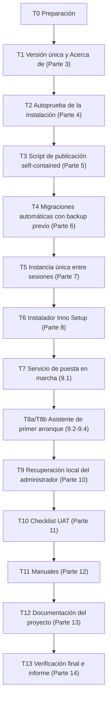

# Plan de implementación F9 — Empaquetado, instalador y puesta en marcha

**Autor:** revisión senior (2026-10-03)
**Ejecutor:** un **orquestador** en Google Antigravity (agente principal, Gemini Flash con razonamiento High) que delega cada tarea en **subagentes** (implementador y escritor de tests en `flash`, revisor de solo lectura en `pro`). Ver **E.6** antes que nada. Sin subagentes, el mismo plan se ejecuta secuencialmente con E.1–E.5.
**Punto de partida:** F8 **commiteado** (`12d5fbc feat(F8): utilitarios de backup, restauracion, importacion y logs`, rama `feat/f8-utilitarios`). Build Release con 0 warnings; **1425 tests en verde** según la bitácora de F8 (mídelo tú mismo en T0 y anota el número real).
**HUs:** HU-F9-01 … HU-F9-06 (ver `Agents.md §3`).

> **Aviso al usuario antes de entregar este plan.** Al escribirlo (2026-10-03) el árbol **no** está limpio: hay 17 archivos modificados que solo quitan el BOM de la primera línea (`Directory.Packages.props`, `PesajeFaeneo.Infrastructure.csproj`, 9 archivos de `Utilitarios/Importacion` y 6 tests). T0 se detiene con el árbol sucio. Haz tú un commit (por ejemplo `chore(F8): quitar BOM`) o descártalos antes de empezar. Además: en esta PC **no** está instalado Inno Setup (T6 lo necesita) y el único SDK es el **.NET 10.0.301** (compila `net8.0` sin problema, pero la publicación self-contained descarga los paquetes de runtime de .NET 8 desde nuget.org: hace falta red en T3).

**Cómo leer este documento:**
- La **Parte E** dice *qué* tarea hacer, *en qué orden*, *qué archivos* puedes tocar, *cómo* se comprueba cada tarea y, en **E.6**, *quién* la hace. Síguela al pie de la letra.
- Las **Partes 0–14** son la *especificación*. Cada tarea de la Parte E apunta a una o más Partes.
- La **Parte 15** es la revisión del plan: huecos detectados, cómo se cubren, riesgos abiertos y preguntas al usuario. **Léela entera antes de escribir código.** Muchas reglas existen por lo que se explica allí (se citan como "ver R*n*").

Este documento es **la especificación**. Si algo no está aquí, se aplican las convenciones de `Agents.md §4` y, como plantilla de código, lo que ya hacen F2–F8 (`ServicioParametros`, `SqliteBackupService`, `AplicadorRestauracion`, `FrmBackupRestaurar`, `FrmPrincipal`, `ContextoAplicacion`, `Program` y sus tests). Si algo contradice `Agents.md`, manda este documento y la diferencia se anota en el informe final.

---

## Mapa HU → Partes

| HU | Título | Partes | Tareas |
|---|---|---|---|
| HU-F9-01 | Publicación self-contained y versionado | 3 (versión única y "Acerca de"), 4 (autoprueba de la instalación), 5 (script de publicación) | T1, T2, T3 |
| HU-F9-02 | Migraciones automáticas al iniciar con backup previo | 6 | T4 |
| HU-F9-03 | Instalador Inno Setup | 7 (instancia única entre sesiones), 8 (script `.iss` y script de construcción) | T5, T6 |
| HU-F9-04 | Asistente de primer arranque | 9 (servicio y asistente), 10 (recuperación local del administrador, nota pendiente de F1) | T7, T8a, T8b, T9 |
| HU-F9-05 | Checklist de aceptación en sitio (UAT) | 11 | T10 |
| HU-F9-06 | Manual de usuario y guía de balanza | 12 | T11 |
| — | Documentación del proyecto y cierre | 13, 14 | T12, T13 |

**F9 no tiene migraciones de base de datos.** Lo que necesita ya está en el esquema: `ParametrosSistema.ConfiguracionInicialCompleta` existe desde la migración `Inicial` (sembrada en `false`), `Auditorias.Accion` no tiene CHECK (se agrega un valor al enum sin migración, como F8) y `TipoBackup` vive en Application (no se persiste en la base). La carpeta `src/PesajeFaeneo.Infrastructure/Persistencia/Migraciones` no se toca (E.4 lo comprueba). Si crees que necesitas una migración, **detente** y repórtalo.

**F9 no agrega paquetes NuGet.** Ni uno. Inno Setup es una herramienta externa que instala el usuario (H7), no un paquete.

**Qué entrega F9 al final (para que el ejecutor sepa a dónde va):**
1. `scripts/publicar.ps1` → `artifacts/publish/win-x64/` (aplicación autocontenida que corre en un Windows 10/11 x64 sin .NET instalado), verificada con `PesajeFaeneo.WinForms.exe --autoprueba`.
2. `scripts/construir-instalador.ps1` + `instalador/PesajeFaeneo.iss` → `artifacts/instalador/PesajeFaeneo-Setup-<versión>-x64.exe`.
3. Al arrancar una versión nueva sobre datos viejos: copia `PesajeFaeneo_premigracion_….zip` y migración automática; si la base es de una versión **más nueva**, no se toca.
4. Asistente de puesta en marcha para el Administrador mientras `ConfiguracionInicialCompleta = false`.
5. `PesajeFaeneo.WinForms.exe --restablecer-admin` (solo como administrador de Windows) para recuperar el acceso.
6. `docs/puesta-en-marcha/checklist-uat.md`, `docs/puesta-en-marcha/acta-aceptacion.md`, `docs/manual/manual-usuario.md`, `docs/manual/guia-balanza.md`, `docs/manual/guia-instalacion-soporte.md`, `CHANGELOG.md`.

---

## Parte E — Ejecución

### E.1 Por qué el plan es tan explícito

El ejecutor es un agente de menor capacidad. Los fallos típicos que este plan neutraliza:

| Fallo típico | Cómo lo neutraliza el plan |
|---|---|
| Poner `<RuntimeIdentifier>`/`<SelfContained>` en el `.csproj` de WinForms "para publicar". | El proyecto de tests referencia a `PesajeFaeneo.WinForms`: un ejecutable self-contained referenciado por un proyecto que no lo es rompe la compilación de la suite (H2). La publicación se configura **solo** en la línea de comandos de `scripts/publicar.ps1` (D3). |
| Publicar con `--no-restore` después de `dotnet restore` de la solución. | La restauración sin `-r win-x64` no baja los paquetes de runtime: el `publish` falla (H1). El script restaura dentro del propio `publish`. |
| Escribir scripts `.ps1` o `.iss` con tildes y ñ en UTF-8 sin BOM. | Windows PowerShell 5.1 e Inno Setup leen esos archivos como ANSI: los textos salen corruptos o el script no parsea (H9). Regla 0.19: **ASCII puro** en `.ps1` e `.iss`. |
| `icacls … /grant Users:…` | En un Windows en español el grupo se llama "Usuarios": el comando falla (H8). Se usa el SID `*S-1-5-32-545`. |
| Abrir la aplicación al terminar el instalador "tal cual". | El instalador corre elevado: la aplicación también, y crearía la base y los logs como administrador. `runasoriginaluser` (D11). |
| `MessageBox` en el modo `--autoprueba`. | El script de publicación espera al proceso; un diálogo lo cuelga para siempre. Regla 0.20. |
| Migrar sin mirar qué hay en la base. | Una base de una versión **más nueva** (alguien reinstaló una versión vieja) se abriría con un modelo que no la entiende; EF no avisa (H10). D7: se detecta y no se toca. |
| Hacer la copia previa a migrar también en una instalación nueva. | No hay base todavía: abrirla en solo lectura falla. D6: solo hay copia si había migraciones aplicadas **y** hay pendientes. |
| `Start-Process … -ArgumentList '--autoprueba', $carpeta` con una ruta con espacios. | PowerShell 5.1 **no** pone comillas a los elementos del arreglo: la ruta `C:\Users\Gary Ronald\…` llega partida (H12). Se pasa una sola cadena con las comillas escritas. |
| Una ruta que termina en `\` dentro de comillas para ISCC. | `"C:\x\"` escapa la comilla de cierre (H12). Las rutas se pasan sin barra final. |
| Modificar `FrmPrincipal`/`ContextoAplicacion` y romper el inicio de sesión si el servicio nuevo falla. | 9.3: la decisión de mostrar el asistente va en `try/catch` y ante cualquier error **no** lo muestra (el login nunca se bloquea). |
| Llamar a `EjecutarAsync` dentro de otro `EjecutarAsync` en el asistente. | Regla 0.10 y 9.2: los formularios hijos se abren **fuera** de `EjecutarAsync`; la recarga del estado va después. |
| Inventar en los manuales funciones que no existen. | Parte 12: cada afirmación sale de `README.md`, `Agents.md` o del código; lista cerrada de secciones y fuentes; T13 revisa una muestra contra el código. |
| Probar el instalador en la PC de desarrollo. | Cambiaría permisos y registraría una desinstalación en la PC del usuario. Regla 0.21: **ningún agente ejecuta el instalador**; la prueba de punta a punta del instalador la hace el usuario (14.3) en otra PC. |

### E.2 Orden de tareas

Ejecuta **una tarea a la vez, en este orden**. No empieces la siguiente hasta que la compuerta de la actual esté en verde y la tarea esté commiteada (E.5).



Orden lineal: **T0, T1, T2, T3, T4, T5, T6, T7, T8a, T8b, T9, T10, T11, T12, T13.**

**T3 y T6 dependen del entorno.** Si en T3 no hay red (no se pueden bajar los paquetes de runtime) o en T6 no está Inno Setup 6.3+ (H7), es una **parada autorizada** (regla 0.1) **solo para esa tarea**: el ORQ deja escritos y commiteados los scripts (con sus comprobaciones estáticas de E.3), anota "no ejecutado: <motivo>" en la bitácora y **sigue con la tarea siguiente**. En el informe final queda como pendiente para el usuario.

### E.3 Ficha de cada tarea

Rutas relativas a la raíz del repositorio. `App` = `src/PesajeFaeneo.Application`, `Infra` = `src/PesajeFaeneo.Infrastructure`, `WF` = `src/PesajeFaeneo.WinForms`, `Dom` = `src/PesajeFaeneo.Domain`, `Tests` = `tests/PesajeFaeneo.Tests`. "Nuevo" = archivo a crear. **Siempre `--include=*.cs`** en los `grep -r` sobre `src/` (sin él aparecen `obj/` y `bin/`).

| Tarea | Especificación | Archivos permitidos (lista blanca) | Comprobaciones automáticas propias (además de E.4) |
|---|---|---|---|
| **T0** | E.5 | — (solo git y `.agents/`, excluida de git) | `git status` limpio; `git log -1 --format=%s` empieza por `feat(F8)`; línea base de tests anotada; resultado de las comprobaciones de entorno de E.5-1. |
| **T1** | Parte 3 | Modificados: `Directory.Build.props` (**solo** las propiedades de 3.1), `Infra/Utilitarios/Backup/SqliteBackupService.cs` (**solo** la línea `VersionAplicacion`), `WF/Program.cs` (**solo** la línea del log de inicio), `WF/Formularios/FrmPrincipal.cs`, `Tests/FrmPrincipalTests.cs` (solo agregar), `Tests/LayoutFormulariosTests.cs` (solo agregar). Nuevos: `Infra/Common/InfoVersion.cs`, `WF/Formularios/Ayuda/FrmAcercaDe.cs`, `Tests/InfoVersionTests.cs`, `Tests/FrmAcercaDeTests.cs` | `grep -rn --include=*.cs "GetName().Version" src` → **solo** `InfoVersion.cs` y `ActualizadorBaseDatos.cs` (este último aún no existe en T1: solo `InfoVersion.cs`); `git diff --cached -U0 -- Directory.Build.props \| grep "^+[^+]"` muestra solo las líneas de 3.1. |
| **T2** | Parte 4 | Nuevos: `Infra/Instalacion/AutopruebaInstalacion.cs`, `Tests/AutopruebaInstalacionTests.cs`. Modificados: `WF/Program.cs` | `grep -n "MessageBox" src/PesajeFaeneo.WinForms/Program.cs` → ninguna aparición dentro de `EjecutarAutoprueba` (revisión manual); `grep -rn --include=*.cs "CommonApplicationData\|ProgramData" src/PesajeFaeneo.Infrastructure/Instalacion` → **solo** líneas dentro de `CarpetaValida` (que la usa para **rechazarla**, 4.2). |
| **T3** | Parte 5 | Nuevo: `scripts/publicar.ps1` | ASCII puro: `grep -nP '[^\x00-\x7F]' scripts/*.ps1` vacío; `powershell -NoProfile -Command "$null = [scriptblock]::Create((Get-Content -Raw scripts/publicar.ps1))"` sin error (parsea en 5.1); **ejecución real** `powershell -NoProfile -ExecutionPolicy Bypass -File scripts/publicar.ps1` → código 0 y la salida muestra cada paso de la autoprueba en `OK` (si no hay red: parada de E.2). `git status --porcelain` no muestra nada de `artifacts/` (está en `.gitignore`). |
| **T4** | Parte 6 | Modificados: `Dom/Enums/Enums.cs` (**solo** agregar `ActualizacionSistema = 17`), `App/Utilitarios/Backup/Dtos/BackupDtos.cs` (**solo** agregar `PreMigracion = 5`), `App/Utilitarios/Backup/ReglasBackup.cs`, `Infra/Utilitarios/Backup/SqliteBackupService.cs`, `App/Abstracciones/IDatabaseInitializer.cs`, `Infra/Persistencia/DatabaseInitializer.cs`, `App/DependencyInjection.cs`, `WF/Program.cs`, `Tests/ReglasBackupTests.cs` (solo agregar), `Tests/DatabaseInitializerTests.cs` (solo agregar), `Tests/ContenedorDITests.cs` (solo agregar) y **cualquier doble de prueba existente que implemente `IDatabaseInitializer`** (solo agregar el método nuevo). Si `grep -rn --include=*.cs "TipoBackup\." src` muestra otro `switch` sobre `TipoBackup` sin rama para el valor nuevo (por ejemplo en `FrmBackupRestaurar.cs`), ese archivo también (solo esa rama). Nuevos: `App/Arranque/IActualizadorBaseDatos.cs`, `App/Arranque/ActualizadorBaseDatos.cs`, `App/Arranque/ArranqueBaseDatosException.cs`, `App/Arranque/Dtos/ArranqueDtos.cs`, `Tests/ActualizadorBaseDatosTests.cs`, `Tests/MigracionAutomaticaIntegracionTests.cs` | `git diff --cached -U0 -- src/PesajeFaeneo.Domain \| grep "^+[^+]"` → solo `ActualizacionSistema = 17`; `grep -rn --include=*.cs "Microsoft.EntityFrameworkCore\|Microsoft.Data.Sqlite" src/PesajeFaeneo.Application/Arranque` vacío; `grep -rn --include=*.cs "MigrateAsync" src` → **solo** `DatabaseInitializer.cs` y `SqliteBackupService.cs` (la migración de prueba de F8). |
| **T5** | Parte 7 | Modificados: `WF/Infraestructura/InstanciaUnica.cs`, `WF/Program.cs` (**solo** el texto del aviso de instancia en ejecución), `Tests/InstanciaUnicaTests.cs` (solo agregar) | `grep -n "UnauthorizedAccessException" src/PesajeFaeneo.WinForms/Infraestructura/InstanciaUnica.cs` no vacío. |
| **T6** | Parte 8 | Nuevos: `instalador/PesajeFaeneo.iss`, `instalador/LICENCIAS-TERCEROS.txt`, `scripts/construir-instalador.ps1` | ASCII puro en los tres (`grep -nP '[^\x00-\x7F]'` vacío); `grep -c "S-1-5-32-545" instalador/PesajeFaeneo.iss` = 1; `grep -n "AppId={{0157C544-528F-4307-A487-5208BF10696F}" instalador/PesajeFaeneo.iss` no vacío; `grep -n "runasoriginaluser" instalador/PesajeFaeneo.iss` no vacío; el script parsea en 5.1 (mismo comando que T3); **compilación real** `powershell -NoProfile -ExecutionPolicy Bypass -File scripts/construir-instalador.ps1` → código 0 y existe `artifacts/instalador/PesajeFaeneo-Setup-<versión>-x64.exe` (si no hay Inno Setup: parada de E.2). **Nunca** ejecutar el `.exe` resultante (regla 0.21). |
| **T7** | 9.1 | Nuevos: `App/PuestaEnMarcha/IServicioPuestaEnMarcha.cs`, `App/PuestaEnMarcha/ServicioPuestaEnMarcha.cs`, `App/PuestaEnMarcha/ReglasPuestaEnMarcha.cs`, `App/PuestaEnMarcha/Dtos/PuestaEnMarchaDtos.cs`, `Tests/ServicioPuestaEnMarchaTests.cs`. Modificados: `App/DependencyInjection.cs`, `Tests/ContenedorDITests.cs` (solo agregar) | `grep -n "ExigirPermiso" src/PesajeFaeneo.Application/PuestaEnMarcha/ServicioPuestaEnMarcha.cs` → una aparición por método público. |
| **T8a** | 9.2, 9.3 (implementación) | Nuevo: `WF/Formularios/PuestaEnMarcha/FrmAsistentePuestaEnMarcha.cs`. Modificados: `WF/Infraestructura/ContextoAplicacion.cs`, `WF/Formularios/FrmPrincipal.cs` | En los archivos tocados: `grep -n "\.Result\|\.Wait()\|GetAwaiter().GetResult()"` vacío; revisión manual: ningún `ShowDialog`/`MessageBox` dentro de un delegado de `EjecutarAsync`/`Ejecutar` del asistente salvo dentro de su método envoltorio con gancho; ningún `EjecutarAsync(` anidado. |
| **T8b** | 9.4 (tests) | Nuevos: `Tests/FrmAsistentePuestaEnMarchaTests.cs`, `Tests/Utilidades/PuestaEnMarcha/ServicioPuestaEnMarchaFalso.cs`, `Tests/ContextoAplicacionTests.cs`. Modificados: `Tests/LayoutFormulariosTests.cs` (solo agregar), `Tests/FrmPrincipalTests.cs` (solo agregar) | Tres corridas seguidas de la suite. |
| **T9** | Parte 10 | Nuevos: `App/Seguridad/IServicioRecuperacionAdministrador.cs`, `App/Seguridad/ServicioRecuperacionAdministrador.cs`, `App/Seguridad/GeneradorPasswordTemporal.cs`, `Tests/ServicioRecuperacionAdministradorTests.cs`, `Tests/GeneradorPasswordTemporalTests.cs`. Modificados: `App/DependencyInjection.cs`, `WF/Program.cs`, `Tests/ContenedorDITests.cs` (solo agregar) | `grep -rn --include=*.cs "passwordTemporal\|PasswordTemporal" src \| grep -i "log"` vacío (la contraseña nunca va al log); `grep -n "Random\b\|new Random" src/PesajeFaeneo.Application/Seguridad/GeneradorPasswordTemporal.cs` vacío (solo `RandomNumberGenerator`). |
| **T10** | Parte 11 | Nuevos: `docs/puesta-en-marcha/checklist-uat.md`, `docs/puesta-en-marcha/acta-aceptacion.md` | Cada caso de 11.2 aparece con su ID exacto (`grep -c "^| UAT-" docs/puesta-en-marcha/checklist-uat.md` ≥ número de casos de 11.2). |
| **T11** | Parte 12 | Nuevos: `docs/manual/manual-usuario.md`, `docs/manual/guia-balanza.md`, `docs/manual/guia-instalacion-soporte.md` | Las secciones obligatorias de 12.2–12.4 existen con su título exacto (grep de cada título); ninguna mención de funciones inexistentes (revisión de REV contra la lista de 12.1). |
| **T12** | Parte 13 | `Agents.md`, `README.md`, nuevo `CHANGELOG.md` | Las cifras de tests salen de la bitácora (no inventadas). |
| **T13** | Parte 14 | — (solo verificación; correcciones como tareas `T13.n` con su propia lista blanca, declarada en la bitácora antes de tocar nada) | Todo E.4 sobre el árbol final + 14.1 (tres corridas) + 14.2 (publicación y autoprueba reales). |

**Verificación de la lista blanca** (al terminar cada tarea, **antes** del `git add`):
```bash
git status --porcelain
```
Cualquier archivo fuera de la lista = la tarea no está terminada: revierte ese archivo (`git checkout -- <archivo>` o bórralo si es nuevo) y rehaz lo necesario dentro de la lista. Si de verdad necesitas tocar otro archivo, anótalo en la bitácora como **desviación** con el motivo, y solo si es imprescindible para compilar.

### E.4 Compuerta de calidad (después de cada tarea, sin excepción)

Comandos de **Git Bash** (herramienta Bash), no de PowerShell:
```bash
dotnet build src/PesajeFaeneo.sln -c Release
```
```bash
dotnet test src/PesajeFaeneo.sln -c Release
```
```bash
# Finales de línea: debe salir vacío (después de git add)
git add -A && git diff --cached --name-only --diff-filter=AM | xargs -r git ls-files --eol | grep "w/lf"
# Nada de trampas: debe salir vacío
git diff --cached -U0 | grep -E "^\+.*(#pragma warning disable|Skip *=|NoWarn|TreatWarningsAsErrors|PackageReference|PackageVersion|RuntimeIdentifier|SelfContained|Thread\.Sleep|Task\.Delay\(|SuppressMessage)"
# Migraciones: F9 no tiene ninguna; debe salir vacío en TODAS las tareas
git diff --cached --name-only <SHA_F8> -- src/PesajeFaeneo.Infrastructure/Persistencia/Migraciones
# .csproj: F9 no toca ninguno; debe salir vacío en TODAS las tareas
git diff --cached --name-only <SHA_F8> -- '*.csproj' Directory.Packages.props
```
- La regla de "trampas" **no** se aplica a `scripts/*.ps1` (allí `-r win-x64 --self-contained` es la especificación de la Parte 5): el ORQ revisa a mano que las coincidencias de esa línea estén solo en `scripts/publicar.ps1`.
- 0 warnings (`TreatWarningsAsErrors=true`), 0 errores, todos los tests en verde. **No avances con rojo.**
- El número de tests **nunca baja** respecto de la tarea anterior.
- Si un test **existente** falla por un cambio de esta fase, corrige los **datos o dobles del test**, nunca la regla nueva, y anótalo. Los únicos tests existentes que este plan autoriza a modificar son los marcados "(solo agregar)" en E.3 y los dobles que implementan `IDatabaseInitializer` (T4).
- Al cerrar T4, T8b y T13 ejecuta la suite **tres veces seguidas**. Un test que falla 1 de 3 veces es un test roto: corrígelo, no lo reintentes hasta que pase.
- Los tests que crean archivos lo hacen **solo** en un directorio temporal propio (`Path.GetTempPath()` + GUID), borrado en `DisposeAsync`/`finally`. **Ningún** test toca `C:\ProgramData\PesajeFaeneo`, ejecuta `dotnet publish`, `ISCC` ni el instalador.

### E.5 Protocolo de git y bitácora

1. **T0:**
   - `git status` debe estar **limpio** y `git log -1 --format=%s` debe ser el commit de F8 (`feat(F8): …`). Si hay cambios sin commitear o HEAD es otro commit, **detente y repórtalo al usuario**: no commitees nada por tu cuenta ni mezcles fases (ver el aviso del encabezado).
   - Anota `<SHA_F8> = git rev-parse HEAD` en la bitácora (al escribir este plan: `12d5fbc…`).
   - `git switch -c feat/f9-empaquetado`.
   - Ejecuta la compuerta y anota el número de tests de partida (debe ser 1425; si es otro, anótalo y sigue).
   - **Comprobaciones de entorno** (anota el resultado literal; ninguna detiene T0):
     ```powershell
     dotnet --list-sdks
     $iscc = @("${env:ProgramFiles(x86)}\Inno Setup 6\ISCC.exe", "$env:ProgramFiles\Inno Setup 6\ISCC.exe", "$env:LOCALAPPDATA\Programs\Inno Setup 6\ISCC.exe") | Where-Object { Test-Path $_ } | Select-Object -First 1
     if ($iscc) { (Get-Item $iscc).VersionInfo.ProductVersion } else { "ISCC no encontrado" }
     Test-NetConnection api.nuget.org -Port 443 -InformationLevel Quiet
     ```
     Si falta ISCC, **avisa ya** en la bitácora y en el informe: el usuario puede instalarlo mientras avanzas (`winget install --id JRSoftware.InnoSetup -e`); **no** lo instales tú (regla 0.21).
2. **Por cada tarea:** implementa → compuerta E.4 → comprobaciones propias de E.3 → `git status --porcelain` contra la lista blanca → `git add -A && git commit -m "wip(F9-Tn): <título>"`.
3. **Nunca** `push`, `merge`, `rebase`, `reset --hard` ni `checkout` de otras ramas. No commitees la bitácora. Con subagentes, **solo el ORQ** ejecuta git de escritura y escribe la bitácora (E.6.8).
4. **Al terminar T13:** anota el SHA del último commit en la bitácora y en el informe, y ejecuta `git reset --soft <SHA_F8>`: todo F9 queda como cambios preparados sin commit, igual que en fases anteriores, para que el usuario lo revise y haga un único commit `feat(F9): empaquetado, instalador y puesta en marcha`. (Si algo sale mal, `git reset --soft <SHA anotado>` recupera el historial.)
5. **Bitácora** (`../pesalab-f9-bitacora.md`, **fuera** del repositorio para que `git add -A` no la incluya): por tarea, tests antes → después, salida literal de las 3 últimas líneas de `dotnet test`, desviaciones y decisiones tomadas ante ambigüedades. T12 la usa como fuente de cifras.

### E.6 Ejecución orquestada en Antigravity (orquestador + subagentes)

Esta sección la lee y la ejecuta **el orquestador (ORQ)**: el agente principal de Antigravity al que el usuario le entrega este plan. Los subagentes **no** leen el plan completo: reciben un *brief* (E.6.6) con solo lo que necesitan. Todo lo de E.1–E.5 sigue vigente; aquí se dice **quién** hace cada cosa. Si Antigravity no permitiera subagentes en tu instalación, ejecuta T0…T13 tú mismo, secuencialmente, con E.1–E.5.

#### E.6.1 Hechos de Antigravity en los que se apoya esta sección

Los mismos que funcionaron en F7 y F8 (`antigravity.google/docs/subagents/` y `antigravity.google/docs/hooks/`). **Si tu versión difiere, manda lo que veas en tu instalación** y anótalo en la bitácora.

| # | Hecho | Consecuencia |
|---|---|---|
| A1 | El agente principal lanza subagentes con `invoke_subagent`; al terminar envían un mensaje de resultado al padre. | ORQ = agente principal. Los subagentes **no** lanzan otros subagentes (lo prohíbe el brief). |
| A2 | Subagentes propios: Markdown con frontmatter YAML en `.agents/agents/<nombre>.md`. Campos: `name`, `description` (obligatorios), `tools`, `model` (`inherit`, `flash`, `pro`), `commandExecutionPolicy` (`off`, `auto`, `eager`, `sandbox`), `mainAgent`, `subagent`. | E.6.3 trae los archivos listos para copiar. |
| A3 | **Problema conocido:** un nombre de herramienta mal escrito en `tools` puede **colgar** al subagente. Nombres documentados: `view_file`, `grep_search`, `replace_file_content`, `write_to_file`, `run_command`. | E.6.3 usa **solo** esos cinco. T0 comprueba que existen antes de crear los agentes. |
| A4 | Espacio de trabajo del subagente: `inherit`, `branch` (worktree aislado, **se borra al terminar**) o `share`. | F9 trabaja **secuencialmente en `inherit`**. |
| A5 | Hooks en `.agents/hooks.json`; evento `PreToolUse` con `matcher` por nombre de herramienta; el comando recibe JSON por stdin y responde `{"decision":"allow"}` o `{"decision":"deny", "reason":"…"}`. No está documentado si alcanzan a los subagentes. | E.6.3: hook de guardia como defensa en profundidad. |

#### E.6.2 Perfiles

| Perfil | Agente de Antigravity | Modelo | Herramientas | Uso |
|---|---|---|---|---|
| **ORQ** — orquestador | Agente principal | **Gemini Flash**, razonamiento **High** | Todas | Único dueño de git, de la bitácora, de las compuertas, de las ejecuciones reales de T3/T6/T13 y del informe final. Arma los briefs, lanza subagentes, verifica, integra. **No implementa** tareas (solo corrige trivialidades de integración: un `using`, un registro de DI, CRLF). |
| **IMP** — implementador | `f9-implementador` | `flash` | `view_file`, `grep_search`, `replace_file_content`, `write_to_file`, `run_command` | Implementa una tarea dentro de su lista blanca y ejecuta la compuerta. Sin git de escritura. También escribe los documentos de T10–T12. |
| **TST** — escritor de tests | `f9-tests` | `flash` | Las mismas que IMP | Escribe tests **desde la especificación**, sin modificar código de producción (T8b). Instancia distinta de la que implementó. |
| **REV** — revisor | `f9-revisor` | `pro` | **Solo** `view_file`, `grep_search` | Revisa el diff de cada tarea contra su especificación (E.6.7) y hace la revisión final (T13). |
| **EXP** — explorador | `research` (incorporado) | el suyo | el suyo | Consultas baratas del ORQ. Nunca escribe. |

#### E.6.3 Preparación en T0 (el ORQ crea estos archivos; **no** se commitean)

1. Excluir de git la carpeta de Antigravity, **sin** tocar `.gitignore`:
   ```bash
   mkdir -p .agents/agents .agents/hooks && (grep -qxF ".agents/" .git/info/exclude || echo ".agents/" >> .git/info/exclude)
   ```
   Comprueba que `git status --porcelain` sigue vacío tras crear los archivos de abajo.
2. Verifica que `view_file`, `grep_search`, `replace_file_content`, `write_to_file` y `run_command` existen **con ese nombre** en tu lista de herramientas. Si alguno se llama distinto, usa el nombre real en los tres archivos y anótalo.
3. `.agents/agents/f9-implementador.md`:
   ```markdown
   ---
   name: f9-implementador
   description: Implementa UNA tarea del plan F9 (docs/plans/F9-empaquetado-instalador.md) a partir del brief que recibe, solo dentro de su lista blanca de archivos, y ejecuta la compuerta de build y tests. No hace commits.
   tools:
     - view_file
     - grep_search
     - replace_file_content
     - write_to_file
     - run_command
   model: flash
   commandExecutionPolicy: sandbox
   mainAgent: false
   subagent: true
   ---
   Eres un implementador. Trabajas SOLO en la tarea del brief y SOLO en los archivos de su lista blanca.
   - No preguntes: si algo es ambiguo, elige la opción más conservadora compatible con la especificación y anótala en DESVIACIONES.
   - Nunca: git commit, push, merge, rebase, reset, checkout de ramas, stash, clean; dotnet ef; dotnet add package; editar .csproj/.props (salvo Directory.Build.props en T1, exactamente lo del brief); #pragma warning disable; Skip en tests; borrar tests.
   - Nunca ejecutes un instalador, ISCC ni winget. Nunca toques C:\ProgramData\PesajeFaeneo.
   - No lances subagentes.
   - Antes de usar una API de librería que no esté en los hechos verificados del brief, confirma su firma con Context7 o learn.microsoft.com y compílala.
   - Los archivos .ps1 e .iss se escriben en ASCII puro (sin tildes ni ñ). El resto: CRLF y UTF-8 sin BOM.
   - Tu última respuesta es SOLO el reporte con el formato del brief.
   ```
4. `.agents/agents/f9-tests.md`: igual que el anterior, con `name: f9-tests`, `description: Escribe los tests de una tarea del plan F9 a partir de la especificación del brief, sin modificar código de producción.` y agrega: "No modifiques ningún archivo bajo `src/`. Puedes LEER el código de producción para conocer los nombres de los ganchos `internal`, pero el comportamiento esperado sale de la especificación, no de la implementación. Si un test revela un defecto o falta un gancho, NO lo arregles: descríbelo en BLOQUEOS."
5. `.agents/agents/f9-revisor.md`:
   ```markdown
   ---
   name: f9-revisor
   description: Revisa en solo lectura el diff de una tarea del plan F9 contra su especificación y devuelve hallazgos con formato fijo.
   tools:
     - view_file
     - grep_search
   model: pro
   commandExecutionPolicy: off
   mainAgent: false
   subagent: true
   ---
   Eres un revisor de solo lectura. No escribes archivos ni ejecutas comandos. Revisa SOLO el diff que recibes contra la especificación y los riesgos del brief. No propongas mejoras de estilo ni refactors. Responde solo con hallazgos en el formato del brief, o exactamente SIN HALLAZGOS.
   ```
6. Hook de guardia `.agents/hooks/guardia-f9.ps1` (Windows PowerShell 5.1; ASCII puro a propósito):
   ```powershell
   $entrada = [Console]::In.ReadToEnd()
   $prohibidos = @(
       'git\s+push', 'git\s+reset\s+--hard', 'git\s+clean\s', 'git\s+rebase', 'git\s+stash',
       'git\s+checkout\s+(?!--)', 'git\s+merge', 'git\s+branch\s+-D',
       'dotnet\s+ef\s+migrations\s+(add|remove)', 'dotnet\s+ef\s+database',
       'dotnet\s+add\s+\S*\s*package', 'winget\s+install', '(Start-Process|Invoke-Item|cmd(\.exe)?\s+/c|&)[^\r\n]*PesajeFaeneo-Setup',
       'rm\s+-rf', 'ProgramData\\\\PesajeFaeneo[^\r\n]*(Remove-Item|del\s|rm\s|icacls)'
   )
   foreach ($p in $prohibidos) {
       if ($entrada -match $p) {
           @{ decision = 'deny'; reason = "Bloqueado por el plan F9 (patron '$p'). Si de verdad hace falta, el ORQ debe registrarlo como desviacion y pedirselo al usuario." } | ConvertTo-Json -Compress
           exit 0
       }
   }
   '{"decision":"allow"}'
   ```
   y `.agents/hooks.json`:
   ```json
   {
     "guardia-f9": {
       "PreToolUse": [
         {
           "matcher": "run_command",
           "hooks": [
             { "type": "command", "command": "powershell -NoProfile -ExecutionPolicy Bypass -File .agents/hooks/guardia-f9.ps1", "timeout": 10 }
           ]
         }
       ]
     }
   }
   ```
   A diferencia de F8, **no** se bloquea `Remove-Item -Recurse` en la línea de comandos (los scripts de T3/T6 limpian `artifacts/`; el hook solo ve el comando, no el contenido del script). El patrón del instalador bloquea **ejecutarlo** (`Start-Process`, `&`, `cmd /c`, `Invoke-Item`), no listarlo ni calcular su hash. **Prueba del hook** (T0): ejecuta `echo "prueba git push"`. Si se deniega, el hook está activo (anótalo). Si se ejecuta, anótalo y sigue.
7. Configuración del proyecto en Antigravity (la hace el **usuario**; el ORQ la verifica): planes y artefactos sin aprobación manual por paso; terminal con permiso para `dotnet`, `git` y `powershell`. Si un subagente con `sandbox` no puede compilar (caché de NuGet o `%TEMP%`), cambia ese campo a `auto` en `f9-implementador.md` y `f9-tests.md` y anótalo. **No** uses `eager`. **Las ejecuciones reales de `scripts/publicar.ps1` (T3, T13) y `scripts/construir-instalador.ps1` (T6) las hace el ORQ**, no un subagente: necesitan red y pueden tardar varios minutos.

#### E.6.4 Mapa de tareas para los briefs

Orden **estrictamente secuencial**, espacio de trabajo `inherit`. **A** = tarea exigente (brief con "Trampas conocidas", E.6.5). Las filas R se copian **literalmente** de la Parte 15; las reglas, de la Parte 0; los hechos, de la Parte 2; las decisiones, de la Parte 1.

| Tarea | Perfil | Especificación (copiar literal) | Decisiones | Filas R | Reglas Parte 0 | Hechos | Archivos de referencia a imitar |
|---|---|---|---|---|---|---|---|
| T1 | IMP | Parte 3 completa | D1, D4 | R14, R15 | 0.4, 0.9, 0.10, 0.11 | H6 | `FrmVisorLogs.cs` (diálogo simple), `FrmPrincipal.cs`, `LayoutFormulariosTests.cs` |
| T2 **A** | IMP | Parte 4 completa | D5 | R9, R10, R11 | 0.4, 0.6, 0.16, 0.20 | H3, H4, H5 | `Program.cs`, `GeneradorPdfReportesTests.cs`, `EntornoArchivosPrueba.cs` |
| T3 **A** | IMP (escribe) + ORQ (ejecuta) | Parte 5 completa | D2, D3, D4 | R1–R4, R12, R13, R16 | 0.19, 0.21 | H1–H5, H9, H12 | `build.ps1` |
| T4 **A** | IMP | Parte 6 completa | D6–D8 | R17–R24 | 0.4, 0.6, 0.12, 0.13, 0.14, 0.16, 0.17 | H10, H11 | `AplicadorRestauracion.cs` (`RegistrarAuditoriaAsync`), `SqliteBackupService.cs`, `MigracionF6Tests.cs`, `EntornoArchivosPrueba.cs`, `ServicioParametros.cs` |
| T5 | IMP | Parte 7 completa | D10 | R25 | 0.4 | H13 | `InstanciaUnica.cs`, `InstanciaUnicaTests.cs` |
| T6 **A** | IMP (escribe) + ORQ (compila) | Parte 8 completa | D9–D12 | R5–R8, R26–R32 | 0.19, 0.21 | H7, H8, H9, H12, H14 | — (el `.iss` está escrito completo en 8.2: cópialo) |
| T7 | IMP | 9.1 completa | D13–D16 | R33, R34 | 0.4, 0.12, 0.13, 0.14 | — | `ServicioParametros.cs`, `ServicioParametrosTests.cs` |
| T8a **A** | IMP | 9.2 y 9.3 | D13–D16 | R35–R39 | 0.9, 0.10, 0.11 | — | `FrmBackupRestaurar.cs` (ganchos), `FrmPrincipal.cs` (`AbrirBackupRestaurar`, `AbrirParametrosAsync`), `ContextoAplicacion.cs` |
| T8b **A** | **TST** | 9.2, 9.3 y 9.4 (tests) + la tabla de ganchos de 9.2 | — | R35–R39 | 0.11 | — | `FrmBackupRestaurarTests.cs`, `FrmPrincipalTests.cs`, `LayoutFormulariosTests.cs` |
| T9 **A** | IMP | Parte 10 completa | D17 | R40–R43 | 0.4, 0.12, 0.14 | H15 | `ServicioUsuarios.cs` (restablecer contraseña), `DataSeeder.cs`, `ServicioUsuariosTests.cs` |
| T10 | IMP | Parte 11 completa | D18 | R44 | 0.4 | — | — |
| T11 **A** | IMP | Parte 12 completa | D18, D19 | R44–R47 | 0.4 | H7, H8, H16 | `README.md`, `Agents.md` §4 y "Notas hacia fases futuras" |
| T12 | IMP | Parte 13 + la **bitácora completa** | — | R48 | 0.4 | — | entrada "Fase F8" de `Agents.md` |
| T13 | **REV** + ORQ | Parte 14 + revisión final de `git diff <SHA_F8>` contra las Partes 3–13 y la Parte 15 | todas | todas | todas | todos | — |

**Lista blanca de las tareas partidas:** T8a = solo los archivos de producción de su fila en E.3 (deben compilar y no romper ningún test existente; todavía no tienen tests propios). T8b = solo los archivos de test de su fila; puede **leer** el formulario, nunca modificarlo. Si un test falla, el ORQ decide **contra la especificación** quién está mal: si es el formulario, abre `T8a.n` (IMP, instancia nueva, brief de `T8a` + el test que falla); si es el test, `T8b.n`.

Ninguna tarea se paraleliza (dos `dotnet build` en `inherit` compiten por los mismos `obj/`). **Excepción permitida:** T10 y T11 son solo documentación; el ORQ **puede** lanzarlas en paralelo entre sí (no compilan), pero commitea cada una por separado.

#### E.6.5 Trampas conocidas (sección extra del brief de las tareas A)

- **T2:** el modo `--autoprueba` se resuelve **antes** del mutex y **antes** de crear `new AppPaths()` sin argumentos: jamás toca `C:\ProgramData`; **ningún** `MessageBox` en ese camino (el script espera al proceso, R10); cada paso en su propio `try/catch` (un paso que falla no impide los demás); el resultado se escribe en `autoprueba.json` aunque haya una excepción inesperada.
- **T3:** **no** pongas `-r`/`--self-contained` en ningún `.csproj` (H2); no uses `--no-restore` (H1); el script es ASCII puro (H9); la carpeta a borrar se valida antes de `Remove-Item` (debe estar dentro de `<repo>\artifacts`); `Start-Process -ArgumentList` recibe **una** cadena con las comillas escritas (H12); `$LASTEXITCODE` se revisa después de cada ejecutable externo.
- **T4:** la copia previa usa `IMotorBackup.CrearAsync` (no copies archivos a mano); si **no** hay migraciones aplicadas no se hace copia (instalación nueva, R18); las migraciones **desconocidas** detienen el arranque **sin** migrar ni copiar (D7); la auditoría se registra **después** de `SembrarAsync` y nunca impide arrancar; `ArranqueBaseDatosException` sí impide arrancar (Program la atrapa y sale con código 2, sin el texto "Error fatal"); los tests de integración construyen la base vieja con `IMigrator.MigrateAsync("20260927144821_F4_Pesaje")` sobre un **archivo** temporal (no en memoria: el backup necesita un archivo).
- **T6:** el `.iss` de 8.2 está **completo**: cópialo tal cual y cambia solo lo que 8.2 marca como variable; ASCII puro; `AppId` con **doble** llave de apertura (`{{`); `icacls` con el SID, nunca con nombre de grupo; rutas pasadas a ISCC sin barra final (H12).
- **T8a:** el asistente se abre **antes** del shell, desde `ContextoAplicacion`, y si algo falla al decidir **no** se muestra (el login nunca se bloquea); los formularios hijos se abren con `IFormFactory` fuera de `EjecutarAsync` y después se recarga el estado; si el paso "Copias de seguridad" termina con `ReinicioSolicitado`, el asistente se cierra y la aplicación se reinicia como en `FrmPrincipal.AbrirBackupRestaurar`.
- **T8b:** los dobles devuelven tareas **ya completadas**; ningún test abre un formulario hijo real (gancho `AbrirPasoParaTest`), un `MessageBox` ni un diálogo; `ContextoAplicacion` **no** se instancia en los tests (su constructor muestra el login): se prueba la función pura `DebeMostrarAsistente` (9.3).
- **T9:** la contraseña temporal **nunca** se escribe en el log ni en la auditoría; el servicio no exige sesión (lo invoca `Program` con el proceso elevado) y lo dice en un comentario; si `admin` no existe se crea dentro de una transacción explícita (`ITransaccion`) para auditar con su `Id` real; los argumentos nuevos se quitan de `argsHost` (H17 de F8).
- **T11:** cada afirmación del manual sale de una fuente de 12.1; si dudas de que algo exista, búscalo en el código y, si no lo encuentras, **no** lo escribas (anótalo en DESVIACIONES).

#### E.6.6 Plantilla del brief

El ORQ arma un brief por tarea con **exactamente** estas secciones, en este orden, **sin resumir** la especificación (copiar y pegar del plan):

```text
# Tarea Tn — <título>            Perfil: <IMP|TST|REV> (agente <f9-implementador|f9-tests|f9-revisor>)
## Directorio de trabajo
<ruta absoluta del repositorio>   (espacio de trabajo: inherit)
## Objetivo (2–3 líneas)
## Especificación
<Partes de E.6.4 copiadas LITERALMENTE, con sus tablas, bloques de código y tests>
## Decisiones y hechos que aplican
<filas D y H de E.6.4, copiadas literalmente>
## Riesgos que debes evitar
<filas R de E.6.4, copiadas literalmente>
## Trampas conocidas            (solo tareas A, de E.6.5)
## Reglas obligatorias (no negociables)
- Solo puedes crear o modificar estos archivos: <lista blanca de E.3>. Si necesitas tocar otro, DETENTE y explícalo en BLOQUEOS.
- No preguntes. Si algo es ambiguo, elige la opción más conservadora compatible con la especificación y anótala en DESVIACIONES.
- No ejecutes git commit, push, merge, rebase, reset, stash, clean ni checkout de ramas. No ejecutes dotnet ef. No lances subagentes.
- No agregues paquetes NuGet ni cambies .csproj/.props (salvo T1: Directory.Build.props, exactamente 3.1). No desactives warnings, tests ni analizadores.
- Nunca ejecutes un instalador, ISCC ni winget. Ningún test toca C:\ProgramData\PesajeFaeneo.
- <reglas de la Parte 0 indicadas en E.6.4, copiadas literalmente>
## Archivos de referencia (léelos antes de escribir; imita su estilo)
<columna de E.6.4>
## Criterios de aceptación (ejecútalos tú y pega la salida real)
dotnet build src/PesajeFaeneo.sln -c Release       → 0 warnings, 0 errores
dotnet test src/PesajeFaeneo.sln -c Release        → N tests (≥ <número actual>), 0 fallos
<comprobaciones automáticas propias de la tarea (columna de E.3), salvo las ejecuciones reales que hace el ORQ>
Convierte a CRLF los archivos que creaste o tocaste.
## Formato de reporte (tu última respuesta, nada más)
ARCHIVOS: <lista con A=agregado, M=modificado>
TESTS: antes=<n> después=<n> fallos=<n>   (pega las 3 últimas líneas de dotnet test)
BUILD: warnings=<n> errores=<n>
COMPROBACIONES: <salida de cada comprobación propia>
DESVIACIONES: <lista o "ninguna">
BLOQUEOS: <lista o "ninguno">
```

Solo en el brief de T1, agrega como primer criterio de aceptación: `echo "prueba git push"` → informa si fue denegado. En T10–T12 (documentación) los criterios de build/test se mantienen (no deben cambiar nada) y se agregan las comprobaciones de E.3.

#### E.6.7 Revisión por REV (después de cada tarea de implementación o de tests)

- **Entrada:** el brief de la tarea + la salida de `git diff` de la tarea, que el ORQ ejecuta y **pega** (REV no tiene terminal) + la ruta del repositorio.
- **Instrucción fija:** "Revisa solo este diff contra la especificación y los riesgos. No propongas mejoras de estilo ni refactors. Para cada problema, da un hallazgo con este formato:"
  ```text
  [SEVERIDAD: BLOQUEANTE|MAYOR|MENOR] archivo:línea
  Regla violada: <D#, H#, R#, Parte x.y o regla 0.n>
  Qué pasa: <1–2 frases>
  Cómo demostrarlo: <test concreto o comando que falla>
  ```
  Si no hay hallazgos, responde exactamente `SIN HALLAZGOS`.
- **En T11 (manuales)** REV recibe además la lista de fuentes de 12.1 y busca, para **cada** función mencionada en el manual, su existencia en el código (`grep_search`). Una función inexistente es MAYOR.
- **Filtro del ORQ (obligatorio):** un hallazgo solo se acepta si el ORQ lo **confirma** (lee el código, ejecuta el comando o escribe el test propuesto y lo ve fallar). Los no confirmados se anotan como "descartado: no reproducible".
- **Corrección:** los BLOQUEANTE y MAYOR confirmados vuelven a una **instancia nueva** del mismo perfil (brief original + hallazgos confirmados). Los MENOR se anotan; se corrigen solo si son de una línea.
- **Límite:** como máximo **2 ciclos** implementar → revisar por tarea. Si en el tercero sigue un BLOQUEANTE confirmado, el ORQ lanza una tarea `Tn.x` de perfil IMP acotada **solo** a ese defecto, y lo anota como desviación.
- **Sin revisión:** T10 y T12 (documentación); el ORQ verifica a mano que las cifras coinciden con la bitácora y que los IDs de 11.2 están todos.

#### E.6.8 Protocolo del ORQ

1. **T0** (sin subagentes): E.5-1 completo; luego E.6.3 completo; anota la versión de Antigravity, el modelo, si el hook está activo y los nombres de herramientas.
2. **Por cada tarea T1…T12, en orden:**
   1. Arma el brief (E.6.6) y lanza el subagente (perfil de E.6.4, `inherit`). Espera su resultado; no lances otro mientras tanto (salvo T10 ‖ T11, E.6.4).
   2. **Re-ejecuta tú** la compuerta E.4, las comprobaciones propias de E.3 (incluidas las ejecuciones reales de T3 y T6) y `git status --porcelain` contra la lista blanca. El reporte del subagente **nunca** cuenta como prueba.
   3. Si algo falla o hay archivos fuera de la lista blanca: tarea **rechazada**; revierte lo que esté fuera y relanza una instancia nueva con el brief original + la salida literal del fallo.
   4. Si pasa: lanza REV (E.6.7), aplica sus correcciones; vuelve a 2.2.
   5. Aprobada: `git add -A && git commit -m "wip(F9-Tn): <título>"`. **Solo el ORQ commitea.**
   6. Anota en la bitácora: perfil, ciclos, hallazgos (confirmados/descartados), tests antes → después, desviaciones, bloqueos.
   7. Si un subagente no devuelve resultado en un tiempo razonable (orientativo: 30 min las tareas normales, 60 min las **A**), detenlo, revisa `git status` (descarta los cambios a medias), comprueba los nombres de `tools` y relánzalo una vez; si se repite, ejecuta tú esa tarea con E.1–E.5 y anótalo.
3. **Paradas:** si un subagente informa en BLOQUEOS una de las paradas autorizadas de la regla 0.1, el ORQ **no** la resuelve por su cuenta: la registra y la incluye en el informe final; si impide seguir, se detiene y lo reporta.
4. **T13:** lanza REV con `git diff <SHA_F8>` completo (en partes: una por capa, otra para `scripts/` + `instalador/`, otra para `docs/`) contra las Partes 3–13 y la Parte 15; filtra y corrige como en E.6.7 (tareas `T13.n`); después el ORQ ejecuta él mismo 14.1 y 14.2 y escribe el informe 14.4.
5. **Qué nunca delega el ORQ:** git, la bitácora, las compuertas, las ejecuciones reales de los scripts, la decisión de aceptar hallazgos, la verificación 14.2, el `reset --soft` final y el informe.
6. Al terminar, el ORQ puede borrar `.agents/` o dejarla (está excluida de git); anota qué hizo. **No** modifiques `.gitignore`.

---

## Parte 0 — Reglas de comportamiento (obligatorias)

1. **No te detengas hasta terminar** (vale para el ORQ y para cada subagente dentro de su tarea). El ORQ responde al usuario **una sola vez**, al final, con el informe de 14.4; los subagentes **no hacen preguntas**. Si algo es ambiguo, elige la opción más conservadora compatible con este plan, anótala como desviación y continúa. Las únicas paradas autorizadas son: T0 (F8 sin commit o árbol sucio), "necesito una migración", "necesito un paquete NuGet", "una API de la Parte 2 no compila con la versión instalada", y las **paradas parciales** de E.2 (T3 sin red, T6 sin Inno Setup), que no detienen el resto del plan.
2. **Git:** lo gobierna E.5.
3. **Compuerta:** E.4 después de cada tarea. Nunca desactives un warning, un test ni un analizador.
4. **Convenciones:** identificadores, comentarios, mensajes de UI y de log en **español**; imita el estilo y la densidad de comentarios del código existente. Código C# y Markdown: CRLF, UTF-8 sin BOM. xUnit solo con `Assert`. Sin librerías de mocks: dobles escritos a mano. `?? throw new ArgumentNullException(nameof(x))` o `ArgumentNullException.ThrowIfNull` en los constructores, como el resto del código.
5. **Capas** (las hace cumplir `ArquitecturaTests`):
   - Domain sin dependencias. **F9 solo agrega un valor a `AccionAuditoria`.**
   - Application sin EF, WinForms, Serilog, Hosting, `System.Drawing`, QuestPDF, ClosedXML, CsvHelper, OleDb, `Microsoft.Data.Sqlite` ni `System.IO.Compression`. Define interfaces, DTOs, reglas puras y servicios que orquestan.
   - Infrastructure sin WinForms y sin `System.Drawing`. QuestPDF/ClosedXML solo en `Infra/Reportes` (la autoprueba los usa **a través de** `IGeneradorPdfReportes`/`IGeneradorExcelReportes`, nunca directamente).
   - WinForms nunca hace `using` de QuestPDF, ClosedXML, CsvHelper, OleDb, `Microsoft.Data.Sqlite` ni `System.IO.Compression`.
   - **No agregues paquetes NuGet ni cambies `.csproj`/`Directory.Packages.props`.** `Directory.Build.props` solo en T1 (3.1).
6. **Tiempo:** siempre `TimeProvider` inyectado. Nada de `DateTime.Now`, `DateTime.UtcNow`, `DateTime.Today` ni `ToLocalTime()` en producción. En tests, `FakeTimeProvider` con zona fija UTC-4 (`TimeZoneInfo.CreateCustomTimeZone("UTC-4", TimeSpan.FromHours(-4), "UTC-4", "UTC-4")`) y ahora = **2026-10-03T14:00Z** (= 10:00 local) salvo que el test diga otra cosa. (La autoprueba usa el `TimeProvider` del contenedor, que es `TimeProvider.System`: es un arranque real.)
7. **Pesos:** si algún código de F9 construye datos de reporte (autoprueba), usa `decimal`.
8. **Cultura:** fechas y números que se muestran → `TextosBoleta.Cultura` (es-BO); en nombres de archivo y JSON → `CultureInfo.InvariantCulture`.
9. **Hilo de UI:** nunca `.Result`, `.Wait()` ni `.GetAwaiter().GetResult()` una vez iniciado el bucle de mensajes (en `Program.Main`, **antes** de `WinFormsApp.Run`, sí se permite, como ya hace el código). Manejadores asíncronos con lambdas `async (_, _) =>` que delegan en `FormBase.EjecutarAsync`.
10. **Regla de reentrada de `FormBase`:** `EjecutarAsync`/`Ejecutar` descartan **en silencio** cualquier invocación mientras otra está en curso. **Nunca** llames a un método que use `EjecutarAsync`/`Ejecutar` desde dentro del delegado de otro **del mismo formulario**. Los diálogos modales (`MessageBox`, formularios hijos con `ShowDialog`) se muestran **fuera** de `EjecutarAsync`: primero se obtiene el dato (dentro), después, fuera, el diálogo; y la recarga posterior en un `EjecutarAsync` nuevo.
11. **Tests de WinForms:** todo test que cree un `Form` corre dentro de `HiloSta.Ejecutar(...)` y desecha lo que crea. Los dobles devuelven **tareas ya completadas**. Si el código espera una tarea no completada, usa `CompletarBombeando` (como `FrmReportesTests`). Nada de `Thread.Sleep` ni `Task.Delay`. **Ningún test puede abrir un `MessageBox`, un formulario hijo real ni un proceso externo**: cada uno tiene su gancho `internal ...ParaTest`. **Ninguna excepción esperable puede llegar a `ManejadorErrores`** (abre un `MessageBox` que cuelga el hilo STA).
12. **Tests de servicios:** con **SQLite real** — en memoria (`BaseDatosEnMemoria`) para lógica de datos, y **en archivo** (`EntornoArchivosPrueba` o un directorio temporal propio con `new AppPaths(dir)`) para todo lo que haga backup o migre un archivo. Sesiones con `SesionesDePrueba.IniciarAsync(db, sesion, Rol.X)`. Datos con los `*Builder` de `Builders/EntityBuilders.cs`.
13. **Seguridad:** permiso exigido en **cada** método público de servicio que corre con sesión (defensa en profundidad), además de ocultar el menú: `GestionarParametros` para la puesta en marcha. Los servicios de arranque (`ActualizadorBaseDatos`, `ServicioRecuperacionAdministrador`, `AutopruebaInstalacion`) corren **sin sesión** porque los invoca `Program`, no un usuario; cada uno lo declara en su comentario `<summary>`.
14. **Logging:** `Information` por cada migración automática (versión de la aplicación, cantidad de migraciones, nombre del archivo de copia), por cada puesta en marcha completada y por cada recuperación de administrador (sin contraseña). **Nunca** contraseñas (ni temporales), hashes, rutas completas elegidas por el usuario ni datos de la tabla `Usuarios` más allá del nombre de usuario.
15. **APIs de librería:** los hechos de la **Parte 2** están verificados; respétalos tal cual. Para cualquier otra API, confirma la firma con Context7 o learn.microsoft.com **y compílala** antes de usarla.
16. **Archivos y SQLite:** todas las rutas de datos salen de `AppPaths` (nunca `C:\ProgramData` escrito a mano en C#). Toda `SqliteConnection` creada a mano usa `Pooling = false` (regla 0.16 de F8). **Prohibido** `File.Copy`/`File.Move`/`File.Delete` sobre `AppPaths.DatabasePath` en código de F9 (la copia previa a migrar la hace `IMotorBackup`).
17. **`ConfigureAwait(false)`** en todo `await` de código de F9 que corre fuera de la UI (Application/Infrastructure): `Program` espera esas tareas de forma síncrona.
18. **Nada de `Process.Start`** en código nuevo de F9, salvo `Program` para el reinicio que ya existe.
19. **Scripts y `.iss` en ASCII puro.** `scripts/*.ps1`, `instalador/*.iss` e `instalador/*.txt` no contienen ningún carácter fuera de ASCII (sin tildes, sin ñ, sin comillas tipográficas, sin "—"). Escribe "configuracion" o reformula. Deben correr en **Windows PowerShell 5.1** (`powershell.exe`): nada de `??`, `?.`, `&&`, `||`, ternarios ni `-Parallel`. CRLF.
20. **Modo `--autoprueba` no interactivo:** ni `MessageBox`, ni formularios, ni `ManejadorErrores`, ni lectura o escritura de `C:\ProgramData\PesajeFaeneo`. Siempre termina con un código de salida y, salvo argumentos inválidos, escribe `autoprueba.json`.
21. **Instalador:** ningún agente ejecuta el instalador generado, `ISCC` fuera de `scripts/construir-instalador.ps1`, `winget` ni `icacls`. Ningún agente modifica permisos de carpetas de la PC. La prueba de instalación la hace el usuario en otra PC (14.3).

---

## Parte 1 — Decisiones de diseño (asumidas; el usuario puede cambiarlas)

Las marcadas **(P*n*)** dependen de una pregunta al usuario de la Parte 15.

| # | Decisión | Valor |
|---|---|---|
| D1 | Versión (HU-F9-01) | **Una sola fuente:** `<Version>` en `Directory.Build.props` (hoy `1.0.0`; la primera entrega es `1.0.0`, **P9**). SemVer `MAYOR.MENOR.PARCHE`: PARCHE = correcciones sin migración; MENOR = funciones nuevas o migraciones; MAYOR = cambios incompatibles con backups anteriores. `AssemblyVersion`/`FileVersion` los deriva el SDK de `Version` (`1.0.0.0`). `InformationalVersion` = `Version` + `+<sha>` (el SDK lo agrega solo dentro de un repositorio git, H6). Se muestra `v1.0.0` en la barra de estado (como hoy) y la versión informativa (sha recortado a 7) en "Ayuda › Acerca de". **Nadie** sube la versión dentro de F9: el procedimiento de release (12.4) dice cuándo y cómo. |
| D2 | Publicación (HU-F9-01) | `dotnet publish` de **solo** `PesajeFaeneo.WinForms.csproj` con `-c Release -r win-x64 --self-contained true`, `PublishSingleFile=false` (carpeta, no un único exe: las librerías nativas de SQLite y QuestPDF deben estar en disco), `PublishTrimmed=false` (WinForms y EF Core no lo soportan), `PublishReadyToRun=false` (menos piezas; evaluar en UAT si el arranque supera 5 s, R16), `SatelliteResourceLanguages=es` (solo recursos en español). Salida: `artifacts/publish/win-x64/` (ignorada por git), borrada antes de publicar. Los `.pdb` se publican (pila con número de línea en los logs de soporte). Solo **x64** (R13): la nota de `Agents.md` sobre `win-x86` de OleDb queda descartada. |
| D3 | Dónde vive la configuración de publicación | **Solo** en `scripts/publicar.ps1` (argumentos de línea de comandos). **Nunca** `RuntimeIdentifier`, `SelfContained` ni `PublishProfile` en un `.csproj` ni en `Directory.Build.props` (H2). |
| D4 | Nombre del ejecutable | Se mantiene `PesajeFaeneo.WinForms.exe` (cambiar `AssemblyName` rompería `InternalsVisibleTo`, `ArquitecturaTests` y rutas conocidas). Los accesos directos se llaman "Sistema de Pesaje para Faeneo". |
| D5 | Autoprueba de la instalación | `PesajeFaeneo.WinForms.exe --autoprueba "<carpeta>"`: corre los pasos de 4.2 sobre una carpeta de datos **temporal y vacía** (nunca `ProgramData`), escribe `<carpeta>\autoprueba.json` y sale con 0 (todo OK), 1 (algún paso falló) o 3 (argumentos inválidos). La usa `scripts/publicar.ps1` y la puede usar soporte en sitio (12.4). |
| D6 | Migración automática con copia previa (HU-F9-02) | Al arrancar, después de aplicar una restauración pendiente y **antes** de sembrar: se evalúa el esquema. **Instalación nueva** (ninguna migración aplicada) → migrar sin copia. **Al día** → nada que copiar (se llama igual a `InicializarAsync`: WAL y `ANALYZE`). **Actualización** (hay aplicadas **y** pendientes) → backup `PreMigracion` con `IMotorBackup.CrearAsync` → migrar. Si la copia falla → **no** se migra y la aplicación no abre (mensaje claro, código de salida 2) **(P6)**. Si la migración falla después de la copia → la aplicación no abre y el mensaje nombra el archivo de copia; **no** hay reversión automática: la guía de soporte (12.4) trae el procedimiento manual (R21). |
| D7 | Base de datos de una versión más nueva | Si la base tiene migraciones aplicadas que esta versión **no conoce** → **no** se copia, **no** se migra, **no** se siembra; mensaje "La base de datos fue actualizada por una versión más nueva del sistema…" y código de salida 2. |
| D8 | Rastro de la actualización | `TipoBackup.PreMigracion = 5` (archivo `PesajeFaeneo_premigracion_{yyyy-MM-dd_HHmmss}.zip` en `backups\seguridad`, retención: los 10 más recientes de su tipo, como los otros resguardos) y una fila de auditoría `AccionAuditoria.ActualizacionSistema = 17`, entidad `Sistema`, `UsuarioId = null`, con la versión, las migraciones aplicadas y el nombre del archivo de copia. La auditoría se registra después de sembrar; si falla, solo queda un `Warning` en el log. |
| D9 | Instalador (HU-F9-03) | Inno Setup **6.3 o superior** (H7). Instalación **por equipo** con privilegios de administrador en `{autopf}\PesajeFaeneo` (`C:\Program Files\PesajeFaeneo`), solo Windows 10 1809+ x64 (`MinVersion=10.0.17763`, `x64compatible`). Idioma español. Acceso en el menú Inicio y, opcional, en el escritorio. Sin firma de código **(P3)**, sin icono propio **(P2)**, editor "Pesalab" **(P1)**. Sin motor ACE ni otros prerrequisitos (la aplicación es autocontenida; QuestPDF no necesita Visual C++, H3). Archivo: `artifacts/instalador/PesajeFaeneo-Setup-<versión>-x64.exe` + su `.sha256`. `AppId` **fijo para siempre**: `{0157C544-528F-4307-A487-5208BF10696F}` (cambiarlo haría que una versión nueva se instale al lado de la vieja). |
| D10 | Instancia única | Se mantiene el mutex `Global\PesajeFaeneo` (una sola instancia **por equipo**, aunque haya dos sesiones de Windows: la base SQLite y el puerto COM no se comparten). Si el mutex lo creó otro usuario de Windows, el sistema avisa "ya está en ejecución en este equipo" en vez de cerrarse con un error (H13). El instalador usa `AppMutex=Global\PesajeFaeneo` para no reemplazar archivos con la aplicación abierta, y `CloseApplications=no` para no matarla en mitad del backup de cierre. |
| D11 | Carpeta de datos | `C:\ProgramData\PesajeFaeneo` y sus subcarpetas (`config`, `logs`, `logo`, `backups`, `restore`): el instalador las crea con **Modificar para Usuarios** (`users-modify`) y, además, ejecuta `icacls … /grant *S-1-5-32-545:(OI)(CI)M /T /C /Q` para corregir archivos que hubiera creado una versión anterior (H8). **La desinstalación nunca borra la carpeta de datos**; al terminar, avisa dónde quedó. La primera ejecución desde el instalador se hace con `runasoriginaluser` (nunca elevada, H14). |
| D12 | Actualización de versión | Mismo instalador sobre la instalación existente (mismo `AppId`, `UsePreviousAppDir=yes`). Los datos no se tocan; la migración y su copia previa las hace la aplicación al abrirse (D6). Conservar **siempre** los instaladores anteriores (la vuelta atrás tras una migración fallida los necesita, 12.4). |
| D13 | Asistente de puesta en marcha (HU-F9-04) | Un formulario "centro de pasos": cada paso muestra su estado y un botón que abre el **formulario existente** que ya lo resuelve (no se duplican pantallas). Pasos: 1 Copias de seguridad / restaurar desde otro equipo (opcional), 2 Datos de la empresa (**obligatorio**), 3 Balanza (**obligatorio**), 4 Impresión de boletas (recomendado), 5 Fleteros (opcional), 6 Usuarios (recomendado), 7 Importar datos del sistema anterior (opcional). "Finalizar" marca `ConfiguracionInicialCompleta = true`; "Omitir por ahora" cierra sin marcar. |
| D14 | Cuándo aparece el asistente | Después del inicio de sesión (y del cambio obligatorio de contraseña), **antes** del menú principal, si el usuario tiene `GestionarParametros` (Administrador) **y** `ConfiguracionInicialCompleta = false`. Aparece en cada inicio de sesión del Administrador hasta que se finalice. Supervisor y Operador nunca lo ven. Siempre se puede reabrir desde **Ayuda › Asistente de puesta en marcha** (solo Administrador). Las instalaciones que ya estaban en uso (por ejemplo, la PC de desarrollo) lo verán **una vez** con los pasos ya marcados como listos (R11 de F2). |
| D15 | Criterios de "listo" | Empresa: `NombreEmpresa` distinto de `"NOMBRE DE EMPRESA"` (el sembrado; comparación sin distinguir mayúsculas, tras `Trim`). Balanza: tipo de conexión distinto de `Simulador`, **o** casilla explícita "continuar con el simulador (solo pruebas)" **(P7)**. Impresión: existe configuración de impresión de **este** equipo (`IAlmacenConfiguracionImpresion.LeerAsync() != null`). Fleteros: cantidad de activos (informativo). Usuarios: cantidad de usuarios activos que no son Administrador (informativo; recomendado ≥ 1). Copias e importación: sin estado (opcionales). |
| D16 | Registro de "Finalizar" | `ParametrosSistema.ConfiguracionInicialCompleta = true` + auditoría `CambioParametros`, entidad `ParametrosSistema`, id `"1"`, antes `{ ConfiguracionInicialCompleta = false }`, después `{ ConfiguracionInicialCompleta = true }`, motivo `"Puesta en marcha completada"` (+ `" (balanza en modo simulador)"` si se confirmó el simulador), en **una** llamada a `GuardarCambiosAsync`. Si ya estaba completa, no hace nada (sin auditoría). No hay forma de volver a `false` desde la aplicación. |
| D17 | Recuperación local del administrador (nota pendiente F9-04/F1) | `PesajeFaeneo.WinForms.exe --restablecer-admin`, **solo** si el proceso corre elevado (clic derecho › "Ejecutar como administrador"; quien es administrador de Windows ya puede leer la base de todos modos). Con la aplicación cerrada y tras confirmar: la cuenta `admin` queda activa, con rol Administrador, desbloqueada, con una **contraseña temporal aleatoria** que se muestra **una sola vez** en pantalla y `DebeCambiarPassword = true`; si no existe, se crea. Auditoría `RestablecerPassword` con `UsuarioId = null`. No abre la aplicación. **(P4)** |
| D18 | Formato de los documentos (HU-F9-05, 06) | Markdown en el repositorio (`docs/manual/`, `docs/puesta-en-marcha/`), revisable en git. El instalador **no** los incluye; el PDF para el cliente lo exporta el usuario (por ejemplo, desde VS Code) **(P5)**. Lenguaje para el operador: frases cortas, pasos numerados, nombres de menú y teclas exactos. |
| D19 | Requisitos de hardware (documentados, no verificados por la aplicación) | Windows 10 (1809 o superior) u 11, 64 bits; **8 GB de RAM recomendados** (con 4 GB, los PDF de más de ~5 000 boletas pueden quedarse sin memoria, F7-Abierto) **(P8)**; 1 GB libre más espacio para backups; puerto USB para el adaptador serie o red para indicadores TCP; impresora con su driver de Windows instalado. |
| D20 | Licencias de terceros | El instalador copia `LICENCIAS-TERCEROS.txt` (8.3) a la carpeta del programa. QuestPDF se usa bajo la licencia **Community**, que tiene condiciones para uso comercial: el cliente debe confirmar que las cumple **(P10)**. |

---

## Parte 2 — Hechos verificados (no los re-investigues; respétalos)

Verificados en esta PC y en el repositorio el 2026-10-03.

| # | Hecho | Consecuencia |
|---|---|---|
| H1 | En esta PC el único SDK es **.NET 10.0.301**; hay runtimes de escritorio 8.0.22 y 8.0.28. `dotnet publish -r win-x64 --self-contained` de un proyecto `net8.0-windows` **descarga** de nuget.org `Microsoft.NETCore.App.Runtime.win-x64` y `Microsoft.WindowsDesktop.App.Runtime.win-x64` (la 8.0.x más reciente que conoce el SDK). Un `dotnet restore` de la solución **sin** `-r` no los baja. | El `publish` hace su propia restauración (nunca `--no-restore`). Sin red → parada parcial de T3. |
| H2 | `tests/PesajeFaeneo.Tests` tiene `ProjectReference` a `PesajeFaeneo.WinForms.csproj`. Un ejecutable con `SelfContained=true`/`RuntimeIdentifier` en su `.csproj`, referenciado por un proyecto que no lo es, produce errores de compilación del SDK. | D3: nada de eso en `.csproj`/`.props`. E.4 lo vigila con grep. |
| H3 | QuestPDF 2024.3.0 trae `runtimes/win-x64/native/QuestPdfSkia.dll` (importa solo `KERNEL32`, `USER32`, `ole32` y `FONTSUB`: **no** necesita el redistribuible de Visual C++) y las fuentes `runtimes/any/native/LatoFont/*.ttf`. | La publicación debe contener `QuestPdfSkia.dll` y `Lato-Regular.ttf` (en cualquier subcarpeta de la salida); la autoprueba genera un PDF real para probar que se cargan. |
| H4 | `System.Data.OleDb` 8.0.1 solo trae `runtimes/win/lib/net8.0/System.Data.OleDb.dll` (administrado, sin nativos). Con `-r win-x64` el SDK copia esa implementación a la raíz de la salida. El proveedor **ACE** no es parte del paquete: lo instala el cliente (guía 12.4). | Nada que copiar a mano. La autoprueba **no** comprueba ACE (en `net8.0` no hay forma sin APIs de Windows marcadas por CA1416). |
| H5 | `SQLitePCLRaw.lib.e_sqlite3` 2.1.6 → `e_sqlite3.dll` en la raíz de la salida con `-r win-x64`. | Se verifica su presencia; la autoprueba abre una base real. |
| H6 | Con SDK ≥ 8, `InformationalVersion` = `Version` + `+<sha completo>` cuando se compila dentro de un repositorio git (`IncludeSourceRevisionInInformationalVersion`). Fuera de git queda solo `Version`. | `InfoVersion.Informativa` recorta el sha a 7 caracteres y tolera su ausencia. |
| H7 | Inno Setup **no** está instalado en esta PC (2026-10-03). Instalación (la hace el usuario): `winget install --id JRSoftware.InnoSetup -e`; queda en `C:\Program Files (x86)\Inno Setup 6\ISCC.exe` o, si es por usuario, en `%LOCALAPPDATA%\Programs\Inno Setup 6\ISCC.exe`. `x64compatible` en `ArchitecturesAllowed`/`ArchitecturesInstallIn64BitMode` exige **6.3+**. En Inno Setup 6 existen: `Permissions: users-modify` (nombres por SID: `users`, `admins`, …; máscaras `full`, `modify`, `readexec`), `Flags: uninsneveruninstall` en `[Dirs]`, `AppMutex`, `runasoriginaluser` en `[Run]` y `compiler:Languages\Spanish.isl`. | El script de construcción busca ISCC en esas rutas y exige versión ≥ 6.3. Si el usuario instala Inno Setup 7, se acepta si compila sin errores (anotarlo). |
| H8 | Los nombres de grupos de Windows están localizados ("Usuarios" en español). El SID de `BUILTIN\Users` es `S-1-5-32-545`; `icacls` acepta SIDs con el prefijo `*`. | `icacls "<carpeta>" /grant *S-1-5-32-545:(OI)(CI)M /T /C /Q`. |
| H9 | Windows PowerShell 5.1 lee un `.ps1` UTF-8 **sin BOM** como ANSI; Inno Setup 6 lee un `.iss` sin BOM como ANSI. `.editorconfig` exige UTF-8 sin BOM. | Regla 0.19: ASCII puro en esos archivos (ASCII es UTF-8 válido y ANSI válido a la vez). |
| H10 | EF Core 8: `context.Database.GetAppliedMigrationsAsync()` (abre la conexión: si el archivo no existe, SQLite lo **crea vacío** y la lista sale vacía), `context.Database.GetMigrations()` (las que conoce el ensamblado), `MigrateAsync()`. `MigrateAsync` **no** falla si la base tiene migraciones aplicadas que el ensamblado no conoce: aplica las suyas y sigue. Las migraciones de SQLite que reconstruyen tablas (F1, F2, F3) ejecutan parte del SQL fuera de transacción: una migración que falla a la mitad puede dejar la base a medio migrar. | D6 (copia previa obligatoria) y D7 (detectar migraciones desconocidas). |
| H11 | `SqliteBackupService.CrearAsync` abre la base viva en **solo lectura** con `BackupDatabase`, lee `count(*)` de `Pesajes`, `Ganaderos`, `Clientes`, `Usuarios` y `__EFMigrationsHistory` (todas existen desde `Inicial`) y toma su semáforo interno. Es `singleton` y se puede usar antes de migrar. Lanza `ReglaNegocioException` (`BAK_ESPACIO`, `BAK_INTEGRIDAD`) con mensajes para el usuario. | La copia previa a migrar funciona sobre cualquier base desde `Inicial`. |
| H12 | En Windows PowerShell 5.1, `Start-Process -ArgumentList @('a', 'b c')` une los elementos con espacios **sin** comillas; y un argumento `"C:\x\"` pasado a un ejecutable nativo hace que la barra final escape la comilla. La ruta del repositorio tiene espacios (`C:\Users\Gary Ronald\…`). | `-ArgumentList ('--autoprueba "' + $carpeta + '"')` (una sola cadena) y rutas sin barra final (`.TrimEnd('\')`). |
| H13 | `new Mutex(true, @"Global\…", out _)` lanza `UnauthorizedAccessException` si el mutex ya existe y lo creó **otro usuario** de Windows (su seguridad por defecto no da acceso a los demás). Hoy `InstanciaUnica.Adquirir` no lo atrapa y `Program.Main` se cerraría sin log (el logger aún no existe en ese punto). | Parte 7. |
| H14 | En un instalador elevado, una entrada `[Run]` con `postinstall` ejecuta el programa elevado, salvo que tenga `runasoriginaluser`. | D11. |
| H15 | `IUsuarioRepositorio` tiene `ObtenerPorNombreUsuarioAsync` (con tracking) y `Agregar`; `IPasswordHasher.Hashear(string)` devuelve `(hash, salt)`; `IUnidadDeTrabajo.IniciarTransaccionAsync` devuelve `ITransaccion`. `Usuario` tiene `IntentosFallidos` y `BloqueadoHasta`. | Parte 10. |
| H16 | Configuración de la balanza verificada en sitio (`Agents.md`, R23 de F3): RX8 Accurex + adaptador CH340, Serie, 9600 8N1, separación "Inicio con '='", unidad "Gramos", patrón sembrado. Reconectar el adaptador puede cambiar el COM (COM3 → COM4) y dejar entradas fantasma. | Guía de balanza (12.3). |
| **Del repositorio** | `Program.Main` (orden: instancia única → manejadores → `AppPaths` → logger → Host → restauración pendiente → `InicializarBaseDeDatos` → balanza → programador de backup → `ContextoAplicacion`), `ContextoAplicacion.ContinuarTrasLogin`, `FrmPrincipal.AbrirBackupRestaurar` (reinicio), `AutorizadorMenu` + `OpcionMenu(Permiso, …)` en `Tag`, `FormBase` (`EjecutarAsync`, `Ejecutar`, `MostrarErroresValidacion`), ganchos `…ParaTest` de `FrmBackupRestaurar`, `EntidadesAuditoria.Sistema`, `FabricaAuditoria.Crear`, `ValidacionException(campo, mensaje)`, `ReglasBackup.NombreArchivo/Carpeta/SeleccionarSeguridadAEliminar/TextoTipo`. | Úsalos; no los reinventes. |

---

## Parte 3 — Versión única y "Acerca de" (HU-F9-01) — tarea T1

### 3.1 `Directory.Build.props`

Agrega **exactamente** estas tres líneas dentro del `PropertyGroup` existente, debajo de `<Version>1.0.0</Version>` (no cambies `Version` ni nada más):
```xml
    <Product>Sistema de Pesaje para Faeneo</Product>
    <Company>Pesalab</Company>
    <Copyright>Copyright (c) 2026 Pesalab</Copyright>
```
(`Pesalab` depende de **P1**; si el usuario da otro nombre antes de T1, usa ese en las dos líneas y en 8.2.)

### 3.2 `Infra/Common/InfoVersion.cs` (nuevo)

```csharp
using System.Reflection;

namespace PesajeFaeneo.Infrastructure.Common;

/// <summary>
/// Versión de la aplicación (D1). Única fuente: &lt;Version&gt; de Directory.Build.props, que comparten todos los
/// ensamblados de la solución. Informativa = Version + "+sha" (lo agrega el SDK dentro de git), con el sha recortado.
/// </summary>
public static class InfoVersion
{
    public const string Producto = "Sistema de Pesaje para Faeneo";

    public static string Version { get; } = typeof(InfoVersion).Assembly.GetName().Version?.ToString(3) ?? "0.0.0";

    public static string Informativa { get; } = RecortarInformativa(
        typeof(InfoVersion).Assembly.GetCustomAttribute<AssemblyInformationalVersionAttribute>()?.InformationalVersion,
        Version);

    internal static string RecortarInformativa(string? valor, string respaldo)
    {
        if (string.IsNullOrWhiteSpace(valor))
        {
            return respaldo;
        }

        var mas = valor.IndexOf('+');
        if (mas < 0 || valor.Length - mas - 1 <= 7)
        {
            return valor;
        }

        return valor[..(mas + 8)];
    }
}
```

### 3.3 Usos de la versión (reemplazos exactos)

| Archivo | Antes | Después |
|---|---|---|
| `WF/Program.cs` | `var version = Assembly.GetExecutingAssembly().GetName().Version?.ToString() ?? "1.0.0";` + `Log.Information("Aplicación iniciada v{Version}", version);` | `Log.Information("Aplicación iniciada v{Version} ({Compilacion})", InfoVersion.Version, InfoVersion.Informativa);` (quita el `using System.Reflection;` si queda sin uso) |
| `Infra/Utilitarios/Backup/SqliteBackupService.cs` | `private static readonly string VersionAplicacion = typeof(SqliteBackupService).Assembly.GetName().Version?.ToString(3) ?? "1.0.0";` | `private static readonly string VersionAplicacion = InfoVersion.Version;` |
| `WF/Formularios/FrmPrincipal.cs` (`ConfigurarStatusStrip`) | `var version = Assembly.GetExecutingAssembly().GetName().Version?.ToString(3) ?? "1.0.0";` | se usa `InfoVersion.Version`; el texto sigue siendo `$"v{…}"` |

### 3.4 Menú "Ayuda" en `FrmPrincipal`

En `ConfigurarMenu`, **después** del menú "Sesión" (último a la derecha), agrega `var mnuAyuda = new ToolStripMenuItem("A&yuda");` con un ítem `"&Acerca de…"` **sin** `Tag` (visible para todos los roles) que llama a `AbrirAcercaDe()`:
```csharp
private void AbrirAcercaDe()
{
    Ejecutar(() =>
    {
        using var frm = _formFactory.Crear<FrmAcercaDe>();
        frm.ShowDialog(this);
    });
}
```
(T8a agrega a este mismo menú el ítem del asistente.) Comprueba leyendo `AutorizadorMenu` que un ítem sin `Tag` queda visible y que un menú padre solo se oculta si todos sus hijos lo están.

### 3.5 `WF/Formularios/Ayuda/FrmAcercaDe.cs` (nuevo)

- `public sealed class FrmAcercaDe : FormBase`, constructor `FrmAcercaDe(AppPaths appPaths)` (`AppPaths` ya es singleton en DI).
- `Text = "Acerca de"`, `FormBorderStyle = FixedDialog`, `MaximizeBox = MinimizeBox = false`, `StartPosition = CenterParent`, `AutoSize = true`, `AutoSizeMode = GrowAndShrink`, `ShowInTaskbar = false`.
- Contenido: título `InfoVersion.Producto` (negrita, 12 pt) y un `TableLayoutPanel` de dos columnas (`ColumnStyle` AutoSize | AutoSize) con filas etiqueta → valor, **en este orden y con estas etiquetas**:

  | Etiqueta | Valor |
  |---|---|
  | `Versión` | `InfoVersion.Version` |
  | `Compilación` | `InfoVersion.Informativa` |
  | `.NET` | `System.Runtime.InteropServices.RuntimeInformation.FrameworkDescription` |
  | `Proceso` | `Environment.Is64BitProcess ? "64 bits" : "32 bits"` |
  | `Equipo` | `Environment.MachineName` |
  | `Carpeta de datos` | `appPaths.BaseDir` |
  | `Carpeta del programa` | `AppContext.BaseDirectory.TrimEnd('\\')` |

  Etiquetas y valores `AutoSize = true`; los valores con `MaximumSize = new Size(520, 0)` (las rutas largas pasan a varias líneas).
- Botones en un `FlowLayoutPanel` (`FlowDirection.RightToLeft`, `AutoSize`): `btnCerrar` ("Cerrar", `DialogResult.OK`, `AcceptButton` y `CancelButton`) y `btnCopiar` ("Copiar para soporte").
- `internal string TextoSoporte` = las líneas `"<Etiqueta>: <valor>"` de la tabla, precedidas por `InfoVersion.Producto`, unidas con `Environment.NewLine`.
- `btnCopiar` → `CopiarAlPortapapeles(TextoSoporte)`; envoltorio con gancho:
  ```csharp
  internal Action<string>? CopiarAlPortapapelesParaTest { get; set; }
  private void CopiarAlPortapapeles(string texto)
  {
      if (CopiarAlPortapapelesParaTest != null) { CopiarAlPortapapelesParaTest(texto); return; }
      Clipboard.SetText(texto);
  }
  ```
- Reglas de layout de `Agents.md §4` (tamaños a 96 DPI, nada de `Anchor = Right` con `Location` fija).

### 3.6 Tests [T1]

- `InfoVersionTests`: `RecortarInformativa(null, "1.2.3") == "1.2.3"`; `("", "1.2.3") == "1.2.3"`; `("1.0.0", "x") == "1.0.0"`; `("1.0.0+abc", "x") == "1.0.0+abc"`; `("1.0.0+0123456789abcdef", "x") == "1.0.0+0123456"`; `InfoVersion.Version` cumple `^\d+\.\d+\.\d+$`; `InfoVersion.Version == typeof(PesajeFaeneo.WinForms.Program).Assembly.GetName().Version!.ToString(3)` (todos los ensamblados comparten la versión).
- `FrmAcercaDeTests` (en `HiloSta`): `TextoSoporte` contiene `"Versión: " + InfoVersion.Version` y `"Carpeta de datos: " + <BaseDir del AppPaths de prueba>` (usa `new AppPaths(<ruta temporal que no hace falta crear>)`); `btnCopiar.PerformClick()` invoca el gancho exactamente una vez con `TextoSoporte`.
- `LayoutFormulariosTests` (agregar): `FrmAcercaDe` sin controles fuera de su contenedor ni textos cortados a 96 DPI y con `Scale(1,25)` (mismo patrón que los formularios de F8), con un `BaseDir` de 200 caracteres.
- `FrmPrincipalTests` (agregar): existe el menú "Ayuda" con "Acerca de…" visible (`Available`) para Operador, Supervisor y Administrador.

---

## Parte 4 — Autoprueba de la instalación (HU-F9-01) — tarea T2

### 4.1 Entrada en `Program.Main`

Inmediatamente después de `ApplicationConfiguration.Initialize();` (antes de leer `--reinicio`, del mutex y de `new AppPaths()`):
```csharp
// Autoprueba de la instalación (F9-01, D5): no toma el mutex, no toca ProgramData y nunca muestra diálogos.
var indiceAutoprueba = Array.FindIndex(args, a => string.Equals(a, ArgumentoAutoprueba, StringComparison.OrdinalIgnoreCase));
if (indiceAutoprueba >= 0)
{
    return EjecutarAutoprueba(indiceAutoprueba + 1 < args.Length ? args[indiceAutoprueba + 1] : null);
}
```
y en la clase:
```csharp
internal const string ArgumentoAutoprueba = "--autoprueba";

private static int EjecutarAutoprueba(string? carpeta)
{
    if (!AutopruebaInstalacion.CarpetaValida(carpeta))
    {
        return 3;
    }

    var appPaths = new AppPaths(carpeta);
    appPaths.AsegurarDirectorios();
    Log.Logger = new LoggerConfiguration()
        .MinimumLevel.Information()
        .WriteTo.File(Path.Combine(appPaths.LogsDir, "pesaje-.log"), rollingInterval: RollingInterval.Day,
            outputTemplate: "{Timestamp:yyyy-MM-dd HH:mm:ss.fff zzz} [{Level:u3}] {Message:lj}{NewLine}{Exception}")
        .CreateBootstrapLogger();

    ResultadoAutoprueba resultado;
    try
    {
        var builder = Host.CreateApplicationBuilder(new HostApplicationBuilderSettings
        {
            Args = Array.Empty<string>(),
            ContentRootPath = AppContext.BaseDirectory
        });
        ConfiguracionLogging.ConfigurarSerilog(builder, appPaths);
        builder.Services.AddApplication();
        builder.Services.AddInfrastructure(appPaths);
        builder.Services.AddWinForms();

        using var host = builder.Build();
        using var scope = host.Services.CreateScope();
        var autoprueba = ActivatorUtilities.CreateInstance<AutopruebaInstalacion>(scope.ServiceProvider);
        resultado = autoprueba.EjecutarAsync().GetAwaiter().GetResult();
    }
    catch (Exception ex)
    {
        Log.Error(ex, "La autoprueba no pudo iniciarse.");
        resultado = AutopruebaInstalacion.ResultadoDeError(ex);
    }

    try
    {
        AutopruebaInstalacion.EscribirResultado(appPaths.BaseDir, resultado);
    }
    catch (Exception ex)
    {
        Log.Error(ex, "No se pudo escribir el resultado de la autoprueba.");
        resultado = resultado with { Exito = false };
    }
    finally
    {
        Log.CloseAndFlush();
    }

    return resultado.Exito ? 0 : 1;
}
```
El host **no** se inicia (`Build` sin `Start`): no hay servicios en segundo plano que hagan falta. `AutopruebaInstalacion.EjecutarAsync` lleva `.ConfigureAwait(false)` en todos sus `await` (regla 0.17).

### 4.2 `Infra/Instalacion/AutopruebaInstalacion.cs` (nuevo)

```csharp
public sealed record PasoAutoprueba(string Nombre, bool Exito, string Mensaje, long Milisegundos);

public sealed record ResultadoAutoprueba(
    string Version,
    string Compilacion,
    string Runtime,
    bool Proceso64Bits,
    DateTime FechaUtc,
    bool Exito,
    IReadOnlyList<PasoAutoprueba> Pasos);
```
Clase `public sealed class AutopruebaInstalacion` (`<summary>`: corre sin sesión, la invoca `Program` con `--autoprueba`; nunca toca `ProgramData`). Constructor: `AppPaths appPaths, IDatabaseInitializer inicializador, IDataSeeder sembrador, IDbContextFactory<PesajeDbContext> contextFactory, IGeneradorPdfReportes pdf, IGeneradorExcelReportes excel, IMotorBackup motorBackup, TimeProvider tiempo, ILogger<AutopruebaInstalacion> logger`.

`public async Task<ResultadoAutoprueba> EjecutarAsync(CancellationToken ct = default)` ejecuta **en este orden** cinco pasos con estos **nombres exactos**. Cada paso: `Stopwatch`; `try { …; Exito = true }` `catch (Exception ex) { Exito = false; Mensaje = $"{ex.GetType().Name}: {ex.Message}"; _logger.LogWarning(ex, "Autoprueba: falló el paso {Paso}.", nombre); }`. Un paso que falla **no** detiene los siguientes.

| # | Nombre | Qué hace | Éxito si | Mensaje si OK |
|---|---|---|---|---|
| 1 | `BaseDeDatos` | `InicializarAsync()` + `SembrarAsync()`; luego con un contexto: `Usuarios.CountAsync()` y `Database.SqlQueryRaw<string>("SELECT journal_mode AS \"Value\" FROM pragma_journal_mode()").SingleAsync()` | hay ≥ 1 usuario **y** el modo es `wal` (sin distinguir mayúsculas); si no, `throw new InvalidOperationException(...)` con lo encontrado | `"Base creada y migrada ({n} migraciones)."` con `n = GetMigrations().Count()` |
| 2 | `Pdf` | `GenerarPdfAsync(ReporteDeEjemplo(), memoria)` | los 4 primeros bytes son `%PDF` (ASCII) | `"PDF generado ({bytes} bytes)."` |
| 3 | `Excel` | `GenerarExcelAsync(ReporteDeEjemplo(), memoria)` | los 2 primeros bytes son `PK` | `"Excel generado ({bytes} bytes)."` |
| 4 | `Backup` | `CrearAsync(new SolicitudBackup(TipoBackup.Manual, ReglasBackup.DiasRetencionPorDefecto, null))` | `File.Exists(r.Backup.RutaArchivo)` | `"Copia creada: {r.Backup.NombreArchivo}."` |
| 5 | `Escritura` | escribe `"ok"` en `Path.Combine(appPaths.ConfigDir, "autoprueba.tmp")`, lo lee y lo borra | se leyó `"ok"` y el archivo ya no existe | `"Carpeta de datos escribible."` |

- `internal static ReportePesajes ReporteDeEjemplo(DateTime ahoraLocal)`: tipo `PesajesDelDia`, `Desde = Hasta = DateOnly.FromDateTime(ahoraLocal)`, `ClaveFiltro = null`, `Empresa = "AUTOPRUEBA"`, `RutaLogo = null`, `Titulo = "AUTOPRUEBA"`, `Subtitulo = ""`, `GeneradoPor = "autoprueba"`, `GeneradoEnLocal = ahoraLocal` (Kind `Unspecified`), **una** `FilaReporte` (item 1, boleta 1, marca `"AB"`, ganadero `"GANADERO DE PRUEBA"`, cliente 1 `"CLIENTE DE PRUEBA"`, dirección `"-"`, `ResCompleta`, 100,0 + 100,0 = 200,0 kg en `decimal`, `OrigenPeso.Balanza`, campos de anulación `null`) y `TotalesReporte(1, 1, 0, 1m, 100.0m, 100.0m, 200.0m, 0)`. La hora local sale de `TimeZoneInfo.ConvertTimeFromUtc(tiempo.GetUtcNow().UtcDateTime, tiempo.LocalTimeZone)`.
- `public static bool CarpetaValida(string? carpeta)`: `false` si es nula o en blanco, si no es `Path.IsPathFullyQualified`, si `Path.GetFullPath(carpeta)` es igual o está **dentro** de `Path.Combine(Environment.GetFolderPath(Environment.SpecialFolder.CommonApplicationData), "PesajeFaeneo")` (comparación `OrdinalIgnoreCase` con separador final) o si existe y **no** está vacía (`Directory.EnumerateFileSystemEntries(...).Any()`). `true` en otro caso. (Este es el único lugar de F9 que menciona esa carpeta en C#, y es para **rechazarla**.)
- `public static ResultadoAutoprueba ResultadoDeError(Exception ex)`: `Exito = false` y un único paso `"Inicio"` con el mensaje `$"{ex.GetType().Name}: {ex.Message}"`.
- `public static void EscribirResultado(string carpeta, ResultadoAutoprueba r)`: `JsonSerializer.Serialize(r, new JsonSerializerOptions { WriteIndented = true })` (nombres de propiedad tal cual, PascalCase) en `Path.Combine(carpeta, "autoprueba.json")`, UTF-8 **sin** BOM (`new UTF8Encoding(false)`).
- `Version = InfoVersion.Version`, `Compilacion = InfoVersion.Informativa`, `Runtime = RuntimeInformation.FrameworkDescription`, `Proceso64Bits = Environment.Is64BitProcess`, `FechaUtc` del `TimeProvider`, `Exito = Pasos.All(p => p.Exito)`.

### 4.3 Tests [T2] (`Tests/AutopruebaInstalacionTests.cs`)

Directorio temporal propio por test (`Path.GetTempPath()` + GUID), `new AppPaths(dir)` + `AsegurarDirectorios()`, fábrica de contextos sobre `appPaths.ConnectionString` con `Pooling = false` (como `EntornoArchivosPrueba`), servicios **reales** construidos a mano: `DatabaseInitializer`, `DataSeeder(contextFactory, new Pbkdf2PasswordHasher(), tiempo)`, `GeneradorPdfReportes`, `GeneradorExcelReportes`, `SqliteBackupService(appPaths, contextFactory, tiempo, NullLogger<…>.Instance, "EQUIPO-PRUEBA")`. Limpieza en `DisposeAsync`: `SqliteConnection.ClearAllPools()` y borrado de mejor esfuerzo.
1. Todo real → `Exito`, 5 pasos con los nombres de 4.2 en ese orden, todos `Exito`; existe un `.zip` en `backups\manuales`.
2. Con un `IGeneradorPdfReportes` falso que lanza `InvalidOperationException("sin skia")` → `Exito == false`; el paso `Pdf` falla con un mensaje que contiene `"sin skia"`; los otros cuatro siguen en `Exito`.
3. `CarpetaValida`: `null`, `""`, `"relativa\\x"`, la carpeta `ProgramData\PesajeFaeneo` real (solo se **calcula** la ruta; no se crea ni se lee nada en ella), una subcarpeta de ella y un directorio temporal con un archivo → `false`; un directorio temporal inexistente y uno vacío → `true`.
4. `EscribirResultado` + lectura con `JsonDocument` → la propiedad `Exito` y la lista `Pasos` existen con los valores escritos; el archivo no empieza con BOM.
5. `ResultadoDeError(new IOException("x"))` → un paso `"Inicio"`, `Exito == false`, mensaje `"IOException: x"`.

---

## Parte 5 — Script de publicación self-contained (HU-F9-01) — tarea T3

### 5.1 `scripts/publicar.ps1` (nuevo; cópialo tal cual, es ASCII puro)

```powershell
# Publica PesajeFaeneo como aplicacion autocontenida win-x64 y la verifica con --autoprueba (F9-01).
# ASCII puro: Windows PowerShell 5.1 lee los .ps1 sin BOM como ANSI (regla 0.19 del plan F9).
# Uso: powershell -NoProfile -ExecutionPolicy Bypass -File scripts\publicar.ps1 [-SinAutoprueba]
[CmdletBinding()]
param(
    [switch]$SinAutoprueba
)

$ErrorActionPreference = 'Stop'
$raiz = Split-Path -Parent $PSScriptRoot
Set-Location -LiteralPath $raiz

function Fallar([string]$mensaje) {
    Write-Host "ERROR: $mensaje" -ForegroundColor Red
    exit 1
}

# 1. Version: unica fuente en Directory.Build.props (D1)
[xml]$props = Get-Content -Raw -LiteralPath (Join-Path $raiz 'Directory.Build.props')
$version = @($props.Project.PropertyGroup | ForEach-Object { $_.Version } | Where-Object { $_ })[0]
if (-not ($version -match '^\d+\.\d+\.\d+$')) { Fallar "Version invalida en Directory.Build.props: '$version'." }
Write-Host "Version: $version"

# 2. Carpeta de salida, siempre dentro de artifacts (se borra entera antes de publicar)
$artifacts = Join-Path $raiz 'artifacts'
$salida = Join-Path $artifacts 'publish\win-x64'
if (-not $salida.StartsWith($artifacts + '\', [StringComparison]::OrdinalIgnoreCase)) { Fallar 'La carpeta de salida no esta dentro de artifacts.' }
if (Test-Path -LiteralPath $salida) { Remove-Item -LiteralPath $salida -Recurse -Force }

# 3. Publicar. Sin --no-restore: la restauracion con -r win-x64 baja los paquetes de runtime (necesita red, H1).
#    RuntimeIdentifier/SelfContained solo aqui, nunca en un .csproj (H2, D3).
$proyecto = Join-Path $raiz 'src\PesajeFaeneo.WinForms\PesajeFaeneo.WinForms.csproj'
& dotnet publish $proyecto -c Release -r win-x64 --self-contained true -p:PublishSingleFile=false -p:PublishTrimmed=false -p:PublishReadyToRun=false -p:SatelliteResourceLanguages=es -o $salida
if ($LASTEXITCODE -ne 0) { Fallar "dotnet publish termino con codigo $LASTEXITCODE." }

# 4. Archivos obligatorios (H3, H4, H5) y prohibidos
$obligatorios = @(
    'PesajeFaeneo.WinForms.exe', 'PesajeFaeneo.WinForms.dll', 'PesajeFaeneo.Application.dll',
    'PesajeFaeneo.Infrastructure.dll', 'PesajeFaeneo.Domain.dll', 'appsettings.json',
    'coreclr.dll', 'hostfxr.dll', 'System.Windows.Forms.dll', 'Microsoft.Data.Sqlite.dll',
    'e_sqlite3.dll', 'QuestPdfSkia.dll', 'System.Data.OleDb.dll'
)
foreach ($a in $obligatorios) {
    if (-not (Test-Path -LiteralPath (Join-Path $salida $a))) { Fallar "Falta $a en la publicacion." }
}
$lato = Get-ChildItem -LiteralPath $salida -Recurse -Filter 'Lato-Regular.ttf' | Select-Object -First 1
if (-not $lato) { Fallar 'Falta la fuente Lato-Regular.ttf que usa QuestPDF.' }
$prohibidos = @(Get-ChildItem -LiteralPath $salida -Recurse -File | Where-Object {
    $_.Name -like '*Tests*' -or $_.Name -like 'xunit*' -or $_.Name -like '*.db' -or $_.Name -like '*.db-wal' -or $_.Name -like '*.db-shm'
})
if ($prohibidos.Count -gt 0) { Fallar ('Archivos que no deben publicarse: ' + (($prohibidos | ForEach-Object { $_.Name }) -join ', ')) }

# 5. La version del ejecutable coincide con Directory.Build.props
$exe = Join-Path $salida 'PesajeFaeneo.WinForms.exe'
$productVersion = (Get-Item -LiteralPath $exe).VersionInfo.ProductVersion
if (-not $productVersion.StartsWith($version)) { Fallar "ProductVersion '$productVersion' no coincide con $version." }

# 6. Autoprueba (D5) en una carpeta temporal nueva; nunca en ProgramData
if (-not $SinAutoprueba) {
    $carpeta = Join-Path ([IO.Path]::GetTempPath()) ('PesajeFaeneo-autoprueba-' + [guid]::NewGuid().ToString('N'))
    $psi = New-Object System.Diagnostics.ProcessStartInfo
    $psi.FileName = $exe
    $psi.Arguments = '--autoprueba "' + $carpeta.TrimEnd('\') + '"'
    $psi.UseShellExecute = $false
    $proc = [System.Diagnostics.Process]::Start($psi)
    if (-not $proc.WaitForExit(300000)) { $proc.Kill(); Fallar 'La autoprueba no termino en 5 minutos.' }
    $codigo = $proc.ExitCode
    $json = Join-Path $carpeta 'autoprueba.json'
    if (-not (Test-Path -LiteralPath $json)) { Fallar "La autoprueba no escribio su resultado (codigo $codigo)." }
    $r = Get-Content -Raw -LiteralPath $json | ConvertFrom-Json
    Write-Host ("Autoprueba v{0} ({1}, 64 bits: {2})" -f $r.Version, $r.Runtime, $r.Proceso64Bits)
    foreach ($paso in $r.Pasos) {
        $estado = 'FALLA'
        if ($paso.Exito) { $estado = 'OK' }
        Write-Host ('  {0,-12} {1,-6} {2,6} ms  {3}' -f $paso.Nombre, $estado, $paso.Milisegundos, $paso.Mensaje)
    }
    Remove-Item -LiteralPath $carpeta -Recurse -Force -ErrorAction SilentlyContinue
    if ($codigo -ne 0) { Fallar "La autoprueba fallo (codigo $codigo)." }
}

# 7. Resumen
$archivos = @(Get-ChildItem -LiteralPath $salida -Recurse -File)
$mb = [math]::Round((($archivos | Measure-Object -Property Length -Sum).Sum / 1MB), 1)
$resumen = "Version=$version`r`nArchivos=$($archivos.Count)`r`nTamanoMB=$mb`r`n"
[IO.File]::WriteAllText((Join-Path $artifacts 'publish\publicacion-win-x64.txt'), $resumen, [Text.Encoding]::ASCII)
Write-Host "Publicacion OK: $salida ($($archivos.Count) archivos, $mb MB)" -ForegroundColor Green
exit 0
```

### 5.2 Verificación [T3] (la ejecuta el ORQ)

1. Las comprobaciones estáticas de E.3 (ASCII, parseo en 5.1).
2. `powershell -NoProfile -ExecutionPolicy Bypass -File scripts/publicar.ps1` → código 0; anota en la bitácora la salida de la autoprueba (los 5 pasos `OK`), la cantidad de archivos y los MB.
3. `git status --porcelain` no muestra `artifacts/`.
4. Si falla el paso 3 del script por red: parada parcial (E.2). Si falla por otra causa, es un defecto de la tarea: vuelve a IMP con la salida literal.
5. **No** se agrega ningún test de xUnit que publique (regla de E.4).

---

## Parte 6 — Migraciones automáticas con copia previa (HU-F9-02) — tarea T4

### 6.1 Valores nuevos de enums

- `Dom/Enums/Enums.cs`, en `AccionAuditoria`, después de `Importacion = 16`: `ActualizacionSistema = 17`. (Sin migración: `Accion` no tiene CHECK; `FrmVisorAuditoria` lista los valores con `Enum.GetValues`.)
- `App/Utilitarios/Backup/Dtos/BackupDtos.cs`, en `TipoBackup`, después de `PreImportacion = 4`: `PreMigracion = 5`.

### 6.2 `ReglasBackup` y `SqliteBackupService`

- `NombreArchivo`: `TipoBackup.PreMigracion => $"PesajeFaeneo_premigracion_{local.ToString("yyyy-MM-dd_HHmmss", CultureInfo.InvariantCulture)}.zip"`.
- `Carpeta`: `TipoBackup.PreMigracion => CarpetaSeguridad`.
- `SeleccionarSeguridadAEliminar`: `TipoBackup.PreMigracion => "PesajeFaeneo_premigracion_"`.
- `TextoTipo`: `TipoBackup.PreMigracion => "Resguardo previo a actualizar"`.
- `SqliteBackupService.CrearInternoAsync`, paso 9 (retención): la condición de seguridad pasa a `solicitud.Tipo is TipoBackup.PreRestauracion or TipoBackup.PreImportacion or TipoBackup.PreMigracion`.
- `SqliteBackupService.ListarAsync`, rama de zip ilegible en la carpeta `seguridad`: si el nombre empieza por `"PesajeFaeneo_premigracion_"` → `TipoBackup.PreMigracion`; si empieza por `"PesajeFaeneo_preimportacion_"` → `PreImportacion`; si no, `PreRestauracion` (como hoy).
- Ejecuta `grep -rn --include=*.cs "TipoBackup\." src` y revisa **cada** `switch`/`if` sobre `TipoBackup`: si alguno no cubre el valor nuevo (o lo mandaría a una rama `_ => throw`), agrégale la rama del resguardo (mismo trato que `PreImportacion`) y anótalo.

### 6.3 `IDatabaseInitializer` y `DatabaseInitializer`

En `App/Abstracciones/IDatabaseInitializer.cs`:
```csharp
/// <summary>Migraciones de la base frente a las que conoce esta versión del sistema (F9-02).</summary>
public sealed record EstadoEsquemaBaseDatos(
    IReadOnlyList<string> Aplicadas,
    IReadOnlyList<string> Pendientes,
    IReadOnlyList<string> Desconocidas);

public interface IDatabaseInitializer
{
    Task<EstadoEsquemaBaseDatos> EvaluarAsync(CancellationToken cancellationToken = default);
    Task InicializarAsync(CancellationToken cancellationToken = default);
}
```
En `DatabaseInitializer` (no cambies `InicializarAsync`):
```csharp
public async Task<EstadoEsquemaBaseDatos> EvaluarAsync(CancellationToken cancellationToken = default)
{
    // Abrir una base inexistente la crea vacía (H10): en ese caso no hay aplicadas y todo está pendiente.
    await using var context = await _contextFactory.CreateDbContextAsync(cancellationToken).ConfigureAwait(false);
    var conocidas = context.Database.GetMigrations().ToList();
    var aplicadas = (await context.Database.GetAppliedMigrationsAsync(cancellationToken).ConfigureAwait(false)).ToList();
    return new EstadoEsquemaBaseDatos(
        aplicadas,
        conocidas.Except(aplicadas, StringComparer.Ordinal).ToList(),
        aplicadas.Except(conocidas, StringComparer.Ordinal).ToList());
}
```
Si algún doble de prueba implementa `IDatabaseInitializer`, agrégale `EvaluarAsync` devolviendo un estado "al día" (`[]`, `[]`, `[]`).

### 6.4 `App/Arranque/` (nuevo)

`Dtos/ArranqueDtos.cs`:
```csharp
namespace PesajeFaeneo.Application.Arranque.Dtos;

public enum EstadoActualizacionBaseDatos
{
    NuevaInstalacion = 1,
    AlDia = 2,
    Actualizada = 3
}

public enum MotivoFalloArranque
{
    VersionMasNueva = 1,
    BackupFallido = 2,
    MigracionFallida = 3
}

public sealed record ResultadoActualizacionBaseDatos(
    EstadoActualizacionBaseDatos Estado,
    IReadOnlyList<string> MigracionesAplicadas,   // vacía salvo en Actualizada
    string? ArchivoBackup);                        // solo el nombre del archivo (nunca la ruta)
```
`ArranqueBaseDatosException.cs`:
```csharp
/// <summary>La base de datos no se puede abrir con esta versión: Program muestra Message y termina con código 2.</summary>
public sealed class ArranqueBaseDatosException : Exception
{
    public MotivoFalloArranque Motivo { get; }

    public ArranqueBaseDatosException(MotivoFalloArranque motivo, string mensaje, Exception? interna = null)
        : base(mensaje, interna)
    {
        Motivo = motivo;
    }
}
```
(No hereda de `DomainException`: no es un error de negocio y no pasa por `ClasificadorErrores`.)

`IActualizadorBaseDatos.cs`:
```csharp
public interface IActualizadorBaseDatos
{
    /// <summary>Evalúa, copia si corresponde y migra. Lanza ArranqueBaseDatosException si la aplicación no debe abrir.</summary>
    Task<ResultadoActualizacionBaseDatos> PrepararAsync(CancellationToken cancellationToken = default);

    /// <summary>Audita una actualización (solo si Estado == Actualizada). Llamar después de sembrar.</summary>
    Task RegistrarAuditoriaAsync(ResultadoActualizacionBaseDatos resultado, CancellationToken cancellationToken = default);
}
```
`ActualizadorBaseDatos.cs` (`<summary>`: corre sin sesión, lo invoca `Program` antes de sembrar). Constructor: `IDatabaseInitializer inicializador, IMotorBackup motorBackup, IUnidadDeTrabajoFactory uowFactory, TimeProvider tiempo, ILogger<ActualizadorBaseDatos> logger`. Versión: `private static readonly string VersionAplicacion = typeof(ActualizadorBaseDatos).Assembly.GetName().Version?.ToString(3) ?? "0.0.0";` (Application no ve `InfoVersion`; todos los ensamblados comparten la versión, 3.6).

`PrepararAsync`, **en este orden**:
1. `estado = await _inicializador.EvaluarAsync(ct)`.
2. Si `estado.Desconocidas.Count > 0` → `LogError("La base de datos tiene migraciones desconocidas para la versión {Version}: {Migraciones}.", …)` y `throw new ArranqueBaseDatosException(MotivoFalloArranque.VersionMasNueva, MensajeVersionMasNueva)`. Nada más (ni copia, ni migración).
3. `esActualizacion = estado.Aplicadas.Count > 0 && estado.Pendientes.Count > 0`.
4. Si `esActualizacion`: `LogInformation("Actualización de base de datos: {Cantidad} migraciones pendientes. Creando copia previa.", …)`; `CrearAsync(new SolicitudBackup(TipoBackup.PreMigracion, 0, null), ct)` → `archivo = r.Backup.NombreArchivo`. Si lanza `OperationCanceledException` → se propaga tal cual. Cualquier otra → `throw new ArranqueBaseDatosException(MotivoFalloArranque.BackupFallido, MensajeBackupFallido(ex), ex)`.
5. `await _inicializador.InicializarAsync(ct)`. Si lanza (salvo `OperationCanceledException`) **y** `esActualizacion` → `throw new ArranqueBaseDatosException(MotivoFalloArranque.MigracionFallida, MensajeMigracionFallida(archivo), ex)`. Si lanza y **no** es actualización → se propaga la excepción original (comportamiento de hoy: error fatal de arranque).
6. Si `esActualizacion` → `LogInformation("Base de datos actualizada a la versión {Version} ({Cantidad} migraciones; copia previa {Archivo}).", …)`.
7. Devuelve `Estado = Aplicadas.Count == 0 ? NuevaInstalacion : esActualizacion ? Actualizada : AlDia`, `MigracionesAplicadas = esActualizacion ? estado.Pendientes : []`, `ArchivoBackup = archivo` (o `null`).

Mensajes (**literales**; los tests los comparan):
```csharp
internal const string MensajeVersionMasNueva =
    "La base de datos fue actualizada por una versión más nueva del sistema. Instale esa versión (o una posterior) para seguir trabajando. No se modificó ningún dato.";

internal static string MensajeBackupFallido(Exception ex)
{
    var detalle = ex is DomainException ? ex.Message : "error inesperado (ver el log).";
    return $"No se pudo crear la copia de seguridad previa a la actualización de la base de datos: {detalle} La base de datos no se modificó. Libere espacio en el disco o contacte a soporte.";
}

internal static string MensajeMigracionFallida(string? archivo) =>
    $"La actualización de la base de datos falló. Sus datos quedaron resguardados en la copia {archivo} (carpeta backups\\seguridad). No use el sistema: contacte a soporte para restaurarla.";
```
`RegistrarAuditoriaAsync(resultado, ct)`: si `resultado.Estado != Actualizada` → return. Si no: `await using var uow = await _uowFactory.CrearAsync(ct)`; `uow.Auditoria.Registrar(FabricaAuditoria.Crear(_tiempo, usuarioId: null, AccionAuditoria.ActualizacionSistema, EntidadesAuditoria.Sistema, "Actualizacion", despues: new { Version = VersionAplicacion, Migraciones = resultado.MigracionesAplicadas, Backup = resultado.ArchivoBackup }, motivo: $"Base de datos actualizada a la versión {VersionAplicacion}"))`; `await uow.GuardarCambiosAsync(ct)`. Todo `await` con `.ConfigureAwait(false)`.

Registro en `App/DependencyInjection.cs`: `services.AddScoped<Arranque.IActualizadorBaseDatos, Arranque.ActualizadorBaseDatos>();` (scoped porque depende de `IDatabaseInitializer`, que es scoped).

### 6.5 `Program.cs`

Reemplaza el cuerpo de `Inicializar` por:
```csharp
private static void Inicializar(IServiceProvider servicios)
{
    using var scope = servicios.CreateScope();
    // F9-02: evalúa el esquema, copia antes de migrar si es una actualización y migra. Lanza
    // ArranqueBaseDatosException cuando la aplicación no debe abrir (base más nueva, copia o migración fallida).
    var actualizador = scope.ServiceProvider.GetRequiredService<IActualizadorBaseDatos>();
    var resultado = actualizador.PrepararAsync().GetAwaiter().GetResult();
    scope.ServiceProvider.GetRequiredService<IDataSeeder>().SembrarAsync().GetAwaiter().GetResult();

    try
    {
        actualizador.RegistrarAuditoriaAsync(resultado).GetAwaiter().GetResult();
    }
    catch (Exception ex)
    {
        Log.Warning(ex, "No se pudo auditar la actualización de la base de datos.");
    }
}
```
Y en `Main`, **antes** del `catch (Exception ex)` general:
```csharp
catch (ArranqueBaseDatosException ex)
{
    Log.Error(ex, "La base de datos no se pudo preparar ({Motivo}).", ex.Motivo);
    MessageBox.Show(ex.Message, "No se pudo abrir la base de datos", MessageBoxButtons.OK, MessageBoxIcon.Error);
    return 2;
}
```
`InicializarBaseDeDatos` no cambia: si la base recién restaurada lanza **cualquier** excepción (incluida `ArranqueBaseDatosException`), ya revierte y reintenta; si el reintento también lanza, sale por el `catch` de arriba.

### 6.6 Tests [T4]

**`ActualizadorBaseDatosTests`** (dobles propios dentro del archivo: un inicializador falso con `EstadoEsquemaBaseDatos` configurable y excepción opcional en `InicializarAsync`, y un motor de backup falso que registra la `SolicitudBackup` y puede lanzar; ambos agregan su nombre a una lista compartida de llamadas para comprobar el **orden**):
1. Nueva instalación (aplicadas `[]`, pendientes 3) → sin copia; `InicializarAsync` una vez; `Estado == NuevaInstalacion`; `MigracionesAplicadas` vacía.
2. Al día (aplicadas 3, pendientes `[]`) → sin copia; `InicializarAsync` una vez; `AlDia`.
3. Actualización (aplicadas 2, pendientes 1) → copia **antes** de `InicializarAsync` (orden `["Evaluar", "Backup", "Inicializar"]`), con `Tipo == PreMigracion`, `DiasRetencion == 0`, `CarpetaSecundaria == null`; `Actualizada`, `MigracionesAplicadas` = la pendiente, `ArchivoBackup` = el nombre devuelto por el falso.
4. Desconocidas (`["29991231000000_Futura"]`) → `ArranqueBaseDatosException` con `Motivo == VersionMasNueva` y `Message == MensajeVersionMasNueva`; orden `["Evaluar"]`.
5. La copia lanza `new ReglaNegocioException("BAK_ESPACIO", "No hay espacio suficiente en el disco para crear la copia de seguridad.")` → `BackupFallido`; el mensaje contiene ese texto; `InicializarAsync` **no** se llamó.
6. La copia lanza `InvalidOperationException("secreto")` → el mensaje contiene `"error inesperado (ver el log)."` y **no** contiene `"secreto"`.
7. Actualización y `InicializarAsync` lanza `InvalidOperationException` → `MigracionFallida`; el mensaje contiene el nombre del archivo de copia; `InnerException` es la original.
8. Nueva instalación y `InicializarAsync` lanza `InvalidOperationException` → se propaga **esa** excepción (no `ArranqueBaseDatosException`).
9. La copia lanza `OperationCanceledException` → se propaga tal cual.
10. `RegistrarAuditoriaAsync` con `Actualizada` (con `BaseDatosEnMemoria` y la fábrica de unidades de trabajo real) → exactamente una fila con `Accion == ActualizacionSistema`, `Entidad == "Sistema"`, `UsuarioId == null`, `DatosDespuesJson` que contiene la versión y el nombre del archivo. Con `AlDia` → ninguna fila.

**`MigracionAutomaticaIntegracionTests`** (archivo SQLite temporal real, `new AppPaths(dir)`, fábrica con `Pooling = false`, `DatabaseInitializer` + `SqliteBackupService` + `UnidadDeTrabajoFactory` reales; `FakeTimeProvider` de la regla 0.6):
1. Base migrada con `IMigrator.MigrateAsync("20260927144821_F4_Pesaje")` y un usuario, un ganadero, un cliente y un pesaje insertados con SQL crudo (copia el `INSERT` de `MigracionF6Tests` sin la fila anulada) → `PrepararAsync` devuelve `Actualizada`; en `backups\seguridad` hay **un** zip que empieza por `PesajeFaeneo_premigracion_`; `ArchivoBackupZip.LeerManifiesto(zip)` tiene `Tipo == PreMigracion` y `UltimaMigracion == "20260927144821_F4_Pesaje"`; `EvaluarAsync` posterior → `Pendientes` vacía; el pesaje sigue ahí.
2. Base al día (migrada con `MigrateAsync()`) → `AlDia` y ninguna entrada en `backups\seguridad`.
3. Carpeta sin `pesaje.db` → `NuevaInstalacion`, ninguna copia, la base existe y `Pendientes` queda vacía.
4. Base al día + `INSERT INTO __EFMigrationsHistory (MigrationId, ProductVersion) VALUES ('29991231000000_Futura', '8.0.11')` → `ArranqueBaseDatosException` (`VersionMasNueva`); ninguna copia; `__EFMigrationsHistory` sigue con la misma cantidad de filas.

**`DatabaseInitializerTests`** (agregar): `EvaluarAsync` sobre un archivo nuevo → `Aplicadas` vacía, `Pendientes` = todas las de `GetMigrations()`, `Desconocidas` vacía; después de `InicializarAsync` → `Pendientes` vacía.
**`ReglasBackupTests`** (agregar): nombre `PesajeFaeneo_premigracion_2026-10-03_101500.zip` para las 10:15:00 locales; `Carpeta(PreMigracion) == "seguridad"`; `SeleccionarSeguridadAEliminar` con 12 nombres `premigracion` y 3 `prerestauracion` → devuelve los 2 `premigracion` más viejos y ningún `prerestauracion`; `TextoTipo(PreMigracion) == "Resguardo previo a actualizar"`.
**`ContenedorDITests`** (agregar): `IActualizadorBaseDatos` se resuelve dentro de un scope con `ValidateScopes`.

---

## Parte 7 — Instancia única entre sesiones de Windows (HU-F9-03) — tarea T5

### 7.1 `InstanciaUnica`

```csharp
public static InstanciaUnica? Adquirir(string nombre, bool esperar, TimeSpan espera)
    => Adquirir(nombre, esperar, espera, n =>
    {
        var m = new Mutex(true, n, out var esNueva);
        return (m, esNueva);
    });

internal static InstanciaUnica? Adquirir(
    string nombre, bool esperar, TimeSpan espera, Func<string, (Mutex Mutex, bool EsNueva)> crear)
{
    Mutex mutex;
    bool esNueva;
    try
    {
        (mutex, esNueva) = crear(nombre);
    }
    catch (UnauthorizedAccessException)
    {
        // El mutex Global\ lo creó otro usuario de Windows en otra sesión (H13): el sistema ya está abierto en este equipo.
        return null;
    }

    // … el resto del método actual, sin cambios, usando "mutex" y "esNueva"
}
```

### 7.2 `Program.cs`

Solo el texto del aviso: `"El sistema ya está en ejecución en este equipo (puede estar abierto en la sesión de otro usuario de Windows)."` (título igual que hoy).

### 7.3 Tests [T5] (`InstanciaUnicaTests`, agregar)

1. `crear` que lanza `UnauthorizedAccessException` → `null`, sin excepción, con `esperar` `false` y `true`.
2. `crear` que usa un nombre `Local\…` con GUID → devuelve una instancia; un segundo `Adquirir` con el mismo nombre y `esperar = false` → `null` (mismo hilo, regla de F8). Desecha ambos.

---

## Parte 8 — Instalador Inno Setup (HU-F9-03) — tarea T6

### 8.1 `scripts/construir-instalador.ps1` (nuevo; cópialo tal cual, es ASCII puro)

```powershell
# Construye el instalador Inno Setup de PesajeFaeneo (F9-03).
# ASCII puro: Windows PowerShell 5.1 lee los .ps1 sin BOM como ANSI (regla 0.19 del plan F9).
# Uso: powershell -NoProfile -ExecutionPolicy Bypass -File scripts\construir-instalador.ps1 [-SinPublicar]
# Este script NO ejecuta el instalador (regla 0.21).
[CmdletBinding()]
param(
    [switch]$SinPublicar
)

$ErrorActionPreference = 'Stop'
$raiz = Split-Path -Parent $PSScriptRoot
Set-Location -LiteralPath $raiz

function Fallar([string]$mensaje) {
    Write-Host "ERROR: $mensaje" -ForegroundColor Red
    exit 1
}

# 1. Inno Setup 6.3 o superior (H7)
$candidatos = @(
    (Join-Path ${env:ProgramFiles(x86)} 'Inno Setup 6\ISCC.exe'),
    (Join-Path $env:ProgramFiles 'Inno Setup 6\ISCC.exe'),
    (Join-Path $env:LOCALAPPDATA 'Programs\Inno Setup 6\ISCC.exe')
)
$iscc = $candidatos | Where-Object { $_ -and (Test-Path -LiteralPath $_) } | Select-Object -First 1
if (-not $iscc) {
    $comando = Get-Command 'iscc' -ErrorAction SilentlyContinue
    if ($comando) { $iscc = $comando.Source }
}
if (-not $iscc) { Fallar 'No se encontro Inno Setup (ISCC.exe). Instalelo con: winget install --id JRSoftware.InnoSetup -e' }
$textoVersion = (Get-Item -LiteralPath $iscc).VersionInfo.ProductVersion
$versionIscc = [version](($textoVersion -replace '[^0-9\.].*$', '').Trim('.'))
if ($versionIscc -lt [version]'6.3') { Fallar "Se necesita Inno Setup 6.3 o superior (encontrado $textoVersion)." }
Write-Host "Inno Setup: $iscc ($textoVersion)"

# 2. Publicacion (scripts\publicar.ps1), salvo -SinPublicar
if (-not $SinPublicar) {
    & powershell -NoProfile -ExecutionPolicy Bypass -File (Join-Path $PSScriptRoot 'publicar.ps1')
    if ($LASTEXITCODE -ne 0) { Fallar 'La publicacion fallo; no se construye el instalador.' }
}
$origen = (Join-Path $raiz 'artifacts\publish\win-x64').TrimEnd('\')
if (-not (Test-Path -LiteralPath (Join-Path $origen 'PesajeFaeneo.WinForms.exe'))) { Fallar 'No hay publicacion en artifacts\publish\win-x64. Ejecute scripts\publicar.ps1.' }

# 3. Version (unica fuente: Directory.Build.props)
[xml]$props = Get-Content -Raw -LiteralPath (Join-Path $raiz 'Directory.Build.props')
$version = @($props.Project.PropertyGroup | ForEach-Object { $_.Version } | Where-Object { $_ })[0]
if (-not ($version -match '^\d+\.\d+\.\d+$')) { Fallar "Version invalida en Directory.Build.props: '$version'." }

# 4. Compilar. Rutas sin barra final: "C:\x\" escaparia la comilla de cierre (H12).
$salida = (Join-Path $raiz 'artifacts\instalador').TrimEnd('\')
New-Item -ItemType Directory -Force -Path $salida | Out-Null
$iss = Join-Path $raiz 'instalador\PesajeFaeneo.iss'
& $iscc "/DVersionApp=$version" "/DOrigen=$origen" "/DSalida=$salida" $iss
if ($LASTEXITCODE -ne 0) { Fallar "ISCC termino con codigo $LASTEXITCODE." }

# 5. Resultado y su SHA-256
$nombre = "PesajeFaeneo-Setup-$version-x64.exe"
$setup = Join-Path $salida $nombre
if (-not (Test-Path -LiteralPath $setup)) { Fallar "No se genero $nombre." }
$hash = (Get-FileHash -LiteralPath $setup -Algorithm SHA256).Hash.ToLowerInvariant()
[IO.File]::WriteAllText($setup + '.sha256', "$hash  $nombre`r`n", [Text.Encoding]::ASCII)
$mb = [math]::Round(((Get-Item -LiteralPath $setup).Length / 1MB), 1)
Write-Host "Instalador OK: $setup ($mb MB)" -ForegroundColor Green
Write-Host "SHA256: $hash"
exit 0
```

### 8.2 `instalador/PesajeFaeneo.iss` (nuevo; cópialo tal cual, es ASCII puro)

Lo único variable es el nombre del editor (`#define Editor`, **P1**). **Nunca** cambies `AppId`.

```iss
; Instalador del Sistema de Pesaje para Faeneo (F9-03).
; ASCII puro (regla 0.19 del plan F9). Lo compila scripts\construir-instalador.ps1, que pasa:
;   /DVersionApp=x.y.z   /DOrigen=<carpeta de publicacion>   /DSalida=<carpeta del instalador>

#ifndef VersionApp
  #error Falta /DVersionApp: use scripts\construir-instalador.ps1
#endif
#ifndef Origen
  #error Falta /DOrigen: use scripts\construir-instalador.ps1
#endif
#ifndef Salida
  #error Falta /DSalida: use scripts\construir-instalador.ps1
#endif

#define NombreApp "Sistema de Pesaje para Faeneo"
#define Editor "Pesalab"
#define Exe "PesajeFaeneo.WinForms.exe"
#define CarpetaDatos "{commonappdata}\PesajeFaeneo"

[Setup]
; AppId FIJO PARA SIEMPRE (D9): cambiarlo haria que una version nueva se instale al lado de la anterior.
AppId={{0157C544-528F-4307-A487-5208BF10696F}
AppName={#NombreApp}
AppVersion={#VersionApp}
AppVerName={#NombreApp} {#VersionApp}
AppPublisher={#Editor}
VersionInfoVersion={#VersionApp}
VersionInfoProductName={#NombreApp}
DefaultDirName={autopf}\PesajeFaeneo
UsePreviousAppDir=yes
DefaultGroupName={#NombreApp}
DisableProgramGroupPage=yes
PrivilegesRequired=admin
ArchitecturesAllowed=x64compatible
ArchitecturesInstallIn64BitMode=x64compatible
MinVersion=10.0.17763
; No reemplazar archivos con el sistema abierto (D10); no cerrarlo a la fuerza durante su backup de cierre.
AppMutex=Global\PesajeFaeneo
CloseApplications=no
OutputDir={#Salida}
OutputBaseFilename=PesajeFaeneo-Setup-{#VersionApp}-x64
Compression=lzma2/max
SolidCompression=yes
WizardStyle=modern
UninstallDisplayName={#NombreApp}
UninstallDisplayIcon={app}\{#Exe}
SetupLogging=yes

[Languages]
Name: "spanish"; MessagesFile: "compiler:Languages\Spanish.isl"

[Tasks]
Name: "escritorio"; Description: "{cm:CreateDesktopIcon}"; GroupDescription: "{cm:AdditionalIcons}"

[Dirs]
; Datos compartidos por todos los usuarios de Windows del equipo (D11). Nunca se borran al desinstalar.
Name: "{#CarpetaDatos}"; Permissions: users-modify; Flags: uninsneveruninstall
Name: "{#CarpetaDatos}\config"; Permissions: users-modify; Flags: uninsneveruninstall
Name: "{#CarpetaDatos}\logs"; Permissions: users-modify; Flags: uninsneveruninstall
Name: "{#CarpetaDatos}\logo"; Permissions: users-modify; Flags: uninsneveruninstall
Name: "{#CarpetaDatos}\backups"; Permissions: users-modify; Flags: uninsneveruninstall
Name: "{#CarpetaDatos}\restore"; Permissions: users-modify; Flags: uninsneveruninstall

[Files]
Source: "{#Origen}\*"; DestDir: "{app}"; Flags: ignoreversion recursesubdirs createallsubdirs
Source: "LICENCIAS-TERCEROS.txt"; DestDir: "{app}"; Flags: ignoreversion

[Icons]
Name: "{autoprograms}\{#NombreApp}"; Filename: "{app}\{#Exe}"; WorkingDir: "{app}"
Name: "{autodesktop}\{#NombreApp}"; Filename: "{app}\{#Exe}"; WorkingDir: "{app}"; Tasks: escritorio

[Run]
; Corrige tambien archivos creados por versiones anteriores. SID de BUILTIN\Users: el nombre cambia con el idioma (H8).
Filename: "{sys}\icacls.exe"; Parameters: """{#CarpetaDatos}"" /grant *S-1-5-32-545:(OI)(CI)M /T /C /Q"; Flags: runhidden waituntilterminated; StatusMsg: "Configurando permisos de la carpeta de datos..."
; Primera ejecucion como el usuario que instalo, nunca elevada (H14).
Filename: "{app}\{#Exe}"; Description: "{cm:LaunchProgram,{#NombreApp}}"; Flags: nowait postinstall skipifsilent runasoriginaluser

[Code]
procedure CurUninstallStepChanged(CurUninstallStep: TUninstallStep);
begin
  if (CurUninstallStep = usPostUninstall) and (not UninstallSilent) then
    MsgBox('Los datos del sistema (base de datos, copias de seguridad y configuracion) se conservaron en ' +
      ExpandConstant('{#CarpetaDatos}') + '. Borrelos manualmente solo si ya no los necesita.', mbInformation, MB_OK);
end;
```

### 8.3 `instalador/LICENCIAS-TERCEROS.txt` (nuevo, ASCII puro)

Lo escribe IMP **después** de que el ORQ haya ejecutado `scripts/publicar.ps1` en T3 (si T3 quedó en parada parcial, a partir de `PesajeFaeneo.WinForms.deps.json` de `src/PesajeFaeneo.WinForms/bin/Release/net8.0-windows/`):
1. Lista de paquetes: las claves de tipo `"package"` de la sección `libraries` de `artifacts/publish/win-x64/PesajeFaeneo.WinForms.deps.json` (formato `Id/Versión`). Excluye las de runtime (`runtimepack.*`).
2. Licencia de cada paquete: el elemento `<license>` (o `<licenseUrl>`) de `%USERPROFILE%\.nuget\packages\<id en minúsculas>\<versión>\<id en minúsculas>.nuspec`.
3. Formato: encabezado `Sistema de Pesaje para Faeneo - Componentes de terceros`, una línea en blanco, y una línea por paquete `- <Id> <Versión>: <licencia>` ordenadas alfabéticamente; al final, tres líneas fijas:
   ```text
   - .NET Runtime y Windows Desktop Runtime 8 (Microsoft): MIT
   - SQLite (incluido en e_sqlite3.dll): dominio publico
   - Fuente Lato (incluida por QuestPDF): SIL Open Font License 1.1
   ```
   y la nota: `QuestPDF se usa bajo la licencia QuestPDF Community. Sus condiciones de uso comercial estan en https://www.questpdf.com/license/ y deben confirmarse con el cliente.`
4. Todo en ASCII (sin tildes).

### 8.4 Verificación [T6] (la ejecuta el ORQ)

1. Comprobaciones estáticas de E.3.
2. Si hay ISCC ≥ 6.3: `powershell -NoProfile -ExecutionPolicy Bypass -File scripts/construir-instalador.ps1 -SinPublicar` (la publicación de T3 ya existe; si no existe, sin `-SinPublicar`) → código 0; anota en la bitácora tamaño y SHA-256. Revisa el log de ISCC: **ningún** `Warning`. Si aparece uno, es defecto de la tarea.
3. **No** ejecutes el `.exe` generado ni lo copies fuera de `artifacts/` (regla 0.21).
4. Sin ISCC: parada parcial (E.2); el `.iss` y el script quedan commiteados y la compilación pasa a la lista de pendientes del usuario (14.4).

---

## Parte 9 — Asistente de primer arranque (HU-F9-04) — tareas T7, T8a, T8b

### 9.1 Servicio de puesta en marcha (T7)

`App/PuestaEnMarcha/Dtos/PuestaEnMarchaDtos.cs`:
```csharp
namespace PesajeFaeneo.Application.PuestaEnMarcha.Dtos;

public sealed record EstadoPuestaEnMarcha(
    bool Completa,
    bool EmpresaConfigurada,
    string NombreEmpresa,
    TipoConexion TipoConexionBalanza,
    bool ImpresionConfigurada,
    int FleterosActivos,
    int UsuariosNoAdministradoresActivos);
```
`App/PuestaEnMarcha/ReglasPuestaEnMarcha.cs`:
```csharp
public static class CamposPuestaEnMarcha
{
    public const string Empresa = "Empresa";
    public const string Balanza = "Balanza";
}

public static class ReglasPuestaEnMarcha
{
    /// <summary>Valor sembrado en ParametrosSistema (ParametrosSistemaConfiguration.HasData). Un test los mantiene iguales.</summary>
    public const string NombreEmpresaPorDefecto = "NOMBRE DE EMPRESA";

    public static bool EmpresaConfigurada(string? nombreEmpresa) =>
        !string.IsNullOrWhiteSpace(nombreEmpresa) &&
        !string.Equals(nombreEmpresa.Trim(), NombreEmpresaPorDefecto, StringComparison.OrdinalIgnoreCase);

    public static bool PuedeFinalizar(EstadoPuestaEnMarcha estado, bool confirmaSimulador) =>
        estado.EmpresaConfigurada &&
        (estado.TipoConexionBalanza != TipoConexion.Simulador || confirmaSimulador);
}
```
`App/PuestaEnMarcha/IServicioPuestaEnMarcha.cs`:
```csharp
public interface IServicioPuestaEnMarcha
{
    Task<EstadoPuestaEnMarcha> ObtenerEstadoAsync(CancellationToken cancellationToken = default);

    /// <summary>Marca ConfiguracionInicialCompleta (D16). Lanza ValidacionException si faltan pasos obligatorios.</summary>
    Task MarcarCompletaAsync(bool confirmaSimulador, CancellationToken cancellationToken = default);
}
```
`ServicioPuestaEnMarcha` — constructor: `IUnidadDeTrabajoFactory uowFactory, ISesionActual sesionActual, IAlmacenConfiguracionImpresion almacenImpresion, TimeProvider tiempo, ILogger<ServicioPuestaEnMarcha> logger`.

- `ObtenerEstadoAsync`: `_sesionActual.ExigirPermiso(Permiso.GestionarParametros)`; en una unidad de trabajo: `Parametros.ObtenerAsync`, `ConfiguracionBalanza.ObtenerAsync`, `Fleteros.ContarActivosAsync`, `(await Usuarios.ListarAsync(incluirInactivos: false)).Count(u => u.Rol != Rol.Administrador)`; fuera de ella, `ImpresionConfigurada = await _almacenImpresion.LeerAsync(ct) is not null`. `EmpresaConfigurada = ReglasPuestaEnMarcha.EmpresaConfigurada(p.NombreEmpresa)`.
- `MarcarCompletaAsync(confirmaSimulador)`: `ExigirPermiso(GestionarParametros)`; `var sesion = _sesionActual.ExigirSesion()`; en **una** unidad de trabajo: `p = Parametros.ObtenerAsync` (con tracking), `b = ConfiguracionBalanza.ObtenerAsync`.
  1. Si `p.ConfiguracionInicialCompleta` → return (sin auditoría).
  2. Si `!ReglasPuestaEnMarcha.EmpresaConfigurada(p.NombreEmpresa)` → `throw new ValidacionException(CamposPuestaEnMarcha.Empresa, "Configure los datos de la empresa antes de finalizar.")`.
  3. Si `b.TipoConexion == TipoConexion.Simulador && !confirmaSimulador` → `throw new ValidacionException(CamposPuestaEnMarcha.Balanza, "La balanza está en modo Simulador. Configure la balanza real o confirme que continuará con el simulador (solo pruebas).")`.
  4. `p.ConfiguracionInicialCompleta = true; p.ModificadoEn = ahora UTC`; `uow.Auditoria.Registrar(FabricaAuditoria.Crear(_tiempo, sesion.Id, AccionAuditoria.CambioParametros, EntidadesAuditoria.ParametrosSistema, "1", antes: new { ConfiguracionInicialCompleta = false }, despues: new { ConfiguracionInicialCompleta = true }, motivo: conSimulador ? "Puesta en marcha completada (balanza en modo simulador)" : "Puesta en marcha completada"))` con `conSimulador = b.TipoConexion == TipoConexion.Simulador`; `GuardarCambiosAsync`.
  5. `LogInformation("Puesta en marcha completada por {Usuario} (balanza en simulador: {Simulador}).", sesion.NombreUsuario, conSimulador)`.
- Registro: `services.AddTransient<PuestaEnMarcha.IServicioPuestaEnMarcha, PuestaEnMarcha.ServicioPuestaEnMarcha>();`.

**Tests [T7]** (`ServicioPuestaEnMarchaTests`, `BaseDatosEnMemoria` migrada con su siembra, `SesionesDePrueba`, almacén de impresión falso propio que devuelve `null` o una configuración):
1. Base recién sembrada, Administrador → `Completa == false`, `EmpresaConfigurada == false`, `NombreEmpresa == "NOMBRE DE EMPRESA"`, `TipoConexionBalanza == Simulador`, `ImpresionConfigurada == false`.
2. `ReglasPuestaEnMarcha.NombreEmpresaPorDefecto` es igual al `NombreEmpresa` de la fila sembrada (mantiene sincronizadas la constante y la siembra).
3. Operador y Supervisor → `ObtenerEstadoAsync` y `MarcarCompletaAsync` lanzan la excepción de permiso que lanza hoy `ExigirPermiso` (búscala en `SesionActual`).
4. Empresa por defecto → `ValidacionException` con campo `Empresa`; `ConfiguracionInicialCompleta` sigue `false`; ninguna auditoría nueva.
5. Empresa configurada + Simulador + `confirmaSimulador: false` → `ValidacionException` con campo `Balanza`.
6. Empresa configurada + Simulador + `true` → `Completa == true`; una auditoría `CambioParametros`, entidad `ParametrosSistema`, motivo `"Puesta en marcha completada (balanza en modo simulador)"`, `UsuarioId` = el administrador.
7. Empresa configurada + `TipoConexion.Serial` + `false` → completa con motivo `"Puesta en marcha completada"`.
8. Dos llamadas seguidas → una sola auditoría.
9. Almacén que devuelve una configuración → `ImpresionConfigurada == true`. Dos operadores activos, un supervisor inactivo y el admin → `UsuariosNoAdministradoresActivos == 2`.
10. `EmpresaConfigurada`: `null`, `""`, `"  nombre de empresa "` → `false`; `"FRIGORIFICO X"` → `true`. `PuedeFinalizar`: las 4 combinaciones de (empresa sí/no) × (Simulador sin/con confirmación) + Serial.

### 9.2 Formulario `FrmAsistentePuestaEnMarcha` (T8a)

`WF/Formularios/PuestaEnMarcha/FrmAsistentePuestaEnMarcha.cs`:
```csharp
public enum PasoPuestaEnMarcha
{
    CopiasSeguridad = 1,
    Empresa = 2,
    Balanza = 3,
    Impresion = 4,
    Fleteros = 5,
    Usuarios = 6,
    Importacion = 7
}

public sealed class FrmAsistentePuestaEnMarcha : FormBase
{
    public FrmAsistentePuestaEnMarcha(IServicioPuestaEnMarcha servicio, ISesionActual sesion, IFormFactory formFactory) { … }
    public bool ReinicioSolicitado { get; private set; }
}
```
**Diseño** (reglas de layout de `Agents.md §4`; tamaños a 96 DPI): `Text = "Asistente de puesta en marcha"`, `StartPosition = CenterScreen`, `MinimumSize = new Size(820, 600)`, `Size = new Size(860, 640)`.
- Arriba, `lblIntro` (`AutoSize`, `MaximumSize` de ancho 780): "Complete los pasos obligatorios para dejar el sistema listo para pesar. Puede cerrar este asistente y volver más tarde desde Ayuda › Asistente de puesta en marcha."
- Centro, `TableLayoutPanel tlpPasos` (`Dock = Fill`, `AutoScroll = true`), 3 columnas: estado (`AutoSize`), descripción (`Percent 100`), botón (`AutoSize`); una fila `AutoSize` por paso, en el orden del enum. Cada fila: `Label` de estado (negrita), `Label` de descripción (`AutoSize`, `MaximumSize` de ancho 520) con el texto `"<Título>\n<Detalle>"`, `Button` "Abrir…" (`AutoSize`).

  | Paso | Título | Detalle | Permiso para abrir | Formulario |
  |---|---|---|---|---|
  | `CopiasSeguridad` | 1. Copias de seguridad (opcional) | Si este equipo reemplaza a otro, restaure aquí la copia del equipo anterior. Configure también una carpeta secundaria (pendrive o red). | `BackupRestore` | `FrmBackupRestaurar` |
  | `Empresa` | 2. Datos de la empresa (obligatorio) | Nombre, dirección y teléfonos que salen en la boleta; logo opcional. | `GestionarParametros` | `FrmParametros` |
  | `Balanza` | 3. Balanza (obligatorio) | Tipo de conexión, puerto y protocolo del indicador. Use "Probar conexión" antes de guardar. | `ConfigurarBalanza` | `FrmConfiguracionBalanza` |
  | `Impresion` | 4. Impresión de boletas (recomendado) | Impresora, papel y calibración de este equipo. | `GestionarParametros` | `FrmConfiguracionImpresion` |
  | `Fleteros` | 5. Fleteros (opcional) | Hasta 4 fleteros que salen en la boleta. | `GestionarCatalogos` | `FrmFleteros` |
  | `Usuarios` | 6. Usuarios (recomendado) | Cree las cuentas de operadores y supervisores; no comparta la cuenta de administrador. | `GestionarUsuarios` | `FrmUsuarios` |
  | `Importacion` | 7. Datos del sistema anterior (opcional) | Importe ganaderos, clientes y boletas desde CSV, DBF o Access. | `ImportarLegado` | `FrmImportarLegado` |

  Texto y color del estado (tras cada carga):

  | Paso | Condición → texto (color) |
  |---|---|
  | `CopiasSeguridad`, `Importacion` | siempre `Opcional` (`SystemColors.GrayText`) |
  | `Empresa` | `EmpresaConfigurada` → `Listo` (`Color.ForestGreen`); si no `Pendiente` (`Color.DarkOrange`) |
  | `Balanza` | `Simulador` → `SIMULADOR` (`Color.DarkOrange`); `Serial` → `Listo (Serie)`; `Tcp` → `Listo (Red)` (`Color.ForestGreen`) |
  | `Impresion` | `ImpresionConfigurada` → `Listo`; si no `Pendiente` |
  | `Fleteros` | `"{n} activos"` (`ControlText`) |
  | `Usuarios` | `n == 0` → `Pendiente` (`DarkOrange`); si no `"{n} usuarios"` (`ForestGreen`) |

- Abajo: `chkSimulador` "Continuar con la balanza en modo SIMULADOR (solo pruebas: los pesos no tienen valor comercial)", visible **solo** si el tipo es `Simulador`; `lblResumen` (`AutoSize`, color `DarkOrange`): `"Falta: datos de la empresa."` si la empresa no está lista, si no `"Falta: configurar la balanza o confirmar el simulador."` si no se puede finalizar por la balanza, y vacío si se puede finalizar; botones en `FlowLayoutPanel` derecha a izquierda: `btnFinalizar` "Finalizar" y `btnOmitir` "Omitir por ahora" (`DialogResult.Cancel`, `CancelButton`). **Sin** `AcceptButton` (Enter no finaliza).

**Comportamiento:**
- `Shown += async (_, _) => await EjecutarAsync(CargarAsync);` — `CargarAsync`: `_estado = await _servicio.ObtenerEstadoAsync();` → `Pintar()`.
- `Pintar()`: estados, `chkSimulador.Visible`, `lblResumen`, `btnFinalizar.Enabled = _estado is not null && ReglasPuestaEnMarcha.PuedeFinalizar(_estado, chkSimulador.Checked)`, y cada botón de paso `Enabled = _sesion.TienePermiso(<permiso de la tabla>)`.
- `chkSimulador.CheckedChanged += (_, _) => Pintar();`
- Clic en el botón de un paso (regla 0.10: nada anidado):
  ```csharp
  private async Task AbrirPasoAsync(PasoPuestaEnMarcha paso)
  {
      var reinicio = false;
      Ejecutar(() => reinicio = AbrirPaso(paso));   // el formulario hijo es modal; su propio FormBase maneja sus errores
      if (reinicio)
      {
          ReinicioSolicitado = true;
          DialogResult = DialogResult.Cancel;
          Close();
          return;
      }

      await EjecutarAsync(CargarAsync);
  }
  ```
  `AbrirPaso(paso)` (envoltorio con gancho): si `AbrirPasoParaTest` no es `null` → `return AbrirPasoParaTest(paso)`. Si no: `_sesion.ExigirPermiso(<permiso>)`; `using var frm = _formFactory.Crear<…>(); frm.ShowDialog(this);` y devuelve `frm.ReinicioSolicitado` **solo** para `FrmBackupRestaurar`; `false` para el resto.
- Clic en `btnFinalizar`:
  ```csharp
  ValidacionException? error = null;
  var completado = false;
  await EjecutarAsync(async () =>
  {
      try
      {
          await _servicio.MarcarCompletaAsync(chkSimulador.Checked);
          completado = true;
      }
      catch (ValidacionException ex)
      {
          error = ex;   // se muestra fuera (regla 0.10); nunca llega a ManejadorErrores
      }
  }, btnFinalizar);

  if (error is not null)
  {
      MostrarAdvertencia(error.Message);
      await EjecutarAsync(CargarAsync);
      return;
  }

  if (completado)
  {
      DialogResult = DialogResult.OK;
      Close();
  }
  ```
- `MostrarAdvertencia(texto)`: gancho `MostrarAdvertenciaParaTest`; si no, `MessageBox.Show(this, texto, "Asistente de puesta en marcha", OK, Warning)`.

**Ganchos y accesos para tests** (todos `internal`):

| Miembro | Uso |
|---|---|
| `Func<PasoPuestaEnMarcha, bool>? AbrirPasoParaTest` | reemplaza la apertura del formulario hijo; devuelve "se pidió reinicio" |
| `Action<string>? MostrarAdvertenciaParaTest` | reemplaza el `MessageBox` |
| `Button BotonPaso(PasoPuestaEnMarcha paso)` / `Label EstadoPaso(PasoPuestaEnMarcha paso)` | acceso a la fila |
| `CheckBox ChkSimulador`, `Button BtnFinalizar`, `Button BtnOmitir`, `Label LblResumen` | acceso directo |

### 9.3 Integración (T8a)

**`ContextoAplicacion`:** agrega el parámetro `IServicioPuestaEnMarcha puestaEnMarcha` al constructor (lo resuelve `ActivatorUtilities`). En `ContinuarTrasLogin`, entre el bloque del cambio obligatorio de contraseña y `MostrarShell()`:
```csharp
if (await DebeMostrarAsistenteAsync())
{
    bool reinicio;
    using (var asistente = _formFactory.Crear<FrmAsistentePuestaEnMarcha>())
    {
        asistente.ShowDialog();
        reinicio = asistente.ReinicioSolicitado;
    }

    if (reinicio)
    {
        // Se programó una restauración desde el asistente: mismo camino que el shell (Program relanza la aplicación).
        await _autenticacion.CerrarSesionAsync();
        ReinicioSolicitado = true;
        ExitThread();
        return;
    }
}
```
y:
```csharp
private async Task<bool> DebeMostrarAsistenteAsync()
{
    var tienePermiso = _sesionActual.TienePermiso(Permiso.GestionarParametros);
    if (!tienePermiso)
    {
        return false;
    }

    try
    {
        return DebeMostrarAsistente(tienePermiso, await _puestaEnMarcha.ObtenerEstadoAsync());
    }
    catch (Exception ex)
    {
        // Nunca bloquear el inicio de sesión por el asistente.
        _logger.LogWarning(ex, "No se pudo consultar el estado de la puesta en marcha; se omite el asistente.");
        return false;
    }
}

internal static bool DebeMostrarAsistente(bool tienePermiso, EstadoPuestaEnMarcha? estado) =>
    tienePermiso && estado is { Completa: false };
```
**`FrmPrincipal`:** en el menú "Ayuda" de T1, **antes** de "Acerca de…", el ítem `"Asistente de &puesta en marcha…"` con `Tag = new OpcionMenu(Permiso.GestionarParametros)` (el segundo parámetro, `FaseFutura`, queda en `null`), `Click += async (_, _) => await AbrirAsistenteAsync();`:
```csharp
private async Task AbrirAsistenteAsync()
{
    var reiniciar = false;
    Ejecutar(() =>
    {
        _sesion.ExigirPermiso(Permiso.GestionarParametros);
        using var frm = _formFactory.Crear<FrmAsistentePuestaEnMarcha>();
        frm.ShowDialog(this);
        reiniciar = frm.ReinicioSolicitado;
    });

    if (reiniciar)
    {
        Solicitud = SolicitudCierreShell.ReiniciarAplicacion;
        Close();
        return;
    }

    await EjecutarAsync(ActualizarEmpresaAsync);
}
```

### 9.4 Tests (T8b, perfil TST)

**`FrmAsistentePuestaEnMarchaTests`** (en `HiloSta`; `ServicioPuestaEnMarchaFalso` en `Tests/Utilidades/PuestaEnMarcha/` con estado configurable, contador de `ObtenerEstadoAsync`, registro de las llamadas a `MarcarCompletaAsync` y excepción opcional; sesión de prueba con el rol que pida cada test — reutiliza lo que ya usan los tests de formularios de F8 para `ISesionActual`; gancho `AbrirPasoParaTest` **siempre** asignado):
1. Estado (empresa no, `Simulador`, impresión no, 0 fleteros, 0 usuarios) → `EstadoPaso(Empresa).Text == "Pendiente"`, `EstadoPaso(Balanza).Text == "SIMULADOR"`, `EstadoPaso(Usuarios).Text == "Pendiente"`, `EstadoPaso(Fleteros).Text == "0 activos"`, `ChkSimulador.Visible`, `!BtnFinalizar.Enabled`, `LblResumen.Text == "Falta: datos de la empresa."`.
2. Empresa sí + `Simulador` → `!BtnFinalizar.Enabled` y resumen de balanza; al marcar `ChkSimulador` → `BtnFinalizar.Enabled` y resumen vacío.
3. Empresa sí + `Serial` → `!ChkSimulador.Visible`, `EstadoPaso(Balanza).Text == "Listo (Serie)"`, `BtnFinalizar.Enabled`.
4. Clic en Finalizar (caso 2 con la casilla marcada) → `MarcarCompletaAsync` llamado una vez con `true`; `DialogResult == OK`.
5. Finalizar con el falso que lanza `new ValidacionException("Empresa", "falta empresa")` → `MostrarAdvertenciaParaTest` recibe un texto que contiene `"falta empresa"`; el formulario sigue abierto; `ObtenerEstadoAsync` se llamó 2 veces.
6. Clic en el botón de `Balanza` → el gancho recibe `Balanza`; `ObtenerEstadoAsync` se llamó 2 veces.
7. Gancho que devuelve `true` para `CopiasSeguridad` → `ReinicioSolicitado`, `DialogResult == Cancel`.
8. Sesión sin `ConfigurarBalanza` (por ejemplo Supervisor) → `!BotonPaso(Balanza).Enabled`.
9. Clic en "Omitir por ahora" → `DialogResult == Cancel` y ninguna llamada a `MarcarCompletaAsync`.
10. Pulsar Enter con el foco en el formulario → **no** llama a `MarcarCompletaAsync`.

**`ContextoAplicacionTests`**: `DebeMostrarAsistente(false, incompleto) == false`; `(true, null) == false`; `(true, completa) == false`; `(true, incompleta) == true`. (No instancies `ContextoAplicacion`: su constructor muestra el login.)
**`FrmPrincipalTests`** (agregar): Administrador ve "Asistente de puesta en marcha…" (`Available`); Supervisor y Operador no; "Acerca de…" sigue visible para los tres.
**`LayoutFormulariosTests`** (agregar): el asistente con estado `Simulador` (casilla visible) sin controles fuera de su contenedor ni textos cortados a 96 DPI y con `Scale(1,25)`.

---

## Parte 10 — Recuperación local del administrador (HU-F9-04, nota pendiente de F1) — tarea T9

### 10.1 `App/Seguridad/GeneradorPasswordTemporal.cs`

```csharp
using System.Security.Cryptography;

namespace PesajeFaeneo.Application.Seguridad;

/// <summary>Contraseña temporal aleatoria para --restablecer-admin (D17). Sin caracteres ambiguos (0/O, 1/l/I).</summary>
public static class GeneradorPasswordTemporal
{
    internal const string Alfabeto = "ABCDEFGHJKLMNPQRSTUVWXYZabcdefghjkmnpqrstuvwxyz23456789";

    public static string Generar(int longitud = 10)
    {
        if (longitud < PoliticaSeguridad.LongitudMinimaPassword || longitud > PoliticaSeguridad.LongitudMaximaPassword)
        {
            throw new ArgumentOutOfRangeException(nameof(longitud));
        }

        var caracteres = new char[longitud];
        for (var i = 0; i < longitud; i++)
        {
            caracteres[i] = Alfabeto[RandomNumberGenerator.GetInt32(Alfabeto.Length)];
        }

        return new string(caracteres);
    }
}
```

### 10.2 Servicio

```csharp
public sealed record ResultadoRecuperacionAdministrador(string NombreUsuario, bool Creado);

public interface IServicioRecuperacionAdministrador
{
    Task<ResultadoRecuperacionAdministrador> RestablecerAsync(string passwordTemporal, CancellationToken cancellationToken = default);
}
```
`ServicioRecuperacionAdministrador` (`<summary>`: **sin sesión**; solo lo invoca `Program` con `--restablecer-admin` y el proceso elevado, D17). Constructor: `IUnidadDeTrabajoFactory uowFactory, IPasswordHasher hasher, TimeProvider tiempo, ILogger<ServicioRecuperacionAdministrador> logger`. Constantes: `NombreUsuarioAdministrador = "admin"`, `Motivo = "Recuperación local de la cuenta de administrador (--restablecer-admin)"`.
1. Si `passwordTemporal` es nula o su largo está fuera de `PoliticaSeguridad.LongitudMinimaPassword..LongitudMaximaPassword` → `ArgumentException` (sin tocar la base).
2. `(hash, salt) = _hasher.Hashear(passwordTemporal)`; `ahora` UTC del `TimeProvider`.
3. Unidad de trabajo; `u = await uow.Usuarios.ObtenerPorNombreUsuarioAsync("admin")`.
4. **Si existe:** `antes = FabricaAuditoria.CrearSnapshot(u)`; `u.Hash = hash; u.Salt = salt; u.Rol = Rol.Administrador; u.Activo = true; u.DebeCambiarPassword = true; u.IntentosFallidos = 0; u.BloqueadoHasta = null;` `despues = CrearSnapshot(u)`; auditoría `RestablecerPassword`, `EntidadesAuditoria.Usuario`, `u.Id.ToString(CultureInfo.InvariantCulture)`, `antes`, `despues`, `Motivo`, `usuarioId: null`; `GuardarCambiosAsync`. Devuelve `("admin", false)`.
5. **Si no existe:** transacción explícita (`IniciarTransaccionAsync`, mismo patrón que las altas de catálogos de F2): `Agregar(new Usuario { NombreUsuario = "admin", NombreCompleto = "Administrador del Sistema", Hash, Salt, Rol = Administrador, Activo = true, DebeCambiarPassword = true, CreadoEn = ahora })`; `GuardarCambiosAsync`; auditoría `Crear`, entidad `Usuario`, id real, `despues = CrearSnapshot(u)`, `Motivo`, `usuarioId: null`; `GuardarCambiosAsync`; confirmar la transacción. Devuelve `("admin", true)`.
6. `LogInformation("Cuenta de administrador {Usuario} restablecida localmente (creada: {Creada}).", "admin", creado)`. **Nunca** la contraseña.
- Registro: `services.AddTransient<Seguridad.IServicioRecuperacionAdministrador, Seguridad.ServicioRecuperacionAdministrador>();`.

### 10.3 `Program.cs`

- Constante `internal const string ArgumentoRestablecerAdmin = "--restablecer-admin";` y `var restablecerAdmin = args.Contains(ArgumentoRestablecerAdmin, StringComparer.OrdinalIgnoreCase);` junto a `esReinicio`. `argsHost` quita **también** este argumento (H17 de F8).
- Inmediatamente después (antes del mutex):
  ```csharp
  if (restablecerAdmin && !EsAdministradorWindows())
  {
      MessageBox.Show(
          "Para restablecer la cuenta de administrador, ejecute el sistema como administrador de Windows (clic derecho › Ejecutar como administrador).",
          "Restablecer administrador", MessageBoxButtons.OK, MessageBoxIcon.Warning);
      return 3;
  }
  ```
  con `private static bool EsAdministradorWindows() { using var identidad = WindowsIdentity.GetCurrent(); return new WindowsPrincipal(identidad).IsInRole(WindowsBuiltInRole.Administrator); }`.
- El mutex se adquiere igual que siempre (el sistema debe estar cerrado: si no se adquiere, el aviso de siempre y `return 0`).
- Después de `AvisarRestauracion(...)` y **antes** de iniciar la balanza:
  ```csharp
  if (restablecerAdmin)
  {
      var codigo = RestablecerAdministrador(host.Services);
      host.StopAsync().GetAwaiter().GetResult();
      return codigo;
  }
  ```
  ```csharp
  private static int RestablecerAdministrador(IServiceProvider servicios)
  {
      var respuesta = MessageBox.Show(
          "Se restablecerá la cuenta 'admin' con una contraseña temporal nueva. Quien la use deberá cambiarla al ingresar. ¿Continuar?",
          "Restablecer administrador", MessageBoxButtons.YesNo, MessageBoxIcon.Warning, MessageBoxDefaultButton.Button2);
      if (respuesta != DialogResult.Yes)
      {
          return 0;
      }

      Log.Information("Recuperación local de la cuenta de administrador solicitada.");
      var password = GeneradorPasswordTemporal.Generar();
      using var scope = servicios.CreateScope();
      var resultado = scope.ServiceProvider.GetRequiredService<IServicioRecuperacionAdministrador>()
          .RestablecerAsync(password).GetAwaiter().GetResult();

      MessageBox.Show(
          $"Cuenta '{resultado.NombreUsuario}' restablecida.{Environment.NewLine}{Environment.NewLine}Contraseña temporal: {password}{Environment.NewLine}{Environment.NewLine}Anótela ahora: no se volverá a mostrar. Al ingresar, el sistema pedirá cambiarla.",
          "Restablecer administrador", MessageBoxButtons.OK, MessageBoxIcon.Information);
      return 0;
  }
  ```
  Un error sale por el `catch` general de `Main` (mensaje de error fatal, código 1), como cualquier fallo de arranque.

### 10.4 Tests [T9]

- `GeneradorPasswordTemporalTests`: longitud por defecto 10; todos los caracteres en `Alfabeto`; 200 generaciones → al menos 199 distintas; `Generar(5)` y `Generar(101)` lanzan `ArgumentOutOfRangeException`.
- `ServicioRecuperacionAdministradorTests` (`BaseDatosEnMemoria`, `Pbkdf2PasswordHasher` real):
  1. `admin` existente, inactivo, rol Operador, `IntentosFallidos = 5`, `BloqueadoHasta` futuro → queda activo, Administrador, `DebeCambiarPassword`, 0 intentos, sin bloqueo; el hash verifica la contraseña temporal con el hasher; `Creado == false`; una auditoría `RestablecerPassword` con `UsuarioId == null`, `EntidadId == id` y motivo exacto; ni `DatosAntesJson` ni `DatosDespuesJson` contienen la contraseña, `Hash` ni `Salt`.
  2. Sin `admin` (otro administrador con otro nombre) → se crea `admin`; `Creado == true`; auditoría `Crear` con `EntidadId` igual al `Id` real (distinto de `"0"`).
  3. Contraseña de 3 caracteres → `ArgumentException` y la base no cambia (misma cantidad de usuarios y auditorías).
  4. Tras restablecer, `ServicioAutenticacion` permite iniciar sesión como `admin` con la contraseña temporal y devuelve que debe cambiarla (usa el método y el resultado reales de `IServicioAutenticacion`).
- `ContenedorDITests` (agregar): `IServicioRecuperacionAdministrador` se resuelve.

---

## Parte 11 — Checklist de aceptación en sitio (HU-F9-05) — tarea T10

### 11.1 `docs/puesta-en-marcha/checklist-uat.md`

Estructura (títulos exactos):
1. `# Checklist de aceptación en sitio (UAT) — Sistema de Pesaje para Faeneo`
2. `## Datos de la prueba` — tabla para completar a mano: cliente, sitio, fecha, versión instalada, SHA-256 del instalador, nombre del equipo, Windows (edición y versión), indicador de balanza (marca/modelo), impresora (marca/modelo), responsables (cliente e implementador).
3. `## Preparación` — lista de materiales: PC de producción, balanza e indicador conectados, adaptador USB-serie, **pesas patrón** (al menos una certificada, idealmente ≥ 20 kg, y una carga ≥ 100 kg si existe), impresora con papel o formularios del cliente, pendrive vacío, muestra real de datos del sistema anterior (P7 de F8), copia del sistema anterior si se reemplaza una PC, instalador y su `.sha256`.
4. `## Cómo registrar los resultados` — columna Resultado: `OK`, `FALLA` u `OBS` (funciona con observación); toda FALLA u OBS lleva una línea en "Observaciones" y pasa al acta.
5. Una sección por grupo de 11.2, cada una con la tabla `| ID | HU | Pasos | Resultado esperado | Resultado | Observaciones |`. Los pasos se escriben numerados dentro de la celda (`1. … <br> 2. …`) con nombres de menú y teclas exactos (fuente: `FrmPrincipal.ConfigurarMenu` y `README.md`).

### 11.2 Casos (IDs, HU y objetivo; T10 redacta pasos y resultado esperado a partir del objetivo, sin agregar funciones que no existan)

| ID | HU | Objetivo del caso |
|---|---|---|
| UAT-INS-01 | F9-03 | Instalar en una PC limpia Windows 10/11 x64 sin .NET: instala sin pedir prerrequisitos; acceso en el menú Inicio (y escritorio si se marcó). Anotar si apareció SmartScreen. |
| UAT-INS-02 | F9-03 | El SHA-256 del instalador (`Get-FileHash`) coincide con su `.sha256`. |
| UAT-INS-03 | F9-03 | Primera apertura con un usuario **estándar** de Windows: se crea la base, entra con admin/admin. |
| UAT-INS-04 | F9-03 | Con el sistema cerrado en la sesión anterior, **otro** usuario estándar de Windows lo abre, pesa una boleta de prueba y crea un backup manual (permisos de `ProgramData`). |
| UAT-INS-05 | F9-03 | Con el sistema abierto en una sesión de Windows, abrirlo en otra: aviso "ya está en ejecución en este equipo", sin error. |
| UAT-INS-06 | F9-01 | Autoprueba en sitio: `"C:\Program Files\PesajeFaeneo\PesajeFaeneo.WinForms.exe" --autoprueba "C:\Temp\autoprueba-uat"` → `autoprueba.json` con `"Exito": true`. |
| UAT-INS-07 | F9-01 | Ayuda › Acerca de muestra la versión instalada; "Copiar para soporte" copia los datos. |
| UAT-PRI-01 | F1/F9-04 | Primer ingreso: cambio obligatorio de la contraseña de admin. |
| UAT-PRI-02 | F9-04 | Aparece el asistente; "Finalizar" deshabilitado hasta configurar empresa y balanza (o confirmar el simulador). |
| UAT-PRI-03 | F9-04 | "Omitir por ahora": el asistente vuelve en el siguiente ingreso del Administrador; un Operador nunca lo ve. |
| UAT-PRI-04 | F9-04 | "Finalizar": no vuelve a aparecer; el visor de auditoría muestra "Puesta en marcha completada". |
| UAT-PRI-05 | F9-04/F8 | (Solo si reemplaza una PC) Restaurar desde el asistente la copia del equipo anterior: el sistema se reinicia y los datos están. |
| UAT-SEG-01 | F1 | Crear un Operador y un Supervisor; cada rol ve solo sus menús (Anexo B del manual). |
| UAT-SEG-02 | F1 | 5 contraseñas erróneas bloquean la cuenta 5 minutos. |
| UAT-SEG-03 | F9-04 | `--restablecer-admin`: sin elevar → aviso; elevado → contraseña temporal; el ingreso exige cambiarla; queda en auditoría. |
| UAT-BAL-01 | F3 | Configurar el indicador real (guía de balanza §3); "Probar conexión" muestra tramas válidas y estable. |
| UAT-BAL-02 | F3 | **Peso patrón** (R23 de F3): 3 lecturas con cada pesa patrón; la diferencia con el valor certificado no supera la resolución del indicador. Anotar valores. |
| UAT-BAL-03 | F3 | Desconectar el adaptador USB: la barra de estado lo indica; reconectar: se recupera (o se reconfigura el COM según la guía §2). |
| UAT-BAL-04 | F3/F4 | Con la carga oscilando, el peso figura INESTABLE y no se puede capturar. |
| UAT-PES-01 | F4 | Res completa: F5, retorno a cero, F6, F12 → boleta grabada con el número siguiente. |
| UAT-PES-02 | F4 | Media res: un solo lado → total correcto. |
| UAT-PES-03 | F4 | Intentar el segundo lado sin bajar a cero: bloqueado con mensaje guía. |
| UAT-PES-04 | F4 | Alta rápida de ganadero y cliente desde el pesaje. |
| UAT-PES-05 | F4 | La secuencia sugerida del ganadero aumenta en el día y vuelve a 1 al día siguiente (o comprobar con la fecha de una boleta del día anterior). |
| UAT-PES-06 | F4 | Corte abrupto: terminar el proceso desde el Administrador de tareas inmediatamente después de grabar; al reabrir, la boleta existe y la numeración sigue sin huecos ni duplicados. |
| UAT-BOL-01 | F5 | Impresión automática en la impresora real; comparar con el formato del cliente (R29: título y formulario preimpreso). |
| UAT-BOL-02 | F5 | Página de calibración: el recuadro queda a 10 mm de cada borde (ajustar desplazamientos si no). |
| UAT-BOL-03 | F5 | Reimpresión (F3): leyenda "REIMPRESIÓN n". |
| UAT-BOL-04 | F5 | Impresora apagada: la boleta se graba y el mensaje ofrece F9; al encenderla, F9 imprime. |
| UAT-EDI-01 | F6 | Supervisor edita una boleta (los pesos no son editables); la auditoría muestra las diferencias. |
| UAT-EDI-02 | F6 | Anular con motivo; la reimpresión muestra ANULADA; el número no se reutiliza. |
| UAT-REP-01 | F7 | Pesajes del día: los totales coinciden con la suma manual de las boletas (media res = 0,5). |
| UAT-REP-02 | F7 | Por ganadero, por cliente y entre fechas; las anuladas solo en su reporte. |
| UAT-REP-03 | F7 | Exportar PDF y Excel (abren correctamente); vista previa e impresión. |
| UAT-REP-04 | F7 | Rendimiento: el reporte más grande disponible (por ejemplo, un mes); anotar el tiempo. |
| UAT-UTI-01 | F8 | Backup manual con carpeta secundaria en pendrive. |
| UAT-UTI-02 | F8 | Backup automático del día (sistema abierto más de 2 minutos) y al cerrar. |
| UAT-UTI-03 | F8 | Restauración de ensayo con el backup de UAT-UTI-01: reinicio y datos de esa fecha (hacerla **antes** de la jornada piloto). |
| UAT-UTI-04 | F8 | Importar la muestra real del sistema anterior: simulacro, revisar mapeo y codificación (ñ, acentos), importar; la numeración continúa. |
| UAT-UTI-05 | F8 | Visor de logs: filtrar errores y buscar texto. |
| UAT-ACT-01 | F9-02/03 | Instalar encima la misma versión (o una nueva, cuando exista) con datos: los datos siguen; si hubo migraciones, existe `PesajeFaeneo_premigracion_*.zip` y la auditoría "ActualizacionSistema". |
| UAT-ACT-02 | F9-03 | Ejecutar el instalador con el sistema abierto: pide cerrarlo y no reemplaza archivos. |
| UAT-DES-01 | F9-03 | Desinstalar: el programa desaparece, aparece el aviso de datos conservados, `C:\ProgramData\PesajeFaeneo` sigue intacto; reinstalar recupera los datos. |
| UAT-OPE-01 | — | La fecha, hora y zona horaria de Windows son las del sitio; la hora de la boleta coincide con el reloj. |
| UAT-OPE-02 | — | Jornada piloto: un día de faena real en paralelo con el procedimiento anterior; los totales coinciden. |

### 11.3 `docs/puesta-en-marcha/acta-aceptacion.md`

Títulos exactos: `# Acta de aceptación — Sistema de Pesaje para Faeneo`; `## Datos` (los mismos de 11.1-2); `## Resumen de resultados` (tabla por grupo: casos, OK, FALLA, OBS); `## Observaciones pendientes` (tabla: ID del caso, descripción, responsable, fecha comprometida); `## Decisión` (casillas: Aceptado / Aceptado con observaciones / No aceptado); `## Firmas` (Responsable del cliente, Responsable de operación, Implementador; nombre, cargo, firma, fecha).

---

## Parte 12 — Manuales (HU-F9-06) — tarea T11

### 12.1 Fuentes permitidas (regla de oro: si no está aquí ni en el código, no se escribe)

- `README.md` (todas sus secciones), `Agents.md` §4 y "Notas hacia fases futuras", la Parte 1 de este plan.
- El código, para nombres exactos: menús y atajos (`FrmPrincipal.ConfigurarMenu`), teclas de la pantalla de pesaje (`FrmPesaje.ProcessCmdKey`), permisos por rol (`MatrizPermisos`), textos de estados de balanza (`PresentacionBalanza`), opciones de separación y unidad (`DelimitadorTrama`, `UnidadPesoTrama`, `FrmConfiguracionBalanza`), cómo se interpreta el grupo `estable` (`ParserTramas` y `ParserTramasTests`).
- Ninguna captura de pantalla (no se pueden generar aquí); donde ayudaría, deja `> [Captura: <qué mostrar>]` para que el usuario la agregue.

### 12.2 `docs/manual/manual-usuario.md` (para operadores, supervisores y administrador)

Títulos exactos:
```text
# Manual de usuario — Sistema de Pesaje para Faeneo
## 1. Introducción
## 2. Inicio de sesión y contraseña
## 3. Pantalla principal
## 4. Registrar un pesaje
## 5. Boletas: impresión y reimpresión
## 6. Buscar, editar y anular boletas
## 7. Reportes
## 8. Catálogos: ganaderos, clientes y fleteros
## 9. Administración
## 10. Utilitarios: copias de seguridad, importación y logs
## 11. Problemas frecuentes
## Anexo A. Teclas rápidas
## Anexo B. Permisos por rol
```
- §1: qué hace el sistema y los tres roles. Indica la versión del sistema a la que corresponde el manual (`1.0.0`).
- §3: menús, barra de estado, indicador de balanza (colores, `[SIMULADOR]`).
- §4: paso a paso de res completa y media res, retorno a cero, rangos de peso, mensajes guía, alta rápida, política del simulador.
- §9: usuarios, parámetros, balanza (remite a la guía de balanza), impresión y calibración, visor de auditoría, **asistente de puesta en marcha** (D13–D16).
- §11: tabla `Síntoma | Causa probable | Qué hacer` con al menos: balanza en rojo, peso INESTABLE permanente, no se puede capturar en simulador, la boleta no se imprime, vista previa sin impresoras (R35 de F7), cuenta bloqueada, "ya está en ejecución", backup en pendrive con aviso.
- Anexo A: todas las teclas de `FrmPrincipal` y `FrmPesaje` (y las de buscador/reimpresión que figuran en `README.md`).
- Anexo B: tabla Permiso × rol copiada de `MatrizPermisos` (con el nombre en lenguaje llano).

### 12.3 `docs/manual/guia-balanza.md` (para el técnico que instala)

Títulos exactos:
```text
# Guía de balanza
## 1. Tipos de conexión
## 2. Adaptador USB-serie y número de puerto COM fijo
## 3. Configuración verificada: indicador RX8 Accurex
## 4. Otros indicadores: tramas, unidad y patrón
## 5. Probar conexión
## 6. Estabilidad
## 7. Validación con peso patrón
## 8. Problemas y soluciones
## 9. Modo simulador
```
- §2 (R21, R35 de F3): instalar el driver del adaptador (CH340); fijar el número de COM: Administrador de dispositivos › Puertos (COM y LPT) › el adaptador › Propiedades › Configuración de puerto › Opciones avanzadas › Número de puerto COM; usar siempre el mismo puerto USB; "Ver › Mostrar dispositivos ocultos" para quitar entradas fantasma; el número puede cambiar al reconectar (COM3 → COM4 observado en sitio).
- §3: tabla con los valores de H16.
- §4 (R30 de F3): separación de tramas (las tres opciones), unidad (kg/gramos), patrón por defecto y cómo un patrón específico del indicador evita que bytes basura parezcan pesos; el grupo `estable` **tal como lo interpreta `ParserTramas`** (con un ejemplo que exista en `ParserTramasTests`).
- §7: procedimiento con pesas patrón y planilla de registro (remite a UAT-BAL-02).
- §8: tabla `Mensaje o síntoma | Causa | Solución` con al menos: "No se pudo abrir el puerto" (COM equivocado, otro programa lo usa, driver), sin datos, tramas no reconocidas (velocidad/paridad/patrón), INESTABLE permanente (lecturas para estable / tolerancia), peso mil veces mayor o menor (unidad), el COM cambió.
- §9: solo para pruebas; leyenda en boletas; solo el Administrador puede pesar con simulador.

### 12.4 `docs/manual/guia-instalacion-soporte.md` (para el técnico y el desarrollador)

Títulos exactos:
```text
# Guía de instalación y soporte técnico
## 1. Requisitos
## 2. Instalación
## 3. Carpetas y permisos
## 4. Primer arranque
## 5. Actualizar a una versión nueva
## 6. Si la actualización de la base de datos falla
## 7. Copias de seguridad y restauración
## 8. Restaurar a mano cuando el sistema no abre
## 9. Recuperar el acceso del administrador
## 10. Motor de Access para importar archivos .mdb y .accdb
## 11. Impresoras
## 12. Diagnóstico
## 13. Desinstalar
## 14. Procedimiento de release (desarrollo)
## 15. Limitaciones conocidas
```
Contenido obligatorio por sección:
- §1: D19.
- §2: ejecutar el instalador como administrador; verificar el SHA-256 (`Get-FileHash .\PesajeFaeneo-Setup-<versión>-x64.exe -Algorithm SHA256`); sin firma de código (D9/P3): SmartScreen → "Más información" › "Ejecutar de todas formas"; posible aviso del antivirus.
- §3: `C:\Program Files\PesajeFaeneo` (programa) y `C:\ProgramData\PesajeFaeneo` (datos: `pesaje.db`, `config`, `logs`, `logo`, `backups`, `restore`); el instalador da "Modificar" a Usuarios (D11) y por qué; **cualquier usuario de Windows del equipo puede leer esos archivos** (R27): usar cuentas de Windows solo para el personal.
- §4: admin/admin, cambio obligatorio, asistente.
- §5: cerrar el sistema; ejecutar el instalador nuevo (pide cerrar si está abierto); al abrir, copia `PesajeFaeneo_premigracion_…` y actualización automática; **guardar siempre los instaladores anteriores**.
- §6: los mensajes de D6/D7 con su significado y el procedimiento de vuelta atrás:
  1. No abra el sistema.
  2. Copie la carpeta completa `C:\ProgramData\PesajeFaeneo` a un pendrive (estado actual, por si acaso).
  3. Instale encima el instalador de la versión **anterior**.
  4. En `backups\seguridad`, abra el `PesajeFaeneo_premigracion_<fecha>.zip` más reciente y extraiga `pesaje.db`.
  5. Con el sistema cerrado, borre `pesaje.db`, `pesaje.db-wal` y `pesaje.db-shm` de `C:\ProgramData\PesajeFaeneo` y copie allí el `pesaje.db` extraído.
  6. Abra el sistema y compruebe la última boleta.
  7. Envíe a soporte el log del día (`logs\pesaje-<aaaammdd>.log`).
  Para "versión más nueva" (D7): instalar la versión más nueva (no restaurar nada).
- §7: dónde están y qué contienen (incluida la tabla de usuarios con sus hashes: custodiar los pendrives), automáticos y retención, carpeta secundaria, restaurar desde Utilitarios › Backup / Restaurar.
- §8: igual que §6 pasos 1, 2, 4, 5 y 6 (sin reinstalar), eligiendo el zip deseado de `automaticos`, `manuales` o `seguridad`; copiar también los archivos de `logo/` del zip a `C:\ProgramData\PesajeFaeneo\logo` si faltan.
- §9: D17 paso a paso (clic derecho sobre el acceso directo › "Abrir la ubicación del archivo" › clic derecho en `PesajeFaeneo.WinForms.exe` › "Ejecutar como administrador" no recibe argumentos: indicar que se use una consola de administrador: `& "C:\Program Files\PesajeFaeneo\PesajeFaeneo.WinForms.exe" --restablecer-admin`).
- §10 (R34 de F8): descargar "Microsoft Access Database Engine 2016 Redistributable" **de 64 bits** del sitio de Microsoft; si hay un Office de 32 bits instalado, ejecutar el instalador del motor con `/quiet` desde una consola de administrador; alternativa: exportar las tablas a CSV desde Access.
- §11 (R31 de F5, R35 de F7): driver del fabricante para matriciales; evitar impresoras virtuales con impresión automática; la vista previa necesita al menos una impresora instalada.
- §12: logs (`C:\ProgramData\PesajeFaeneo\logs`, Utilitarios › Visor de logs), autoprueba (UAT-INS-06), Ayuda › Acerca de › "Copiar para soporte".
- §13: Panel de control › Aplicaciones; los datos se conservan; para borrarlos, eliminar `C:\ProgramData\PesajeFaeneo` a mano **después** de guardar un backup.
- §14: 1. Subir `<Version>` en `Directory.Build.props` según D1. 2. Actualizar `CHANGELOG.md`. 3. `.\build.ps1`. 4. `powershell -NoProfile -ExecutionPolicy Bypass -File scripts\construir-instalador.ps1`. 5. Guardar el `.exe` y su `.sha256` en el archivo de entregas. 6. Commit y etiqueta `v<versión>` (git). 7. Si se agregó una migración, probar la actualización sobre una copia de la base de producción antes de entregar.
- §15: QuestPDF Community (P10); sin firma de código; PDF de muchas boletas y memoria (F7-Abierto); una sola instancia por equipo; datos legibles por los usuarios locales; sin reversión automática de migraciones; sin actualización automática.

---

## Parte 13 — Documentación del proyecto — tarea T12

- `Agents.md`:
  - §2: F9 ✅ Completado, 6/6, fecha real.
  - §3: las seis HU de F9 marcadas.
  - §4: viñeta nueva **"Empaquetado y puesta en marcha (F9)"** con D1–D3, D5–D11, D13–D17 resumidos (versión única e `InfoVersion`; publicación self-contained solo por script; autoprueba; `ActualizadorBaseDatos` con copia `PreMigracion`, detección de base más nueva y auditoría `ActualizacionSistema`; instalador Inno Setup con `AppId` fijo, permisos por SID y datos nunca borrados; mutex entre sesiones; asistente de puesta en marcha; `--restablecer-admin`; regla de ASCII en `.ps1`/`.iss`).
  - "Notas hacia fases futuras": marcar **resueltas** R32 (F5), R76 (F8), la nota F9 de permisos de `ProgramData` (con la decisión del mutex, D10), R40 (F7, librerías nativas: verificadas por `publicar.ps1` y la autoprueba), R35 de F8 (**corregida**: solo x64; OleDb no tiene nativos), F8/F9-02, R11 de F2 / F9-04, la recuperación de administrador (D17), R21/R35 de F3 y R34 de F8 (documentadas en las guías). Agregar los riesgos abiertos de la Parte 15 como "F9-Abierto".
  - Bitácora: entrada "Fase F9 — Empaquetado, instalador y puesta en marcha" con fecha, estado, compilación, pruebas (antes → después, de la bitácora), base de datos (sin migraciones), decisiones D1–D20, verificación real de 14.2 (publicación, autoprueba, instalador compilado o pendiente) y desviaciones.
- `README.md`: secciones nuevas "Publicación e instalador" (uso de los dos scripts, requisitos: red y Inno Setup 6.3+), "Autoprueba de una instalación", "Actualización de versión", "Recuperación del administrador"; actualizar "Primer Ingreso al Sistema" con el asistente; enlaces a `docs/manual/` y `docs/puesta-en-marcha/`.
- `CHANGELOG.md` (nuevo): formato "Keep a Changelog" en español; sección `## [1.0.0] - sin publicar` con una línea por fase F0–F9 (títulos de `Agents.md §2`) y una subsección "Notas" con los riesgos abiertos principales. La fecha la pone el usuario al publicar.

---

## Parte 14 — Cierre — tarea T13

### 14.1 Verificaciones finales

```powershell
.\build.ps1
```
```bash
dotnet ef migrations has-pending-model-changes -p src/PesajeFaeneo.Infrastructure -s src/PesajeFaeneo.WinForms
```
(Debe decir que no hay cambios.) `dotnet test` **tres veces seguidas** y anota los tres resultados. Vacíos: `git diff --stat <SHA_F8> -- src/PesajeFaeneo.Infrastructure/Persistencia/Migraciones`, `git diff --stat <SHA_F8> -- '*.csproj' Directory.Packages.props`. `grep -rn --include=*.cs "GetName().Version" src` → solo `InfoVersion.cs` y `ActualizadorBaseDatos.cs`. ASCII en `scripts/` e `instalador/`.

### 14.2 Verificación real (la hace el ORQ, no se delega)

1. `scripts/publicar.ps1` desde cero (borra y vuelve a publicar) → código 0, 5 pasos `OK`; anota archivos, MB y tiempo total.
2. Si hay ISCC: `scripts/construir-instalador.ps1 -SinPublicar` → código 0; anota tamaño, SHA-256 y que el log de ISCC no tiene `Warning`. **No** lo ejecutes.
3. Arranque del ejecutable **publicado** con los datos reales de esta PC:
   - **Antes**, respalda `C:\ProgramData\PesajeFaeneo` a `..\respaldo-programdata-f9\` con `robocopy "C:\ProgramData\PesajeFaeneo" "..\respaldo-programdata-f9" /E` y anótalo. Al terminar (pase lo que pase), restaura con `robocopy "..\respaldo-programdata-f9" "C:\ProgramData\PesajeFaeneo" /MIR` **con la aplicación cerrada**.
   - Lanzar `$p = Start-Process "artifacts\publish\win-x64\PesajeFaeneo.WinForms.exe" -PassThru`; vivo a los 10 s; cerrar con `$p.CloseMainWindow()` + `$p.WaitForExit(30000)` (`True`; si hay un `MessageBox`, repetir `$p.Refresh(); $p.CloseMainWindow()` hasta 3 veces con 3 s de espera; `Start-Sleep` está permitido aquí porque no es código del repositorio). El log del día contiene `Aplicación iniciada v<versión> (<versión>+<sha7>)` y ningún `[ERR]`/`[FTL]` nuevo. La base de desarrollo está al día: **no** debe aparecer un `PesajeFaeneo_premigracion_*` nuevo.
   - Lanzar con `-ArgumentList '--restablecer-admin'` **sin** elevar → aparece el aviso; ciérralo como arriba; `$p.ExitCode -eq 3`.
   - Restaurar el respaldo y comprobar que vuelve a arrancar (primer punto otra vez).
4. Si 14.2-3 deja la aplicación sin poder arrancar: restaura el respaldo y repórtalo como parada.

### 14.3 Checklist para el usuario (en el informe final; necesita otra PC o una máquina virtual, R51)

1. Instalar Inno Setup si faltaba y ejecutar `scripts\construir-instalador.ps1` (si T6 quedó pendiente).
2. En una PC o VM limpia con Windows 10/11 x64: UAT-INS-01 a 07, UAT-PRI-01 a 04, UAT-SEG-03, UAT-ACT-01, UAT-ACT-02 y UAT-DES-01 del checklist.
3. Revisar y completar los manuales (capturas marcadas con `> [Captura: …]`) y exportarlos a PDF.
4. Responder las preguntas abiertas P1–P10 (Parte 15).

### 14.4 Informe final (única respuesta al usuario)

- Tabla tarea → archivos creados/modificados → tests añadidos → desviaciones.
- Tests antes → después, los tres resultados, warnings, `has-pending-model-changes`, resultado de 14.2 paso a paso (incluido lo que quedó **no ejecutado** y por qué), SHA anotado antes del `reset --soft`.
- Tests existentes modificados y por qué.
- Tamaño de la publicación y del instalador; SHA-256 del instalador.
- El checklist de 14.3 y las preguntas P1–P10 con la opción que se asumió.

---

## Parte 15 — Revisión del plan: huecos detectados y riesgos

Esta parte es el resultado de repasar el plan buscando fallas probables. Cada fila dice qué podría salir mal, qué consecuencia tendría y cómo lo cubre el plan. Las filas *Abierto* no se resuelven en F9.

### 15.1 Huecos detectados y cómo se cubren

| # | Hueco o falla probable | Consecuencia | Cobertura |
|---|---|---|---|
| R1 | Configurar `RuntimeIdentifier`/`SelfContained` en el `.csproj` de WinForms. | La suite deja de compilar (H2). | D3; E.4 (grep `RuntimeIdentifier\|SelfContained` y diff de `.csproj` vacío). |
| R2 | Publicar con `--no-restore` o sin red. | `publish` falla al no encontrar los paquetes de runtime (H1). | 5.1 paso 3; parada parcial de E.2. |
| R3 | Librerías nativas ausentes en la publicación (`e_sqlite3`, `QuestPdfSkia`, fuentes Lato). | La aplicación instalada falla al abrir la base o al primer PDF (R40 de F7). | 5.1 paso 4 (archivos obligatorios) + autoprueba (`BaseDeDatos`, `Pdf`). |
| R4 | Restos de una publicación anterior en la carpeta de salida. | Se empaquetan DLL viejas. | 5.1 paso 2: se borra la salida (validada dentro de `artifacts`). |
| R5 | `icacls … Users:…` en un Windows en español. | Permisos no aplicados: un usuario estándar no puede escribir la base. | H8: SID `*S-1-5-32-545`; `users-modify` de Inno usa SID. |
| R6 | Abrir la aplicación desde el instalador elevado. | Base y logs creados como administrador. | D11: `runasoriginaluser` (+ permisos heredados por si acaso). |
| R7 | Actualizar con la aplicación abierta, o que el instalador la mate. | Archivos en uso / backup de cierre interrumpido. | D10: `AppMutex`, `CloseApplications=no`; UAT-ACT-02. |
| R8 | Cambiar el `AppId` entre versiones. | Dos instalaciones paralelas y accesos directos duplicados. | D9; comentario en el `.iss`; grep de E.3. |
| R9 | La autoprueba usa o daña los datos reales. | Pérdida de datos en sitio. | 4.1 (antes de `new AppPaths()`), `CarpetaValida` rechaza `ProgramData` y carpetas no vacías; test 3 de 4.3. |
| R10 | Un `MessageBox` en `--autoprueba`. | El script de publicación queda colgado. | Regla 0.20; `WaitForExit(300000)` en el script. |
| R11 | Un paso de la autoprueba que falla oculta los demás. | Diagnóstico incompleto. | Pasos independientes (4.2); test 2 de 4.3. |
| R12 | `.ps1`/`.iss` con tildes o sintaxis de PowerShell 7. | Script que no parsea o textos corruptos (H9). | Regla 0.19; comprobaciones ASCII y de parseo en E.3. |
| R13 | PCs de 32 bits en sitio. | El instalador no corre. | D2/D9: solo x64 (lo bloquea el instalador con mensaje); D19 lo documenta. Corrige la nota R35 de F8. |
| R14 | Versión distinta entre ensamblados o "1.0.0" escrito a mano en varios lugares. | Backups y logs con versión equivocada. | `InfoVersion` (3.2); grep de E.3/14.1; test de igualdad entre ensamblados (3.6). |
| R15 | Compilar fuera de git (sin sha). | "Acerca de" vacío o con error. | `RecortarInformativa` con respaldo; tests 3.6. |
| R16 | *Abierto.* Arranque más lento sin ReadyToRun en PCs viejas. | Operadores que hacen doble clic otra vez (verán "ya está en ejecución"). | Medir en UAT; si > 5 s, evaluar `PublishReadyToRun=true` (solo en el script). |
| R17 | Copia previa en una instalación nueva. | Falla del backup y la aplicación nunca abre. | D6: sin copia si no hay migraciones aplicadas; test 1 de 6.6 e integración 3. |
| R18 | `GetAppliedMigrationsAsync` crea un archivo vacío. | Ninguna (lo crearía la migración). | H10; integración 3. |
| R19 | Reinstalar una versión vieja sobre datos nuevos. | Modelo viejo sobre esquema nuevo: errores o corrupción silenciosa. | D7; tests 4 de 6.6 e integración 4. |
| R20 | La copia previa falla (disco lleno, integridad). | Migrar sin red de seguridad. | D6 / **P6**: no se migra, mensaje y código 2; tests 5–6. |
| R21 | *Abierto.* La migración falla a la mitad (H10). | Base a medio migrar; el sistema no abre. | Copia previa + mensaje con el nombre del archivo + procedimiento manual (12.4 §6). Sin reversión automática (decisión consciente: más código de alto riesgo en el arranque). |
| R22 | Restauración pendiente de una base vieja + migración. | Doble manejo de errores. | `InicializarBaseDeDatos` no cambia: cualquier excepción tras restaurar revierte y reintenta (6.5). |
| R23 | Un `switch` sobre `TipoBackup` sin el valor nuevo. | Excepción al listar o retener resguardos. | 6.2 (grep obligatorio), tests de `ReglasBackup`. |
| R24 | La auditoría de la actualización impide arrancar. | Sistema detenido por un registro accesorio. | 6.5: después de sembrar, en `try/catch` con `Warning`. |
| R25 | Mutex `Global\` creado por otro usuario de Windows. | Cierre sin log ni mensaje (H13). | Parte 7; tests 7.3. |
| R26 | Archivos de una versión anterior sin permisos para Usuarios. | Otro usuario de Windows no puede escribir la base. | `icacls … /T` en cada instalación (D11). |
| R27 | *Abierto.* Cualquier usuario local puede leer o copiar la base y los backups (con hashes). | Exposición de datos en una PC compartida. | Aceptado (la aplicación es de equipo único); documentado en 12.4 §3 y §15. |
| R28 | *Abierto.* Instalador sin firma. | SmartScreen o antivirus advierten o bloquean. | 12.4 §2; **P3**. |
| R29 | La desinstalación borra los datos. | Pérdida total. | `uninsneveruninstall` + aviso; UAT-DES-01. |
| R30 | Falta Inno Setup o es anterior a 6.3. | No se compila el instalador. | 8.1 paso 1; parada parcial de E.2. |
| R31 | Rutas con espacios o con barra final (H12). | Argumentos partidos; ISCC o la autoprueba reciben rutas erróneas. | Scripts de 5.1 y 8.1 (una sola cadena entre comillas, `TrimEnd('\')`). |
| R32 | Un agente ejecuta el instalador o `icacls` en la PC del usuario. | Cambios de sistema no pedidos. | Regla 0.21; hook (`winget`, `icacls` sobre ProgramData, ejecución del setup). |
| R33 | El asistente aparece en instalaciones que ya funcionaban. | Molestia única. | D14: una vez, con los pasos ya en "Listo"; documentado. |
| R34 | La constante `"NOMBRE DE EMPRESA"` diverge de la siembra. | Empresa "configurada" sin serlo. | Test 2 de 9.1. |
| R35 | El asistente falla y bloquea el inicio de sesión. | Nadie puede entrar. | 9.3: `try/catch` → no se muestra. |
| R36 | `EjecutarAsync` anidado en el asistente. | Clics que no hacen nada (regla 0.10). | 9.2: hijo con `Ejecutar` y recarga después; revisión manual de E.3. |
| R37 | Restaurar desde el asistente sin reiniciar. | La restauración queda pendiente sin aviso. | `ReinicioSolicitado` en asistente, contexto y shell (9.2–9.3); test 7 de 9.4. |
| R38 | Abrir un paso sin el permiso del formulario hijo. | Excepción de autorización. | Botón deshabilitado + `ExigirPermiso` (9.2); test 8. |
| R39 | Enter finaliza la puesta en marcha sin querer. | Configuración incompleta marcada como lista. | Sin `AcceptButton`; test 10. |
| R40 | La contraseña temporal termina en el log o la auditoría. | Fuga de credenciales. | Reglas 0.14; grep de E.3; test 1 de 10.4. |
| R41 | `--restablecer-admin` sin elevar o con el sistema abierto. | Uso indebido o base en uso. | Elevación obligatoria (código 3) + mutex. |
| R42 | Cualquiera con privilegios de administrador de Windows recupera la cuenta. | Toma de control del sistema. | Aceptado: ese usuario ya puede leer o reemplazar la base; queda auditado. |
| R43 | El Host recibe los argumentos nuevos como claves de configuración. | Configuración contaminada (H17 de F8). | `argsHost` los quita (10.3); `--autoprueba` usa `Args = []`. |
| R44 | Documentos que describen funciones inexistentes o menús con otro nombre. | Manuales que confunden al operador. | 12.1 (fuentes cerradas); REV busca cada función (E.6.7). |
| R45 | Manuales desactualizados en versiones futuras. | Soporte con información vieja. | El manual declara su versión; §14 de la guía exige actualizar `CHANGELOG.md`. |
| R46 | Instrucciones del motor ACE equivocadas (choque con Office de 32 bits). | El cliente no puede importar `.mdb`. | 12.4 §10 con `/quiet` y la alternativa CSV. |
| R47 | Documentar el grupo `estable` con una semántica inventada. | Configuraciones de balanza erróneas. | 12.3 §4: derivarlo de `ParserTramas` y sus tests. |
| R48 | Cifras de tests inventadas en `Agents.md`. | Bitácora falsa (pasó en F5 y F7). | T12 copia de la bitácora; el ORQ las verifica. |
| R49 | *Abierto.* `Microsoft.EntityFrameworkCore.Design` (con Roslyn y Humanizer) se publica porque WinForms es el proyecto de inicio de `dotnet ef`. | ~20 MB más en la instalación; sin efecto funcional. | Aceptado. Quitarlo de la publicación rompería `deps.json` o `dotnet ef`; reevaluar con un proyecto de inicio separado en el futuro. |
| R50 | *Abierto.* Los agentes no prueban el instalador. | Errores del instalador solo se ven en sitio. | 14.3: el usuario lo prueba en otra PC antes de la UAT. |
| R51 | Windows 11 Home (esta PC) no tiene Windows Sandbox ni Hyper-V. | No hay dónde probar el instalador localmente. | Otra PC o VirtualBox (14.3). |
| R52 | El mutex por equipo impide abrir el sistema si quedó abierto en otra sesión de Windows. | El operador del turno siguiente no puede entrar. | Mensaje claro (D10); manual §11: cerrar sesión del otro usuario. |
| R53 | Zona horaria o reloj de Windows mal configurados en sitio. | Boletas y reportes "del día" con fechas corridas. | UAT-OPE-01. |
| R54 | El antivirus bloquea el ejecutable sin firma o bloquea `pesaje.db`. | Errores intermitentes de acceso. | 12.4 §2 y §15 (agregar exclusión de `C:\ProgramData\PesajeFaeneo` si ocurre). |

### 15.2 Fuera del alcance de F9 (se mantienen como notas abiertas)

- Impresión en modo texto ESC/P para matriciales (R31 de F5), `Print()` en un hilo STA dedicado (R40 de F5), `ComandoSolicitud` para indicadores bajo demanda (R22 de F3), token de concurrencia en `ParametrosSistema` (R12 de F6), tope de filas del PDF (F7-Abierto), actualización automática, firma de código, base de datos compartida en red, reversión automática de migraciones.

### 15.3 Preguntas al usuario (el plan asume la opción indicada)

| # | Pregunta | Se asume |
|---|---|---|
| P1 | ¿Qué nombre de editor/empresa va en el instalador, en "Acerca de" y en el copyright? | "Pesalab". |
| P2 | ¿Hay un icono (`.ico`) del producto? | No: icono por defecto. Si llega, agregar `ApplicationIcon` (cambio de `.csproj` autorizado solo para eso) y `SetupIconFile`. |
| P3 | ¿Hay certificado de firma de código? | No: se documenta SmartScreen. |
| P4 | ¿Se incluye la recuperación local del administrador (`--restablecer-admin`)? | Sí (T9). Si no, se omite T9 entera. |
| P5 | ¿Formato y distribución de los manuales? | Markdown en el repositorio; el PDF lo exporta el usuario; el instalador no los incluye. |
| P6 | Si la copia previa a migrar falla, ¿se bloquea el arranque? | Sí (más seguro; el técnico libera espacio y reintenta). |
| P7 | ¿Se permite finalizar la puesta en marcha con la balanza en simulador? | Sí, con casilla explícita y auditoría. |
| P8 | ¿Requisito de 8 GB de RAM y se mantiene el tope de 20 000 boletas por PDF? | Sí y sí (solo se documenta). |
| P9 | ¿La primera versión entregada es la `1.0.0`? | Sí. |
| P10 | ¿El cliente cumple las condiciones de la licencia Community de QuestPDF? | Se documenta; la verificación es del usuario. Si no las cumple, hace falta una licencia comercial o cambiar el generador de PDF (fuera de F9). |
