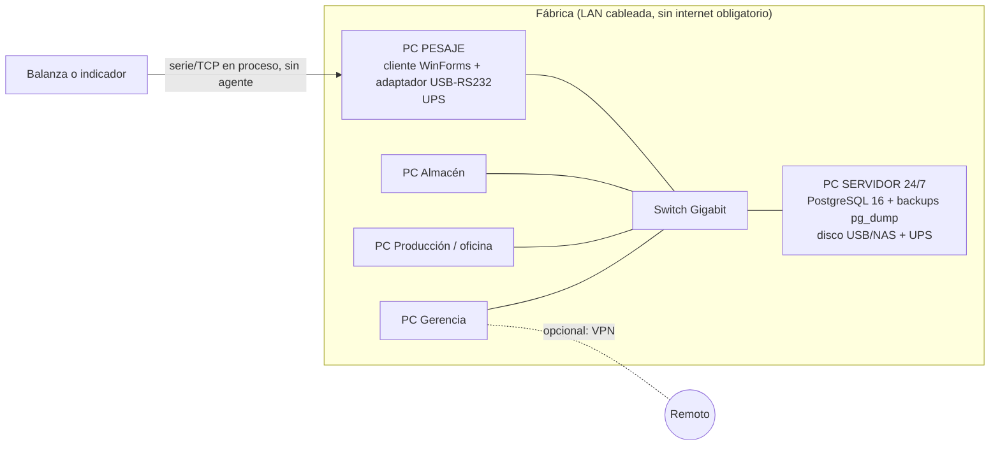
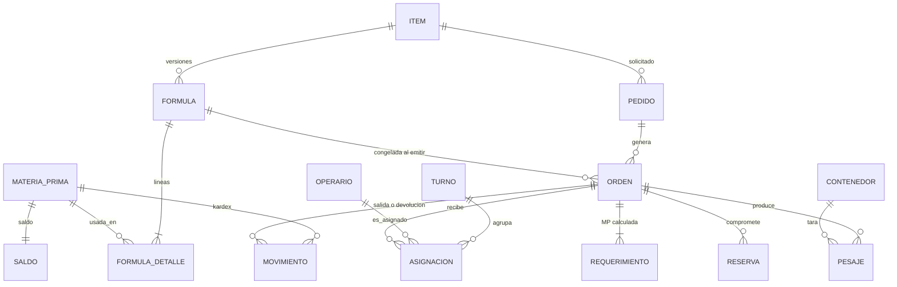
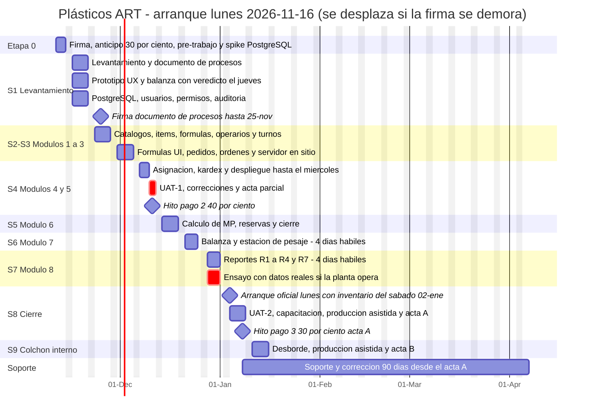

# Plan Maestro de Implementación – Sistema de Producción PLÁSTICOS ART

Fecha de elaboración: 2026-11-11 · Rol: líder técnico / jefe de proyecto (consolidación), revisado por el editor técnico final tras la revisión de viabilidad y de coherencia (registro en el Anexo C) · Base: propuesta de 8 semanas y 20 000 Bs, arquitectura Opción B (WinForms .NET + PostgreSQL 16 en LAN).

Anexos de detalle (este documento los resume y resuelve sus contradicciones; no los duplica):

| Anexo | Contenido | Horas que declara (históricas) |
|---|---|--:|
| [01 Arquitectura e infraestructura](./anexos/01-arquitectura-e-infraestructura.md) | Topología, PostgreSQL, balanza, seguridad, despliegue, hardware del cliente | 58 |
| [02 Diseño de software](./anexos/02-diseno-de-software.md) | ER, reglas con ejemplos, estados, matriz de permisos, backlog de 38 historias | 336 |
| [03 Diseño UX/UI](./anexos/03-diseno-ux-ui.md) | Personas, flujos, wireframes, estación de pesaje, sistema de diseño | 52 |
| [04 Levantamiento y procesos](./anexos/04-levantamiento-y-procesos.md) | Semana 1 día por día, cuestionarios, plantillas de datos, gobierno, criterios de aceptación | 56 |
| [05 Calidad, implantación y soporte](./anexos/05-calidad-implantacion-y-soporte.md) | Estrategia de pruebas, 42 casos UAT, datos reales, go-live, capacitación, soporte 90 días | 66 |

Las horas de los anexos son históricas: **las vigentes son las de 7.2 y 7.4 de este plan**, y cada anexo lleva al inicio una nota de subordinación o de erratas (vocabulario de estados, tarifa, horas). Si un anexo contradice este plan, manda el plan.

Convención: **[SUPUESTO]** se da por cierto hasta confirmar; **[PREGUNTA]** se cierra con el cliente (sección 12); **DEC-nn** es una decisión de consolidación tomada en este documento.

---

## 0. Resumen ejecutivo

**Qué se construye.** Un sistema de control de producción para la fábrica de plásticos con los 8 módulos de la propuesta: fórmulas por ítem (con versiones), pedidos, órdenes de producción (con estados y fórmula congelada), operarios por turno, inventario de materia prima (kardex inmutable y saldo con reservas), cálculo de materia prima por orden (explosión con merma, faltantes, semáforo), registro de pesos con balanza (peso a cantidad de ítems) y los reportes comprometidos (R1 a R4, R7 y el visor de auditoría, con PDF y Excel). Incluye usuarios con 6 roles y auditoría con diff antes/después.

**Arquitectura.** Escritorio WinForms en C# (.NET 8) sobre las capas de Pesalab (Domain, Application, Infrastructure, WinForms, Tests), con PostgreSQL 16 en un PC servidor en la LAN de la fábrica; la balanza se lee en proceso desde la PC de la estación de pesaje con el lector serie/TCP, parser y detector de estabilidad de Pesalab (probados en sitio). Sin internet obligatorio; sin hosting. Plan B: todo en un solo PC si el cliente tiene solo uno. El acceso remoto (P1) se resuelve con VPN/escritorio remoto o un visor web de solo lectura cotizado aparte. La reutilización es alta en seguridad, auditoría, balanza y reportes, y **requiere adaptar la persistencia** (10 archivos de Infrastructure y 23 de pruebas dependen de SQLite): por eso la Etapa 0 incluye un spike de 6 h que mide el costo real antes de comprometer la S1.

**Cómo se cumple la semana 4 (40 % = 8 000 Bs).** "Usar el sistema desde la semana 4" exige los módulos 1, 2, 3, 4 y 5 más usuarios y permisos. El hito se define como **entrega instalada en el servidor del cliente o, si este se retrasa (es costo del cliente), en cualquier PC aceptable (plan B-mono)**, con datos maestros reales y UAT-1 con casos críticos reducidos (sección 8.2). Se logra con: (a) pre-trabajo de 13 h antes del arranque; (b) usuarios, permisos y auditoría en la S1 y operarios/turnos en la S2; (c) servidor en sitio por el ingeniero en sistemas en la S3; (d) congelamiento de código el miércoles de la S4, UAT-1 el jueves y correcciones el viernes. De S4 a S7 el sistema es **piloto con datos maestros reales y movimientos de prueba** (DEC-16): el uso real arranca el 2027-01-04. La reserva de stock y el cálculo de MP llegan en la S5 (módulo 6, tal como indica la propuesta).

**Cómo se cumple la semana 8 (30 % = 6 000 Bs).** La S6 integra la balanza real (el veredicto Go, lector nuevo o modo manual se toma el jueves de la S1); la S7 entrega los reportes y un ensayo con datos reales (feriado de Año Nuevo); el arranque oficial es el lunes 2027-01-04 tras la toma de inventario del sábado 2027-01-02, **en producción asistida**. El acta final se **divide en dos** (DEC-17): el **acta A** (viernes 2027-01-08: sistema instalado, UAT-2 aprobado, capacitación hecha, backups restaurados, manuales) **dispara el 30 %**; el **acta B** (puesta en marcha con conciliación de saldos y cantidades, hasta 2027-01-15 o la fecha acordada) no retiene el pago.

**Esfuerzo vs capacidad (DEC-01 revisada).** El plan bottom-up suma **378 h**: 322 h del desarrollador principal, 36 h del ingeniero en sistemas y 20 h de una persona de respaldo. La capacidad efectiva del desarrollador es de **36 h productivas por semana** (no 45): 289 h hasta la S8 (30 h en S6 y S7 por los feriados) y 36 h más en la **S9, colchón interno fuera del contrato**. Dentro del plazo contractual la holgura productiva es 0 %; la protección es el 20 % de jornada no planificada, la S9 (33 h de desborde identificado), 18 h de recortes de nivel 2 y la cláusula 5 de la propuesta: **el plazo de 8 semanas es objetivo y la ampliación por demoras del cliente es el caso base**, y así se escribe en el acta de arranque.

**Cinco riesgos principales.**
1. Capacidad: una sola persona productiva a 36 h por semana con 0 % de holgura contractual; dependencia de 36 h del ingeniero y 20 h del respaldo que deben acordarse por escrito.
2. Datos maestros y fórmulas del cliente tardíos o inconsistentes (reciclado, masterbatch, peso unitario faltante), que bloquean módulos 1, 3, 5, 6 y 7 y el UAT-1.
3. Balanza sin salida de datos o con protocolo propietario: el veredicto del jueves de la S1 fija el alcance del módulo 7; el lector nuevo son 24 h cotizadas aparte.
4. Calendario: las semanas 6 y 7 caen en Navidad y Año Nuevo (4 días hábiles cada una) y la planta puede estar cerrada, lo que traslada la conciliación a producción asistida (S8 y S9).
5. Infraestructura del cliente y cambios de proceso: servidor, red y administrador a tiempo; cambios tras firmar el documento de la semana 1 y alcance implícito (trazabilidad por lote, costos, etiquetas, acceso web).

---

## 1. Alcance

### 1.1 Dentro del alcance (propuesta firmada)

| # | Módulo | Qué incluye en este plan | Semana de entrega |
|--:|---|---|---|
| 1 | Fórmulas por ítem | Ítems, materias primas, unidades; fórmula con líneas, base (por unidad, por lote o por kg), merma global y por línea, versiones (1 vigente por ítem), aviso de suma incoherente | S2–S3 |
| 2 | Órdenes de pedido | Pedido de 1 ítem, cantidad, fecha requerida, prioridad; estados Registrado, Aprobado, EnProduccion, Atendido, Cancelado; correlativo atómico | S3 |
| 3 | Órdenes de producción | Emitir desde pedido (1 pedido a N órdenes) con fórmula congelada; estados Emitida, Liberada, EnProduccion, Pausada, Terminada, Cerrada, Cancelada | S3 (emitir, liberar, cancelar), S5 (resto) |
| 4 | Operarios por turno | Operarios, turnos (cruzan medianoche), asignación por fecha, turno y orden; regla de no doble orden | S2 (catálogos), S4 (asignación) |
| 5 | Inventario de MP | Ingreso, salida contra orden, ajuste con motivo, devolución; kardex inmutable; saldo y stock mínimo | S4 |
| 6 | Cálculo de MP por orden | Explosión de fórmula con merma, disponible = existencia menos reservas, semáforo, faltantes, liberar con faltante con permiso y motivo, hoja de orden imprimible, cierre con desviación básica y, en la S9, pantalla de consumo real vs teórico con alerta de tolerancia | S5 (consumo detallado en S9) |
| 7 | Registro de pesos con balanza | Estación de pesaje (mínimo viable: un botón y teclado físico), captura estable, bruto menos tara, cantidad estimada con peso unitario del ítem, muestreo opcional, modo manual, simulador solo administrador, anulación | S6 |
| 8 | Reportes | R1 producción por orden, R2 por turno, R3 por período, R4 control de pesos y R7 stock y kardex (R5 cantidades como columnas de R1 a R3; R10 visor de auditoría existente) con PDF, Excel e impresión; R6, R8 y R9 diferidos ([02, sección 6](./anexos/02-diseno-de-software.md)) | S7 |

Transversales incluidos en el precio: usuarios, 6 roles y permisos; auditoría; pruebas (automatizadas y UAT); instalación (servidor y clientes); backups; capacitación; 90 días de soporte y corrección.

### 1.2 Fuera de alcance (debe firmarse en el documento de procesos de la semana 1)

Costos y valuación de inventario; compras y órdenes de compra; facturación y contabilidad; nómina y asistencia; mantenimiento de máquinas; trazabilidad por lote de proveedor (solo se guarda el dato en el ingreso); pedido con varios ítems y consolidación de N pedidos en 1 orden; semielaborados como MP; etiquetas o tickets de lote; hoja de orden con formato preimpreso; cola local de pesajes ante caída de red (el mínimo es bloquear con mensaje claro y conservar en memoria el último peso capturado); acceso web, app móvil y hosting; TLS en la LAN (solo si hay Wi-Fi, P8); gráficos y reportes programados por correo; importador DBF/MDB (salvo P9); kiosco, beep y teclado numérico en pantalla de la estación (soporte, cotizable); reportes R6, R8 y R9; importador de fórmulas (carga manual guiada); hardware, licencias de terceros, servidor y hosting (a cargo del cliente). Detalle y precio estimado en la sección 13.

### 1.3 Supuestos de alcance (consolidados)

| ID | Supuesto | Fuente |
|---|---|---|
| SUP-01 | Una sola planta, un almacén de MP, una moneda, una balanza principal | 01, 02, 04 |
| SUP-02 | Un pedido tiene un ítem y genera N órdenes; cada orden pertenece a un pedido | 02 |
| SUP-03 | La merma es aditiva sobre la cantidad neta (global + línea); la forma de cálculo vive en una sola función por si el cliente prefiere merma sobre bruto | 02 |
| SUP-04 | Se pesa producto terminado; el enum prevé pesar MP pero sin pantalla propia salvo que P5 lo exija | 02 |
| SUP-05 | El almacenero registra a mano las salidas de MP contra la orden; no se descuenta automáticamente al pesar | 02 |
| SUP-06 | La reserva de stock ocurre al liberar la orden y es todo-o-nada | 02 |
| SUP-07 | Hasta 20 usuarios; LAN cableada; ≤ 5 GB de datos en 3 años | 01 |
| SUP-08 | La aprobación de cada acta (parcial, final y semanales) se da por tácita a los 3 días hábiles, confirmado por escrito en el arranque (condición 5 de la propuesta) | 04, 05 |
| SUP-09 | Los operarios de planta no tienen usuario individual en la estación: entra un responsable de estación (sin PIN individual) y el operario se toma de la asignación del turno | 03 |
| SUP-10 | De S4 a S7 el sistema es **piloto con datos maestros reales y movimientos de prueba**; el 2027-01-02 se reinicia la parte transaccional y el "Saldo inicial" se registra como movimiento único en base limpia (DEC-16; se confirma con el cliente en la S1, Q-27) | revisión de viabilidad |
| SUP-11 | Variantes de ítem (color, medida), reciclado como entrada y sustitutos de MP se tratan como ítems y MP distintos; una sola fórmula vigente por ítem; no hay órdenes sin pedido | revisión (Q-22 a Q-26) |
| SUP-12 | El peso unitario por ítem es dato maestro obligatorio de la plantilla de la S1: sin él no hay cantidad estimada ni alerta de tolerancia | revisión de viabilidad |
| SUP-13 | El plazo de 8 semanas es objetivo; la ampliación por demoras del cliente es el caso base; la S9 es colchón interno sin costo para el cliente | revisión de viabilidad |

---

## 2. Equipo y responsabilidades

### 2.1 Roles del proveedor (quién los cubre realmente)

El presupuesto (20 000 Bs) alcanza para **una persona a tiempo completo**. Los "roles" de los anexos son sombreros de la misma persona; el plan reserva horas por tarea, no por rol. La persona 1 tiene 45 h de jornada y **36 h productivas por semana** (30 h en S6 y S7); el resto es reuniones, demos, llamadas, viajes a planta y mensajería.

| Rol | Quién lo cubre | Horas en el plan | Notas |
|---|---|--:|---|
| Desarrollador principal, jefe de proyecto, analista, UX, QA y capacitador | Persona 1 (a tiempo completo) | 322 (289 hasta la S8 y 33 en la S9) | Responsable de todo el cronograma y de las actas |
| Ingeniero en sistemas (proponente) | Persona 2, **horas acordadas por escrito** antes del 16-nov | 36 | Visita de planta y de servidor en la S1 (6 h); esqueleto de despliegue y servidor en sitio S2 a S4 (14 h); jornada de balanza en la S6 (6 h); inventario de arranque, sesiones de almacén y usuario clave y puesta en marcha en la S8 (10 h) |
| Persona de respaldo | Persona 3, contratación puntual con costo salido del margen del proyecto | 20 | CRUD de patrón en S2 a S4 (16 h) e instalación en sitio y materiales de capacitación en la S8 (4 h); conoce el repositorio y el runbook de despliegue (se documentan desde la S3); cubre enfermedad en S8 |
| Arquitecto / DBA / DevOps, diseñador UX | Persona 1, con la guía de los anexos 01 y 03 | dentro de las 322 | PostgreSQL, instaladores, backups; componentes de Pesalab |

**Acuerdo interno de recursos (condición de arranque).** Las 36 h del ingeniero y las 20 h del respaldo se firman entre los dos antes de la reunión de arranque. Cada hora que no se aporte se convierte en una hora de desborde (7.3, medida 9). Se pide además al ingeniero que el repositorio tenga copia externa y un README de despliegue desde la S3.

### 2.2 Roles del cliente (obligatorios por la condición 5 de la propuesta)

| Rol del cliente | Responsabilidad | Disponibilidad exigida |
|---|---|---|
| Responsable con autoridad (y suplente) | Decide, aprueba entregas, firma actas, convoca personal | Demo semanal; respuesta en 24 h; aprobación en 3 días hábiles |
| Usuario clave | Segundo par de ojos en UAT, primer nivel de soporte, valida cálculos de oro | ≥ 4 h semanales en S4–S8 |
| Jefe de producción | Fórmulas, pedidos, órdenes, turnos, operarios | Entrevista S1; fórmulas firmadas; UAT |
| Almacenero | Maestro de MP, stock inicial, conteo | Entrevista S1; conteo de arranque |
| Supervisor de turno | Operación de órdenes y pesaje | S6 a S8 |
| Encargado de balanza / calidad | Acceso a la balanza, manual, peso patrón | Jueves S1; jornada S6 |
| Gerencia | Reportes, aprobación de pedidos y fórmulas, pagos | Arranque, entregas |
| Administrador de backups / TI | Custodia de respaldos, servidor, red | Desde S3 |

### 2.3 Matriz RACI (R ejecuta, A aprueba, C consultado, I informado)

| Actividad | Dev/JP | Ing. sistemas | Resp. cliente | Jefe prod. | Almacén | Balanza/calidad | Gerencia | Admin TI |
|---|:-:|:-:|:-:|:-:|:-:|:-:|:-:|:-:|
| Levantamiento y documento de procesos | R | C | A | C | C | C | I | I |
| Datos maestros: ítems, MP, fórmulas | C | I | A | R | R | I | I | I |
| Operarios, turnos | C | I | A | R | I | I | I | I |
| Stock inicial (conteo) | C | I | A | I | R | I | I | I |
| Infraestructura: servidor, UPS, red | R (especifica, instala) | C | A | I | I | I | R (compra) | R |
| Balanza: acceso y captura de tramas | R | C | A | I | I | R | I | I |
| Desarrollo y pruebas automatizadas | R | I | I | I | I | I | I | I |
| UAT-1 y UAT-2 | R | I | A | R | R | R | I | I |
| Producción asistida y conciliación (acta B) | R | I | A | R | R | R | I | I |
| Capacitación | R | C | A | R (asiste) | R (asiste) | R (asiste) | R (asiste) | R (asiste) |
| Control de cambios | R (estima) | C | A | C | C | C | I | I |
| Backups: configurar / operar / verificar | R / I / C | C | A (designa) | I | I | I | I | R (opera y verifica) |
| Cutover y toma de inventario | R | C | A | R | R | I | I | I |
| Actas y pagos | R | R | A | I | I | I | R (paga) | I |

---

## 3. Arquitectura e infraestructura (síntesis de [01](./anexos/01-arquitectura-e-infraestructura.md))

### 3.1 Topología

### 3.2 Decisiones técnicas vigentes

| Tema | Decisión |
|---|---|
| Stack | C# 12, WinForms, EF Core con Npgsql, PostgreSQL 16, QuestPDF, ClosedXML, Serilog, xUnit, Inno Setup |
| Runtime (DEC-02 revisada) | **.NET 8** (como Pesalab). La migración a la LTS vigente se agenda en la ventana de soporte (4 a 8 h). Solo se adopta .NET 10 si un spike genera un PDF (QuestPDF), un Excel (ClosedXML), abre el puerto serie en la PC de pesaje y pasa las pruebas; el acta registra la versión del runtime y quién asume el costo de la migración posterior |
| Datos | `numeric(14,3)` para cantidades y pesos, `timestamptz` UTC, `jsonb` para auditoría, `citext` para nombres; sin `REAL` |
| Concurrencia | `UPDATE ... WHERE ... RETURNING` atómico para saldo, reservas y correlativos; token de versión en Pedido, Orden y Pesaje; reservas ordenadas por MateriaPrimaId (sin deadlocks) |
| Balanza | Lectura en proceso en la PC de pesaje; configuración **por estación** en la tabla `ConfiguracionBalanza` (una fila por `EstacionId`, auditada; si el spike de la E0 muestra que es más barato, archivo local); simulador y modo manual como respaldo |
| Seguridad | PBKDF2 (subir iteraciones si el rendimiento lo permite), bloqueo a 5 intentos, rol de BD de mínimos privilegios, cadena de conexión cifrada con DPAPI, `pg_hba.conf` limitado a la subred |
| Backup | `pg_dump -Fc` diario 23:00 y previo a migraciones (los binarios `pg_dump` y `pg_restore` son los del PostgreSQL 16 del servidor; el cliente no los necesita); retención 30 días con mínimo 3; copia a segundo disco; verificación con `pg_restore --list`; RPO 24 h, RTO 2 h |
| Instalación | Servidor: script PowerShell más Inno Setup mínimo; cliente: Inno Setup con autoprueba; esquema compartido cliente-servidor verificado al conectar; visita técnica previa de red y servidor en la S1 |
| Pruebas con BD | PostgreSQL 16 local con esquema por prueba y paralelización por esquema (DEC-03; no se asume Docker). Son más lentas que SQLite en memoria: meta de suite ≤ 5 min y 250 pruebas (8.1) |
| Licencias de Pesalab | No se usan (no se pidió licenciamiento y evita dependencia de internet) |

### 3.3 Qué debe proveer el cliente y cuándo

| Ítem | Costo orientativo (Bs) | Fecha límite | Necesario para |
|---|--:|---|---|
| Designar responsable, suplente, usuario clave y administrador de backups | 0 | Lun 2026-11-16 | Arranque |
| Acceso a la balanza (marca, modelo, manual, 2 h el jueves) | 0 | Jue 2026-11-19 | Decisión Go/lector nuevo |
| Balanza o indicador con salida de datos (o decisión de modo manual) | 0 si existe; 1 500 a 6 000 si debe comprarse | Vie 2026-11-20 (confirmar) | Módulo 7 |
| Adaptador USB-RS232 de chipset confiable (FTDI recomendado) | 80 a 200 | Vie 2026-12-18 | Estación de pesaje |
| PC servidor (i5, 16 GB, SSD 480 GB, Windows 11 Pro) | 3 000 a 5 500 | **Mié 2026-12-02** | Instalar antes de la entrega 1 (si no llega, B-mono en un PC aceptable: no bloquea el hito de la S4) |
| Acceso de administrador al servidor, IP fija y reglas de antivirus y firewall | 0 | Mié 2026-12-02 (checklist en la visita de la S1) | Servidor en la S3 |
| UPS 1000 VA servidor | 600 a 1 000 | Mié 2026-12-02 | Producción |
| Switch Gigabit y cables Cat6 | 200 a 450 | Mié 2026-12-02 | Red |
| Disco USB 1 TB o NAS pequeño (backup) | 450 a 700 | Mié 2026-12-02 | Respaldo |
| PCs cliente (almacén, producción, gerencia) | 2 500 a 4 000 c/u si faltan | Lun 2026-12-07 | Entrega 1 |
| UPS 600 a 1000 VA para PC de pesaje | 400 a 800 | Vie 2026-12-18 | Estación de pesaje |
| Hosting, VPS o dominio | 0 en el plan base | Decidir en S1 | Solo si se exige acceso web |

Total mínimo realista para el cliente (sin balanza ni PCs cliente): 5 500 a 9 500 Bs. Camino económico con un PC existente como servidor: riesgo operativo mayor, debe quedar firmado.

---

## 4. Modelo de dominio y reglas clave (síntesis de [02](./anexos/02-diseno-de-software.md))

### 4.1 Entidades (20)

Unidad, ConversionUnidad, Item (peso unitario estándar y tolerancia), MateriaPrima, Formula, FormulaDetalle, PedidoProduccion, OrdenProduccion (con FormulaSnapshotJson), OrdenRequerimiento, ReservaMp, SaldoMp, MovimientoInventario (kardex inmutable), Turno, Operario, AsignacionTurno, Contenedor (tara), RegistroPesaje, ParametrosSistema, Usuario y Auditoría (estas dos adaptadas de Pesalab).

### 4.2 Reglas que fijan los criterios de aceptación

| Regla | Definición (ejemplo numérico fijo de 02) |
|---|---|
| Explosión de fórmula | `factor = Q / B`; `requerida = cantidad x factor x (1 + (merma global + merma línea)/100)`; 3 decimales, AwayFromZero, sin redondeos intermedios. Ejemplo A: 25 000 vasos de 18,9 g, PP 18,5 kg por millar, merma 3 % da 476,375 kg de PP y 10,300 kg de masterbatch |
| Stock | `disponible = existencia - reservado`; semáforo verde, amarillo (bajo mínimo), rojo (faltante); liberar reserva todo-o-nada; liberar con faltante exige permiso y motivo |
| Consumo | Real = salidas menos devoluciones; teórico = fórmula x producción real; desviación % con alerta contra tolerancia (ejemplo: 468,200 kg vs 444,000 kg da +5,45 %) |
| Peso a cantidad | `neto = bruto - tara`; `cantidad = round(neto x 1000 / peso unitario g)` (51,20 kg / 18,9 g = 2 709 un); producción acumulada se calcula del acumulado de neto, no sumando redondeos |
| Cierre | Solo desde Terminada; libera reservas; informe con diferencias; motivo obligatorio si desviación > 5 %; la orden queda inmutable |
| Concurrencia | Una transacción por operación de stock; 20 tareas paralelas reservando la misma MP no producen sobre-reserva ni negativos |
| Antifraude | Simulador solo Administrador; modo manual con permiso y motivo; origen visible en reportes |

### 4.3 Estados

Pedido: Registrado a Aprobado a EnProduccion a Atendido, con Cancelado desde Registrado y Aprobado. Orden: Emitida a Liberada a EnProduccion, con Pausada, Terminada, Cerrada y Cancelada. Diagramas completos en [02, sección 3](./anexos/02-diseno-de-software.md). Vocabulario oficial del proyecto (DEC-05): el de 02; los casos UAT de 05 y los diagramas de 03 y 04 ya llevan la equivalencia (erratas al inicio de cada anexo).

### 4.4 Roles (DEC-04: 6 roles de 02)

Administrador, Gerencia, Jefe de producción, Almacenero, Supervisor de turno, Operador de balanza. Matriz de aproximadamente 28 permisos en [02, sección 4](./anexos/02-diseno-de-software.md); se valida con el cliente en la S1 y se prueba de forma exhaustiva (patrón de Pesalab).

---

## 5. Lineamientos UX/UI (síntesis de [03](./anexos/03-diseno-ux-ui.md))

- **Principios:** pocas pantallas y una acción principal en planta; teclado primero en oficina; nunca perder un peso; el estado de orden, balanza y conexión siempre visible; mensajes en "usted" que dicen qué pasó y qué hacer; coma decimal fija en todo el sistema (lección de Pesalab).
- **Inventario de pantallas:** unas 14 nuevas de fondo (editor de fórmula, alta de pedido con simulador de MP, tablero y detalle de órdenes con pestañas, asignación por turno, ingreso, stock, estación de pesaje), 6 adaptadas y 8 reutilizadas. Menú y tarjetas de inicio por rol (`AutorizadorMenu`).
- **Sistema de diseño:** paleta con contraste AA, tipografía legible, badges de estado, banners de conexión; componentes de Pesalab (FormBase, ControlBusquedaCatalogo, DisenoFiltros, VerificadorLayout, ErrorProvider, EjecutarAsync).
- **Estación de pesaje (diseño propio):** modo oscuro con peso gigante (120 a 160 pt); un solo botón PESAR habilitado solo con peso estable y válido; estados por color más texto más ícono (inestable, estable, sin datos, cero, fuera de rango, esperando retorno a cero, guardado); orden elegida una vez por turno y operario heredado de la asignación; cantidad de ítems con teclado físico y valor sugerido (el teclado numérico en pantalla pasa a soporte); peso por unidad como verificación contra el estándar; anular último con un toque y anteriores solo por el Supervisor; balanza desconectada con Reconectar y modo manual del Supervisor; **mínimo viable del plazo: pantalla de un solo botón PESAR con teclado físico; el kiosco, el beep y el teclado en pantalla pasan a soporte y se cotizan como cambio.** Mínimo viable ante caída de red (DEC-06): bloquear con mensaje claro y conservar el último peso en memoria hasta 5 minutos; la cola local queda en fase 2.
- **Reportes:** reutilizan el motor PDF y Excel de Pesalab; hoja de orden de producción imprimible con requerimiento de MP en formato libre (incluida en E4-03); etiqueta o ticket de lote fuera de alcance (8 a 10 h si se pide).
- **Métricas de usabilidad (criterios de diseño):** operador pesa un lote en ≤ 10 s en prueba (≤ 6 s tras el primer día); jefe crea pedido, orden y libera en ≤ 3 min la primera vez; almacenero registra un ingreso en ≤ 60 s; 100 % de los operarios lee el peso correcto a 2 m; 0 errores graves en tareas críticas; sin recortes a 100 % y 125 % de escala.

---

## 6. Plan por etapas

### 6.0 Cómo leer esta sección

- **Capacidad (revisión de viabilidad):** la persona 1 tiene 45 h de jornada por semana, pero **36 h productivas** (reuniones, demos, llamadas, viajes a planta y WhatsApp ya descontados); 30 h en S6 y S7 (4 días hábiles por los feriados del 25-dic y 1-ene). Las horas del ingeniero en sistemas (36 h) y de la persona de respaldo (20 h) se muestran por separado: columna **Quién** (D = desarrollador principal, I = ingeniero en sistemas, R = respaldo). Ver 2.1 y 7.2.
- **IDs:** `HU-Ex-yy` son historias de [02](./anexos/02-diseno-de-software.md) (a veces con horas ajustadas, ver 7.4); `PR-` procesos y gobierno ([04](./anexos/04-levantamiento-y-procesos.md)); `UX-` diseño ([03](./anexos/03-diseno-ux-ui.md)); `QA-` y `DAT-` calidad y datos ([05](./anexos/05-calidad-implantacion-y-soporte.md)); `INF-` infraestructura ([01](./anexos/01-arquitectura-e-infraestructura.md)); `E0-` pre-trabajo.
- **Fechas:** suponen firma y anticipo antes del lunes 2026-11-16. Si la firma se demora, todo el calendario se desplaza día a día (condición 5 de la propuesta). **El plazo de 8 semanas es el objetivo contractual; la ampliación por demoras del cliente es el caso base** y se escribe así en el acta de arranque. La semana 9 (2027-01-11 a 15) es un **colchón interno fuera del contrato** que absorbe el desborde ya identificado en 7.2 (33 h) sin costo para el cliente.
- **Alcance real:** la lista de recortes de 7.3 (nivel 1) ya está **aplicada** en estas tablas; no es una reserva. Los recortes de nivel 2 sí son reserva.
- **Regla de oro:** toda historia incluye sus pruebas automatizadas; "terminada" = Definition of Done de la sección 8.

### Etapa 0 – Pre-arranque (mié 2026-11-11 a vie 2026-11-13) · 13 h

**Objetivo.** Dejar firma, anticipo, accesos y decisiones de plataforma resueltos, y **medir** el costo real de pasar Pesalab a PostgreSQL antes de comprometer la S1 y la S2.

| ID | Tarea | h | Quién | Fuente |
|---|---|--:|:-:|---|
| E0-00 | Firma de la propuesta, designación de responsable y suplente, cobro del 30 % (6 000 Bs); acta de arranque con las cláusulas de 10.5; envío de la agenda de la semana 1, las plantillas de datos (con **peso unitario por ítem obligatorio**) y el checklist de balanza; pedir fotos del indicador y su manual; pedir acceso de administrador al servidor del cliente | 0 (gestión del ingeniero en sistemas) | I | 04 |
| E0-01 | Solución `PlasticosArt` desde Pesalab: renombrar espacios de nombres, eliminar faeneo, boletas y licencias, `ArquitecturaTests` en verde (HU-E1-02) | 5 | D | 02 |
| E0-02 | PostgreSQL 16 local de desarrollo y de pruebas (esquema por prueba, DEC-03) | 2 | D | 01 |
| E0-03 | **Spike de persistencia (6 h):** migrar `DbContext`, `UnidadDeTrabajo` y el fixture de pruebas a Npgsql (reemplazo de `NOCASE` por `citext`, conversores de fecha y decimales, `SqliteException` por `PostgresException`, pragmas fuera) y correr ≥ 100 pruebas reutilizadas; medir tiempo de la suite; probar la tabla `ConfiguracionBalanza` con una fila por estación; reestimar HU-E1-03 con la medición | 6 | D | revisión de viabilidad |

**Decisión de runtime (DEC-02 revisada).** Se queda en .NET 8 y la migración a la LTS vigente se agenda en soporte (4 a 8 h). Solo se adopta .NET 10 si el spike genera un PDF (QuestPDF), un Excel (ClosedXML), abre el puerto serie en la PC de pesaje y pasa las pruebas; el acta registra la versión del runtime y quién asume el costo de la migración posterior.

**Entregables.** Acta de arranque firmada; solución compilando en Release con 0 warnings; informe del spike con la medición (horas reales de persistencia y fixtures, duración de la suite).

**Criterios de salida.** Firma y anticipo recibidos; responsable designado por escrito; calendario de entrevistas confirmado (lunes a viernes de la S1); el cliente sabe qué debe entregar y cuándo; ≥ 100 pruebas reutilizadas pasan contra PostgreSQL. **Regla de reestimación:** si el spike mide más de 16 h para persistencia y fixtures (E1-03a + E1-03b), se activa el primer recorte de nivel 2 de 7.3 y se informa en la demo de la S1.

**Insumos del cliente y fecha límite.** Firma y anticipo: antes del lun 2026-11-16 (la propuesta vence el 2026-12-11). Calendario de la planta (feriados y vacaciones colectivas de fin de año): lun 2026-11-16. Acceso de administrador al PC que será servidor y datos de red (IP fija, antivirus, firewall): antes del mié 2026-12-02.

**Hito de pago.** 30 % = 6 000 Bs **a la firma de la propuesta** (no depende del documento de procesos).

**Riesgos.** Trabajo antes de la firma queda hundido si no se firma (aceptado: son 13 h de bajo valor ajeno al cliente). Firma tardía desplaza todo.

**Demo.** No aplica; se confirma la reunión de arranque del lunes.

---

### Etapa 1 – Semana 1 (2026-11-16 a 2026-11-20) · 42 h (36 D + 6 I) · Levantamiento, base de datos, usuarios y permisos

**Objetivo.** Documento de procesos validado y base técnica con usuarios, roles y auditoría funcionando contra PostgreSQL. Decidir la balanza el jueves.

| ID | Tarea | h | Quién | Fuente |
|---|---|--:|:-:|---|
| PR-01 | Levantamiento de campo: lunes arranque, planta y gerencia; martes fórmulas y pedidos; miércoles almacén y turnos; jueves balanza (captura de ≥ 50 tramas, decisión Go o lector nuevo) y calidad; viernes reportes y taller TO-BE. Incluye la **visita técnica de red y servidor** (checklist: administrador, IP fija, antivirus, firewall, UPS). Fusiona HU-E1-01, la visita de UX y el cuestionario | 18 (12 D + 6 I) | D+I | 04 §1–2, 03 §9, 05 §1.4 |
| PR-02 | Documento de procesos v1: TO-BE de los 6 procesos, reglas RN-nn, plantillas de datos con ejemplos reales (peso unitario por ítem obligatorio; **3 fórmulas más complejas con reciclado y masterbatch**), matriz de permisos, criterios de aceptación por módulo, exclusiones; envío el viernes | 6 | D | 04 §4–5, §7 |
| UX-01 | Prototipo de baja fidelidad (wireframes del anexo 03 ajustados), validación de 60 a 90 min con el cliente, guía de estilo de una página | 4 | D | 03 |
| HU-E1-03a | Persistencia PostgreSQL (parte 1): migración `Inicial` (Usuario, Auditoría, Parámetros, Unidad), `DatabaseInitializer`, semilla admin | 6 | D | 02 |
| HU-E1-04 | Usuarios, 6 roles y matriz de permisos; bloqueo a 5 intentos, cambio obligatorio, protección del último admin | 5 | D | 02 |
| HU-E1-05 | Auditoría con diff JSON en `jsonb`; acciones nuevas | 2 | D | 02 |
| PR-03 | Acta de arranque y actas cortas diarias de entrevista | 1 | D | 04 |

**Entregables.** Documento de procesos v1 enviado (viernes 2026-11-20); ficha de balanza con tramas capturadas y veredicto verde, amarillo o rojo; prototipo validado; usuarios y permisos operativos contra PostgreSQL.

**Veredicto de balanza (fecha tope: jueves 2026-11-19).** Verde o amarillo: se sigue con el lector de Pesalab (amarillo: ajuste de patrón o unidades). **Rojo** (sin salida de datos, protocolo propietario, bajo demanda o Modbus): el mismo jueves se firma el **acta de ajuste del módulo 7**: el modo manual (con permiso, motivo y marca MANUAL) pasa a ser el entregable base del módulo 7 y el lector nuevo se cotiza aparte (24 h × 60 Bs/h = 1 440 Bs) y se programa como HU-E5-03 en la S5 o S6. El veredicto no condiciona el cobro del 30 % (ya cobrado a la firma): condiciona el alcance del módulo 7.

**Criterios de aceptación y de salida.**
- Todas las preguntas marcadas como críticas del cuestionario ([04, sección 2](./anexos/04-levantamiento-y-procesos.md)) tienen respuesta escrita o una decisión por defecto firmada (sección 12).
- Ficha de balanza completa; ≥ 20 tramas consecutivas parseadas con el parser de Pesalab en la laptop; decisión Go o lector nuevo comunicada al cliente el jueves.
- Matriz de permisos probada de forma exhaustiva; login, bloqueo y cambio de contraseña funcionando contra PostgreSQL.
- Plantilla de ítems con peso unitario en ≥ 5 ítems y 3 fórmulas complejas recibidas (reciclado, masterbatch, aditivos en partes por cien).
- Compila en Release con 0 warnings; pruebas en verde.

**Insumos del cliente.**

| Insumo | Fecha límite |
|---|---|
| Responsable, suplente, usuario clave, administrador de backups | Lun 2026-11-16 |
| Borrador de ítems (con peso unitario), MP y fórmulas (≥ 5 ítems representativos y las 3 fórmulas más complejas) | Mié 2026-11-18 |
| Operarios y turnos | Jue 2026-11-19 |
| Acceso a la balanza, manual y 2 h de prueba | Jue 2026-11-19 |
| 3 pedidos y 3 órdenes reales, planilla de turno y kardex de 1 mes | Vie 2026-11-20 |
| Respuestas P1 a P10 y preguntas críticas (sección 12) | Vie 2026-11-20 |

**Hito de pago.** Ninguno.

**Riesgos específicos.** Entrevistas que no se concretan (ver R-02); balanza roja (ver veredicto); semana al 100 % de la capacidad efectiva.

**Demo de fin de etapa.** Viernes 2026-11-20 15:00: login y matriz de permisos por rol, auditoría con diff, prototipo de la estación, lectura de tramas reales en laptop, entrega del documento v1.

---

### Etapa 2 – Semanas 2 y 3 (2026-11-23 a 2026-12-04) · 72 h D + 21 h de apoyo · Módulos 1, 2 y 3 (más operarios y turnos adelantados)

**Objetivo.** Fórmulas versionadas, pedidos y órdenes de producción emitidas desde pedido, más catálogos de operarios y turnos, con el esqueleto de despliegue listo.

**Semana 2 (48 h: 36 D + 3 I + 9 R)**

| ID | Tarea | h | Quién | Fuente |
|---|---|--:|:-:|---|
| PR-02b | Revisión del documento v1 (3 días hábiles), ajustes y firma | 2 | D | 04 |
| PR-03 | Demo del viernes y acta corta | 1 | D | 04 |
| HU-E1-03b | Persistencia (parte 2): traducción de errores de PostgreSQL (23505, 23514, 40001), fixture de pruebas con esquema por prueba paralelizado, correlativo `UPDATE...RETURNING` probado | 6 | D | 02 |
| INF-01 | Esqueleto de despliegue: PostgreSQL en servidor de pruebas, script PowerShell del servidor, instalador mínimo de cliente | 3 | I | 02 §8.2, 01 |
| HU-E2-01 | Catálogos: unidades y conversiones, materias primas, contenedores (código automático, stock mínimo); lo construye la persona de respaldo sobre el patrón CRUD de Pesalab (9 h R) y el desarrollador revisa (2 h D) | 11 (2 D + 9 R) | D+R | 02 |
| HU-E2-02 | Ítems con peso unitario y tolerancia | 6 | D | 02 |
| HU-E2-03a | Fórmulas (modelo y servicio): versiones, 1 vigente por ítem (índice parcial), base de cálculo, mermas, inmutabilidad; modelado con las 3 fórmulas complejas de la S1 | 11 | D | 02 |
| HU-E3-01 | Operarios y turnos (turnos que cruzan medianoche, vínculo opcional a usuario) | 5 | D | 02 |
| FOR-01 | Colchón de ajuste del modelo de fórmula tras la firma del 25-nov (3 h aquí y 3 h en la S9) | 3 | D | revisión de viabilidad |

**Semana 3 (45 h: 36 D + 6 I + 3 R)**

| ID | Tarea | h | Quién | Fuente |
|---|---|--:|:-:|---|
| HU-E2-03b | Pantalla de fórmula maestro-detalle: aviso si Σ ≠ peso x base (> 2 %), copiar versión, activar | 11 | D | 02 |
| HU-E2-04 | Pedidos: correlativo atómico, estados y permisos, filtros, auditoría (8 h D; listados y filtros 3 h R) | 11 (8 D + 3 R) | D+R | 02 |
| HU-E2-05a | Órdenes desde pedido (parte 1): fórmula congelada (snapshot), estados Emitida, Liberada, Cancelada, vínculo a pedido | 17 | D | 02 |
| INF-04 | **Servidor en sitio:** PostgreSQL 16 como servicio, firewall, `pg_hba.conf` por subred, roles separados (aplicación y migración), DPAPI, backup `pg_dump` con copia a segundo disco; acta de red; PR-03 de la semana (1 h) | 6 | I | 01 |

**Entregables.** Módulos 1, 2 y 3 en el servidor de pruebas, con datos reales de 5 ítems o más; documento de procesos firmado; catálogos de operarios y turnos; servidor del cliente (o PC aceptable, ver Etapa 3) con PostgreSQL y backup diario.

**Criterios de aceptación y de salida** (de [04, sección 7](./anexos/04-levantamiento-y-procesos.md) y [02](./anexos/02-diseno-de-software.md)):
- Una fórmula nueva se crea con versión; activar una versión archiva la anterior; una versión vigente no se edita (probado por índice único parcial).
- Una orden conserva la versión de fórmula con que se emitió aunque la fórmula evolucione (prueba automatizada).
- No se aprueba un pedido de un ítem sin fórmula vigente (mensaje claro).
- Pedido registrado en ≤ 1 min; orden generada desde pedido en ≤ 3 clics; 500 pedidos listados en < 2 s.
- Correlativos sin duplicados con 5 usuarios concurrentes (prueba automatizada).
- Las fórmulas de la plantilla firmada se cargan por **carga manual guiada** (el jefe de producción con una guía de una página; el importador de fórmulas queda fuera, recorte de nivel 1) y 3 fórmulas reales calculadas coinciden con el Excel del jefe de producción (diferencia ≤ 0,1 kg; el cálculo de MP completo llega en S5, aquí se valida la estructura).

**Insumos del cliente.**

| Insumo | Fecha límite |
|---|---|
| Firma del documento de procesos | Mié 2026-11-25 (3 días hábiles desde el viernes 11-20) |
| Fórmulas finales aprobadas y firmadas por el jefe de producción | Vie 2026-11-27 |
| Listado final de ítems con peso unitario y tolerancia | Vie 2026-11-27 |
| Confirmación del servidor y UPS (compra) y **acceso de administrador al servidor** | Vie 2026-11-27 |
| Respuestas pendientes de reglas (sección 12, prioridad 2) | Vie 2026-11-27 |

**Hito de pago.** Ninguno.

**Riesgos específicos.** Firma tardía del documento (se desarrolla con lo ya validado en talleres); fórmulas con casos no previstos (varias bases, sustitutos de MP; por escrito se tratan como ítems y MP distintos, SUP-11); S2 y S3 al 100 % de la capacidad efectiva.

**Demo.** Viernes 2026-11-27: catálogos y fórmula con versiones. Viernes 2026-12-04: pedido a orden con fórmula congelada; roles en acción.

---

### Etapa 3 – Semana 4 (2026-12-07 a 2026-12-11) · 45 h (36 D + 5 I + 4 R) · Módulos 4 y 5 y primera entrega parcial

**Objetivo.** Primera entrega utilizable: módulos 1 a 5 más usuarios y permisos, **instalados en el servidor del cliente o, si este se retrasa, en cualquier PC aceptable (plan B-mono)**, con los datos maestros reales cargados.

**Secuencia de la semana (capacidad 36 h):** lunes a miércoles desarrollo (22 h); **congelamiento de código el miércoles 18:00**; despliegue el miércoles tarde; UAT-1 el jueves con el usuario clave (4 h); correcciones el jueves tarde y el viernes (6 h); demo y acta el viernes 15:00.

| ID | Tarea | h | Quién | Fuente |
|---|---|--:|:-:|---|
| HU-E2-05b | Órdenes desde pedido (parte 2): Σ órdenes ≤ pedido + 5 %, cancelación, pruebas | 3 | D | 02 |
| HU-E3-02 | Asignar operarios a turno y orden (grilla por fecha y turno; sin doble orden activa; copiar día anterior): 3 h D + 4 h R | 7 (3 D + 4 R) | D+R | 02 |
| HU-E3-03 | Movimientos de inventario: ingreso, salida contra orden, ajuste con motivo, devolución; kardex inmutable; contra-movimiento; prueba de concurrencia con 20 tareas | 14 | D | 02 |
| HU-E3-04 | Consulta de stock (existencia, reservado, disponible), semáforo con amarillo bajo mínimo y kardex con saldo corrido (la alerta visual en el listado es lo único que se recorta si hace falta) | 2 | D | 02 |
| HU-E3-05 | Despliegue: esquema en el servidor, instalador cliente en ≥ 2 PCs (2 h D + 3 h I) | 5 (2 D + 3 I) | D+I | 02, 01 |
| DAT-01 | Importador CSV adaptado (ítems, MP y stock; sin fórmulas) con simulacro y carga de datos maestros reales | 2 | I | 05 §5 |
| QA-01 | UAT-1: preparación, ejecución con el usuario clave y acta (casos críticos aplicables más UAT-1-13) | 4 | D | 05 §3.3 |
| FIX-01 | Correcciones de UAT-1 | 6 | D | 02 |
| PR-03 | Demo y acta parcial (incluye observación de usabilidad en la demo, sin prueba formal) | 2 | D | 04 |

**Entregables.** Sistema instalado en el servidor (o PC aceptable) y ≥ 2 clientes; backup nocturno ejecutándose; carga de ítems, MP, fórmulas, operarios, turnos y stock provisional; acta de entrega parcial 1 firmada.

**Criterios de aceptación y de salida (condición de pago).** UAT-1 con **casos críticos reducidos** (sección 8.2): UAT-1-01, 02, 03, 05, 07 (con v1 congelada, sin cálculo de MP), 08, 10, 11 (hasta Liberada), 13, 15, 16, 17 y 18, todos en OK; ≥ 90 % de los casos aplicables en OK (denominador **21**: el UAT-1-21 de caída de servidor se verifica en S6, y el 12 corre ajustado) y 0 defectos críticos o altos abiertos. Criterios de módulo ([04, sección 7](./anexos/04-levantamiento-y-procesos.md)): stock = Σ ingresos − Σ salidas ± ajustes con diferencia 0 en 10 movimientos de prueba; stock inicial importado coincide 100 % con la plantilla firmada; no se permite stock negativo; 10 usuarios simultáneos 30 min sin errores de bloqueo; backup restaurable (prueba en PC de desarrollo).

**Uso de S4 a S7.** Entorno **piloto con datos maestros reales y movimientos de prueba** (DEC-16); el 2027-01-02 se reinicia la parte transaccional (ver 9.1). El acta de la semana 4 lo declara para que el cliente no espere uso real ni se cobre por esa expectativa. Si el cliente exige uso real desde S4, se aplican ajustes documentados "Ajuste por conteo inicial" en vez del reinicio.

**Insumos del cliente.**

| Insumo | Fecha límite |
|---|---|
| PC servidor, UPS, switch y disco de backup en sitio (si no llegan: plan B-mono sin retener hito ni aprobación tácita; el servidor es costo del cliente) | Mié 2026-12-02 |
| PCs cliente disponibles para instalar | Lun 2026-12-07 |
| Stock inicial provisional (conteo de las MP principales) | Vie 2026-12-04 |
| Usuario clave y 2 personas para UAT-1 (≥ 4 h) | Jue 2026-12-10 |
| Aprobación del acta (3 días hábiles) | Mié 2026-12-16 (tácita) |

**Hito de pago.** 40 % = 8 000 Bs a la firma del acta parcial (viernes 2026-12-11; límite tácito 2026-12-16). El hito es "entrega instalada y UAT-1 reducido en OK"; la falta de servidor del cliente no lo bloquea.

**Riesgos específicos.** Semana crítica (despliegue y UAT en 5 días con 36 h); servidor del cliente tarde: B-mono y migración posterior; inventario provisional impreciso (se documenta, la toma real es en S8); concurrencia mal resuelta (no se recorta).

**Demo.** Viernes 2026-12-11, 2 h: flujo completo fórmula, pedido, orden, asignación, ingreso y salida de MP en el servidor, y respaldo.

---

### Etapa 4 – Semana 5 (2026-12-14 a 2026-12-18) · 36 h · Módulo 6: cálculo de materia prima por orden

**Objetivo.** Calcular, reservar y verificar la MP de cada orden; transiciones de la orden y cierre.

| ID | Tarea | h | Quién | Fuente |
|---|---|--:|:-:|---|
| HU-E4-01 | Explosión de fórmula por orden (ejemplos A y B de 02 al 3.er decimal); unidades; recalcula solo en Emitida | 10 | D | 02 |
| HU-E4-02 | Reserva y verificación de stock: disponible descuenta reservas, semáforo, liberar todo-o-nada, liberar con faltante con permiso y motivo, prueba de 20 liberaciones concurrentes | 12 | D | 02 |
| HU-E4-03 | Pestaña Requerimiento de MP, lista de faltantes y **hoja de orden imprimible** (PDF libre; compromiso DEC-08, no se recorta sin cambio firmado) | 7 | D | 02, 03 |
| HU-E4-05 | Transiciones Iniciar, Pausar y Terminar (3 h, DEC-07) y cierre de orden con desviación teórico vs real básica y motivo obligatorio (3 h) | 6 | D | 02 |
| PR-03 | Demo y acta | 1 | D | 04 |
| *HU-E4-04* | *Consumo real vs teórico por orden con alerta de tolerancia y detalle por MP: pasa a la S9 (6 h)* | *0 aquí* | D | 02 |

**Entregables.** Módulo 6 desplegado con aviso previo (ventana de actualización con backup previo, 7:00 o 13:00). Como S4 a S7 son piloto, no hay migración de datos reales: las órdenes de prueba de S4 se re-liberan o se recrean.

**Criterios de aceptación y de salida.**
- Para 5 órdenes reales, la necesidad por MP coincide con el cálculo manual del jefe de producción (error ≤ 0,1 kg).
- Casos de oro 1, 2, 3, 5 y 6 de UAT-2 (cálculo, faltante, reserva cruzada, recalcular, merma) en OK sobre datos de prueba.
- 20 liberaciones concurrentes: Σ reservado ≤ existencia, sin negativos ni deadlock.
- Liberar con faltante exige permiso y motivo y queda auditado; la orden queda marcada "con faltante".
- Cerrar con desviación > 5 % exige motivo; orden cerrada inmutable.
- Jefe de producción crea pedido, genera orden y libera en ≤ 3 min la primera vez (observado en la demo).

**Insumos del cliente.**

| Insumo | Fecha límite |
|---|---|
| Decisión: liberar con faltante bloquea o se autoriza (Q-08) | Vie 2026-11-27 |
| 5 órdenes reales con su cálculo manual (casos de oro) | Mar 2026-12-15 |
| Adaptador USB-RS232 y UPS de pesaje | Vie 2026-12-18 |
| Jefe de producción disponible para validar cálculos (2 h) | Mié 2026-12-16 |

**Hito de pago.** Ninguno.

**Riesgos específicos.** Merma sobre neta o bruta mal elegida (una sola función, cambio de 1 h); semana al 100 %; casos de oro del cliente distintos de la regla firmada.

**Demo.** Viernes 2026-12-18: orden con faltante en rojo, reserva en vigor, liberar con autorización, cierre con diferencias.

---

### Etapa 5 – Semana 6 (2026-12-21 a 2026-12-25) · 36 h (30 D + 6 I; 4 días hábiles) · Módulo 7: balanza y registro de pesos

**Objetivo.** Pesaje de producción con la balanza real en la estación, relacionado con la cantidad de ítems. **Mínimo viable de la estación:** una pantalla con un solo botón PESAR y teclado físico; el kiosco, el beep y el teclado numérico en pantalla pasan a soporte.

| ID | Tarea | h | Quién | Fuente |
|---|---|--:|:-:|---|
| HU-E5-01 | Configuración de balanza **por estación** (tabla `ConfiguracionBalanza` con una fila por `EstacionId`, auditada; si el spike de la E0 mostró que es más barato, archivo local), servicio, formulario, validaciones, migración y pruebas; diagnóstico reutilizado | 9 | D | 02 |
| HU-E5-02 | Lector, parser y estabilidad con la trama real de la S1; 20 lecturas válidas; reconexión | 6 | D | 02 |
| HU-E5-04 | Registro de pesaje: neto, cantidad estimada con peso unitario, muestreo, acumulado de orden, sobreproducción, solo con orden EnProduccion, anulación con motivo, auditoría | 12 | D | 02 |
| HU-E5-05a | Estación de pesaje (parte 1): display en vivo, captura estable con retorno a cero, tara por contenedor, lote automático, modo manual con permiso, simulador solo Administrador, atajos | 3 | D | 02, 03 |
| HU-E5-06 | Prueba en sitio con peso patrón y operador real (guantes, luz, distancia): error ≤ 1 división; 50 pesadas sin pérdida; acta; demo breve del miércoles | 4 | I | 02, 03 |
| INF-02 | UPS y corte de red simulado (bloqueo con mensaje, último peso en memoria 5 min), plan de contingencia | 2 | I | 01 |
| *HU-E5-03* | *Contingente: lector bajo demanda o Modbus (solo si la balanza lo exige): **24 h**, cotizadas aparte (1 440 Bs) si el veredicto fue rojo; se ejecuta en S5 o S6 desplazando QA-03 y E7-03 a la S9* | *+24* | D | 02 |

**Entregables.** Estación de pesaje operando con la balanza real; acta de la jornada de balanza.

**Criterios de aceptación y de salida.**
- Lectura en vivo de la balanza real con indicador estable; 100 % de tramas válidas en 10 min; 30 min sin reconexiones espontáneas.
- Peso capturado (1 decimal o la resolución P3) coincide con el display en 20 pesadas; error contra peso patrón ≤ 1 división.
- Cada pesada queda ligada a orden, turno, operario, fecha y cantidad; corregir o anular solo con permiso y auditoría.
- Peso inestable no se puede capturar; desconexión se indica en < 5 s y reconecta; modo manual marcado "MANUAL"; simulador bloqueado a operadores (casos UAT-2-08 a 13 sobre simulador y balanza real).
- Operador pesa un lote en ≤ 10 s en la prueba; 100 % lee el peso correcto a 2 m.

**Insumos del cliente.**

| Insumo | Fecha límite |
|---|---|
| Balanza disponible en la estación (jornada de ≈ 4 h) | Mar 2026-12-22 |
| Peso patrón conocido | Mar 2026-12-22 |
| Operador y supervisor para la prueba (2 h) | Mar a mié 2026-12-22 a 23 |
| 30 piezas de un ítem para calibrar peso unitario | Mar 2026-12-22 |

**Hito de pago.** Ninguno.

**Riesgos específicos.** Balanza con protocolo no estándar (se conoce desde la S1; el modo manual está firmado como base); semana de Navidad con 4 días hábiles y disponibilidad del cliente incierta (si la jornada del 22-dic no es posible, pasa al 28 o 29 y desplaza reportes: ver 7.3); adaptador USB-serie con driver CH340 (el lector de Pesalab ya lo resuelve); peso unitario estándar mal definido, que genera falsas alertas (se calibra con muestreo).

**Demo.** Miércoles 2026-12-23 (adelantada por feriado): pesaje con balanza real, anular último, balanza desconectada y modo manual.

---

### Etapa 6 – Semana 7 (2026-12-28 a 2027-01-01) · 30 h (4 días hábiles) · Módulo 8: reportes y ensayo con datos reales

**Objetivo.** Reportes del plazo con filtros, PDF y Excel; ensayo con datos reales sobre los días en que la planta opere. **La conciliación formal (paralelo) pasa a la producción asistida de la S8 y la S9** (sección 9.2), porque este tramo cae en Año Nuevo y puede tener planta cerrada.

**Reportes comprometidos (5; DEC-17):** R1 producción por orden, R2 por turno, R3 por período, R4 control de pesos (fuera de tolerancia, marca Manual y Simulado) y R7 stock y kardex. R5 (cantidades) se cubre con las columnas de cantidad de R1 a R3; el reporte R6 (consumo teórico vs real) y R8 a R9 pasan a soporte o fase 2 (la pantalla de consumo está en HU-E4-04, S9). R10 es el visor de auditoría existente. Antes de la S7 el cliente confirma cuáles usará a diario (Q-29).

| ID | Tarea | h | Quién | Fuente |
|---|---|--:|:-:|---|
| HU-E6-01 | Motor de reportes sobre el modelo nuevo (filtros, vista previa, PDF, Excel, logo, totales, límites) | 8 | D | 02 |
| HU-E6-02 | R1 producción por orden, R2 por turno, R3 por período | 12 | D | 02 |
| HU-E6-03 | R4 control de pesos | 5 | D | 02 |
| HU-E6-04a | R7 stock y kardex | 3 | D | 02 |
| HU-E5-05b | Ajustes de la estación tras la jornada con el operador real (UX-05 observada) | 2 | D | 03 |

**Entregables.** Reportes R1 a R4, R7 y R10; materiales de capacitación en borrador (por la persona de respaldo en tiempo de S8).

**Criterios de aceptación y de salida (de la etapa; los criterios del ensayo van al acta B, 9.2).**
- Totales de reportes cuadran 100 % con los datos de las pantallas; un mes con 5 000 pesadas genera PDF y Excel en < 30 s; pantallas ≤ 2 s; reporte semanal ≤ 5 s; reportes de 20 000 registros < 30 s.
- El ensayo con datos reales (≥ 3 productos si la planta opera) deja bitácora de incidencias y lista priorizada de defectos; sin defectos críticos abiertos.

**Insumos del cliente.**

| Insumo | Fecha límite |
|---|---|
| Calendario real de producción de fin de año (días con operación) | Vie 2026-11-20 (con el calendario de planta) |
| Reportes que usará a diario y muestra de formatos y papel (carta o A4) | Vie 2026-12-11 |
| Usuario clave 30 min diarios en los días con operación | Lun 2026-12-28 a jue 12-31 |
| Operarios en los 2 turnos al menos una vez | Durante el ensayo |

**Hito de pago.** Ninguno.

**Riesgos específicos.** Feriado del 1 de enero y posible vacación colectiva (el ensayo puede quedarse con 0 a 4 días de producción real; se deja constancia en el acta semanal); sobrecarga de S6 y S7 con 4 días hábiles cada una.

**Demo.** Jueves 2026-12-31 (o el último día hábil con operación): reportes por orden, turno y período con los datos disponibles.

---

### Etapa 7 – Semana 8 (2027-01-04 a 2027-01-08) · 50 h (36 D + 10 I + 4 R) · Instalación, capacitación, UAT-2 y puesta en marcha

**Objetivo.** Sistema instalado, aceptado en UAT-2, con capacitación hecha y backups verificados (**acta final A**, que dispara el 30 %); arranque oficial con producción asistida (**acta B**, ver 9.2).

| ID | Tarea | h | Quién | Fuente |
|---|---|--:|:-:|---|
| HU-E7-01 | Backups y restauración: diario y al cierre, retención 30 días con mínimo 3, copia a USB o red, restauración probada en otro PC con `pg_restore --list` y conteo de filas (Estado del sistema pasa a fase 2) | 7 | D | 02, 01 |
| HU-E7-02 | Instaladores finales: script PowerShell + Inno Setup mínimo del servidor y del cliente (sin binarios de `pg_dump` en el cliente) y prueba en PC limpia (3 h D; instalación en sitio 2 h R) | 5 (3 D + 2 R) | D+R | 02 |
| HU-E7-03 | Corrección de defectos de UAT-2 y del ensayo; 0 críticos y 0 altos (6 h más en la S9) | 10 | D | 02 |
| HU-E7-04 | Capacitación en 4 sesiones, evaluación práctica y materiales (3 guías de 1 página, lámina plastificada, guía del usuario clave): dev 6 h (operarios y gerencia), ing. 4 h (almacén y usuario clave), respaldo 2 h (materiales) | 12 (6 D + 4 I + 2 R) | D+I+R | 02, 05, 03 |
| QA-04 | UAT-2 (20 casos) y regresión de 5 casos críticos de UAT-1 (dev 6 h); toma de inventario de arranque, script de reinicio transaccional y cutover (ing. 4 h) | 10 (6 D + 4 I) | D+I | 05 |
| HU-E7-05 | Puesta en marcha y actas; inicio de los 90 días de soporte | 4 (2 D + 2 I) | D+I | 02 |
| PR-03 | Acta final A | 2 | D | 04 |

**Plan de corte (DEC-09 revisada; ver 9.2).** Viernes 2027-01-01 feriado (sin trabajo). **Sábado 2027-01-02:** toma de inventario de arranque (doble conteo) con la planta detenida, reinicio transaccional con respaldo `pre_reinicio_2027-01-02`, registro del "Saldo inicial" y **sesión de almacén** (2 h, sobre la base de capacitación). **Lunes 2027-01-04, 7:00:** sesión del usuario clave (2 h) y de operarios en el puesto (2 h); **9:00 arranque oficial** en producción asistida (el papel queda como respaldo). Martes y miércoles: UAT-2 (lectura sobre la instalación real y casos destructivos sobre la BD de capacitación) y regresión. Jueves: sesión de gerencia y planificación (3 h) y corrección. Viernes: acta final A.

**Entregables.** Sistema en producción asistida; stock inicial firmado; manuales y plan de contingencia; informe de pruebas; acta final A; credenciales y custodia de backups entregadas.

**Criterios de aceptación y de salida (acta A, condición de pago).**
- UAT-2: 100 % de críticos en OK, ≥ 95 % del total en OK, 0 críticos o altos abiertos; los medios y bajos con fecha.
- Instalación de servidor y 2 PCs cliente por un técnico del cliente siguiendo el manual en ≤ 2 h.
- Restauración de un respaldo en otro PC con mismos saldos y totales; backup nocturno 3 noches seguidas.
- Capacitación con asistencia firmada y evaluación práctica aprobada (100 % de las tareas marcadas con ★).
- Checklist de go-live de 14 puntos completo ([05, sección 6.1](./anexos/05-calidad-implantacion-y-soporte.md)) con el punto 12 (licencia) marcado "no aplica".

**Insumos del cliente.**

| Insumo | Fecha límite |
|---|---|
| Planta detenida y 2 personas para el conteo de arranque (almacén y producción) | Sáb 2027-01-02 |
| Usuarios, roles y asistentes a capacitación (lista) | Vie 2026-12-18 |
| Administrador de backups designado y presente en la prueba de restauración | Mié 2027-01-06 |
| Disponibilidad de gerencia para la sesión de reportes | Jue 2027-01-07 |
| Aprobación del acta final A | Mié 2027-01-13 (tácita, 3 días hábiles) |

**Hito de pago.** 30 % = 6 000 Bs a la firma del **acta final A** (viernes 2027-01-08 objetivo; límite tácito 2027-01-13). El acta B (puesta en marcha con conciliación) no retiene el pago.

**Riesgos específicos.** Semana saturada (UAT, inventario, instalación y capacitación en 5 días; 50 h entre tres personas); inventario inicial erróneo; corte eléctrico; falta de la persona de respaldo.

**Demo y cierre.** Viernes 2027-01-08, 2 h con responsable y gerencia: recorrido del sistema en producción asistida, resultado de UAT-2, restauración de respaldo, firma del acta A.

---

### Etapa 8 – Semana 9 (2027-01-11 a 2027-01-15) · 33 h · Colchón interno: desborde, producción asistida y acta B

**Objetivo.** Absorber el desborde identificado (7.2), cerrar la producción asistida y firmar el acta B. No es plazo comprometido con el cliente: es capacidad reservada por el proveedor.

| ID | Tarea | h | Quién | Fuente |
|---|---|--:|:-:|---|
| HU-E4-04 | Consumo real vs teórico por orden con alerta de tolerancia y detalle por MP | 6 | D | 02 |
| QA-03 | Producción asistida y conciliación diaria con datos reales (criterios 1 a 7 de 9.2); carga de un mes de pruebas de rendimiento; capacitación básica de refuerzo | 10 | D | 05 §4 |
| QA-04b | Re-ejecución de casos de UAT-2 fallidos y regresión final | 3 | D | 05 |
| HU-E7-03b | Correcciones de la primera semana de uso real | 6 | D | 02 |
| UX-05b | Ajustes de la estación según observación en producción | 3 | D | 03 |
| FOR-01b | Ajustes del modelo de fórmula (segundo tramo del colchón) | 3 | D | revisión de viabilidad |
| PR-03 | Acta B (puesta en marcha con conciliación) | 2 | D | 04 |

**Criterios de salida (acta B).** Los 7 criterios de 9.2 cumplidos en producción asistida; fecha de cierre acordada si la planta tuvo cierre de fin de año.

**Hito de pago.** Ninguno.

---

### Etapa 9 – Soporte y corrección de 90 días (2027-01-08 a 2027-04-08)

**Objetivo.** Hipercuidado: estabilizar, corregir y traspasar. Detalle en la sección 9.4.

| Concepto | Plan |
|---|---|
| Esfuerzo | **Bolsón de 40 h** reservado en la cuenta del proyecto (fuera de las horas de las etapas). El exceso se cotiza a 60 Bs/h (DEC-11) |
| Cadencia | Visitas: 2 en el primer mes (semana 1 y semana 3) y luego bajo pedido; atención remota 2 h/semana el primer mes y 1 h/semana después, en horario hábil |
| Validaciones | Conteo aleatorio de 5 MP el día +1 y el día +5; conciliación diaria las 5 primeras jornadas |
| Hito de seguimiento | Día 30: revisión de incidencias y tendencias; día 60: prueba de restauración trimestral; día 90: cierre |
| Entregables de cierre | Versión estable con CHANGELOG; manuales finales; respaldo final verificado; informe de soporte; acta de cierre con traspaso de contraseñas y custodia de backups; migración a .NET LTS vigente si quedó pendiente; kiosco, beep y teclado en pantalla de la estación si el cliente los pide (cotizados como cambio) |
| Hito de pago | Ninguno (ya cobrado el 100 %) |
| Calendario | Carnaval (8 y 9 de febrero de 2027, aproximado) reduce disponibilidad; se avisa al cliente |

---

## 7. Cronograma

### 7.1 Diagrama de Gantt (arranque lunes 2026-11-16)

Las fechas se desplazan día por día si la firma o la entrega de insumos del cliente se demoran (condición 5 de la propuesta). El Gantt marca días hábiles (`excludes weekends`) y **no descuenta los feriados** del 25 de diciembre y 1 de enero: la capacidad real de S6 y S7 es de 4 días hábiles y está descontada en 7.2. La toma de inventario del sábado 2027-01-02 no se dibuja como barra (un sábado no se grafica con `excludes weekends`): figura en el hito de arranque.

### 7.2 Carga semanal en horas vs capacidad efectiva

Capacidad efectiva del desarrollador principal: **36 h productivas por semana** (80 % de la jornada de 45 h: demos, llamadas, viajes y mensajería ya descontados); **30 h** en S6 y S7 (4 días hábiles); 13 h de pre-trabajo en la Etapa 0. Las horas del ingeniero en sistemas (I) y de la persona de respaldo (R) están acordadas en 2.1.

| Semana | Fechas | Etapa | Cap. D | Dev (D) | Ing. (I) | Resp. (R) | Total | Holgura D |
|---|---|---|--:|--:|--:|--:|--:|--:|
| E0 | 11-11 a 11-13 | 0 | 13 | 13 | 0 | 0 | 13 | 0 |
| S1 | 11-16 a 11-20 | 1 | 36 | 36 | 6 | 0 | 42 | 0 |
| S2 | 11-23 a 11-27 | 2 | 36 | 36 | 3 | 9 | 48 | 0 |
| S3 | 11-30 a 12-04 | 2 | 36 | 36 | 6 | 3 | 45 | 0 |
| S4 | 12-07 a 12-11 | 3 | 36 | 36 | 5 | 4 | 45 | 0 |
| S5 | 12-14 a 12-18 | 4 | 36 | 36 | 0 | 0 | 36 | 0 |
| S6 | 12-21 a 12-24 (feriado 25) | 5 | 30 | 30 | 6 | 0 | 36 | 0 |
| S7 | 12-28 a 12-31 (feriado 1-ene) | 6 | 30 | 30 | 0 | 0 | 30 | 0 |
| S8 | 01-04 a 01-08 | 7 | 36 | 36 | 10 | 4 | 50 | 0 |
| **Subtotal contractual (E0 a S8)** | | | **289** | **289** | **36** | **20** | **345** | **0** |
| S9 (colchón interno) | 01-11 a 01-15 | 8 | 36 | 33 | 0 | 0 | 33 | 3 |
| **Total del plan** | | | **325** | **322** | **36** | **20** | **378** | **3** |

Lectura honesta: dentro del plazo contractual no hay holgura productiva (0 %); la protección está en cuatro capas, en este orden: (1) el 20 % de la jornada que no se planifica (9 h por semana); (2) la S9, que absorbe 33 h de desborde ya identificado y 3 h libres; (3) los recortes de nivel 2 (18 h, 7.3); (4) la ampliación de plazo por la condición 5 de la propuesta, que es el **caso base** si el cliente se demora. **El fin de semana no es capacidad:** solo se usa en emergencia y no se cuenta en este cuadro.

**Qué se mueve a la S9 (33 h):** consumo real vs teórico (HU-E4-04, 6 h), producción asistida y conciliación (QA-03, 10 h), correcciones de la primera semana de uso (6 h), regresión de UAT-2 (3 h), ajustes de estación (3 h), segundo tramo del colchón de fórmulas (3 h) y acta B (2 h).

### 7.3 Sobrecarga y rebalanceo (DEC-01)

**Puente de 368 h (plan inicial) a 378 h (plan revisado).** La cifra vinculante es el cuadre tarea por tarea del Anexo B. El puente de las 568 h declaradas por los anexos a las 368 h iniciales (−135 por duplicados, −35 por UX y procesos reutilizados, −21 por diferido, −9 por patrón) fue orientativo y **no** se vuelve a usar como prueba: los anexos describen varias veces las mismas tareas, pero la suma correcta es la de las tablas de la sección 6.

| Concepto de la revisión | Horas |
|---|--:|
| **Añadido:** spike de persistencia (E0-03) 6; persistencia y fixtures (E1-03) +2; configuración de balanza por estación (HU-E5-01) +4; colchón de fórmulas 6; servidor en sitio (INF-04) 6; correcciones de UAT-1 (FIX-01) 6; revisión de catálogos del respaldo +2; capacitación +2; QA-04 +3 y QA-04b 3; instaladores +1; correcciones de la primera semana (E7-03b) 6; acta B 2 | +49 |
| **Retirado o recortado:** usabilidad formal y diseño detallado (UX-01 −3, UX-02 −3, UX-03/04/06 −5, UX-05 −2) 13; demos y actas semanales de 1 a 2 h (PR-03 −8), PR-02 −1 y E0-02 −1; importador de fórmulas (DAT-01 −3); stock, despliegue y UAT-1 (E3-04 −1, E3-05 −2, QA-01 −1); estación mínima (HU-E5-05 −2) e INF-02 −2; reportes R5 y R6 (−4); Estado del sistema (−1) | −39 |
| **Neto sobre las 368 h iniciales** | **+10 = 378** |

**Medidas, en orden de uso:**

1. **Pre-trabajo (hecho):** 13 h en la Etapa 0 (solución limpia, PostgreSQL local y spike) sacan carga y riesgo de la S1.
2. **Simulador adelantado (hecho):** el simulador y el parser de Pesalab se usan desde la S2; la trama real se captura el jueves de la S1 y se prueba en laptop.
3. **Reutilizar Pesalab (con honestidad):** seguridad, auditoría, parser y estabilidad de balanza, simulador, `FormBase`, reportes y plantilla de manuales se reutilizan casi sin cambios. Lo que depende de SQLite **se adapta y está presupuestado**: 10 archivos de Infrastructure y `Program` (unidad de trabajo, repositorios, inicializador, importación, backup, restauración, autoprueba) y 23 archivos de pruebas con fixtures SQLite en memoria; las pruebas con esquema PostgreSQL por prueba son más lentas, por eso la meta de la suite baja (8.1).
4. **Operarios y turnos adelantados (hecho)** y **persona de respaldo** para los CRUD de patrón (catálogos, listados de pedidos, grilla de asignación: 16 h en S2 a S4).
5. **Recortes de nivel 1 (aplicados en las tablas de la sección 6, 16 h):** pruebas de usabilidad formales (5), alerta visual de stock mínimo en el listado (1; el **semáforo amarillo de 4.2 se mantiene**), R5 y R6 como reportes aparte (4), importador de fórmulas (3), Estado del sistema (1) y kiosco, beep y teclado en pantalla de la estación (2).
6. **Recortes de nivel 2 (reserva, 18 h):**

| Paso | Recorte | Horas |
|--:|---|--:|
| 1 | Capacitación de 4 a 3 sesiones (gerencia y planificación juntas, guías mínimas) | 3 |
| 2 | R3 (período) y R1 en un solo reporte con agrupación | 4 |
| 3 | Pantalla de consumo real vs teórico (HU-E4-04) pasa a soporte | 6 |
| 4 | Hoja de orden imprimible: solo con cambio firmado (DEC-08) | 3 |
| 5 | Exportación a Excel del kardex y R7 solo en PDF | 2 |
| | **Total** | **18** |

7. **Cláusula 5 de la propuesta:** si el cliente retrasa insumos o cambia procesos validados, el plazo se amplía en la misma medida y queda en acta. **El acta de arranque declara que el plazo de 8 semanas es objetivo y que esta ampliación es el caso base.**
8. **Balanza roja:** se programa HU-E5-03 (24 h, cotizada aparte) en la S5 o S6 y se desplazan QA-03 y E7-03 a la S9 y luego a soporte; sin el cambio firmado, el módulo 7 se entrega en modo manual (veredicto de la S1).
9. **Si el ingeniero en sistemas o la persona de respaldo no aportan las horas acordadas (2.1):** cada hora no aportada se convierte en una hora de desborde hacia la S9 y, superada esta, en ampliación de plazo.

### 7.4 Ajustes de estimación respecto a 02 (por trazabilidad)

| Historia | 02 | Plan | Motivo |
|---|--:|--:|---|
| HU-E1-01 + E1-06 | 12 + 5 | PR-01 18 + PR-02 6 + PR-02b 2 | Se incorpora el campo de 04 y se fusiona la visita de UX |
| HU-E1-02 | 6 | 5 | Renombrado automatizado |
| HU-E1-03 | 12 | 12 (6 + 6) más spike E0-03 de 6 | Persistencia y fixtures reales; el spike mide antes de comprometer |
| HU-E2-01 | 10 | 11 (9 R + 2 D) | Patrón CRUD de Pesalab, hecho por la persona de respaldo y revisado |
| HU-E2-02 | 8 | 6 | Segundo CRUD reutiliza el primero |
| HU-E2-03 | 22 | 22 + colchón FOR-01 de 6 | Fórmulas complejas (reciclado, masterbatch) |
| HU-E2-04 | 14 | 11 | Patrón de estados de Pesalab |
| HU-E2-05 | 22 | 20 (17 + 3) | Idem; partida entre S3 y S4 |
| HU-E2-06 | 8 | DAT-01 2 | Solo ítems, MP y stock por CSV; fórmulas por carga manual guiada |
| HU-E3-02 | 8 | 7 (3 D + 4 R) | Reutiliza la grilla |
| HU-E3-04 | 5 | 2 | Excel de kardex y alerta visual de mínimo a fase 2 |
| HU-E3-05 | 10 | 5 + INF-01 3 + INF-04 6 | Servidor en sitio por el ingeniero en sistemas |
| HU-E4-03 | 8 | 7 | Incluye hoja de orden simple (DEC-08) |
| HU-E4-04 | 8 | 6 (en S9) | Pasa a la S9 |
| HU-E4-05 | 4 | 6 | Se agrega Iniciar, Pausar y Terminar (hueco detectado, DEC-07) |
| HU-E5-01 | 5 | 9 | Configuración de balanza por estación: servicio, formulario, validaciones, auditoría, migración y pruebas |
| HU-E5-03 | 8 (contingente) | 24 contingentes, cotizadas aparte | Solo si lo exige la balanza |
| HU-E5-05 | 7 | 5 (3 + 2) | Mínimo viable: un botón y teclado físico |
| HU-E6-03 | 8 | 5 | Solo R4 |
| HU-E6-04 | 8 | 3 | Solo R7; R5 como columnas; R6, R8 y R9 diferidos |
| HU-E6-05 | 6 | QA-03 10 (en S9) | Se fusiona con el paralelo de 05 |
| HU-E7-01 | 10 | 7 | Backup básico ya hecho en S3; Estado del sistema a fase 2 |
| HU-E7-02 | 8 | 5 | Script PowerShell + Inno mínimo; instalador mínimo desde S2 |
| HU-E7-03 | 10 | 10 + 6 en S9 | Primera semana de uso real |
| HU-E7-04 | 10 | 12 | Materiales por la persona de respaldo |
| HU-E7-05 | 4 | 4 | Sin cambio |

---

## 8. Calidad, UAT y Definition of Done

### 8.1 Estrategia (síntesis de [05](./anexos/05-calidad-implantacion-y-soporte.md) y [02](./anexos/02-diseno-de-software.md))

| Nivel | Qué cubre | Herramienta |
|---|---|---|
| Unitarias de reglas puras | Explosión de fórmula, merma, conversión de unidades, peso a cantidad y tolerancias, máquina de estados, redondeos, matriz de permisos exhaustiva | xUnit |
| Integración con PostgreSQL real | Migraciones sin cambios pendientes, restricciones, índice parcial de fórmula vigente, auditoría atómica, correlativos sin huecos, reservas todo-o-nada | xUnit con esquema por prueba |
| Concurrencia | 20 tareas paralelas reservando la misma MP; dos usuarios editando el mismo pedido; prueba de humo con 5 sesiones | xUnit |
| Balanza | Simulador para flujos completos; tramas reales capturadas como fixtures; desconexión | `GeneradorPesoSimulado` |
| Layout y arquitectura | `VerificadorLayout` a 96 DPI y 125 %; `ArquitecturaTests` | xUnit |
| UAT | Casos con ID y datos reales del cliente | Checklist y actas |

Objetivos (revisados): **≥ 250 pruebas centradas en reglas de cálculo, stock y concurrencia**; cobertura de Domain ≥ 90 % y de servicios de Application ≥ 75 %; suite completa ≤ 5 min con esquema PostgreSQL por prueba paralelizado (más lenta que SQLite en memoria; el spike de la Etapa 0 mide la duración real y reajusta la meta). No se hacen pruebas de UI automatizadas ni de penetración.

### 8.2 Plan de UAT y ajustes de consolidación

UAT-1 (S4): 22 casos, de los cuales **21 son aplicables** (el UAT-1-21, caída del servidor, se verifica en la S6 con INF-02); UAT-2 (S8): 20 casos más regresión de 5 casos críticos de UAT-1 (regresión final en la S9). Los casos están en [05, sección 3](./anexos/05-calidad-implantacion-y-soporte.md) y ya usan el vocabulario de estados de 02 (DEC-05). Ajustes por la consolidación:

| Caso | Ajuste |
|---|---|
| UAT-1-07 | Se edita la fórmula con una orden abierta: la orden conserva la versión 1 **congelada en su snapshot** y las nuevas toman la versión 2. El cálculo de MP de esa orden no se prueba (llega en S5) |
| UAT-1-10 y 1-11 | Vocabulario de estados de 02 (Emitida, Liberada, EnProduccion, Terminada, Cerrada). En la S4 la prueba llega hasta Liberada (la reserva de MP llega en S5); EnProduccion, Terminada y Cerrada pasan a UAT-2 |
| UAT-1-12 | "Anular" es Cancelar y solo se permite en Emitida o Liberada (en EnProduccion solo con consumo 0 y sin pesajes); la **liberación de reserva se verifica en UAT-2 (S5 en adelante)** y no cuenta en el denominador de la S4 |
| UAT-1-13 | Se **agrega al subconjunto crítico** del hito: cubre el módulo 4 (el mismo operario no puede estar en dos órdenes con solapamiento de turno) |
| UAT-1-18 | Concurrencia sobre salidas de inventario (ya cubierta en S4); la concurrencia sobre reservas se verifica en S5 |
| UAT-1-21 | Se mueve a la S6 (INF-02: bloqueo con mensaje y último peso en memoria); queda fuera del denominador de la S4 |
| UAT-2 | Se suman casos para Iniciar, Pausar y Terminar |
| Hito S4 | Subconjunto crítico (13 casos): UAT-1-01, 02, 03, 05, 07 (ajustado), 08, 10, 11 (hasta Liberada), 13, 15, 16, 17 y 18; además ≥ 90 % de los 21 casos aplicables en OK y 0 defectos críticos o altos abiertos. El acta reporta el denominador real de casos aplicables |

Reglas: el desarrollador observa y no guía con el mouse; resultado OK, FALLA u OBSERVACIÓN; severidad según la tabla de la sección 9.4; el cliente tiene 3 días hábiles para firmar o listar objeciones. UAT-2 es de **aceptación**, posterior al arranque oficial del lunes (9.2): sus casos de lectura corren sobre la instalación real y los destructivos sobre la BD de capacitación.

### 8.3 Definition of Done

**Por historia:** compila en Release con 0 warnings; pruebas de la historia y la suite completa en verde; permisos aplicados en UI y en servicio (`ExigirPermiso`); auditoría en toda operación de escritura; migración revisada sin cambios de modelo pendientes; sin bloqueos de UI (`EjecutarAsync`); textos en español que dicen qué hacer; criterios de aceptación verificados por el desarrollador en el servidor de pruebas; documento de usuario actualizado si cambia el flujo.

**Por etapa:** desplegada en el servidor o cliente de prueba; UAT de la etapa ejecutado con el responsable; acta firmada (alineada a los hitos de pago); backup previo a cada despliegue; despliegues en producción solo a las 7:00 o 13:00 con aviso.

---

## 9. Implantación, capacitación y soporte

### 9.1 Carga de datos maestros y stock inicial

| Dato | Fuente | Cuándo |
|---|---|---|
| Ítems (con peso unitario), MP y fórmulas | Plantillas Excel con encabezados exactos ([04, sección 4](./anexos/04-levantamiento-y-procesos.md)) | Borrador 2026-11-18; final y firmadas 2026-11-27; ítems y MP por importador CSV (simulacro más informe); fórmulas por carga manual guiada por el jefe de producción |
| Operarios y turnos | Plantillas | Borrador 2026-11-19 |
| Usuarios | Planilla (nombre y rol) | 2026-12-18 |
| Stock inicial provisional (solo piloto) | Conteo de MP principales | 2026-12-04 (para S4) |
| **Stock inicial definitivo** | **Toma de inventario de arranque**: congelar movimientos desde las 18:00 del día anterior, conteo por dos personas con reconteo si la diferencia es > 1 % o > 2 kg, pesar sacos abiertos, reinicio transaccional, movimiento único "Saldo inicial", firma del usuario clave, respaldo `saldo_inicial_AAAA-MM-DD` | Sáb 2027-01-02 |

**Stock inicial y kardex inmutable (DEC-16).** El kardex no se edita ni se borra. Por eso **S4 a S7 son un piloto con datos maestros reales y movimientos de prueba** y el 2027-01-02, tras un respaldo `pre_reinicio_2027-01-02`, un script de reinicio transaccional (2 h, dentro de QA-04) conserva usuarios, ítems, MP, fórmulas, operarios, turnos y contenedores y borra pedidos, órdenes, reservas, movimientos, pesajes y la auditoría de prueba; sobre esa base limpia se registra el movimiento único "Saldo inicial". No hay migración de datos reales entre despliegues. Si el cliente exige uso real desde la S4 (Q-27, se decide en la S1 y se escribe en el acta de la semana 4), no hay reinicio: el stock definitivo entra como ajustes documentados "Ajuste por conteo inicial" sobre el provisional, y no se cobra ni se promete por la expectativa de uso real.

Reglas de calidad: códigos únicos en mayúsculas sin acentos; una unidad base por MP; sin celdas combinadas ni fórmulas; el cliente firma el acta de datos maestros (cambios posteriores son edición normal, agregar campos nuevos es cambio). El retraso del cliente amplía el plazo.

### 9.2 Instalación y puesta en marcha (DEC-09)

- **Servidor** (Windows con IP fija o reserva, sin hibernación, UPS): PostgreSQL 16 como servicio automático, firewall del puerto 5432 solo a la LAN, `pg_hba.conf` por subred, rol de aplicación sin DDL y rol de migración separado, backup programado con copia a segundo disco.
- **Clientes:** instalador por equipo con el asistente que pide el servidor y prueba la conexión; estación de pesaje con COM fijo en el Administrador de dispositivos y configuración de balanza por equipo.
- **Cutover (DEC-09 revisada):** el sábado 2027-01-02 se toma el inventario, se reinicia la parte transaccional y se registra el "Saldo inicial" (9.1); el lunes 2027-01-04 a las 7:00 se dan las sesiones del usuario clave y de operarios (las de almacén se dan el sábado tras el conteo) y a las 9:00 el sistema pasa a ser el registro oficial en **producción asistida**: el papel queda solo como respaldo y se concilia cada día 10 min durante las 5 primeras jornadas (y hasta la S9). UAT-2 es la aceptación posterior (martes y miércoles) y el **acta A** del viernes 2027-01-08 cubre instalación, UAT-2, capacitación, backups y manuales. **Acta B** (hasta 2027-01-15 o la fecha acordada): se firma cuando la conciliación cumple los criterios 1 a 7 siguientes. **El pago final no depende del cutover ni del acta B** (DEC-17).
- **Criterios de la conciliación (acta B).** 1) Saldo de MP sistema vs método actual: ≥ 98 % de las MP movidas con diferencia ≤ 0,5 % o ≤ resolución, el resto explicado; 2) cantidades producidas vs parte de producción: diferencia ≤ 1 % por orden y sin error sistemático; 3) cálculo de MP vs cálculo manual: 100 % de coincidencia en las órdenes reales; 4) balanza real: ≥ 99 % de pesadas con peso estable a la primera o segunda, 0 pérdidas y ≤ 1 reconexión por jornada; 5) 0 defectos críticos y 0 altos, ≤ 5 medios con plan; 6) rendimiento: pantallas ≤ 2 s, grabar pesada ≤ 1 s; 7) usuario clave y supervisor declaran por escrito que pueden trabajar sin el papel en ≥ 2 de 3 flujos. Si la planta cierra a fin de año, la fecha del acta B se corre a los primeros días con operación y se deja por escrito en el acta de arranque (R-04).
- **Instalación del servidor:** requiere acceso de administrador, IP fija y reglas de antivirus y firewall confirmados antes del 2 de diciembre; el script PowerShell y el Inno mínimo se prueban en una PC limpia en la S8.
- **Reversa:** ventana de 10 días hábiles; disparadores y acciones en [05, sección 6.3](./anexos/05-calidad-implantacion-y-soporte.md); sin servidor, restauración del último `pg_dump` en cualquier PC en ≤ 2 h; si solo hay un PC, plan B-mono con UPS y respaldo diario a USB.

### 9.3 Capacitación (DEC-10 revisada)

| Sesión | Público | Duración | Cuándo y quién |
|---|---|--:|---|
| Almacén | Almacenero | 2 h | Sáb 2027-01-02 tras el conteo, sobre la BD de capacitación (ingeniero) |
| Usuario clave | Usuario clave y administrador de backups | 2 h | Lun 2027-01-04 a las 7:00 (ingeniero) |
| Operarios y estación de pesaje | Operadores de balanza y supervisores | 2 h | Lun 2027-01-04 a las 7:00, en la estación, antes del arranque (desarrollador) |
| Gerencia y planificación | Gerente, jefe de producción, supervisores | 3 h | Jue 2027-01-07 (desarrollador) |

Total 9 h de aula (05 proponía 11 h; se reduce por presupuesto). El almacenero y el usuario clave **se capacitan antes de operar** el arranque; los operarios reciben su sesión en la estación antes del primer turno oficial. Materiales (por la persona de respaldo): tarjeta plastificada de 1 página junto a la balanza (5 pasos y qué hacer si...), guías de 1 página por rol, hoja de teclas, guía del usuario clave; BD de capacitación separada (`plasticosart_capacitacion`) con el juego de datos demo. Evaluación práctica con lista de verificación; aprobado = 100 % de las tareas marcadas con ★ (operario: iniciar sesión, elegir orden, pesar 3 lotes, reconocer "sin conexión"; almacén: ingreso, salida con stock insuficiente, anular movimiento; planificación: crear fórmula, pedido a orden, ver faltante, cerrar con diferencias; gerencia: abrir 3 reportes y exportar; usuario clave: restaurar respaldo, crear y desbloquear usuario, reconectar balanza). Quien no aprueba repite en el puesto durante la producción asistida. Asistencia y resultado firmados.

### 9.4 Soporte de 90 días

| Severidad | Definición | Primera respuesta | Meta de solución o alternativa |
|---|---|---|---|
| Crítica (S1) | Sistema inutilizable o pérdida de datos o saldos | 4 h hábiles | ≤ 8 h hábiles |
| Alta (S2) | Función principal falla con alternativa temporal | 4 h | ≤ 2 días hábiles |
| Media (S3) | Error que no bloquea | 1 día hábil | ≤ 5 días hábiles |
| Baja (S4) | Estético o consulta | 2 días hábiles | Versión de cierre |

Canales: WhatsApp o teléfono de lunes a viernes de 8:00 a 18:00 (sábado de 8:00 a 12:00 solo críticos); hoja compartida de incidencias; 2 visitas en el primer mes (semanas 1 y 3) y luego bajo pedido; atención remota en horario hábil; acceso remoto solo con autorización. La primera respuesta de una incidencia crítica es de 4 horas hábiles (no hay guardia nocturna). Corrección incluida: el sistema no hace lo descrito en el documento de procesos o falla en un caso de UAT aceptado, errores de cálculo, permisos, interfaz o balanza (la misma validada), reconfiguración por cambio de COM, reinstalación, refuerzo de capacitación de hasta 2 h por rol. Cambio cotizable: campos, reportes o módulos nuevos, cambiar procesos validados, otra balanza o protocolo, visor web, integraciones, daños por mala operación. Se reserva un **bolsón de 40 h** en la cuenta del proyecto (la primera semana de producción real consume por sí sola buena parte); si el consumo supera las 40 h se avisa al cliente con causas y el exceso se cotiza a 60 Bs/h (DEC-11). Un solo desarrollador implica riesgo en vacaciones y enfermedad: se informa al cliente de la persona de respaldo opcional. Entregables de cierre en el día 90: ver Etapa 9.

---

## 10. Gobierno

### 10.1 Ritmo de reuniones

| Reunión | Frecuencia | Duración | Salida |
|---|---|--:|---|
| Arranque | Lun 2026-11-16 | 1,5 h | Acta de arranque |
| Demo semanal | Viernes 15:00 desde la S2 | 45 min | Observaciones y acta corta |
| Seguimiento | Martes (llamada o WhatsApp) | 15 min | Bloqueos del cliente |
| Entrega parcial | Vie 2026-12-11 | 2 h | Acta parcial |
| Entrega final | Vie 2027-01-08 | 2 h | Acta final A |
| Puesta en marcha | Hasta vie 2027-01-15 | 1 h | Acta B |

Las actas se envían el mismo día; sin objeción en **3 días hábiles** se dan por aceptadas (condición 5 de la propuesta; también las actas semanales cortas).

### 10.2 Aprobación en 3 días hábiles

Entrega publicada con guía y lista de verificación; cuenta regresiva de 3 días hábiles desde el correo de entrega; el cliente responde Aprobado, Aprobado con observaciones (lista numerada) o Rechazado (con motivo); sin respuesta, recordatorio y al día 4 aprobado por tácita (cláusula que se acuerda por escrito en el arranque, SUP-08); las observaciones se clasifican como corrección, cambio o aclaración.

### 10.3 Control de cambios

- **Corrección:** el sistema no cumple el documento validado o un caso de UAT aceptado; sin costo dentro de los 90 días.
- **Aclaración:** detalle no definido que no altera estructura y ≤ 2 h; se resuelve en la demo.
- **Cambio:** funcionalidad o regla no descrita, o modificación de un proceso validado, o cualquier solicitud que supere 2 h o altere tablas validadas.
- **Procedimiento:** formulario RC-nn; clasificación en 1 día hábil; estimación de horas, plazo y costo en 2 días; decisión firmada del responsable (aprobar, posponer a fase 2 o rechazar); el plazo se amplía en la misma medida. Tarifa de referencia: 20 000 Bs / 378 h = 53 Bs/h (04 y 01 usaban ≈ 62 Bs/h sobre 320 h, valor superado); se fija una sola tarifa de **60 Bs/h** en el acta de arranque (DEC-11), la que cita Q-21 y que se aplica también al exceso del bolsón de soporte.

### 10.4 Actas por hito de pago

| Acta | Fecha | Evidencia | Pago |
|---|---|---|--:|
| Arranque | Firma de la propuesta (Etapa 0) | Alcance, responsable, calendario, exclusiones y las cláusulas de 10.5. El 30 % se cobra **a la firma de la propuesta**; el documento de procesos (firmado hasta 2026-11-25) es **condición de plazo, no de pago** | 30 % = 6 000 Bs |
| Aceptación parcial | Vie 2026-12-11 | Entrega instalada (servidor o PC aceptable), UAT-1 con críticos en OK; módulos 1 a 5 y permisos con datos maestros reales; declaración de piloto | 40 % = 8 000 Bs |
| Aceptación final A | Vie 2027-01-08 | UAT-2 en OK; sistema instalado y en producción asistida; capacitación; backups restaurados; manuales | 30 % = 6 000 Bs |
| Puesta en marcha B | Hasta vie 2027-01-15 o fecha acordada | Conciliación con los criterios 1 a 7 de 9.2 | Ninguno |
| Cierre de soporte | 2027-04-08 | Informe y traspaso | Ninguno |

Los defectos menores se listan con fecha de corrección sin retener el pago. Las demoras del cliente se anotan en el acta semanal.

### 10.5 Cláusulas del acta de arranque (por escrito)

1. El plazo de 8 semanas es el objetivo; la ampliación por demoras o cambios del cliente (condición 5) es el caso base, y la semana 9 es colchón interno sin costo para el cliente.
2. Aprobación tácita de actas a los 3 días hábiles; tarifa de cambios de 60 Bs/h; exclusiones de 1.2.
3. De S4 a S7 el sistema es piloto con datos reales cargados y movimientos de prueba; reinicio transaccional el 2027-01-02 (o ajustes documentados si se exige uso real).
4. Falta de servidor, PCs, UPS o administrador es costo y responsabilidad del cliente y no bloquea el hito de la semana 4 (B-mono) ni la aprobación tácita.
5. Veredicto de balanza el jueves de la S1: si es rojo, modo manual como entregable base del módulo 7 y lector nuevo cotizado aparte (24 h).
6. Versión del runtime (.NET 8) y quién asume la migración posterior.
7. Acta final en dos partes: A (dispara el 30 %) y B (puesta en marcha con conciliación).

---

## 11. Registro de riesgos

Probabilidad (P) e impacto (I): A alta, M media, B baja, C cierta.

| ID | Riesgo | P | I | Mitigación | Responsable |
|---|---|:-:|:-:|---|---|
| R-01 | Plan sin holgura contractual con una sola persona productiva a 36 h por semana; enfermedad o retraso rompen el plazo; las horas del ingeniero (36) y del respaldo (20) no están acordadas | A | A | Acuerdo interno firmado antes del arranque; S9 colchón; recortes de nivel 2 (18 h); persona de respaldo con costo del margen; repositorio con copia externa, README y runbook desde la S3; el plazo de 8 semanas es objetivo (acta de arranque) | Dev/JP |
| R-02 | Datos maestros y fórmulas tardíos, inconsistentes o sin unidades; peso unitario ausente; entrevistas no concretadas | A | A | Plantillas Excel el lunes con peso unitario obligatorio; fechas límite en actas; importador con simulacro; 3 a 5 ítems representativos y las 3 fórmulas más complejas en S1; validación de cada fórmula con el jefe de producción; el retraso amplía plazo | Responsable cliente |
| R-03 | Balanza sin salida de datos o protocolo propietario, bajo demanda o Modbus; el módulo 7 depende de ella | M | A | Checklist y captura de tramas el jueves de la S1 con veredicto firmado; si es rojo, modo manual como entregable base y lector nuevo cotizado (24 h, HU-E5-03); simulador desde la S2; no se absorbe sin cambio firmado | Dev/JP |
| R-04 | Fin de año: feriados 25-dic y 1-ene, planta cerrada o con poca producción; S6 y S7 con 4 días hábiles | A | A | Capacidad de S6 y S7 recalculada en 30 h; calendario de planta en la S1; el ensayo pasa a producción asistida S8 y S9; el acta B se corre a los primeros días con operación y se escribe en el acta de arranque | Dev/JP y cliente |
| R-05 | Cambios de proceso tras firmar el documento; alcance implícito (lotes, costos, etiquetas, acceso web, variantes de ítem) | M | A | Exclusiones firmadas; control de cambios; variantes, reciclado y sustitutos como ítems y MP distintos (SUP-11); el plazo se amplía | Dev/JP y responsable |
| R-06 | Hito de la S4 exige módulos 1 a 5 con despliegue y UAT en 5 días y 36 h | A | A | Hito redefinido como entrega instalada con UAT-1 reducido; CRUD en el respaldo; servidor en la S3; congelamiento miércoles, UAT jueves, correcciones viernes; no se recorta concurrencia ni fórmula versionada | Dev/JP |
| R-07 | Concurrencia de stock mal resuelta (negativos, sobre-reserva, deadlock) | M | A | `UPDATE...RETURNING`, orden de bloqueo, pruebas de 20 tareas desde la S4 | Dev/JP |
| R-08 | Inventario inicial incorrecto desde el día 1 | M | A | Doble conteo, sacos abiertos pesados, firma del usuario clave, validación día +1 y +5; base limpia con "Saldo inicial" único | Almacén |
| R-09 | Cliente no consigue servidor, UPS, PCs o acceso de administrador a tiempo | M | A | Fechas límite en el acta; B-mono temporal; el hito y la aprobación tácita no se bloquean; firma del riesgo | Responsable cliente |
| R-10 | Corte eléctrico, servidor sin UPS y backups sin responsable | M | A | UPS obligatorio; transacciones atómicas; copia a segundo disco; nombre y apellido del administrador de backups en acta; alerta si el último respaldo supera 36 h | Cliente y dev |
| R-11 | Acceso web o remoto esperado por el "hosting" de la propuesta | M | M | Cerrar P1 en la S1; VPN o escritorio remoto sin desarrollo; visor web de solo lectura cotizado aparte (40 a 60 h) | Dev/JP y gerencia |
| R-12 | Migración de SQLite a PostgreSQL más grande que lo previsto: 10 archivos de Infrastructure y Program y 23 de pruebas con fixtures SQLite; `NOCASE`, conversores, errores de concurrencia y restauración; suite más lenta | M | A | Spike de 6 h en la E0 con 100 pruebas reutilizadas; 12 h presupuestadas para persistencia y fixtures; paralelización por esquema; regla de reestimación (Etapa 0) | Dev/JP |
| R-13 | Resistencia al cambio; operarios siguen en papel | A | A | Estación de un botón, lámina plastificada, capacitación en el puesto, usuario clave, producción asistida, apoyo de gerencia | Gerencia |
| R-14 | Peso unitario estándar mal definido o tolerancia mal calibrada (falsas alertas) | M | M | Dato maestro obligatorio en la S1; aviso sin bloqueo; calibrar con 30 piezas en S6 y S7 | Producción |
| R-15 | Memoria de PDF grande (riesgo conocido de Pesalab) | B | M | Tope de 20 000 filas; recomendar Excel; probar en S7 | Dev/JP |
| R-16 | .NET 8 fuera de soporte; migración posterior a la LTS vigente | C | B | Se queda en .NET 8 (DEC-02 revisada); migración de 4 a 8 h en soporte; el acta registra la versión y quién asume el costo; solo se adopta .NET 10 con spike de PDF, Excel y puerto serie | Dev/JP |
| R-17 | Instalador sin firma de código y antivirus | M | M | Excepción por escrito; certificado a cargo del cliente si se desea | Dev/JP |
| R-18 | Aprobación tácita no aceptada por el cliente | B | M | Acordarla por escrito en el arranque (3 días hábiles) | Dev/JP |
| R-19 | Contradicción entre stock provisional del piloto y kardex inmutable; el cliente espera uso real desde S4 | M | A | DEC-16: piloto con reinicio transaccional el 2-ene, o ajustes documentados; se decide en la S1 y se escribe en el acta de la S4 | Dev/JP y responsable |
| R-20 | UAT-2 y arranque oficial se solapan en la S8 con 50 h entre tres personas; conciliación sin tiempo | A | M | Acta final en dos partes (A y B); producción asistida S8 y S9; capacitación de almacén y usuario clave antes de operar; regresión de 5 casos | Dev/JP |
| R-21 | Instalación de PostgreSQL en un PC de Windows del cliente (firewall, antivirus, permisos, IP fija) pierde días | M | A | Visita técnica en la S1 con checklist; 6 h de infraestructura en la S3; script PowerShell más Inno mínimo; acceso de administrador antes del 2 de diciembre | Ing. sistemas y TI cliente |
| R-22 | Fórmulas reales con reciclado, masterbatch, aditivos en partes por cien y variantes que multiplican el catálogo | M | M | 3 fórmulas complejas en S1; colchón de 6 h; variantes, reciclado y sustitutos como ítems y MP distintos (SUP-11) | Dev/JP |
| R-23 | El soporte de 90 días con una sola persona agotada tras 8 semanas consume más de lo reservado | A | M | Bolsón de 40 h; respuesta crítica en 4 h hábiles; 2 visitas en el primer mes; exceso a 60 Bs/h; persona de respaldo informada | Dev/JP |

---

## 12. Decisiones y preguntas abiertas

### 12.1 Decisiones de consolidación (contradicciones entre anexos y revisión)

| ID | Contradicción | Decisión |
|---|---|---|
| DEC-01 | Capacidad 320 h (01, 05), 336 h (02), 360 h; horas sumadas 568 | 45 h de jornada = **36 h productivas por semana** (30 en S6 y S7): 289 h hasta la S8 y 36 h de colchón en la S9; plan bottom-up de **378 h** (322 D + 36 I + 20 R); 0 % de holgura contractual con cuatro capas de protección (7.2 y 7.3) |
| DEC-02 | .NET 8 en el stack (01 con nota de fin de soporte) | Se queda en .NET 8 y se migra en soporte; .NET 10 solo si un spike prueba PDF, Excel y puerto serie; el acta registra la versión |
| DEC-03 | Pruebas con Testcontainers (05) o PostgreSQL local (02) | PostgreSQL 16 local con esquema por prueba paralelizado; meta de 250 pruebas y suite ≤ 5 min; Testcontainers solo si hay Docker |
| DEC-04 | 5 roles (01), 6 roles (02), 4 mínimo (04) | 6 roles de 02 |
| DEC-05 | Estados de la orden: Pendiente, Planificada, En proceso, Cerrada (05); Borrador, Programada, EnProceso (04); Por liberar, Cumplido (03) frente a Emitida, Liberada, EnProduccion, Pausada, Terminada, Cerrada, Cancelada (02) | Vocabulario de 02; los casos UAT de 05 se reescribieron y 03, 04 y 05 llevan una tabla de equivalencias subordinada al plan |
| DEC-06 | Cola local de pesajes ante caída de red (03) | Fuera de alcance; mínimo: bloquear con mensaje y conservar el último peso en memoria 5 min; cola a fase 2 |
| DEC-07 | Hueco: ninguna historia de 02 cubría Iniciar, Pausar y Terminar la orden | Se agregan a HU-E4-05 (+2 h) |
| DEC-08 | "Impresión de orden en formato aprobado" como criterio crítico en 04; hoja de orden fuera del alcance firmado según 03 | Hoja de orden en PDF de formato libre con el motor de reportes (dentro de HU-E4-03); **no se recorta sin cambio firmado**; formato preimpreso o etiqueta de lote = cambio |
| DEC-09 | Cutover después de la S8 (05) frente a puesta en marcha en la S8 (propuesta) | Inventario el sábado 2027-01-02, arranque oficial el lunes 2027-01-04 en producción asistida, UAT-2 como aceptación posterior, acta A el 2027-01-08 y acta B hasta 2027-01-15 |
| DEC-10 | Capacitación: 11 h de aula en 5 sesiones (05) frente a 2 sesiones (02) | 4 sesiones, 9 h de aula; almacén y usuario clave antes de operar; operarios en el puesto antes del primer turno oficial |
| DEC-11 | Tarifa de cambios: 62,5 Bs/h (04) y ≈ 62 Bs/h (01) frente a 53 a 54 Bs/h | Una sola tarifa de **60 Bs/h**, fijada en el acta de arranque; notas de superación en 01 y 04 |
| DEC-12 | Licencia de Pesalab: "si aplica" (05) frente a "no usar" (01) | No se usa; punto 12 del checklist go-live "no aplica" |
| DEC-13 | Stock inicial: antes de S4 (04) o día del arranque (05) | Provisional (principales MP) para el piloto de S4; definitivo con toma de inventario el 2027-01-02 sobre base limpia (DEC-16) |
| DEC-14 | Reserva al liberar (02) frente a la disponibilidad del hito S4 (módulos 1 a 5) | El hito S4 incluye Liberada sin reserva; la reserva atómica llega en S5 (módulo 6); los casos UAT-1 dependientes se ajustan (8.2) |
| DEC-15 | Soporte: 24 h (05) frente a 8 a 10 h por mes (01) | Bolsón de 40 h en 90 días, fuera de las 378 h; exceso a 60 Bs/h |
| DEC-16 | Kardex inmutable frente a stock provisional cargado en S4 con uso | S4 a S7 son piloto con datos maestros reales y movimientos de prueba; reinicio transaccional el 2027-01-02 con respaldo previo; alternativa: ajustes documentados si el cliente exige uso real (Q-27) |
| DEC-17 | Pago final atado al cutover y al paralelo de fin de año | Acta final en dos partes: A (UAT-2, instalación, capacitación, backups y manuales) dispara el 30 %; B (conciliación) no retiene el pago |
| DEC-18 | Hito S4 condicionado a un servidor del cliente que llega el 2-dic | Hito = entrega instalada en el servidor o en cualquier PC aceptable (B-mono) con UAT-1 reducido; la falta de servidor es costo del cliente y no bloquea el hito ni la aprobación tácita |
| DEC-19 | Reportes R1 a R10 en 32 h | 5 reportes en el plazo (R1 a R4 y R7); R5 como columnas; R6, R8 y R9 diferidos; confirmar los de uso diario antes de la S7 (Q-29) |
| DEC-20 | Configuración de balanza por equipo en archivo (5 h) | Tabla `ConfiguracionBalanza` con una fila por estación, 9 h; el spike de la E0 lo verifica |
| DEC-21 | Equipo de una sola persona al 100 % | 36 h productivas del desarrollador, 36 h del ingeniero y 20 h de respaldo acordadas por escrito |

### 12.2 Preguntas abiertas para el cliente (priorizadas; la mayoría se cierra en la semana 1)

Para cada pregunta se indica la fecha límite y la respuesta por defecto que el plan asume si no hay contestación a tiempo.

| ID | Pregunta | Fecha límite | Si no se responde se asume |
|---|---|---|---|
| **Prioridad 1: bloquean S1 y S2** | | | |
| Q-01 | ¿Quién es el responsable con autoridad, su suplente, el usuario clave y quién administra los backups? (P10) | 2026-11-16 | El gerente es responsable; sin suplente ni administrador de backups la S4 no se despliega |
| Q-02 | ¿Cuántos PCs y estaciones de pesaje hay, y hay un PC que pueda ser servidor 24/7? (P2) | 2026-11-17 | 4 clientes, 1 estación, servidor a comprar (B; B-mono si solo hay un PC) |
| Q-03 | Marca, modelo, puertos, manual y resolución de la balanza; acceso el jueves (P3, P4) | 2026-11-19 | Serie continuo, 9600 8N1; si no hay acceso el jueves se corre el Go/lector nuevo |
| Q-04 | ¿Se pesa producto terminado, MP o ambos; por unidad, caja o lote; hay tara por contenedor? (P5) | 2026-11-18 | Producto terminado por lote con tara de contenedor |
| Q-05 | ¿La fórmula es por unidad, por 100 kg, por lote o por kg de producto; la merma se expresa sobre neta o bruta; hay reciclado? | 2026-11-18 | Base por millar o por kg, merma aditiva sobre neta, reciclado como una MP más |
| Q-06 | ¿Cuándo debe entregar el cliente ítems, MP, fórmulas, operarios, turnos y stock? | 2026-11-16 | Fechas de la sección 6 |
| Q-07 | ¿Calendario de la planta en Navidad y Año Nuevo (vacaciones colectivas, turnos)? | 2026-11-20 | Planta opera 28 a 31 de diciembre |
| **Prioridad 2: definen reglas (antes del 2026-11-27)** | | | |
| Q-08 | ¿Una orden con faltante de MP se bloquea o se libera con autorización; quién autoriza y quién ajusta inventario? | 2026-11-27 | Libera con permiso de Jefe o Gerencia y motivo; ajustes del almacenero con límite de ±5 % |
| Q-09 | ¿Un pedido tiene varios ítems o genera varias órdenes; una orden atiende varios pedidos? | 2026-11-20 | Un ítem por pedido; 1 pedido a N órdenes |
| Q-10 | ¿Cuándo se descuenta el stock (reserva al liberar, salida real al entregar)? ¿Hay lotes de MP con trazabilidad o varios almacenes? | 2026-11-20 | Reserva al liberar, salida manual del almacenero; sin trazabilidad de lote; 1 almacén |
| Q-11 | Tolerancia de peso unitario por ítem; ¿se requiere conteo físico de ítems? | 2026-11-27 | ±5 % por ítem; basta estimación por peso |
| Q-12 | ¿Cuántos turnos, horarios y reglas de asignación (un operario en dos órdenes a la vez)? | 2026-11-19 | 2 turnos; un operario en una orden activa por turno |
| Q-13 | ¿Quién aprueba fórmulas y pedidos; Jefe y Gerencia son la misma persona? | 2026-11-20 | Jefe de producción propone; Gerencia o Jefe activa |
| Q-14 | ¿Hay scrap o reciclado que reingresa al inventario; semielaborados? | 2026-11-20 | Reciclado como MP; sin semielaborados |
| Q-15 | Formatos de reporte actuales (fotos), papel (carta o A4), logo en alta resolución | 2026-12-11 | Carta, logo recibido en S1, formato libre |
| **Prioridad 3: infraestructura y datos históricos** | | | |
| Q-16 | ¿Alguien necesita ver reportes fuera de la fábrica (VPN o visor web)? (P1) | 2026-11-20 | Solo LAN, VPN opcional sin costo de desarrollo |
| Q-17 | ¿Hay servidores, SQL Server o licencias existentes que condicionen el motor? (P7) | 2026-11-20 | PostgreSQL |
| Q-18 | ¿Wi-Fi en algún puesto? (P8) | 2026-11-20 | Todo cableado; con Wi-Fi se activa TLS (+4 a 6 h) |
| Q-19 | ¿Existen datos históricos en Excel o Access para importar y de qué antigüedad? (P9) | 2026-11-20 | Solo cierre de stock y maestros actuales |
| Q-20 | Ventanas de mantenimiento y horario de respaldo (P6); PC de contingencia; soporte remoto por VPN | 2026-11-20 | Backup a las 23:00; despliegues 7:00 o 13:00 |
| Q-21 | Aprobación tácita a los 3 días hábiles; tarifa de cambios de 60 Bs/h; exclusiones (costos, facturación, compras, nómina, etiquetas, acceso web); plazo de 8 semanas como objetivo y ampliación como caso base | 2026-11-16 | Se firma en el acta de arranque |
| **Prioridad 2b: consolidación de los anexos y de la revisión** | | | |
| Q-22 | ¿Se necesitan órdenes de producción sin pedido previo (urgencias, reprocesos)? (02 P-S2; el modelo exige `PedidoId`) | 2026-11-20 | No hay órdenes sin pedido; una urgencia es un pedido urgente |
| Q-23 | ¿Puede haber más de una fórmula vigente por ítem (por máquina o por color)? (03 Q10; el índice parcial permite 1) | 2026-11-20 | Una fórmula vigente por ítem; las variantes son ítems distintos |
| Q-24 | ¿El operario se identifica individualmente en la estación o basta el responsable de estación? (03 Q3, hoy SUP-09) | 2026-11-20 | Responsable de estación sin PIN individual; operario tomado de la asignación del turno |
| Q-25 | ¿La estación tendrá pantalla táctil o teclado numérico, y cómo son el ruido y la luz? (03 Q1 y Q7) | 2026-11-27 | Teclado físico; teclado en pantalla, kiosco y modo oscuro fino pasan a soporte |
| Q-26 | ¿Se requiere etiqueta de lote? ¿El descuento de MP se hace al entregar, al iniciar o al cerrar la orden? (03 Q5, 04 #9) | 2026-11-27 | Sin etiqueta; salida manual del almacenero contra la orden (SUP-05) |
| Q-27 | ¿De S4 a S7 el sistema se usa en producción real o es piloto con reinicio? | 2026-11-20 | Piloto con reinicio transaccional el 2027-01-02 (DEC-16) |
| Q-28 | ¿Conocen el peso unitario estándar por ítem (dato maestro obligatorio)? | 2026-11-18 | Se calibra con 30 piezas en la jornada de balanza; sin dato no hay cantidad estimada |
| Q-29 | ¿Qué reportes usarán a diario (R1 a R4 y R7 comprometidos)? | 2026-12-11 | R1 a R4 y R7 |
| Q-30 | Acceso de administrador al PC servidor, IP fija y reglas de antivirus y firewall | 2026-12-02 | B-mono en un PC aceptable |

---

## 13. Backlog de fase 2 (fuera del plazo, cotizable por separado)

Horas de referencia; precio a la tarifa vigente del acta (sección 10.3).

| ID | Ítem | Horas aprox. | Por qué queda fuera |
|---|---|--:|---|
| F2-01 | Visor web de solo lectura para gerencia o acceso remoto (VPS más dominio a cargo del cliente) | 40 a 60 | No está en el alcance; ocupa más que la S7 completa |
| F2-02 | Cola local de pesajes con reenvío ante caída de red | 10 a 12 | Mínimo viable ya incluido (bloqueo con mensaje) |
| F2-03 | Etiqueta o ticket de lote y hoja de orden con formato preimpreso | 8 a 10 | No firmado |
| F2-04 | Trazabilidad por lote de proveedor (qué lote fue a qué orden) | 20 a 30 | Cambia modelo de inventario |
| F2-05 | Costos y valuación de inventario (PEPS o promedio) | 30 a 40 | Excluido |
| F2-06 | Compras: sugerencia de pedido a proveedor y órdenes de compra | 16 a 24 | Excluido |
| F2-07 | Pedido con varios ítems y consolidación de N pedidos en 1 orden | 22 a 30 | Decisión de alcance SUP-02 |
| F2-08 | Lector de balanza bajo demanda o Modbus (si aplica) | 8 a 20 | Contingencia de la S6 |
| F2-09 | Reportes R6 (consumo teórico vs real), R8 y R9, Excel del kardex y alerta visual de stock mínimo en el listado | 10 a 14 | Recortes de nivel 1 y 2 |
| F2-10 | Reportes programados por correo, gráficos y tableros | 18 a 26 | Excluido |
| F2-11 | TLS en la LAN y Wi-Fi seguro | 4 a 6 | Solo si P8 lo exige |
| F2-12 | Pruebas de usabilidad formales, videos de capacitación | 6 a 10 | Recorte de nivel 1 (la observación se hace en demos) |
| F2-13 | Semielaborados como MP, scrap con reingreso estructurado | 20 a 30 | Fuera de alcance |
| F2-14 | Asistencia y horas de operarios, mantenimiento de máquinas | 30 a 40 | Excluido |
| F2-15 | Importador DBF o MDB de datos históricos | 6 a 10 | Solo si P9 lo exige |
| F2-16 | Migración a .NET LTS vigente (si no se adoptó en la Etapa 0) | 4 a 8 | Ciclo de vida |
| F2-17 | Soporte mensual continuo posterior a los 90 días | a convenir | Oferta opcional al cierre |
| F2-18 | Estación de pesaje: kiosco, beep, teclado numérico en pantalla y modo oscuro fino | 6 a 10 | Mínimo viable en el plazo (un botón y teclado físico) |
| F2-19 | Lector de balanza nuevo si el veredicto de la S1 es rojo (ya cotizado: 24 h) | 24 | Cambio de alcance firmado |

---

## Anexo A. Trazabilidad de historias de 02 en este plan

HU-E1-01 y E1-06 en PR-01, PR-02 y PR-02b; HU-E1-02 en E0-01; HU-E1-03 en E0-03 (spike), HU-E1-03a (S1) y HU-E1-03b (S2); HU-E1-04 y E1-05 en S1; HU-E2-01 en S2 (respaldo), E2-02 y E2-03a en S2; HU-E2-03b, E2-04 y E2-05a en S3; HU-E2-05b en S4; HU-E2-06 en DAT-01 (S4, solo ítems, MP y stock); HU-E3-01 en S2; HU-E3-02 a 05 en S4; HU-E4-01 a 03 y E4-05 en S5; HU-E4-04 en S9; HU-E5-01, 02, 04, 05a y 06 en S6 y HU-E5-05b en S7; HU-E5-03 como contingente cotizado; HU-E6-01 a 04a en S7 (R1 a R4 y R7) y HU-E6-05 en QA-03 (S9); HU-E7-01 a 05 en S8, con HU-E7-03b en S9. Reportes R5 como columnas de R1 a R3; R6, R8 y R9 diferidos.

## Anexo B. Verificación del cuadre de horas

Etapa 0: 5 + 2 + 6 = 13. S1: 18 + 6 + 4 + 6 + 5 + 2 + 1 = 42 (36 D + 6 I). S2: 2 + 1 + 6 + 3 + 11 + 6 + 11 + 5 + 3 = 48 (36 D + 3 I + 9 R). S3: 11 + 11 + 17 + 6 = 45 (36 D + 6 I + 3 R). S4: 3 + 7 + 14 + 2 + 5 + 2 + 4 + 6 + 2 = 45 (36 D + 5 I + 4 R). S5: 10 + 12 + 7 + 6 + 1 = 36 (36 D). S6: 9 + 6 + 12 + 3 + 4 + 2 = 36 (30 D + 6 I). S7: 8 + 12 + 5 + 3 + 2 = 30 (30 D). S8: 7 + 5 + 10 + 12 + 10 + 4 + 2 = 50 (36 D + 10 I + 4 R). S9: 6 + 10 + 3 + 6 + 3 + 3 + 2 = 33 (33 D).

Total: 13 + 42 + 48 + 45 + 45 + 36 + 36 + 30 + 50 + 33 = **378 h** = 322 D + 36 I + 20 R. Hasta la S8 (contractual): 345 h = 289 D + 36 I + 20 R, contra una capacidad productiva del desarrollador de 289 h (13 + 5 x 36 + 2 x 30 + 36). La S9 (capacidad 36 h) absorbe las 33 h de desborde y deja 3 h libres. Las 24 h de la contingencia de balanza (HU-E5-03) y el bolsón de soporte de 40 h están fuera de este total.

## Anexo C. Registro de revisión

Revisión técnica final del plan (revisores: viabilidad y coherencia). **Aplicado** = incorporado; **Aplicado con ajuste** = incorporado distinto de lo propuesto, con el motivo; **Descartado** = no incorporado, con el motivo. Las secciones citadas son las de este plan.

| # | Revisor | Sev. | Hallazgo (resumen) | Decisión | Dónde y motivo |
|--:|---|---|---|---|---|
| 1 | Viabilidad | Alta | 0 % de holgura con 45 h por semana; puente 568 a 368 no demostrado; escalera y válvula no son capacidad | Aplicado | Capacidad de 36 h (30 en S6 y S7), reestimación completa a 378 h, recortes de nivel 1 aplicados, S9 como colchón, plazo objetivo en el acta de arranque (0, 2.1, 6.0, 7.2, 7.3, 10.5). El puente de 568 h se declara orientativo y la prueba es el Anexo B. La válvula de fin de semana se retira como capacidad |
| 2 | Viabilidad | Alta | Hito de 8 000 Bs exige módulos 1 a 5 en servidor real con UAT y solo 24 h de desarrollo | Aplicado con ajuste | Hito = entrega instalada en servidor o PC aceptable, UAT-1 reducido, congelamiento miércoles, UAT jueves, correcciones viernes, INF en S3, CRUD al respaldo, tácita y pago no bloqueados por el servidor (Etapa 3, DEC-18). El kardex (14 h) se queda en S4 y no pasa a S3 porque la S3 ya está al 100 %; por eso el congelamiento es el miércoles y no el martes |
| 3 | Viabilidad | Alta | Módulo 7 depende de una balanza desconocida; contingencia corta; peso unitario | Aplicado con ajuste | Veredicto con fecha tope jueves de la S1 y acta de ajuste con modo manual como entregable base y lector cotizado (24 h, 1 440 Bs); peso unitario obligatorio en la plantilla (Etapas 1 y 5, 10.5, SUP-12). El 30 % de la firma se cobra a la firma de la propuesta, por lo que el veredicto condiciona el alcance del módulo 7 y no ese cobro |
| 4 | Viabilidad | Alta | Paralelo del 28-dic al 1-ene imposible; S8 saturada; cutover antes de UAT-2 | Aplicado | Acta final A (dispara el 30 %) y B (conciliación); paralelo pasa a producción asistida S8 y S9; fecha del acta B corrida si la planta cierra (Etapas 6 a 8, 9.2, 10.4, DEC-17, R-04, R-20). No se fija "fin de enero" como fecha: se corre a los primeros días con operación |
| 5 | Viabilidad | Alta | Se declara tal cual lo que depende de SQLite (10 archivos y 23 de pruebas) | Aplicado | Spike de 6 h en la E0, 12 h para persistencia y fixtures, meta de suite ≤ 5 min con paralelización por esquema, texto de reutilización corregido (E0, 3.2, 7.3 medida 3, R-12, DEC-03) |
| 6 | Viabilidad | Alta | Kardex inmutable frente a stock provisional con uso en S4 a S7 | Aplicado | DEC-16 piloto con reinicio transaccional el 2-ene, o ajustes documentados; se decide en la S1 (Q-27) y se escribe en el acta de la S4 (SUP-10, 9.1, R-19) |
| 7 | Viabilidad | Media | Reportes R1 a R7 en 32 h subestimados; hoja de orden recortada contra DEC-08 | Aplicado | Opción de 5 reportes (R1 a R4 y R7) en 28 h; R5 como columnas; la hoja de orden se mantiene y solo se recorta con cambio firmado; Q-29 confirma los de uso diario (Etapa 6, DEC-19, 7.3) |
| 8 | Viabilidad | Media | Soporte de 24 h irreal; respuesta crítica de 2 h | Aplicado | Bolsón de 40 h, primera respuesta crítica en 4 h hábiles, 2 visitas en el primer mes, exceso a 60 Bs/h (Etapa 9, 9.4, DEC-15, R-23) |
| 9 | Viabilidad | Media | Despliegue de PostgreSQL en el PC del cliente subestimado; instaladores y binarios | Aplicado | Visita técnica en la S1 con checklist, INF-04 de 6 h en la S3, script PowerShell más Inno mínimo, binarios `pg_dump` del servidor, acceso de administrador antes del 2-dic (Etapas 1 a 3, 3.2, 3.3, R-21, Q-30) |
| 10 | Viabilidad | Media | Fórmulas reales complejas; documento firmado a mitad de la S2 | Aplicado | 3 fórmulas complejas pedidas en la S1; colchón de 6 h (3 en S2 y 3 en S9); variantes, reciclado y sustitutos como ítems y MP distintos (SUP-11, R-22) |
| 11 | Viabilidad | Media | Configuración de balanza por equipo subestimada en 5 h | Aplicado | HU-E5-01 de 9 h; tabla con una fila por estación, verificada en el spike (Etapa 5, 3.2, DEC-20) |
| 12 | Viabilidad | Media | Cambio a .NET 10 con spike de 3 h insuficiente | Aplicado | Se queda en .NET 8; .NET 10 solo con spike que incluya PDF, Excel y puerto serie; registro en acta (DEC-02, R-16, E0) |
| 13 | Viabilidad | Media | Equipo de una persona al 100 %; horas del ingeniero sin cargar | Aplicado | 36 h del ingeniero y 20 h de respaldo acordadas por escrito (más de las 20 h de ejemplo, porque absorben infraestructura, balanza y CRUD); repositorio y runbook desde la S3 (2.1, 7.3 medida 9, R-01) |
| 14 | Viabilidad | Baja | Estación completa en 12 h; meta de 350 pruebas | Aplicado | Mínimo viable de un botón y teclado físico; kiosco, beep y teclado en pantalla a soporte; meta de 250 pruebas (5, Etapa 5, 8.1, F2-18) |
| 15 | Coherencia | Alta | S6 y S7 con 4 días hábiles planificadas a 45 h | Aplicado | Capacidad de 30 h en S6 y S7 en 7.2 y en DEC-01 |
| 16 | Coherencia | Alta | Gantt: s8a en sábado se corre al lunes y se solapa; soporte 01-11 frente a 01-08 | Aplicado | Se quita la barra; hito de arranque el lunes 04-ene con la nota del inventario del sábado; soporte desde el 08-ene en Gantt y tablas (7.1) |
| 17 | Coherencia | Alta | Anexos 03, 04 y 05 con vocabulario de estados distinto | Aplicado | Notas de errata con equivalencias en 03, 04 y 05 y casos 08, 10, 11 y 12 de 05 reescritos; diagramas de 03 corregidos; DEC-05 |
| 18 | Coherencia | Alta | Subconjunto crítico del hito incluye casos que dependen de la S5 o S6 | Aplicado | UAT-1-07 con v1 congelada, 10 y 11 hasta Liberada, 12 y 21 movidos, denominador real de 21 casos (8.2) |
| 19 | Coherencia | Media | Módulo 4 sin caso crítico; 100 % de fórmulas cargadas en S3 contra importador de S4 | Aplicado | UAT-1-13 agregado al subconjunto crítico; criterio de la S3 cambiado a carga manual guiada (Etapas 2 y 3, 8.2) |
| 20 | Coherencia | Media | Capacitación de almacén y gerencia después del arranque; QA-04 saturado | Aplicado | Sesiones de almacén y usuario clave antes de operar, operarios antes del primer turno, UAT-2 como aceptación posterior, regresión reducida a 5 casos (Etapa 7, 9.2, 9.3) |
| 21 | Coherencia | Media | Fechas de Q-08 y Q-20 inconsistentes con las etapas | Aplicado | Q-08 al 2026-11-27 en ambos sitios; Q-20 al 2026-11-20 (12.2, Etapa 4) |
| 22 | Coherencia | Media | Faltan preguntas de los anexos | Aplicado | Q-22 a Q-26 con supuesto por defecto, más Q-27 a Q-30 de la revisión (12.2) |
| 23 | Coherencia | Media | Escalera recorta la hoja de orden y la alerta de mínimo contra DEC-08 y 4.2 | Aplicado | La hoja de orden sale del nivel 1 y solo se recorta con cambio firmado; el semáforo amarillo se mantiene y solo se recorta la alerta visual del listado (7.3) |
| 24 | Coherencia | Media | Aprobación tácita de 2 días en 10.1 frente a 3 en el resto | Aplicado | Unificado a 3 días hábiles, también para actas semanales (10.1) |
| 25 | Coherencia | Baja | Tarifa de 62,5 Bs/h en 01 y 04 frente a 60 en el plan | Aplicado | Una sola tarifa de 60 Bs/h; notas de superación en 01 y 04; Q-21 la cita (10.3, DEC-11) |
| 26 | Coherencia | Baja | Mermaid frágil (paréntesis, punto y coma, `\n`, etiquetas ER vacías) | Aplicado con ajuste | Etiquetas entrecomilladas en 03, ` ` en 01, relaciones ER con etiqueta en 02 y en el plan; Gantt sin paréntesis. No se pudo ejecutar `mermaid-cli` en este entorno: la validación fue sintáctica y manual sobre cada bloque; conviene pasar `mmdc` antes de entregar al cliente |
| 27 | Coherencia | Baja | Acta de arranque mezcla el pago con el documento de procesos | Aplicado | El 30 % se cobra a la firma de la propuesta; el documento de procesos es condición de plazo, no de pago (10.4) |
| 28 | Coherencia | Baja | Los anexos declaran horas previas sin marca de sustitución | Aplicado | Notas iniciales en 01 y 02 y en la tabla de anexos; Anexo B recalculado; 4 sesiones de capacitación y R8 y R9 diferidos alineados |
| 29 | Coherencia | Baja | Verificación de datos personales y cobertura | Sin cambios | Se repitió el barrido: no hay CI, celulares, correos ni nombres de personas en el plan ni en los anexos; los módulos 1 a 8 y los transversales siguen con historia, entregable, criterio y etapa |

**Descartados:** ninguno íntegramente; los hallazgos 2, 3, 4 y 26 se aplicaron con ajuste por los motivos indicados.
