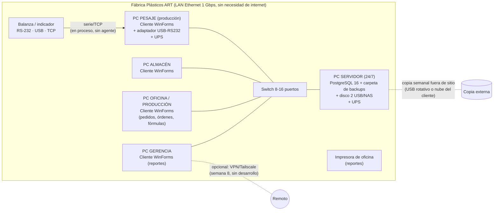
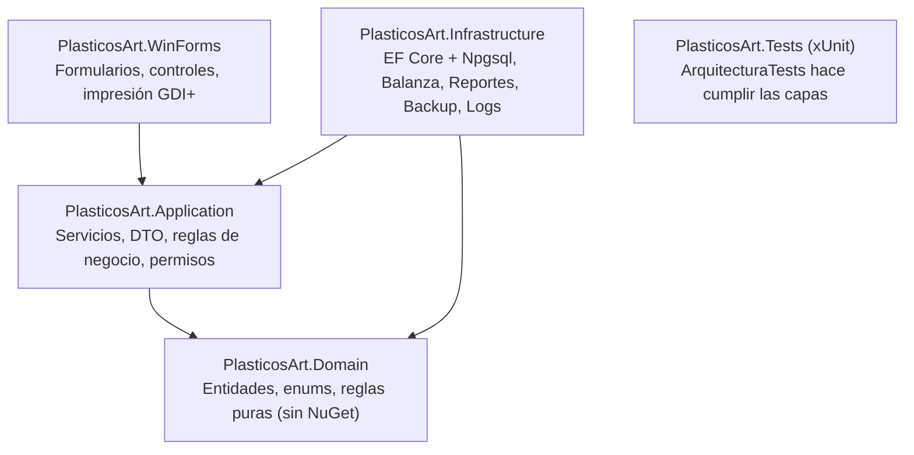

# Anexo 01 – Arquitectura de solución e infraestructura
**Sistema de Producción – PLÁSTICOS ART** · Autor: Ingeniero en Sistemas Senior · Fecha: 2026-11-11

> **Nota de revisión (vigente; subordina a este anexo lo que contradiga el [Plan maestro](../Plan-Implementacion-Plasticos-ART.md))**: (1) runtime: se queda en .NET 8 y la migración a la LTS vigente se agenda en soporte (Plan DEC-02); (2) configuración de balanza: tabla `ConfiguracionBalanza` con una fila por estación (`EstacionId`) en lugar de `config/balanza.json` (Plan 3.2, HU-E5-01 de 9 h); (3) instalador del servidor = script PowerShell + Inno Setup mínimo; los binarios `pg_dump` y `pg_restore` los aporta el propio PostgreSQL 16 del servidor y el cliente no los necesita; (4) tarifa de cambios: 60 Bs/h (la referencia de ≈ 62 Bs/h de este anexo queda superada, Plan DEC-11); (5) horas vigentes: Plan 7.2 y Anexo B del plan.
>
> Documento de decisión. Los anexos de software, UX/UI, procesos y QA parten de aquí.
> Convención: **[SUPUESTO]** = lo damos por cierto hasta confirmar; **[PREGUNTA]** = se pregunta al cliente en la semana 1.

---

## 0. Resumen ejecutivo

| Tema | Decisión |
|---|---|
| **Arquitectura recomendada** | **Opción B: escritorio WinForms .NET 8 cliente-servidor en LAN, con PostgreSQL 16 en un PC servidor de la fábrica.** La balanza se lee en proceso desde el PC de la estación de pesaje (sin agente). |
| **Plan B** | **B-mono:** si el cliente confirma en la semana 1 que tiene un solo PC, se instala todo en ese PC (PostgreSQL local, mismo código). Si exige acceso web/remoto, se cotiza aparte un **módulo de consulta web de solo lectura** (fuera de las 8 semanas) o se da acceso remoto por VPN/escritorio remoto al PC servidor. |
| **Por qué no web (C)** | La interfaz de Pesalab (21 509 líneas WinForms) no se reutiliza en web. Reescribir la UI de 8 módulos + balanza + reportes en Blazor, más un agente de balanza, no cabe en 8 semanas con 1 desarrollador y 20 000 Bs. |
| **Por qué no SQLite monoequipo (A)** | Los módulos exigen usuarios concurrentes (almacén, producción, supervisión, gerencia). SQLite sobre carpeta compartida SMB corrompe datos; sólo vale con un único PC. |
| **Ahorro por reutilización** | ≈ **330 h** de trabajo que de otro modo habría que escribir (≈ 1,0 × todo el presupuesto de horas). Ver §5. |
| **Costo de infraestructura para el cliente** | ≈ **5 500 – 9 500 Bs** (servidor usado/nuevo básico + UPS + switch + adaptadores). No incluye la balanza. Ver §9. |
| **Presupuesto de horas asumido** | ≈ 320 h totales (8 sem × 40 h; ≈ 62 Bs/h). Infraestructura y DevOps ocupan ≈ **58 h** (18 %). Ver §10. |
| **Riesgo #1** | Protocolo de la balanza desconocido y/o balanza sin salida de datos (sólo display). Mitigación: validación en la semana 1 con checklist y simulador; Pesalab ya cubre serie/TCP continuo. |
| **Riesgo #2** | Migrar EF Core de SQLite a PostgreSQL (el acoplamiento está en ~15 archivos de Infrastructure; las capas Domain/Application no cambian). |

---

## 1. Evaluación de opciones

### 1.1 Opciones

| Opción | Descripción | Reutiliza de Pesalab |
|---|---|---|
| **A** | WinForms .NET 8 + SQLite, un solo PC | ~100 % de capas; UI ~70 % como patrón |
| **B** | WinForms .NET 8 clientes en LAN + **PostgreSQL** (o SQL Server Express) en un PC servidor | Domain, Application, Balanza, Reportes, Seguridad, Auditoría, FormBase, instalador; cambia proveedor EF, backup y migraciones |
| **C** | Web ASP.NET Core + Blazor Server en servidor local/nube + **agente Windows** de balanza (reutiliza lector serie; expone peso por SignalR/HTTP) | Domain y Application, lector de balanza, reportes PDF/Excel; **UI nueva completa** |
| **D1** | Híbrido: **B** + visor web de solo lectura (ASP.NET Core mínimo) para gerencia/remoto, en una fase posterior | B + ~15 % nuevo |
| **D2** | B con SQL Server Express en lugar de PostgreSQL | Igual que B; cambia motor |

### 1.2 Matriz de criterios ponderados
Escala 1 (malo) a 5 (excelente). Puntaje = Σ peso × nota.

| Criterio | Peso | A SQLite mono | **B WinForms + PostgreSQL LAN** | C Web + agente | D1 B + visor web |
|---|---:|:-:|:-:|:-:|:-:|
| Cumple plazo de 8 sem con 1 dev | 20 | 5 | **4** | 1 | 3 |
| Encaja en 20 000 Bs (horas) | 15 | 5 | **4** | 1 | 3 |
| Reutilización de Pesalab | 12 | 5 | **4** | 2 | 4 |
| Multiusuario concurrente real | 12 | 1 | **5** | 5 | 5 |
| Integración con balanza (riesgo bajo) | 10 | 5 | **5** | 3 | 5 |
| Robustez sin internet en planta | 8 | 5 | **5** | 4 | 5 |
| Acceso remoto / "hosting" de la propuesta | 5 | 1 | 2 | 5 | 4 |
| Costo de infraestructura para el cliente | 6 | 5 | **4** | 2 | 3 |
| Soporte 90 días y mantenibilidad | 7 | 3 | **4** | 3 | 3 |
| Seguridad y respaldo | 5 | 3 | **4** | 4 | 4 |
| **Total (máx. 500)** | 100 | **398** | **418** | 245 | 369* |

*D1 puntúa menos en plazo/horas porque sólo el visor ya cuesta ≈ 40–60 h extra; se mantiene como ampliación futura, no como alcance base.

**Lectura:** A gana en simplicidad pero falla el requisito de concurrencia (peso 12 con nota 1 es un descalificador funcional, no sólo un punto). B es el único que cumple todos los requisitos duros. C es la mejor arquitectura "ideal" a largo plazo pero no cabe en plazo ni presupuesto.

### 1.3 Sobre el "hosting y dominios" de la propuesta
La propuesta dice que hosting y dominios son costo del cliente "según las capacidades que elija". Eso **no obliga** a una solución web. **[SUPUESTO]** el sistema corre 100 % en la LAN de la fábrica. **[PREGUNTA 1]** ¿La gerencia necesita ver reportes fuera de la fábrica (celular/casa)? Si sí: (a) VPN tipo Tailscale/WireGuard gratuita hacia el PC servidor + escritorio remoto (sin costo de desarrollo), o (b) visor web de solo lectura D1 (cotización adicional, ≈ 40–60 h). Esto debe quedar escrito en el documento de procesos de la semana 1 para que no se interprete como incluido.

### 1.4 PostgreSQL vs SQL Server Express (dentro de B)
| Criterio | PostgreSQL 16 | SQL Server Express 2022 |
|---|---|---|
| Licencia | Libre, sin límite de tamaño | Gratis, límite 10 GB/BD, 1 GB RAM de motor |
| Tipo `numeric` exacto para pesos y recetas | Sí | Sí |
| Respaldo | `pg_dump` en línea, formato comprimido | `BACKUP DATABASE`, requiere programar con Task Scheduler (Express no tiene Agent) |
| Instalación silenciosa en el instalador | Sí (instalador EDB `--mode unattended`) | Sí, pero más pesado (~700 MB) |
| EF Core 8 | Npgsql, muy maduro | Maduro |
| Familiaridad del equipo | **[SUPUESTO]** media | **[SUPUESTO]** media |
**Decisión: PostgreSQL 16.** Sin tope de 10 GB, sin costo, y `pg_dump` simplifica el respaldo. SQL Server Express queda como alternativa si el cliente ya tiene un servidor SQL.

---

## 2. Arquitectura decidida

### 2.1 Topología

Reglas de la topología:
- **Una sola base de datos**, en el servidor. Los clientes nunca guardan datos de negocio localmente.
- **La balanza se conecta a un PC cliente** (la estación de pesaje), no al servidor, como en Pesalab (`IServicioBalanza` singleton, lectura en hilo dedicado). Sin agente ni servicio adicional: menos piezas que fallar.
- **Cuántas estaciones de pesaje**: **[PREGUNTA 2]** ¿hay una o varias balanzas? El diseño soporta N: la configuración de balanza se guarda **por equipo** (ver §6.2).
- El servidor puede ser también un PC de oficina si el cliente no compra uno dedicado (no recomendado; ver §9).

### 2.2 Capas (sin cambios respecto a Pesalab)

Convenciones heredadas y que se mantienen: `TimeProvider` inyectado, fechas en UTC, `ExigirPermiso` en cada método de servicio, unidad de trabajo con auditoría atómica, `FormBase.EjecutarAsync`, DPI y `VerificadorLayout`.

### 2.3 Stack
| Componente | Elección |
|---|---|
| Lenguaje / runtime | C# 12 / .NET 8 LTS (soporte hasta nov 2026 → **ver nota**) |
| UI | WinForms (DPI-aware), controles reutilizados de Pesalab |
| ORM / BD | EF Core 8 + Npgsql; PostgreSQL 16 |
| Reportes | QuestPDF (PDF) y ClosedXML (Excel), como en Pesalab |
| Logs | Serilog a archivo, retención 30 días |
| Pruebas | xUnit; BD de pruebas = PostgreSQL local (esquema por prueba) |
| Instalador | Inno Setup 6.3+ (cliente y servidor) |
| Balanza | `PuertoSerieWin32` (kernel32), `LectorSerial`, `LectorTcp`, `GeneradorPesoSimulado` |

> **Nota de ciclo de vida:** .NET 8 sale de soporte en noviembre de 2026 (muy cerca de la entrega). **[SUPUESTO]** se mantiene .NET 8 porque Pesalab está en .NET 8 y el sistema es una instalación cerrada en LAN; se deja la actualización a .NET 10 LTS (el sucesor, cambio de `TargetFramework` + recompilar) como tarea de la ventana de soporte opcional posterior. Verificar el estado vigente en la semana 1 y, si el costo de pasar directo a la LTS vigente es de ≤ 4 h, hacerlo desde el día 1.

---

## 3. Requisitos mínimos

### 3.1 Hardware y red (a proveer por el cliente)
| Equipo | Mínimo | Recomendado |
|---|---|---|
| **PC servidor** | CPU 4 núcleos, 8 GB RAM, SSD 240 GB, Ethernet 1 Gbps, Windows 10/11 Pro | i3/i5 10.ª gen o superior, 16 GB RAM, SSD 480 GB + disco USB de 1 TB para backups, **UPS 1000 VA** |
| **PC cliente** | 4 GB RAM, 2 núcleos, 1366×768, Windows 10 22H2 / 11 | 8 GB RAM, 1920×1080 (el layout se verifica a 100 % y 125 % DPI como en Pesalab) |
| **PC de pesaje** | Lo anterior + puerto serie o adaptador USB-RS232 (FTDI recomendado; CH340 funciona con el lector kernel32 de Pesalab) | UPS 600–1000 VA |
| **Red** | Switch no administrable de 8 puertos, cableado Cat5e/6, IP **fija** para el servidor (reserva DHCP o estática) | Segmentada de internet si se desea; no hace falta salida a internet |
| **SO** | Windows 10 22H2+ / 11 (64 bits). Windows 11 *Home* sirve como cliente, **no** como servidor recomendado (limitaciones de conexiones y política) | Windows 11 Pro en el servidor |

Dimensionamiento: ≈ 20 usuarios simultáneos máximo, < 5 GB de datos en 3 años (pesajes + órdenes + inventario). PostgreSQL con 8 GB sobra.

### 3.2 Software en el servidor
PostgreSQL 16 (servicio Windows), carpeta `D:\PlasticosArt\backups`, tarea de respaldo, regla de firewall de entrada TCP 5432 **sólo** desde la subred de la fábrica (`pg_hba.conf` con `scram-sha-256` y rango de la LAN).

---

## 4. Base de datos, respaldo, restauración y retención

### 4.1 Diseño
- Esquema `public`, nombres PascalCase como en Pesalab, **decimales `numeric(14,3)`** para cantidades de materia prima y `numeric(12,1)` para pesos de balanza (se conserva la resolución de 0,1 kg de Pesalab; **[PREGUNTA 3]** resolución real de la balanza: 0,01 kg o 0,001 kg obliga a `numeric(12,3)`; se decide con el protocolo).
- Colación: reemplazo del `NOCASE` de SQLite por `citext` (o índices con `lower()`) en nombres de ítems, materias primas y usuarios. Se conserva la normalización a mayúsculas y el plegado de acentos de `TextoBusqueda`.
- Numeración atómica (órdenes de pedido, órdenes de producción, lotes): `UPDATE … RETURNING` como primera sentencia de la transacción — **funciona igual en PostgreSQL**; o `SEQUENCE` por serie.
- Concurrencia optimista: token `Version` en `OrdenProduccion`, `Inventario` y `OrdenPedido`, ya resuelto en Pesalab (`PesajeDbContext.SaveChangesAsync`). **En PostgreSQL se usa `xmin` como token** o se conserva el entero (portable).
- Stock: `MovimientoInventario` inmutable (ingreso/salida/ajuste) y saldo calculado; evita condiciones de carrera entre almacén y producción. Se valida `stock ≥ requerido` dentro de la transacción de reserva/salida.
- Migraciones EF Core desde cero (la de SQLite no se arrastra); `ActualizadorBaseDatos` de Pesalab se reutiliza para aplicar migraciones al iniciar el servidor **con backup previo**.

### 4.2 Respaldo y restauración
| Aspecto | Diseño |
|---|---|
| Mecanismo | `pg_dump -Fc` (formato personalizado comprimido) invocado por el programador de la aplicación en el servidor (patrón `ProgramadorBackupAutomatico`) o por una tarea de Windows (`schtasks`) creada por el instalador |
| Frecuencia | Diario a las 23:00 + backup previo a cada migración + manual desde "Utilitarios" |
| Destinos | (1) disco local del servidor, (2) **disco USB/NAS segundo**, (3) copia semanal fuera de sitio (USB rotativo o carpeta sincronizada del cliente) |
| Retención | 30 días diarios, 12 semanales, mínimo 3 copias siempre (regla de Pesalab); purga automática |
| Verificación | `pg_restore --list` tras cada copia + **prueba de restauración mensual** en el PC de desarrollo o equipo de pruebas (checklist en UAT) |
| Restauración | Asistida: detiene a los clientes (mensaje de mantenimiento), `pg_restore --clean` a una BD nueva, valida, intercambia; mismo principio de "aplicar al arranque" de Pesalab (D10) pero a nivel de servidor |
| Objetivo | RPO ≤ 24 h (≤ 1 jornada de producción); RTO ≤ 2 h con el procedimiento documentado |

### 4.3 Retención de datos de negocio
Sin borrado físico (como en Pesalab): sólo `Activo = false` y anulación con motivo. Auditoría (`Auditoria`) se conserva ≥ 5 años; logs 30 días.

---

## 5. Mapa de reutilización de Pesalab (revisado sobre `src/`)

Tamaños medidos: Domain 579 líneas, Application 11 361, Infrastructure 7 545, WinForms 21 509 (sin migraciones). El acoplamiento a SQLite está confinado a **15 archivos** de Infrastructure/WinForms (`SqliteOpcionesExtensiones`, `SqlitePragmasInterceptor`, `UnidadDeTrabajo` (traducción de errores), `DatabaseInitializer`, configuraciones con `NOCASE`, `ParametrosRepositorio`, `SqliteBackupService`, `AplicadorRestauracion`, `RepositorioImportacion`, `AutopruebaInstalacion`, `DesignTimeDbContextFactory`, `DependencyInjection`, `Program.cs`).

Horas ahorradas = horas que costaría escribirlo desde cero menos horas de adaptación (estimación a ritmo de 1 dev senior).

| Componente de Pesalab | Ruta | Estado | Qué cambia | Horas de ahorro |
|---|---|:-:|---|---:|
| Solución, props, capas, `ArquitecturaTests` | `src/*.sln`, `Directory.Build.props` | **Tal cual** (renombrar) | Namespaces/proyectos | 12 |
| Host genérico, DI, configuración, `AppPaths`, Serilog | `WinForms/Program.cs`, `Infrastructure/Common` | **Adaptar** | `AppPaths` pasa a rutas de cliente; el servidor guarda BD fuera | 14 |
| `FormBase`, `ContextoAplicacion`, `IFormFactory`, `ManejadorErrores`, `ClasificadorErrores`, DPI/`VerificadorLayout` | `WinForms`, `Application/Comun` | **Tal cual** | — | 28 |
| `ControlBusquedaCatalogo`, `MotorBusqueda`, `TextoBusqueda`, `DisenoFiltros` | `WinForms/Controles`, `Application` | **Tal cual** | Se usan para ítems, materias primas, clientes, operarios | 20 |
| Seguridad: usuarios, roles, permisos, PBKDF2, bloqueo 5 intentos, cambio de contraseña, `FrmLogin`, `FrmUsuarios`, `AutorizadorMenu` | `Application/Seguridad`, `WinForms` | **Adaptar** | Nuevos roles y matriz `Rol × Permiso` (§7.2) | 26 |
| Auditoría con diff JSON, `FrmVisorAuditoria`, `DiferenciasAuditoria` | `Application/Auditoria` | **Adaptar** | Nuevos snapshots por entidad | 14 |
| Unidad de trabajo, `ITransaccion`, repositorios, token de concurrencia | `Infrastructure/Persistencia` | **Adaptar** | Proveedor Npgsql, pragmas fuera, `xmin`/`Version`, traducción de errores PG (`23505` único → `ConflictoException`, `23514` check) | 10 (ahorro neto tras costo de migración) |
| Catálogos con código automático (`AsignadorCodigos`), normalización mayúsculas, alta rápida | `Application/Catalogos` | **Adaptar** | Entidades: Ítem, MateriaPrima, Operario, Turno, Proveedor | 24 |
| **Lectura de balanza completa**: `IScaleReader`, `LectorSerial`, `PuertoSerieWin32` (CH340), `LectorTcp`, `SeparadorTramas`, `ParserTramas` (regex), `DetectorEstabilidad`, `ServicioBalanza`, `MonitorBalanzaUi`, `FrmConfiguracionBalanza` (diagnóstico) | `Infrastructure/Balanza`, `Application/Balanza` | **Tal cual** | Sólo config por equipo (§6.2) | **60** |
| Simulador y demo de balanza | `Infrastructure/Balanza/Simulador`, `Demo` | **Tal cual** | Imprescindible para no bloquear el desarrollo | 12 |
| `ControlCapturas`, retorno a cero, política de simulador | `Application/Pesajes` | **Adaptar** | Reglas por ítem (rangos mín/máx de peso unitario) | 10 |
| Reportes: servicio común, filtros, grilla, PDF (QuestPDF), Excel (ClosedXML), vista previa e impresión, `ColumnasReporte` declarativas, logo | `Application/Reportes`, `Infrastructure/Reportes` | **Adaptar** | Nuevos reportes (§ módulo 8); se reutiliza toda la infraestructura de exportación | 36 |
| Backup/restore: `ProgramadorBackupAutomatico`, retención, manifiesto, resguardo previo, `FrmBackupRestaurar` | `Infrastructure/Utilitarios/Backup` | **Reescribir núcleo** | `SqliteBackupService` → `pg_dump`/`pg_restore`; reutiliza programador, retención, UI y reglas | 10 (neto) |
| Visor de logs | `Infrastructure/Utilitarios/Logs` | **Tal cual** | — | 8 |
| Importador CSV/DBF/MDB | `Infrastructure/Utilitarios/Importacion` | **Adaptar** (opcional) | Útil para cargar ítems, materias primas y fórmulas desde Excel/CSV del cliente (reduce captura manual en semana 1–2) | 14 |
| Impresión de boleta GDI+ (`DocumentoBoleta`, `PintorBoleta`) | `WinForms/Impresion` | **Adaptar** | Etiqueta/ticket de pesaje de lote | 8 |
| Instalador Inno Setup, `publicar.ps1`, autoprueba, `ActualizadorBaseDatos`, asistente de puesta en marcha | `instalador/`, `scripts/`, `Application/Arranque` | **Adaptar** | Dos instaladores (cliente y servidor), instalación silenciosa de PostgreSQL | 26 |
| Licencias Supabase | `Infrastructure/Licencias` | **No usar** (decisión) | El cliente no pidió licenciamiento; se evita dependencia de internet. Se deja desactivado; opcional si el desarrollador desea proteger el producto | 0 (ahorra mantener) |
| Manuales y checklist UAT (plantillas) | `docs/` | **Adaptar** | Estructura y herramienta `construir-manuales.py` | 12 |
| Suite de pruebas (~1 950 tests) | `tests` | **Adaptar** | Fixture de BD pasa a PostgreSQL; builders y patrones se reutilizan | 16 |
| **Total ahorro estimado** | | | | **≈ 330 h** |

**Sin equivalente en Pesalab (nuevo):** fórmulas/recetas (BOM), órdenes de pedido, órdenes de producción con máquina de estados, operarios y turnos, inventario con movimientos, motor de cálculo de materia prima (MRP simple), relación peso ↔ cantidad producida, reportes de producción. Esto es el grueso de las ≈ 230 h de desarrollo restantes; el detalle va en el anexo de software.

**Qué NO se reutiliza (y por qué):** la UI web (no existe), licencias (decisión), reglas de faeneo/boleta/desposte, importador DBF/MDB (sólo si el cliente tiene datos legados).

---

## 6. Integración de balanza

### 6.1 Principio
En producción Pesalab ya demostró en sitio el flujo **indicador → adaptador USB-serie CH340 → `PuertoSerieWin32` → trama → regex → estabilidad → captura**. Se reutiliza íntegro. La diferencia de este proyecto: el peso se relaciona con **cantidad de ítems producidos** (p. ej. "peso del lote = N unidades × peso unitario"), de modo que el control es *peso total vs. cantidad × peso teórico por ítem con tolerancia*.

### 6.2 Cambio necesario: configuración por equipo
Pesalab guarda **una** `ConfiguracionBalanza` en la BD. Con varios PCs, sólo el de pesaje tiene balanza. Se mueve a **configuración por equipo** (JSON local `config/balanza.json`, patrón ya usado por `impresion.json`, o tabla `ConfiguracionBalanza` con clave `NombreEquipo`). Costo: 4 h. Los PCs sin balanza arrancan con la balanza "No configurada" sin errores.

### 6.3 Protocolos posibles y cobertura actual
| Protocolo | ¿Lo cubre Pesalab hoy? | Esfuerzo si hace falta |
|---|:-:|---|
| RS-232 / USB-serie, transmisión **continua** | **Sí** (probado RX8 Accurex, 9600 8N1, gramos) | 0 h |
| TCP/IP (servidor serie→Ethernet) continuo | **Sí** (`LectorTcp`) | 0 h |
| Serie o TCP **bajo demanda** (envía comando `P`, `W`, `ENQ`) | No (R22 abierto en Agents.md) | **8 h**: `ComandoSolicitud` + temporizador de sondeo |
| **Modbus RTU/TCP** | No | **16–20 h** (NModbus o implementación mínima de función 03) — riesgo para el plazo |
| Trama binaria propietaria | No (el parser es por regex de texto) | 12–16 h (parser binario) |
| USB HID / SDK del fabricante (DLL) | No | 16–24 h, depende del SDK; **evitar** |
| Salida analógica 4–20 mA / contactos | No | **No soportado**; exige conversor del cliente |
| Balanza **sin salida de datos** (sólo display) | — | Se registra el peso **a mano** con validación; Módulo 7 sigue funcionando en modo manual (§6.5) |

### 6.4 Validación del protocolo en la semana 1 (checklist)
Pedir al cliente antes del día 2: marca/modelo del indicador, manual de comunicación, fotos del panel trasero (conectores) y 10 minutos de acceso al indicador.
1. Identificar el puerto físico: DB9 RS-232, USB, RJ45, sólo display. **Decisión inmediata:** si no hay salida de datos, el cliente debe informar si comprará otra o usará registro manual.
2. Conectar con adaptador USB-RS232 y capturar con una herramienta de monitor de puerto (RealTerm/Termite o `FrmConfiguracionBalanza` → "Probar") **≥ 50 tramas** con carga 0, carga patrón y carga en movimiento.
3. Determinar: baudios/paridad/bits, separador de trama (CR/LF/espacio/`=`), unidad (kg/g/lb), decimales, bandera de estabilidad, modo (continuo o bajo demanda).
4. Escribir y probar el **regex** con `ParserTramas` y el simulador; guardar el archivo de captura como dato de prueba del repositorio (fixture).
5. Validar conversión con **un peso patrón conocido** (lección de F3: queda pendiente en Pesalab).
6. Registrar el resultado en el documento de procesos: protocolo = {serie|TCP|Modbus|otro}, modo, y **veredicto verde/amarillo/rojo**. Rojo (sin salida o protocolo propietario no soportado) activa el plan de contingencia: peso manual + simulador, y se reajusta el cronograma por escrito (condición 5 de la propuesta).
**[PREGUNTA 4]** ¿Cuántas balanzas, marca/modelo y cuál es la capacidad y división? **[PREGUNTA 5]** ¿Se pesa producto terminado, materia prima en el ingreso, o ambos? (Define si el almacén también necesita balanza.)

### 6.5 Simulador y modo manual
Para no bloquear el desarrollo: `LectorBalanzaDemo`/`GeneradorPesoSimulado` de Pesalab se usan desde el día 1 (semanas 2–5 integran pesos contra el simulador). Política heredada: los pesos simulados quedan marcados "SIMULADO" y sólo el Administrador puede grabarlos; en producción el origen válido es `Balanza`. Se añade `Origen = Manual` (con permiso y motivo obligatorio, auditado) para el caso de contingencia o balanza sin salida.

---

## 7. Seguridad

### 7.1 Autenticación
Se reutiliza `Pbkdf2PasswordHasher` (SHA-256, 100 000 iteraciones **→ subir a 600 000 si el rendimiento del PC lo permite**; es una mejora de 1 línea), política de contraseña, bloqueo tras 5 intentos / 5 min, cambio obligatorio en el primer ingreso, mensajes unificados anti-enumeración. Nuevos usuarios nacen con `DebeCambiarPassword = true`. Recuperación local del administrador (`--restablecer-admin`).

### 7.2 Roles propuestos (matriz base; se valida en la semana 1) **[SUPUESTO]**
| Permiso | Administrador | Gerencia | Jefe de producción | Almacenista | Operador de balanza |
|---|:-:|:-:|:-:|:-:|:-:|
| Usuarios y parámetros | ✔ | | | | |
| Fórmulas (crear/editar) | ✔ | | ✔ | | |
| Pedidos | ✔ | ver | ✔ | | |
| Órdenes de producción (crear/cerrar) | ✔ | ver | ✔ | | |
| Operarios por turno | ✔ | ver | ✔ | | |
| Inventario (ingresos/salidas/ajustes) | ✔ | ver | ver | ✔ | |
| Cálculo de materia prima | ✔ | ver | ✔ | ver | |
| Registro de pesos | ✔ | ver | ✔ | | ✔ |
| Reportes | ✔ | ✔ | ✔ | parcial | |
| Auditoría y backups | ✔ | ver auditoría | | | |
La UI oculta opciones sin permiso (`AutorizadorMenu`) y **cada servicio** vuelve a exigirlo (`ExigirPermiso`), defensa en profundidad heredada.

### 7.3 Datos y red
- Conexión cliente → PostgreSQL con **un rol de aplicación de mínimos privilegios** (sin `SUPERUSER`, sin `CREATE`), autenticación `scram-sha-256`, `pg_hba.conf` limitado a la subred. La cadena de conexión se guarda **cifrada con DPAPI** (`ProtectedData`, ámbito máquina) en el cliente; nunca en `appsettings.json` en claro.
- Migraciones las ejecuta un rol de propietario distinto (sólo el instalador del servidor/actualizador).
- **TLS en la LAN**: opcional (`ssl=on` con certificado autofirmado) — **[SUPUESTO]** se activa si el cliente usa Wi-Fi para algún PC; con cableado se documenta como riesgo aceptado, igual que R27 en Pesalab.
- Auditoría: `Auditoria` atómica con cada operación (órdenes, inventario, pesos, cierres, anulaciones); jamás se registran contraseñas ni hashes.
- Cifrado en reposo: BitLocker en el PC servidor si el cliente tiene Windows Pro (recomendado, no incluido en el alcance).
- Antivirus: excluir la carpeta de datos de PostgreSQL y backups (rendimiento), a cargo del cliente.

---

## 8. Entornos, despliegue, actualizaciones, monitoreo, continuidad

### 8.1 Entornos
| Entorno | Dónde | Datos | Uso |
|---|---|---|---|
| Desarrollo | PC del desarrollador (PostgreSQL local, simulador) | Sintéticos | Diario |
| Pruebas / UAT | PC del desarrollador o VM + un PC del cliente en semanas 4 y 7 | **Copia de datos reales** (anonimizados si el cliente lo pide) | Aceptación de hitos |
| Producción | Servidor de la fábrica | Reales | Desde semana 4 (módulos 1–5), completo semana 8 |
Regla: **producción nunca se prueba con datos de prueba**; la BD de UAT es una BD distinta (`plasticosart_uat`) en el mismo servidor para las pruebas de semana 7 sin riesgo.

### 8.2 Instalación
Dos instaladores Inno Setup (patrón de F9, `AppId` fijo, permisos por SID, datos nunca borrados al desinstalar):
- **`PlasticosArt-Servidor-x.y.z.exe`**: instala PostgreSQL silencioso (si falta), crea BD y roles, copia scripts de respaldo, regla de firewall, tarea programada, aplica migraciones, siembra datos iniciales (admin/admin con cambio forzado, parámetros).
- **`PlasticosArt-Cliente-x.y.z.exe`**: instala la app self-contained win-x64 (publicación con `publicar.ps1`, ≈ 180 MB), asistente de primer arranque pide **IP/nombre del servidor** y prueba la conexión.
- Autoprueba `--autoprueba` (BD, PDF, Excel, escritura) como en Pesalab.
- Tiempo objetivo: servidor ≤ 45 min, cada cliente ≤ 10 min.

### 8.3 Actualizaciones
Versión única en `Directory.Build.props`. Regla: **cliente y servidor deben coincidir en versión de esquema**; el cliente lee `__EFMigrationsHistory` al conectar y, si el esquema es más nuevo que su versión, muestra "Actualice esta PC" y no deja operar (equivalente a `ArranqueBaseDatosException` de Pesalab). El orden de actualización: respaldo previo → servidor (migra) → clientes. Todo con ventana fuera de turno (**[PREGUNTA 6]** turnos y horarios de producción para planificar ventanas).

### 8.4 Monitoreo y logs
Serilog por cliente (30 días) en `%ProgramData%`, visor de logs reutilizado. Servidor: log de PostgreSQL + **comprobación de salud** diaria en la aplicación del Administrador ("Estado del sistema": espacio libre en disco, edad del último backup, versión de esquema, conexiones activas). Alerta visual en la barra de estado si el último backup tiene > 36 h. Sin monitoreo externo (fuera de alcance).

### 8.5 Licenciamiento
No se aplica. **[SUPUESTO]** PostgreSQL, .NET, QuestPDF (licencia Community: confirmar umbral de ingresos vigente, P10 de Pesalab), ClosedXML e Inno Setup son libres o gratuitos para este uso. Windows y Office son del cliente. Se desactiva el módulo de licencias de Pesalab; la decisión de protección del software se deja al desarrollador.

### 8.6 Continuidad (corte de luz / red / fallo)
| Evento | Efecto | Mitigación |
|---|---|---|
| Corte de luz | PostgreSQL es transaccional (WAL): no se corrompe; transacción en curso se pierde | **UPS en servidor y PC de pesaje** (≥ 15 min); apagado ordenado por software de la UPS |
| Corte de red / cable | Los clientes pierden conexión | El cliente detecta, bloquea grabar, **reintenta y mantiene en memoria el último peso capturado** hasta 5 minutos; mensaje claro "Sin conexión con el servidor"; no se graba parcialmente (todo atómico) |
| Servidor caído | Nadie opera | Procedimiento en papel (formato de contingencia) para registrar pesos y luego cargar; recuperación desde backup en ≤ 2 h (RTO) sobre **cualquier PC** con el instalador de servidor |
| Disco del servidor falla | Pérdida del activo | Backup en disco 2 + copia semanal externa; RPO ≤ 24 h |
| Balanza o adaptador desconectado | El indicador de balanza pasa a `SinDatos` | Reconexión automática (ya implementada); modo manual con motivo auditado |
Esta tabla va tal cual al **plan de contingencia** entregado con la capacitación.

---

## 9. Infraestructura que debe proveer el cliente y cuándo
Estimaciones **orientativas** para Bolivia (precios de mercado local sujetos a verificación con proveedores; no incluidos en los 20 000 Bs).

| Ítem | Cantidad | Costo aproximado (Bs) | Necesario para | Fecha límite |
|---|:-:|---:|---|---|
| PC servidor (usado reacondicionado i5/16 GB/SSD 480 GB o equivalente nuevo básico) | 1 | 3 000 – 5 500 | Producción | **Semana 3** (para instalar y sembrar antes de la entrega 1) |
| UPS 1000 VA para servidor | 1 | 600 – 1 000 | Producción | Semana 3 |
| UPS 600–1000 VA para PC de pesaje | 1 | 400 – 800 | Pesaje | Semana 5 |
| Disco USB 1 TB (backups) o NAS pequeño | 1 | 450 – 700 | Respaldo | Semana 3 |
| Switch 8 puertos Gigabit + cables Cat6 | 1 + varios | 200 – 450 | Red | Semana 3 |
| Adaptador USB-RS232 (FTDI/chipset confiable) | 1 por balanza | 80 – 200 | Pesaje | **Semana 2** (para validar protocolo) |
| Balanza/indicador con salida de datos | **Cliente ya la tiene / decide** | (1 500 – 6 000 si debe comprar o reemplazar) | Pesaje | **Semana 1: confirmar** |
| PCs cliente (almacén, producción, gerencia) | los que no existan | 2 500 – 4 000 c/u si hay que comprar | Uso | Semana 4 |
| Windows 11 Pro (servidor) | 1 | según proveedor | Servidor | Semana 3 |
| Hosting/VPS/dominio | 0 en el plan base | 0 (si se opta por visor web: VPS ≈ 40–60 Bs/mes + dominio ≈ 100–150 Bs/año) | Sólo si acceso remoto web | Decidir en semana 1 |
**Total mínimo realista para el cliente (sin balanza ni PCs cliente):** ≈ **4 700 – 8 450 Bs**; con adaptador y UPS de pesaje: **≈ 5 500 – 9 500 Bs**.
**Camino económico:** usar un PC existente como servidor (menos recomendable) y UPS compartida; baja el costo a ≈ 1 500–2 500 Bs, con mayor riesgo operativo. Debe quedar firmado por el cliente.

---

## 10. Tareas de infraestructura por semana (dentro del plan de 8 semanas)
Base: 40 h/semana (≈ 320 h). Las horas de abajo son **sólo infraestructura y DevOps**; el desarrollo funcional está en el anexo de software. Total: **≈ 58 h**.

| Sem. | Tareas de infraestructura | Entregable verificable | Horas |
|---|---|---|---:|
| **1** | Relevar equipos, red, número de PCs y balanzas (**P1, P2, P4**); validar protocolo de balanza con checklist §6.4 y captura real; PostgreSQL local de desarrollo; crear solución desde Pesalab (renombrar, quitar licencias, proveedor Npgsql, migración inicial `Inicial`); decisión B vs B-mono/D1 **firmada** | Informe de protocolo (verde/amarillo/rojo); decisión de topología firmada; solución compila con 0 warnings; BD creada con usuarios/permisos | **14** |
| **2** | Adaptar `UnidadDeTrabajo`/traducción de errores PG; fixture de pruebas en PostgreSQL; simulador integrado; pedir/confirmar hardware pendiente | Suite de pruebas base en verde sobre PG | **8** |
| **3** | Instalador servidor (PostgreSQL silencioso, BD, roles, firewall) y cliente (asistente con IP del servidor); programador de **backup** con `pg_dump`; **instalar y probar el servidor del cliente** | Servidor del cliente operativo; 1 cliente conectado; primer backup restaurado en prueba | **12** |
| **4** | Despliegue de la **primera entrega** (módulos 1–5) en producción; ventana de instalación en 2–3 PCs; "Estado del sistema"; capacitación corta | Acta de entrega parcial 1; backup nocturno ejecutado 3 noches seguidas | **6** |
| **5** | Pruebas de concurrencia (≥ 5 clientes), lectura de balanza real en estación de pesaje; ajustes de red | Prueba de carga 20 min sin errores | **4** |
| **6** | Integración de balanza en el PC de pesaje: configuración por equipo, cable, UPS; prueba con peso patrón; corte de red simulado | Peso patrón validado ±1 división; recuperación tras corte documentada | **6** |
| **7** | Actualizaciones controladas (migración con backup previo) con datos reales en BD UAT; prueba de **restauración completa** en otro PC | Restauración exitosa con RTO medido | **5** |
| **8** | Instalación final, VPN opcional, plan de contingencia, manual de soporte, entrega de credenciales, **prueba de recuperación en frío** | Acta de entrega final; manual de administración | **3** |
| | **Total** | | **58** |

Horas adicionales ocultas que el plan debe reservar: soporte posterior 90 días (≈ 8–10 h/mes de bolsa), y la contingencia de balanza **roja** (+16–24 h) que se descontaría de funciones menos críticas (reportes) con aprobación del cliente.

---

## 11. Riesgos de arquitectura e infraestructura

| # | Riesgo | Prob. | Impacto | Mitigación |
|---|---|:-:|:-:|---|
| R1 | Balanza sin salida de datos o protocolo propietario | M | Alto | Checklist de semana 1; modo manual; plan rojo con ajuste de alcance escrito |
| R2 | Migración SQLite → PostgreSQL consume más de lo previsto | M | M | Acoplamiento acotado a 15 archivos; primera semana la dedicada; fallback: SQL Server Express (mismas tareas) |
| R3 | Cliente no consigue servidor/UPS a tiempo | M | Alto | Fechas límite en §9 por escrito; alternativa B-mono temporal en un PC existente |
| R4 | Cliente espera acceso web "por el hosting" | M | M | Cerrar en semana 1 (P1); VPN gratuita o visor web cotizado aparte |
| R5 | Windows Home / PCs viejos sin 4 GB | M | Baja | Requisito mínimo en la propuesta de infraestructura |
| R6 | Corte de luz frecuente | Alta (contexto) | M | UPS + transacciones atómicas + procedimiento en papel |
| R7 | .NET 8 fuera de soporte en el periodo de soporte | Cierta | Baja | Ver nota §2.3; no es riesgo funcional en LAN cerrada |
| R8 | Cliente cambia procesos tras la semana 1 | M | Alto | Cláusula de ampliación de plazo de la propuesta (cond. 5) |

---

## 12. Decisiones pendientes y preguntas abiertas para el cliente (semana 1)
1. **P1** ¿Alguien necesita ver reportes fuera de la fábrica? (Define VPN o visor web.)
2. **P2** ¿Cuántos PCs y cuántas estaciones de pesaje? ¿Hay un PC que pueda actuar de servidor 24/7?
3. **P3** Resolución real de la balanza (0,1 / 0,01 / 0,001 kg) y rango.
4. **P4** Marca, modelo, puertos y manual de la balanza; ¿tiene salida de datos?
5. **P5** ¿Se pesa producto terminado, materia prima, ambos?
6. **P6** Turnos y horarios (ventanas de mantenimiento y respaldo).
7. **P7** ¿Tienen servidor, SQL Server o licencias existentes que condicionen el motor de BD?
8. **P8** ¿Wi-Fi para algún puesto? (Activa TLS obligatorio.)
9. **P9** ¿Hay datos históricos (Excel/Access) de ítems, fórmulas e inventario para importar? (Reduce horas de captura.)
10. **P10** ¿Quién es el responsable con autoridad y quién administra los backups en la fábrica?
**Supuestos clave:** LAN cableada sin internet obligatorio; ≤ 20 usuarios; una balanza principal; sin requisito de alta disponibilidad; el desarrollador principal cubre arquitectura, infraestructura, software y parte de UX (los "roles" del equipo de planificación son hats de una misma persona, con apoyo parcial opcional de un segundo técnico para instalación en sitio).
