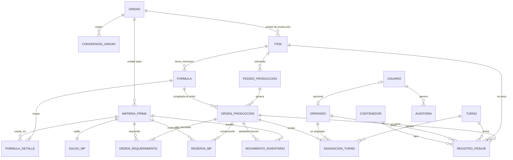
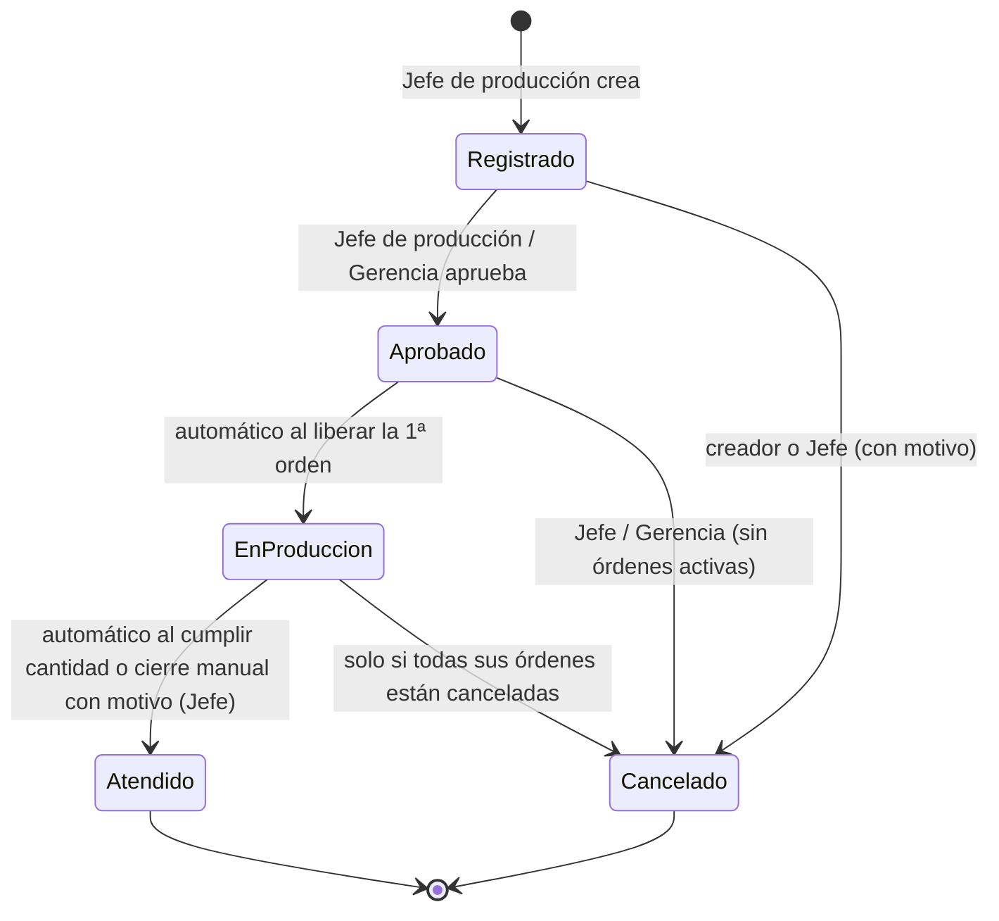

# Anexo 02 – Diseño de software y backlog (Sistema de Producción – PLÁSTICOS ART)

Fecha: 2026-11-11. Rol: ingeniero de software senior. Se trabaja sobre la arquitectura ya decidida (Opción B: WinForms .NET 8 cliente-servidor en LAN, PostgreSQL 16, EF Core 8 + Npgsql, capas de Pesalab). Ver `01-arquitectura-e-infraestructura.md`.

> **Horas vigentes: ver Plan maestro 7.2, 7.4 y Anexo B** (374 h bottom-up; las horas de este anexo —336 h, E6-04 de 8 h, E7-04 con 2 sesiones, E1-03 de 12 h— quedan sustituidas). El plan sustituye también: capacitación en 4 sesiones, reportes en plazo R1 a R4 y R7 (R5 y R6 como columnas y pantalla; reporte R6, R8 y R9 diferidos), configuración de balanza por estación en tabla (HU-E5-01 de 9 h) y los puntos abiertos Q-22 a Q-26 del plan (órdenes sin pedido, una fórmula vigente por ítem, identificación de operario, teclado numérico, etiqueta de lote).
>
> Nota de equipo: el "equipo" real es 1 desarrollador principal (~40-45 h/semana, 8 semanas = 320-360 h) con apoyo puntual del ingeniero en sistemas para levantamiento, capacitación y despliegue. Los roles (analista, QA, DBA, DevOps) los cubre la misma persona; el plan reserva horas explícitas para cada tarea, no para "roles".

---

## 0. Resumen ejecutivo

- 14 entidades núcleo nuevas + 6 reutilizadas de Pesalab (Usuario, Auditoría, ParametrosSistema, etc.).
- Decisiones de simplificación para caber en 8 semanas: **1 ítem por pedido**; **1 pedido → N órdenes** (no consolidación N pedidos → 1 orden); **fórmula congelada** al emitir la orden; **sin valuación de inventario** (costo es solo referencial); **stock = saldo materializado + kardex inmutable** con actualización atómica en PostgreSQL; **una sola balanza principal**, configuración por equipo en archivo local.
- Backlog: 7 etapas, 38 historias, **336 h netas = 100 % de la capacidad (8 × 42 h)**. No hay holgura: se identifican 26 h de historias "Could" que se difieren si algo se atrasa (sección 8.3). Semanas críticas: S1, S3, S4 y S6.
- Reutilización estimada: ~60 % de la infraestructura (seguridad, auditoría, balanza, reportes, FormBase, DI, logging); 100 % del dominio de negocio (fórmulas, pedidos, órdenes, inventario, cálculo MP, pesaje de producción) es nuevo.

---

## 1. Modelo de dominio

### 1.1 Diagrama ER



### 1.2 Entidades y atributos clave

Convenciones: PK `Id` bigint identity; todas las fechas `timestamptz` en UTC (se mantiene la regla de Pesalab: UTC en BD, local en pantalla con `TimeProvider`); cantidades y pesos `numeric(14,3)` (kg con 3 decimales; sin `REAL`, se elimina `DecimalARealConverter`); códigos texto con `citext` o collation insensible; `Version` entero (token de concurrencia) en Pedido, Orden y Registro de pesaje; `xmin` como token en `SaldoMp`. Borrado solo lógico (`Activo`).

| Entidad | Atributos clave | Reglas / restricciones |
|---|---|---|
| **Unidad** | Codigo (kg, g, t, un, mil, bolsa, rollo), Nombre, Tipo (Masa/Conteo/Longitud), FactorABase (kg para masa; 1 para conteo), EsBase | Unidad base de masa = kg. Única por código. |
| **ConversionUnidad** | UnidadOrigenId, UnidadDestinoId, Factor, MateriaPrimaId? | Conversiones por materia (ej.: bolsa de PP = 25 kg). Si MateriaPrimaId es null, vale para todas. |
| **Item** (producto) | Codigo (auto), Nombre, Descripcion, UnidadProduccionId, **PesoUnitarioStdG** (g, 3 dec.), **TolPesoUnitarioPct** (def. 5 %), UnidadesPorEmbalaje?, Activo | PesoUnitarioStdG > 0. Es la referencia para peso→cantidad. |
| **MateriaPrima** | Codigo (auto), Nombre, Tipo (Resina/Masterbatch/Aditivo/Reciclado/Empaque), UnidadBaseId, StockMinimo, CostoReferencial? (no se valúa), Activo | Stock siempre en unidad base (kg). |
| **Formula** | ItemId, NumeroVersion, Estado (Borrador/Vigente/Archivada), **BaseCalculo** (PorUnidad/PorLote/PorKg), **CantidadBase** (ej. 1 000 un, 1 lote, 100 kg), MermaGlobalPct, VigenteDesde, Notas, CreadaPorId | Único (ItemId, NumeroVersion). **Máximo 1 Vigente por ítem** (índice único parcial). Una versión Vigente es inmutable: para cambiar se crea nueva versión; al activarla la anterior pasa a Archivada. |
| **FormulaDetalle** | FormulaId, MateriaPrimaId, Cantidad, UnidadId, MermaPct (línea), Orden | Cantidad > 0; sin MP repetida en la misma versión. Aviso (no bloqueo) si Σ líneas sin merma difiere de PesoUnitarioStdG × CantidadBase en más de 2 %. |
| **PedidoProduccion** | Numero (correlativo atómico), ItemId, CantidadSolicitada, UnidadId, FechaRequerida, Prioridad (Normal/Alta/Urgente), Solicitante (texto libre: cliente o área), Estado, Observacion, CreadoPorId, Version | **1 ítem por pedido** (decisión de alcance). Cantidad > 0. FechaRequerida ≥ hoy al crear. |
| **OrdenProduccion** | Numero (correlativo atómico), PedidoId (FK obligatoria; ver pregunta P-S2), ItemId, **FormulaId + FormulaSnapshotJson** (congelada), CantidadPlanificada, CantidadProducida (derivada), FechaInicioPlan, FechaFinPlan, TurnoPrincipalId?, Estado, MermaAdmitidaPct, CierreMotivo?, CerradaPorId?, Version | Σ CantidadPlanificada de órdenes no canceladas de un pedido ≤ CantidadSolicitada × (1 + SobreproduccionPct param., def. 5 %). Fórmula = versión Vigente al emitir; no cambia aunque la fórmula evolucione. |
| **OrdenRequerimiento** | OrdenId, MateriaPrimaId, CantidadNeta, MermaPct, CantidadRequerida, CantidadReservada, CantidadConsumida | Calculado y guardado al emitir (foto del cálculo). Recalculable solo en estado Emitida. |
| **Turno** | Nombre (Mañana/Tarde/Noche), HoraInicio, HoraFin (puede cruzar medianoche), Activo | Fecha de producción de un turno nocturno = fecha en que inicia. |
| **Operario** | Codigo, Nombre, Cargo, UsuarioId? (opcional), Activo | Un operario puede no tener usuario del sistema. |
| **AsignacionTurno** | Fecha, TurnoId, OperarioId, OrdenProduccionId?, RolEnTurno (Operador/Ayudante/Supervisor), Estado | Único (Fecha, TurnoId, OperarioId, OrdenId). Un operario no puede estar en 2 órdenes activas del mismo turno y fecha (regla, se valida). |
| **MovimientoInventario** (kardex) | Fecha, MateriaPrimaId, Tipo (Ingreso, SalidaProduccion, AjustePositivo, AjusteNegativo, Devolucion), Cantidad (>0, base), Signo (+1/−1), OrdenProduccionId?, DocumentoRef (factura/guía), LoteProveedor?, Proveedor (texto), CostoUnitario?, Motivo, UsuarioId, MovimientoAnuladoId? | **Inmutable**: no se edita ni borra; error se corrige con contra-movimiento. Ajuste exige Motivo. SalidaProduccion y Devolucion exigen OrdenProduccionId. |
| **SaldoMp** | MateriaPrimaId (PK), Existencia, Reservado, xmin | Tabla materializada, se actualiza en la misma transacción que el movimiento/reserva. CHECK Existencia ≥ 0, Reservado ≥ 0, Reservado ≤ Existencia. Disponible = Existencia − Reservado. Verificable contra Σ kardex (job de conciliación). |
| **ReservaMp** | OrdenId, MateriaPrimaId, Cantidad, Estado (Activa/Consumida/Liberada), Fecha | Una reserva activa por (Orden, MP). Se libera al cancelar/cerrar. |
| **Contenedor** | Nombre (caja, bolsa, bandeja), TaraKg, Activo | Tara predefinida para agilizar el pesaje. |
| **RegistroPesaje** | OrdenId, ItemId, TurnoId, OperarioId, FechaHora, TipoPesaje (ProductoTerminado/MateriaPrima/Retazo), Lote (texto, auto: orden-fecha-correlativo), PesoBruto, Tara, **PesoNeto** (= bruto − tara), PesoUnitarioRefG (snapshot del ítem), **CantidadEstimada**, ConteoMuestra?, PesoMuestraG?, DesviacionPct?, Origen (Balanza/Manual/Simulador), MotivoManual?, EstacionPc, Estado (Vigente/Anulado), MotivoAnulacion?, UsuarioId, Version | Neto > 0. Origen Manual exige MotivoManual y permiso específico. Simulador solo Administrador (regla antifraude heredada de Pesalab). Orden debe estar EnProduccion. Anulación sin borrado, con motivo. |
| **ParametrosSistema** (reutiliza) | Empresa, Logo, SiguienteNumeroPedido, SiguienteNumeroOrden, SobreproduccionPct, ToleranciaPesoDefaultPct, UmbralFaltante | Numeración con `UPDATE … RETURNING` (válido en PostgreSQL, igual que Pesalab). |
| **Usuario / Rol / Auditoría** (reutiliza) | Usuario.NombreUsuario, Hash PBKDF2, Rol, Activo, bloqueo por intentos; Auditoría: Accion, Entidad, EntidadId, UsuarioId, FechaUtc, `DetalleJson` (jsonb con antes/después) | Se agregan acciones nuevas al enum `AccionAuditoria`. |

### 1.3 Decisión pedido ↔ orden

Se elige **1 pedido → N órdenes** (un pedido grande se parte en varias órdenes por turno o máquina) y cada orden pertenece a un solo pedido. La consolidación N pedidos → 1 orden queda fuera de alcance (pregunta P-S2). Un pedido pasa a *Atendido* cuando Σ producido de sus órdenes ≥ cantidad solicitada (o por cierre manual con motivo).

---

## 2. Reglas de negocio y algoritmos (con ejemplos)

### 2.1 Explosión de fórmula y requerimiento de MP

Definición: la fórmula dice cuánta MP se necesita para producir `B` (CantidadBase) en su base de cálculo. Para una orden de cantidad `Q` (misma unidad que `B`):

```
factor        = Q / B
neta_i        = cantidad_i × factor                    (convertida a unidad base de la MP)
merma_i       = MermaGlobalPct + MermaPct_i            (aditivas, en %)
requerida_i   = neta_i × (1 + merma_i / 100)
```
Redondeo: se calcula en `decimal` con 3 decimales (kg), redondeo AwayFromZero, al final (sin redondeos intermedios). Si la base es PorKg y la orden viene en unidades: `Q_kg = Q × PesoUnitarioStdG / 1000` y `B` se interpreta en kg de producto.

**Ejemplo A – base por millar.** Ítem "Vaso 8 oz", peso unitario std 18,9 g. Fórmula v2, base = 1 000 un: PP homopolímero 18,500 kg; masterbatch blanco 0,400 kg; merma global 3 %. Σ = 18,9 kg = 1 000 × 18,9 g (coincide, sin aviso). Orden Q = 25 000 un → factor 25:
- PP: 18,500 × 25 = 462,500 kg neta → ×1,03 = **476,375 kg**
- Masterbatch: 0,400 × 25 = 10,000 kg → ×1,03 = **10,300 kg**

**Ejemplo B – base por kg.** Fórmula PorKg, B = 100 kg: resina 96 kg, masterbatch 3 kg, aditivo 1 kg; merma global 2 %; línea del aditivo con merma extra 1 %. Orden: 40 000 un × 18,9 g = 756 kg de producto → factor 7,56. Aditivo: 1 × 7,56 = 7,56 kg × (1 + 0,03) = **7,787 kg**; resina: 96 × 7,56 = 725,76 × 1,02 = **740,275 kg**.

### 2.2 Verificación de stock (suficiente / faltante), con reservas de otras órdenes

```
disponible_i = Existencia_i − Reservado_i                (Reservado ya incluye las órdenes activas)
faltante_i   = max(0, requerida_i − disponible_i)        (al evaluar una orden aún sin reserva)
semáforo     = Verde (faltante = 0) | Amarillo (disponible − requerida < StockMinimo) | Rojo (faltante > 0)
```
Ejemplo (continúa A): existencia PP 900 kg, reservado por otras órdenes 500 kg → disponible 400 kg; requerida 476,375 → **faltante 76,375 kg (rojo)**. Masterbatch: existencia 30, reservado 8 → disponible 22 ≥ 10,3 → verde (queda 11,7 kg; con stock mínimo de 15 → amarillo).
Reserva: al **Liberar** la orden se reserva atómicamente cada MP con `UPDATE SaldoMp SET Reservado = Reservado + @q WHERE MateriaPrimaId=@id AND Existencia − Reservado >= @q`. Si alguna MP falla, se hace rollback de toda la liberación (todo o nada). El Jefe de producción puede *liberar con faltante* (reserva parcial) registrando motivo; queda marcada "con faltante" y en el reporte de faltantes. Orden de prioridad de reservas: por orden de liberación (primero en liberar, primero reservado); no hay reasignación automática.

### 2.3 Consumo real vs teórico

- Salida a producción: el Almacenero registra `SalidaProduccion` contra la orden (resta Existencia y consume Reserva hasta cubrirla; no puede superar `requerida × 1,10` sin permiso especial). `Devolucion` suma Existencia.
- **Consumo real** = Σ SalidaProduccion − Σ Devolucion (por MP y orden).
- **Consumo teórico** (al cierre) = `cantidad_i × (Producido / B)` con la **producción real** (no la planificada).
- **Desviación %** = (real − teórico) / teórico × 100. Se marca *fuera de tolerancia* si supera `MermaAdmitidaPct` de la orden (def. = merma global de la fórmula).
Ejemplo: se produjeron 24 000 un; PP teórico = 18,5 × 24 = 444,000 kg; salidas netas 468,200 kg → desviación = +5,45 % (> 3 %: alerta).

### 2.4 Peso → cantidad de ítems y tolerancias

```
PesoNeto          = PesoBruto − Tara                       (tara = contenedor seleccionado o digitada)
CantidadEstimada  = round(PesoNeto × 1000 / PesoUnitarioRefG)       (g; redondeo al entero más cercano)
```
Ejemplo: bruto 52,40 kg; tara 1,20 kg (caja) → neto 51,20 kg; 51 200 / 18,9 = 2 709,0 → **2 709 un**.
Resolución de balanza (P3): con división de 0,01 kg el error de lectura es ±0,01 kg = ±0,5 un; se muestra como "±1 un". 
**Muestreo opcional de calidad:** el operario cuenta n piezas (ej. 100) y las pesa (1 905 g) → peso unitario real 19,05 g; desviación = (19,05 − 18,9)/18,9 = +0,79 % → dentro de la tolerancia 5 % del ítem (verde). Fuera de tolerancia: aviso, y el pesaje queda con bandera "revisar" (no se bloquea; el supervisor decide).
**Producción acumulada de la orden:** `CantidadProducida = round(Σ PesoNeto vigentes × 1000 / PesoUnitarioStdG)` (se calcula del acumulado, no sumando estimaciones, para que el redondeo no se acumule). Si supera `CantidadPlanificada × (1 + Sobreproducción %)` → advertencia y requiere confirmación del supervisor.
Rango: neto debe estar entre 0,1 kg y `MaxPesoBalanza` (parámetro); retorno a cero entre pesadas se conserva como regla opcional (reutilizar `ControlCapturas` con umbral configurable).

### 2.5 Cierre de orden

Requisitos: estado Terminada, sin pesajes con bandera pendiente. Al cerrar: (1) se libera toda reserva activa restante; (2) se calcula el informe de cierre: producido vs planificado (%), consumo real vs teórico por MP, merma real = (Σ MP consumida − Σ peso neto producto)/Σ neto; (3) si la diferencia de producción > ±5 % o hay MP fuera de tolerancia se exige **motivo de cierre**; (4) la orden queda inmutable (solo lectura). Un pedido se marca Atendido al cumplirse la cantidad.
**Valuación: fuera de alcance.** `CostoReferencial` y `CostoUnitario` se guardan solo como dato informativo; no hay costeo PEPS/promedio ni reporte de costos (se puede ofertar aparte).

### 2.6 Concurrencia de stock (PostgreSQL)

1. Toda operación de stock (ingreso, salida, reserva, ajuste) corre en **una sola transacción** `READ COMMITTED` que inserta el movimiento y actualiza `SaldoMp` con `UPDATE … WHERE condición RETURNING` (condición atómica; 0 filas = rechazo "stock insuficiente"). Sin lecturas previas que luego se escriben.
2. Al reservar varias MP, se procesan **ordenadas por MateriaPrimaId** (evita deadlocks entre dos usuarios).
3. `Version`/`xmin` como token optimista en Pedido, Orden y Registro; `DbUpdateConcurrencyException` → `ConcurrenciaException` ("otro usuario modificó este registro, recargue") — traducción ya existente en la unidad de trabajo de Pesalab, se adapta a `PostgresException` 23505/23514/40001.
4. Correlativos (pedido, orden) con `UPDATE ParametrosSistema … RETURNING` como primera sentencia de la transacción.
5. Job de conciliación nocturno (o botón del Administrador): compara `SaldoMp` contra Σ kardex y reporta diferencias (no corrige solo).

---

## 3. Máquinas de estados

### 3.1 Pedido de producción


Solo en *Registrado* se edita ítem, cantidad y fecha. En *Aprobado* solo la fecha requerida (con auditoría).

### 3.2 Orden de producción

```mermaid
stateDiagram-v2
    [*] --> Emitida: Jefe emite desde pedido Aprobado (fórmula congelada, MP calculada)
    Emitida --> Liberada: Jefe libera (reserva MP; con faltante exige motivo)
    Emitida --> Cancelada: Jefe (motivo)
    Liberada --> EnProduccion: Supervisor de turno inicia (o 1er pesaje)
    Liberada --> Cancelada: Jefe (libera reservas)
    EnProduccion --> Pausada: Supervisor (motivo)
    Pausada --> EnProduccion: Supervisor
    EnProduccion --> Terminada: Supervisor / Jefe
    Terminada --> EnProduccion: Jefe (reabrir, con motivo, solo si no cerrada)
    Terminada --> Cerrada: Jefe (informe de cierre)
    EnProduccion --> Cancelada: solo Jefe con consumo = 0 y sin pesajes; si no, Terminar
    Cerrada --> [*]
    Cancelada --> [*]
```


Reglas: Almacenero registra salidas solo con orden Liberada/EnProduccion/Pausada; Operador de balanza registra pesajes solo con EnProduccion. Toda transición escribe auditoría (estado anterior/nuevo, usuario, motivo).

---

## 4. Matriz rol × permiso

Roles: **Adm** Administrador (TI/dueño del sistema), **Ger** Gerencia (consulta y aprobación), **Jef** Jefe de producción, **Alm** Almacenero, **Sup** Supervisor de turno, **Bal** Operador de balanza. Se cubre con la misma `MatrizPermisos` de Pesalab (enum `Permiso` + diccionario Rol→permisos + prueba exhaustiva); la UI oculta y los servicios exigen (`ExigirPermiso`).

| Permiso | Adm | Ger | Jef | Alm | Sup | Bal |
|---|:-:|:-:|:-:|:-:|:-:|:-:|
| GestionarUsuarios, ConfigurarSistema, VerAuditoria | ✔ | VerAud. | — | — | — | — |
| ConfigurarBalanza (y usar Simulador) | ✔ | — | — | — | — | — |
| GestionarCatalogos (Unidades, Contenedores, Turnos) | ✔ | — | ✔ | — | — | — |
| GestionarItems | ✔ | — | ✔ | — | — | — |
| GestionarMateriasPrimas | ✔ | — | ✔ | ✔ | — | — |
| GestionarFormulas (crear/versionar) | ✔ | — | ✔ | — | — | — |
| ActivarFormula (publicar versión vigente) | ✔ | ✔ | ✔ | — | — | — |
| VerFormulas | ✔ | ✔ | ✔ | ✔ | ✔ | — |
| CrearPedido | ✔ | — | ✔ | — | — | — |
| AprobarPedido | ✔ | ✔ | ✔ | — | — | — |
| EmitirOrden / LiberarOrden / CancelarOrden | ✔ | — | ✔ | — | — | — |
| LiberarConFaltante (excepción) | ✔ | ✔ | ✔ | — | — | — |
| IniciarPausarTerminarOrden | ✔ | — | ✔ | — | ✔ | — |
| CerrarOrden | ✔ | — | ✔ | — | — | — |
| GestionarOperarios y Turnos | ✔ | — | ✔ | — | — | — |
| AsignarOperarios | ✔ | — | ✔ | — | ✔ | — |
| RegistrarIngresoMp | ✔ | — | — | ✔ | — | — |
| RegistrarSalidaProduccion / Devolucion | ✔ | — | — | ✔ | — | — |
| AjustarInventario (con motivo) | ✔ | — | — | ✔ (límite) | — | — |
| VerInventario / VerRequerimientoMp | ✔ | ✔ | ✔ | ✔ | ✔ | — |
| RegistrarPesaje (balanza) | ✔ | — | — | — | ✔ | ✔ |
| RegistrarPesajeManual (con motivo) | ✔ | — | — | — | ✔ | — |
| AnularPesaje | ✔ | — | ✔ | — | ✔ | — |
| VerReportes | ✔ | ✔ | ✔ | ✔ (inventario) | ✔ (su turno) | — |
| ExportarReportes (PDF/Excel) | ✔ | ✔ | ✔ | ✔ | ✔ | — |
| Backup / Restaurar / Logs | ✔ | — | — | — | — | — |

Notas: Gerencia no modifica datos operativos (solo aprueba pedidos y activa fórmulas); el Operador de balanza solo ve la pantalla de pesaje de la orden en EnProduccion. Los límites de ajuste del Almacenero (p. ej. ±5 % del saldo) son un parámetro; sobre el límite requiere Jefe. Cambio de rol de un usuario se audita. (SUPUESTO: Jefe y Gerencia pueden ser la misma persona en una planta pequeña; el sistema lo permite asignando dos usuarios.)

---

## 5. Estructura de la solución y reutilización de Pesalab

### 5.1 Proyectos

```
src/
  PlasticosArt.Domain          entidades, enums, excepciones, reglas puras (sin NuGet)
  PlasticosArt.Application     servicios, DTOs, validadores, interfaces, permisos
  PlasticosArt.Infrastructure  EF Core + Npgsql, balanza, reportes, backup pg_dump, archivos
  PlasticosArt.WinForms        formularios, controles, Program, DI
  PlasticosArt.Tests           xUnit; incluye ArquitecturaTests (reglas de capas por reflexión)
instalador/  (servidor.iss, cliente.iss)     scripts/ (publicar.ps1, backup-pg.ps1, restaurar-pg.ps1)
```
Carpetas nuevas dentro de Domain/Application: `Catalogos` (Unidad, MateriaPrima, Item, Contenedor, Turno, Operario), `Formulas`, `Pedidos`, `Ordenes`, `Inventario`, `Requerimientos` (explosión y stock), `Pesaje`, `Reportes`. Las reglas puras (`ReglasFormula`, `ReglasRequerimiento`, `ReglasPesoCantidad`, `ReglasStock`) viven en `Domain/Reglas` sin dependencias, 100 % testeables.

### 5.2 Qué se reutiliza (según `src/` de Pesalab)

| Componente Pesalab | Acción | Notas |
|---|---|---|
| `Application/Seguridad`: `MatrizPermisos`, `PoliticaSeguridad`, `ServicioAutenticacion`, `ServicioUsuarios`, `SesionActual`, `ValidadorUsuario`, `GeneradorPasswordTemporal`; `Infrastructure/Seguridad` (PBKDF2 hasher) | **Tal cual** + nuevo enum `Rol` (6 roles) y `Permiso` (≈28) | Bloqueo por 5 intentos, cambio obligatorio de clave, protección del último admin. |
| `Application/Auditoria`: `FabricaAuditoria`, `DiferenciasAuditoria`, `ServicioAuditoria`; `FrmVisorAuditoria` | **Tal cual** (columna `jsonb`) | Nuevos snapshots por entidad. |
| `Application/Balanza`: `IScaleReader`, `ParserTramas`, `DetectorEstabilidad`, `ServicioBalanza`, `ValidadorConfiguracionBalanza`, `MapeoBalanza`, `EstadoBalanza`; `Infrastructure/Balanza`: `LectorSerial`, `LectorTcp`, `PuertoSerieWin32`, `SeparadorTramas`, `EnumeradorPuertosSerie`, `FabricaLectorBalanza`, `Simulador`, `Demo`; `WinForms`: `MonitorBalanzaUi`, `FrmConfiguracionBalanza` | **Tal cual**; solo cambia dónde se guarda la configuración (archivo `config/balanza.json` por equipo, patrón de `impresion.json`, en vez de tabla única en la BD) | Probado con RX8 Accurex + CH340. Si el protocolo es bajo demanda/Modbus: nuevo lector (E5-03). |
| `Infrastructure/Persistencia`: `PesajeDbContext`, `UnidadDeTrabajo`, `UnidadDeTrabajoFactory`, repositorios, `DatabaseInitializer`, `DataSeeder`, conversores | **Adaptar**: Npgsql, `numeric`, `timestamptz`, `jsonb`, sin `SqlitePragmasInterceptor`/`DecimalARealConverter`; traducción de `PostgresException`; migraciones nuevas desde cero | Unidad de trabajo e `ITransaccion` se conservan (patrón de auditoría atómica). |
| `ClasificadorErrores`, `ManejadorErrores`, `FormBase` (`EjecutarAsync`, anti-reentrada, DPI), `FormFactory`/`IFormFactory`, `ContextoAplicacion`, `ControlBusquedaCatalogo`, `DisenoFiltros`, `VerificadorLayout`, `AsignadorCodigos` | **Tal cual** | Códigos automáticos de ítem/MP/operario con `AsignadorCodigos`. |
| Reportes: `Application/Reportes` (servicio, `ColumnasReporte`, reglas de totales), `Infrastructure/Reportes` (`GeneradorPdfReportes`, `GeneradorExcelReportes`, `DisenoPdfReporte`, `CargadorLogoReporte`), `FrmReportes`, `FrmVistaPrevia` | **Tal cual** el motor; definiciones de reporte nuevas | Límites (20 000 filas) se mantienen. Cuidado con memoria de PDF (riesgo F7 de Pesalab). |
| Logging Serilog, Host, DI, `AppPaths`, instancia única | **Tal cual** (instancia única por equipo, no por servidor) | |
| `Utilitarios/Backup` (`SqliteBackupService`, programador, retención) | **Adaptar**: `pg_dump -Fc` programado, retención y verificación (`pg_restore --list`); restauración guiada | La parte de programador y retención se reusa. |
| `Utilitarios/Importacion` (lector CSV/DBF/MDB, simulacro) | **Reutilizar el lector CSV** para cargar ítems, MP y fórmulas iniciales (E2-06) | DBF/MDB solo si P9 lo exige. |
| `Application/Pesajes`, `ControlCapturas`, `ReglasPesaje`, `FrmPesaje` | **Adaptar** (captura estable, retorno a cero, política de simulador, atajos) a RegistroPesaje | Se elimina boleta, desposte, ganadero. |
| Boletas/impresión GDI+, Licencias Supabase, `Catalogos` de Ganadero/Cliente/Fletero, Parametros de faeneo | **Eliminar** del nuevo proyecto | Licencias: no se pidió; ahorra tiempo. |
| Instalador Inno Setup, `publicar.ps1`, autoprueba | **Adaptar** a dos instaladores (servidor, cliente) | Servidor instala/valida PostgreSQL (o documenta instalación previa) y crea esquema. |

Verificar nombres exactos en la HU E1-02 (renombrado de espacios de nombres).

### 5.3 Pantallas (WinForms)

Inicio (tarjetas por permiso) · Catálogos (Unidades, Contenedores, Turnos, Operarios) · Ítems · Materias primas · Fórmulas (maestro-detalle con versiones) · Pedidos · Órdenes (lista con semáforo de stock + detalle con pestañas: Requerimiento MP, Asignaciones, Pesajes, Consumo, Cierre) · Inventario (saldos, kardex, ingreso, salida, ajuste) · Asignación de turnos (grilla por fecha y turno) · Pesaje de producción · Reportes · Usuarios · Balanza · Parámetros · Backups · Auditoría.

---

## 6. Catálogo de reportes (Módulo 8)

Filtros comunes: rango de fechas (obligatorio, días locales), turno, ítem, orden, operario según el caso. Exportación PDF/Excel/impresión con el motor de Pesalab. Permiso `VerReportes`.

| ID | Reporte | Fuente de datos | Filtros específicos | Columnas / totales |
|---|---|---|---|---|
| R1 | Producción por orden | OrdenProduccion + RegistroPesaje vigentes | Orden, estado, ítem | Orden, ítem, planificado, producido, % cumplimiento, kg netos, nº pesajes, estado |
| R2 | Producción por turno | RegistroPesaje + Turno + Operario | Turno, operario | Fecha, turno, ítem, kg netos, cantidad estimada, nº pesajes; total por turno |
| R3 | Producción por período | RegistroPesaje agrupado día/semana/mes | Ítem, agrupación | Período, ítem, kg, cantidad; total |
| R4 | Control de pesos | RegistroPesaje | Ítem, orden, solo fuera de tolerancia | Fecha, lote, bruto, tara, neto, peso unitario (muestra vs std), desviación %, origen (marca Manual/Simulado) |
| R5 | Cantidades de ítems producidos | RegistroPesaje + OrdenProduccion | Ítem, período | Ítem, planificado vs producido, diferencia |
| R6 | Consumo de MP teórico vs real | OrdenRequerimiento + Kardex | Orden, MP, período | MP, teórico, real, desviación %, alerta |
| R7 | Stock y kardex de MP | SaldoMp + MovimientoInventario | MP, tipo de movimiento | Existencia, reservado, disponible, mínimo; kardex con saldo corrido |
| R8 | Faltantes de MP por órdenes pendientes | OrdenRequerimiento + SaldoMp | Fecha requerida hasta | MP, requerido total, disponible, faltante |
| R9 | Pedidos y cumplimiento | Pedido + Orden | Estado, fecha requerida | Pedido, solicitado, producido, atraso en días |
| R10 | Auditoría | Auditoría | Usuario, entidad, fechas | (visor existente) |

Excluidos: costos/valuación, gráficos, reportes programados por correo.

---

## 7. Estrategia de pruebas y Definition of Done

**Pirámide.**
1. **Unitarias de reglas puras (xUnit, sin BD):** explosión de fórmula (ejemplos A y B de la sección 2 como casos fijos), merma aditiva, conversión de unidades, peso→cantidad con bordes (neto 0, tara > bruto, redondeo .5), tolerancias, máquina de estados (tabla de transiciones válidas/inválidas × rol), matriz de permisos exhaustiva (patrón de Pesalab).
2. **Integración con PostgreSQL real:** fixture con contenedor efímero (Testcontainers) o instancia local PostgreSQL 16 de pruebas con esquema por prueba; verifica migraciones (`has-pending-model-changes`), CHECK/UNIQUE/índice parcial de fórmula vigente, auditoría atómica, correlativos sin huecos bajo concurrencia, reservas todo-o-nada.
3. **Concurrencia:** prueba con 20 tareas paralelas que reservan sobre la misma MP (suma reservada ≤ existencia, sin negativos, sin deadlock) y dos usuarios editando el mismo pedido (uno recibe `ConcurrenciaException`).
4. **Balanza:** simulador de Pesalab (`GeneradorPesoSimulado`) para flujos completos de pesaje; pruebas de parser con tramas reales capturadas del equipo del cliente (semana 6) como fixtures; pruebas de desconexión/sin datos.
5. **UI:** `VerificadorLayout` a 96 DPI y 125 %; pruebas de formularios con servicios simulados para los flujos críticos (pesaje, liberar orden); arquitectura (`ArquitecturaTests`).
6. **Aceptación (UAT):** checklist por etapa con datos reales del cliente (adaptar plantilla `docs/puesta-en-marcha/checklist-uat.md`).

Objetivos medibles: ≥ 350 pruebas al final (Pesalab llegó a ~1 950 con 13 fases; aquí se priorizan reglas de dominio y servicios); cobertura de líneas de `Domain` ≥ 90 % y de servicios de `Application` ≥ 75 %; suite completa < 2 min.

**Definition of Done (por historia):** compila en Release con 0 warnings; pruebas unitarias/integración de la historia en verde y suite completa verde; permisos aplicados en UI y servicio; auditoría en operaciones de escritura; migración revisada (sin cambios de modelo pendientes); sin bloqueos de UI (`EjecutarAsync`); textos en español con mensajes de validación claros; criterios de aceptación verificados por el desarrollador en el servidor de pruebas; actualización del documento de usuario si cambia flujo. **DoD de etapa:** desplegada en el PC servidor/cliente de prueba, UAT de la etapa ejecutado con el responsable del cliente y acta firmada (alineada a los hitos de pago).

---

## 8. Backlog por etapa (alineado a las 8 semanas)

Prioridad: **M** Must, **S** Should, **C** Could (difiribles). Horas = netas de desarrollo + pruebas de la historia (la gestión, reuniones y viajes están dentro del margen de 42 h/semana).

### Etapa E1 – Semana 1: levantamiento, base de datos, usuarios y permisos (42 h)

| ID | Historia | Criterios de aceptación | h | P |
|---|---|---|--:|:-:|
| HU-E1-01 | Como ingeniero, levanto procesos, formatos y reportes actuales y completo el checklist de balanza | Documento de procesos con flujo actual (pedido→orden→producción→almacén), lista de ítems/MP/operarios/turnos, 3 formatos de reporte actuales anexados; checklist de balanza llena (marca, modelo, puerto, baud, trama real capturada, resolución, rango); respuestas a P1–P10; responsable del cliente aprueba por escrito | 12 | M |
| HU-E1-02 | Como desarrollador, creo la solución desde Pesalab limpia | Solución PlasticosArt compila Release 0 warnings; eliminados módulos faeneo, boletas y licencias; espacios de nombres renombrados; `ArquitecturaTests` en verde | 6 | M |
| HU-E1-03 | Como desarrollador, migro la persistencia a PostgreSQL | EF Core + Npgsql; migración `Inicial` con Usuario, Auditoría, Parámetros, Unidad; `numeric`/`timestamptz`/`jsonb`; traducción de `PostgresException`; fixture de pruebas contra PostgreSQL; `DatabaseInitializer` crea esquema y semilla admin; correlativo `UPDATE…RETURNING` probado | 12 | M |
| HU-E1-04 | Como administrador, gestiono usuarios con los 6 roles y permisos | Matriz de la sección 4 implementada y probada exhaustivamente; login, bloqueo a 5 intentos, cambio de clave obligatorio, protección del último admin funcionando contra PostgreSQL | 5 | M |
| HU-E1-05 | Como auditor, veo auditoría con diff JSON | Visor muestra antes/después en `jsonb`; acciones nuevas en enum | 2 | M |
| HU-E1-06 | Como cliente, valido el documento de procesos | Documento v1 firmado; lista de supuestos y alcance cerrados; fecha de cambio de proceso "congelada" | 5 | M |

Carga: 42 h (sobrecarga controlada). **Riesgo:** el levantamiento depende de la disponibilidad del cliente; si se retrasa, E1-03/E1-04 absorben la espera (no dependen del cliente). El 30 % de pago se cobra a la firma, no depende de esta etapa.

### Etapa E2 – Semanas 2–3: Módulos 1, 2 y 3 (84 h)

| ID | Historia | Criterios de aceptación | h | P |
|---|---|---|--:|:-:|
| HU-E2-01 | Catálogos: unidades y conversiones, materias primas, contenedores | CRUD con búsqueda; código automático; stock mínimo; unidades por materia; borrado lógico; permisos por rol; auditado | 10 | M |
| HU-E2-02 | Ítems con peso unitario y tolerancia | CRUD; peso unitario > 0 obligatorio; código automático; desactivar ítem no afecta órdenes existentes | 8 | M |
| HU-E2-03 | Fórmulas por ítem con versiones | Crear borrador con ≥ 1 línea; base PorUnidad/PorLote/PorKg; merma global y por línea; aviso si Σ ≠ peso×base (>2 %); activar versión archiva la anterior (1 vigente por ítem, probado por índice único); versión vigente inmutable; copiar versión como nueva; pantalla maestro-detalle | 22 | M |
| HU-E2-04 | Pedidos de producción | Crear con ítem, cantidad, fecha requerida, prioridad; correlativo atómico sin huecos bajo concurrencia; transiciones de la sección 3.1 con permisos; filtros por estado y fecha; auditoría | 14 | M |
| HU-E2-05 | Órdenes de producción desde pedido | Emitir desde pedido Aprobado con fórmula vigente congelada (snapshot); valida Σ órdenes ≤ pedido + 5 %; correlativo; estados Emitida/Liberada/Cancelada operativos; la fórmula posterior no altera órdenes emitidas (prueba) | 22 | M |
| HU-E2-06 | Carga inicial desde Excel/CSV de ítems, MP y fórmulas | Importa ≥ 50 filas con simulacro y reporte de errores por fila; sin duplicados | 8 | C |

Carga: 84 h = 2 × 42. **S2:** E2-01, 02, 03 (40 h); **S3:** E2-04, 05, 06 (44 h) → S3 sobrecargada +2 h; se absorbe moviendo E2-06 al final de S3 y recortándolo si hace falta.

### Etapa E3 – Semana 4: Módulos 4 y 5 + primera entrega parcial (42 h)

| ID | Historia | Criterios de aceptación | h | P |
|---|---|---|--:|:-:|
| HU-E3-01 | Operarios y turnos | CRUD; turnos que cruzan medianoche; vínculo opcional a usuario | 5 | M |
| HU-E3-02 | Asignar operarios a turno y orden | Grilla por fecha y turno; un operario no puede estar en 2 órdenes activas del mismo turno/fecha (mensaje claro); copia de la asignación del día anterior | 8 | M |
| HU-E3-03 | Movimientos de inventario (ingreso, salida, ajuste, devolución) | Kardex inmutable; ingreso con documento/proveedor/lote; salida exige orden Liberada/EnProduccion; ajuste exige motivo; saldo nunca negativo; prueba de concurrencia con 20 tareas; contra-movimiento para corregir | 14 | M |
| HU-E3-04 | Consulta de stock y alerta de mínimo | Existencia/reservado/disponible; filas en amarillo bajo mínimo; kardex por MP con saldo corrido; exportar a Excel | 5 | M |
| HU-E3-05 | Despliegue de la 1ª entrega: servidor PostgreSQL, instalador cliente, backup básico y UAT | Sistema instalado en el PC servidor y ≥ 1 cliente del cliente; backup diario con `pg_dump` funcionando; UAT de módulos 1–5 con datos reales; acta de 1ª entrega firmada | 10 | M |

Carga: 42 h. **Hito de pago 2 (40 % = 8 000 Bs) se condiciona a E3-05**. Si el cliente no tiene PC servidor 24/7 (P2), se instala B-mono en un PC.

### Etapa E4 – Semana 5: Módulo 6, cálculo de materia prima (42 h)

| ID | Historia | Criterios de aceptación | h | P |
|---|---|---|--:|:-:|
| HU-E4-01 | Explosión de fórmula por orden | Reproduce ejemplos A y B de la sección 2 al 3.er decimal; convierte unidades; recalcula solo en Emitida; guarda `OrdenRequerimiento` | 10 | M |
| HU-E4-02 | Reserva y verificación de stock | Disponible considera reservas de otras órdenes; semáforo verde/amarillo/rojo; liberar reserva todo-o-nada (rollback si falta una MP); liberar con faltante exige permiso y motivo; prueba de 20 liberaciones concurrentes sin sobre-reserva | 12 | M |
| HU-E4-03 | Pantalla de requerimiento y faltantes | Pestaña "Requerimiento MP" en la orden; lista de faltantes imprimible/Excel | 8 | M |
| HU-E4-04 | Consumo real vs teórico | Salidas/devoluciones por orden; desviación % con alerta por tolerancia; al cerrar se calcula con producción real | 8 | M |
| HU-E4-05 | Cierre de orden | Libera reservas sobrantes; informe de cierre con diferencias; motivo obligatorio si desviación > 5 %; orden inmutable | 4 | M |

Carga: 42 h.

### Etapa E5 – Semana 6: Módulo 7, balanza y registro de pesos (42 h)

| ID | Historia | Criterios de aceptación | h | P |
|---|---|---|--:|:-:|
| HU-E5-01 | Configuración de balanza por equipo | `config/balanza.json` por PC; solo la estación de pesaje se conecta; pantalla de diagnóstico reutilizada; validación | 5 | M |
| HU-E5-02 | Lector, parser y estabilidad con la balanza del cliente | Parser configurado con trama real de E1-01; 20 lecturas consecutivas válidas; estabilidad alcanzada; reconexión tras desconectar el cable; simulador disponible | 6 | M |
| HU-E5-03 | Lector alternativo si el protocolo no es de transmisión continua | Solo si E1-01 lo exige (bajo demanda/Modbus): lector nuevo con sondeo; pruebas con trama grabada | 8 | C* |
| HU-E5-04 | Registro de pesaje de producción | Neto = bruto − tara; cantidad estimada según 2.4 (ejemplo 2 709 un); muestreo opcional con desviación; acumulado de la orden por Σ neto; advertencia por sobreproducción; solo con orden EnProduccion; auditoría; anulación con motivo | 12 | M |
| HU-E5-05 | Pantalla de pesaje | Display en vivo (100 ms), captura solo con peso estable y retorno a cero, selección de contenedor/tara, lote automático, modo manual con motivo y permiso, simulador solo Administrador, atajos de teclado | 7 | M |
| HU-E5-06 | Prueba en sitio con la balanza real | Prueba con peso patrón: error ≤ resolución; 50 pesadas sin pérdida; acta | 4 | M |

\* E5-03 es contingencia: si no se necesita, esas 8 h se reasignan a holgura para E6/E7. Si se necesita lector Modbus, estimar hasta 16 h y recortar "Could".

### Etapa E6 – Semana 7: Módulo 8, reportes y pruebas con datos reales (42 h)

| ID | Historia | Criterios de aceptación | h | P |
|---|---|---|--:|:-:|
| HU-E6-01 | Motor de reportes sobre el modelo nuevo | Pantalla de filtros común, vista previa, PDF y Excel con logo y totales; límites de filas y mensajes | 8 | M |
| HU-E6-02 | R1, R2 y R3 | Totales coinciden con la suma de pesajes de prueba (caso fijo); filtros por turno/orden/período | 12 | M |
| HU-E6-03 | R4 y R5 | Marca pesajes manuales/simulados; filtra solo fuera de tolerancia | 8 | M |
| HU-E6-04 | R6, R7, R8 y R9 | Coinciden con kardex; faltantes por fecha; R9 con atraso | 8 | S |
| HU-E6-05 | Pruebas con datos reales y de carga | Un mes de datos del cliente cargado; reportes < 5 s con 20 000 registros; lista de defectos priorizada | 6 | M |

Carga: 42 h.

### Etapa E7 – Semana 8: correcciones, instalación, capacitación, puesta en marcha (42 h)

| ID | Historia | Criterios de aceptación | h | P |
|---|---|---|--:|:-:|
| HU-E7-01 | Backups y restauración con pg_dump | Backup diario programado y al cierre; retención 30 días con mínimo 3; copia a USB/ruta de red; restauración probada en otro PC con prueba de integridad (`pg_restore --list` y conteo de filas) | 10 | M |
| HU-E7-02 | Instaladores finales (servidor y cliente) y prueba en PC limpia | Instalar, actualizar y desinstalar sin perder datos; autoprueba; documentos de instalación | 8 | M |
| HU-E7-03 | Corrección de defectos de UAT | 0 defectos críticos/altos abiertos; los medios con plan | 10 | M |
| HU-E7-04 | Capacitación y manuales cortos | 2 sesiones (administración/jefatura y almacén/balanza); guías de 1 página por rol; asistencia registrada | 10 | M |
| HU-E7-05 | Puesta en marcha y acta final | Sistema en producción con datos reales; acta firmada; inicio de los 90 días de soporte | 4 | M |

Carga: 42 h.

### 8.1 Resumen de carga

| Semana | Etapa | Horas planificadas | Capacidad | Estado |
|---|---|--:|--:|---|
| S1 | E1 | 42 | 42 | Llena (riesgo: dependencia del cliente) |
| S2 | E2 | 40 | 42 | OK |
| S3 | E2 | 44 | 42 | +2 h (sobrecarga leve) |
| S4 | E3 | 42 | 42 | **Crítica**: incluye despliegue e hito de pago |
| S5 | E4 | 42 | 42 | Llena |
| S6 | E5 | 42 | 42 | **Crítica**: depende de acceso a balanza; contingencia de 8 h |
| S7 | E6 | 42 | 42 | Llena |
| S8 | E7 | 42 | 42 | Llena |
| **Total** | | **336** | **336** | **Sin holgura (0 %)** |

Estas horas incluyen pruebas automatizadas de cada historia pero no cubren retrabajo por cambios de alcance ni enfermedad; por eso el plan **no es robusto** sin una de las medidas de la sección 8.3.

### 8.2 Rebalanceo para no romper el hito de la semana 4

1. **Adelantar a la semana 1–2 el "esqueleto de despliegue":** instalar PostgreSQL en el PC servidor (o el de pruebas) y el instalador mínimo de cliente en S2 (≈ 4 h tomadas de E3-05), para que S4 solo despliegue/valide.
2. **Reordenar S3 y S4:** E3-01 (operarios/turnos, 5 h, CRUD simple) pasa al final de S3 junto con E2-06 en la parte "Could"; en S4 queda inventario (la parte más delicada) y despliegue.
3. **El hito de la semana 4 exige usar los módulos 1–5:** son las 4 etapas E1, E2 y E3 = 168 h en 4 semanas (100 % de capacidad). Si hay atraso, el recorte permitido es: E2-06 (importador), alerta de mínimo, exportación Excel del kardex; **no se recorta** la concurrencia del stock ni la fórmula versionada.
4. **Fin de semana puntual de la S3 (+8 h)** como válvula acordada con el ingeniero (no planificada en el cálculo).

### 8.3 Historias "Could" difiribles (26 h) si hace falta colchón

HU-E2-06 (8 h), HU-E5-03 si no aplica (8 h), parte de HU-E6-04 (R8/R9, 4 h), exportación Excel del kardex y alerta de mínimo de HU-E3-04 (3 h), manuales cortos de HU-E7-04 (3 h). Con ellas diferidas el plan queda con ~7 % de colchón (310 h comprometidas). Lo diferido se entrega en el período de soporte de 90 días siempre que no altere el alcance firmado.

---

## 9. SUPUESTOS

1. Hay **una** balanza principal y la lee la PC de la estación de pesaje; ítem, orden y operario se seleccionan en esa pantalla.
2. Un pedido contiene **un** ítem (la propuesta: "ítem, cantidad y fecha requerida").
3. La merma es porcentaje **adicional** sobre la cantidad neta (1 + m) y las mermas global y de línea se suman; el cliente puede preferir "merma sobre bruto" (neta/(1 − m)): se parametriza en una sola función.
4. Se pesa **producto terminado**; el pesaje de materia prima queda previsto (enum) pero sin pantalla propia salvo que P5 lo requiera.
5. No hay valuación de inventario, ni compras, ni facturación, ni mantenimiento de máquinas.
6. El Almacenero registra manualmente las salidas de MP a producción (no se descuentan automáticamente al pesar).
7. Los datos maestros (ítems, MP, fórmulas, operarios, turnos) los entrega el cliente en Excel/papel en la semana 1.
8. Una sola planta, una sola moneda y sin multiempresa.

## 10. PREGUNTAS ABIERTAS PARA EL CLIENTE

- **P-S1** ¿Cómo se expresa la merma hoy: sobre la cantidad neta o sobre la bruta? ¿Hay merma distinta por máquina o turno?
- **P-S2** ¿Un pedido se divide en varias órdenes, o varias órdenes de distintos pedidos se juntan en una sola (consolidación)? ¿Se producen órdenes sin pedido previo (stock/urgencias)?
- **P-S3** ¿Un pedido tiene varios ítems o siempre uno?
- **P-S4** ¿Las fórmulas cambian seguido? ¿Quién aprueba un cambio de fórmula?
- **P-S5** ¿La materia prima incluye reciclado/molido propio (retorno de scrap a inventario)? ¿Se necesita reingresar el scrap?
- **P-S6** ¿Qué se pesa exactamente (producto terminado en cajas/bolsas, bobinas, MP)? ¿Se pesa cada caja o por lote? ¿Existe tara fija por contenedor?
- **P-S7** ¿Se necesita conteo físico de ítems como validación o basta la estimación por peso? ¿Cuál es la tolerancia aceptada de peso unitario por ítem?
- **P-S8** ¿Quién autoriza liberar una orden con faltante de MP y quién ajusta inventario?
- **P-S9** ¿Se usa lote de proveedor y trazabilidad (qué lote de resina fue a qué orden)? (Fuera de alcance: solo se guarda el dato en el ingreso.)
- **P-S10** Confirmar los formatos de reporte actuales (¿hay un formato impreso que respetar?) y el idioma/unidades (kg y gramos, millares).
- Más las preguntas P1–P10 del anexo 01.

## 11. RIESGOS DE DISEÑO

| # | Riesgo | Probabilidad | Impacto | Mitigación |
|---|---|:-:|:-:|---|
| 1 | **Plan sin holgura**: 336 h netas = 100 % de la capacidad | Alta | Alto | Diferir "Could" (sección 8.3); fin de semana acordado; no aceptar cambios de alcance sin ampliar plazo (cláusula 5 de la propuesta) |
| 2 | Concurrencia de stock mal resuelta (negativos, sobre-reserva) | Media | Alto | `UPDATE … WHERE … RETURNING`, orden de bloqueo, pruebas de carga paralela desde S4 |
| 3 | Protocolo de la balanza distinto al de Pesalab (bajo demanda, Modbus, TCP propietario) | Media | Alto en S6 | Checklist en S1; capturar trama real en S1; E5-03 contingente; modo manual y simulador como respaldo |
| 4 | Fórmulas del cliente con casos no previstos (varias bases, sustitutos de MP, rendimiento variable) | Media | Medio | Levantamiento en S1 con 3 fórmulas reales; modelo con BaseCalculo y merma por línea; versiones |
| 5 | Datos maestros tardíos o desordenados | Alta | Alto | Plantillas Excel en S1; importador (E2-06); fecha límite en el acta de S1 |
| 6 | Cambios de proceso tras S1 | Media | Alto | Documento firmado; control de cambios; plazo se amplía (cláusula de la propuesta) |
| 7 | Memoria/rendimiento de reportes PDF grandes (riesgo conocido de Pesalab) | Baja | Medio | Mantener tope de filas; recomendar Excel para volúmenes grandes |
| 8 | Dependencia de un solo desarrollador (bus factor) | Media | Alto | Código en repositorio con copia externa, README de despliegue, documentación breve de arquitectura |
| 9 | Migración PostgreSQL con rarezas de Npgsql (DateTime Kind, `numeric`, enums) | Baja | Medio | Resolver en E1-03 con pruebas contra PostgreSQL real, no SQLite |
| 10 | Exigencia posterior de acceso web (P1) | Media | Alto | Fuera de alcance; VPN/escritorio remoto o cotización aparte de visor web de solo lectura |
| 11 | Hito 2 (semana 4) con 5 módulos en 4 semanas | Alta | Alto | Rebalanceo 8.2; criterio explícito: usable = módulos 1–5 con UAT firmado |

**Estimación de esfuerzo total del plan de software:** 336 h (de las cuales 26 h son "Could" difiribles; 8 h contingentes).
