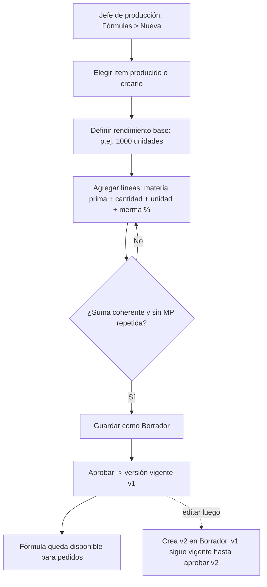
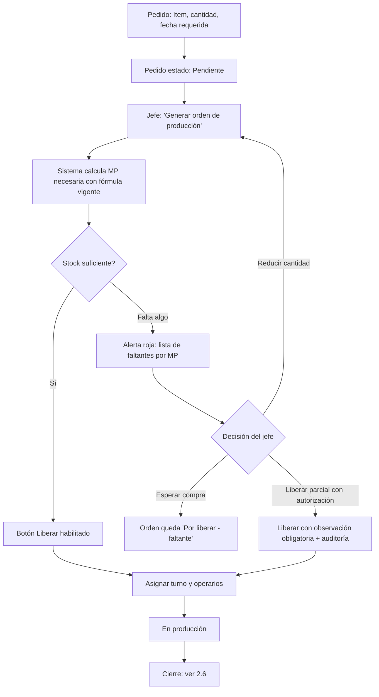
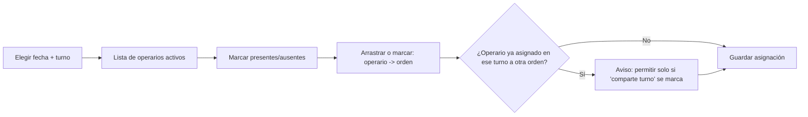
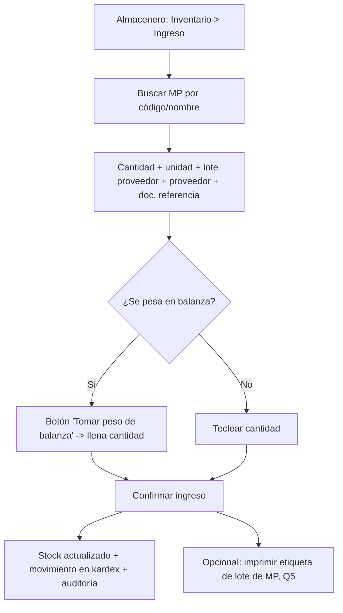
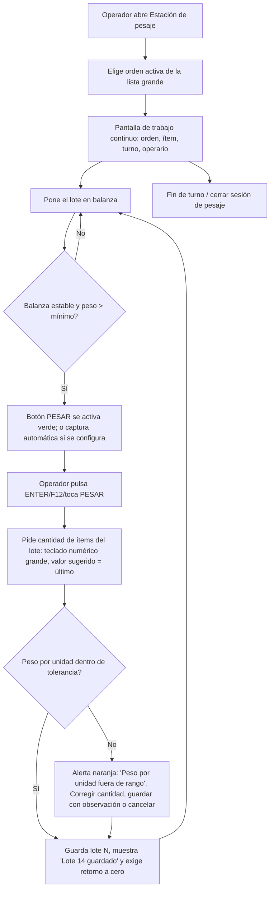
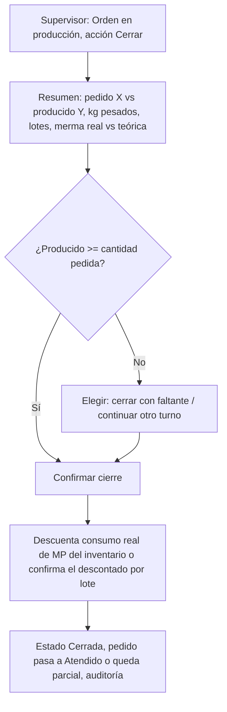
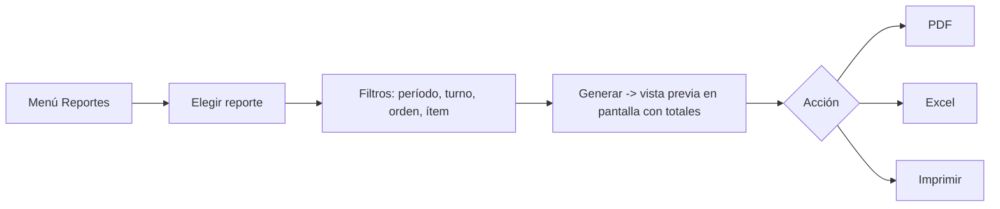

# Anexo 03 – Diseño UX/UI del Sistema de Producción PLÁSTICOS ART

Fecha: 2026-11-11 · Rol: diseñador UX/UI senior · Stack: WinForms .NET 8, cliente-servidor LAN, PostgreSQL 16 (Opción B).

> **Errata de vocabulario (subordinado al [Plan maestro](../Plan-Implementacion-Plasticos-ART.md), DEC-05; el vocabulario oficial es el de 02):** orden: Borrador = **Emitida**; "Por liberar (faltante)" = **Emitida** con indicador de faltante (no es un estado); Liberada = **Liberada** (si se liberó con faltante, queda marcada); En producción = **EnProduccion**; Pausada = **Pausada**; se agrega **Terminada** antes de **Cerrada**; Anulada = **Cancelada**. Pedido: Pendiente = **Registrado** (más **Aprobado**); Con orden = **EnProduccion**; Cumplido = **Atendido**; Cancelado = **Cancelado**. Las pantallas se construyen con el vocabulario de 02. Estación de pesaje: el mínimo viable es una pantalla de un solo botón con teclado físico; kiosco, beep y teclado en pantalla pasan a soporte (Plan 5).
>
> Nota de realismo: el equipo de ejecución es en la práctica 1 desarrollador principal. El "diseñador UX" es un rol que esa misma persona asume en tiempo acotado (ver sección 9). Todo el diseño está pensado para construirse con controles estándar de WinForms más los componentes que ya existen en Pesalab (FormBase, ControlBusquedaCatalogo, DisenoFiltros, VerificadorLayout, FrmPesaje, MonitorBalanzaUi), sin librerías de UI de pago.

---

## 1. Usuarios y contextos de uso

| Persona | Rol en el sistema | Nivel digital probable | Entorno | Dispositivo | Tareas dominantes |
|---|---|---|---|---|---|
| Gerente / dueño | Gerencia (solo lectura + aprobación) | Medio | Oficina, luz normal | PC de escritorio, quizá laptop | Ver producción del día/semana, faltantes de MP, reportes PDF |
| Jefe de producción | Planificador | Medio | Oficina de planta, algo de ruido | PC | Fórmulas, pedidos, órdenes, asignar operarios, liberar órdenes |
| Almacenero | Inventario | Bajo-medio | Almacén, polvo, montacargas | PC fija en almacén | Ingreso de MP, salidas a producción, ver stock |
| Supervisor de turno | Supervisión | Bajo-medio | Planta, ruido, de pie, ve la pantalla a 1-2 m | PC en planta | Ver órdenes del turno, operarios presentes, cerrar órdenes, corregir pesos |
| Operador de balanza | Pesaje | Bajo | Planta: ruido, polvo de resina, guantes, luz variable, de pie | PC/pantalla en la estación; idealmente táctil o con teclado numérico externo | Pesar lotes en serie, indicar cantidad de ítems, repetir muchas veces por turno |
| Administrador (TI / el desarrollador) | Admin | Alto | Oficina | Cualquier PC | Usuarios, permisos, balanza, backups, auditoría |

Supuestos de diseño (a confirmar, ver preguntas abiertas):
- S1. La estación de pesaje es un PC (o mini-PC) con pantalla de 19-24" y teclado numérico; táctil es deseable pero NO se asume.
- S2. Resolución mínima 1366x768 en oficinas; 1920x1080 en la estación de pesaje; escala de Windows 100-125 % (Pesalab ya maneja DPI con FormBase).
- S3. Idioma único: español (Bolivia); fechas dd/MM/yyyy, pesos con coma decimal fija en todo el sistema (lección de Pesalab: el separador regional mezclado fue un defecto), formato 1.234,5.
- S4. Los operarios de planta NO tienen usuario del sistema individual en la estación de pesaje; entra un "responsable de estación" (operador de balanza) y los operarios son registros de personal asignables (módulo 4). Pregunta abierta Q3.

Principios rectores:
1. Planta: pocas pantallas, texto grande, una acción principal por pantalla, cero escritura donde se pueda elegir.
2. Oficina: densidad media, teclado primero (Tab/Enter/F-keys), búsqueda tolerante a acentos (ya existe MotorBusqueda).
3. Nunca perder un peso: todo pesaje capturado se guarda localmente en pantalla hasta confirmarse; los errores de red no borran lo hecho.
4. "Ocultar, nunca falsear" y "estado siempre visible": el estado de la orden, de la balanza y de la red se ven siempre.
5. Mensajes que dicen qué pasó, por qué y qué hacer.

---

## 2. Flujos críticos (mapas)

### 2.1 Crear fórmula (receta) de un ítem


Regla UX: una fórmula aprobada no se edita; se crea versión nueva (las órdenes viejas conservan la versión con la que se calcularon).

### 2.2 Pedido -> orden de producción -> verificación de MP -> liberar



Estados de la orden de producción (badges): Borrador, Por liberar (faltante), Liberada, En producción, Pausada, Cerrada, Anulada. Estados de pedido: Pendiente, Con orden, Cumplido, Cancelado.

### 2.3 Asignar operarios a turno y orden



### 2.4 Ingreso de MP al almacén



### 2.5 Pesaje de lote en balanza y relación con cantidad de ítems (flujo central)


Relación peso-ítems: el sistema muestra siempre peso unitario implícito = peso lote / cantidad, comparado con el peso estándar del ítem (campo en el ítem, con tolerancia %). Eso da al operador una verificación inmediata sin cálculos. (Pregunta abierta Q2: ¿se pesa producto terminado, MP, o ambos? El diseño soporta ambos con "tipo de pesaje": Producto terminado / Materia prima / Merma-desperdicio.)

### 2.6 Cierre de orden


Decisión de diseño: el consumo de MP se descuenta al LIBERAR/PRODUCIR (reserva al liberar, consumo real al cerrar con diferencia visible). Pregunta Q4 para validar con el cliente: ¿salida de MP la hace el almacenero contra la orden (recomendado) o se descuenta automáticamente?

### 2.7 Consultar reportes



---

## 3. Arquitectura de información y navegación

Shell: ventana principal con barra de menú superior (patrón Pesalab), tarjetas de inicio por rol, barra de estado inferior con: usuario, turno actual, estado de servidor (verde/rojo), balanza (conectada/estable/sin datos), versión.

### 3.1 Menú por rol (Available=false para lo no permitido, como AutorizadorMenu de Pesalab)

| Menú | Gerente | Jefe prod. | Almacenero | Supervisor | Op. balanza | Admin |
|---|:-:|:-:|:-:|:-:|:-:|:-:|
| Inicio (tarjetas) | X | X | X | X | X | X |
| Producción > Fórmulas | ver | X | – | ver | – | X |
| Producción > Pedidos | ver | X | – | ver | – | X |
| Producción > Órdenes | ver | X | – | X (cierre) | ver lista | X |
| Producción > Operarios y turnos | ver | X | – | X | – | X |
| Inventario > Materias primas / Ingresos / Salidas / Stock | ver | ver | X | ver | – | X |
| Cálculo de MP por orden (dentro de Órdenes) | ver | X | ver | ver | – | X |
| Estación de pesaje | – | – | – | X | X | X |
| Historial de pesajes | ver | ver | – | X | X (del día) | X |
| Reportes | X | X | stock | X | – | X |
| Administración > Usuarios, Permisos, Balanza, Parámetros | – | – | – | – | – | X |
| Utilitarios > Backup, Logs, Auditoría | – | – | – | – | – | X |

### 3.2 Página de inicio por rol (tarjetas grandes, 6 máximo)
- Jefe de producción: Órdenes por liberar (con contador de faltantes), Nuevo pedido, Operarios del turno, Producción de hoy.
- Almacenero: Ingreso de MP, Salida a producción, Stock crítico (contador rojo), Kardex.
- Operador de balanza: UNA tarjeta enorme "Ir a pesar" + "Mis pesajes de hoy". Al iniciar sesión un operador de balanza va DIRECTO a la estación (configurable).
- Gerente: Producción de hoy / semana, Faltantes, Órdenes atrasadas.

---

## 4. Inventario de pantallas

| # | Módulo | Pantalla | Tipo | Roles | Prioridad |
|---|---|---|---|---|---|
| U1 | Usuarios | Login (con logo y empresa) | Modal | todos | Reutiliza Pesalab |
| U2 | Usuarios | Cambio de contraseña | Modal | todos | Reutiliza |
| U3 | Usuarios | Gestión de usuarios y roles | Lista+detalle | Admin | Adapta |
| U4 | Usuarios | Visor de auditoría (diff) | Lista | Admin | Reutiliza |
| 1a | Fórmulas | Lista de fórmulas (búsqueda, estado, versión) | Lista | JP | Nueva |
| 1b | Fórmulas | **Editor de fórmula** (clave) | Maestro-detalle | JP | Nueva |
| 1c | Fórmulas | Catálogo de ítems (producto, peso estándar, unidad) | Lista+form | JP | Nueva |
| 2a | Pedidos | Lista de pedidos (filtros por estado, fecha) | Lista | JP | Nueva |
| 2b | Pedidos | **Alta/edición de pedido** | Form | JP | Nueva |
| 3a | Órdenes | **Tablero de órdenes** (kanban simple o lista con badges) | Lista | JP, Sup | Nueva |
| 3b | Órdenes | **Detalle de orden** con pestañas: Resumen / Materia prima / Operarios / Pesajes / Historial | Detalle | JP, Sup | Nueva |
| 3c | Órdenes | Cierre de orden (diálogo) | Modal | Sup, JP | Nueva |
| 4a | Operarios | Catálogo de operarios | Lista+form | JP | Nueva |
| 4b | Operarios | Catálogo de turnos | Lista+form | JP, Admin | Nueva |
| 4c | Operarios | **Asignación por turno** (calendario del día) | Matriz | JP, Sup | Nueva |
| 5a | Inventario | Catálogo de materias primas (unidad, stock mínimo) | Lista+form | Alm | Nueva |
| 5b | Inventario | **Ingreso de MP** | Form | Alm | Nueva |
| 5c | Inventario | Salida a producción (contra orden) | Form | Alm | Nueva |
| 5d | Inventario | **Stock actual** (semáforo) | Lista | Alm, JP, G | Nueva |
| 5e | Inventario | Kardex por MP | Lista | Alm, G | Nueva |
| 5f | Inventario | Ajuste de inventario (con motivo) | Modal | Alm+aprob. | Nueva |
| 6 | Cálculo MP | Panel "Necesidad vs stock" dentro de 3b, y simulador previo en 2b | Panel | JP | Nueva |
| 7a | Pesaje | **Estación de pesaje** | Pantalla completa | Op, Sup | Adapta FrmPesaje |
| 7b | Pesaje | Historial/corrección de pesajes (anular con motivo) | Lista | Sup | Adapta |
| 7c | Pesaje | Configuración y diagnóstico de balanza (por equipo) | Form | Admin | Reutiliza |
| 8a | Reportes | Pantalla común de filtros + vista previa | Común | JP, Sup, G | Adapta FrmReportes |
| 8b | Reportes | 6 reportes (ver sección 8) | – | – | Nueva (plantillas) |
| A1 | Admin | Backup/restauración, logs, parámetros empresa, impresión | Varias | Admin | Reutiliza/adapta |

Pantallas totales nuevas de fondo: ~14; adaptadas ~6; reutilizadas ~8. Esto sustenta la estimación de esfuerzo en la sección 9.

---

## 5. Wireframes de pantallas clave (ASCII)

Convenciones: `[ ]` campo, `[Botón]`, `(*)` obligatorio, `▼` combo, `{badge}` estado. Atajos entre paréntesis.

### 5.1 Editor de fórmula (1b)

```
┌ Fórmula: BOLSA CAMISETA 30x40 ─────────── v2 {Borrador}  (v1 {Vigente}) ────────┐
│ Ítem (*) [BOLSA CAMISETA 30x40 ▼ buscar..]   Rendimiento base (*) [1000] [unid ▼]  │
│ Peso estándar por unidad [ 4,2 ] g   Tolerancia [ 5 ] %   Observación [..........] │
├─ Materias primas de la receta ──────────────────────────────────────────────────┤
│ #  Materia prima              Cantidad   Unidad  Merma %   Cant. con merma  [x]  │
│ 1  POLIETILENO ALTA DENS.     [ 3,900 ]  kg      [ 2,0 ]   3,978 kg          [x] │
│ 2  MASTERBATCH BLANCO         [ 0,150 ]  kg      [ 1,0 ]   0,152 kg          [x] │
│ 3  ADITIVO ANTIESTÁTICO       [ 0,050 ]  kg      [ 0,0 ]   0,050 kg          [x] │
│ [+ Agregar materia prima (Ins)]                                                  │
├──────────────────────────────────────────────────────────────────────────────────┤
│ Total MP por 1000 unid: 4,180 kg   Peso esperado: 4,200 kg   Diferencia: -0,5 %  │
│ ⓘ El total debería acercarse al peso estándar x rendimiento.                     │
│ [Guardar borrador (F12)] [Aprobar versión] [Cancelar (Esc)]       Última edición..│
└──────────────────────────────────────────────────────────────────────────────────┘
```
- Estados: vacío ("Esta fórmula aún no tiene materias primas. Pulse Ins para agregar la primera."), error en línea (MP repetida: borde rojo + texto bajo la fila), cargando (cursor de espera, FormBase).
- Teclado: Tab recorre celdas, Ins agrega fila, Supr borra fila seleccionada, F12 guarda, Ctrl+F busca ítem.
- Aprobar exige confirmación y vuelve de solo lectura; "Nueva versión" copia la vigente.
- Verificación cruzada (diferencia con peso estándar) es una ayuda, no bloqueo.

### 5.2 Alta de pedido de producción (2b) con simulador de MP

```
┌ Nuevo pedido de producción ─────────────────────────────  N.º 0042 (automático) ┐
│ Ítem (*)  [BOLSA CAMISETA 30x40 ▼]      Fórmula vigente: v1                      │
│ Cantidad (*) [ 50.000 ] unid      Fecha requerida (*) [18/11/2026]  Prioridad [Normal ▼] │
│ Solicitante/Cliente [ ......................... ]   Observación [ ................ ] │
├─ Vista previa de necesidad de materia prima (se actualiza al escribir) ──────────┤
│ Materia prima             Necesaria     Stock      Estado                        │
│ POLIETILENO ALTA DENS.    198,9 kg      240,0 kg   {OK}                          │
│ MASTERBATCH BLANCO          7,6 kg        5,0 kg   {FALTA 2,6 kg}                │
│ ADITIVO ANTIESTÁTICO        2,5 kg       12,0 kg   {OK}                          │
│ ⚠ Faltan 1 de 3 materias primas. Puede guardar el pedido igual.                  │
│ [Guardar (F12)] [Guardar y generar orden] [Cancelar (Esc)]                       │
└──────────────────────────────────────────────────────────────────────────────────┘
```
- La alerta NO bloquea el pedido (el faltante bloquea solo la LIBERACIÓN de la orden).
- Sin fórmula vigente: mensaje "El ítem BOLSA... no tiene fórmula aprobada. Pida al jefe de producción aprobarla." y botón Guardar deshabilitado.

### 5.3 Tablero de órdenes (3a)

```
┌ Órdenes de producción ── Filtro: [Estado ▼ Activas] [Turno ▼] [Fecha  ] [Buscar..]┐
│ N.º   Ítem                     Pedido  Req.     Producido    Avance          Estado   MP   │
│ OP-0031 BOLSA CAMISETA 30x40   50.000  18/11    32.400       ████████░░ 65%  {En producción} {✔} │
│ OP-0032 VASO 8oz               20.000  19/11    0            ░░░░░░░░░░  0%  {Por liberar}  {⚠ 2 faltan} │
│ OP-0033 TAPA 90mm              80.000  21/11    0            ░░░░░░░░░░  0%  {Borrador}     {—} │
├──────────────────────────────────────────────────────────────────────────────────┤
│ [Nueva desde pedido (F2)] [Abrir (Enter)] [Liberar (F5)] [Cerrar (F6)] [Imprimir hoja de orden] │
└──────────────────────────────────────────────────────────────────────────────────┘
```
- Color de filas solo como refuerzo; el estado siempre tiene texto en el badge (accesibilidad).
- Vacío: "No hay órdenes con este filtro. [Quitar filtros]  [Crear orden desde un pedido]".

### 5.4 Detalle de orden – pestaña Materia prima (3b / módulo 6)

```
┌ OP-0032 · VASO 8oz · 20.000 unid · requerida 19/11 ─────── {Por liberar} ───────┐
│ [Resumen][Materia prima][Operarios][Pesajes][Historial]                           │
│ Fórmula v3 · Base 1.000 unid · Recalculado hoy 08:12 [Recalcular]                │
│ Materia prima        Necesaria   Disponible  Reservado otras   Libre    Estado   │
│ POLIPROPILENO        412,0 kg    500,0 kg    120,0 kg          380,0    {FALTA 32,0 kg} │
│ MASTERBATCH AZUL      12,4 kg     14,0 kg      0,0 kg           14,0    {OK}     │
│ ┌─────────────────────────────────────────────────────────────────────────────┐ │
│ │ ⚠ NO SE PUEDE LIBERAR: falta 32,0 kg de POLIPROPILENO.                       │ │
│ │ Opciones: esperar ingreso · reducir cantidad a 18.400 · liberar con autorización │ │
│ └─────────────────────────────────────────────────────────────────────────────┘ │
│ [Liberar (F5) – deshabilitado]  [Liberar con autorización...]  [Reducir cantidad] │
└──────────────────────────────────────────────────────────────────────────────────┘
```
"Disponible" incluye lo reservado por otras órdenes liberadas, para evitar sobre-promesa de stock: columna "Libre" = Stock - reservado.

### 5.5 Asignación de operarios por turno (4c)

```
┌ Operarios por turno ──  Fecha [11/11/2026 ◄ ►]  Turno [Mañana 06-14 ▼] ──────────┐
│ Operarios disponibles          │ Asignados a órdenes                              │
│ [Buscar..........]             │ OP-0031 BOLSA CAMISETA (línea Extrusora 1)       │
│ ☑ Juan Pérez     (libre)       │   • Juan Pérez [Quitar]   • Luis Mamani [Quitar] │
│ ☑ Luis Mamani    (OP-0031)     │ OP-0034 VASO 8oz (Inyectora 2)                    │
│ ☐ Ana Flores     (ausente)     │   (sin operarios)  [+ Asignar seleccionados]      │
│ ☑ Pedro Quispe   (libre)       │                                                   │
│ Presentes: 3 de 4              │ ⚠ OP-0034 sin operarios: no puede pasar a 'En producción' │
│ [Marcar ausente] [Copiar turno de ayer] [Guardar (F12)]                           │
└──────────────────────────────────────────────────────────────────────────────────┘
```
"Copiar turno de ayer" reduce el trabajo diario del supervisor (acción más frecuente).

### 5.6 Ingreso de materia prima (5b)

```
┌ Ingreso de materia prima ──────────────────────────────── N.º ING-0108 ─────────┐
│ Materia prima (*) [POLIETILENO ALTA DENS. ▼]    Unidad: kg    Stock actual: 240,0 │
│ Cantidad (*) [ 1.000,0 ] kg   [Tomar de balanza (F9)]  Lote proveedor [ L-2210 ]   │
│ Proveedor [ ................ ]  Documento (factura/nota) [ ........ ]  Fecha [11/11/2026] │
│ Costo unitario (opcional, Q6) [ ...... ] Bs                                        │
│ Resultado: stock pasará de 240,0 a 1.240,0 kg                                      │
│ [Confirmar ingreso (F12)] [Confirmar e imprimir etiqueta] [Cancelar (Esc)]         │
└──────────────────────────────────────────────────────────────────────────────────┘
```
Confirmación inmediata y mensaje verde: "Ingreso ING-0108 registrado. Stock de POLIETILENO: 1.240,0 kg." El ingreso no se edita: se corrige con ajuste auditado (patrón anulación de Pesalab).

### 5.7 Stock actual (5d)

```
┌ Stock de materias primas ─ [Buscar..] [Solo críticas ☐] ───────────────────────┐
│ Código  Materia prima            Stock    Reservado  Libre    Mínimo   Estado   │
│ MP-001  POLIETILENO ALTA DENS.  1.240,0   198,9      1.041,1   300,0   {OK}     │
│ MP-004  MASTERBATCH BLANCO          5,0     7,6         -2,6    10,0   {FALTANTE}│
│ MP-007  ADITIVO ANTIESTÁTICO       12,0     2,5          9,5    10,0   {BAJO}    │
│ Resumen: 2 críticas · [Exportar Excel] [Imprimir] [Ver kardex (Enter)]            │
└──────────────────────────────────────────────────────────────────────────────────┘
```
Estados: OK (libre ≥ mínimo), BAJO (0 ≤ libre < mínimo), FALTANTE (libre < 0).

### 5.8 ESTACIÓN DE PESAJE (7a) – diseño especial (ver sección 6)

```
┌──────────────────────────────────────────────────────────────────────────────────────┐
│ OP-0031 · BOLSA CAMISETA 30x40 · Turno Mañana · Resp: J. Pérez        {Red OK} {Bal. OK}│
├──────────────────────────────────────────────┬───────────────────────────────────────┤
│                                              │  AVANCE DE LA ORDEN                   │
│        1 2 4 , 6   kg                        │  Pedido:   50.000 unid                │
│   (fuente 120+ pt, monoespaciada)            │  Producido: 32.400 unid  (65 %)       │
│   ┌──────────────────────────────┐           │  ███████████░░░░░░                    │
│   │  ●  ESTABLE  (verde grande)  │           │  Lotes hoy: 13                        │
│   └──────────────────────────────┘           │  Peso hoy:  1.612,3 kg                │
│  Objetivo por lote: 120–130 kg               ├───────────────────────────────────────┤
│  [barra de rango ──|███|──]                  │  ÚLTIMOS LOTES                         │
│                                              │  #13  124,2 kg  1.000 u  4,2 g/u  ✔   │
│  Mensaje guía: "Peso estable. Pulse PESAR"   │  #12  123,8 kg    985 u  4,2 g/u  ✔   │
│                                              │  #11  125,0 kg  1.000 u  4,2 g/u  ✔   │
├──────────────────────────────────────────────┴───────────────────────────────────────┤
│  [    PESAR (Enter / F12)    ]   [ Repetir cantidad (F2) ] [ Anular último (F8) ] [Menú]│
└──────────────────────────────────────────────────────────────────────────────────────┘
```
Segundo paso (diálogo grande sobre la misma pantalla, no ventana nueva):
```
┌ Lote 14 · 124,6 kg ─────────────────────────┐
│  ¿Cuántas unidades tiene el lote?           │
│        [   1 . 0 0 0   ]   (sugerido: 1.000)│
│   [7][8][9]                                  │
│   [4][5][6]       Peso por unidad: 4,2 g ✔  │
│   [1][2][3]       (esperado 4,2 g ±5 %)     │
│   [←][0][OK]                                 │
│  [ CONFIRMAR (Enter) ]    [ Cancelar (Esc) ] │
└──────────────────────────────────────────────┘
```

### 5.9 Historial y corrección de pesajes (7b)
Grilla con N.º lote, hora, orden, peso, unidades, peso/unidad, operador, origen (Balanza/Manual/Simulador), estado. Acciones (Supervisor): Anular con motivo (5-100 caracteres, validar ANTES de confirmar: lección E5 de Pesalab), Corregir cantidad de unidades (los pesos de balanza NO se editan, igual que F6 de Pesalab; un peso erróneo se anula y se repite).

### 5.10 Reporte: filtros y vista previa (8a)
Reutiliza FrmReportes de Pesalab: tipo de reporte combo, Desde/Hasta (dd/MM/yyyy fijas), Turno, Orden, Ítem, [Generar], grilla con totales fijos al pie, botones PDF/Excel/Vista previa/Imprimir que se deshabilitan al cambiar filtros (D15 de Pesalab).

---

## 6. La estación de pesaje: diseño especial

Referencia aprendida de Pesalab y mejoras.

### 6.1 Qué se conserva de Pesalab (probado en producción)
- Peso en vivo con sondeo cada 100 ms (MonitorBalanzaUi) sobre instantánea inmutable; nunca eventos cruzando hilos.
- Captura solo si EsCapturable (conectada, estable, peso no nulo, lectura reciente) + exigencia de retorno a cero entre lotes (peso <= umbral).
- Mensajes guía contextuales (EvaluadorPantallaPesaje) que dicen qué falta para poder grabar.
- Navegación por teclado con ProcessCmdKey (F-keys, Enter, Esc), botones con TabStop=false para no perder el foco.
- Protección contra doble clic/Enter (FormBase _ocupado) y bloqueo de cierre mientras se guarda.
- Política de simulador: solo Admin puede capturar con simulador; los registros llevan origen y se marcan.
- Escalado DPI y VerificadorLayout en pruebas.

### 6.2 Mejoras para planta
1. **Peso gigante**: etiqueta única de 120-160 pt (a 96 DPI) ocupando ≥ 40 % del ancho; unidad "kg" más pequeña. Fondo oscuro con dígitos claros por defecto en la estación (modo "planta"): mejor lectura a 2 m y con luz variable. Dígitos monoespaciados (Consolas/Lato Mono) para que no "bailen".
2. **Estado por color + texto + ícono** (nunca solo color): INESTABLE (ámbar, "Esperando estabilidad…"), ESTABLE (verde, "ESTABLE"), SIN DATOS (rojo, "Balanza sin señal"), CERO (gris, "Coloque el lote").
3. **Una sola acción primaria**: botón PESAR de ≥ 96 px de alto y ancho completo, solo activo cuando la captura es válida; atajos Enter y F12 (compatibles con teclado numérico externo: Enter del numpad).
4. **Mínima escritura**: la orden se elige de una lista grande (tarjetas) una vez por turno; el operador se hereda de la asignación del turno (módulo 4); la cantidad de ítems se pide con teclado numérico en pantalla (teclas ≥ 72x72 px, táctil) y valor sugerido = última cantidad; opción "cantidad fija por lote" (ej. siempre 1.000) para solo confirmar con Enter.
5. **Verificación inmediata**: peso por unidad calculado y comparado con el estándar del ítem; semáforo en el diálogo. Barra de rango objetivo por lote (opcional si el ítem define peso objetivo del lote).
6. **Modo de trabajo continuo por turno**: tras confirmar, la pantalla vuelve sola al estado "Coloque el siguiente lote" y exige retorno a cero; contador de lotes y kg del turno siempre visible; no hay ventanas modales salvo la cantidad. Cierre de sesión solo con "Menú" (evita salidas accidentales).
7. **Recuperación de errores**:
   - Pesaje equivocado: "Anular último (F8)" válido solo para el último lote del operador en el mismo turno y con confirmación de un toque; los anteriores solo los anula el Supervisor con motivo.
   - Pérdida de red/servidor: banner rojo "Sin conexión con el servidor. Los lotes se guardan en este equipo y se enviarán solos." Cola local (SQLite local o archivo) con reenvío automático; numeración definitiva asignada por el servidor al sincronizar; contador visible "2 lotes pendientes de enviar". Alcance: es un riesgo de planificación (ver riesgos); si no cabe, mínimo viable = bloquear el pesaje con mensaje claro y modo manual desactivado.
   - Balanza desconectada: estado SIN DATOS tras 3 timeouts (regla heredada), botón "Reconectar" y modo manual de respaldo (solo Supervisor: teclea el peso con motivo; el registro lleva origen Manual y se resalta en reportes).
   - Cierre inesperado: al reabrir, "Retomar orden OP-0031 y turno Mañana" con un toque.
8. **Doble confirmación proporcional**: guardar un lote normal = 1 acción (+ cantidad). Anular, cambiar de orden o forzar un lote fuera de tolerancia = confirmación explícita con texto del efecto.
9. **Audio opcional** (beep corto al capturar, doble beep al error): útil con ruido y mirada fuera de pantalla; configurable, sin dependencias (System.Media / Console.Beep o WAV embebido).
10. **Tamaño y táctil**: objetivos táctiles ≥ 48 px de alto (recomendado 72 px para planta), separación ≥ 8 px; sin menús desplegables ni scroll en la estación; probar con guantes (Q7).
11. **Pantalla completa sin barra de menú** ("kiosco"): FormBorderStyle None + botón Menú visible; evita que el operador abra otras ventanas.

### 6.3 Estados de la estación (matriz)

| Estado | Peso mostrado | Indicador | Botón PESAR | Mensaje guía |
|---|---|---|---|---|
| Sin orden elegida | – | – | Oculto | "Elija la orden en la que va a pesar." |
| Balanza sin datos | "---,-" | Rojo SIN SEÑAL | Deshabilitado | "La balanza no responde. Revise el cable o pulse Reconectar." |
| Peso 0 / vacío | 0,0 | Gris | Deshabilitado | "Coloque el lote en la balanza." |
| Peso inestable | variable, ámbar | Ámbar | Deshabilitado | "Espere: el peso todavía se mueve." |
| Estable y válido | fijo, verde | Verde | HABILITADO | "Peso estable. Pulse PESAR." |
| Estable fuera de rango | fijo, naranja | Naranja | Habilitado con aviso | "Peso fuera del rango esperado (120-130 kg). Verifique antes de pesar." |
| Esperando retorno a cero | actual | Gris | Deshabilitado | "Retire el lote para pesar el siguiente." |
| Guardando | – | Spinner | Deshabilitado | "Guardando lote 14…" |
| Guardado | – | Verde 2 s | – | "Lote 14 guardado: 124,6 kg · 1.000 unid." |
| Sin conexión servidor | normal | Banner rojo | Habilitado (cola) o bloqueado | "Sin conexión. Se guardará en este equipo." |

### 6.4 Pesaje de MP (ingreso) vs producto terminado
Misma lógica de lectura reusando el control de peso en vivo como UserControl (`ControlPesoEnVivo`) embebido tanto en la estación como en Ingreso de MP (botón "Tomar de balanza"), con tamaño normal (48 pt) en oficina.

---

## 7. Sistema de diseño ligero

### 7.1 Paleta (contraste AA verificado: texto normal ≥ 4,5:1, texto grande ≥ 3:1)

| Token | Hex | Uso | Contraste sobre fondo claro (#FFFFFF) |
|---|---|---|---|
| Primario | #0B5CAD | Botones primarios, encabezados | 6,6:1 con texto blanco |
| Primario oscuro | #08417A | Hover, barra de título | 9,9:1 |
| Superficie | #F4F6F8 | Fondo de formularios | – |
| Texto | #1F2933 | Texto principal | 14:1 |
| Texto secundario | #52606D | Ayudas, etiquetas | 6,3:1 |
| Éxito / Estable | #1B7F3B | OK, ESTABLE (fondo #E6F4EA para badges) | 5,3:1 |
| Advertencia | #8A5A00 sobre #FFF4D6 | Faltante bajo, fuera de rango | 5,9:1 |
| Peligro | #B3261E | Errores, anular, faltante | 6,5:1 |
| Información | #1D5F8F | Avisos | 6,0:1 |
| Modo planta (estación) | Fondo #101820, dígitos #F2F5F7, estable #3DDC84, inestable #FFC145, error #FF6B6B | Estación de pesaje | ≥ 7:1 todos |

Regla: color nunca es el único portador de significado (texto + ícono en badges, flechas, ✔/⚠/✖).

### 7.2 Tipografía
- Familia: Segoe UI (disponible en Windows, sin licencias); estación: Consolas para dígitos de peso y Segoe UI Semibold para mensajes.
- Escala (a 96 DPI): título de pantalla 16 pt semibold; etiqueta 10 pt; campo/grilla 10-11 pt (11 pt en planta); botón 11 pt semibold; estación: peso 120-160 pt, mensaje guía 24 pt, botón PESAR 28 pt, KPI 20 pt.
- Mayúsculas: catálogos normalizados en MAYÚSCULAS como Pesalab; mensajes en frase normal.

### 7.3 Espaciado y layout
- Cuadrícula de 8 px (4 px en subdivisiones). Márgenes de formulario 16 px; separación entre campos 8 px; entre grupos 16 px.
- Reglas de Pesalab que se mantienen: AutoScaleMode.Dpi en FormBase.OnLoad, tamaños a 96 DPI, etiquetas y botones AutoSize, TableLayoutPanel con ColumnStyle explícito, nada de Anchor=Right con Location fija, DisenoFiltros para filtros, VerificadorLayout en tests a 100 % y 125 %.
- Resolución mínima de diseño: 1280x720 (oficina), 1920x1080 (estación).

### 7.4 Componentes (todos implementables en WinForms)

| Componente | Descripción | Origen |
|---|---|---|
| FormBase | Cursor de espera, anti-reentrada, manejo de errores | Pesalab |
| ControlBusquedaCatalogo | Autocompletado de ítems, MP, operarios, órdenes | Pesalab (reutilizar) |
| Grilla estándar | DataGridView de solo lectura, columnas NotSortable salvo en reportes, filas alternas, encabezado semibold, filas anuladas en gris, altura de fila 28 px (40 px en planta) | Adaptar |
| Badge de estado | Label con fondo de color + texto + ícono unicode; helper `EstiloBadge.Para(EstadoOrden)` | Nuevo, 2 h |
| Banner de alerta | Panel superior con ícono y texto; tipos Info/Aviso/Error/Éxito; no desaparece solo si es error | Nuevo, 3 h |
| Alerta de stock faltante | Tabla "Necesaria / Disponible / Falta" + banner rojo + acciones | Nuevo |
| ControlPesoEnVivo | Peso + indicador de estabilidad, tamaño parametrizable | Extraído de FrmPesaje |
| TecladoNumerico | Panel de teclas grandes para cantidades (táctil) | Nuevo, 4 h |
| Barra de avance | ProgressBar personalizada con texto "65 %" | Nuevo, 1 h |
| Barra de estado | Usuario, turno, servidor, balanza, versión | Adaptar |
| ErrorProvider | Validación en línea + resumen | Estándar |

### 7.5 Accesibilidad y usabilidad en planta
- Navegación completa por teclado, orden de tabulación lógico, AccessibleName en controles clave.
- Foco visible (borde 2 px primario).
- Tamaño mínimo de objetivo 32x32 px en oficina; 48-72 px en estación.
- No depender de hover; no tooltips para información crítica.
- Confirmaciones destructivas con botón por defecto = el seguro (Cancelar).
- Modo alto contraste de Windows respetado en oficina (no en estación, que ya es de alto contraste).

### 7.6 Microcopy (tono: "usted", directo, sin tecnicismos; patrón: qué pasó + qué hacer)

Errores:
- "No se puede liberar la orden OP-0032: falta 32,0 kg de POLIPROPILENO. Espere el ingreso de material o reduzca la cantidad."
- "La cantidad de unidades debe ser mayor a 0 y menor a 100.000."
- "Peso por unidad fuera de rango: 5,9 g (esperado 4,2 g ±5 %). Revise la cantidad ingresada o el peso del lote."
- "La balanza no responde. Revise el cable USB y pulse Reconectar. Si continúa, avise al supervisor."
- "No se pudo conectar con el servidor. Los lotes se guardan en este equipo y se enviarán cuando vuelva la conexión."
- "Otro usuario modificó esta orden hace un momento. Se recargaron los datos; revise y vuelva a intentar." (concurrencia, token de versión como Pesalab)
- "El ítem BOLSA CAMISETA no tiene fórmula aprobada. Pida al jefe de producción aprobarla."
- "Escriba el motivo (mínimo 5 caracteres)."

Confirmaciones y éxito:
- "Lote 14 guardado: 124,6 kg · 1.000 unid."
- "Orden OP-0031 liberada. Material reservado: 198,9 kg de POLIETILENO."
- "Ingreso ING-0108 registrado. Stock de POLIETILENO: 1.240,0 kg."
- Antes de cerrar: "Va a cerrar la orden OP-0031 con 48.200 de 50.000 unidades (96 %). Después no podrá registrar más pesajes. ¿Cerrar?" [Cerrar orden] [Seguir produciendo]
- Antes de anular: "Va a anular el lote 13 (124,2 kg). Esta acción queda registrada y no se puede deshacer." [Anular lote] [Cancelar]

Estados vacíos: "Aún no hay pesajes en esta orden. Los lotes aparecerán aquí a medida que se pesen."; "No hay materias primas bajo el mínimo. Todo en orden."

Botones: verbos concretos (Guardar borrador, Aprobar versión, Liberar orden, Confirmar ingreso, Pesar), nunca "Aceptar/OK" salvo en teclado numérico.

---

## 8. Reportes impresos / PDF

### 8.1 Estructura común (reutiliza DisenoPdfReporte/QuestPDF de Pesalab)
- Encabezado: logo de Plásticos ART (izq.), nombre de la empresa, título del reporte, fecha/hora de generación y usuario (der.).
- Bloque de filtros aplicados ("Período 01/11/2026 – 10/11/2026 · Turno: Todos · Orden: todas").
- Tabla con encabezado repetido en cada página; pesos con coma decimal (#,##0.0); numeración "Página n de N"; pie con versión del sistema.
- Totales al pie y por grupo; fila de totales en negrita; notas de advertencia al pie (pesos manuales/simulados con asterisco).
- Orientación horizontal para tablas de ≥ 8 columnas; tamaño carta/A4 (Q8: confirmar).
- Regla anti-error: un reporte nunca muestra totales sin rango de fechas visible.

### 8.2 Reportes (módulo 8)

| # | Reporte | Columnas principales | Totales |
|---|---|---|---|
| R1 | Control de pesos por orden | Lote, fecha/hora, turno, operador, peso, unidades, g/unidad, origen | Lotes, kg, unidades, g/unidad promedio |
| R2 | Producción por orden | Orden, ítem, pedido, producido, %, estado, kg, merma real vs teórica | Totales por ítem |
| R3 | Producción por turno | Fecha, turno, operarios, órdenes, lotes, unidades, kg | Por turno y total |
| R4 | Producción por período (día/semana/mes) | Período, ítem, unidades, kg | Subtotales por período |
| R5 | Consumo de MP y stock | MP, ingresos, salidas, consumo teórico vs real, stock | Diferencias |
| R6 | Órdenes y faltantes | Órdenes por liberar con MP faltante, pedidos atrasados | Conteos |
| R7 | Pesajes anulados / manuales | Lote, motivo, quién, cuándo | Conteo |

Exportación Excel: valores numéricos reales, sin fórmulas, una hoja por reporte (como ClosedXML en Pesalab).

### 8.3 Hoja de orden de producción (impresa, media carta o carta)
Encabezado con N.º de orden y código de barras/QR opcional, ítem, cantidad, fecha requerida, fórmula con cantidades calculadas por MP (casilla de "entregado" para el almacén), turno, operarios, espacio de firma de jefe de producción y supervisor. Alta utilidad en planta aunque el sistema sea digital.

### 8.4 Ticket / etiqueta de lote (PREGUNTA ABIERTA Q5)
Si el cliente lo quiere: etiqueta 100x50 mm o ticket 80 mm con orden, ítem, lote N.º, peso, unidades, fecha/hora, turno, operador, código de barras. Reutiliza el motor de boleta de Pesalab (DocumentoBoleta, mm, compensación de márgenes, copias) y su calibración por equipo. Estimado 8-10 h; NO incluido en el alcance salvo confirmación (el alcance firmado no menciona etiquetas).

---

## 9. Plan UX dentro de las 8 semanas

Realismo: 1 persona desarrolla y diseña. El diseño se hace "justo a tiempo" por módulo, con prototipos de baja fidelidad en papel/Figma gratuito/o formularios WinForms vacíos (los wireframes de este anexo sirven como punto de partida). Horas totales UX: ~52 h (≈ 6,5 días-persona), es decir ~13 % del esfuerzo de 8 semanas y ~2 600 Bs de los 20 000 si se valora a la misma tarifa. Se logra reutilizando el sistema de diseño y componentes de Pesalab.

| Sem. | Actividad UX | Entregable | Horas |
|---|---|---|---:|
| 1 | Visita a planta: observar flujo real, balanza, estación, ruido/luz, guantes; entrevistas de 20-30 min con 5-6 usuarios (jefe prod., almacenero, supervisor, operador, gerente) | Notas, fotos, lista de formatos actuales | 6 |
| 1 | Prototipo de baja fidelidad (wireframes de la sec. 5 ajustados, en papel o Figma gratuito) y sesión de validación de 60-90 min con el cliente; checklist de balanza | Prototipo validado + acta de cambios | 8 |
| 1 | Sistema de diseño mínimo: paleta, tipografía, badges, banners en una librería (`Pesalab.UI` reutilizada) | Guía de estilo de 1 página + componentes | 5 |
| 2–3 | Diseño detallado de editor de fórmula, pedido, tablero de órdenes (1 pasada, sin rediseño) | Pantallas implementadas conforme a wireframes | 4 |
| 4 | Diseño de asignación por turno e inventario (ingreso, stock) + prueba de usabilidad 1 (3 usuarios x 20 min, 5 tareas) | Informe breve + ajustes | 5 |
| 4 | Guías rápidas para Jefe de producción, Almacenero y Supervisor (1 página c/u con capturas) – ver abajo | 3 PDF | 3 |
| 5 | Panel de cálculo MP y alertas de faltante; prueba de usabilidad 2 de la liberación de órdenes | Ajustes | 4 |
| 6 | Estación de pesaje: prototipo funcional temprano con simulador (primera mitad de la semana) y prueba EN la estación con el operador real (guantes, luz, distancia) con balanza real o simulador | Informe + ajustes de tamaños, colores, flujo | 8 |
| 7 | Diseño de reportes (PDF/Excel) con datos reales, validación con gerente; prueba de usabilidad 3 de reportes | Plantillas aprobadas | 5 |
| 8 | Materiales de capacitación: lámina de 1 página de la estación (plastificable), guía del operador, guía del gerente/reportes, guion de capacitación 2 h | 5 piezas | 4 |
| **Total** | | | **52** |

### 9.1 Pruebas de usabilidad rápidas (antes de cada entrega)
- Formato: 5 usuarios máximo (3 por ronda en semana 4 y 5; 5 en la estación), 20-30 min, método "pensar en voz alta", 4-6 tareas.
- Tareas ejemplo (estación): 1) elegir la orden y pesar 3 lotes; 2) corregir un lote mal pesado; 3) qué hace si la balanza no responde; 4) cambiar de orden.
- Métricas objetivo (criterios de aceptación medibles):
  - Operador pesa un lote (peso estable -> confirmado) en ≤ 6 s tras el primer día de uso (≤ 10 s en la prueba).
  - Tasa de éxito en tareas críticas ≥ 90 %; 0 errores graves (peso de otra orden, cantidad equivocada sin aviso).
  - Jefe de producción crea pedido + genera orden + libera en ≤ 3 min la primera vez.
  - Almacenero registra un ingreso de MP en ≤ 60 s.
  - Satisfacción (escala 1-5) ≥ 4 en claridad de mensajes (pregunta única SEQ por tarea).
  - Legibilidad del peso a 2 m en condiciones de planta: 100 % de los operadores lee el peso correcto en la prueba.
- Registro: planilla simple (tarea, tiempo, éxito sí/no, observación); los hallazgos se priorizan como Crítico/Alto/Menor y solo los críticos y altos entran en la misma semana.

### 9.2 Materiales de capacitación
1. Lámina de 1 página de la Estación de pesaje (plastificada, junto a la balanza): 5 pasos con íconos y qué hacer si... (balanza sin señal, peso equivocado, se cayó el sistema).
2. Guía rápida por rol (1-2 páginas): Jefe de producción (fórmula -> pedido -> orden -> liberar), Almacenero (ingreso y salida), Supervisor (turno, asignación, cierre), Gerente (reportes).
3. Hoja de teclas rápidas (F-keys) por pantalla, como en los manuales de Pesalab.
4. Videos cortos de pantalla (opcional, 3-5 min c/u, si sobra tiempo; fuera del presupuesto base).
5. Guion de capacitación en sitio de 2 h por grupo con ejercicios sobre datos reales. Reutilizar la estructura del checklist UAT y los manuales de Pesalab (hay herramienta de capturas automatizada: `scripts/capturas-manual.ps1`, adaptable en ~6 h para generar capturas sin depender de datos reales).

---

## 10. Criterios de aceptación de diseño (resumen verificable)

1. Todas las pantallas se ven sin recortes a 100 % y 125 % de escala (VerificadorLayout en CI) en 1366x768 (oficina) y 1920x1080 (estación).
2. Contraste AA en todos los textos de la paleta (verificación con una herramienta de contraste, tabla 7.1).
3. Toda acción frecuente tiene atajo de teclado documentado; toda pantalla es operable sin mouse.
4. La estación de pesaje cumple las métricas de 9.1 en prueba real con un operador.
5. Ningún mensaje de error es un texto técnico ni un código; todos dicen qué hacer.
6. El estado de orden, de balanza y de conexión es visible en todo momento en la estación.
7. Los pesos se muestran con coma decimal y 1 decimal (o el que defina la resolución de la balanza, Q2) en TODAS las pantallas, tickets y reportes.
8. Un peso capturado no se pierde ante caída de red o cierre inesperado (según alcance acordado de la cola local).

---

## 11. Supuestos y preguntas abiertas para el cliente

Supuestos: S1-S4 de la sección 1; la fórmula define una base de rendimiento (cantidad de unidades) y la MP por unidad se escala linealmente; los operarios no se loguean individualmente; hay un solo idioma; la tablet/táctil no es obligatoria.

Preguntas abiertas:
- Q1. ¿Cuántos y cuáles PC/pantallas hay en planta? ¿La estación de pesaje tiene teclado numérico o pantalla táctil? ¿Tamaño de pantalla? (ligado a P2).
- Q2. ¿Qué se pesa: producto terminado, MP o ambos? ¿Se pesa cada unidad, un lote o una caja? ¿Resolución y rango de la balanza? (P3, P5). Define el diseño del diálogo de cantidad y de la barra de rango.
- Q3. ¿Cada operario necesita identificarse en la estación (tarjeta/PIN) o basta con un responsable por turno?
- Q4. ¿La salida de MP la registra el almacenero contra la orden o se descuenta automáticamente al producir? ¿Hay mermas y reproceso (triturado/reciclaje) que se reingresan?
- Q5. ¿Se necesita etiqueta o ticket de lote impreso? ¿Qué impresora y tamaño? ¿Hoja de orden impresa?
- Q6. ¿Se maneja costo de MP (valoración)? El alcance firmado no lo menciona; se asume que no.
- Q7. ¿Ruido, polvo, guantes, luz en la estación? ¿Se acepta pantalla en modo oscuro? ¿Sonido permitido?
- Q8. ¿Formato de papel de reportes (carta/A4)? ¿Logo en alta resolución y colores corporativos?
- Q9. ¿Cuántos turnos, horarios y cómo se registra la asistencia hoy (papel, Excel)?
- Q10. ¿Un ítem puede tener varias fórmulas (variantes de color, máquinas distintas)?
- Q11. ¿Qué unidades se usan (kg, g, unidades, bolsas de 25 kg, toneladas)?
- Q12. ¿Quién aprueba fórmulas y quién puede liberar con faltante (autorización)?
- Q13. ¿Necesitan ver reportes fuera de la planta? (P1) Impacta solo en que el diseño de reportes en PDF/Excel debe ser autosuficiente (se envía por correo/WhatsApp), no se diseña UI web.

---

## 12. Riesgos UX y mitigación

| Riesgo | Prob. | Impacto | Mitigación |
|---|---|---|---|
| Operarios de baja alfabetización digital rechazan el sistema | Media | Alto | Estación con 1 botón, íconos y colores+texto, lámina plastificada, capacitación práctica en la propia estación, supervisor como "campeón" |
| El peso por unidad calculado genera falsas alertas (tolerancia mal definida) | Media | Medio | Tolerancia configurable por ítem y avisar sin bloquear; calibrar con datos reales en semana 6-7 |
| Pesaje con mala conexión de red | Media | Alto | Banner claro y cola local (si cabe); mínimo viable: bloqueo con mensaje; estación en cable, no Wi-Fi |
| Pocas horas de diseño: inconsistencias entre módulos | Media | Medio | Librería de componentes y guía de estilo desde semana 1; reutilizar FormBase y controles de Pesalab; revisión de pantallas con checklist de la sección 10 |
| Cambios de proceso tras validar prototipo (rompen plazo) | Media | Alto | Acta de validación firmada en semana 1; cambios posteriores con ampliación de plazo (condición de la propuesta) |
| Dependencia de la disponibilidad de usuarios para pruebas | Alta | Medio | Agendar sesiones en semana 1; pruebas de 20 min dentro del turno; el responsable con autoridad lo garantiza (condición 5 de la propuesta) |
| Pantallas pequeñas/DPI altos en PC viejas | Baja | Medio | Pruebas a 125 % y mínimos de 1280x720 en el prototipo; no usar anchos fijos |
| Protocolo de la balanza desconocido condiciona el flujo (continuo vs bajo demanda) | Media | Alto | Checklist semana 1; simulador y modo manual de respaldo (solo supervisor) permiten construir y capacitar |
| Etiquetas/ticket solicitados tarde, fuera de alcance | Media | Medio | Preguntar en semana 1; si se piden, cotizar aparte (8-10 h) |

---

## 13. Reutilización de Pesalab en lo visual (síntesis)

| Elemento | Decisión |
|---|---|
| FormBase, escalado DPI, DisenoFiltros, VerificadorLayout, ErrorProvider, EjecutarAsync | Tal cual |
| ControlBusquedaCatalogo, MotorBusqueda | Tal cual (ítems, MP, operarios) |
| FrmLogin, cambio de contraseña, usuarios, auditoría, visor de logs, backup | Adaptar textos y permisos |
| FrmPesaje, MonitorBalanzaUi, EvaluadorPantallaPesaje, ControlCapturas | Adaptar: eliminar ganadero/cliente/desposte; agregar orden, cantidad de ítems y peso por unidad; modo kiosco |
| FrmReportes, DisenoPdfReporte, GeneradorExcel, FrmVistaPrevia | Adaptar columnas y tipos de reporte |
| DocumentoBoleta (impresión) | Solo si se confirma la etiqueta (Q5) |
| Herramienta de capturas de manuales | Adaptar para guías rápidas (opcional) |

Estimado de horas de diseño UX/UI totales: **52 h** (incluidas en el esfuerzo total; el desarrollo de pantallas se estima en otro anexo).
