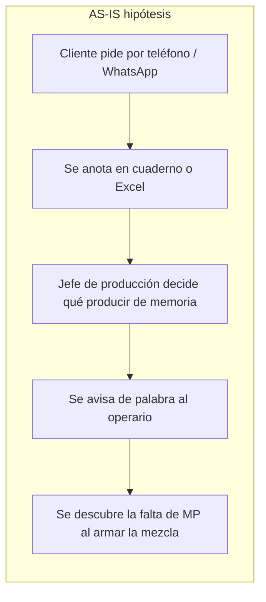
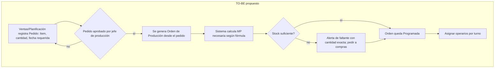
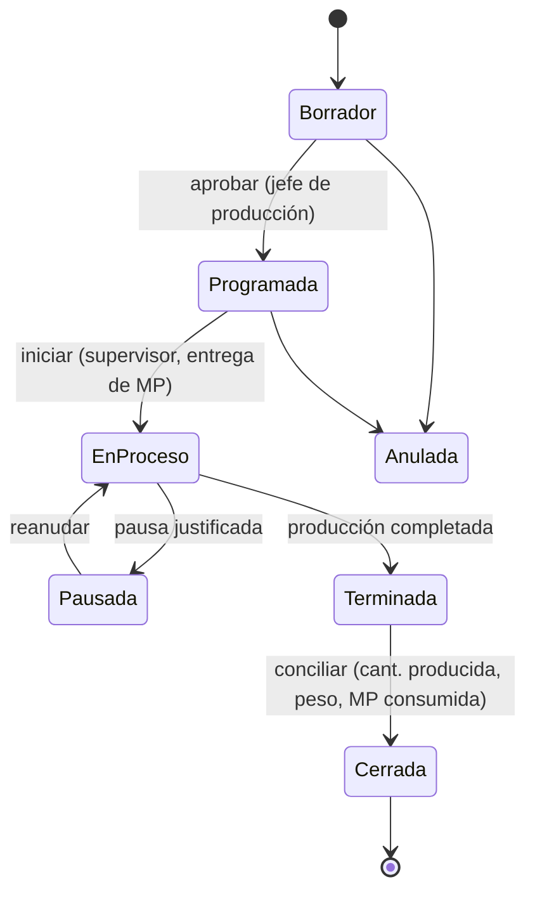
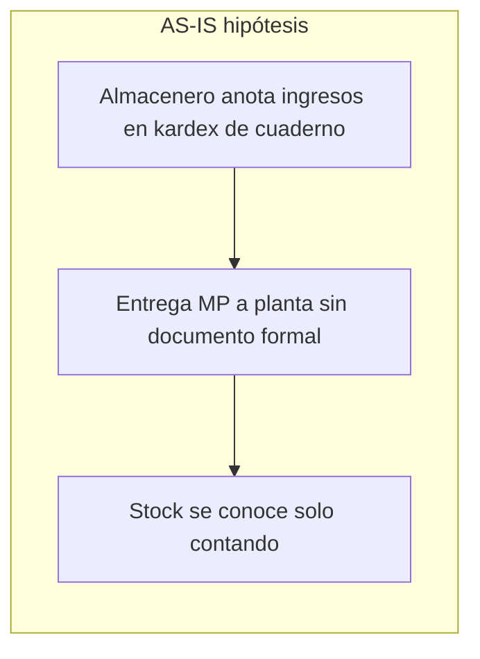
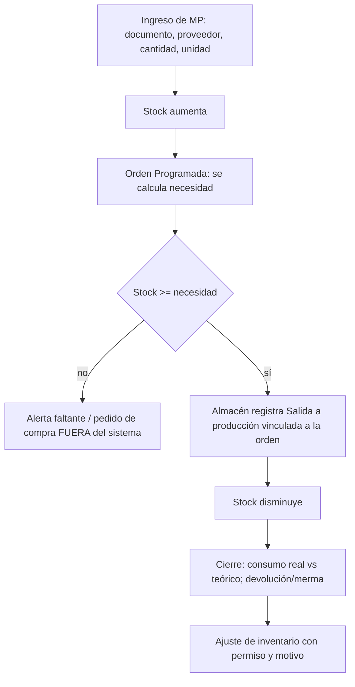
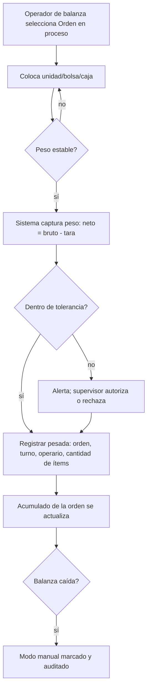

# Anexo 04 — Levantamiento de procesos (Semana 1) y gobierno con el cliente

Proyecto: Sistema de Producción – PLÁSTICOS ART. Fecha de elaboración: 2026-11-11. Rol: Analista de negocio / procesos.
Arquitectura base (ya decidida): WinForms .NET 8, PostgreSQL 16 en PC servidor, LAN, balanza leída desde la estación de pesaje (reutiliza el lector y parser de Pesalab).

> **Errata de vocabulario y tarifa (subordinado al [Plan maestro](../Plan-Implementacion-Plasticos-ART.md); el vocabulario oficial es el de 02, DEC-05):** orden Borrador = **Emitida**; Programada = **Liberada** (la "aprobación" del jefe es la acción Liberar); EnProceso = **EnProduccion**; Pausada, Terminada y Cerrada sin cambio; Anulada = **Cancelada**. Pedido: Pendiente = **Registrado**. Tarifa de cambios: **60 Bs/h** (DEC-11; las referencias de 62,5 Bs/h de este anexo quedan superadas). Aprobación tácita: 3 días hábiles. El 30 % de la firma se cobra con la firma de la propuesta; el documento de procesos es condición de plazo, no de pago.
>
> Nota de realismo: el "equipo" es 1 desarrollador principal que en la semana 1 actúa también como analista. Donde este documento dice "Analista", es la misma persona. Esfuerzo de este rol: **56 h** (40 h semana 1 + 16 h repartidas en gobierno, demos y control de cambios hasta la semana 8). No se contrata a nadie adicional.

---

## 1. Plan de la Semana 1 (día por día)

Principio: la semana 1 es contractual (entregable "Documento de procesos validado"). Todo lo que no se defina aquí es riesgo de plazo, porque la propuesta dice que un cambio de procesos validados amplía el plazo. Se trabaja en paralelo en lo técnico (esqueleto de solución, BD, usuarios) por las tardes, pero el foco es el levantamiento.

Carga estimada del Analista en semana 1: ~24 h de campo/entrevistas + ~16 h de redacción y validación = 40 h. El resto de la semana (≈ 0 h libres, el desarrollador dedica el tiempo técnico a la BD/usuarios, que se estima en otro anexo).

### Lunes (D1) — Arranque y visión general
| Hora | Actividad | Con quién | Duración | Objetivo / salida |
|---|---|---|---|---|
| 08:30 | Reunión de arranque | Gerente/dueño, responsable designado, jefes de producción y almacén | 1,5 h | Confirmar alcance (8 módulos), responsable con autoridad, calendario de entrevistas, accesos; entregar plantillas de carga de datos y checklist de balanza. Firmar acta de arranque |
| 10:30 | Recorrido de planta guiado | Jefe de producción | 2 h | Ver flujo físico: almacén MP → mezcla/molido → máquinas (extrusión, inyección, soplado, etc., según corresponda) → empaque → almacén PT. Fotos de formatos, cuadernos, etiquetas |
| 14:30 | Entrevista 1: Gerencia | Gerente | 1 h | Qué decisiones quiere tomar con los reportes, indicadores clave, quién ve qué |
| 16:00 | Recopilación de documentos | Responsable designado | 1 h | Recoger copias/fotos de todos los formatos (pedidos, órdenes, recetas, planillas de turno, kardex, reportes) |

### Martes (D2) — Producción y fórmulas
| Hora | Actividad | Con quién | Duración | Objetivo |
|---|---|---|---|---|
| 08:30 | Entrevista 2: Jefe de producción (fórmulas) | Jefe de producción / quien conoce las recetas | 2 h | Estructura de la fórmula (ver cuestionario B), mermas, reprocesos, molido, masterbatch/colorantes |
| 11:00 | Observación en línea | Operario + supervisor de turno | 2 h | Ver una orden real de principio a fin: qué se anota, cuándo, dónde |
| 14:30 | Entrevista 3: Planificación/ventas (pedidos) | Quien recibe pedidos | 1,5 h | Origen del pedido, datos que trae, prioridades, fechas, pedidos parciales |
| 16:30 | Redacción de borradores AS-IS | Analista | 1,5 h | Primer diagrama AS-IS de pedido→orden |

### Miércoles (D3) — Almacén, personal y turnos
| Hora | Actividad | Con quién | Duración | Objetivo |
|---|---|---|---|---|
| 08:30 | Entrevista 4: Encargado de almacén MP | Almacenero | 2 h | Ingresos, salidas, unidades, lotes, kardex actual, inventario físico, stock mínimo |
| 11:00 | Recorrido del almacén + conteo de muestra | Almacenero | 1 h | Ver cómo se guarda y se despacha MP; detectar unidades reales (bolsa 25 kg, tambor, etc.) |
| 14:30 | Entrevista 5: Personal y turnos | Jefe de producción / RRHH | 1,5 h | Turnos, horarios, rotación, asignación de operarios a máquina/orden |
| 16:30 | Entrevista 6: Supervisor(es) de turno | Supervisor | 1 h | Cierre de turno, producción reportada, paros, incidencias |

### Jueves (D4) — Balanza y calidad
| Hora | Actividad | Con quién | Duración | Objetivo |
|---|---|---|---|---|
| 08:30 | Visita a la balanza | Encargado de balanza/calidad + técnico si existe | 2 h | Fotografiar equipo y placa (marca/modelo), puertos, cables, manual. Rellenar checklist de protocolo (sección 2.E) |
| 10:30 | Prueba de comunicación | Analista (laptop con adaptador USB-serie y herramienta de captura) | 2 h | Capturar tramas crudas durante 10 min con peso en cero, con peso estable y con peso variable. Guardar archivo de tramas como evidencia. Si la balanza es bajo demanda/Modbus: documentar comando |
| 14:30 | Entrevista 7: Calidad/pesaje | Encargado de pesaje | 1,5 h | Qué se pesa (PT, MP o ambos), por unidad/bolsa/caja/lote, tara, tolerancias de peso, rechazos |
| 16:30 | Cierre de balanza | Analista | 1 h | Determinar si el lector existente de Pesalab sirve sin cambios (decisión Go / lector nuevo) y comunicarlo al cliente |

### Viernes (D5) — Datos maestros, TO-BE y validación
| Hora | Actividad | Con quién | Duración | Objetivo |
|---|---|---|---|---|
| 08:30 | Revisión de reportes actuales | Gerente + jefe de producción | 1,5 h | Priorizar reportes del módulo 8 con el formato que usan hoy; confirmar los filtros (orden, turno, período) |
| 10:00 | Taller TO-BE | Responsable designado, producción, almacén | 2 h | Presentar los flujos propuestos (sección 3) en papel/pantalla; ajustar |
| 13:30 | Entrega y revisión de plantillas de datos | Responsable designado | 1 h | Revisar qué plantillas ya llegaron, calidad, faltantes y fecha límite (sección 4) |
| 15:00 | Redacción del Documento de procesos validado v1 | Analista | 2 h | Compilar |
| 17:00 | Envío al cliente | — | — | Se envía el v1 el viernes; plazo de revisión de 3 días hábiles según propuesta (hasta miércoles de semana 2). Mientras tanto semana 2 continúa con lo no discutible (esqueleto de módulos 1–3 con la estructura confirmada). Riesgo: ver sección 9 |

**Cierre real de la firma**: lunes/martes de semana 2 como máximo para no frenar las semanas 2–3. Si el cliente tarda los 3 días hábiles completos, se asume el riesgo y se desarrolla con lo ya aprobado en talleres (acta firmada de cada entrevista como respaldo).

### Reglas operativas de la semana
- Al final de cada entrevista se emite un "acta corta" de 1 página (decisiones + dudas) y se envía el mismo día por WhatsApp/correo para confirmación verbal escrita.
- Las respuestas ambiguas se anotan como PREGUNTA ABIERTA con responsable y fecha; no se dejan en blanco.
- Se piden los datos reales (no ejemplos): 3 pedidos reales, 3 órdenes reales completas, 3 fórmulas reales, la planilla de turno de la última semana y el kardex de 1 mes.

---

## 2. Cuestionario por área (preguntas que DEBEN responderse)

Marcar cada pregunta con: R = respondida, P = pendiente, N/A. Las preguntas con ★ son críticas (si cambian después, mueven el plazo).

### A. Gerencia
1. ★ ¿Qué decisiones tomará con los reportes (compras de MP, costos, productividad, entregas)?
2. ★ ¿Quién ve qué? (roles: gerente, jefe de producción, supervisor, almacenero, operador de balanza). ¿Alguien consulta fuera de la fábrica? (P1)
3. ¿Cuántos usuarios usarán el sistema a la vez? ¿Cuántos PCs y dónde están? (P2)
4. ¿Se maneja costo en el sistema (costo de MP, costo de producción)? Por alcance, el sistema NO incluye costos: confirmar que queda fuera.
5. ¿Hay facturación/ventas/contabilidad con la que deba conectarse? (Por alcance no; confirmar.)
6. ¿Existe información histórica (Excel/Access) que quieran importar? ¿Cuántos meses? (P9)
7. ★ ¿Quién es el responsable con autoridad para aprobar entregas y cambios? ¿Y su suplente?

### B. Producción (fórmulas, pedidos, órdenes)
**Fórmulas**
1. ★ ¿La fórmula se expresa por unidad de ítem, por 100 kg de mezcla, por lote/batch o por kg de producto terminado? ¿Puede variar la base según el ítem?
2. ★ ¿Cuáles son las unidades de las cantidades de MP (kg, g, bolsas, litros)? ¿Con cuántos decimales?
3. ★ ¿Hay merma/desperdicio estándar por ítem o proceso? ¿Se incluye en la fórmula o se agrega como % aparte?
4. ★ ¿Se usa material reciclado/molido (reproceso)? ¿Entra como MP en la fórmula con un % máximo?
5. ¿Una fórmula tiene versiones/vigencias (la receta cambia con el tiempo)? ¿Se debe conservar la fórmula con que se produjo cada orden?
6. ¿Un mismo ítem tiene más de una fórmula alternativa (por color, por proveedor de resina)?
7. ¿Hay colorantes/aditivos/masterbatch que se dosifican en pequeñas cantidades (gramos)? ¿Cómo se miden?
8. ¿Quién autoriza cambios de fórmula?
9. ¿Un ítem puede ser MP de otro (semielaborado, p. ej. preforma, tapa)? Esto cambia el alcance: confirmar si hay semielaborados.

**Pedidos**
10. ★ ¿Quién crea el pedido y con qué datos (cliente, ítem, cantidad, fecha requerida, prioridad, observaciones)? ¿Se registra el cliente o solo es un pedido interno?
11. ★ ¿Un pedido puede tener varios ítems? ¿Un pedido genera varias órdenes? ¿Una orden puede atender varios pedidos?
12. ¿La cantidad se pide en unidades, kg, cajas, millares? ¿Cuál es la unidad de producción y cuál la de venta?
13. ¿Se permiten pedidos parciales/entregas parciales? ¿Cómo se cierran pedidos incompletos (se produce de menos o de más)?
14. ¿Se puede cancelar o modificar un pedido? ¿Hasta qué estado?

**Órdenes de producción**
15. ★ ¿Qué estados tiene hoy una orden (Pendiente, En proceso, Pausada, Terminada, Cerrada, Anulada)? ¿Quién cambia cada estado?
16. ★ ¿Cómo se numera (correlativo, por año, por máquina)? ¿Se imprime la orden? ¿En qué formato?
17. ★ ¿En qué máquina/línea se produce? ¿Hay un catálogo de máquinas? ¿Debe el sistema controlar la máquina?
18. ¿Se produce más o menos de lo pedido? ¿Qué tolerancia se acepta (±%)?
19. ¿Hay reprocesos, productos de segunda, rechazos? ¿Se registran como cantidad aparte (buena / segunda / desecho)?
20. ¿Cuándo se considera "cerrada" una orden y quién la cierra? ¿Se puede reabrir?
21. ¿Se producen varias órdenes del mismo ítem en paralelo?

### C. Personal y turnos
1. ★ ¿Cuántos turnos hay (mañana/tarde/noche), con qué horarios? ¿Cambian según el día o la temporada?
2. ★ ¿Un turno que cruza medianoche a qué fecha pertenece (la de inicio)?
3. ★ ¿Un operario puede estar asignado a más de una orden en el mismo turno? ¿Y a más de una máquina?
4. ¿Los operarios rotan de turno? ¿Quién arma la planilla y con qué anticipación?
5. ¿Hay cargos distintos (operario, ayudante, supervisor de turno)? ¿Se registra el cargo en la orden?
6. ¿Se necesita registrar horas trabajadas/asistencia? (Por alcance no: confirmar que solo es asignación.)
7. ¿Quién puede modificar la asignación una vez iniciado el turno?

### D. Almacén / inventario de materias primas
1. ★ ¿Cuántos almacenes/ubicaciones de MP existen? ¿Se maneja ubicación o solo un stock total?
2. ★ ¿Cómo se identifica una MP (código, nombre, proveedor, grado/MFI, color)? ¿Hay códigos existentes?
3. ★ ¿Se manejan lotes de MP (lote del proveedor, fecha de ingreso, vencimiento)? ¿Se necesita trazabilidad de qué lote se usó en cada orden? (Si sí, el esfuerzo aumenta: debe cotizarse como cambio o simplificarse a lote simple.)
4. ★ ¿Unidad de almacenamiento vs unidad de consumo? (Bolsa de 25 kg vs kg.) ¿Factor de conversión?
5. ★ ¿Cómo se descuenta el stock: al emitir la orden (reserva), al entregar MP a planta (salida real) o al cerrar la orden? ¿Se descuenta lo teórico (según fórmula) o lo real entregado?
6. ¿Se necesita reservar stock para órdenes aprobadas pero aún no iniciadas?
7. ¿Hay stock mínimo / punto de pedido por MP? ¿Se desea alerta?
8. ¿Cómo se registra una devolución de MP de planta a almacén? ¿Y los ajustes por inventario físico (mermas, diferencias)?
9. ¿Los ingresos tienen documento (nota de ingreso, factura, remisión)? ¿Se registra proveedor?
10. ¿Se hace inventario físico periódico? ¿Con qué frecuencia? ¿Quién autoriza ajustes?
11. ¿Existe un stock inicial confiable y a qué fecha se hará el corte para cargarlo?

### E. Balanza / calidad (checklist técnico y de proceso)
**Técnico (completar en la visita, con foto)**
| Dato | Valor | Observaciones |
|---|---|---|
| Marca / modelo / serie | | |
| Capacidad máxima / resolución (división) (P3) | | |
| Tipo de salida (RS-232 / USB / RS-485 / Ethernet) | | |
| Parámetros serie (baudios, bits, paridad, parada) | | |
| Transmisión continua o bajo demanda (comando) | | Si bajo demanda: comando exacto |
| Ejemplo de trama cruda (10 líneas) y unidad (kg/g) | | |
| ¿Envía bit/indicador de estable? | | |
| ¿Protocolo propietario o Modbus? | | Si Modbus: mapa de registros |
| Cable / adaptador existente; distancia al PC | | |
| ¿PC de la estación de pesaje ya existe? SO | | |
| ¿Hay display remoto o impresora de etiquetas conectada? | | |
| ¿Manual disponible (PDF/papel)? | | Copia a la carpeta del proyecto |
| ¿Calibración vigente / certificado? | | |

**Proceso de pesaje**
1. ★ ¿Qué se pesa: producto terminado, materia prima o ambos? (P5)
2. ★ ¿Se pesa por unidad, por bolsa, por caja, por pallet o por lote? ¿Cuántas pesadas por orden aprox. (por hora/turno)?
3. ★ ¿Cómo se relaciona el peso con la cantidad de ítems: peso unitario promedio (peso total ÷ peso estándar de 1 ítem), conteo manual ingresado al pesar, o ambos?
4. ★ ¿Se pesa con tara (envase/pallet)? ¿La tara es fija por tipo de envase o se pesa cada vez?
5. ¿Existe un peso estándar y tolerancia por ítem (mín/máx) para validar la pesada? ¿Qué pasa si está fuera: se rechaza, se registra con alerta?
6. ¿Quién pesa (operario, supervisor, calidad)? ¿Cada pesada se asocia a una orden y a un turno? ¿Y al operario?
7. ¿Se imprime etiqueta o comprobante por pesada? (Fuera de alcance por defecto: confirmar.)
8. ¿Qué pasa si falla la balanza o la PC? (Modo manual de respaldo: ¿quién lo autoriza y se marca?)
9. ¿Una pesada se puede corregir o anular? ¿Quién? (Auditoría obligatoria.)

### F. Transversal (todas las áreas)
1. ¿Qué reportes se arman hoy a mano, con qué frecuencia y quién los recibe? (Pedir copia.)
2. ¿Qué es lo que más duele hoy (faltantes de MP, retrasos, diferencias de peso, falta de trazabilidad)? Este orden prioriza el valor del sistema.
3. ¿Habrá cambios de procesos en los próximos 3 meses (nueva máquina, nuevos turnos)?
4. ¿Idioma, formato de fecha (dd/MM/yyyy) y moneda: confirmar. Peso en kg, 1 decimal (confirmar según P3).
5. ¿Cierres contables o fechas de corte mensual que el sistema deba respetar?

---

## 3. Procesos AS-IS (hipótesis a validar) y TO-BE propuesto

Los AS-IS son hipótesis típicas de una planta pequeña con registros en cuaderno/Excel; deben verificarse en la semana 1 y corregirse en el documento validado.

### 3.1 Planificación de pedidos → órdenes

Reglas TO-BE a validar: 1 pedido puede tener varios ítems; cada línea de pedido genera 1 o más órdenes; una orden cubre una sola línea de pedido (regla por defecto, simplifica); pedidos con estados Registrado → Aprobado → En producción → Atendido/Cancelado.

### 3.2 Emisión y cierre de orden

Reglas por defecto (a confirmar): cierre exige MP real consumida registrada y al menos una pesada (si el ítem se pesa); una orden cerrada no se edita (solo se anula con motivo y permiso); toda transición queda auditada (quién/cuándo).

### 3.3 Abastecimiento de materia prima

Decisión crítica: descuento al **entregar** (salida real) y comparación contra teórico al cerrar. La alternativa (reserva) se activa solo si el cliente la exige (cuesta ~10 h extra, cotizar).

### 3.4 Pesaje del producto terminado

Regla de seguridad heredada de Pesalab: pesos de simulador marcados como tales y bloqueados para operadores; el modo manual queda marcado y con permiso.

---

## 4. Plantillas de carga de datos maestros

Formato: Excel (.xlsx) con una hoja por plantilla, primera fila = encabezados exactos, fila 2 = ejemplo (borrar). Se entregan el lunes D1; el cliente las llena con apoyo del analista. **Fecha límite**: borrador de ítems, MP y fórmulas el **miércoles D3**; operarios y turnos el **jueves D4**; stock inicial con corte físico **antes del lunes de semana 4** (por la entrega parcial); versión final de fórmulas aprobada y firmada antes del **viernes de semana 2** (si no, se ajusta el plazo).

### 4.1 Ítems (productos terminados)
| Columna | Ejemplo | Regla |
|---|---|---|
| Codigo | BOL-001 | Obligatorio, único, sin espacios, máx. 20 |
| Nombre | Bolsa polietileno 30x40 | Obligatorio, máx. 100 |
| Categoria | Bolsas | Opcional |
| UnidadVenta | MILLAR | De lista fija (UND, MILLAR, KG, CAJA) |
| UnidadProduccion | KG | Obligatoria |
| PesoUnitarioKg | 0,0045 | Si se pesa por conteo; hasta 4 decimales |
| ToleranciaPesoPct | 3 | 0–50 |
| Activo | SI | SI/NO |

### 4.2 Materias primas
| Columna | Ejemplo | Regla |
|---|---|---|
| Codigo | MP-PEAD-01 | Único |
| Nombre | Polietileno alta densidad HD 5502 | Obligatorio |
| Tipo | RESINA / ADITIVO / COLORANTE / RECICLADO / EMPAQUE | Lista fija |
| UnidadAlmacen | KG | Una sola unidad base (kg) |
| PresentacionKg | 25 | Bolsa de 25 kg (para conversión), opcional |
| StockMinimoKg | 500 | Opcional |
| Proveedor | (texto) | Opcional |
| Activo | SI | |

### 4.3 Fórmulas (una fila por componente)
| Columna | Ejemplo | Regla |
|---|---|---|
| CodigoItem | BOL-001 | Debe existir en 4.1 |
| VersionFormula | 1 | Entero ≥ 1 |
| BaseFormula | POR_100KG | De lista: POR_UNIDAD, POR_100KG, POR_LOTE, POR_KG_PRODUCTO (una por fórmula) |
| CantidadBase | 100 | > 0 (por ejemplo, 100 si POR_100KG) |
| CodigoMP | MP-PEAD-01 | Debe existir en 4.2 |
| CantidadMP | 70,0 | > 0, unidad = UnidadAlmacen de la MP |
| MermaPct | 2 | 0–30; por componente o general |
| Observacion | | |
Validaciones del sistema al importar: todas las filas de (CodigoItem, Version) deben tener la misma BaseFormula/CantidadBase; si BaseFormula = POR_100KG, la suma de CantidadMP debe ser 100 ± tolerancia (aviso, no error); sin MP duplicadas en la misma fórmula.

### 4.4 Operarios
| Columna | Ejemplo | Regla |
|---|---|---|
| Codigo | OP-014 | Único |
| NombreCompleto | (nombre) | Obligatorio |
| Cargo | OPERARIO / AYUDANTE / SUPERVISOR | Lista |
| TurnoHabitual | MANANA | Referencia a 4.5; vacío si rota |
| Activo | SI | |
(No se carga CI ni datos personales sensibles; solo identificación laboral.)

### 4.5 Turnos
| Columna | Ejemplo | Regla |
|---|---|---|
| Codigo | T1 | Único |
| Nombre | Mañana | |
| HoraInicio | 06:00 | HH:mm |
| HoraFin | 14:00 | Si Fin < Inicio, cruza medianoche |
| DiasAplica | L-V | Opcional |

### 4.6 Stock inicial
| Columna | Ejemplo | Regla |
|---|---|---|
| FechaCorte | 2026-12-07 | Misma fecha para todas las filas |
| CodigoMP | MP-PEAD-01 | Existente en 4.2 |
| CantidadKg | 1850,5 | ≥ 0; 1 decimal |
| LoteProveedor | (si se maneja lote) | Opcional |
| Ubicacion | ALM-1 | Opcional |

### 4.7 Reglas de calidad de datos (aplican al importador)
1. Códigos únicos, en mayúsculas, sin acentos; nombres normalizados (mayúsculas y espacios simples).
2. Una sola unidad base por MP (kg); la conversión de bolsas la hace la plantilla, no el usuario.
3. Sin celdas combinadas, sin filas de título, sin fórmulas de Excel en celdas de datos.
4. El importador hace un **simulacro** y entrega un informe CSV (filas aceptadas, advertencias, errores) antes de grabar (patrón ya probado en el importador de Pesalab).
5. El cliente firma la lista final de maestros cargada (acta de datos maestros). Cambios posteriores a ese acta = edición normal en el sistema, no cambio de alcance; lo que sí es cambio es agregar campos nuevos.
6. Retraso del cliente en entregar datos → el plazo se amplía en la misma medida (cláusula 5 de la propuesta); se registra en el acta semanal.

---

## 5. Documento de procesos validado (entregable contractual)

### 5.1 Índice
1. Control del documento (versión, fecha, responsables, historial de revisiones).
2. Alcance y objetivos confirmados (8 módulos + usuarios/permisos); explícitamente **fuera de alcance** (costos, facturación, compras, nómina, etiquetas, acceso web, etc.).
3. Organización y roles del cliente (organigrama operativo, usuarios por rol del sistema).
4. Glosario y unidades de medida (kg, decimales, millar, etc.).
5. Procesos TO-BE validados: planificación de pedidos; emisión y cierre de órdenes (diagrama de estados con permisos); abastecimiento y movimientos de MP; asignación de operarios por turno; cálculo de MP; pesaje. Cada uno: actor, disparador, pasos, reglas de negocio, excepciones.
6. Reglas de negocio numeradas (RN-01…): base de fórmula, mermas, reservas, descuento de stock, tolerancias, cierre de orden, etc.
7. Catálogo de datos maestros y estructura de plantillas aprobadas (referencia a sección 4).
8. Modelo de roles y permisos (matriz Rol × Acción).
9. Formatos y reportes actuales (anexo con fotos/copias) y reportes del módulo 8: columnas, filtros, agrupaciones, formato de salida (pantalla, PDF, Excel).
10. Balanza: ficha técnica, trama de ejemplo, decisión técnica (lector existente o nuevo), modo manual y simulador; responsables de calibración.
11. Infraestructura confirmada (PCs, servidor, red, UPS, backups; respuestas a P1–P10).
12. Supuestos, exclusiones y riesgos acordados.
13. Plan de datos: fechas de entrega de plantillas y corte de stock.
14. Criterios de aceptación por módulo (sección 8 de este anexo).
15. Anexos: actas de entrevistas, fotos, trama capturada, plantillas de ejemplo.

### 5.2 Contenido mínimo para considerarlo "validado"
- Los 6 procesos TO-BE con reglas sin PREGUNTAS ABIERTAS críticas (★).
- Todas las preguntas ★ del cuestionario con respuesta escrita.
- Ficha de balanza completa y trama capturada.
- Matriz de permisos aprobada.
- Lista de reportes priorizados con maqueta (boceto) de cada uno.
- Plantillas de datos con ejemplo real y fechas de entrega.

### 5.3 Criterios de firma
- Firma del responsable designado del cliente (con autoridad) y del proveedor, con fecha. Se firma sobre la versión final (no sobre borradores).
- Plazo de revisión: máx. 3 días hábiles. Si no hay observaciones escritas en ese plazo → se considera **aprobado por silencio**, y así se dice en el documento (cláusula acordada en la reunión de arranque).
- Con la firma, el documento queda **congelado**: lo posterior se maneja por control de cambios (sección 6.4).
- Se firma una única página de "Conformidad" que remite a la versión (hash del PDF o número de versión).
- Pendientes no críticos pueden firmarse con "reserva" siempre que se listen con responsable y fecha; los pendientes críticos (★) bloquean la firma.

---

## 6. Gobierno del proyecto con el cliente

### 6.1 Responsable designado
Una persona del cliente con autoridad para decidir y aprobar (gerente o jefe de producción). Debe: asistir a la demo semanal, aprobar entregas en 3 días hábiles, resolver dudas en 24 h, convocar al personal. Se designa por escrito en la reunión de arranque, con suplente. Si el responsable cambia, se informa por escrito.

### 6.2 RACI (R = ejecuta, A = aprueba/responde, C = consultado, I = informado)
| Actividad | Proveedor (desarrollador/analista) | Responsable cliente | Jefe producción | Almacén | Encargado balanza/calidad | Gerencia |
|---|---|---|---|---|---|---|
| Levantamiento de procesos | R | A | C | C | C | I |
| Documento de procesos validado | R | A | C | C | C | I |
| Datos maestros (ítems, MP, fórmulas) | C | A | R | R | I | I |
| Operarios y turnos | C | A | R | I | I | I |
| Stock inicial (conteo) | C | A | I | R | I | I |
| Acceso y datos de la balanza | R (captura) | A | I | I | R | I |
| Infraestructura (PC servidor, red, UPS) | C (especifica) | A | I | I | I | R (compra) |
| Desarrollo e implementación | R | I | I | I | I | I |
| Revisión y aprobación de entregas | C | A | R | R | R | I |
| Pruebas con datos reales | R | A | R | R | R | I |
| Capacitación | R | A | R (asistir) | R (asistir) | R (asistir) | I |
| Control de cambios | R (estima) | A (decide) | C | C | C | I |
| Backups (operación) | R (configura) | A (designa) | I | I | I | I |

### 6.3 Ritmo de reuniones
| Reunión | Frecuencia | Duración | Participantes | Salida |
|---|---|---|---|---|
| Arranque | Una vez (D1) | 1,5 h | Gerente, responsable, jefes | Acta de arranque |
| Demo semanal | Viernes 15:00 desde semana 2 | 45 min | Responsable + usuarios clave | Demo con datos reales; lista de observaciones; acta corta |
| Seguimiento breve | Martes (llamada/WhatsApp) | 15 min | Responsable | Bloqueos pendientes del cliente |
| Entrega parcial (S4) | Viernes S4 | 2 h | Responsable + usuarios | Acta de aceptación parcial |
| Entrega final (S8) | Viernes S8 | 2 h | Responsable + gerencia | Acta de aceptación final |
Cada acta tiene: asistentes, decisiones, pendientes (responsable, fecha), cambios solicitados (referencia a formulario). Se envía el mismo día; si no hay objeción en 2 días hábiles, se da por aceptada.

### 6.4 Proceso de aprobación (3 días hábiles)
1. Entrega publicada en el ambiente de pruebas/instalador + guía breve + lista de verificación del módulo.
2. Cuenta regresiva de 3 días hábiles a partir del correo de entrega.
3. El cliente responde: **Aprobado**, **Aprobado con observaciones** (lista numerada) o **Rechazado** (con motivo).
4. Sin respuesta al día 3 → recordatorio; al día 4 se da por aprobado y se registra en el acta (cláusula pactada en el arranque; se recomienda comunicarla de forma explícita).
5. Observaciones: se clasifican en 6.5 (corrección o cambio).

### 6.5 Control de cambios
**Definiciones**
- **Corrección (defecto)**: el sistema no hace lo que dice el Documento de procesos validado o el criterio de aceptación firmado, o falla (error de cálculo, pantalla que no guarda). Sin costo, dentro de los 90 días de soporte; prioridad por severidad.
- **Cambio (alcance)**: cualquier funcionalidad, campo, regla, reporte o pantalla no descrito en el documento validado, o modificación de un proceso ya validado (p. ej., agregar costos, lotes con trazabilidad, reserva de stock, etiquetas, cambiar la base de fórmula, nuevo formato de reporte, otra balanza).
- **Aclaración**: detalle no definido que no altera la estructura (p. ej., el texto de una etiqueta de pantalla): se resuelve en la demo sin costo, si no supera 2 h.
- Regla del "umbral": si agregar o modificar lo pedido supera 2 h de trabajo o altera tablas/reglas ya validadas, es cambio.

**Procedimiento**
1. El cliente (o proveedor) llena el formulario de solicitud de cambio (RC-nn).
2. Analista clasifica en 1 día hábil (corrección / cambio / aclaración).
3. Si es cambio: estima impacto (horas, plazo en días, costo en Bs, módulos afectados, riesgos) en 2 días hábiles. Tarifa de referencia derivada de la propuesta: 20 000 Bs ÷ (8 semanas × 40 h) ≈ 62,5 Bs/h (SUPERADA: el Plan fija 60 Bs/h, DEC-11).
4. El responsable del cliente decide: aprobar / posponer a fase 2 / rechazar. Se firma el formulario.
5. Si se aprueba, se actualiza el plan y se comunica la nueva fecha; el plazo se amplía "en la misma medida" (cláusula 5).
6. Registro de cambios en una hoja de seguimiento visible a ambos.

**Formulario de solicitud de cambio (RC)**
| Campo | Contenido |
|---|---|
| N.º / fecha / solicitante | RC-001 / ... / ... |
| Módulo afectado | |
| Descripción del cambio y motivo de negocio | |
| Clasificación (corrección / cambio / aclaración) | |
| Impacto en esfuerzo (h) | |
| Impacto en plazo (días) | |
| Impacto en costo (Bs) | |
| Riesgos / dependencias | |
| Alternativas (p. ej., diferir a fase 2) | |
| Decisión del cliente / firma / fecha | |

### 6.6 Actas de aceptación ligadas a los pagos
| Acta | Cuándo | Contenido verificable | Pago |
|---|---|---|---|
| Acta de arranque + documento de procesos firmado | Firma de contrato / D1–D2 de S2 | Alcance, responsable, calendario | **30 % = 6 000 Bs** (a la firma de la propuesta) |
| Acta de aceptación parcial | Viernes S4 | Módulos 1–5 + usuarios/permisos funcionando en el servidor con datos reales; checklist de aceptación de cada módulo firmado | **40 % = 8 000 Bs** |
| Acta de aceptación final | Viernes S8 | Módulos 6–8 + balanza en producción; capacitación realizada; instalación en servidor y estación; backups verificados; manual entregado | **30 % = 6 000 Bs** |
Reglas: el acta parcial se firma si pasan **todos los criterios críticos** (sección 8); los defectos menores se listan con fecha de corrección sin retener el pago. Las 8 semanas se cuentan desde la firma y desde la entrega de insumos por parte del cliente; las demoras del cliente se anotan en el acta semanal.

---

## 7. Criterios de aceptación de negocio por módulo (medibles)

Se prueban con datos reales cargados por el cliente. "Aprobado" = todos los criterios críticos (C) cumplidos; los demás (M) se corrigen en soporte.

### 0. Usuarios y permisos
- C: Existen al menos 4 roles (p. ej., Administrador, Jefe de producción, Almacén, Operador de balanza) y cada uno solo ve/ejecuta lo definido en la matriz firmada: 100 % de las celdas de la matriz verificadas en 1 sesión.
- C: Contraseñas con hash (no legibles); 5 intentos fallidos bloquean al usuario por 5 min; el cambio obligatorio en el primer ingreso funciona.
- C: Auditoría: cualquier alta/modificación/anulación en pedidos, órdenes, stock y pesadas registra usuario, fecha y diff antes/después, y es consultable.
- C: 10 usuarios simultáneos operando durante 30 min sin errores de bloqueo de datos.
- M: Mensajes de error comprensibles, sin textos técnicos.

### 1. Fórmulas por ítem
- C: Se crean, editan y versionan fórmulas; todas las fórmulas de la plantilla firmada (100 %) se importan; el informe de simulacro no deja errores sin explicar.
- C: Una orden conserva la versión de fórmula con que se creó aunque la fórmula cambie después.
- C: Se calculan correctamente (diferencia ≤ 0,1 kg) 3 ejemplos reales de fórmula elegidos por el jefe de producción.
- M: Una fórmula puede copiarse a otro ítem.

### 2. Órdenes de pedido
- C: Registrar un pedido con ítem, cantidad, fecha requerida y estado en ≤ 1 min.
- C: No se puede aprobar un pedido con ítem sin fórmula vigente (aviso claro).
- C: Filtrar por estado, fecha y cliente/ítem; el listado muestra 500 pedidos en < 2 s.
- M: Cancelación con motivo y auditoría.

### 3. Órdenes de producción
- C: Se genera una orden desde un pedido en ≤ 3 clics, con número correlativo único (sin duplicados con 5 usuarios concurrentes).
- C: El flujo de estados respeta el diagrama firmado; las transiciones inválidas se bloquean; cada cambio queda auditado.
- C: Orden cerrada no editable; anulación con motivo y permiso.
- C: Impresión de orden en el formato aprobado (A4, media carta).

### 4. Operarios por turno
- C: Alta y baja lógica de operarios y turnos; asignación de operarios a turnos y a una orden.
- C: Se bloquea (o avisa, según regla firmada) asignar al mismo operario a dos órdenes en el mismo turno.
- C: La planilla del turno de una fecha se obtiene en pantalla e impresa en < 5 s.
- M: Copiar la asignación del día anterior.

### 5. Inventario de materias primas
- C: Ingreso, salida por producción y ajuste con motivo; el stock = Σ ingresos − Σ salidas ± ajustes, verificado en 10 movimientos de prueba con diferencia 0.
- C: Stock inicial importado coincide 100 % con la plantilla firmada (informe de conciliación).
- C: Las salidas a producción quedan ligadas a una orden; no se permite stock negativo (salvo permiso).
- C: Kardex por MP por rango de fechas, con saldo corriente.
- M: Alerta visual de stock bajo mínimo.

### 6. Cálculo de materia prima por orden
- C: Para una orden de N unidades/kg, el sistema calcula la necesidad por MP con la regla de base y merma firmada; resultado coincide con el cálculo manual del jefe de producción (error ≤ 0,1 kg) en 5 órdenes reales.
- C: Indica por cada MP: necesario, disponible, faltante/sobrante; semáforo suficiente/insuficiente.
- C: Si el stock es insuficiente, el sistema muestra el listado de faltantes (la política de bloquear o solo alertar según acta).
- M: Recalcular al cambiar la cantidad de la orden.

### 7. Registro de pesos con balanza
- C: Lectura en vivo del peso de la balanza real en la estación de pesaje, con indicador de estable; 100 % de las tramas válidas en 10 min de prueba (sin pérdida).
- C: Peso capturado con 1 decimal (o resolución P3) coincide con el display de la balanza en 20 pesadas de prueba.
- C: Cada pesada queda ligada a orden, turno, operario, fecha/hora y cantidad de ítems; se corrige/anula solo con permiso y auditoría.
- C: Modo manual (balanza caída) solo con permiso y marcado como manual en reportes; simulador bloqueado para operadores.
- C: Si la balanza se desconecta, la pantalla lo indica en < 5 s y reconecta sola al volver.
- M: Validación contra tolerancia de peso unitario.

### 8. Reportes
- C: Reportes por orden, turno y período con filtros combinables; cifras de totales (kg, ítems, pesadas) cuadran 100 % con los datos de las pantallas.
- C: Exportación a PDF y Excel; un período de un mes con 5 000 pesadas se genera en < 30 s.
- C: Los reportes priorizados con maqueta firmada se entregan con las columnas definidas.
- C: Reporte de consumo de MP real vs teórico por orden.
- M: Reporte de producción por operario.

### Transversales (para la entrega final)
- C: Instalación completa en el servidor y 2 PCs cliente por un técnico sin ayuda del desarrollador, siguiendo el manual, en ≤ 2 h.
- C: Backup automático verificado: restauración de prueba exitosa.
- C: Capacitación a todos los roles (asistencia firmada) y manual de usuario por rol.
- C: 0 defectos críticos abiertos (que impidan operar); defectos menores listados con fecha.

---

## 8. Esfuerzo del Analista (horas)

| Concepto | Horas |
|---|---|
| Entrevistas, recorridos y balanza (campo) | 24 |
| Redacción: documento validado, AS-IS/TO-BE, plantillas, matriz de permisos | 16 |
| Demos semanales y actas (7 × ~1 h) | 7 |
| Control de cambios y aclaraciones (S2–S8) | 5 |
| Apoyo a aceptaciones parcial y final (preparación de checklists) | 4 |
| **Total** | **56** |

---

## 9. Riesgos principales de proceso

1. Fórmulas/maestros que llegan tarde o incompletos (la planilla de MP no cuadra): bloqueo de módulos 1, 3, 5 y 6. Mitigación: fechas límite, importador con simulacro, empezar con 3–5 ítems representativos.
2. Cambios de proceso después de la firma (base de fórmula, lotes). Mitigación: preguntas ★ cerradas por escrito; control de cambios con tarifa.
3. Documento firmado tarde (se pisa con semana 2). Mitigación: desarrollo "no regret" en S2 y aprobación por silencio.
4. Balanza con protocolo no estándar o bajo demanda; la prueba D4 es el punto de decisión (Go/lector nuevo; +16 a 24 h).
5. Alcance implícito oculto: lotes con trazabilidad, costos, compras, etiquetas, acceso web. Cada uno debe estar en la lista de exclusiones firmada.
6. Usuarios sin experiencia con la PC. Mitigación: pantallas simples, atajos de teclado, capacitación práctica por rol.
7. Parcial en S4 exige módulos 1–3 + permisos, no solo 4–5: no se debe dejar para S4 nada que bloquee la prueba real.
8. Disponibilidad del responsable: sin respuesta en 24 h, el plazo se amplía.

---

## 10. Preguntas abiertas para la reunión de arranque (priorizadas)

**Prioridad 1 (bloquean semana 1–2)**
1. ¿Quién es el responsable con autoridad y su suplente? ¿Quién administra los backups? (P10)
2. ¿Cuántos usuarios, PCs y estaciones de pesaje, y hay un PC que pueda estar encendido 24/7 como servidor? (P2)
3. ¿Marca, modelo, puertos y manual/protocolo de la balanza? ¿Pueden darnos acceso el jueves D4? (P4)
4. ¿Qué se pesa: producto terminado, materia prima o ambos? (P5)
5. ¿La fórmula es por unidad, por 100 kg, por lote o por kg producido? ¿Hay merma y material reciclado?
6. ¿Quién entrega y cuándo los datos: ítems, MP, fórmulas, operarios, turnos y stock inicial (fecha de corte)?
7. ¿Cuántos turnos y qué horarios? ¿Un operario puede estar en dos órdenes a la vez?

**Prioridad 2 (definen reglas)**
8. ¿Un pedido genera una o varias órdenes? ¿Una orden atiende varios pedidos?
9. ¿Cuándo se descuenta el stock: al entregar MP, al iniciar o al cerrar la orden? ¿Se necesita reserva?
10. ¿Se manejan lotes de MP con trazabilidad, o solo stock total? ¿Varios almacenes?
11. ¿Resolución y rango reales de la balanza; tolerancias de peso; se pesa tara? (P3)
12. ¿Quién necesita ver reportes fuera de la fábrica (VPN/visor web)? (P1)
13. ¿Hay ventanas de mantenimiento o paradas de turno para respaldos y despliegues? (P6)

**Prioridad 3 (infraestructura y datos históricos)**
14. ¿Existen servidores, SQL Server o licencias que condicionen el motor? (P7)
15. ¿Hay puestos con Wi-Fi? (exige TLS) (P8)
16. ¿Hay datos históricos en Excel/Access para importar? ¿Cuántos meses? (P9)
17. ¿Formatos y reportes que hoy usan y deben respetarse (copias/fotos)?
18. ¿El cliente confirma que quedan fuera costos, facturación, compras, nómina, etiquetas y acceso web?

---

## 11. Supuestos del documento
- S1: Una sola planta y un solo almacén de MP (hasta confirmar).
- S2: El cliente asiste a las entrevistas en las fechas del plan; el resto de actividades se reprograman si no.
- S3: El cuestionario cubre los 8 módulos; productos semielaborados fuera de alcance hasta confirmar.
- S4: La aprobación por silencio a los 3 días hábiles se acuerda por escrito en el arranque.
- S5: La tarifa de referencia de cambios (~62,5 Bs/h) quedó superada por la tarifa de 60 Bs/h del Plan (DEC-11).
